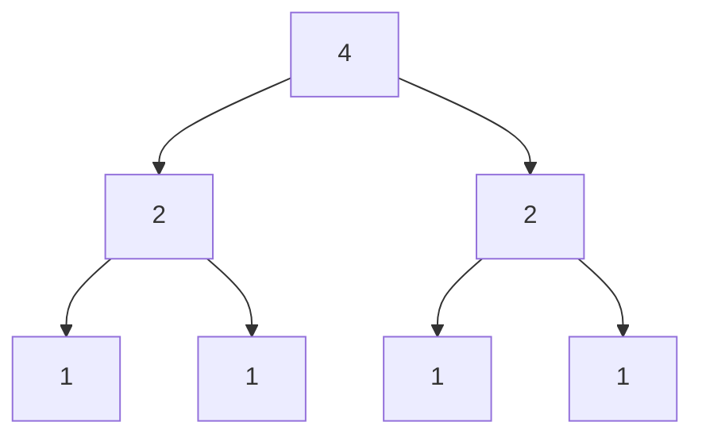

# DSA 01.01: Complexity Analysis and Arrays in Memory

*Part of the [Arrays and Strings plan](00_plan.md) · Time: about 4 hours (1.5 reading, 2.5 problems) · You need: loops, functions, `std::vector` basics · Companion code: [`01_complexity_and_arrays_demo.cpp`](01_complexity_and_arrays_demo.cpp) (every complete function, plus the numbers quoted in the text; short loop fragments are illustrative and not in it)*

By the end of this tutorial you can:

- look at code and say its time and space complexity, and defend the answer;
- explain why `push_back` is "O(1)" even though it sometimes copies everything;
- explain how an array sits in memory, and why walking it in the wrong order can be 15 times slower;
- use four small in-place moves that solve many array problems;
- answer the array and complexity questions that open most coding interviews.

---

# Part 1: Counting the cost of code

## 1.1 Why we count instead of timing

A stopwatch tells you how fast code is on one machine with one input. An interviewer wants a different answer: *what happens when the input is 1,000 times bigger?* So we count basic steps (comparisons, assignments, array reads) as a function of the input size **n**.

Example. "Does this array contain a duplicate?" Two ways to answer it:

```cpp
bool hasDuplicateBrute(const std::vector<int>& a) {
    for (size_t i = 0; i < a.size(); ++i)
        for (size_t j = i + 1; j < a.size(); ++j)
            if (a[i] == a[j]) return true;
    return false;
}
```

```cpp
bool hasDuplicateSorted(std::vector<int> a) {   // by value: we sort our own copy
    std::sort(a.begin(), a.end());
    for (size_t i = 1; i < a.size(); ++i)
        if (a[i] == a[i - 1]) return true;
    return false;
}
```

The first compares every pair: about n²/2 comparisons. The second sorts (about n·log₂n comparisons) and then makes n−1 more. Here is what that means:

| n | Brute force, about n²/2 | Sort first, about n·log₂n | Time at 10⁸ steps per second |
|---|---|---|---|
| 1,000 | 500,000 | 10,000 | both instant |
| 100,000 | 5,000,000,000 | 1,700,000 | 50 s vs 0.02 s |
| 1,000,000 | 500,000,000,000 | 20,000,000 | 83 minutes vs 0.2 s |

Same answer, wildly different cost. Big-O is the shorthand for this difference.

## 1.2 Big-O in plain words

> f(n) is **O(g(n))** if, for large enough n, f grows no faster than g, up to a constant factor.

Three rules turn a step count into a Big-O:

1. **Drop constants.** 3n + 7 → O(n). n/2 → O(n).
2. **Keep the fastest-growing term.** n² + 1000n + 5 → O(n²).
3. **Name each input separately.** Two arrays of sizes a and b → O(a + b) or O(a·b), not "O(n)".

Dropping constants is fine because constants depend on the machine and compiler, while the growth rate does not. (Constants do matter when two solutions have the same Big-O. Section 2.4 shows a 15× gap from memory order alone.)

A note on symbols: **O** is an upper bound, **Ω** a lower bound, **Θ** both at once. In interviews everyone says "O" but means the tight bound. Linear search is "O(n)", not "O(n²)", even though the second is technically true. Always give the tightest bound you can justify.

## 1.3 The classes you will meet

| Class | Typical source | n = 10 | n = 1,000 | n = 1,000,000 |
|---|---|---|---|---|
| O(1) | `a[i]`, push on a stack | 1 | 1 | 1 |
| O(log n) | binary search, any loop that halves | 3 | 10 | 20 |
| O(n) | one pass over the data | 10 | 1,000 | 10⁶ |
| O(n log n) | good sorting | 33 | 10,000 | 2 × 10⁷ |
| O(n²) | all pairs, nested loops | 100 | 10⁶ | 10¹² |
| O(2ⁿ) | all subsets | 1,024 | never finishes | never finishes |
| O(n!) | all orderings | 3.6 million | never finishes | never finishes |

Memory aid: **log n is the number of times you can halve n before reaching 1.** Halve a million about 20 times and you are at 1.

## 1.4 Reading code to get the Big-O

Four rules cover almost everything:

- **Steps in a row add.** Keep the larger. A loop of n followed by a sort is O(n + n log n) = O(n log n).
- **Nested loops multiply**, but count the *real* iterations of the inner loop, not what it looks like.
- **A loop that halves or doubles its variable runs log n times.**
- **Calls cost what the function costs.** A library call is not free (table below).

Three loops that look alike and are not:

```cpp
for (int i = 0; i < n; ++i)
    for (int j = i; j < n; ++j) work();     // n + (n-1) + ... + 1 = n(n+1)/2  ->  O(n²)

for (int i = 0; i < n; ++i)
    for (int j = 1; j < n; j *= 2) work();  // n times a log n loop  ->  O(n log n)

for (int i = 1; i < n; i *= 2)
    for (int j = 0; j < i; ++j) work();     // 1 + 2 + 4 + ... + n < 2n  ->  O(n), not O(n log n)
```

The third one is a favourite trick question. The outer loop runs log n times, but the inner loop is short in the early rounds and the total is a geometric series.

**Hidden costs.** These are the usual ways correct-looking code turns out to be slower than you think:

| Operation (C++) | Cost |
|---|---|
| `v[i]`, `v.size()`, `v.back()` | O(1) |
| `v.push_back(x)` | amortised O(1) (section 1.7) |
| `v.insert(pos, x)`, `v.erase(pos)` | O(n − pos): everything after `pos` shifts |
| copying a vector or string, passing it **by value** | O(length) |
| `s + t`, `s.substr(i, k)` | O(length of the result) |
| `s == t` | O(length) |
| `s += c` | amortised O(1) |
| `std::sort` | O(n log n) |
| `std::map` find / insert | O(log n) |
| `std::unordered_map` find / insert | O(1) on average, O(n) worst case |

Here is the most common hidden cost in practice. Both loops build the same string of n characters:

```cpp
std::string s;
for (int i = 0; i < n; ++i) s = s + 'x';   // builds a brand-new string every time
```

```cpp
std::string t;
for (int i = 0; i < n; ++i) t += 'x';      // appends in place
```

The first copies the whole string on every step, so it is O(n²). The second is O(n). With n = 100,000 I measured about 165 ms against 0.3 ms.

Another: erasing from the front of a vector in a loop.

```cpp
while (!v.empty()) v.erase(v.begin());     // every erase shifts everything left: O(n²) in total
```

## 1.5 Complexity of recursion

For recursive code, **count the calls, then multiply by the work done per call.**

| Shape | Example | Calls | Total |
|---|---|---|---|
| One call on n−1 | sum of 1..n recursively | n | O(n) |
| One call on n/2 | recursive binary search | log n | O(log n) |
| Two calls on n−1 | naive Fibonacci | doubles at each level | O(2ⁿ) |
| Two calls on n/2, plus linear work | merge sort | see below | O(n log n) |

Naive Fibonacci is the standard warning: `fib(30)` makes about 2.7 million calls and `fib(40)` about 330 million, because the same values are recomputed over and over. (Dynamic programming fixes exactly this, much later.)

Merge sort on 4 elements. Each box is one call and shows the size of its piece:



Add up the *work* level by level. Every level has pieces totalling n elements, and merging costs about one step per element, so **each level costs n**. There are log₂n + 1 levels. Total: n × log n. This "recursion tree" method is enough for interviews; the formal Master Theorem is a shortcut you can look up later.

## 1.6 Space complexity

Space complexity counts the **extra** memory your algorithm needs beyond its input (the "auxiliary space"):

- a new array, string or hash map of size n costs O(n);
- the **recursion stack** counts too: a recursion that goes n levels deep uses O(n) space even if it allocates nothing;
- reversing an array in place is O(1) space; reversing it into a new array is O(n).

Say whether you count the output. Most people do not ("O(1) extra space, not counting the answer").

Stack depth is also a real limit: the default stack is about 8 MB on Linux and macOS, and 1 MB on Windows. Recursion that goes 10⁵ levels deep is usually fine and 10⁶ often crashes. When n can be a million, convert the recursion into a loop.

## 1.7 Best, worst, average, and amortised

The same code can have different costs on different inputs. Linear search for a value:

| Case | When | Cost |
|---|---|---|
| Best | it is the first element | O(1) |
| Worst | it is last or missing | O(n) |
| Average | it is somewhere in the middle | about n/2, so O(n) |

Interviewers expect the **worst case** unless you agree otherwise. (Hash tables are the usual exception: O(1) on average, O(n) worst case. More on that in the Hashing area.)

**Amortised cost** is the average cost per operation over a long sequence, even if a single operation is sometimes expensive. The standard example is `vector::push_back`. Run this and watch the capacity:

```cpp
std::vector<int> v;
size_t last = v.capacity();
for (int i = 0; i < 100; ++i) {
    v.push_back(i);
    if (v.capacity() != last) {
        last = v.capacity();
        std::cout << "size " << v.size() << " -> capacity " << last << "\n";
    }
}
```

```text
size 1 -> capacity 1
size 2 -> capacity 2
size 3 -> capacity 4
size 5 -> capacity 8
size 9 -> capacity 16
size 17 -> capacity 32
size 33 -> capacity 64
size 65 -> capacity 128
```

(This is GCC's `libstdc++`. Some libraries grow by 1.5× instead of 2×. The exact factor does not change the Big-O.)

When the buffer is full, `push_back` allocates a buffer twice as big, **copies every element across**, and frees the old one. Pushes 1 to 9 look like this:

| Push # | Buffer full? | Action | Elements copied |
|---|---|---|---|
| 1 | yes (capacity 0) | allocate 1 | 0 |
| 2 | yes | grow 1 → 2 | 1 |
| 3 | yes | grow 2 → 4 | 2 |
| 4 | no | write | 0 |
| 5 | yes | grow 4 → 8 | 4 |
| 6, 7, 8 | no | write | 0 |
| 9 | yes | grow 8 → 16 | 8 |

The copies are 1 + 2 + 4 + 8 + ... , and that sum stays **below n** after n pushes. So n pushes cost at most n writes plus fewer than n copies: under 2n steps, which is **O(1) per push on average**. One unlucky push costs O(n), but it is rare and pays for itself.

If the buffer grew by a fixed amount instead (say +10), copies would be 10 + 20 + 30 + ... ≈ n²/20, which is O(n²). Growth must be a multiple of the size, not a fixed amount.

**Why a systems engineer cares:** one unlucky `push_back` takes a long time, and it also moves the data and invalidates every pointer into it. In latency-sensitive code (a packet path, a control loop) call `v.reserve(n)` up front, or use a fixed-capacity buffer, so that no push can ever allocate.

## 1.8 From constraints to the target complexity

Problem statements tell you the complexity they expect through the size limits. With roughly 10⁸ simple steps per second:

| Input size n | Complexity that fits | Typical technique |
|---|---|---|
| n ≤ 10 | O(n!) | permutations, brute force |
| n ≤ 20 | O(2ⁿ) | subsets, bitmask |
| n ≤ 500 | O(n³) | triple loops, Floyd-Warshall |
| n ≤ 5,000 | O(n²) | double loops, 2D DP |
| n ≤ 10⁶ | O(n log n) or O(n) | sorting, hashing, two pointers |
| n ≥ 10⁹ | O(log n) or O(1) | binary search on the answer, math |

Example: "n ≤ 200,000". An O(n²) solution needs 4 × 10¹⁰ steps, about 400 seconds. So you are being asked for O(n log n) or O(n). **Do this arithmetic before you write any code.**

## 1.9 How to say it in an interview

A good answer has a fixed shape: brute force, then the improvement, then the trade-off. For the duplicate problem:

> "Brute force compares every pair: O(n²) time, O(1) space. If I sort first, equal values become neighbours, so one pass finds them: O(n log n) time, and O(n) space if I sort a copy. A hash set gets O(n) time at O(n) space. So it is a time-versus-memory trade-off, and I would pick the hash set unless memory is tight."

Say time *and* space every time, and name what n is.

---

# Part 2: Arrays in memory

## 2.1 The picture

An array is **one unbroken block of memory holding equal-sized elements side by side**:

```text
address   0x1000  0x1004  0x1008  0x100C  0x1010
          +-------+-------+-------+-------+-------+
int a[5]  |  10   |  20   |  30   |  40   |  50   |
          +-------+-------+-------+-------+-------+
index        0       1       2       3       4
```

The address of element *i* is computed, not searched for:

> address of a[i] = base address + i × sizeof(element)

That is why **access is O(1)**: one multiply, one add, one memory read, whether the array has 5 elements or 5 million. It is also why indexing starts at 0: the index is the *offset* from the start. (In C and C++, `a[i]` literally means `*(a + i)`.)

A 2D array is stored **row by row** ("row-major"). For `int m[3][4]` (3 rows, 4 columns):

> address of m[r][c] = base + (r × 4 + c) × sizeof(int)

So `m[2][1]` is element number 2×4+1 = 9, at byte offset 36.

## 2.2 The three kinds of array in C++

| | C array `int a[5]` | `std::array<int, 5>` | `std::vector<int>` |
|---|---|---|---|
| Size fixed at compile time | yes | yes | no |
| Where the elements live | stack (if local) | stack (if local) | heap |
| Can grow | no | no | yes |
| Knows its own size | no (decays to a pointer) | yes | yes |

Use `std::vector` by default in interviews. A `vector` object is small: three pointers (24 bytes on a 64-bit machine) pointing into one heap buffer.

```text
   begin ---+     end ---------+      end_of_storage ----------+
            v                  v                              v
           [ 10 ][ 20 ][ 30 ] [ ?  ][ ?  ]
           |<--- size = 3 --->|
           |<---------------- capacity = 5 ------------------>|
```

- **size** is how many elements are in use. **capacity** is how many fit before the next reallocation.
- `reserve(n)` raises capacity without changing size. `resize(n)` changes size.

Watch out: a big *local* array such as `int big[10'000'000]` is 40 MB on the stack and crashes on an 8 MB stack. Use a `vector` (heap) or make it `static`.

## 2.3 What each operation costs

| Operation | Cost | Why |
|---|---|---|
| Read or write `a[i]` | O(1) | address arithmetic |
| Search an unsorted array | O(n) | must look at each element |
| Search a sorted array | O(log n) | binary search (next area) |
| Append at the end | O(1) amortised | section 1.7 |
| Insert or erase at index *i* | O(n − i) | elements after *i* must shift |
| Insert or erase at the front | O(n) | everything shifts |

Inserting 99 at index 2:

```text
before:  [10][20][30][40][50][  ]
shift:   [10][20][  ][30][40][50]      <- 3 elements move one place right
after:   [10][20][99][30][40][50]
```

The shift is a single block copy (`memmove`), which is very fast, so one front-insert into a small array is cheap. But doing it n times is O(n²): 100,000 front-inserts move about 5 billion elements. If you need to add at the front, push everything at the back and `reverse` once, or use `std::deque`.

## 2.4 Why arrays are fast: the cache

The CPU does not read one `int` at a time. It reads memory in **cache lines**, typically 64 bytes (16 ints). Reading `a[0]` pulls `a[0..15]` into the cache in one go, so the next 15 reads are nearly free, and the hardware also prefetches ahead when it sees you walking in order. (Check your machine: `getconf LEVEL1_DCACHE_LINESIZE` on Linux, `sysctl hw.cachelinesize` on macOS. Apple's M-series chips report 128.)

Here is a demonstration: add up a 4096 × 4096 grid of ints (64 MB) in two orders. Both do exactly 16.7 million additions.

```cpp
long long sumRowMajor(const std::vector<int>& grid, int N) {
    long long sum = 0;
    for (int r = 0; r < N; ++r)
        for (int c = 0; c < N; ++c) sum += grid[r * N + c];   // next element is next in memory
    return sum;
}

long long sumColumnMajor(const std::vector<int>& grid, int N) {
    long long sum = 0;
    for (int c = 0; c < N; ++c)
        for (int r = 0; r < N; ++r) sum += grid[r * N + c];   // next element is N ints away
    return sum;
}
```

On the cloud machine I tried, the first took about **10 ms** and the second about **165 ms**. Your numbers will differ, but the gap will be large. The column walk jumps 16 KB each step, so every read pulls in a new cache line, uses 4 bytes of it, and the line is evicted before it can be reused.

Lessons:

1. **Big-O first, memory order second.** Two O(N²) loops can differ 15× in real time.
2. Walk arrays in the order they are laid out. For a row-major grid, rows go in the outer loop.
3. A `vector<vector<int>>` is *not* one block: each row is a separate heap allocation. When speed matters, use one flat `vector` and index with `r * cols + c`, as above.
4. This is also why a linked list (nodes scattered across memory) is usually slower than an array in practice, even when Big-O says they tie.

## 2.5 Strings are arrays too

A `std::string` is an array of `char` plus a size. So `s[i]` and `s.size()` are O(1); copying, `s + t` and `==` are O(length). Short strings (about 15 characters in GCC) are stored inside the string object itself with no heap allocation. Tutorial 07 covers strings properly.

## 2.6 Mistakes that cost points

1. **Out-of-bounds access.** `a[i]` is not checked; a bad index is undefined behaviour, not an error message. `v.at(i)` throws instead. While practising, compile with `g++ -g -fsanitize=address,undefined file.cpp` and the runtime will catch it for you.
2. **`v.size() - 1` on an empty vector.** `size()` is unsigned, so `0 - 1` wraps to 18446744073709551615 and the loop runs off the end. Write `i + 1 < v.size()` instead, or cast to `int`.
3. **Integer overflow.** Summing many `int`s overflows `int`; use `long long`. For binary search use `mid = lo + (hi - lo) / 2`, not `(lo + hi) / 2`.
4. **Stale references after `push_back`.**

   ```cpp
   std::vector<int> v = {1, 2, 3};
   int& first = v[0];
   v.push_back(4);          // may reallocate: 'first' now points into freed memory
   std::cout << first;      // undefined behaviour
   ```

5. **Erasing inside a range-for loop** invalidates the loop's iterator. Use an index, or the read/write pattern in section 3.2.
6. **Passing a vector by value** copies it: O(n) per call. Pass `const std::vector<int>&`.
7. **Off-by-one errors.** Prefer half-open ranges `[l, r)` (include `l`, exclude `r`): the length is `r - l`, and empty is `l == r`. The standard library uses them everywhere.

---

# Part 3: Four small moves that solve many problems

These four moves appear again and again. Each is O(n) time and, apart from the last, O(1) extra space.

## 3.1 One pass with running state

Keep a few variables that summarise everything seen so far, and update them as you walk the array once. Example: the length of the longest run of equal consecutive values.

```cpp
int longestRun(const std::vector<int>& a) {
    if (a.empty()) return 0;
    int best = 1, cur = 1;                 // cur is the running state: length of the current run
    for (size_t i = 1; i < a.size(); ++i) {
        cur = (a[i] == a[i - 1]) ? cur + 1 : 1;
        best = std::max(best, cur);
    }
    return best;
}
```

For `{1, 1, 2, 2, 2, 3}`, `cur` goes 1, 2, 1, 2, 3, 1 and `best` ends at 3. Always check the empty array.

## 3.2 Read and write indices (filter in place)

To delete elements without shifting on every delete, use two indices: **r** (read) visits every element once, **w** (write) marks where the next *kept* element goes.

```cpp
// Keep only the even numbers, preserving order. Returns the new length.
size_t keepEven(std::vector<int>& a) {
    size_t w = 0;                          // write index: next slot to fill
    for (size_t r = 0; r < a.size(); ++r)  // read index: visits every element once
        if (a[r] % 2 == 0) a[w++] = a[r];
    a.resize(w);
    return w;
}
```

Trace on `{3, 4, 7, 8, 2, 5}`:

| r | a[r] | kept? | action | array so far (first w slots) |
|---|---|---|---|---|
| 0 | 3 | no | | [] |
| 1 | 4 | yes | a[0] = 4, w = 1 | [4] |
| 2 | 7 | no | | [4] |
| 3 | 8 | yes | a[1] = 8, w = 2 | [4, 8] |
| 4 | 2 | yes | a[2] = 2, w = 3 | [4, 8, 2] |
| 5 | 5 | no | | [4, 8, 2] |

`w` never passes `r`, so we never overwrite something we still need to read. This is O(n) time and O(1) space, versus O(n²) for erasing one at a time.

## 3.3 Swap with the last element (unordered delete)

If the order does not matter, deleting from the middle can be O(1): overwrite the unwanted element with the last one and shrink.

```cpp
// Remove a[i] in O(1) when order does not matter: overwrite it with the last element.
void eraseUnordered(std::vector<int>& a, size_t i) {
    a[i] = a.back();
    a.pop_back();
}
```

`{10, 20, 30, 40, 50}` with `i = 1` becomes `{10, 50, 30, 40}`. You will see this trick in "insert, delete, getRandom in O(1)" and in many real systems that keep a set of active items.

## 3.4 Reverse in place

Swap the two ends, then move both inward until they meet.

```cpp
void reverseRange(std::vector<int>& a, size_t l, size_t r) {   // reverses a[l, r): r is one past the end
    while (l + 1 < r) std::swap(a[l++], a[--r]);
}
```

`{1, 2, 3, 4, 5}` with `l = 1, r = 4` gives `{1, 4, 3, 2, 5}`. O(n) time, O(1) space. Reversing is a building block for rotating an array, reversing words in a sentence, and "next permutation". You will use it in Problem 12.

---

# Part 4: Questions you will be asked

**Why is array access O(1)?** The address is `base + i × size`, one multiply and one add, regardless of the array's length.

**Why is `push_back` O(1) amortised, and what is its worst case?** The buffer doubles when full, so the total copying over n pushes is under n. A single push that triggers the growth costs O(n) and invalidates pointers into the vector.

**What is the difference between `size` and `capacity`?** Size is the number of elements in use. Capacity is the room allocated. Reallocation happens only when size would exceed capacity.

**What happens when a vector reallocates?** A bigger buffer is allocated, the elements are moved (or copied) across, the old buffer is freed, and every iterator, pointer and reference into the old buffer becomes invalid.

**How do you avoid that cost?** `reserve(n)` when you know the size, or use a fixed-capacity container.

**Array or linked list?** Array for random access and sequential scans (cache-friendly). Linked list when you hold a handle to a node and need O(1) insert or delete there without moving other elements, and you do not need random access.

**What does inserting in the middle of a vector cost, and why?** O(n − i), because everything after the position shifts one place.

**Two solutions are both O(n²). Can one still be much faster?** Yes: memory access order (row versus column, array versus linked list) changes the constant a lot.

---

# Part 5: Problems

**How to use this section.** Do the paper problems first, 10 to 15 minutes each, with no computer. Then do the coding problems. Try each one for at least 15 minutes (easy) or 30 minutes (medium). If you are stuck, read only the **How** lines, then try again, and only then read the answer at the bottom. Write each attempt in the [practice log](../practice_log.md).

## On paper

**Problem 1: Name the complexity.** For each fragment, give the time complexity in terms of n (or p and q).
*Where:* paper. *How:* count the iterations of each loop, and be careful with the loops that halve.

```cpp
// (a)
for (int i = 0; i < n; ++i)
    for (int j = 0; j < n; ++j)
        if (i == j) ++count;
// (b)
for (int i = 1; i < n; i *= 3) ++count;
// (c)
for (int i = 0; i < n; ++i)
    for (int j = 0; j < 100; ++j) ++count;
// (d)
for (int i = n; i > 0; i /= 2)
    for (int j = 0; j < i; ++j) ++count;
// (e)
void f(int n) { if (n <= 1) return; f(n / 2); f(n / 2); }
// (f)
void g(int n) { if (n <= 1) return; g(n - 1); g(n - 1); }
// (g)  a has p elements, b has q elements
for (int x : a) for (int y : b) if (x == y) ++count;
// (h)
std::string s;
for (int i = 0; i < n; ++i) s = s + "ab";
```

**Problem 2: Count the copies.** An empty vector doubles its capacity when full (1, 2, 4, 8, ...). You push 1,000 elements. (a) How many element copies happen in total across all growths? (b) How many would happen if capacity grew by a fixed +10 instead?
*Where:* paper. *How:* list the growth events, sum the copies, and compare with n.

**Problem 3: Will it pass?** A problem says n ≤ 200,000 and your solution is O(n²). Will it pass in 2 seconds? What complexity should you aim for?
*Where:* paper. *How:* use the table in section 1.8.

**Problem 4: Addresses.** (a) `int a[]` starts at 0x1000. What is the address of `a[10]`? (b) The same for `long long` (8 bytes) and for `char`. (c) `int m[3][4]` starts at 0x2000. What is the address of `m[2][1]`? (d) What is the address one past the end of a 100-element `int` array starting at 0x1000?
*Where:* paper. *How:* use the formula in section 2.1; write the answers in hex.

**Problem 5: Front inserts.** What is the total cost of `v.insert(v.begin(), x)` repeated n times, compared with `push_back` n times? How would you get the front-insert result cheaply?
*Where:* paper. *How:* add up how many elements shift each time.

## In code

**Problem 6: Contains Duplicate** (LeetCode 217, easy)
*Where:* leetcode.com/problems/contains-duplicate. *Goal:* return true if any value appears at least twice.
*How:* write three versions (nested loops, sort then compare neighbours, a hash set) and fill in a time and space table for each. Section 1.9 shows how to present the trade-off.

**Problem 7: Remove Element** (LeetCode 27, easy)
*Where:* leetcode.com/problems/remove-element. *Goal:* remove every occurrence of `val` in place and return how many elements are left.
*How:* this is section 3.2 with a different condition. Afterwards, try the swap-with-last move from 3.3 and think about which is better when `val` is rare.

**Problem 8: Remove Duplicates from Sorted Array** (LeetCode 26, easy)
*Where:* leetcode.com/problems/remove-duplicates-from-sorted-array. *Goal:* keep one copy of each value, in place, and return the new length.
*How:* sorted means duplicates are neighbours. Use read and write indices, and compare each element with the **last element you kept**.

**Problem 9: Move Zeroes** (LeetCode 283, easy)
*Where:* leetcode.com/problems/move-zeroes. *Goal:* move all zeros to the end, keep the order of the others, in place.
*How:* read and write indices again. Think about whether you can finish in one pass by swapping instead of overwriting.

**Problem 10: Best Time to Buy and Sell Stock** (LeetCode 121, easy)
*Where:* leetcode.com/problems/best-time-to-buy-and-sell-stock. *Goal:* the maximum profit from one buy followed by one sell.
*How:* running state (3.1). For each day, the best profit if you sell today is `price - (lowest price so far)`.

**Problem 11: Merge Sorted Array** (LeetCode 88, easy)
*Where:* leetcode.com/problems/merge-sorted-array. *Goal:* merge `nums2` into `nums1`, which has `m` real values followed by `n` empty slots, in place.
*How:* merging from the front overwrites values you have not read yet. Think about which end is empty, and fill from there with three indices.

**Problem 12: Rotate Array** (LeetCode 189, medium)
*Where:* leetcode.com/problems/rotate-array. *Goal:* rotate the array right by `k` places, in place with O(1) extra space. `k` can be larger than n.
*How:* three calls to `reverseRange` (3.4). Try it by hand on `1 2 3 4 5 6 7` with `k = 3` first and see what each reverse does.

**Problem 13: Product of Array Except Self** (LeetCode 238, medium)
*Where:* leetcode.com/problems/product-of-array-except-self. *Goal:* for each `i`, the product of all the other elements, without division, in O(n) time.
*How:* the answer for `i` is (product of everything left of `i`) × (product of everything right of `i`). Fill the output with left products in one pass, then multiply in the right products on a pass going backwards, using one running variable.

**Problem 14: Two Sum** (LeetCode 1, easy)
*Where:* leetcode.com/problems/two-sum. *Goal:* indices of the two numbers that add to `target`.
*How:* first write the O(n²) brute force. Then ask: while at `nums[i]`, what single value am I looking for, and how can I check "have I seen it?" in O(1)? (Treat the hash map as a black box that finds a key in O(1) on average; the Hashing area explains how.)

---

# Answers

Try before reading. Code is written as plain functions; LeetCode wraps them in `class Solution { public: ... };`.

## Problem 1

| | Answer | Why |
|---|---|---|
| (a) | O(n²) | both loops run n times; the `if` does not shorten them |
| (b) | O(log n) | `i` is multiplied by 3 each time (the base does not matter) |
| (c) | O(n) | the inner loop is a constant 100 |
| (d) | O(n) | n + n/2 + n/4 + ... < 2n |
| (e) | O(n) | calls double at each level, work per call is O(1): about 2n calls in total |
| (f) | O(2ⁿ) | two calls on n−1: the call tree doubles n times |
| (g) | O(p · q) | every pair is checked |
| (h) | O(n²) | `s + "ab"` copies the whole string each time; lengths 2, 4, ..., 2n sum to about n² |

## Problem 2

(a) Growths happen when the size passes 1, 2, 4, ..., 512, copying 1 + 2 + 4 + ... + 512 = **1,023** elements for 1,000 pushes: about one copy per push.
(b) With +10 growth the copies are 10 + 20 + ... + 990 = 10 × (1 + 2 + ... + 99) = **49,500**. That is about n²/20, so quadratic.

## Problem 3

No. n² = 4 × 10¹⁰ steps, about 400 seconds at 10⁸ steps per second. Aim for O(n log n) (about 3.5 × 10⁶ steps) or O(n).

## Problem 4

(a) 0x1000 + 10 × 4 = **0x1028**.
(b) `long long`: 0x1000 + 10 × 8 = **0x1050**. `char`: 0x1000 + 10 = **0x100A**.
(c) element number 2 × 4 + 1 = 9, offset 9 × 4 = 36 = 0x24, so **0x2024**.
(d) 0x1000 + 100 × 4 = 0x1000 + 0x190 = **0x1190**. (You may form this "one past the end" address, as `end()` does, but you may not read through it.)

## Problem 5

The i-th front insert shifts i elements, so the total is 0 + 1 + ... + (n−1) = n(n−1)/2, which is **O(n²)**. `push_back` n times is **O(n)** amortised. To get the front-inserted order cheaply, `push_back` everything and call `std::reverse` once (O(n)), or use `std::deque`, which inserts at either end in O(1).

## Problem 6: Contains Duplicate

The brute-force and sorted versions are in section 1.1. The hash-set version:

```cpp
bool containsDuplicate(const std::vector<int>& nums) {
    std::unordered_set<int> seen;
    for (int x : nums)
        if (!seen.insert(x).second) return true;   // insert fails if x is already there
    return false;
}
```

| Version | Time | Extra space |
|---|---|---|
| Nested loops | O(n²) | O(1) |
| Sort a copy, compare neighbours | O(n log n) | O(n) |
| Sort in place (allowed to modify the input) | O(n log n) | O(log n), the sort's own stack |
| Hash set | O(n) on average | O(n) |

## Problem 7: Remove Element

```cpp
int removeElement(std::vector<int>& nums, int val) {
    int w = 0;
    for (int r = 0; r < (int)nums.size(); ++r)
        if (nums[r] != val) nums[w++] = nums[r];
    return w;
}
```

O(n) time, O(1) space. The swap-with-last variant keeps the order *unspecified* but writes only once per removed element, so it does fewer writes when `val` is rare.

## Problem 8: Remove Duplicates from Sorted Array

```cpp
int removeDuplicates(std::vector<int>& nums) {
    if (nums.empty()) return 0;
    int w = 1;                                  // nums[0] is always kept
    for (int r = 1; r < (int)nums.size(); ++r)
        if (nums[r] != nums[w - 1]) nums[w++] = nums[r];
    return w;
}
```

O(n) time, O(1) space.

## Problem 9: Move Zeroes

```cpp
void moveZeroes(std::vector<int>& nums) {
    int w = 0;
    for (int r = 0; r < (int)nums.size(); ++r)
        if (nums[r] != 0) std::swap(nums[w++], nums[r]);
}
```

Swapping (instead of overwriting) sends the zeros to the back as `w` advances, so no second pass is needed. O(n) time, O(1) space. (When `w == r` the swap is a harmless self-swap.)

## Problem 10: Best Time to Buy and Sell Stock

```cpp
int maxProfit(const std::vector<int>& prices) {
    int minPrice = INT_MAX, best = 0;
    for (int p : prices) {
        minPrice = std::min(minPrice, p);         // cheapest day so far
        best = std::max(best, p - minPrice);      // sell today
    }
    return best;
}
```

O(n) time, O(1) space. For `{7, 1, 5, 3, 6, 4}` the answer is 5 (buy at 1, sell at 6). A falling market gives 0.

## Problem 11: Merge Sorted Array

```cpp
void merge(std::vector<int>& nums1, int m, const std::vector<int>& nums2, int n) {
    int i = m - 1, j = n - 1, w = m + n - 1;     // three fingers, all moving left
    while (j >= 0) {                             // when nums2 is used up, the rest of nums1 is already in place
        if (i >= 0 && nums1[i] > nums2[j]) nums1[w--] = nums1[i--];
        else                               nums1[w--] = nums2[j--];
    }
}
```

The empty slots are at the **back** of `nums1`, so we place the largest remaining value there first. Writing at `w` can never overwrite an unread value of `nums1`, because `w` is always at or ahead of `i`. O(m + n) time, O(1) space.

## Problem 12: Rotate Array

```cpp
void rotate(std::vector<int>& nums, int k) {
    int n = nums.size();
    if (n == 0) return;
    k %= n;                                      // k can be larger than n
    reverseRange(nums, 0, n);                    // 1 2 3 4 5 6 7  ->  7 6 5 4 3 2 1
    reverseRange(nums, 0, k);                    // first k:           5 6 7 4 3 2 1
    reverseRange(nums, k, n);                    // the rest:          5 6 7 1 2 3 4
}
```

Why it works: reversing the whole array moves the last k elements to the front, but backwards. Reversing each of the two parts puts each back in the right order. O(n) time, O(1) space.

## Problem 13: Product of Array Except Self

```cpp
std::vector<int> productExceptSelf(const std::vector<int>& nums) {
    int n = nums.size();
    std::vector<int> out(n, 1);
    int prefix = 1;                              // product of everything left of i
    for (int i = 0; i < n; ++i) { out[i] = prefix; prefix *= nums[i]; }
    int suffix = 1;                              // product of everything right of i
    for (int i = n - 1; i >= 0; --i) { out[i] *= suffix; suffix *= nums[i]; }
    return out;
}
```

O(n) time, O(1) extra space (the output array does not count). Dividing the total product by `nums[i]` fails when the array contains a zero, which is why the problem forbids it.

## Problem 14: Two Sum

```cpp
std::vector<int> twoSum(const std::vector<int>& nums, int target) {
    std::unordered_map<int, int> seenAt;         // value -> index where we saw it
    for (int i = 0; i < (int)nums.size(); ++i) {
        auto it = seenAt.find(target - nums[i]);
        if (it != seenAt.end()) return {it->second, i};
        seenAt[nums[i]] = i;
    }
    return {};
}
```

Brute force is O(n²) time, O(1) space. The map version is O(n) time on average, O(n) space. We look up the partner *before* inserting the current element, so an element is never paired with itself.

---

# Cheat sheet

- Count steps as a function of n. Drop constants, keep the biggest term, name each input separately.
- Loops that halve or double: log n. Nested loops multiply, but count the real inner iterations.
- Recursion: number of calls × work per call. Draw the recursion tree.
- Space includes the recursion stack. State whether you count the output.
- Read the constraints first: n ≤ 2 × 10⁵ means O(n log n) or better.
- Array access is `base + i × size`: O(1). Insert or erase in the middle shifts: O(n).
- `push_back` is amortised O(1) because capacity grows geometrically. `reserve` avoids reallocation.
- Walk memory in order. Same Big-O does not mean same speed.
- Four moves: one pass with running state, read and write indices, swap with last, reverse in place.
- In an interview: brute force, then the improvement, then the trade-off. Always say time **and** space.

---

## Sources

- Counts, outputs and timings in this tutorial were produced by running the code shown in it on the machine described in the text. Times are that machine's, not yours.
- The algorithms and data structures are standard; for further reading see the "Extra practice and resources" section of the [area plan](00_plan.md), which lists the textbook chapters and free references for this area. The explanations and code are my own.
- LeetCode numbers and titles are from memory; check a number before you rely on it.

**Next:** tutorial 02, Two Pointers. Say "next" when you are ready.
