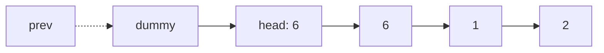
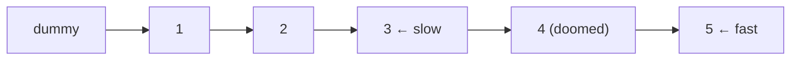
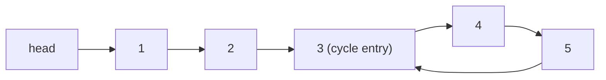
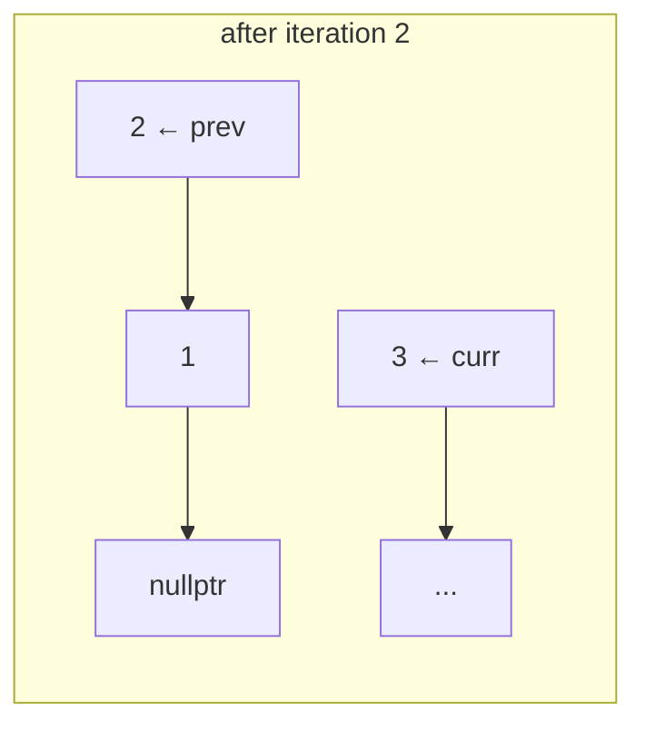

# Topic 2: Core Patterns & Techniques (Phase 2)

*Part of the [Linked List Study Plan](./00_plan.md). Builds on [Topic 1](./01_foundations_singly_linked_list.md). Companion code: [`02_two_pointers_reversal_demo.cpp`](./02_two_pointers_reversal_demo.cpp), 49 checks, clean under `-fsanitize=address,undefined`.*

---

## 0. How this topic is organized

Phase 2 is five techniques that account for most linked-list interview problems and most real pointer-manipulation bugs:

1. The **dummy (sentinel) node**: removes the "what if it's the head?" special case.
2. **Two pointers**: a speed ratio (middle) and a fixed gap (nth from end).
3. **Floyd's cycle detection**: detect, locate the entry, measure the length, with the proof.
4. **Reversal**: iterative, recursive, a sub-range, and in groups of k.
5. **Recursion on lists**: the pattern, and its real cost.

They're taught in that order because later ones use earlier ones. At the end, a capstone (Reorder List) uses three of them in one function.

**Style note.** Problems in this phase use a bare `ListNode` and free functions, which is the shape you'll see in interviews. Every function ports 1:1 into your `SinglyLinkedList<T>` as a member function; the only change is `Node<T>*` for `ListNode*`.

```cpp
struct ListNode {
    int val;
    ListNode* next;
    explicit ListNode(int v = 0, ListNode* n = nullptr) : val(v), next(n) {}
};
```

---

## 1. The dummy (sentinel) node

### 1.1 The problem it solves

Almost every "remove" or "insert" operation has the shape: *find the node before the target, then relink it*. For the head node there **is no node before it**, so you write a special case:

```cpp
// Remove all nodes equal to `target`, WITHOUT a dummy: two code paths
while (head && head->val == target) {          // special case: leading matches
    ListNode* d = head; head = head->next; delete d;
}
for (ListNode* p = head; p && p->next; ) {     // general case: everything else
    if (p->next->val == target) { ListNode* d = p->next; p->next = d->next; delete d; }
    else p = p->next;
}
```

Two code paths means two places to get bugs, plus the empty-list case on top.

### 1.2 The fix: give the head a predecessor

Put a fake node in front of the list. Now **every real node, including the head, has a node before it**, so one code path handles all of them.



```cpp
// LC 203
ListNode* removeElements(ListNode* head, int target) {
    ListNode dummy(0, head);                  // lives on the stack; never deleted
    ListNode* prev = &dummy;
    while (prev->next) {
        if (prev->next->val == target) {
            ListNode* doomed = prev->next;
            prev->next = doomed->next;        // unlink; do NOT advance prev
            delete doomed;
        } else {
            prev = prev->next;
        }
    }
    return dummy.next;                        // the (possibly new) head
}
```

Three things to notice:

- **`prev` doesn't advance after a deletion.** The node that slid into `prev->next` might match too (`6 -> 6 -> 1`). Advancing there is the classic bug.
- **`return dummy.next`**, not `head`. The head may have been deleted; `dummy.next` is always right.
- **The dummy is a stack object.** No `new`, no `delete`, and it's destroyed automatically. (Heap-allocating it is correct but pointless, and one more thing to leak.)

### 1.3 Where you'll reach for it

Any time the head might be removed, replaced, or might not exist yet: removing by value, removing the nth from the end, merging two lists (Phase 4), partitioning, removing duplicates, and **building a list** (the helper in the companion file uses it: `tail = &dummy`, append, return `dummy.next`, so the first append needs no special case either).

### 1.4 The alternative: pointer-to-pointer (kernel-style)

You can get the same effect without a dummy by tracking *the address of the pointer that points at the current node*:

```cpp
ListNode** pp = &head;                        // pp points at "the thing that points at the node"
while (*pp) {
    if ((*pp)->val == target) {
        ListNode* doomed = *pp;
        *pp = doomed->next;                   // rewrite whichever pointer led here: head OR some node's next
        delete doomed;
    } else {
        pp = &(*pp)->next;
    }
}
```

`*pp` is `head` for the first node and some `prev->next` for every other node, so there is no special case. This is the idiom you'll see in C systems code; it's worth being able to read. In an interview, the dummy node is easier to explain and harder to get wrong, so default to it.

### 1.5 One caveat for your templated class

A dummy `Node<T>` needs a `T`, which means `T` must be default-constructible, which you can't assume. Production containers avoid this by splitting the node into a link-only base (just `next`, or `next`/`prev`) and a derived node that adds the value. libstdc++'s `std::list` is built that way. You'll implement a version of this in Phase 3.

---

## 2. Two pointers

Two pointers walking the same list at the same time. There are two flavors; the difference is **what stays constant between them**.

| Flavor | Constant | Finds |
|---|---|---|
| Speed ratio (fast/slow) | fast moves 2× as fast | middle, cycle |
| Fixed gap | pointers move at the same speed, `n` nodes apart | nth from end |

### 2.1 Speed ratio: the middle

You wrote this one in Topic 1's practice; here's the full picture including the variant that Phase 4's merge sort needs.

```cpp
ListNode* middleNode(ListNode* head) {        // second middle for even length
    ListNode* slow = head;
    ListNode* fast = head;
    while (fast && fast->next) {
        slow = slow->next;
        fast = fast->next->next;
    }
    return slow;
}

ListNode* firstMiddle(ListNode* head) {       // first middle for even length; requires head != nullptr
    ListNode* slow = head;
    ListNode* fast = head;
    while (fast->next && fast->next->next) {
        slow = slow->next;
        fast = fast->next->next;
    }
    return slow;
}
```

`1->2->3->4`: `middleNode` returns **3**, `firstMiddle` returns **2**. Use `firstMiddle` when you need to *cut* the list into two halves (cut after `slow`); use `middleNode` when you want "the" middle.

The loop condition `fast && fast->next` is order-sensitive: `&&` short-circuits, so `fast->next` is only evaluated once `fast` is known to be non-null.

### 2.2 Fixed gap: the nth node from the end

**LC 19.** Remove the nth node from the end in a single pass, without knowing the length.

**Idea.** Send `fast` ahead by `n` nodes, then move both at the same speed. The gap between them stays `n`, so when `fast` reaches the end, `slow` is exactly `n` nodes behind it.

The detail that makes it clean: start both pointers at the **dummy**, and stop when `fast` is on the **last node** (not past it). Then `slow` lands on the node *before* the target, which is exactly what you need to unlink it.

```cpp
ListNode* removeNthFromEnd(ListNode* head, int n) {
    if (n < 1) return head;
    ListNode dummy(0, head);
    ListNode* fast = &dummy;
    ListNode* slow = &dummy;
    for (int i = 0; i < n; ++i) {             // open a gap of n nodes
        fast = fast->next;
        if (!fast) return head;               // n > length: nothing to remove
    }
    while (fast->next) {                      // slide until fast is on the last node
        fast = fast->next;
        slow = slow->next;
    }
    ListNode* doomed = slow->next;            // slow is the node BEFORE the target
    slow->next = doomed->next;
    delete doomed;
    return dummy.next;
}
```

**Trace: `1->2->3->4->5`, remove the 2nd from the end (`n = 2`).** Positions are dummy=0 ... 5.

| Step | `fast` | `slow` |
|---|---|---|
| start | 0 (dummy) | 0 (dummy) |
| gap loop, 2 steps | 2 | 0 |
| `fast->next` is non-null → move both | 3 | 1 |
| move both | 4 | 2 |
| move both | 5 (last node) | 3 |
| `fast->next == nullptr` → stop | 5 | 3 |

`slow` is on node 3, so `doomed = slow->next` is node **4**, the 2nd from the end. ✓



**Why the dummy matters here.** If `n` equals the length, the target is the head and there is no node before it. With `slow` starting at the dummy, that case just works: `slow` never leaves the dummy and `slow->next` is the head.

**The guards**, which are production behavior rather than interview decoration: `n < 1` would make `slow` end on the last node and `doomed` be null (null dereference); `n > length` would walk `fast` off the end. Both return the list unchanged.

### 2.3 Which one do I use?

| You want | Technique |
|---|---|
| The middle, or to split in half | speed ratio |
| Does it loop / where does the loop start | speed ratio (Floyd's, next section) |
| The kth from the end | fixed gap of `k` |
| Two pointers meeting at a computed spot (e.g. intersection) | fixed gap equal to the length difference (Phase 4) |

---

## 3. Floyd's cycle detection ("tortoise and hare")

A list that accidentally loops back on itself makes every traversal run forever. A corrupted `next` pointer in a descriptor chain or free list produces exactly this. Floyd's algorithm detects it with **O(1) extra memory**.

### 3.1 Detection

```cpp
// LC 141
bool hasCycle(const ListNode* head) {
    const ListNode* slow = head;
    const ListNode* fast = head;
    while (fast && fast->next) {
        slow = slow->next;
        fast = fast->next->next;
        if (slow == fast) return true;        // compare ADDRESSES, never values
    }
    return false;                             // fast fell off the end: there is an end, so no cycle
}
```

If there's no cycle, `fast` hits `nullptr` and the loop ends. If there is one, `fast` can never reach null, so the only way out is the two pointers meeting.



**Pitfall: comparing values.** `slow->val == fast->val` is wrong, because duplicate values (`7 -> 7 -> 7`) look identical in a perfectly healthy list. Cycle means *same node*, so compare addresses.

### 3.2 Why they must meet (the proof)

Let the list have a tail of `μ` nodes before the cycle, and a cycle of length `C`.

1. Once `slow` enters the cycle, `fast` is already inside it, some distance `k` ahead (`0 ≤ k < C`, measured around the cycle).
2. Each iteration `fast` advances 2 and `slow` advances 1, so the gap **shrinks by exactly 1** (modulo `C`).
3. The gap goes `k, k-1, ..., 1, 0`, so it reaches 0 within `C` iterations. Gap 0 means they're on the same node.

### 3.3 Why speed 2, and not 3?

The "gap shrinks by exactly 1" is what guarantees `fast` can't *jump over* `slow`. With `fast` at speed 3 the gap shrinks by 2 per step; if the gap is odd and `C` is even, the gap goes `... 3, 1, C-1, C-3 ...` and never equals 0, so they chase each other forever without meeting. Speed 2 is the smallest speed that works for every `C`.

### 3.4 Finding where the cycle starts

**LC 142.** This is the part that looks like magic until you see the algebra.

When they meet, let `a` = the distance from the cycle entry to the meeting point (walking along the cycle).

- `slow` has walked `μ + a`.
- `fast` has walked twice that: `2(μ + a)`.
- `fast` also equals `slow`'s distance plus some whole number of extra laps: `μ + a + n·C`, for some `n ≥ 1`.

Set them equal:

```
2(μ + a) = μ + a + n·C
   μ + a = n·C
       μ = n·C − a
```

Read that last line physically: **starting at the meeting point and walking `μ` steps** puts you at position `a + μ = n·C` around the cycle, which is a whole number of laps from the entry, so you're **at the entry**.

And `μ` is also exactly the distance from `head` to the entry. So: put one pointer at `head`, keep one at the meeting point, move both **one step at a time**, and they meet at the cycle entry.

```cpp
// LC 142: returns the first node of the cycle, or nullptr
ListNode* detectCycle(ListNode* head) {
    ListNode* slow = head;
    ListNode* fast = head;
    while (fast && fast->next) {
        slow = slow->next;
        fast = fast->next->next;
        if (slow == fast) {                   // phase 1: met inside the cycle
            ListNode* p = head;               // phase 2: head and meeting point, same speed
            while (p != slow) {
                p = p->next;
                slow = slow->next;
            }
            return p;                         // they converge exactly at the entry
        }
    }
    return nullptr;
}
```

**Trace** on `1->2->3->4->5->(back to 3)`: `μ = 2`, `C = 3`.

| Iteration | `slow` | `fast` |
|---|---|---|
| start | 1 | 1 |
| 1 | 2 | 3 |
| 2 | 3 | 5 |
| 3 | 4 | 4 ← **met at node 4** (`a = 1`) |

Phase 2: `p = 1`, `slow = 4`. Step both: `p = 2, slow = 5`; step both: `p = 3, slow = 3`. They meet at **3**, the entry. ✓ (`μ = 2` steps, and `n·C − a = 3 − 1 = 2`.)

### 3.5 Cycle length

Once they've met, walk `slow` around until it returns to the meeting point, counting nodes:

```cpp
int cycleLength(ListNode* head) {
    ListNode* slow = head;
    ListNode* fast = head;
    while (fast && fast->next) {
        slow = slow->next;
        fast = fast->next->next;
        if (slow == fast) {
            int len = 1;
            for (ListNode* p = slow->next; p != slow; p = p->next) ++len;
            return len;
        }
    }
    return 0;                                 // acyclic
}
```

### 3.6 Edge cases (all covered in the companion tests)

- **Empty list / single node, no loop:** the loop condition fails immediately → `false`.
- **Self-loop** (`a->next = a`): `slow` and `fast` are both `a` after one iteration → `true`, entry is `a`, length 1.
- **Entire list is the cycle** (`μ = 0`): the entry is the head; phase 2 returns immediately or after at most one lap-aligned walk.
- **Freeing a cyclic list:** `freeList` on a cyclic list never terminates (or double-frees). Break the cycle first (`tail->next = nullptr`).

### 3.7 Complexity and alternatives

- **Floyd:** O(n) time, **O(1) space**.
- **Hash set of visited nodes:** O(n) time, O(n) space. Simpler, and it finds the entry directly (the first node you see twice), but it allocates, which is often unacceptable in embedded or kernel contexts.
- **Brent's algorithm:** a variant that teleports the slow pointer on power-of-two intervals; typically fewer pointer dereferences than Floyd's. Worth knowing it exists; Floyd's is what interviewers expect.

Floyd's idea applies beyond lists to any "sequence generated by repeatedly applying a function" problem: LC 287 (Find the Duplicate Number) treats the array as `i -> nums[i]` and finds the duplicate as a cycle entry; LC 202 (Happy Number) detects the digit-square-sum cycle.

---

## 4. Reversal

### 4.1 The mental model

Reversal is **flipping each `next` arrow** while you walk, without losing the rest of the chain. The danger is that the moment you flip `curr->next`, you've lost your only reference to the remainder of the list, so you must save it first.

Three pointers do it: `prev` (already-reversed part), `curr` (node being processed), `next` (saved remainder).

### 4.2 Iterative: O(n) time, O(1) space

```cpp
// LC 206
ListNode* reverseList(ListNode* head) {
    ListNode* prev = nullptr;
    ListNode* curr = head;
    while (curr) {
        ListNode* next = curr->next;          // 1. save the rest of the chain
        curr->next = prev;                    // 2. flip this link
        prev = curr;                          // 3. advance prev
        curr = next;                          // 4. advance curr
    }
    return prev;                              // prev is the new head
}
```

**The order of the four lines is the whole algorithm.** Swap lines 1 and 2 and you've destroyed the chain; swap 3 and 4 and you've overwritten `curr` before using it.

**Trace on `1->2->3`:**

| After iteration | `prev` | `curr` | List state |
|---|---|---|---|
| start | `nullptr` | 1 | `1->2->3` |
| 1 | 1 | 2 | `nullptr<-1`, `2->3` |
| 2 | 2 | 3 | `nullptr<-1<-2`, `3` |
| 3 | 3 | `nullptr` | `nullptr<-1<-2<-3` |

Loop ends; return `prev` = 3, so the list reads `3->2->1->nullptr`.



Note that the **old head (1) becomes the tail and its `next` is `nullptr`** because `prev` started as `nullptr`. That's why you never need to null it out separately in the iterative version.

### 4.3 Recursive: O(n) time, O(n) stack

```cpp
ListNode* reverseListRec(ListNode* head) {
    if (!head || !head->next) return head;    // base: empty or single node
    ListNode* newHead = reverseListRec(head->next);
    head->next->next = head;                  // head->next is now the TAIL of the reversed rest; point it back
    head->next = nullptr;                     // head becomes the new tail
    return newHead;
}
```

The way to think about it is **trust the recursive call**. Assume `reverseListRec(head->next)` correctly reverses everything after `head` and returns its new head. Then the only remaining work is to attach `head` at the *end* of that reversed chain, and the end is exactly `head->next` (which used to be the first node of the rest and is now its last).

**Trace on `1->2->3`:**

```
reverseListRec(1)
  reverseListRec(2)
    reverseListRec(3)  → base case, returns 3
  [at 2] 2->next is 3;  3->next = 2;  2->next = null      list: 3->2->null,  1->2 still points in
  returns 3
[at 1] 1->next is 2;  2->next = 1;  1->next = null        list: 3->2->1->null
returns 3
```

Every frame returns the **same** `newHead` (3); only the pointer surgery differs by frame.

### 4.4 Tail-recursive form, and why it doesn't save you in C++

```cpp
ListNode* reverseListTail(ListNode* curr, ListNode* prev = nullptr) {
    if (!curr) return prev;
    ListNode* next = curr->next;
    curr->next = prev;
    return reverseListTail(next, curr);       // nothing left to do after the call
}
```

This is the iterative algorithm in recursive clothing, and the recursive call is in tail position, so a compiler *may* turn it into a loop. But **C++ does not guarantee tail-call optimization**. GCC/Clang typically do it at `-O2` and not at `-O0` (debug builds), which means the same code can pass in release and stack-overflow in debug. Don't rely on it for unbounded input.

### 4.5 Reverse a sub-range: `[left, right]`

**LC 92.** Reverse positions `left` through `right` (1-indexed) in a single pass.

**Technique: head insertion.** Walk `prev` to the node just before position `left`. Then repeatedly take the node *after* `curr` and move it to the front of the segment. `curr` stays put and gradually sinks to the end of the segment as nodes are inserted ahead of it.

```cpp
ListNode* reverseBetween(ListNode* head, int left, int right) {
    if (!head || left >= right) return head;
    ListNode dummy(0, head);
    ListNode* prev = &dummy;
    for (int i = 1; i < left; ++i) prev = prev->next;   // node just before position `left`
    ListNode* curr = prev->next;                         // first node of the segment; becomes its tail
    for (int i = 0; i < right - left; ++i) {
        ListNode* nxt = curr->next;                      // node to move to the front of the segment
        curr->next = nxt->next;                          // detach nxt
        nxt->next = prev->next;                          // nxt points at the current segment front
        prev->next = nxt;                                // nxt becomes the new segment front
    }
    return dummy.next;
}
```

**Trace:** `1->2->3->4->5`, `left = 2`, `right = 4`. `prev = 1`, `curr = 2`.

| Iteration | `nxt` | List after |
|---|---|---|
| start | | `1 -> 2 -> 3 -> 4 -> 5` |
| 1 | 3 | `1 -> 3 -> 2 -> 4 -> 5` |
| 2 | 4 | `1 -> 4 -> 3 -> 2 -> 5` |

Done after `right - left = 2` iterations. The dummy handles `left = 1` (the segment starts at the head) with no special case.

### 4.6 Reverse in groups of k

**LC 25.** Reverse each consecutive block of `k` nodes; a trailing block shorter than `k` stays as-is. `1->2->3->4->5` with `k = 2` becomes `2->1->4->3->5`.

**Plan, per group:**

1. From `groupPrev` (the node before the group), walk `k` steps to find `kth`. If you run off the end, fewer than `k` nodes remain, so stop.
2. Remember `groupNext = kth->next` (first node after the group).
3. Reverse the group with the standard loop, but **seed `prev` with `groupNext`** instead of `nullptr`. That way the group's old head, now its tail, automatically links onward.
4. Stitch: `groupPrev->next = kth` (the group's new head), then move `groupPrev` to the group's old head (its new tail).

```cpp
ListNode* reverseKGroup(ListNode* head, int k) {
    if (k < 2) return head;                   // k == 1 is a no-op; k < 1 is invalid
    ListNode dummy(0, head);
    ListNode* groupPrev = &dummy;             // node just before the current group
    while (true) {
        ListNode* kth = groupPrev;
        for (int i = 0; i < k && kth; ++i) kth = kth->next;
        if (!kth) break;                      // fewer than k nodes remain
        ListNode* groupNext = kth->next;      // first node AFTER the group

        ListNode* prev = groupNext;           // seed: the old head will link onward
        ListNode* curr = groupPrev->next;
        while (curr != groupNext) {
            ListNode* nxt = curr->next;
            curr->next = prev;
            prev = curr;
            curr = nxt;
        }
        ListNode* oldGroupHead = groupPrev->next;   // now the group's tail
        groupPrev->next = kth;                      // kth is the group's new head
        groupPrev = oldGroupHead;                   // next group begins after this tail
    }
    return dummy.next;
}
```

**Trace:** `1->2->3->4->5`, `k = 2`.

| Group | `groupPrev` | `kth` | `groupNext` | After |
|---|---|---|---|---|
| 1 | dummy | 2 | 3 | `2 -> 1 -> 3 -> 4 -> 5`; `groupPrev` → node 1 |
| 2 | 1 | 4 | 5 | `2 -> 1 -> 4 -> 3 -> 5`; `groupPrev` → node 3 |
| 3 | 3 | walks off the end (`kth == nullptr`) | | break |

Result: `2 -> 1 -> 4 -> 3 -> 5`. ✓ O(n) time, O(1) space.

---

## 5. Recursion on linked lists

### 5.1 The recipe

A linked list is *recursively defined*: a list is either empty, or a node followed by a list. That makes recursion natural, and gives you a four-step recipe:

1. **State the contract:** "`f(head)` returns/does X for the whole list starting at `head`."
2. **Base case:** empty list (`!head`) and usually single node (`!head->next`).
3. **Trust it:** assume `f(head->next)` already satisfies the contract.
4. **Fix up the head:** do whatever remains for `head` itself.

`reverseListRec` above is exactly this.

### 5.2 Recursion as an implicit stack

Recursion processes nodes **on the way back up**, in reverse order. That gives you "last node first" for free:

```cpp
void printReverse(const ListNode* n, std::ostream& os) {
    if (!n) return;
    printReverse(n->next, os);                // go all the way down first...
    os << n->val << ' ';                      // ...then print on the way back up
}
```

Printing `1->2->3->4` this way outputs `4 3 2 1`, with the list untouched. Doing that iteratively needs an explicit `std::stack` or a reversal.

### 5.3 The real cost: call-stack depth

Every recursive call is a stack frame, so recursion on a list of `n` nodes uses **O(n) stack space**, even when the heap usage is O(1). In practice:

- A frame is small (roughly a few dozen bytes, depending on the compiler and optimization level), but a default 8 MB main-thread stack on Linux still overflows somewhere around hundreds of thousands of nodes. The exact number depends on the frame size.
- On an RTOS task or embedded target with a stack of a few KB, the safe depth is on the order of tens to low hundreds of nodes. Recursion over a list whose length you don't control is a latent crash.
- A stack overflow is a hard crash with no exception to catch.

**Rule of thumb.** When the list length is unbounded or externally influenced, prefer the iterative version. Use recursion when it makes the logic much clearer and the depth is known to be small. In interviews, say out loud that the recursive solution is O(n) stack and offer the iterative one.

(This resurfaces in Phase 7: a `std::unique_ptr<Node>` chain destroys recursively through destructors, and a long chain overflows the stack on destruction alone.)

---

## 6. Capstone: Reorder List (LC 143)

Transform `L0 -> L1 -> ... -> Ln` into `L0 -> Ln -> L1 -> Ln-1 -> ...`. For example `1->2->3->4->5` becomes `1->5->2->4->3`.

No single trick solves it. It's **three techniques in sequence**, which is why it's a good test of whether Phase 2 has landed:

1. **Two pointers:** find the first middle, to split the list.
2. **Reversal:** reverse the second half.
3. **Interleave:** alternately take a node from each half.

```cpp
void reorderList(ListNode* head) {
    if (!head || !head->next) return;
    ListNode* mid = firstMiddle(head);         // 1. find the first middle
    ListNode* second = reverseList(mid->next); // 2. reverse the second half
    mid->next = nullptr;                       //    and cut the list in two
    ListNode* first = head;                    // 3. interleave
    while (second) {
        ListNode* n1 = first->next;
        ListNode* n2 = second->next;
        first->next = second;
        second->next = n1;
        first = n1;
        second = n2;
    }
}
```

**Trace** on `1->2->3->4->5`:

| Step | State |
|---|---|
| `firstMiddle` | `mid` = 3 |
| reverse `mid->next` | `second` = `5->4`; cut: first half `1->2->3` |
| interleave, round 1 | `1 -> 5 -> 2 ...`; `first` = 2, `second` = 4 |
| interleave, round 2 | `... 2 -> 4 -> 3`; `first` = 3, `second` = `nullptr` |

Result: `1 -> 5 -> 2 -> 4 -> 3`. ✓ The loop runs until `second` is exhausted because the second half is never longer than the first, which is exactly why `firstMiddle` (not `middleNode`) is the right split. O(n) time, O(1) space.

---

## 7. Pitfall checklist

1. **Losing the chain.** Flipping or unlinking `curr->next` before saving it. Save first, always.
2. **Advancing `prev` after a delete.** In removal loops, don't advance after unlinking; the next node may also match.
3. **Comparing values for a cycle.** Compare node addresses. Duplicate values are normal.
4. **Wrong `&&` order in the fast/slow loop.** `fast && fast->next`, not the reverse.
5. **Returning `head` instead of `dummy.next`.** The head may have changed.
6. **Off-by-one in the gap.** For nth-from-end, start both at the dummy and stop with `fast` on the last node.
7. **Freeing a cyclic list.** Break the cycle first.
8. **Unbounded recursion** on lists whose length you don't control.
9. **Forgetting `tail`** if you port these into the Topic 1 class: any operation that can remove or relocate the last node must update `tail`. Reversal swaps head and tail; `removeNthFromEnd` can delete the tail.

---

## 8. Complexity summary

| Technique | Time | Extra space |
|---|---|---|
| Dummy-node remove | O(n) | O(1) |
| Middle (fast/slow) | O(n) | O(1) |
| Nth from end (gap) | O(n), one pass | O(1) |
| Floyd detect / find entry / length | O(n) | O(1) |
| Reverse (iterative) | O(n) | O(1) |
| Reverse (recursive) | O(n) | **O(n) stack** |
| Reverse `[left, right]` | O(n) | O(1) |
| Reverse in k-groups | O(n) | O(1) |
| Reorder List | O(n) | O(1) |

---

## 9. Running the companion code

```bash
g++ -std=c++17 -Wall -Wextra -fsanitize=address,undefined 02_two_pointers_reversal_demo.cpp -o demo && ./demo
```

Expected output: `49/49 checks passed`. The sanitizer flags matter: they would catch a leak, double free, or null dereference in any of these functions, which a plain "it printed the right list" run would miss.

**Suggested way to use it:** don't read the file first. Implement `reverseList`, `hasCycle`, and `removeNthFromEnd` yourself from scratch, then diff against the companion file.

---

## 10. Questions you will be asked

1. Why does a dummy node remove the special case for the head? Show the bug it prevents in "remove all nodes with value `v`".
2. Find the middle of a list in one pass. Which middle do you get for an even length, and how do you change that?
3. Remove the `n`-th node from the end in one pass. What gap do you keep, and where do both pointers start?
4. Detect a cycle in O(1) space. Prove that the fast pointer must meet the slow one.
5. Why speed 2? What happens with speed 3?
6. Given a cycle, how do you find its entry node? Derive why resetting one pointer to the head works.
7. Reverse a list iteratively and recursively. What are the costs of each?
8. Why is a recursive reversal risky on a list of 10^6 nodes?
9. Reorder a list `L0 -> Ln -> L1 -> Ln-1 ...` in O(1) space: which three techniques combine?

## 11. Problems (in this order)

Where to solve: LeetCode. How to approach each is in the hint column.

| Group | Problem | Number | How to approach |
|---|---|---|---|
| Dummy node | Remove Linked List Elements | 203 | Dummy before head; unlink without advancing `prev` |
| Dummy node | Remove Duplicates from Sorted List | 83 | One pointer; skip while `cur->next->val == cur->val` |
| Dummy node | Remove Duplicates from Sorted List II | 82 | Dummy and `prev`; when a run repeats, skip the whole run, not all but one |
| Dummy node | Partition List | 86 | Two dummies (small, large), append to each, join them, set the last large node's `next` to null |
| Two pointers | Middle of the Linked List | 876 | Fast and slow; second middle for even length |
| Two pointers | Remove Nth Node From End of List | 19 | Both start at the dummy; advance `fast` `n + 1` steps, then move both; `slow` is the node before the target |
| Floyd | Linked List Cycle | 141 | Fast and slow meet iff there is a cycle |
| Floyd | Linked List Cycle II | 142 | After they meet, restart one pointer at the head and move both one step at a time; they meet at the entry |
| Floyd | Find the Duplicate Number | 287 | Treat `i -> nums[i]` as a list; the duplicate is the cycle entry; do not modify the array |
| Floyd | Happy Number | 202 | Next value is the sum of squares of digits; Floyd on the function |
| Reversal | Reverse Linked List | 206 | Three pointers `prev`, `curr`, `next`; also write the recursive form |
| Reversal | Swap Nodes in Pairs | 24 | Dummy; swap two nodes at a time by relinking, not by swapping values |
| Reversal | Reverse Linked List II | 92 | Walk to the node before `left`, then head-insert the next `right - left` nodes |
| Reversal | Reverse Nodes in k-Group | 25 | Check `k` nodes exist; reverse the group; reconnect; a short tail stays as it is |
| Synthesis | Reorder List | 143 | Find the middle, reverse the second half, merge alternately |
| Synthesis | Palindrome Linked List | 234 | Middle, reverse the second half, compare; restore the list if you must not change it |

### Answers to the questions (short)

- **Dummy node:** the head has no predecessor, so removing it is a different code path from removing any other node. A dummy gives it one, so a single loop works and you return `dummy.next`.
- **Middle:** with `slow` one step and `fast` two, `slow` ends at the second middle for an even length; stop `fast` one step earlier (`fast->next && fast->next->next`) to get the first.
- **Nth from the end:** the gap is `n + 1` between `fast` and `slow`, both starting at the dummy, so `slow` stops on the predecessor of the node to remove.
- **Why they meet:** inside the cycle the gap changes by 1 each step, so it must pass through every value modulo the cycle length, including 0. Speed 3 also works for detection, but the gap can skip over a multiple of the cycle length in some cases and the analysis for the entry point is no longer the clean one in section 3.
- **Cycle entry:** at the meeting point the fast pointer has travelled twice the slow one's distance; solving gives that the distance from the head to the entry equals the distance from the meeting point to the entry (modulo the cycle length), so two pointers moving at speed 1, one from each place, meet at the entry (section 3.4).
- **Recursion risk:** reversal recurses once per node; at 10^6 nodes the call stack overflows (section 5.3).
- **Reorder list:** find the middle (two pointers), reverse the second half, merge (pointer relinking).

## Cheat sheet

- **Dummy node** before the head whenever the head can change; return `dummy.next`.
- **Fast and slow** for the middle (ratio 2) and for cycles; **fixed gap** for the nth from the end.
- **Floyd:** meet inside the cycle; restart one pointer at the head; both at speed 1 meet at the entry. Cycle length: loop once more.
- **Reverse:** save `next`, flip `curr->next = prev`, advance. Iterative is O(1) space; recursive is O(n) stack.
- **Reverse a range or a group:** walk to the predecessor, reverse the exact number of nodes, reconnect both ends.
- **Reorder / palindrome:** middle, reverse the second half, then merge or compare.
- **Check:** `fast && fast->next` in that order; compare node addresses for cycles, not values; free a cyclic list only after breaking it.

---

## Sources

- Floyd's cycle detection, the dummy node and in-place reversal are standard; see Knuth, *The Art of Computer Programming* volume 2 (exercise on cycle detection) and CLRS. The explanations and code here are my own, and the companion code is tested as described in section 9.
- LeetCode numbers and titles are from memory; check a number before you rely on it.

---

## What's next

**Phase 3: Doubly & Circular Linked Lists.** A `prev` pointer makes `popBack` and "delete this node" O(1), and a circular structure removes the null terminator entirely. You'll also build the sentinel-based doubly linked list design that `std::list` and the Linux kernel's `list_head` use, which pays off the dummy-node idea from Section 1 at the structural level.

Study this, ask whatever doubts come up, and say "next" when you're ready.
