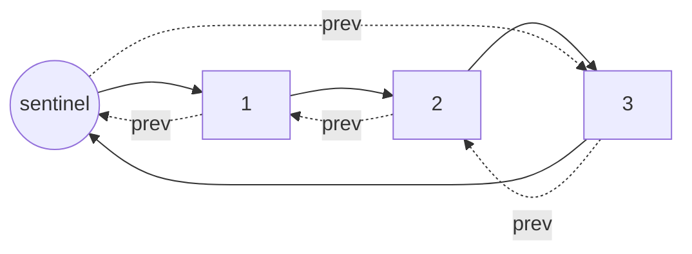
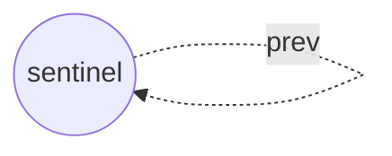

# DSA 04.03: Doubly and Circular Linked Lists

*Part of the [Linked lists plan](00_plan.md) · Time: about 5 hours (2 reading, 3 problems) · You need: [Foundations](01_foundations_singly_linked_list.md) and [Core patterns](02_core_patterns_two_pointers_reversal.md) (the dummy node, reversal) · Companion code: [`03_doubly_and_circular_lists_demo.cpp`](03_doubly_and_circular_lists_demo.cpp)*

By the end of this tutorial you can:

- say what a `prev` pointer buys (erase a node you hold, pop from the back, walk both ways) and what it costs;
- write insert and erase for a doubly linked list with a sentinel, in four pointer writes each and with no special cases;
- read `std::list` and the Linux kernel's `list_head` as the same design;
- build and use circular lists: the tail pointer, rotation, sorted insert;
- solve the Josephus problem three ways: simulation, a recurrence, and a closed form for `k = 2`.

The companion file (C++20) holds every function below and checks it against `std::list`, `std::deque` and brute force on all small cases (612,351 checks). It is short on purpose: the tutorial carries the examples and the problems.

---

## 1. Why a `prev` pointer

### 1.1 What a singly linked list cannot do

Tutorial 01 ended on the honest cost of a singly linked list: to remove the last node you must walk from the head, because nothing points backward. The same hole shows up everywhere you hold a pointer to a node:

| Operation | Singly linked | Doubly linked |
|---|---|---|
| push or pop at the front | O(1) | O(1) |
| push at the back | O(1) with a tail pointer | O(1) |
| pop at the back | **O(n)** (find the node before the tail) | **O(1)** |
| erase a node you already hold | **O(n)** (find its predecessor) | **O(1)** |
| insert before a node you already hold | **O(n)** | **O(1)** |
| walk backward | impossible | O(n) for the whole list |
| memory per node | value + 1 pointer | value + 2 pointers |

A pointer to a node works as a **handle**. In a doubly linked list the handle alone is enough to remove or move the node. In a singly linked list you also need to know what comes before it, so the handle is not enough. That is why caches keep handles in a hash map next to a doubly linked list (the LRU cache of Linked lists 05 does exactly this).

(LeetCode 237 has a trick for a singly list: copy the next node's value into this node and delete the next node. It fails for the last node and breaks any pointer to the next node, so it is a puzzle, not a replacement for `prev`.)

### 1.2 The node and its one rule

```cpp
struct DNode {
    int val;
    DNode* prev;
    DNode* next;
};
```

The whole structure rests on one invariant: for every node `x` in the list, `x->next->prev == x` and `x->prev->next == x`. Every operation is a short run of pointer writes that must leave this true at the end. In the middle it is briefly false, so **the order of the writes matters** (section 1.4).

**Cost of the extra pointer.** On a 64-bit machine, with GCC 13.3's `std::list<int>` and `std::forward_list<int>` (measured by giving each a counting allocator), a doubly node for an `int` is 24 bytes and a singly node is 16 bytes. With glibc 2.39, `malloc_usable_size` returns 24 for a request of 16 bytes and also 24 for a request of 24, so here both node kinds take the same space from the allocator. The second pointer is not free for larger values or another allocator, but it costs less than the table suggests.

### 1.3 Insert and erase with a handle

Insert `v` before the node `pos`, and erase the node `x`, given only those pointers. Without any sentinel the list keeps `head` and `tail`, and the two ends need patching:

```cpp
// Without a sentinel the list needs head and tail pointers, and every edit has to patch them at the two ends.
void plainErase(DNode*& head, DNode*& tail, DNode* x) {
    if (x->prev) x->prev->next = x->next; else head = x->next;  // x was the first node
    if (x->next) x->next->prev = x->prev; else tail = x->prev;  // x was the last node
    delete x;
}

// Insert v before pos; pos == nullptr means "at the end".
DNode* plainInsertBefore(DNode*& head, DNode*& tail, DNode* pos, int v) {
    DNode* x = new DNode{v, pos ? pos->prev : tail, pos};
    if (x->prev) x->prev->next = x; else head = x;
    if (pos) pos->prev = x; else tail = x;
    return x;
}
```

Read `plainErase` as two independent halves: fix the node before `x` (or `head` if there is none), then fix the node after `x` (or `tail` if there is none). It works, but each function has two branches that exist only for the ends, and the empty list and the one-node list hide in them. Section 2 removes the branches.

### 1.4 The order of the writes

To put a new node `x` between `a` and `b`, set the new node's own links first, then the neighbours':

```
x->prev = a;   x->next = b;     // 1. x's own links: only reads
a->next = x;                    // 2. now rewire the neighbours
b->prev = x;
```

If you rewire first, you lose a pointer: after `a->next = x` the old `a->next` (which is `b`) is gone, unless you saved it. In the code of section 2 this shows up as two lines that cannot be swapped:

```cpp
pos->prev->next = x;   // uses pos->prev: must come first
pos->prev = x;         // changes pos->prev: must come second
```

Swap them and the first line becomes `x->next = x`: the new node points at itself, and the old previous node never learns about it. Problem B1 asks you to find exactly this.

---

## 2. The sentinel: a ring with one empty node

### 2.1 The idea

Tutorial 02 (section 1) gave the head a fake predecessor so that every real node had a node before it. Do the same at both ends and close the ring: add **one extra node that holds no data**, the sentinel, and let it sit between the last node and the first. Now **every real node has a real `prev` and a real `next`**, so no operation has an end case.



- `begin()` is `sentinel.next`, the first real node.
- `end()` is the sentinel itself, never a real node. `end()->prev` is the last real node.
- The empty list is a sentinel whose two pointers point to itself:



### 2.2 The code

```cpp
// A ring of nodes with one extra node, the sentinel, that holds no data. begin() is the node after the sentinel,
// end() is the sentinel itself, and an empty list is a sentinel that points to itself.
class DList {
public:
    DList() { s_.prev = s_.next = &s_; }
    DList(const DList&) = delete;
    DList& operator=(const DList&) = delete;
    DList& operator=(DList&&) = delete;
    DList(DList&& o) noexcept {
        s_.prev = s_.next = &s_;
        if (!o.empty()) {
            s_.next = o.s_.next;
            s_.prev = o.s_.prev;
            s_.next->prev = &s_;  // the first and last nodes still point at o's sentinel
            s_.prev->next = &s_;  // so point them at ours
            n_ = o.n_;
            o.s_.prev = o.s_.next = &o.s_;
            o.n_ = 0;
        }
    }
    ~DList() { clear(); }

    DNode* begin() { return s_.next; }
    DNode* end() { return &s_; }
    bool empty() const { return s_.next == &s_; }
    std::size_t size() const { return n_; }

    // Insert v before pos (pos may be end()). Returns the new node. Four pointer writes, no branches.
    DNode* insertBefore(DNode* pos, int v) {
        DNode* x = new DNode{v, pos->prev, pos};
        pos->prev->next = x;
        pos->prev = x;
        ++n_;
        return x;
    }

    // Remove the data node x (never end()). Returns the node that followed it.
    DNode* erase(DNode* x) {
        DNode* after = x->next;
        x->prev->next = x->next;
        x->next->prev = x->prev;
        delete x;
        --n_;
        return after;
    }

    void pushFront(int v) { insertBefore(begin(), v); }
    void pushBack(int v) { insertBefore(end(), v); }
    void popFront() { erase(begin()); }  // the list must not be empty
    void popBack() { erase(s_.prev); }   // the list must not be empty

    // Move the data node x to the front without allocating: unlink it, then link it after the sentinel.
    void moveToFront(DNode* x) {
        x->prev->next = x->next;
        x->next->prev = x->prev;
        x->next = s_.next;
        x->prev = &s_;
        s_.next->prev = x;
        s_.next = x;
    }

    // Reverse in place by swapping prev and next in every node, the sentinel included.
    void reverse() {
        DNode* p = &s_;
        do {
            std::swap(p->prev, p->next);
            p = p->prev;  // the old next
        } while (p != &s_);
    }

    void clear() {
        while (!empty()) popFront();
    }

private:
    DNode s_{0, nullptr, nullptr};
    std::size_t n_ = 0;
};
```

`insertBefore` and `erase` are the whole design. They contain no `if`, and they handle every case:

- **Insert into the empty list.** `pos` is the sentinel `s`, so `x` gets `prev = s.prev = s` and `next = s`. Then `pos->prev->next = x` sets `s.next = x`, and `pos->prev = x` sets `s.prev = x`. The ring is `s, x`.
- **Erase the only node.** `x->prev->next = x->next` sets `s.next = s`, and `x->next->prev = x->prev` sets `s.prev = s`. The list is empty again.
- **Push at the front or at the back** are `insertBefore(begin(), v)` and `insertBefore(end(), v)`: inserting before the sentinel means appending. **`popBack`** is `erase(s_.prev)`: the last node is one hop from the sentinel.

Walking the list: `for (DNode* p = l.begin(); p != l.end(); p = p->next)` forward, and `for (DNode* p = l.end()->prev; p != l.end(); p = p->prev)` backward. `moveToFront` unlinks a node and links it after the sentinel, with no allocation and no search. `reverse` swaps `prev` and `next` in every node, **the sentinel included**, which turns the ring around in O(n) without allocating.

| Operation | Cost |
|---|---|
| `insertBefore`, `erase`, `pushFront`, `pushBack`, `popFront`, `popBack`, `moveToFront` | O(1) |
| `size`, `empty` | O(1) (a counter, and a pointer test) |
| find the i-th node | O(i), no random access |
| `reverse`, `clear` (and a copy, if you write one) | O(n) |

Two preconditions that the code does not check, and that cause most crashes: never pass `end()` to `erase` (the sentinel is not a heap object, so `delete` on it is undefined), and never call `popFront` or `popBack` on an empty list (that is the same `erase(end())`).

### 2.3 Where the sentinel lives, and moving the list

Here the sentinel is a **member** of the list object, so it costs no allocation and `end()` never changes while the list lives. The price appears when the list object itself moves: the first and last nodes still point at the **old** sentinel, so a memberwise move leaves a ring that runs through a dead object. The move constructor above repairs the two pointers (`s_.next->prev = &s_`, `s_.prev->next = &s_`) and empties the source. Copying is deleted to keep the demo short; a real copy allocates new nodes, as `std::list` does. If the sentinel were allocated on the heap, a move would just swap two pointers, at the cost of one allocation per list. Problem B3 shows the defaulted move.

---

## 3. The same design in `std::list` and the Linux kernel

### 3.1 `std::list` (libstdc++ 13.3)

Read from the library's own header, `bits/stl_list.h`:

- A node is two pointers (`_M_next`, `_M_prev`) followed by the value. The list object contains a **header node** of the same shape, which is the sentinel, and a size counter beside it: `sizeof(std::list<int>)` is 24 bytes (`std::forward_list<int>`: 8). Since C++11 `size()` must be constant time; the library's old ABI counted the nodes on every call, the new one stores the count.
- `end()` holds the address of the header node, so `--end()` is the last element. That is the ring.
- Its helpers in the library source (`list.cc`, read in GCC's trunk) are the code of section 2: `_M_hook` is `insertBefore` (the same four writes: the node's own two links, then its two neighbours), `_M_unhook` is `erase`, and `_M_reverse` swaps `next` and `prev` of every node starting at the header, as `reverse` does here. `_M_transfer`, which `splice` uses, relinks a whole range with six pointer writes, however long the range is.
- The move constructor repairs the two pointers that point at the old header, as section 2.3 did.

**Splice** is the operation that only a node-based list offers: it moves nodes between positions or between lists by relinking them, without copying or allocating. Per cppreference, moving one node or a whole list is constant time; moving a range between two different lists is linear in the range's length. The reason shows in the header: libstdc++ counts the range with `std::distance` so that `size()` stays O(1). I measured it on this VM (GCC 13.3, `-O2`, a range of all but the last node of a list of `n` ints, then one node):

| `n` | splice a range to another list | splice one node |
|---|---|---|
| 1,000 | about 2 µs | about 0.05 µs |
| 100,000 | about 0.2 to 0.3 ms | about 0.05 µs |
| 1,000,000 | about 5 ms | about 0.05 µs |

Nothing is invalidated by a splice: iterators and references to the moved nodes stay valid and now refer into the destination list. `erase` invalidates only the erased element. That stability is the real selling point of `std::list`: a pointer, reference or iterator to an element stays good until that element is erased.

### 3.2 The Linux kernel's `list_head`

The kernel's `include/linux/list.h` (read in the upstream master branch in October 2026) is the same ring, with one change: it is **intrusive**. A `struct list_head { struct list_head *next, *prev; }` carries no value; you embed it as a field of your own struct, and the same code links any struct. The head of a list is a `list_head` too, and it is the sentinel.

| This tutorial | Kernel (`list.h`) |
|---|---|
| `DList()` | `INIT_LIST_HEAD(h)`, or `LIST_HEAD_INIT(name)` which expands to `{ &(name), &(name) }` |
| `insertBefore(pos, v)` | `__list_add(new, pos->prev, pos)` |
| `pushFront` / `pushBack` | `list_add(new, head)` / `list_add_tail(new, head)` |
| `erase(x)` | `list_del(x)`: `next->prev = prev; prev->next = next`, then it stores two poison values (`LIST_POISON1`, `LIST_POISON2`) in `x`'s pointers |
| `empty()` | `list_empty(h)`: `h->next == h` |
| `moveToFront(x)` | `list_move(x, head)`: unlink, then `list_add` |

`__list_add` is the same four writes as `insertBefore`. The kernel also has `list_rotate_left(head)`, which moves the first entry to the end (a round-robin step, section 5.2). How an entry is recovered from a `list_head` pointer (`container_of`), the "safe" iteration macros and the singly headed `hlist` are the subject of Linked lists 06 (systems-level topics); the point here is that nothing in the structure is new.

---

## 4. What a handle makes cheap, and when not to use a list

### 4.1 Three uses

**An LRU cache (the idea; Linked lists 05 builds it).** Keep the items in a doubly linked list ordered by recency, newest at the front, and a hash map from key to node. A hit finds the node through the map and calls `moveToFront(node)`: O(1), with no search. A miss on a full cache evicts the last node, `end()->prev`, and its map entry: O(1) again. The map supplies the handle, the list supplies the order, and `prev` is what lets you pull a node out of the middle.

**Browser history (LeetCode 1472).** `back` walks `prev`, `forward` walks `next`, and `visit` adds a node after the current one and drops everything after it. A list fits the picture, but a vector plus an index is simpler and answers `back(steps)` in O(1): do it both ways.

**A text editor with a cursor (LeetCode 2296).** The cursor sits between two nodes. Typing a character is an `insertBefore` at the cursor, backspace is an `erase` of the node before it, and moving the cursor `k` places walks `k` nodes. Every call costs O(k) in its own argument, which is what the problem's follow-up asks for.

### 4.2 Choosing

| | `std::vector` | `std::deque` | `std::list` |
|---|---|---|---|
| `a[i]` | O(1) | O(1) | O(n) |
| push or pop at both ends | back only | O(1) both | O(1) both |
| insert or erase at a position you hold | O(n) shift | O(n) | **O(1)** |
| pointers to other elements survive an insert or erase | no | at the ends, references only | **yes** |
| move nodes between containers without copying | no | no | **yes** (`splice`) |
| memory | one block | blocks | one allocation per node, two pointers each |

Reach for a list when you need stable handles, O(1) erase of an element you hold, or splice. Otherwise prefer a vector: walking a list follows pointers to scattered nodes, and each hop can miss the cache. Linked lists 06 measures it.

---

## 5. Circular linked lists

### 5.1 A ring held by its tail

In a circular singly linked list the last node points back to the first, and nothing is `nullptr` except the empty list. Hold a pointer to the **last** node, `tail`; the first node is `tail->next`:

```cpp
// A circular list is held as a pointer to its last node, tail. The first node is tail->next. nullptr is the empty list.
// Every function returns the new tail.
CNode* cPushFront(CNode* tail, int v) {
    CNode* x = new CNode{v, nullptr};
    if (!tail) {
        x->next = x;  // a single node points to itself
        return x;
    }
    x->next = tail->next;
    tail->next = x;
    return tail;
}

CNode* cPushBack(CNode* tail, int v) {
    tail = cPushFront(tail, v);
    return tail->next;  // the new node is now the first one: let it be the last one
}

CNode* cPopFront(CNode* tail) {
    if (!tail) return nullptr;
    CNode* first = tail->next;
    if (first == tail) {
        delete first;
        return nullptr;
    }
    tail->next = first->next;
    delete first;
    return tail;
}

// The first node becomes the last one: one pointer move, no node is touched.
CNode* cRotate(CNode* tail) { return tail ? tail->next : nullptr; }

// Visit every value once, starting at the first node. A do-while: the first test comes after the first visit.
template <class F>
void cForEach(CNode* tail, F visit) {
    if (!tail) return;
    CNode* p = tail->next;
    do {
        visit(p->val);
        p = p->next;
    } while (p != tail->next);
}

void cFree(CNode* tail) {
    while (tail) tail = cPopFront(tail);
}
```

With `A, B, C`, `tail` points at `C` and `C->next` is `A`; `A` leads to `B`, `B` to `C`, and `C` back to `A`. Why the tail and not the head? From the tail both ends are one hop away: push at the front, push at the back, pop at the front and rotation are all O(1). A head pointer alone makes push at the back O(n). Pop at the back is still O(n) in a singly list, because the node before the tail has to be found: that operation needs `prev`, or a doubly ring.

Two details carry the correctness:

- A single node points **to itself** (`x->next = x`). That is the only special case, and `cPushFront` handles it in its first branch.
- `cPushBack` is `cPushFront` followed by moving the tail one step: the new node becomes the first, and then the last. In a ring "front" and "back" differ only by which pointer you keep.

**Walking a ring** has no `nullptr` to stop at, so you stop when you are back at the start. Use a `do`-`while`, as `cForEach` does: a plain `while (p != start)` stops before the first visit, because `p` starts equal to `start`. (Do not confuse this with the accidental cycles of tutorial 02: here the cycle is the design.)

### 5.2 Round robin

A scheduler gives each task one time slice, and a task that is not finished goes to the back of the queue. On a ring with a tail pointer that is `tail = cRotate(tail)`: one pointer assignment, and no node is unlinked or relinked. A finished task is removed with `cPopFront`. Take tasks `A(3) B(1) C(2)`, where the number is the slices still needed, and a slice of 1: `A` runs and goes back (2 left), `B` runs and finishes, `C` runs and goes back (1 left), `A` runs (1 left), `C` finishes, `A` finishes. The finishing order is `B, C, A`. The kernel's `list_rotate_left` (section 3.2) is the same move on a doubly linked ring.

Do not confuse the **circular linked list** with the **circular buffer** (LeetCode 622 and 641): the buffer is an array with a head index and a size, wrapping with `% capacity`. Both give a queue or deque with O(1) ends; the list can grow, the buffer has a fixed capacity.

### 5.3 Insert into a sorted ring (LeetCode 708)

The ring is sorted in non-decreasing order, `head` may point at **any** node, and the new value must go in so that the ring stays sorted. In a sorted ring there is one **seam**: the place where the order drops from the largest value to the smallest. Walk the ring once and look at each pair `p, q = p->next`:

```cpp
// Insert v into a sorted circular list (LeetCode 708). head may be any node of the ring. Returns head, or the new node
// when the list was empty.
CNode* insertSortedCircular(CNode* head, int v) {
    CNode* x = new CNode{v, nullptr};
    if (!head) {
        x->next = x;
        return x;
    }
    CNode* p = head;
    do {
        CNode* q = p->next;
        bool between = p->val <= v && v <= q->val;
        bool atSeam = p->val > q->val && (v >= p->val || v <= q->val);  // p is the largest, q the smallest
        if (between || atSeam) {
            x->next = q;
            p->next = x;
            return head;
        }
        p = q;
    } while (p != head);
    x->next = head->next;  // no slot found: all values are equal, so any place is correct
    head->next = x;
    return head;
}
```

- `between`: `p <= v <= q`, so `v` goes between them.
- `atSeam`: `p > q` marks the seam, and `v` belongs there when it is at least the largest value (`v >= p`) or at most the smallest (`v <= q`).
- Neither matched after a full lap: every value in the ring is equal (there is no seam and `v` is outside them), so any place keeps it sorted.

For the ring `3, 4, 1` (read from `head` = the 3): inserting 2 matches `between` at the pair `(1, 3)`; inserting 5 matches the seam at `(4, 1)` since `5 >= 4`; inserting 0 matches the seam since `0 <= 1`. For the ring `2, 2, 2` and `v = 7`, no pair matches, and `7` goes after `head`. An empty ring returns the new node pointing at itself.

### 5.4 The Josephus problem

`n` people stand in a circle, numbered `1` to `n`. Count `k` people starting from person 1; the `k`-th leaves; counting restarts at the next person. Who is left? (LeetCode 1823 is this problem with `1 <= k <= n <= 500`.) Take `n = 5`, `k = 2`: the order of leaving is `2, 4, 1, 5`, and `3` is left.

**Way 1: play the game on a ring.** `before` is the node just before the one the count starts at, so after `k - 1` steps `before->next` is the one to remove:

```cpp
// The order in which people leave, by playing the game on a circular list. O(n * k).
Vec josephusOrder(int n, int k) {
    CNode* tail = nullptr;
    for (int i = 1; i <= n; ++i) tail = cPushBack(tail, i);
    Vec order;
    CNode* before = tail;  // the node just before the one the count starts at
    for (int left = n; left > 0; --left) {
        for (int step = 1; step < k; ++step) before = before->next;
        CNode* gone = before->next;
        order.push_back(gone->val);
        if (gone == before) {  // the last person: the ring is empty after this
            delete gone;
            break;
        }
        before->next = gone->next;
        delete gone;
    }
    return order;
}
```

Each removal walks up to `k - 1` nodes, so the cost is O(n k) time and O(n) space. It gives the whole order, not only the winner.

**Way 2: a recurrence.** Number the people from 0 and let `J(m)` be the survivor of a circle of `m` people. With one person, `J(1) = 0`. In a circle of `m` people the first to leave is person `(k - 1) mod m`, and the count restarts at person `k mod m`. Renumber the `m - 1` people left so that person `k mod m` becomes 0; the survivor of that smaller game is `J(m - 1)` in the new numbers, and the new number `x` is the old number `(x + k) mod m`. So:

`J(1) = 0`,  `J(m) = (J(m - 1) + k) mod m`,  and the answer is `J(n) + 1`.

```cpp
// n people stand in a circle, numbered 1..n. Count k people starting from person 1, remove the k-th, and start the next
// count at the person after it. Returns the number of the last person.
// J(1) = 0 and J(m) = (J(m - 1) + k) mod m, counting from 0.
int josephus(int n, int k) {
    int r = 0;
    for (int m = 2; m <= n; ++m) r = (r + k) % m;
    return r + 1;
}
```

For `n = 5`, `k = 2`: `J` is 0, 0, 2, 0, 2 for `m = 1..5`, and the answer is 3. This is O(n) time and O(1) space, the follow-up of LeetCode 1823.

**Way 3: `k = 2` in closed form.** Write `n = 2^a + l` with `0 <= l < 2^a`. The first `l` removals take people `2, 4, ..., 2l`, leaving exactly `2^a` people, and the count restarts at person `2l + 1`. In a circle whose size is a power of two with `k = 2`, a pass removes every second person and the person where the count starts always stays, so that person is the survivor:

```cpp
// For k = 2: write n = 2^a + l with 0 <= l < 2^a. The survivor is 2l + 1.
int josephusK2(int n) {
    int p = 1;
    while (p * 2 <= n) p *= 2;
    return 2 * (n - p) + 1;
}
```

For `n = 41 = 32 + 9` the survivor is `2 * 9 + 1 = 19`. The values for `n = 1..8` are `1, 1, 3, 1, 3, 5, 7, 1`.

**Other conventions.** CSES Josephus Problem II says "`k` children are skipped and one is removed", which is the count `k + 1` here: its example `7 2` is `josephusOrder(7, 3)`, which is `3 6 2 7 5 1 4`. CSES Josephus Problem I removes every second child, so it is `josephusOrder(n, 2)`; for `n = 7` that is `2 4 6 1 5 3 7`. For a large `n` with a large `k` the ring is too slow, and the standard answer is an indexed set that finds the `i`-th remaining person in O(log n) (the Trees area).

---

## 6. Common mistakes

1. **Rewiring the neighbours before the new node's own links are set**, or writing the two neighbour lines in the wrong order (section 1.4). Set `x->prev` and `x->next` first.
2. **Updating only one direction.** If `insert` writes `next` pointers but forgets a `prev`, forward traversal works and backward traversal fails, and the bug can hide for a long time. Check every operation in both directions.
3. **`erase(end())`, or a pop on an empty list.** With a sentinel this deletes the sentinel, which is not a heap object.
4. **Moving or copying a list whose sentinel is a member without repairing the ring** (section 2.3). The first and last node keep pointing at the old object.
5. **Using a node after erasing it in a loop.** Take the next pointer first, or use the return value: `p = l.erase(p)`. The kernel's `list_for_each_safe` exists for this.
6. **Stopping a ring walk with `nullptr`, or with a `while` test at the top.** A ring never reaches `nullptr` (an infinite loop), and `while (p != start)` with `p = start` visits nothing. Use `do`-`while`.
7. **Forgetting the one-node ring or the empty ring.** A single node must point to itself, and the empty ring is `tail == nullptr`; every function must return the new tail.
8. **Assuming `head` is the smallest value** in a sorted ring (LeetCode 708). It may be any node, so look for the seam.
9. **Josephus off-by-one.** Mixing 0-based `J` with 1-based people (the `+ 1` at the end), using `% n` where the recurrence needs `% m`, and "count `k`" against "skip `k`" (CSES says skip).
10. **Using `std::list` where a vector would do.** It has no `operator[]`, `std::next(it, i)` is O(i), and every node is a separate allocation.

---

## 7. Questions to answer out loud

1. **Why can a doubly linked list erase a node in O(1) when a singly one cannot?** Erasing means relinking the node before it, and only `prev` reaches that node without a walk from the head.
2. **What does the sentinel remove?** The end cases: with it every node has a real `prev` and `next`, so `insertBefore` and `erase` are four writes each, and the empty list is just a sentinel pointing to itself.
3. **How does `std::list` represent `end()`?** As the address of its header node, which is the sentinel. `--end()` is the last element because the list is a ring.
4. **Reverse a doubly linked list in place.** Swap `prev` and `next` in every node, sentinel included. O(n), no allocation.
5. **Why hold the tail of a circular list and not the head?** From the tail the first node is one hop away, so push at both ends, pop at the front and rotation are all O(1).
6. **Derive the Josephus recurrence.** After one removal the circle has `m - 1` people and the count restarts at old position `k mod m`, so a survivor `x` of the smaller game is `(x + k) mod m` in the old numbers.
7. **When is a linked list the wrong choice?** When you mostly traverse or index. Pointer chasing is slow on modern memory, and a vector or deque is usually faster.

---

## 8. Problems

### Paper problems

**Problem A.** Start with an empty `DList`. Write the forward sequence after each step, and after the last step the values of `s.next`, `s.prev` and `size()`:
`pushBack(1)`, `pushBack(2)`, `pushBack(3)`; `insertBefore` (the node 2, value 9); `erase` (the node 1); `moveToFront` (the node 3); `reverse()`; `popBack()`.

**Problem B.** Each snippet has a bug. Say what goes wrong and on which input.

```cpp
// B1: insertBefore
DNode* x = new DNode{v, pos->prev, pos};
pos->prev = x;
pos->prev->next = x;

// B2: erase
x->prev->next = x->next;
delete x;

// B3: DList with the move constructor replaced by
DList(DList&&) = default;

// B4: visit every value of a ring held by its tail
for (CNode* p = tail->next; p != tail->next; p = p->next) visit(p->val);
```

**Problem C.** (a) For `n = 7`, `k = 3`, give the order of leaving and the survivor, and check the survivor with the recurrence. (b) Give the survivor for `k = 2`, `n = 100` and `n = 1000`.

**Problem D.** The sorted ring is `1, 3, 5` and `head` points at the 5 (so you read it `5, 1, 3`). For each value say which test fires and between which two nodes the new node goes: (a) 4, (b) 6, (c) 0. Then do the ring `2, 2, 2` with 2 and with 1, and the one-node ring `4` with 9.

### Code problems

For each: *where* to solve it, the *goal*, and *how* to start.

1. **LeetCode 1823, Find the Winner of the Circular Game (Medium).** *Goal:* the winner for `1 <= k <= n <= 500`. *How:* write the list simulation first (a ring and a `before` pointer), then the recurrence, which answers the follow-up (linear time, constant space).
2. **LeetCode 708, Insert into a Sorted Circular Linked List (Medium; Premium as far as I know).** *Goal:* insert a value so the ring stays sorted, from any starting node. *How:* walk one lap and look for `between` or the seam (section 5.3), with the all-equal lap as the last case.
3. **LeetCode 641, Design Circular Deque (Medium).** *Goal:* a deque of fixed capacity with O(1) operations. *How:* do it with a sentinel ring and a counter (this tutorial), then again with an array and `% capacity`. Compare how the full and empty tests differ.
4. **LeetCode 1472, Design Browser History (Medium).** *Goal:* `visit`, `back`, `forward`. *How:* a doubly linked list with a pointer to the current page, then a vector plus an index. Decide which one you would submit.
5. **LeetCode 2296, Design a Text Editor (Hard).** *Goal:* text with a cursor; each call in O(k) for its argument `k`. *How:* a doubly linked ring with the cursor between two nodes; or two stacks (the text before and after the cursor).
6. **CSES, Josephus Problem I** (every second child, `n` up to 2·10^5) **and II.** *Goal:* print the order of leaving. *How:* problem I is a queue or a ring with `k = 2`, O(n). For II (large `k`), come back after the Trees area: it needs an indexed set.
7. **In your own editor: the `DList` of section 2**, written from memory and tested against `std::list` with random operations under `-fsanitize=address,undefined`. *How:* write `insertBefore` and `erase` first, then everything else on top of them.
8. **In your own editor: `splice`.** Add `void splice(DNode* pos, DList& other)` that moves all of `other` before `pos` in O(1). *How:* six pointer writes, plus the two counters. Then explain what a range splice between two lists must additionally do to keep `size()` right.

**More practice.** LeetCode 707 (Design Linked List) as a doubly linked list, 622 (Design Circular Queue), 1670 (Design Front Middle Back Queue). LeetCode 146 (LRU Cache) and 430 (Flatten a Multilevel Doubly Linked List) are in Linked lists 05.

---

## Answers

**Problem A.**

| Step | Forward sequence |
|---|---|
| `pushBack(1)`, `(2)`, `(3)` | `1 2 3` |
| `insertBefore` the node 2, value 9 | `1 9 2 3` |
| `erase` the node 1 | `9 2 3` |
| `moveToFront` the node 3 | `3 9 2` |
| `reverse()` | `2 9 3` |
| `popBack()` | `2 9` |

At the end `s.next` is the node 2, `s.prev` is the node 9 and `size()` is 2.

**Problem B.**

- **B1.** After `pos->prev = x`, the expression `pos->prev->next` is `x->next`, so the second line sets `x->next = x`. The old previous node is never linked to `x`. On an empty list, `pushBack(1)` gives a forward walk that sees nothing (`begin() == end()`), while `size()` is 1 and a backward walk finds the node. Swap the two lines.
- **B2.** `x->next->prev = x->prev` is missing. Forward walks still work, but after erasing the middle node of `1 2 3`, node 3's `prev` points at the freed node, so a backward walk reads freed memory (AddressSanitizer: heap-use-after-free).
- **B3.** The defaulted move copies the sentinel's two pointers. The first and last node still point at the old sentinel, so `b.popFront()` writes into the old object's pointer, `b.begin()` is left pointing at the deleted node, and the next traversal reads freed memory (AddressSanitizer reports heap-use-after-free). Write the move constructor of section 2.3.
- **B4.** `p` starts equal to `tail->next`, so the test fails at once and nothing is visited. Use `do { ... } while (p != tail->next);`. Writing `p != tail` instead visits every node except the last.

**Problem C.** (a) The order is `3 6 2 7 5 1 4` and the survivor is 4. The recurrence gives `J(m)` = 0, 1, 1, 0, 3, 0, 3 for `m = 1..7`, so `J(7) + 1 = 4`. (b) `100 = 64 + 36`, so the survivor is `2 * 36 + 1 = 73`. `1000 = 512 + 488`, so it is `2 * 488 + 1 = 977`.

**Problem D.** The pairs, in walking order from the 5, are `(5, 1)` (the seam), `(1, 3)`, `(3, 5)`. (a) 4: the seam test fails (`4 >= 5` and `4 <= 1` are false), `(1, 3)` fails, `between` fires at `(3, 5)`: the node goes between 3 and 5. (b) 6: the seam fires (`6 >= 5`): between 5 and 1. (c) 0: the seam fires (`0 <= 1`): between 5 and 1. Ring `2, 2, 2` with 2: `between` fires on the first pair (`2 <= 2 <= 2`), so the node goes right after `head`. With 1: no pair fires in a full lap, so it goes after `head`; the ring stays sorted when read from its smallest value. One-node ring `4` with 9: the pair is `(4, 4)`, neither test fires, and the node goes after `head`.

**Problems 1 to 8.**

1. The ring simulation is O(n k); the recurrence is O(n) time and O(1) space. Return `J(n) + 1`.
2. Cases: empty ring (the new node points at itself), `between`, the seam, and the all-equal ring. Test with `head` at every node.
3. Sentinel ring: the four operations are `insertBefore` and `erase`, plus a counter for `isFull` and `isEmpty`. Array: keep `front` and `size`, wrap with `% capacity`, and step the front back with `(front - 1 + capacity) % capacity`.
4. List: `visit` adds a node after `cur` and frees the old forward part; `back` and `forward` walk up to `steps` nodes. Vector: keep `cur`, `resize(cur + 1)` on visit, and use `min` for the moves.
5. Keep a pointer to the node just before the cursor. `addText` inserts after it and advances, `deleteText(k)` erases up to `k` nodes before the cursor, a move walks up to `k` nodes, and the answer is the last (up to) 10 characters, read with `prev`.
6. I: a queue of `1..n`: pop the front to the back, pop the next and print it. II: an indexed set removes the `((pos + k) mod size)`-th element in O(log n).
7. Test every operation in both directions, on the empty and the one-element list, and after the move constructor.
8. Relink `other`'s first and last nodes around `pos` (four writes), make `other`'s sentinel point to itself (two), add `other.n_` to `n_` and zero it; guard `other.empty()`. A range from another list must also count the nodes it moves, which is why it is linear in `std::list`.

---

## Cheat sheet

- Doubly linked list: `x->next->prev == x` and `x->prev->next == x` for every node. A node handle is enough to erase or insert in O(1).
- Sentinel ring: one data-free node between the last and the first. Empty means it points to itself. `insertBefore(pos, v)` and `erase(x)` are four writes each and have no end cases.
- Order of writes: the new node's own links first, then the neighbours, `pos->prev->next` before `pos->prev`.
- `erase(end())` and a pop on an empty list delete the sentinel: never.
- A list whose sentinel is a member needs a move constructor that repairs the first and last node.
- `std::list`: header node plus a size counter, `sizeof` 24 bytes for `list<int>` in libstdc++; stable iterators; splice of one node or a whole list is O(1), of a range from another list is linear.
- Linux `list_head`: the same ring, intrusive, the list head is the sentinel.
- Circular singly list: hold the **tail**; `tail->next` is the front; push at both ends, pop at the front and rotate are O(1); the single node points to itself; walk with `do`-`while`.
- Sorted ring: look for `between` or the seam; if neither fires in a lap, all values are equal.
- Josephus: ring simulation O(n k); `J(1) = 0`, `J(m) = (J(m - 1) + k) mod m`, answer `J(n) + 1`, O(n) time, O(1) space; `k = 2` and `n = 2^a + l` gives `2l + 1`.

---

## Sources

- libstdc++ (GCC 13.3) `bits/stl_list.h`, and GCC trunk `libstdc++-v3/src/c++98/list.cc` (`_M_hook`, `_M_unhook`, `_M_reverse`, `_M_transfer`).
- cppreference: [`std::list::splice`](https://cppreference.com/cpp/container/list/splice), [`erase`](https://cppreference.com/cpp/container/list/erase), [`size`](https://cppreference.com/cpp/container/list/size).
- Linux `include/linux/list.h`: the [upstream master branch](https://android.googlesource.com/kernel/common.git/+/refs/heads/upstream-master/include/linux/list.h) (mirrored by Android), and [v6.1](https://codex.ac6.fr/Linux/xref/Linux-v6.1/include/linux/list.h) for `list_move`.
- LeetCode pages: [1823](https://leetcode.com/problems/find-the-winner-of-the-circular-game/), [1472](https://leetcode.com/problems/design-browser-history/), [641](https://leetcode.com/problems/design-circular-deque/), [2296](https://leetcode.com/problems/design-a-text-editor). For 708 the statement did not load; I used its solution notes, so check the statement on LeetCode.
- CSES Josephus Problem [I](https://phuongdinh1411.github.io/cses-analyses/problem_soulutions/sorting_and_searching/josephus_problem_i_analysis) and [II](https://scriptagc.wasmer.app/https_www_geeksforgeeks_org/cses-solutions-josephus-problem-ii), through third-party pages; check the statements on cses.fi.
- Wikipedia, Josephus problem (through a mirror): the recurrence and the `k = 2` form.
- Measurements (sizes, splice times): this VM, GCC 13.3, `-O2`, glibc 2.39, 64-bit.

**Next:** Linked lists 04, merging and sorting (merge two sorted lists, merge K sorted lists, merge sort on a list). Say "next" when you are ready.
