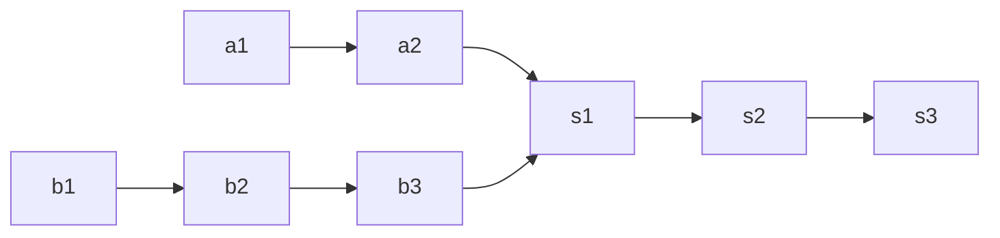

# DSA 04.04: Merging and Sorting Linked Lists

*Part of the [Linked lists plan](00_plan.md) · Time: about 6 hours (2.5 reading, 3.5 problems) · You need: [Core patterns](02_core_patterns_two_pointers_reversal.md) (the dummy node, slow and fast pointers) and [Sorting algorithms inside](../03_binary_search_and_sorting/04_sorting_algorithms_inside.md) (merge sort, stability) · Companion code: [`04_merging_and_sorting_lists_demo.cpp`](04_merging_and_sorting_lists_demo.cpp)*

By the end of this tutorial you can:

- merge two sorted lists by relinking, in O(1) extra memory and stably, and say why the test is `<` and not `<=`;
- merge k sorted lists three ways (one at a time, a heap, pairwise) and say what each costs;
- sort a list with merge sort, top-down (O(log n) stack) and bottom-up (O(1) memory), and say why quicksort and heapsort fit lists badly;
- say what `std::list::merge` and `std::list::sort` do, and when to copy into a vector instead;
- find where two lists meet, in O(1) memory, with the pointer switch.

The companion file (C++20) holds every function below and checks each against `std::merge`, `std::stable_sort`, `std::list` and brute force on all small inputs (114,102 checks). It is short on purpose: the tutorial carries the examples and the problems.

---

## 1. Merging two sorted lists

### 1.1 The idea and the code

Two sorted lists, a finger on the front of each. Take the smaller front node, append it to the result, move that finger. When one list runs out, the rest of the other is already in order, so one pointer write attaches it. The result grows behind a dummy node (tutorial 02, section 1), so "the first node" is not a special case. Nothing is allocated or copied: the nodes of the inputs are relinked.

```cpp
struct ListNode {
    int val;
    ListNode* next;
    explicit ListNode(int v = 0, ListNode* n = nullptr) : val(v), next(n) {}
};

// Merge two sorted lists by relinking their nodes. Stable: on a tie the node of a goes first, so the comparison is
// less(b, a). At most n + m - 1 comparisons, O(1) extra memory.
template <class Less = std::less<int>>
ListNode* mergeTwo(ListNode* a, ListNode* b, Less less = Less()) {
    ListNode dummy;
    ListNode* tail = &dummy;
    while (a && b) {
        if (less(b->val, a->val)) {
            tail->next = b;
            b = b->next;
        } else {
            tail->next = a;
            a = a->next;
        }
        tail = tail->next;
    }
    tail->next = a ? a : b;  // one list is empty: the other one is already in order
    return dummy.next;
}
```

Take A = `1 3 5` and B = `2 3 4`, and write `3a` and `3b` for the two 3s:

| Step | Fronts | Take | Result so far |
|---|---|---|---|
| 1 | `1`, `2` | `1` | `1` |
| 2 | `3a`, `2` | `2` | `1 2` |
| 3 | `3a`, `3b` | `3a` (a tie: A goes first) | `1 2 3a` |
| 4 | `5`, `3b` | `3b` | `1 2 3a 3b` |
| 5 | `5`, `4` | `4` | `1 2 3a 3b 4` |
| end | `5`, B is empty | attach `5` | `1 2 3a 3b 4 5` |

Five comparisons for 3 + 3 nodes. Four things to remember:

- **Stable.** The test is `less(b, a)`: take from B only when its front is strictly smaller. On a tie A goes first. With `<=` the order of equal records from the two lists flips, and a merge sort built on that merge is no longer stable (Sorting algorithms inside, section 8).
- **Cost.** Every comparison places one node, and the last node is attached without a comparison, so there are at most n + m - 1 comparisons, and at least min(n, m) (the shorter list must be used up). Time O(n + m), extra memory O(1).
- **The inputs are consumed.** After the call `a` and `b` point into the middle of the result. Use only the returned head.
- **`Less`** is any strict weak ordering on `val` (tutorial 03.05, section 1). The default is `<`; pass `std::greater<int>()` for descending lists.

### 1.2 The recursive version

```cpp
// The same merge by recursion. The depth is n + m, so a long list can overflow the stack.
ListNode* mergeTwoRec(ListNode* a, ListNode* b) {
    if (!a) return b;
    if (!b) return a;
    if (b->val < a->val) {
        b->next = mergeTwoRec(a, b->next);
        return b;
    }
    a->next = mergeTwoRec(a->next, b);
    return a;
}
```

It is three lines of logic and easy to get right, but each call places one node, so the depth is n + m. On this machine (8 MB stack, GCC 13.3) it crashed at between 259,682 and 263,586 nodes in total at `-O0`, and between 521,270 and 525,174 at `-O2` (a binary search on the size, with two lists that alternate). Use the loop for anything that can be long; keep the recursion for short lists and for thinking.

### 1.3 What `std::list::merge` does

The library does the same merge on a doubly linked ring. In libstdc++ (GCC 13.3, `list.tcc`) the loop walks the first list; when the front of the second list is smaller, it moves that one node in front of the current position (`_M_transfer`, the splice of tutorial 04.03) and takes the next node of the second list; otherwise it steps forward in the first list. What is left of the second list is moved with one more transfer. Nothing is allocated, the second list ends up empty, no iterator is invalidated, the merge is stable, and there are at most N + R - 1 comparisons (cppreference). Both lists must already be sorted by the same ordering, or the behaviour is undefined. `std::forward_list` has `merge` and `sort` members too.

---

## 2. Merging k sorted lists

LeetCode 23 gives you `k` sorted lists with `N` nodes in all and asks for one sorted list. There are three standard answers, and the difference between them is a good interview talking point.

### 2.1 One at a time

```cpp
// One at a time: the result grows, and every node of the early lists is compared again and again. O(N k).
template <class Less = std::less<int>>
ListNode* mergeKFold(const std::vector<ListNode*>& lists, Less less = Less()) {
    ListNode* result = nullptr;
    for (ListNode* l : lists) result = mergeTwo(result, l, less);
    return result;
}
```

Merge the first list into an empty result, then the second into that, and so on. It is correct and stable, but the result grows, and every merge walks all of it again. If every list has `L` nodes, merging list `i` costs up to `iL - 1` comparisons, so the total is about `L k^2 / 2 = N k / 2`. For two or three lists that is fine; for 1,000 lists of 10 it is millions.

### 2.2 A min-heap of heads

The next node of the output is the smallest of the `k` current heads. Keep the heads in a min-heap: pop the smallest, append it, push its successor if it has one. Each of the `N` nodes is pushed and popped once, O(log k) each: O(N log k) time, O(k) extra memory.

```cpp
// A min-heap that holds the current head of every list. O(N log k).
template <class Less = std::less<int>>
ListNode* mergeKHeap(const std::vector<ListNode*>& lists, Less less = Less()) {
    auto after = [&](const ListNode* x, const ListNode* y) { return less(y->val, x->val); };  // reversed: a min-heap
    std::priority_queue<ListNode*, std::vector<ListNode*>, decltype(after)> heap(after);
    for (ListNode* h : lists)
        if (h) heap.push(h);
    ListNode dummy;
    ListNode* tail = &dummy;
    while (!heap.empty()) {
        ListNode* n = heap.top();
        heap.pop();
        tail->next = n;
        tail = n;
        if (n->next) heap.push(n->next);
    }
    return dummy.next;
}
```

`std::priority_queue` is a max-heap (its top is the element that comes last under the comparison), so `after(x, y)` says "x comes after y" and the smallest value ends on top (tutorial 03.05, section 2.3). Empty lists must not be pushed, or the first `->val` reads a null pointer.

Take the lists `1 4 5`, `1 3 4` and `2 6`. The heap holds one head per list:

| Pop | Push | Heap after (values) | Output so far |
|---|---|---|---|
| start | | `1 1 2` | |
| `1` (list 0) | `4` | `1 2 4` | `1` |
| `1` (list 1) | `3` | `2 3 4` | `1 1` |
| `2` | `6` | `3 4 6` | `1 1 2` |
| `3` | `4` | `4 4 6` | `1 1 2 3` |
| `4` (list 0) | `5` | `4 5 6` | `1 1 2 3 4` |
| `4` (list 1) | none, list 1 is done | `5 6` | `1 1 2 3 4 4` |
| `5` | none | `6` | `1 1 2 3 4 4 5` |
| `6` | none | empty | `1 1 2 3 4 4 5 6` |

The heap is the right tool when the inputs are streams that you read one element at a time, such as `k` sorted files: that is the merge phase of external merge sort (Sorting algorithms inside, section 10). The order of equal values is whatever the heap happens to pop.

### 2.3 Pairwise, like a tournament

Merge the lists in pairs, then the results in pairs, until one list is left. Each round touches every node once, and there are about `lg k` rounds: O(N log k) time, O(log k) stack, no heap.

```cpp
// Merge lists[lo..hi) by halves: the lists are merged in pairs, like a tournament. O(N log k), stable across lists.
template <class Less = std::less<int>>
ListNode* mergeKRange(const std::vector<ListNode*>& lists, int lo, int hi, Less less = Less()) {
    if (lo == hi) return nullptr;
    if (hi - lo == 1) return lists[lo];
    int mid = lo + (hi - lo) / 2;
    return mergeTwo(mergeKRange(lists, lo, mid, less), mergeKRange(lists, mid, hi, less), less);
}
```

For the example, `range(0, 3)` merges list 0 with `merge(list 1, list 2)`. The inner merge takes 4 comparisons (`1 2 3 4 6`), the outer one 7: 11 in all, against 12 for the one-at-a-time version and 13 for the heap. On three tiny lists the three are close; the next table shows what happens when `k` grows.

### 2.4 The three side by side

Comparisons for random values (counted with a comparator that increments a counter; GCC 13.3's `priority_queue`):

| `k` | length | `N` | one at a time | heap | pairwise | `N lg k` |
|---|---|---|---|---|---|---|
| 64 | 100 | 6,400 | 206,216 | 52,627 | 38,285 | 38,400 |
| 1,000 | 10 | 10,000 | 4,541,718 | 118,057 | 97,845 | 99,658 |
| 8 | 800 | 6,400 | 27,971 | 31,470 | 19,185 | 19,200 |

- The one-at-a-time count is close to `N k / 2` (204,800 for the first row).
- Pairwise is almost exactly `N lg k`.
- The heap makes 1.2 to 1.6 times as many comparisons as pairwise, and for `k = 8` even the one-at-a-time merge needs fewer than the heap. Counts are not times; the heap's advantage is that it works on streams and needs no recursion.

| Method | Time | Extra memory | Stable | Use it when |
|---|---|---|---|---|
| one at a time | O(N k) | O(1) | yes | `k` is 2 or 3, or lists arrive one at a time |
| heap | O(N log k) | O(k) | no | the lists are streams, or you want a simple loop |
| pairwise | O(N log k) | O(log k) stack | yes | all the lists are in memory and you want few comparisons |

**Stability.** The heap pops equal values in an arbitrary order. On 2,000 random small inputs (two distinct keys, up to six lists) it put equal values from different lists in the wrong order in 1,776 of them. The fix is to store the list index next to the head and break ties by the smaller index (`mergeKHeapStable` in the companion file; Problem 7).

---

## 3. Sorting a list

### 3.1 Why merge sort

LeetCode 148 asks to sort a list in O(n log n). Merge sort is the natural fit, for three reasons:

- It needs only **sequential access**. A merge reads both inputs front to back and never jumps.
- Merging a list means **relinking**, so the O(n) buffer that an array merge sort needs disappears.
- It is **stable** and its cost does not depend on the input.

The others fit worse. Heapsort needs the children of position `i` at `2i + 1` and `2i + 2`: random access, which a list does not have. Quicksort can be written for a list (relink the nodes into a "less", an "equal" and a "greater" list around a pivot and sort the outer two), but a good pivot costs a walk, and the O(n^2) worst case stays. Insertion sort works on a list but is O(n^2) (section 3.5). And `std::sort` does not compile for a list: it needs random-access iterators. The members `std::list::sort` and `std::forward_list::sort` exist for this reason; the first is stable, makes about N log N comparisons, and keeps every iterator valid (cppreference).

### 3.2 Top-down: split, sort the halves, merge

```cpp
// Cut the list after its first half and return the head of the second half. The list has at least two nodes.
ListNode* splitMiddle(ListNode* head) {
    ListNode* slow = head;
    ListNode* fast = head->next;
    while (fast && fast->next) {
        slow = slow->next;
        fast = fast->next->next;
    }
    ListNode* second = slow->next;
    slow->next = nullptr;
    return second;
}

// Top-down merge sort: split, sort both halves, merge. Stable, O(n log n), O(log n) stack.
template <class Less = std::less<int>>
ListNode* sortListTopDown(ListNode* head, Less less = Less()) {
    if (!head || !head->next) return head;
    ListNode* second = splitMiddle(head);
    ListNode* left = sortListTopDown(head, less);
    ListNode* right = sortListTopDown(second, less);
    return mergeTwo(left, right, less);
}
```

`splitMiddle` uses the slow and fast pointers of tutorial 02, section 2.1, with `fast` starting one node ahead. The first half gets `ceil(n / 2)` nodes: `n = 2` gives `1 | 1`, `n = 3` gives `2 | 1`, `n = 5` gives `3 | 2`. The start matters: if `fast` started at `head`, a two-node list would give `slow` the second node, the left half would be the whole list, and the recursion would never end (mistake 3).

**Cost.** There are `ceil(lg n)` levels. On each level the splits walk about `n / 2` nodes in all and the merges make at most `n` comparisons, so the time is O(n log n) for every input. The stack is O(log n), not O(1). The comparisons are at most `n ceil(lg n) - 2^ceil(lg n) + 1`, which is 8,977 for `n = 1000` (Sorting algorithms inside, section 3.3), while no comparison sort can always do better than `ceil(lg n!) = 8,530`. Measured on 1000 random values (the average of 200 lists): 8,710.6 comparisons. A sorted list took 5,044, and a reversed one 4,932.

### 3.3 Bottom-up: runs of 1, 2, 4, ...

Skip the recursion: treat every node as a sorted run of length 1, merge neighbouring runs into runs of 2, then 4, until one run is left.

```cpp
// Cut the list after n nodes (n >= 1) and return the head of the rest, or nullptr if there is no rest.
ListNode* cut(ListNode* head, int n) {
    for (int i = 1; head && i < n; ++i) head = head->next;
    if (!head) return nullptr;
    ListNode* rest = head->next;
    head->next = nullptr;
    return rest;
}

// Bottom-up merge sort: merge runs of 1, then 2, then 4 nodes, until one run is left. Stable, O(n log n), O(1) memory.
template <class Less = std::less<int>>
ListNode* sortListBottomUp(ListNode* head, Less less = Less()) {
    int len = 0;
    for (ListNode* p = head; p; p = p->next) ++len;
    ListNode dummy(0, head);
    for (int width = 1; width < len; width *= 2) {
        ListNode* prev = &dummy;  // the last node of the part that is already merged in this pass
        ListNode* cur = dummy.next;
        while (cur) {
            ListNode* left = cur;
            ListNode* right = cut(left, width);
            cur = cut(right, width);
            prev->next = mergeTwo(left, right, less);
            while (prev->next) prev = prev->next;  // walk to the end of the merged run
        }
    }
    return dummy.next;
}
```

In one pass, `cut(left, width)` detaches the first `width` nodes and returns the rest; a second `cut` takes the next `width` nodes as `right`; they are merged and attached after the part already done (`prev`), and `prev` walks to the end of the merged run. Take `5 3 8 1 9 2 7 4`:

| `width` | Comparisons | The list after the pass (runs in brackets) |
|---|---|---|
| start | | `5 3 8 1 9 2 7 4` |
| 1 | 4 | `[3 5] [1 8] [2 9] [4 7]` |
| 2 | 6 | `[1 3 5 8] [2 4 7 9]` |
| 4 | 7 | `[1 2 3 4 5 7 8 9]` |

17 comparisons in all. When `n` is not a power of two the last run of a pass is shorter, and it merges with whatever is left (Problem D).

This uses a handful of pointers: **O(1) extra memory**, the follow-up of LeetCode 148. Each pass makes fewer than `n` comparisons, so the total is below `n ceil(lg n)`. The runs are not balanced when `n` is not a power of two, so the worst case is a little worse than the top-down one. Over all permutations: `n = 5` needs up to 9 comparisons where top-down needs 8, and `n = 9` needs up to 25 where top-down needs 21. On random input the two are within about 0.1% (1000 values: 8,719.6 and 8,710.6).

**What the library does.** GCC 13.3's `std::list::sort` is also bottom-up, but it takes one node at a time: the node goes into a "carry" list and is merged into an array of 64 scratch lists, where list `i` is empty or holds `2^i` nodes; at the end the scratch lists are merged from the smallest. Those are the same merges as the pass-by-pass version, and the comparison counts agree on every input I tried (all permutations up to 9 elements and 20,000 random lists, 429,114 inputs). The Linux kernel's `list_sort` (`lib/list_sort.c`) is of the same family; its comments say it merges as soon as it can while keeping the merged runs within a 2:1 size ratio, and claim that this avoids cache thrashing and saves about `0.2 n` comparisons against the plain version. Those are the author's claims; I did not measure them.

### 3.4 Time: it is the memory

All three do the same merges, so you might expect the same speed. Nanoseconds per element, sorting random `int`s (GCC 13.3, `-O2`, this 2-core VM; the best of 5 runs, each in a fresh process; nodes allocated in the order of the input; building the list is not timed):

| `n` | `vector` + `std::sort` | `std::list::sort` | top-down | pass-by-pass bottom-up | bottom-up / top-down |
|---|---|---|---|---|---|
| 1,000 | 36.2 | 77.8 | 62.0 | 67.9 | 1.1 |
| 10,000 | 47.5 | 102.9 | 90.4 | 129.5 | 1.4 |
| 100,000 | 59.7 | 146.3 | 130.8 | 329.5 | 2.5 |
| 1,000,000 | 69.7 | 284.7 | 278.8 | 1,171.8 | 4.2 |

Same O(n log n), yet my bottom-up sort is 4.2 times slower than the top-down one at a million nodes, and the gap grows with `n`. That is what a cache effect looks like. The top-down sort and the library finish each small sublist while its nodes are still in cache, and the pass-by-pass version sweeps the whole list on each of its 20 passes, walking it several times per pass (two `cut`s, the merge, and the walk to the end of the run). I did not profile it, so read this as the likely reason, not a proven one. Even the fast list sorts are about 4 times slower than the vector at a million elements (284.7 and 278.8 against 69.7).

So when O(n) extra memory is allowed, **copy the values into a vector, sort it, and write them back** along the list: 92.8 ms for a million values in the same setup, against about 280 ms for the best list sort. For LeetCode 148 the usual accepted answer is the top-down one; the follow-up asks for O(1) memory, and then you write the bottom-up one. Ask whether the recursion stack counts as extra memory.

### 3.5 Insertion sort on a list (LeetCode 147)

```cpp
// Insertion sort on a list: take each node and walk the sorted part to its place. Stable, O(n^2), O(1) memory.
ListNode* insertionSortList(ListNode* head) {
    ListNode dummy;
    while (head) {
        ListNode* next = head->next;
        ListNode* p = &dummy;
        while (p->next && !(head->val < p->next->val)) p = p->next;  // stop before the first greater value
        head->next = p->next;
        p->next = head;
        head = next;
    }
    return dummy.next;
}
```

Take the first node of the unsorted rest and walk the sorted part from its front to the place just before the first strictly greater value. It is stable, uses O(1) memory and is O(n^2). Unlike on an array, **a sorted input is the slow case**: every node walks the whole sorted part, because the walk starts at the front. For `n = 1000`: 499,500 comparisons for a sorted list, 999 for a reversed one (each new node is smaller than the first and stops at once), and about 250,000 for random input (the average of 20 lists was 249,445). Keeping a pointer to the last sorted node and comparing with it first makes the sorted case O(n) (Problem 8).

---

## 4. Where two lists meet

### 4.1 The problem (LeetCode 160)

Two singly linked lists may join and share a tail, from the join on they are one list. Find the first shared **node** (the same address, not an equal value), or `nullptr`. The lists must be left as they were, and there is no cycle.



A has `x = 2` private nodes, B has `y = 3`, and `c = 3` nodes are shared. Three ways:

1. **Hash set.** Put the address of every node of A in a set, then walk B until a node is in it. O(n + m) time, O(n) memory.
2. **Length difference.** Count both lists, step the longer one forward by the difference, then walk both together until the nodes are equal. O(n + m) time, O(1) memory, three walks.
3. **The pointer switch.** Walk `p` along A and then along B, and `q` along B and then along A. Both walk the same total length, so they arrive together:

```cpp
// The shared node of two lists that join into one (LeetCode 160), or nullptr. Each pointer walks its own list and then
// the other one, so both walk n + m nodes and arrive together. Neither list is changed.
ListNode* getIntersection(ListNode* a, ListNode* b) {
    ListNode* p = a;
    ListNode* q = b;
    while (p != q) {
        p = p ? p->next : b;
        q = q ? q->next : a;
    }
    return p;
}
```

### 4.2 Why it works

When `p` falls off the end of A it becomes `nullptr` for one step (that step counts) and then restarts at the head of B. For the example above:

| Step | 0 | 1 | 2 | 3 | 4 | 5 | 6 | 7 | 8 | 9 |
|---|---|---|---|---|---|---|---|---|---|---|
| `p` | `a1` | `a2` | `s1` | `s2` | `s3` | null | `b1` | `b2` | `b3` | `s1` |
| `q` | `b1` | `b2` | `b3` | `s1` | `s2` | `s3` | null | `a1` | `a2` | `s1` |

At step 9 both stand on `s1`. In general `p` needs `x + c + 1 + y` steps to reach `s1` (A, the null step, then B's private part) and `q` needs `y + c + 1 + x`: the same number, whatever `x` and `y` are. That is the whole proof. Without a shared node (`c = 0`) both fall off the end of their second list at the same step, `p == q == nullptr`, the loop stops, and the answer `nullptr` is returned. For A = `1 2` and B = `3` this takes 4 steps, `n + m + 1`.

The `nullptr` step is not optional: `p = p->next ? p->next : b` skips it, the pointers then circle forever when there is no shared node (Problem B4). If the lists are the same list the loop ends at step 0, and an empty list gives `nullptr` (Problem E).

---

## 5. Common mistakes

1. **Forgetting the leftover.** After the loop, `tail->next = a ? a : b;` attaches what is left of the longer list. Without it that part is lost, and leaked (Problem B1).
2. **`<=` in the merge test** (`b->val <= a->val`). The values still come out sorted, so a test on plain `int`s never notices; the merge, and every sort built on it, is no longer stable. Test with records: a key and a tag that shows the original order.
3. **Starting `fast` at `head` in the split**, or forgetting `slow->next = nullptr`. The first makes a two-node list split into 2 and 0, the second leaves the halves joined; both recurse for ever (Problem B2).
4. **Not cutting the runs, or not walking `prev` to the end of the merged run**, in the bottom-up sort. `cut` must set the last node's `next` to `nullptr`; without the walk the next merge overwrites the previous run (Problem B3).
5. **The recursive merge on a long list.** The depth is n + m: it crashed at about 260,000 nodes (`-O0`) and 520,000 (`-O2`) on this machine.
6. **A max-heap for merge k**, or pushing empty lists. `priority_queue` with `<` on the values pops the largest first; a `nullptr` head is dereferenced on the first comparison. Remember that `lists` may be empty, or hold empty lists.
7. **The one-at-a-time merge for large `k`.** O(N k).
8. **Intersection by value**, or by "equal length", or without the `nullptr` step (Problem B4).
9. **`std::sort` on a list.** It does not compile. Use `list.sort()`, or copy to a vector.
10. **Believing a list sort is as fast as a vector sort.** Same O(n log n), but about 4 times slower at a million elements in my measurement. What you get in exchange is no O(n) buffer and no element moves.

---

## 6. Questions to answer out loud

1. **Why does merging two sorted lists need no extra memory, when merging two arrays does?** The merge relinks nodes. No value moves, so there is no output buffer.
2. **Why `<` and not `<=` in the merge?** To take from the second list only when it is strictly smaller, so equal elements keep their original order: A before B. That is what makes merge sort stable.
3. **Why is merge sort the natural sort for lists?** It reads sequentially, merges by relinking, is stable and costs O(n log n) for every input. Heapsort needs random access, and quicksort keeps its O(n^2) worst case.
4. **What extra memory do top-down and bottom-up list merge sort use?** Top-down: O(log n) of stack. Bottom-up: O(1), a few pointers, which is what the follow-up of LeetCode 148 asks for.
5. **Three ways to merge `k` lists, and when to use each?** One at a time, O(N k), for 2 or 3 lists. A heap, O(N log k), O(k) memory, for streams. Pairwise, O(N log k), O(log k) stack, for the fewest comparisons when everything is in memory.
6. **How does the pointer switch find the intersection, and what if there is none?** Each pointer walks its own list and then the other one, so both walk the same total length and meet at the first shared node. With none, both become `nullptr` at the same step and the loop ends.
7. **A million `int`s in a list must be sorted, and O(n) extra memory is fine. What do you do?** Copy the values into a vector, sort it, write them back along the list. In my measurement that was about 3 times faster than the best list sort. If you must keep the order of equal records, use `std::stable_sort`.

---

## 7. Problems

### Paper problems

**Problem A.** Merge A = `2 4 4 9` and B = `1 4 8` with `mergeTwo`. Write the order in which the nodes are taken, say which list each `4` comes from, and count the comparisons.

**Problem B.** Each snippet has a bug. Say what goes wrong and on which input.

```cpp
// B1: the end of mergeTwo
while (a && b) { /* as in section 1.1 */ }
return dummy.next;

// B2: splitMiddle
ListNode* slow = head;
ListNode* fast = head;
while (fast && fast->next) {
    slow = slow->next;
    fast = fast->next->next;
}
ListNode* second = slow->next;
slow->next = nullptr;
return second;

// B3: one pass of sortListBottomUp
prev->next = mergeTwo(left, right, less);
// (the line that walks prev to the end of the merged run is missing)

// B4: getIntersection
while (p != q) {
    p = p->next ? p->next : b;
    q = q->next ? q->next : a;
}
return p;
```

**Problem C.** There are 8 sorted lists of 100 nodes each. Give an upper bound on the number of comparisons for the one-at-a-time merge and for the pairwise merge. (A merge of sizes `s` and `t` makes at most `s + t - 1` comparisons.)

**Problem D.** Run the bottom-up sort by hand on `6 2 9 4 1 7 3`. For each pass write the runs and the comparisons.

**Problem E.** Trace `getIntersection` when A is empty (`nullptr`) and B is `7 8`: write `p` and `q` at each step.

### Code problems

For each: *where* to solve it, the *goal*, and *how* to start.

1. **LeetCode 21, Merge Two Sorted Lists (Easy, from a mirror).** *Goal:* the head of the merged list. *How:* the dummy-node loop of section 1.1, then the recursive version; decide which one you would submit.
2. **LeetCode 23, Merge k Sorted Lists (Hard).** *Goal:* one sorted list from `k` of them, with `k` up to 10^4. *How:* write the heap and the pairwise versions. Then run the one-at-a-time version on 10,000 lists of one node and count its comparisons.
3. **LeetCode 148, Sort List (Medium).** *Goal:* sort in O(n log n) time; the follow-up asks for O(1) memory. *How:* top-down first (base case, split, two calls, merge), then bottom-up. Test both against `std::stable_sort` on random vectors.
4. **LeetCode 147, Insertion Sort List (Medium).** *Goal:* sort by insertion. *How:* a dummy head for the sorted part, and for each node a walk that stops before the first greater value.
5. **LeetCode 160, Intersection of Two Linked Lists (Easy).** *Goal:* the first shared node, or `nullptr`, without changing the lists. *How:* the hash set, then the length difference, then the pointer switch. Add a test with equal values in different nodes.
6. **LeetCode 86, Partition List (Medium as far as I know; the page did not load).** *Goal:* put the nodes with `val < x` before the others and keep the order inside each group. *How:* two dummy lists, one for each group, then join them; set the last `next` of the second group to `nullptr` so no cycle is left.
7. **In your own editor: a stable heap merge.** Make the heap version stable across lists. *How:* store `(head, list index)` and break ties by the smaller index. Test against the one-at-a-time merge on records with a key and a tag; the two outputs must be identical.
8. **In your own editor: insertion sort that is O(n) on a sorted list.** *How:* remember the last sorted node and compare with it first. Check that it is still stable.
9. **In your own editor: a natural merge sort.** *How:* walk once and cut the list into maximal non-decreasing runs, then merge the runs in pairs until one is left. Count comparisons on sorted, reversed and random lists and compare with `sortListBottomUp`.
10. **In your own editor: `DList::merge`.** Add `void merge(DList& other)` to the `DList` of tutorial 04.03 with the same behaviour as `std::list::merge`. *How:* walk both lists; when the front of `other` is smaller, unlink it and link it before the current node of `this` (the splice writes plus the two counters); at the end move what is left of `other` before the sentinel.

---

## Answers

**Problem A.** The nodes are taken in the order `1` (B), `2` (A), `4` (A), `4` (A), `4` (B), `8` (B), `9` (A). Both 4s of A go before the 4 of B, because a tie goes to A. The comparisons are `(2,1)`, `(2,4)`, `(4,4)`, `(4,4)`, `(9,4)`, `(9,8)`: 6, which is 4 + 3 - 1. B is then empty and `9` is attached without a comparison.

**Problem B.**

- **B1.** The leftover is never attached. `tail` is the last node of the list that ran out, and its `next` is `nullptr`, so the rest of the other list is lost and leaked. `1 2` merged with `3 4 5` returns `1 2`. Add `tail->next = a ? a : b;`.
- **B2.** `fast` starts at `head`. For two nodes `slow` ends on the second node, `second` is `nullptr`, and the "left half" is the whole list again, so the recursion never ends (AddressSanitizer: stack-overflow). Every list of two or more nodes shrinks to such a half sooner or later, so every such input fails.
- **B3.** `prev` stays at the dummy node, so each merge overwrites `dummy.next` and the earlier runs are lost. `4 3 2 1` becomes `1 2`: the pass at width 1 builds `3 4`, then overwrites it with `1 2`.
- **B4.** It works when the lists meet. When they do not, `p` and `q` never become `nullptr`: they keep cycling through their lists and are never equal, so the loop does not end. A = `1`, B = `2` is enough.

**Problem C.** One at a time: merge `i` (for `i = 2..8`) joins `(i - 1) * 100` nodes with 100 more, so at most `100 i - 1` comparisons, and the sum is `100 * (2 + ... + 8) - 7 = 3,493`. Pairwise: four merges of 100 + 100 (at most 199 each: 796), two of 200 + 200 (399 each: 798) and one of 400 + 400 (799): 2,393. On random values I counted 3,480 and 2,389 (the heap: 3,940), and `N lg k = 2,400` is close to the second.

**Problem D.**

| `width` | Runs after the pass | Comparisons |
|---|---|---|
| 1 | `[2 6] [4 9] [1 7] [3]` | 3 (the lone `[3]` merges with nothing: 0) |
| 2 | `[2 4 6 9] [1 3 7]` | 5 (3 for the first merge, 2 for the second) |
| 4 | `[1 2 3 4 6 7 9]` | 6 |

14 comparisons in all. That equals the top-down worst case for `n = 7`: `7 * 3 - 8 + 1 = 14`.

**Problem E.** `p` starts at `nullptr` and `q` at `7`.

| Step | 0 | 1 | 2 | 3 |
|---|---|---|---|---|
| `p` | null | `7` | `8` | null |
| `q` | `7` | `8` | null | null |

At step 3 both are `nullptr`, so the loop stops and `nullptr` is returned: `n + m + 1 = 0 + 2 + 1` steps.

**Problems 1 to 10.**

1. The loop ends with `tail->next = a ? a : b;`. The recursive version is four lines.
2. Heap: skip empty lists, pop, append, push the successor. Pairwise: `lo == hi` returns `nullptr`, one list returns itself. The one-at-a-time merge on 10,000 single nodes makes up to about 5 * 10^7 comparisons: correct, but slow.
3. Top-down: `if (!head || !head->next) return head;`, split, two calls, merge. Bottom-up: count the length, then widths 1, 2, 4, ..., with cut, cut, merge and a walk to the tail.
4. Walk `p` from the dummy while `p->next && !(node->val < p->next->val)`, then splice the node in after `p`.
5. The set costs O(n) memory, the other two O(1). The pointer switch is the shortest. A test with two lists `1 2 3` built separately must return `nullptr`.
6. Append each node to the "small" or the "large" list as you walk; finish with `large.tail->next = nullptr` and `small.tail->next = large.head`.
7. The heap entry is a pair, and `after(x, y)` is true when `y.val < x.val`, or when neither value is smaller and `x.index > y.index`. The heap holds one node of each list, so ties inside one list cannot be reordered. The companion file has `mergeKHeapStable` and checks that its output equals the one-at-a-time merge on tagged records.
8. If `node->val >= tail->val`, append at `tail` in O(1); otherwise walk from the front as before. A sorted list then takes n - 1 comparisons. Use `>=` (not `>`) for stability.
9. One pass finds the `r` runs (O(n)); each merge pass halves their number, so there are `ceil(lg r)` passes: O(n log r). A sorted list has `r = 1` and costs n - 1 comparisons.
10. Unlink the node from `other`, link it before the current node of `this` (four pointer writes), then adjust the two counters. When the loop ends, relink the rest of `other` before the sentinel in one step, and set `other` to empty.

---

## Cheat sheet

- Merge two: a dummy node, take from `b` only if `less(b, a)` (strictly smaller, so stable), end with `tail->next = a ? a : b`. At most n + m - 1 comparisons, O(1) memory, inputs consumed. The recursive version has depth n + m.
- `std::list::merge`: node transfers, stable, at most N + R - 1 comparisons, the other list ends empty, nothing is invalidated.
- Merge `k`: one at a time O(N k); heap O(N log k) with O(k) memory, for streams, not stable; pairwise O(N log k), stable, fewest comparisons. Skip empty lists; `lists` may be empty.
- Sort a list with merge sort. Top-down: split (`fast = head->next`, cut with `slow->next = nullptr`), sort both halves, merge; O(log n) stack. Bottom-up: widths 1, 2, 4, ... with `cut`, merge and a walk to the end of the run; O(1) memory (LeetCode 148 follow-up).
- Comparisons: top-down at most `n ceil(lg n) - 2^ceil(lg n) + 1`; bottom-up below `n ceil(lg n)`, a little worse in the worst case (`n = 5`: 9 against 8).
- `std::list::sort`: stable, about N log N, iterators stay valid, the same comparisons as bottom-up (GCC 13.3). A vector round trip was about 3 times faster at a million elements here.
- Insertion sort on a list: O(n^2), stable, O(1) memory; walking from the front makes the sorted input the slow case.
- Intersection: compare nodes, not values. Hash set O(n) memory; length difference; pointer switch (`p`: A then B, `q`: B then A, with the `nullptr` step) in `x + y + c + 1` steps.

---

## Sources

- libstdc++ (GCC 13.3): `bits/list.tcc` (`merge`, `sort`), `bits/stl_list.h` (`_Scratch_list`), `bits/forward_list.h` (`merge`, `sort`).
- cppreference, through mirrors: [`std::list::sort`](https://dum-e.deib.polimi.it/docs/en/cpp/container/list/sort.html) and [`std::list::merge`](https://www.cppreference.com/cpp/container/list/merge).
- Linux `lib/list_sort.c`, through a [mirror](https://git.zx2c4.com/linux-rng/plain/lib/list_sort.c): I read its comments; the claims about the cache and the saved comparisons are the author's and I did not measure them.
- LeetCode pages: [23](https://leetcode.com/problems/merge-k-sorted-lists/), [148](https://leetcode.com/problems/sort-list/), [147](https://leetcode.com/problems/insertion-sort-list/), [160](https://leetcode.com/problems/intersection-of-two-linked-lists/). For 21 the page did not load and "Easy" comes from the leetcode.js.org mirror. For 86 it did not load either; I used a [third-party page](https://ramsayleung.github.io/leetcode_book/docs/000/86_partition_list), which gives no difficulty, so "Medium" is as far as I know.
- Measurements (stack limits, nanoseconds): this VM with 2 cores, GCC 13.3, `-O2`, glibc 2.39. The comparison counts depend on the library version (GCC 13.3); the times and stack limits depend on the machine as well.

**Next:** Linked lists 05, classic interview problems (palindrome list, add two numbers, copy list with random pointer, flatten multilevel list, rotate list, LRU and LFU caches). Say "next" when you are ready.
