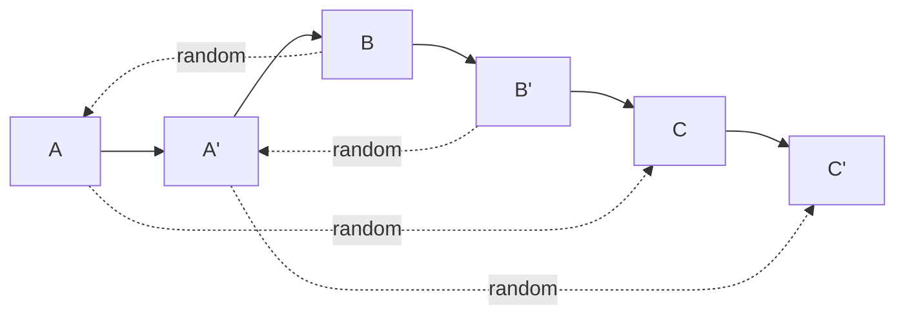
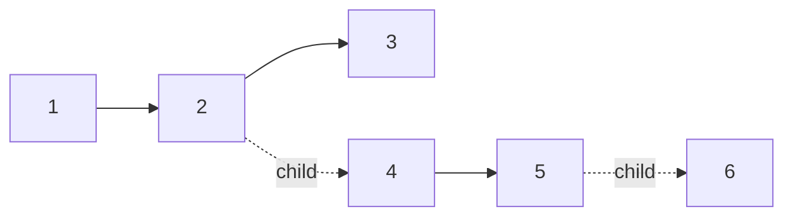
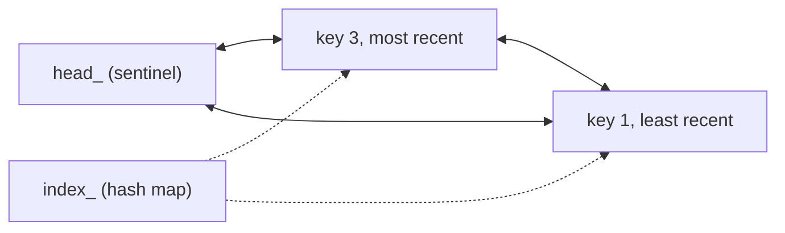

# DSA 04.05: Classic Linked-List Interview Problems

*Part of the [Linked lists plan](00_plan.md) · Time: about 7 hours (3 reading, 4 problems) · You need: [Core patterns](02_core_patterns_two_pointers_reversal.md) (the dummy node, slow and fast pointers, reversal) and [Doubly and circular lists](03_doubly_and_circular_lists.md) (the sentinel ring, `splice`) · Companion code: [`05_classic_interview_problems_demo.cpp`](05_classic_interview_problems_demo.cpp)*

By the end of this tutorial you can:

- check whether a list is a palindrome in O(n) time and O(1) memory, and leave the list as you found it;
- add two numbers stored as lists, with the digits in either order;
- copy a list whose nodes have a `random` pointer, with a hash map and without one;
- flatten a multilevel doubly linked list in place;
- rotate a list by `k` places with the ring trick;
- build an LRU cache and an LFU cache whose `get` and `put` are O(1), and say what every pointer is for.

The companion file (C++20) holds every function below and checks each against a brute-force model (a vector, a number, `std::rotate`, a slow cache made of a vector) on all small inputs and on random ones (1,545,920 checks). Most of the file is those tests and models; the tutorial carries the examples and the problems.

---

## 1. Palindrome list (LeetCode 234)

### 1.1 The problem and the options

Given the head of a singly linked list, say whether its values read the same forwards and backwards. On the mirror I used, the list has 1 to 10^5 nodes with values 0 to 9, and the follow-up asks for O(n) time and O(1) space.

A singly linked list cannot be read backwards, and every answer is a way around that:

1. **Copy the values into a vector** and compare it with its reverse. O(n) time, O(n) memory. It is the simplest, and in an interview you should say it first and then ask whether memory matters.
2. **Recursion.** The call stack reads the list backwards while a second pointer walks forwards. O(n) time, O(n) stack (section 1.3).
3. **Reverse the second half in place** and compare the two halves. O(n) time, O(1) memory, but the list is changed while you work, so you must put it back.

### 1.2 Reverse the second half

The plan: find the end of the first half, reverse everything after it, walk inwards from both ends comparing, and reverse the second half again.

```cpp
struct ListNode {
    int val;
    ListNode* next;
    explicit ListNode(int v = 0, ListNode* n = nullptr) : val(v), next(n) {}
};

// Reverse a list in place and return the new head (tutorial 02).
ListNode* reverseList(ListNode* head) {
    ListNode* prev = nullptr;
    while (head) {
        ListNode* next = head->next;
        head->next = prev;
        prev = head;
        head = next;
    }
    return prev;
}

// The last node of the first half: node number ceil(n / 2). The list must not be empty.
ListNode* endOfFirstHalf(ListNode* head) {
    ListNode* slow = head;
    ListNode* fast = head;
    while (fast->next && fast->next->next) {
        slow = slow->next;
        fast = fast->next->next;
    }
    return slow;
}

// O(n) time, O(1) extra memory. The list is the same when the function returns.
bool isPalindrome(ListNode* head) {
    if (!head) return true;
    ListNode* firstEnd = endOfFirstHalf(head);
    ListNode* second = reverseList(firstEnd->next);  // the second half, backwards
    bool ok = true;
    for (ListNode *p = head, *q = second; q; p = p->next, q = q->next) {
        if (p->val != q->val) {
            ok = false;
            break;
        }
    }
    reverseList(second);  // put the second half back: firstEnd->next still points at its first node
    return ok;
}
```

`reverseList` is the loop of tutorial 02, section 4.2. `endOfFirstHalf` stops when `fast` is on the last or the last-but-one node, and `slow` is then on node number `ceil(n / 2)`: node 3 for `n = 5` and node 2 for `n = 4`. It is the same split as `splitMiddle` in tutorial 04.04, section 3.2. For an odd `n` the middle node belongs to the first half and is never compared, which is right: it equals itself. The second half has `floor(n / 2)` nodes, never more than the first, so `q` always runs out first and `p` never falls off the list.

Take `1 2 3 2 1`. The first half is `1 2 3`, `firstEnd` is the node `3`, and the second half `2 1` is reversed to `1 2`:

| Step | `p` | `q` | Equal? |
|---|---|---|---|
| 1 | `1` | `1` | yes |
| 2 | `2` | `2` | yes |
| end | | null | the answer is `true` |

For `1 2 2 1` the first half is `1 2`, the reversed second half is `1 2`, and the two comparisons succeed in the same way.

While the halves are compared the list is **not a clean list**. Node `3` still points at the old fourth node, which is now the last node of the reversed half. A reader on another thread would see `1 2 3 2` and a shorter list than before. The last line puts it right: reversing `second` again makes the old fourth node the head of the half again, and `firstEnd->next` already points at it, so no assignment is needed. Because the restore is after the loop and not inside it, a mismatch (`break`) restores the list too.

**Cost.** About `n / 2` steps to find the middle, `n / 2` to reverse, up to `n / 2` to compare and `n / 2` to restore: O(n) time and O(1) memory, with a constant of roughly two walks over the whole list.

### 1.3 The recursive version

```cpp
// The recursive version: the call stack walks back from the end while `front` walks forward. Depth n.
static bool matchesFront(ListNode*& front, ListNode* cur) {
    if (!cur) return true;
    if (!matchesFront(front, cur->next)) return false;
    if (front->val != cur->val) return false;
    front = front->next;
    return true;
}

bool isPalindromeRec(ListNode* head) {
    ListNode* front = head;
    return matchesFront(front, head);
}
```

`front` is passed by reference. The deepest call stands on the last node and compares it with the first node, which `front` points at; then `front` moves on, and the call above compares the last-but-one node with the second node, and so on. Every pair is compared twice (the calls past the middle repeat the pairs already seen) and the depth is `n`. Use it for short lists; for the stated limit of 10^5 nodes prefer the loops (the demo tests it on 1,001 nodes only, and tutorial 04.04, section 1.2 measured a similar recursion crashing at about 260,000 nodes).

**Ask before you modify the input.** If another thread may read the list, or the nodes are `const`, the in-place version is wrong and the vector is the answer.

---

## 2. Add two numbers (LeetCode 2 and 445)

### 2.1 Digits in reverse order (LeetCode 2)

Each list is a non-negative integer with one digit per node and the **least significant digit first**: 342 is `2 4 3`. Add two such lists and return the sum in the same form. On the mirror, each list has 1 to 100 nodes and no leading zeros. A hundred digits do not fit in an `int` or a `long long`, so you cannot convert, add and convert back. You add digit by digit as on paper, and the lists start exactly where the paper method starts.

```cpp
// LeetCode 2: the digits are stored with the least significant digit first, so the lists already start where the
// addition starts. The result is a new list; the inputs are not changed.
ListNode* addTwoNumbers(const ListNode* a, const ListNode* b) {
    ListNode dummy;
    ListNode* tail = &dummy;
    int carry = 0;
    while (a || b || carry) {
        int sum = carry;
        if (a) {
            sum += a->val;
            a = a->next;
        }
        if (b) {
            sum += b->val;
            b = b->next;
        }
        tail->next = new ListNode(sum % 10);
        tail = tail->next;
        carry = sum / 10;
    }
    return dummy.next;
}
```

The loop continues while there is a digit in `a`, a digit in `b`, **or a carry**. The sum of two digits and a carry is at most `9 + 9 + 1 = 19`, so the carry is 0 or 1. The result is built with new nodes behind a dummy node (tutorial 02, section 1) and the inputs are not changed. For 342 + 465:

| Step | Digits | Sum with carry | Node | Carry out |
|---|---|---|---|---|
| 1 | `2`, `5` | 7 | `7` | 0 |
| 2 | `4`, `6` | 10 | `0` | 1 |
| 3 | `3`, `4` | 3 + 4 + 1 = 8 | `8` | 0 |

The result is `7 0 8`, which is 807. For 99 + 1, that is `9 9` and `1`, the lists run out after two steps with a carry of 1, and the condition `|| carry` adds a third node: `0 0 1`. Without it the answer is `0 0`.

### 2.2 Digits in forward order (LeetCode 445)

Now the **most significant digit is first**: 7243 is `7 2 4 3`. The addition must start at the *end* of both lists, and lists of different lengths are aligned at their ends, not at their starts. The follow-up asks for a solution that does not reverse the inputs. Three ways:

1. **Two stacks.** Push all the digits of each list, pop one from each, add. Each new digit goes in *front* of the result, so the list comes out in the right order with no final reversal.
2. **Reverse, add, reverse.** Reverse both inputs, use `addTwoNumbers`, reverse the sum, and reverse the inputs back if the caller must not see them changed. O(1) memory besides the result.
3. **Recursion.** Count both lengths, recurse on the longer list while the shorter one is "padded" with zeros at its start, and add on the way back. The stack is O(n).

```cpp
// LeetCode 445: the most significant digit comes first. Two stacks hold the digits; popping gives the least
// significant digit first, and each new node goes in FRONT of the result, so no reversal is needed.
ListNode* addForward(const ListNode* a, const ListNode* b) {
    std::vector<int> sa, sb;
    for (; a; a = a->next) sa.push_back(a->val);
    for (; b; b = b->next) sb.push_back(b->val);
    ListNode* head = nullptr;
    int carry = 0;
    while (!sa.empty() || !sb.empty() || carry) {
        int sum = carry;
        if (!sa.empty()) {
            sum += sa.back();
            sa.pop_back();
        }
        if (!sb.empty()) {
            sum += sb.back();
            sb.pop_back();
        }
        head = new ListNode(sum % 10, head);
        carry = sum / 10;
    }
    return head;
}

// The same without stacks: reverse both inputs, use addTwoNumbers, reverse the sum, and put the inputs back.
ListNode* addForwardByReversing(ListNode* a, ListNode* b) {
    a = reverseList(a);
    b = reverseList(b);
    ListNode* sum = reverseList(addTwoNumbers(a, b));
    reverseList(a);  // the inputs are as they were; the heads are known to the caller
    reverseList(b);
    return sum;
}
```

For 7243 + 564 the stacks hold `7 2 4 3` and `5 6 4`:

| Pop | Sum with carry | Digit | Carry out | List so far (front first) |
|---|---|---|---|---|
| `3`, `4` | 7 | `7` | 0 | `7` |
| `4`, `6` | 10 | `0` | 1 | `0 7` |
| `2`, `5` | 2 + 5 + 1 = 8 | `8` | 0 | `8 0 7` |
| `7`, none | 7 | `7` | 0 | `7 8 0 7` |

The sum is 7807. Both versions take O(n + m) time. The stack version needs O(n + m) extra memory; the reversing version, none beyond the result, and it touches the inputs four times (two reversals and two restores).

---

## 3. Copy a list with random pointers (LeetCode 138)

### 3.1 The problem

Every node has a value, a `next` pointer and a `random` pointer; `random` points at any node of the same list, or is null (the struct `RNode` is at the top of the next listing). Build a **deep copy**: new nodes, with the same values, where every pointer of the copy points inside the copy and none points into the original. On the mirror, the list has 0 to 1,000 nodes with values from -10^4 to 10^4.

Copying along `next` is easy. The trouble is `random`: when you make the copy of node `A`, the copy of `A->random` may not exist yet (the target is later in the list), or it may exist but you have no way to find it. You need a way to go from an original node to its copy.

### 3.2 A map from original to copy

```cpp
struct RNode {
    int val;
    RNode* next;
    RNode* random;  // any node of the same list, or nullptr
    explicit RNode(int v = 0) : val(v), next(nullptr), random(nullptr) {}
};

// A hash map from every old node to its copy. O(n) time, O(n) extra memory.
RNode* copyRandomMap(RNode* head) {
    std::unordered_map<const RNode*, RNode*> copy;
    for (RNode* p = head; p; p = p->next) copy[p] = new RNode(p->val);
    for (RNode* p = head; p; p = p->next) {
        copy[p]->next = copy[p->next];      // copy[nullptr] is created as nullptr, so a null needs no special case
        copy[p]->random = copy[p->random];
    }
    return copy[head];
}
```

The first pass makes every copy and remembers it; the second pass wires `next` and `random` through the map. When a pointer is null, `copy[nullptr]` creates the entry `nullptr -> nullptr` the first time it is looked up, so a null `next` or `random` needs no `if`. This is O(n) time and O(n) extra memory for the map, and it does not touch the original.

### 3.3 Weave the copies into the list

The map only answers "where is the copy of X?". The list can answer that itself if the copy of `X` sits right after `X`: then it is `X->next`.

```cpp
// No map: weave each copy in after its original (A, A', B, B', ...), so that the copy of X is X->next. O(n) time,
// O(1) extra memory. The original list is the same when the function returns.
RNode* copyRandomWeave(RNode* head) {
    if (!head) return nullptr;
    for (RNode* p = head; p; p = p->next->next) {  // 1. insert a copy after every node
        RNode* c = new RNode(p->val);
        c->next = p->next;
        p->next = c;
    }
    for (RNode* p = head; p; p = p->next->next)  // 2. the copy's random is the copy of the original's random
        p->next->random = p->random ? p->random->next : nullptr;
    RNode* newHead = head->next;
    for (RNode* p = head; p; p = p->next) {  // 3. unweave: restore the original, link the copies together
        RNode* c = p->next;
        p->next = c->next;
        c->next = c->next ? c->next->next : nullptr;
    }
    return newHead;
}
```

Three passes:

1. **Weave.** After every node `A` insert its copy `A'`: `A A' B B' C C'`.
2. **Randoms.** The copy of `p->random` is `p->random->next`, so `p->next->random = p->random->next`. This is valid because pass 1 is finished and no `next` has changed since.
3. **Unweave.** Cut the two lists apart again: each original gets its old `next` back and each copy is linked to the next copy.

Take `A`, `B`, `C` with `A.random = C`, `B.random = A` and `C.random = null`:



The dotted arrows are the random pointers after pass 2 (`C` and `C'` have none). Pass 3 then splits the chain into `A B C` and `A' B' C'`, and both keep their dotted arrows.

### 3.4 Which one

Copy times in nanoseconds per node (GCC 13.3, `-O2`, this 2-core VM; the best of 7 runs, each in a fresh process; the list is built in node order with random pointers chosen uniformly; building and freeing are not timed):

| `n` | map | weave | map / weave |
|---|---|---|---|
| 1,000 | 106.4 | 34.5 | 3.1 |
| 10,000 | 86.9 | 26.9 | 3.2 |
| 100,000 | 118.2 | 28.1 | 4.2 |
| 1,000,000 | 206.2 | 42.7 | 4.8 |

The weave is 3 to 5 times faster here, and the gap grows with `n`. I did not profile it; the likely reasons are that it does no hashing and allocates no table. Memory at a million nodes: the peak resident size grew by 72.1 MiB during the map copy and by 30.5 MiB during the weave, which is just the copied nodes (32 bytes each). So the map costs about 44 more bytes per node.

The weave is not free. It **changes the input** for the duration of the call, so it is wrong for a `const` list or a list another thread reads. And if `new` throws in pass 1, the original is left half woven, while the map version leaves the original untouched. In an interview say the map version first, then offer the weave as the O(1) follow-up.

---

## 4. Flatten a multilevel list (LeetCode 430)

### 4.1 The problem

A doubly linked list in which a node (`MNode`, at the top of the next listing) has a `prev`, a `next` and also a `child`: the head of another doubly linked list, which may itself contain nodes with children, and so on. Flatten it into **one level**: every node is followed by its whole child list, and only then by its old `next` node. That is the order of a depth-first walk. On the mirror there are at most 1,000 nodes, and the flattened list must have no child pointers left (as far as I know the statement says so; the mirror I read did not).

Take `1 2 3`, where node `2` has the child list `4 5` and node `5` has the child list `6`. The flat list is `1 2 4 5 6 3`.



### 4.2 Splice the child in, and keep walking

```cpp
struct MNode {
    int val;
    MNode* prev;
    MNode* next;
    MNode* child;  // the head of another doubly linked list, or nullptr
    explicit MNode(int v = 0) : val(v), prev(nullptr), next(nullptr), child(nullptr) {}
};

// Walk the list; at a node with a child, splice the whole child list in between the node and its next node and keep
// walking: the next node visited is the child's first node. O(n) time, O(1) extra memory, no recursion.
MNode* flatten(MNode* head) {
    for (MNode* cur = head; cur; cur = cur->next) {
        if (!cur->child) continue;
        MNode* child = cur->child;
        MNode* tail = child;
        while (tail->next) tail = tail->next;  // the last node of the child list
        tail->next = cur->next;
        if (cur->next) cur->next->prev = tail;
        cur->next = child;
        child->prev = cur;
        cur->child = nullptr;
    }
    return head;
}
```

One pointer `cur` walks the list. At a node with a child, the whole child list is spliced in between `cur` and `cur->next` (the splice of tutorial 03, section 3.1, done by hand: four pointer writes). `cur->child` is cleared. The walk then simply carries on with `cur = cur->next`, which is now the first node of the child list, so grandchildren are found later, when `cur` reaches them. For the example:

| `cur` | Action | The list after it |
|---|---|---|
| `1` | no child | `1 2 3` |
| `2` | child `4 5`: its last node is `5`; `5->next = 3`, `3->prev = 5`, `2->next = 4`, `4->prev = 2` | `1 2 4 5 3` |
| `4` | no child | |
| `5` | child `6`: its last node is `6`; `6->next = 3`, `3->prev = 6`, `5->next = 6`, `6->prev = 5` | `1 2 4 5 6 3` |
| `6`, `3` | no child | `1 2 4 5 6 3` |

**It is O(n), although there is a loop inside the loop.** The inner `while (tail->next)` walks the child list to its end. At that moment the child list is still a plain one-level list (its own children have not been spliced in yet), so the walk visits only the nodes of that one list, and it visits each node of the whole structure at most once: when the list that contains it is spliced. Together with the outer walk that is at most about `2n` steps. The memory is O(1) and there is no recursion, so a chain of children 3,000 levels deep (the demo has one) is no problem.

### 4.3 The recursive version

```cpp
// The same by recursion: flatten the list that starts at `head` and return its last node. Depth = nesting depth.
static MNode* flattenToTail(MNode* head) {
    MNode* last = head;
    for (MNode* cur = head; cur;) {
        MNode* next = cur->next;
        last = cur;
        if (cur->child) {
            MNode* childTail = flattenToTail(cur->child);
            cur->next = cur->child;
            cur->child->prev = cur;
            childTail->next = next;
            if (next) next->prev = childTail;
            cur->child = nullptr;
            last = childTail;
        }
        cur = next;
    }
    return last;
}

MNode* flattenRec(MNode* head) {
    if (head) flattenToTail(head);
    return head;
}
```

The function returns the **last node** of the list it flattened, because the caller needs it to attach the old `next`. The depth of the recursion is the nesting depth, which is as large as `n` for a chain of children. The other common answer keeps an explicit stack: go into the child and push the old `next` on the stack, and pop it when a list ends. It uses O(depth) memory too. The splice version is the only one with O(1).

---

## 5. Rotate a list (LeetCode 61)

### 5.1 The problem

Rotate a list to the right by `k` places: the last `k` nodes move to the front. `1 2 3 4 5` rotated by 2 is `4 5 1 2 3`. On the mirror there are 0 to 500 nodes and `k` is between 0 and 2 * 10^9, which is why the loop must not run `k` times.

### 5.2 The ring trick

Join the tail to the head and the list is a ring (tutorial 03, section 5). The rotated list is the same ring cut in a different place: the new tail is the node `n - k` places from the head, and the new head follows it.

```cpp
// Move the last k nodes to the front. Join the tail to the head (a ring), walk to the new tail, cut the ring there.
ListNode* rotateRight(ListNode* head, int k) {
    if (!head || !head->next || k == 0) return head;
    int n = 1;
    ListNode* tail = head;
    while (tail->next) {
        tail = tail->next;
        ++n;
    }
    k %= n;
    if (k == 0) return head;
    tail->next = head;  // close the ring
    ListNode* newTail = head;
    for (int i = 0; i < n - k - 1; ++i) newTail = newTail->next;
    ListNode* newHead = newTail->next;
    newTail->next = nullptr;  // open the ring
    return newHead;
}
```

One walk finds the length `n` and the old tail. Then `k %= n`: rotating by `n` gives the same list, so only `k mod n` matters, and an `int` is enough (2 * 10^9 is below 2^31 - 1). The new tail is reached after `n - k - 1` steps from the head. For `1 2 3 4 5` and `k = 2`:

| Step | State |
|---|---|
| `n = 5`, `k = 2` | old tail is `5` |
| close the ring | `5 -> 1` |
| walk `5 - 2 - 1 = 2` steps from `1` | the new tail is `3` |
| `newHead = 3->next` | `4` |
| cut: `3->next = nullptr` | `4 5 1 2 3` |

`k = 7` gives `k mod 5 = 2`: the same answer. `k = 5` gives 0, and the list is returned unchanged. The early `if (k == 0) return head;` after `k %= n` is only a shortcut: with `k = 0` the walk ends on the old tail, the ring is cut at the old tail, and the same list comes back. Rotating **left** by `k` is rotating right by `n - k mod n`.

The usual second answer uses two pointers: move `fast` `k` steps ahead, then move both until `fast` is on the last node; `slow` is the new tail. It still needs `n` when `k` can exceed it, so it is no simpler (Problem 6).

---

## 6. LRU cache (LeetCode 146)

### 6.1 The requirements and the design

A cache with a fixed capacity. `get(key)` returns the value, or -1 if the key is absent, and makes the key the **most recently used**. `put(key, value)` inserts the key or updates its value (which also counts as a use); if the cache is over capacity, it first evicts the **least recently used** key. Both operations must be O(1) on average. On the mirror, the capacity is 1 to 3,000 and there are at most 2 * 10^5 calls.

Two jobs, two structures:

- **Find an entry by key:** a hash map.
- **Keep the entries in order of use**, with O(1) "move this one to the front" and O(1) "remove the oldest": a doubly linked list. This is the point of tutorial 03: with a pointer to the node, unlinking it is two writes.

Neither is enough alone. A list finds a key by walking it, O(n). A map has no order. Each structure points into the other: the **map holds a pointer to the node**, so a hit can move the node without searching, and the **node holds its key**, so that when the oldest node is evicted we know which map entry to erase.



### 6.2 The code

```cpp
// A doubly linked list kept in order of use (front = most recent, back = least recent) and a hash map from a key to
// its node. get and put are O(1) on average. A node stores its key: to evict the back node we must erase it from the map.
class LRUCache {
    struct Node {
        int key, value;
        Node *prev, *next;
    };
    int capacity_;
    Node head_{};  // the sentinel of a ring: head_.next is the most recently used node, head_.prev the least
    std::unordered_map<int, Node*> index_;

    void unlink(Node* x) {
        x->prev->next = x->next;
        x->next->prev = x->prev;
    }
    void pushFront(Node* x) {
        x->prev = &head_;
        x->next = head_.next;
        head_.next->prev = x;
        head_.next = x;
    }

public:
    explicit LRUCache(int capacity) : capacity_(capacity) { head_.prev = head_.next = &head_; }
    LRUCache(const LRUCache&) = delete;
    LRUCache& operator=(const LRUCache&) = delete;
    ~LRUCache() {
        for (Node* x = head_.next; x != &head_;) {
            Node* next = x->next;
            delete x;
            x = next;
        }
    }

    int get(int key) {
        auto it = index_.find(key);
        if (it == index_.end()) return -1;
        Node* x = it->second;
        unlink(x);
        pushFront(x);  // a hit makes it the most recently used
        return x->value;
    }

    void put(int key, int value) {
        if (capacity_ <= 0) return;
        auto it = index_.find(key);
        if (it != index_.end()) {
            it->second->value = value;
            unlink(it->second);
            pushFront(it->second);
            return;
        }
        if ((int)index_.size() == capacity_) {
            Node* oldest = head_.prev;
            index_.erase(oldest->key);
            unlink(oldest);
            delete oldest;
        }
        Node* x = new Node{key, value, nullptr, nullptr};
        pushFront(x);
        index_[key] = x;
    }

    int size() const { return (int)index_.size(); }
};
```

- **The ring.** `head_` is the sentinel of tutorial 03, section 2: `head_.next` is the most recently used node and `head_.prev` the least recently used. `unlink` is two pointer writes and `pushFront` four, and neither has a case for "first" or "last" node.
- **`get`** looks the key up, moves the node to the front and returns the value.
- **`put` of an existing key** changes the value *and* moves the node to the front: an update is a use.
- **`put` of a new key** first makes room. The oldest node is `head_.prev`. Its key is read for `index_.erase` *before* the node is deleted; after `delete` the key is gone. Then the new node goes in at the front.
- **Copying is deleted.** The map holds pointers to this object's nodes, so a copy would share them and free them twice. The destructor frees the nodes; the sentinel is a member and needs no `delete`.
- **`capacity_ <= 0`** is guarded: with capacity 0 the "oldest" node would be the sentinel itself. LeetCode promises a capacity of at least 1; a real class needs the guard.

### 6.3 A trace

Capacity 2. The ring is written most recent first.

| Call | Result | Ring after the call |
|---|---|---|
| `put(1, 10)` | | `1` |
| `put(2, 20)` | | `2 1` |
| `get(1)` | 10 | `1 2` |
| `put(3, 30)` | evicts key 2, the back | `3 1` |
| `get(2)` | -1 | `3 1` |
| `put(1, 11)` | an update, moved to the front | `1 3` |
| `put(4, 40)` | evicts key 3 | `4 1` |
| `get(3)` | -1 | `4 1` |
| `get(1)` | 11 | `1 4` |
| `get(4)` | 40 | `4 1` |

### 6.4 Notes

- **The same design is in [Hashing 03](../02_hashing/03_design_a_hash_map.md), section 6**, built from `std::list` and `splice`: the map holds a `list::iterator` and `splice` moves the node. Know both. With `std::list` you write less. With your own nodes you see every pointer, and you can allocate the nodes from an array or a pool (the intrusive style of tutorial 03, section 3.2). A node here is 24 bytes (two `int`s and two pointers) on this machine.
- **A `get` writes.** Moving the node changes the list, so a cache shared by threads needs a lock even for lookups, or it is split into shards (Hashing 03, section 6, has the details).
- **Exact LRU costs memory and writes** (two pointers per key and a list update per hit), so large systems often approximate it. The Redis documentation says its LRU is not exact: it samples a small number of keys at random and evicts the one that has been idle longest, and since version 3.0 it also keeps a pool of good candidates. The number of samples is the setting `maxmemory-samples`; the page's example uses 5 and says that 10 comes very close to true LRU, at more CPU cost.

---

## 7. LFU cache (LeetCode 460)

### 7.1 The requirements

The same interface, but the entry to evict is the one with the **smallest use count**; among entries with the same count, the least recently used one. Every `get` that hits counts as a use, a `put` of a new key creates the entry with count 1, and a `put` of an existing key updates the value and counts as a use. On the mirror it is labelled Hard, the capacity is 1 to 10^4, there are at most 2 * 10^5 calls, and both operations must be O(1) on average.

The difference from LRU is easy to see. Capacity 2: `put(1)`, then `get(1)` three times (count 4), then `put(2)`, then `put(3)`. LRU evicts key 1, which is the older of the two. LFU evicts key 2, which has been used once, and keeps the key that was used four times. After that, `get(1)`, `get(2)`, `get(3)` give 1, -1, 3 under LFU and -1, 2, 3 under LRU (I ran this sequence; the example is mine, not LeetCode's).

### 7.2 How can eviction be O(1)?

A heap ordered by (count, last use) keeps the victim on top, but every hit changes a key and costs O(log n) to fix. The O(1) answer uses one fact: **a count only ever grows by 1.** So keep:

- a **list of entries for each count**, ordered by recency inside the list (the front is the most recent);
- a **map from a key to its entry** (an iterator into one of those lists);
- the **smallest count in the cache**, `minFreq_`.

```text
count 3:  [ k7 ]
count 2:  [ k3 k9 ]         front = most recent
count 1:  [ k4 k8 k2 ]      the next victim is k2: the back of the list of the smallest count
```

A use moves the entry from the list of count `c` to the front of the list of count `c + 1`: one splice. The victim is the back of `byFreq_[minFreq_]`. And `minFreq_` can only change in two ways:

- after a **use**, if the list of count `c` is now empty and `c` was the minimum, the new minimum is `c + 1` (the entry that just moved there);
- after an **insert**, the minimum is 1.

Nothing else changes it, so there is never a search for "the next non-empty count".

### 7.3 The code

```cpp
// A list of entries for every use count (front = most recent), a hash map from a key to its entry, and the smallest
// use count in the cache. The entry to evict is the back of the list of the smallest count: the least recently used
// among the least frequently used. get and put are O(1) on average.
class LFUCache {
    struct Entry {
        int key, value, freq;
    };
    using List = std::list<Entry>;
    int capacity_;
    int minFreq_ = 0;
    std::unordered_map<int, List::iterator> index_;
    std::unordered_map<int, List> byFreq_;

    // One more use of the entry: splice it to the front of the list of the next count (no allocation, and the
    // iterator in index_ stays valid).
    void touch(List::iterator it) {
        List& from = byFreq_[it->freq];
        List& to = byFreq_[it->freq + 1];
        to.splice(to.begin(), from, it);
        if (from.empty()) {
            if (minFreq_ == it->freq) ++minFreq_;
            byFreq_.erase(it->freq);
        }
        ++it->freq;
    }

public:
    explicit LFUCache(int capacity) : capacity_(capacity) {}

    int get(int key) {
        auto f = index_.find(key);
        if (f == index_.end()) return -1;
        touch(f->second);
        return f->second->value;
    }

    void put(int key, int value) {
        if (capacity_ <= 0) return;
        auto f = index_.find(key);
        if (f != index_.end()) {
            f->second->value = value;
            touch(f->second);
            return;
        }
        if ((int)index_.size() == capacity_) {
            List& victims = byFreq_[minFreq_];
            index_.erase(victims.back().key);
            victims.pop_back();
            if (victims.empty()) byFreq_.erase(minFreq_);
        }
        List& ones = byFreq_[1];
        ones.push_front({key, value, 1});
        index_[key] = ones.begin();
        minFreq_ = 1;  // a new entry has count 1, the smallest possible
    }

    int size() const { return (int)index_.size(); }
    int buckets() const { return (int)byFreq_.size(); }  // how many use-count lists exist
};
```

- **`touch`** is the splice of tutorial 03: no allocation, and the iterator stored in `index_` stays valid because `splice` keeps iterators valid (they now refer into the destination list). `from` and `to` are *references* to lists, not map iterators: `byFreq_[it->freq + 1]` may insert into the map and rehash it, which invalidates map iterators but not references to the elements.
- A list that becomes empty is erased from `byFreq_`, so there are never more lists than entries (the demo checks `buckets() <= size()` after every call).
- **Eviction** happens before the insert, from the back of the list of count `minFreq_`: the least recently used among the least frequently used.
- A `put` of an existing key must call `touch`: the value changes and it counts as a use.

### 7.4 A trace

Capacity 2. Each list is written most recent first.

| Call | Result | `minFreq_` | Lists after the call |
|---|---|---|---|
| `put(1, 10)` | | 1 | `c1[1]` |
| `put(2, 20)` | | 1 | `c1[2 1]` |
| `get(1)` | 10 | 1 | `c1[2]` `c2[1]` |
| `put(3, 30)` | evicts key 2 (count 1) | 1 | `c1[3]` `c2[1]` |
| `get(2)` | -1 | 1 | `c1[3]` `c2[1]` |
| `get(3)` | 30 | 2 | `c2[3 1]` |
| `put(4, 40)` | a tie at count 2: evicts key 1, the older | 1 | `c1[4]` `c2[3]` |
| `get(1)` | -1 | 1 | `c1[4]` `c2[3]` |
| `get(3)` | 30 | 1 | `c1[4]` `c3[3]` |
| `get(4)` | 40 | 2 | `c2[4]` `c3[3]` |

Look at the `minFreq_` column. At `get(3)` list `c1` became empty and was the minimum, so the minimum moved to 2. At `put(4)` it fell back to 1 because the new entry has count 1. At the second `get(3)` list `c2` became empty, but `minFreq_` was 1, so it stayed.

### 7.5 Costs and limits

- Every step is a map lookup, one splice or one `pop_back`: O(1) on average.
- Memory per entry: a list node (`Entry` is three `int`s, 12 bytes, plus two pointers: 28 bytes, 32 with padding) and a map entry, plus a list header for every count in use.
- **LFU never forgets.** A key that was very popular last week keeps its count and may outlive keys that are hot today, and a new key starts at 1 and is the first to go (Problem F shows the second effect). Real systems age the counts. The Redis documentation describes its LFU as a small probabilistic counter per key, a few bits, that decays over time; the settings are `lfu-log-factor` and `lfu-decay-time`.
- The system side (threads, expiry, sharding, other policies) belongs to the planned cache-design tutorial of area 13 (design-style coding); this tutorial is the data-structure side.

---

## 8. Common mistakes

1. **Palindrome: returning inside the loop.** The second half stays reversed and the caller's list is damaged. Restore after the loop (Problem B1).
2. **Palindrome: the wrong middle.** The usual loop with `fast = head` and `while (fast && fast->next)` puts `slow` on the *second* middle for an even `n`, so the halves are uneven and `1 2 3 1` is reported as a palindrome (Problem B2).
3. **Add two numbers: no `|| carry`**, so 99 + 1 loses its last digit. Or, for forward order, adding from the front, or aligning the lists at their starts.
4. **Converting to an integer.** A hundred digits overflow every built-in type.
5. **Copy with random pointers: a shallow copy.** Copying `next` but leaving `random` pointing into the original. Check that no pointer of the copy leads to an original node.
6. **The weave: reading `p->random->next` after the unweave has begun**, or forgetting to restore the original in pass 3. Do the passes in order, and run the second pass over the whole list before the third starts. A null `random` needs the `? :`.
7. **Flatten: forgetting `prev`.** Every splice has four pointer writes, two of them on `prev` (`next->prev` and `child->prev`), and `cur->next` may be null. Also forgetting `child = nullptr`, which leaves a structure that is not flat.
8. **Flatten: a recursion that returns the head.** The caller needs the tail to attach the old `next`.
9. **Rotate: no `k %= n`**, which gives a silent wrong answer for `k >= n` (Problem B3); or an off-by-one in the walk (`n - k` steps instead of `n - k - 1`); or forgetting to open the ring, which leaves a cycle and a list that never ends.
10. **LRU: reading `oldest->key` after the `delete`**, not moving the node on a `put` of an existing key, or a node without a key (then the map entry of the evicted node cannot be erased).
11. **LFU: not updating `minFreq_`**, evicting from the front instead of the back of the list, not counting a `put` of an existing key as a use, or leaving empty lists in the map.
12. **A cache that copies by default.** The default copy would share nodes and double-free them: delete the copy or write it properly (tutorial 03, section 2.3 covers the move case).

---

## 9. Questions to answer out loud

1. **How do you test a singly linked list for a palindrome in O(1) memory?** Find the end of the first half with slow and fast pointers, reverse the second half in place, compare the halves, reverse the second half again. O(n) time, and the list is restored.
2. **What do you ask before you do that?** Whether the list may be modified, even for a moment. If it is shared with other threads or is `const`, copy the values into a vector instead.
3. **Why does the add loop test `a || b || carry`?** Either list may be longer, and a carry may be left when both are used up (99 + 1).
4. **How do you add two numbers whose digits come most significant first?** Start from the ends: use two stacks, or reverse the lists, add, and reverse the sum. Each new digit can be put in front of the result so that no final reversal is needed.
5. **What is the hard part of copying a list with random pointers, and how do you avoid the map?** Finding the copy of an arbitrary node. Put each copy right after its original, so the copy of `X` is `X->next`; set the randoms; then split the lists. O(1) extra memory, and the input is changed for a while.
6. **Why is the flatten O(n) with a loop inside a loop?** The inner walk covers a child list that has not been spliced yet, so each node is walked at most once, in its own list.
7. **What is the ring trick for rotate?** Join the tail to the head, walk `n - (k mod n) - 1` steps to the new tail, cut after it. `k` is reduced modulo `n` first.
8. **Which two structures make an LRU cache O(1), and what points where?** A hash map from a key to a node, and a doubly linked list in order of use. The map holds node pointers; the node holds its key so that eviction can erase the map entry.
9. **How can an LFU cache evict in O(1)?** Keep a list of entries for each use count, ordered by recency, and the smallest count. A use moves an entry to the next list; the victim is the back of the smallest list; the minimum moves up by one only when its list empties after a use, and resets to 1 on insert.

---

## 10. Problems

### Paper problems

**Problem A.** Run `isPalindrome` on `1 2 3 3 1`. Give `firstEnd`, the reversed second half, every comparison, the result, and the list after the call.

**Problem B.** Each snippet has a bug. Say what goes wrong and on which input.

```cpp
// B1: the end of isPalindrome
for (ListNode *p = head, *q = second; q; p = p->next, q = q->next)
    if (p->val != q->val) return false;
reverseList(second);
return true;

// B2: endOfFirstHalf
ListNode* slow = head;
ListNode* fast = head;
while (fast && fast->next) {
    slow = slow->next;
    fast = fast->next->next;
}
return slow;

// B3: rotateRight
// (the line "k %= n;" is missing)

// B4: LRUCache::put, making room
Node* oldest = head_.prev;
unlink(oldest);
delete oldest;
index_.erase(oldest->key);

// B5: LFUCache::touch
List& from = byFreq_[it->freq];
List& to = byFreq_[it->freq + 1];
to.splice(to.begin(), from, it);
if (from.empty()) byFreq_.erase(it->freq);
++it->freq;
// (the update of minFreq_ is missing)
```

**Problem C.** Add `9 9 9` and `1 1` with `addForward` (999 + 11). Write each pop, the digit, the carry and the list so far.

**Problem D.** Copy the list `A B C D` with the weave. The randoms are `A -> C`, `B -> null`, `C -> A`, `D -> D`. Write the list after pass 1 and the `random` of every copy after pass 2.

**Problem E.** Flatten the list `1 2 3 4` where node 1 has the child list `5 6`, node 6 has the child list `7`, and node 3 has the child list `8`. Give the flat list and the number of `tail = tail->next` steps.

**Problem F.** LFU cache, capacity 2, the value of each key equal to the key: `put(1)`, `put(2)`, `get(2)`, `get(2)`, `put(3)`, `get(1)`, `get(3)`, `put(4)`, `get(2)`, `get(3)`, `get(4)`. Which key does `put(3)` evict, and which does `put(4)`? What does each `get` return?

### Code problems

For each: *where* to solve it, the *goal*, and *how* to start. The labels and limits come from mirrors (see Sources).

1. **LeetCode 234, Palindrome Linked List (Easy).** *Goal:* `true` if the list is a palindrome; the follow-up asks for O(n) time and O(1) space. *How:* write the vector version first, then reverse the second half. Call your function twice on the same list: the second answer must be the same, which proves the restore.
2. **LeetCode 2, Add Two Numbers (Medium).** *Goal:* the sum as a list, least significant digit first. *How:* dummy node and the loop of section 2.1. Test `0 + 0`, `99 + 1` and lists of different lengths.
3. **LeetCode 445, Add Two Numbers II (Medium).** *Goal:* the sum with the most significant digit first; the follow-up asks for no reversal of the inputs. *How:* stacks first, then the recursion with the lengths, then the reversing version; compare their memory.
4. **LeetCode 138, Copy List with Random Pointer (Medium).** *Goal:* a deep copy. *How:* the map version, then the weave. Walk the copy and check that no `next` or `random` leads to an original node.
5. **LeetCode 430, Flatten a Multilevel Doubly Linked List (Medium).** *Goal:* a single-level list with correct `prev` and `next` and no children. *How:* the splice version, then the recursive one. Check the `prev` links by walking backwards from the tail.
6. **LeetCode 61, Rotate List (Medium).** *Goal:* rotate right by `k`. *How:* the ring trick; then the version with two pointers `k` apart; then rotate left. Test `k = 0`, `k = n`, `k > n`, one node and no node.
7. **LeetCode 146, LRU Cache (Medium).** *Goal:* `get` and `put` in O(1). *How:* write section 6 from memory, then a second version with `std::list` and `splice` (Hashing 03). Run both against the slow vector model on random operations.
8. **LeetCode 460, LFU Cache (Hard).** *Goal:* O(1) `get` and `put`, with the least recently used key among the least frequently used as the victim. *How:* write the slow model first (a vector of keys with count and time of last use), then the design of section 7. Compare them on random operations with a capacity of 1 to 5.
9. **In your own editor: add two numbers in place.** Reuse the nodes of the longer list (least significant digit first) and allocate a node only for a final carry. *How:* walk both lists; when `b` ends, carry on along `a` only; keep the tail. Test against `addTwoNumbers`.
10. **In your own editor: grow `LRUCache`.** Add `peek(key)` (a read that does not count as a use), `erase(key)` and `resize(newCapacity)` (evict from the back until the size fits). *How:* `erase` is unlink, erase the map entry, delete. Extend the vector model and compare.

---

## Answers

**Problem A.** `n = 5`, so `firstEnd` is the first `3` (node 3). The second half `3 1` is reversed to `1 3`. Comparisons: `1` and `1` are equal; `2` and `3` differ, so `ok` is false and the loop stops. The last line reverses the second half again, so the list is `1 2 3 3 1` again. The result is `false`.

**Problem B.**

- **B1.** A mismatch returns before the second half is reversed back. For `1 2 3 3 1` the call returns `false` and the list is left as `1 2 3 3`: the last node (`1`) is no longer reachable from the head, and is leaked if nothing else points to it. Do the restore after the loop.
- **B2.** For an even `n` this puts `slow` on the second middle node. For `1 2 3 1`, `slow` ends on the third node, the "second half" is the single node `1`, one comparison (`1` and `1`) succeeds, and the list is reported as a palindrome. It is not (`2` and `3` differ).
- **B3.** For `1 2 3 4 5` and `k = 7`, `n - k - 1` is negative, the loop does not run, and `newTail` stays on the head. The ring is cut after the first node and the result is `2 3 4 5 1`, which is a rotation by 4, not by 2. There is no crash: a silent wrong answer, for every `k >= n` that is not a multiple of `n`.
- **B4.** `oldest->key` is read after `delete oldest`: a use after free on the first eviction (AddressSanitizer: heap-use-after-free). Read the key first.
- **B5.** After the touch, `minFreq_` can name a count whose list was just erased. Capacity 1: `put(1, 1)`, `get(1)` (count 2; the list of count 1 is erased; `minFreq_` stays 1), `put(2, 2)`: the cache is full, `byFreq_[1]` creates an empty list, and `back()` on it is undefined behaviour (here the program aborted with `free(): invalid pointer`, GCC 13.3, `-O1`).

**Problem C.**

| Pop | Sum with carry | Digit | Carry out | List so far |
|---|---|---|---|---|
| `9`, `1` | 10 | `0` | 1 | `0` |
| `9`, `1` | 9 + 1 + 1 = 11 | `1` | 1 | `1 0` |
| `9`, none | 9 + 1 = 10 | `0` | 1 | `0 1 0` |
| none | carry only: 1 | `1` | 0 | `1 0 1 0` |

The sum is 1010. The last step exists only because of `|| carry`.

**Problem D.** After pass 1: `A A' B B' C C' D D'`. After pass 2: `A'.random = A.random->next = C->next = C'`; `B'.random = null`; `C'.random = A->next = A'`; `D'.random = D->next = D'`. Pass 3 then separates the two lists.

**Problem E.** The flat list is `1 5 6 7 2 3 8 4`. At node 1 the child list is `5 6`: one step (`5` to `6`) to find its tail. At node 6 the child list is the single node `7`: no step. At node 3 the child is the single node `8`: no step. In all, **1** step.

**Problem F.** `put(3)` evicts key 1: it has count 1, key 2 has count 3. `put(4)` evicts key 3, which was used a moment ago: its count is 2 and key 2 has count 3, so the *newest* entry is the cheapest to lose. The `get`s return, in order: `get(2) = 2`, `get(2) = 2`, `get(1) = -1`, `get(3) = 3`, `get(2) = 2`, `get(3) = -1`, `get(4) = 4`. This is the weakness of LFU described in section 7.5.

**Problems 1 to 10.**

1. The vector version is five lines. For the O(1) version, `endOfFirstHalf`, reverse the rest, compare, reverse again. Calling it twice on `1 2 3` must give `false` both times, and on `1 2 1` `true` both times.
2. `while (a || b || carry)`, new nodes behind a dummy node. `0 + 0` gives `0` (one node); `99 + 1` gives `0 0 1`.
3. Stacks: push both, pop while any is non-empty or there is a carry, put each digit in front. Recursion: count both lengths, recurse on the longer list while the shorter is treated as padded with zeros, and add on the way back. The reversing version uses O(1) memory beyond the result.
4. Map: two passes. Weave: three passes. The check is a set of the original nodes: no `next` or `random` of the copy may be in it.
5. At a node with a child, find the child's tail, then four pointer writes, then `child = nullptr`. Walking back from the tail with `prev` must reproduce the list read forwards, reversed.
6. `k %= n`; `n - k - 1` steps. For the two-pointer version, `fast` moves `k mod n` steps first, then both move until `fast->next` is null; `slow` is the new tail. For a left rotation use `k = n - k % n`.
7. The `std::list` version stores `list<pair<int,int>>` and a map to iterators; `get` does `splice(begin, list, it)`. Both must give the same answers as the vector model.
8. Model: on `put` of a new key at capacity, erase the entry with the smallest `(count, last use)`. The design: `byFreq_`, `index_`, `minFreq_` as in section 7.3.
9. Keep `carry`; at each step add the digit of `b` (if any) into the node of `a`; when `a` ends first, hook `b`'s remaining nodes after `a`'s tail; at the end, a new node for a carry.
10. `peek` is a lookup without `unlink` and `pushFront`. `erase`: find, `unlink`, `index_.erase`, `delete`. `resize`: lower `capacity_` and evict `head_.prev` until `size() <= capacity_`.

---

## Cheat sheet

- Palindrome list: end of the first half (`fast->next && fast->next->next`), reverse the rest, compare `floor(n / 2)` pairs, reverse again. O(n) time, O(1) memory, restore after the loop. Vector copy: O(n) memory, no changes to the list.
- Add two numbers: dummy node, `while (a || b || carry)`, sum at most 19. Forward order: two stacks and put each digit in front, or reverse-add-reverse.
- Copy with random pointers: map from original to copy (O(n) memory, input untouched), or weave the copies in (`X->next` is the copy of `X`), set randoms, unweave (O(1), input changed for a while).
- Flatten: splice the child list between `cur` and `cur->next`, clear `child`, keep walking. O(n), O(1) memory. Recursion returns the tail.
- Rotate right by `k`: count `n`, `k %= n`, close the ring, walk `n - k - 1` steps from the head, cut. Left by `k` is right by `n - k % n`.
- LRU: hash map from key to node + doubly linked list (sentinel ring) in order of use. Node holds the key. Move to the front on every use (a `put` of an existing key too); evict `head_.prev`, reading its key first.
- LFU: `index_` (key to list iterator), `byFreq_` (count to list, most recent first), `minFreq_`. A use splices the entry to the next count; evict the back of `byFreq_[minFreq_]`; the minimum moves up when its list empties after a use and resets to 1 on insert. Erase empty lists.
- Redis approximates LRU by sampling keys and keeps LFU as a small decaying counter (from its documentation).

---

## Sources

- LeetCode pages could not be opened from here, so every difficulty label and limit in this tutorial comes from mirrors: [234](https://ycj.codeberg.page/problems/0234-palindrome-linked-list) (Easy; 1 to 10^5 nodes, values 0 to 9, follow-up O(n) time and O(1) space), [2](https://talentd.in/dsa-corner/questions/add-two-numbers) (Medium; 1 to 100 nodes, digits 0 to 9, no leading zeros), [445](https://ycj.codeberg.page/problems/0445-add-two-numbers-ii) (Medium; same limits, follow-up "without reversing the input lists"), [138](https://pkg.go.dev/github.com/awesee/leetcode/problems/copy-list-with-random-pointer) (Medium; 0 to 1,000 nodes), [430](https://pkg.go.dev/github.com/openset/leetcode/problems/flatten-a-multilevel-doubly-linked-list) (Medium; at most 1,000 nodes; the page does not say what happens to the child pointers, so "child must be null" is as far as I know) and [walkccc.me/LeetCode/problems/430](https://walkccc.me/LeetCode/problems/430/) (Medium), [61](https://ycj.codeberg.page/problems/0061-rotate-list) (Medium; 0 to 500 nodes, `k` up to 2 * 10^9), [146](https://godkingjay.github.io/LeetCode/Medium/146.%20LRU%20Cache) (Medium; capacity 1 to 3,000, at most 2 * 10^5 calls), [460](https://robinali34.github.io/blog_leetcode/2025/11/14/hard-460-lfu-cache) (Hard; capacity 1 to 10^4, at most 2 * 10^5 calls, ties by least recently used). Two of those pages show exponents without the superscript; I read `10^5`, `10^4` and `2 * 10^9` from context.
- Redis eviction: the [documentation page](https://redis.io/docs/latest/develop/reference/eviction/) (approximated LRU by sampling, the candidate pool since 3.0, `maxmemory-samples`, the LFU counter and its decay settings). I did not run Redis.
- Hashing 03, section 6, for the `std::list` and `splice` version of the LRU cache and the notes on locking.
- Measurements (nanoseconds, bytes): this VM with 2 cores, GCC 13.3, `-O2`, glibc 2.39, 64-bit.

**Next:** Linked lists 06, systems-level lists (the Linux `list_head`, free lists, why lists are slow in practice with a benchmark, XOR and unrolled lists). Skip lists and lock-free lists follow in 07. Say "next" when you are ready.
