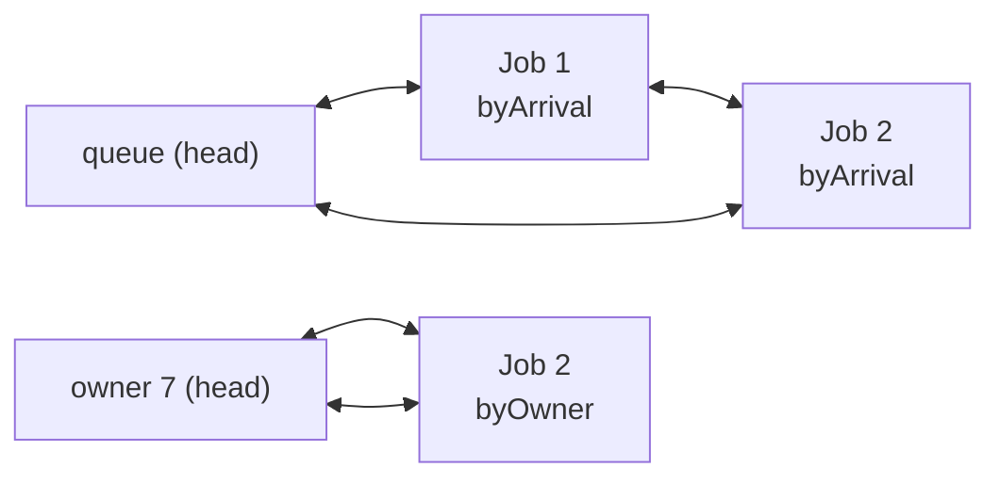
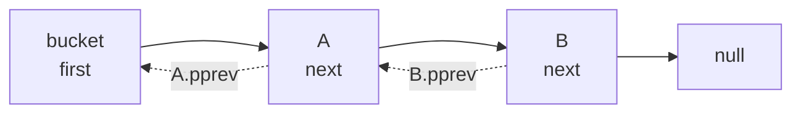
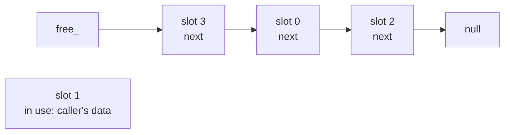
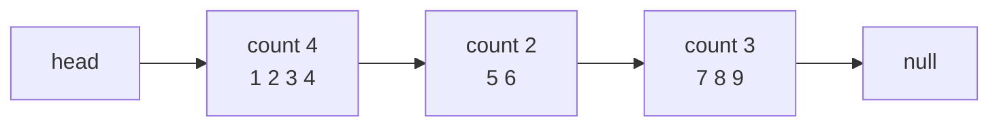

# DSA 04.06: Lists Inside Real Systems

*Part of the [Linked lists plan](00_plan.md) · Time: about 6 hours (3 reading, 3 problems) · You need: [Doubly and circular lists](03_doubly_and_circular_lists.md) (the sentinel ring) and [Classic interview problems](05_classic_interview_problems.md) (the LRU cache) · Companion code: [`06_systems_level_lists_demo.cpp`](06_systems_level_lists_demo.cpp)*

By the end of this tutorial you can:

- explain how the Linux kernel stores its lists (the links live inside the object), write `container_of`, and write the loop that removes entries while walking;
- say what an `hlist` is and why hash tables use it;
- describe how an allocator keeps its free memory on a list, build a fixed-size pool, and say what glibc and the kernel do;
- explain with measured numbers why `std::list` is slow in practice, and name the cases where it still wins;
- write an XOR list and an unrolled list, and say when either one is worth using.

The companion file (C++20) holds the classes and the two experiments of section 3, and checks the classes against simple models (vectors and deques) on random operations (426,550 checks). The tutorial carries the examples and the problems.

**Where the numbers come from.** Every timing and size below was measured on one machine: a 2-core Intel Xeon VM at 2.1 GHz (Ubuntu 24.04, GCC 13.3 with `-O2`, glibc 2.39, 64-bit). Its `lscpu` reports a 48 KiB L1 data cache and a 2 MiB L2 cache per core. Your numbers will differ; the shapes should not. Statements about the Linux kernel, glibc and CPython were checked against their source code (see Sources).

This is the first of two tutorials on Phase 6 of the plan. Skip lists, lock-free lists and the RCU lists of the kernel are tutorial 07.

---

## 1. The intrusive list: how Linux stores its lists

### 1.1 What is wrong with the textbook node

In tutorials 01 to 05 a node is a small object that holds a value and the links. In systems code that has three costs:

1. **One allocation per insert.** It can fail and it takes time, and in an interrupt handler or a driver fast path you often must not do it at all.
2. **One list per node.** An object that must be on two lists at once needs two nodes, and the two must be kept in step.
3. **Removal needs the node, but you hold the object.** To take a job off a queue you first have to find its node.

The kernel's process descriptor, `task_struct`, shows the problem. One descriptor is on the list of all processes and also on its parent's list of children: two lists at once, with the links stored in the descriptor itself (section 1.6).

### 1.2 The idea: put the links inside the object

Turn the node inside out. The *object* holds the links, and the list is made of the links alone:

```cpp
// The links live inside the object that is on the list. A ListHead alone holds no data.
struct ListHead {
    ListHead* next;
    ListHead* prev;
};

// One object on two lists at the same time: it holds two ListHead members.
struct Job {
    int id;
    int owner;
    ListHead byArrival;  // this job's place in the global queue
    ListHead byOwner;    // this job's place in the list of its owner
};
```

A `ListHead` holds no data. A `Job` holds two of them, one for each list it can be on. The head of a list is a bare `ListHead` that belongs to no job; it plays the part of the sentinel of tutorial 03, and an empty list is a head that points to itself.



Job 2 is on both lists, and its two `ListHead` members are inside the same object (the two boxes called "Job 2" are one `Job`). Putting a job on the queue allocates nothing, because its links already exist, so adding cannot fail. Taking it off is one call that needs only a pointer to the job.

### 1.3 From a link back to the job: `container_of`

The loops walk `ListHead` pointers, but the code wants the `Job`. A link inside a job lies at a fixed distance from the start of the job, so the job starts that distance *before* the link. Take a `Job` at address `0x1000` on a 64-bit machine:

| Member | Offset | Address |
|---|---|---|
| `id` (4 bytes) | 0 | `0x1000` |
| `owner` (4 bytes) | 4 | `0x1004` |
| `byArrival` (16 bytes) | 8 | `0x1008` |
| `byOwner` (16 bytes) | 24 | `0x1018` |

A link that points to `0x1018` and is known to be a `byOwner` link belongs to the job at `0x1018 - 24 = 0x1000`. The same address read as a `byArrival` link would give `0x1018 - 8 = 0x1010`, a different job. So the conversion must be told *which member* the pointer is. The kernel calls this `container_of` (and `list_entry`, when it is applied to a list link). In C++:

```cpp
// From a pointer to a member back to the object that contains it.
#define OWNER_OF(ptr, Type, member) \
    reinterpret_cast<Type*>(reinterpret_cast<char*>(ptr) - offsetof(Type, member))
```

`offsetof` is guaranteed only for *standard-layout* types, and `Job` is one: plain members, no virtual functions, no mixed access levels. It also follows that a `Job` must not move while it is on a list, since the neighbours hold its address. A `std::vector<Job>` that reallocates would break every list (section 1.8).

### 1.4 The operations

```cpp
// Written into a removed node, so that a second removal or a stray read fails fast.
// (The kernel writes the values 0x100 and 0x122 for the same purpose.)
constexpr std::uintptr_t kPoisonNext = 0x100;
constexpr std::uintptr_t kPoisonPrev = 0x122;

inline void listInit(ListHead* head) {
    head->next = head;
    head->prev = head;
}

inline bool listEmpty(const ListHead* head) { return head->next == head; }

// Put 'node' between 'before' and 'after', which must be neighbours.
inline void linkBetween(ListHead* node, ListHead* before, ListHead* after) {
    after->prev = node;
    node->next = after;
    node->prev = before;
    before->next = node;
}

inline void listAddFront(ListHead* node, ListHead* head) { linkBetween(node, head, head->next); }
inline void listAddBack(ListHead* node, ListHead* head) { linkBetween(node, head->prev, head); }

// O(1). It needs only the node: no search and no pointer to the head.
inline void listRemove(ListHead* node) {
    node->prev->next = node->next;
    node->next->prev = node->prev;
    node->next = reinterpret_cast<ListHead*>(kPoisonNext);
    node->prev = reinterpret_cast<ListHead*>(kPoisonPrev);
}
```

`listRemove` writes two odd values into the node it removes. A second removal, or a walk that steps on from a removed node, then fails at once on an address nobody owns, instead of silently corrupting a list. A trace with a head `H`, read forwards from `H.next` (after the last job comes `H` again):

| Call | The ring |
|---|---|
| (start) | `H` |
| `listAddBack(J1)` | `H J1` |
| `listAddBack(J2)` | `H J1 J2` |
| `listAddFront(J3)` | `H J3 J1 J2` |
| `listRemove(J2)` | `H J3 J1` |

`linkBetween` makes the same four writes, in the same order, as the kernel's `__list_add`, whose last write goes through the macro `WRITE_ONCE`. For code with one thread the order does not matter. It matters when another CPU may be walking the list forwards at that moment: the new node should be complete before the write that makes it reachable. Tutorial 07 returns to this.

The kernel's names for what we wrote (all in `include/linux/list.h`; `INIT_LIST_HEAD`, `list_add`, `list_add_tail`, `list_del`, `list_empty` and `list_entry` are checked in the source):

| Ours | Kernel | Note |
|---|---|---|
| `listInit` | `INIT_LIST_HEAD` | head points to itself |
| `listAddFront` | `list_add` | insert after the head: a stack |
| `listAddBack` | `list_add_tail` | insert before the head: a queue |
| `listRemove` | `list_del` | the kernel writes `LIST_POISON1` and `LIST_POISON2` (`0x100` and `0x122`, plus a build-time offset) |
| `OWNER_OF` | `container_of`, `list_entry` | |
| (not shown) | `list_del_init` | removes the node and makes it a valid empty list again, so `list_empty(&node)` can tell whether it is linked |
| (not shown) | `list_move`, `list_splice`, `list_replace`, `list_cut_position`, `list_rotate_left` | the ring operations of tutorial 03 |

When the kernel is built with `CONFIG_LIST_HARDENED` (a few inline checks) or `CONFIG_DEBUG_LIST` (the full set), `list_add` first checks that the two neighbours point at each other, and `list_del` checks that they still point at the entry. A failed check is reported and the operation is skipped.

### 1.5 Walking and deleting: the safe loop

The plain loop `for (p = head->next; p != head; p = p->next)` cannot remove the current node: `listRemove(p)` leaves the poison value in `p->next`, and `p = p->next` then steps onto address `0x100`. The fix is to read the next link *before* the body runs:

```cpp
// Take a job off both of its lists. It needs only the Job*.
void cancel(Job* job) {
    listRemove(&job->byArrival);
    listRemove(&job->byOwner);
}

// Cancel every job of 'owner' while walking the global queue.
// 'next' is saved before the body runs, because the body may remove the current node.
int cancelOwner(ListHead* queue, int owner) {
    int removed = 0;
    for (ListHead *p = queue->next, *next = p->next; p != queue; p = next, next = p->next) {
        Job* job = OWNER_OF(p, Job, byArrival);
        if (job->owner == owner) {
            cancel(job);
            ++removed;
        }
    }
    return removed;
}
```

Here `next` is the saved link. In the kernel this loop is the macro `list_for_each_entry_safe(pos, n, head, member)`, where `n` is the saved neighbour. It protects against removing the *current* entry only. If the body removes the saved `next` as well, or another thread touches the list, you need more (a lock, or the RCU variants of tutorial 07).

### 1.6 One object, many lists

`cancel` takes a job off both of its lists with two calls and no search, which is what the textbook node cannot do. The kernel uses the same idea everywhere (checked in `include/linux/sched.h` and `include/linux/mm_types.h`):

- `struct task_struct` has a `list_head tasks` (its place in the list of all processes), a `children` head (its own children) and a `sibling` member (its place in the parent's list of children).
- The descriptor of a page of memory has a `list_head lru`. In the same bytes, in a union, sits `buddy_list`, commented "free page": a page is either in use or free, so one pair of links serves both lists.

### 1.7 `hlist`: a one-pointer head for hash tables

A hash table has many buckets, and most are short or empty. A `list_head` per bucket costs 16 bytes of head each. The kernel has a second list type, `hlist`, whose head is one pointer:

```cpp
// hlist: a head with ONE pointer, for the many buckets of a hash table. A node keeps 'pprev', the address of
// whatever points at it (the head's 'first' or the previous node's 'next'), so removal needs no head.
struct HNode {
    HNode* next;
    HNode** pprev;
};
struct HHead {
    HNode* first;
};

inline void hAddFront(HNode* n, HHead* h) {
    n->next = h->first;
    if (h->first) h->first->pprev = &n->next;
    h->first = n;
    n->pprev = &h->first;
}

inline void hRemove(HNode* n) {
    *n->pprev = n->next;
    if (n->next) n->next->pprev = n->pprev;
}
```

The list is not a ring: it ends at null, and the head knows only the first node. To keep removal O(1) *without* the head, each node stores `pprev`, the address of whatever points at it: the head's `first`, or the previous node's `next`.



Removing `B` is `*B.pprev = B.next`, which sets `A.next` to null; removing `A` is `*A.pprev = A.next`, which sets `bucket.first` to `B`, and then `B.pprev` is fixed. Neither step looks at the head. The price is that there is no pointer to the last node, so `hlist` has no O(1) append and no backward walk. For a bucket chain that costs nothing. The macro `DECLARE_HASHTABLE(name, bits)` in `include/linux/hashtable.h` is an array of `struct hlist_head`, and the kernel's workqueue code keeps its table of busy workers in one with `bits` = 6, that is 64 buckets.

### 1.8 In C++ today, and what goes wrong

You can write this yourself, as above, or use **Boost.Intrusive**: `boost::intrusive::list` stores any type that derives from `list_base_hook<>` or has a `list_member_hook<>` member. Its hooks come in three link modes: `normal_link` (the destructor does nothing), `safe_link` (destroying an object that is still linked asserts) and `auto_unlink` (the destructor unlinks the object). `std::list` is *not* intrusive: every element is a separately allocated node.

What goes wrong with intrusive lists:

1. **The object moves.** Copying a `Job` with `memcpy`, or a `std::vector<Job>` growing, leaves the neighbours pointing at the old address.
2. **The object dies while linked.** The neighbours point at freed memory. The `safe_link` and `auto_unlink` modes exist for this.
3. **Removed twice.** In our code the second `listRemove` writes through the poison address and crashes, which is the intended behaviour.
4. **No "am I on a list?" test.** `listEmpty(&job.byOwner)` answers a different question. Use a `list_del_init`-style removal that makes the node a one-element ring.

---

## 2. Free lists: how allocators remember free memory

### 2.1 The idea

Free memory is not being used, so it can hold the list that keeps track of it. A *free* block stores the pointer to the next free block in its own first bytes, and a block *in use* holds the caller's data. The list costs no extra memory: the allocator keeps one pointer, the head. `allocate` removes the head and `free` puts the block back at the head. Both are O(1), and the list is a stack.



### 2.2 A fixed-size pool

The simplest allocator hands out slots of one size from one array. At the start every slot is free, so the constructor links all of them:

```cpp
// Count slots of SlotSize bytes each. A free slot stores the pointer to the next free slot in its own first bytes,
// so the free list costs no extra memory. allocate and deallocate are O(1) and never search.
template <std::size_t SlotSize, std::size_t Count>
class Pool {
    static_assert(SlotSize >= sizeof(void*), "a free slot must have room for the next pointer");
    union Slot {
        Slot* next;                     // while the slot is free
        unsigned char bytes[SlotSize];  // while it is in use
    };
    Slot slots_[Count];
    Slot* free_ = nullptr;
    std::size_t used_ = 0;

public:
    Pool() {
        for (std::size_t i = Count; i-- > 0;) {  // so that slot 0 is the first one handed out
            slots_[i].next = free_;
            free_ = &slots_[i];
        }
    }

    void* allocate() {
        if (!free_) return nullptr;  // the pool is empty
        Slot* slot = free_;
        free_ = slot->next;
        ++used_;
        return slot;
    }

    void deallocate(void* p) {
        Slot* slot = static_cast<Slot*>(p);
        slot->next = free_;
        free_ = slot;
        --used_;
    }

    std::size_t used() const { return used_; }

    // (helper functions for the tests are in the companion file)
};
```

Take `Pool<24, 4>`: four slots of 24 bytes each. A trace of the free list:

| Call | Returns | Free list afterwards |
|---|---|---|
| (constructor) | | `0 1 2 3` |
| `allocate` | slot 0 | `1 2 3` |
| `allocate` | slot 1 | `2 3` |
| `deallocate(slot 0)` | | `0 2 3` |
| `allocate` | slot 0 | `2 3` |
| `allocate`, `allocate` | slot 2, slot 3 | (empty) |
| `allocate` | `nullptr` | (empty) |

The slot freed last is handed out first. That is good for speed, because it is the slot most likely to be still in the CPU cache.

What this design gives you: O(1) `allocate` and `deallocate` with no search; no header per block (all slots have one size, so nobody has to record it); no fragmentation inside the pool; and slots that sit next to each other in memory. What it costs: one size, a fixed capacity, and no protection. The memory you get back still holds the old `next` pointer in its first 8 bytes; it is not cleared. The slots here are 8-byte aligned; add `alignas(16)` to the union for 16-byte alignment.

### 2.3 Blocks of different sizes

Real allocators must serve any size. The textbook design is an *explicit free list*: each free block has a header with its size and the links.

- **allocate(n)** walks the free list for a block of at least `n` bytes (first fit takes the first one, best fit the smallest that fits) and splits off the unused rest. That is a search, so it is O(number of free blocks).
- **free(p)** puts the block back, and if the block next to it in memory is also free, *merges* the two (coalescing), otherwise free memory ends up as many pieces too small to use. To find the memory neighbours, the size is kept at both ends of a block (boundary tags), and to take a neighbour out of the free list in O(1) the list must be *doubly* linked. That is the use of tutorial 03 here.
- **Size classes.** To avoid the search, keep one free list per size class (16, 32, 48 bytes and so on). Allocating a common size is then a pop from one list.

### 2.4 What real allocators do

**glibc malloc (version 2.39, checked in `malloc/malloc.c`).** Every thread has a cache called the *tcache*. It has 64 size classes, each a singly linked LIFO list of freed chunks, and by default a class holds at most 7 chunks. The first class serves requests of 0 to 24 bytes, the next 25 to 40, then 41 to 56, and so on. A cached chunk is overlaid with a `next` pointer and a `key` that is used to catch a double free. The stored `next` is *masked*: it is `(address of the field >> 12) XOR pointer` ("safe-linking"). Someone who overwrites a freed block then cannot easily steer the list to an address of their choice.

**The Linux slab allocator, SLUB (checked in `mm/slub.c`).** For each cache of same-size kernel objects, the free objects form a singly linked list through a pointer stored in each free object (usually inside it). With `CONFIG_SLAB_FREELIST_HARDENED` the stored value is `pointer XOR a per-cache random number XOR the byte-swapped address of the field`, and `set_freepointer` has a `BUG_ON(object == fp)` as a naive check for a double free.

So both use XOR, but as a *mask* against attackers. Section 4 uses XOR for something else: to save a pointer.

### 2.5 Look inside a freed block

You can see the tcache list on this machine. This is a probe, not a pattern: it reads freed memory, which is undefined behaviour, and it works only with glibc 2.39 (build it with `-O0`).

```cpp
#include <cstdint>
#include <cstdio>
#include <cstdlib>
#include <malloc.h>

int main() {
    void* a = std::malloc(24);
    void* b = std::malloc(24);
    void* c = std::malloc(24);
    std::printf("usable bytes per block: %zu\n", malloc_usable_size(a));
    std::printf("b - a = %ld bytes\n", (long)((char*)b - (char*)a));
    std::free(a);
    std::free(b);
    std::free(c);  // the free list is now c -> b -> a
    auto next = [](void* p) {  // the 'next' stored in a freed block, with the mask removed
        std::uintptr_t stored = *(std::uintptr_t*)p;
        return (void*)(stored ^ ((std::uintptr_t)p >> 12));
    };
    std::printf("next of c is b: %s\n", next(c) == b ? "yes" : "no");
    std::printf("next of b is a: %s\n", next(b) == a ? "yes" : "no");
    std::printf("next of a is null: %s\n", next(a) == nullptr ? "yes" : "no");
    void* x = std::malloc(24);
    void* y = std::malloc(24);
    void* z = std::malloc(24);
    std::printf("the next three mallocs return c, b, a: %s\n", (x == c && y == b && z == a) ? "yes" : "no");
}
```

Output here:

```text
usable bytes per block: 24
b - a = 32 bytes
next of c is b: yes
next of b is a: yes
next of a is null: yes
the next three mallocs return c, b, a: yes
```

A request for 24 bytes gets a 24-byte block, and consecutive blocks are 32 bytes apart: the other 8 bytes are the chunk header. That is why an `int` list node (24 bytes) costs 32 bytes of heap in section 3. The first freed block (`a`) ends the list, so its masked value decodes to null; every later block decodes to the one freed before it; and `malloc` hands the blocks back in the opposite order, last freed first, just like our pool.

### 2.6 What goes wrong

1. **Double free.** The same slot is pushed twice, so the free list contains it twice. Two later allocations then return the *same* address, and two owners write over each other. In our pool, freeing the head slot a second time makes it point to itself, and every allocation after that returns the same slot. glibc's `key` and the kernel's `BUG_ON` exist to catch this.
2. **Write after free.** The caller overwrites the freed block, including the `next` pointer, so the *next allocation returns whatever address was written*. Many heap exploits start here, which is why both allocators mask the pointer.
3. **Overflow into the neighbour.** Writing past the end of a block destroys the `next` of the free block after it.
4. **Freeing a pointer the pool never gave out.** The pool now owns a stray address.

A debug build of a pool defends itself: fill freed slots with a pattern such as `0xDD` and check the pattern when the slot is handed out again (this catches writes after free), keep a flag per slot (this catches double free), and test that a pointer lies inside the array and on a slot boundary. Problem 4 asks for this.

If two threads share a pool, protect it with a lock, or use a lock-free stack. The obvious lock-free pop has a famous bug, the ABA problem; tutorial 07 covers it.

---

## 3. Why linked lists are slow in practice

### 3.1 The cost model

"Insert is O(1)" says nothing about how long a *step* takes. Three facts about the hardware decide it.

1. **Memory moves in cache lines of 64 bytes** (on x86-64). Reading one `int` brings in its neighbours: 16 `int`s of a vector arrive with one line.
2. **A vector's next address is known in advance.** The CPU notices the sequential access, loads ahead, and keeps many loads in flight at once.
3. **A list's next address is inside the current node.** Node `k + 1` cannot be requested until node `k` has arrived, so the loads happen one after another (*dependent loads*). If the nodes are scattered, each step waits for the whole latency of the memory that holds the next node: a few nanoseconds from the L2 cache, and on this machine over a hundred from main memory (the measurements below).

Each element also costs memory. A `std::list<int>` node holds two pointers and the `int`: 24 bytes, and `malloc` turns that into a 32-byte block (section 2.5). Measured with `mallinfo2` on a million elements: **32 bytes of heap per element**, against 4 for a `std::vector<int>`. That is eight times as many cache lines for the same data.

### 3.2 Experiment 1: adding up the elements

The loop is the same for both containers; only the memory differs:

```cpp
// Experiment 1: add up all the elements. Only the memory layout differs.
long long sumVector(const std::vector<int>& v) {
    long long s = 0;
    for (int x : v) s += x;
    return s;
}

long long sumList(const std::list<int>& l) {
    long long s = 0;
    for (int x : l) s += x;
    return s;
}
```

The test builds four structures from the same random values:

- a `std::vector<int>`;
- a `std::list<int>` **in order**: filled with `push_back`, so the allocator hands out the nodes one after another and the list order matches the memory order;
- a `std::list<int>` **scrambled**: the same, then `sort()`. `std::list::sort` relinks the nodes without moving them, so the list order no longer matches the memory order. This is what a long-lived list looks like after many inserts and removals;
- an unrolled list (section 5) with 13 `int`s in each 64-byte node.

Nanoseconds per element, the best of three runs of the program (each run takes the best of five timings), on the machine described at the top:

| `n` | vector | list, in order | list, scrambled | unrolled (13 per node) | scrambled / vector |
|---|---|---|---|---|---|
| 1,000 | 0.3 | 1.5 | 1.5 | 0.4 | 5 |
| 10,000 | 0.3 | 1.5 | 5.0 | 0.4 | 16 |
| 100,000 | 0.3 | 1.6 | 23.2 | 0.6 | 77 |
| 1,000,000 | 0.3 | 1.8 | 104.7 | 0.4 | 339 |
| 4,000,000 | 0.3 | 5.7 | 127.9 | 0.4 | 370 |

How to read it:

- **Vector:** about 0.3 ns per element at every size. The differences between rows are noise at this scale.
- **List, in order:** about 1.5 to 1.8 ns up to a million nodes, 5 to 6 times the vector. The nodes lie one after another, so the prefetcher still helps, but each element takes 32 bytes instead of 4 and each step waits for the one before. At 4,000,000 nodes (128 MB) it is 5.7 ns.
- **List, scrambled:** 1.5 ns at 1,000 nodes (32 KB: it fits in the L1 cache), 5.0 at 10,000 and 23.2 at 100,000 (3.2 MB: larger than the 2 MiB L2 cache), 104.7 at a million and 127.9 at 4,000,000. At a million nodes the walk is about 339 times slower than the vector. Every time the list outgrows a cache level the cost of a step jumps, and the cost at a million nodes is in the range of a trip to main memory. (I did not read the CPU's counters; this explanation is my reading of the sizes.)
- **Unrolled:** about 0.4 to 0.6 ns, close to the vector at every size, because only one pointer in 13 elements is followed.

The lesson is not "pointers are slow". It is that **scattered** nodes are slow. A list that was built in one go and never changed behaves like a slow array. A list that has lived behaves like the scrambled column.

### 3.3 Experiment 2: insert in the middle, erase in the middle

The textbook argument for lists is that inserting and erasing in the middle is O(1) for a list and O(n) for a vector. Test it. The experiment is the one Stroustrup describes in his note "Are lists evil?": insert `n` random numbers so that the sequence stays sorted, then erase `n` elements at random positions. Both containers use the same plain method: walk to the place, then insert or erase there. (For the erase the vector indexes straight to the place, because it can; the list has to walk.) The code is mine:

```cpp
// An element of Bytes bytes whose first four bytes are the sort key.
template <std::size_t Bytes>
struct Item {
    int key;
    char pad[Bytes - sizeof(int)];
};
// A bare key, for the 4-byte case.
struct Small {
    int key;
};

template <class T>
T makeItem(int key) {
    T t;
    std::memset(&t, 0, sizeof t);
    t.key = key;
    return t;
}

// Experiment 2: insert n random keys so that the sequence stays sorted (walk to the place, then insert),
// then erase n elements at random positions. The return value is a checksum of the erased keys.
template <class T>
unsigned long long insertEraseVector(std::vector<T>& v, std::size_t n) {
    std::mt19937 rng(1);
    for (std::size_t i = 0; i < n; ++i) {
        int key = int(rng() % 1000000);
        auto it = v.begin();
        while (it != v.end() && it->key < key) ++it;
        v.insert(it, makeItem<T>(key));
    }
    unsigned long long check = 0;
    for (std::size_t i = 0; i < n; ++i) {
        std::size_t k = rng() % v.size();
        check = check * 31 + (unsigned long long)v[k].key;
        v.erase(v.begin() + (std::ptrdiff_t)k);
    }
    return check;
}

template <class T>
unsigned long long insertEraseList(std::list<T>& l, std::size_t n) {
    std::mt19937 rng(1);
    for (std::size_t i = 0; i < n; ++i) {
        int key = int(rng() % 1000000);
        auto it = l.begin();
        while (it != l.end() && it->key < key) ++it;
        l.insert(it, makeItem<T>(key));
    }
    unsigned long long check = 0;
    for (std::size_t i = 0; i < n; ++i) {
        std::size_t k = rng() % l.size();
        auto it = std::next(l.begin(), (std::ptrdiff_t)k);
        check = check * 31 + (unsigned long long)it->key;
        l.erase(it);
    }
    return check;
}
```

The list's insert is O(1) *after* the walk; the walk is O(n) pointer steps. The vector's walk is fast, and its insert shifts the elements after the place, also O(n), but as one sequential copy. So both are O(n) per operation and O(n^2) in all; the question is only which constant is smaller. Times in milliseconds for 4-byte elements. Each cell is the best of the repeats inside one run (five for the vector; for the list five up to `n` = 10,000, three at 30,000 and one at 100,000), and then the best of three runs of the program:

| `n` | vector (ms) | list (ms) | list / vector |
|---|---|---|---|
| 1,000 | 0.13 | 0.82 | 6.2 |
| 10,000 | 11.2 | 242 | 22 |
| 30,000 | 93.4 | 3,264 | 35 |
| 100,000 | 1,165 | 89,688 | 77 |

The list is slower at every size, by 6.2 times at 1,000 elements and by 77 times at 100,000, where it needed about 90 seconds (the vector: 1.2). The gap grows because the walk leaves the caches as the list grows. Now keep `n` = 10,000 and change the size of the element. The vector must move more bytes per shift, and the list's walk does not change:

| Element size | vector (ms) | list (ms) | faster |
|---|---|---|---|
| 4 bytes | 11.2 | 242 | vector, 22 times |
| 64 bytes | 73.2 | 343 | vector, 4.7 times |
| 256 bytes | 313 | 385 | vector, 1.2 times |
| 1024 bytes | 1,889 | 474 | list, 4.0 times |

The vector is ahead until the elements are between 256 and 1,024 bytes; at 1,024 bytes the list wins by about 4 times. So the rule is not "lists are bad". It is that an O(1) insert is worth little when the walk to the place costs a cache miss per step, and worth a lot when moving the elements is expensive. (A vector with a binary search for the place would do even better than shown; I did not measure that. Problem 5 does.)

### 3.4 When a list still wins

1. **You already hold the position:** a node pointer or an iterator, as in the LRU cache of tutorial 05. Then the insert or erase is really O(1) and nothing is searched.
2. **The elements are large or cannot be moved**, as the last row of the size table shows.
3. **Pointers and iterators must stay valid.** A vector invalidates them when it grows; a list never moves an element.
4. **`splice`:** moving a run of nodes from one list to another in O(1), with no copy.
5. **No allocation allowed, or an object on several lists:** the intrusive list of section 1.
6. **No slow outliers:** a vector's `push_back` sometimes copies everything. A list built on a pool never does.

### 3.5 Making a list less bad

- **Allocate the nodes from a pool or arena** so that they sit together. `std::pmr::list` with a `std::pmr::monotonic_buffer_resource` (C++17) does this; on this machine its nodes came out 24 bytes apart, with no `malloc` header. It fixes the *density*, not the *order*: after splices and sorts the list order still drifts away from the memory order.
- **Link by index.** Keep the nodes in an array and store 32-bit indexes instead of 64-bit pointers: half the link size, and the nodes stay contiguous.
- **Use an unrolled list** (section 5), which keeps up to `B` elements together.
- **Use a vector** when the order does not matter: erase by swapping with the last element.

When it matters, measure with your element size, your `n` and your access pattern. The answer changes with all three.

---

## 4. The XOR linked list

### 4.1 The idea

A doubly linked node holds two pointers. An XOR list holds **one** field, the XOR of the two neighbours' addresses (a missing neighbour counts as address 0). Two facts make this work: `x ^ x = 0` and `x ^ 0 = x`. If you know the address of one neighbour, XOR it out of the field and the other neighbour is left. So you can walk in either direction, as long as you remember where you came from.

A toy example with four nodes at the addresses `0x10`, `0x20`, `0x30`, `0x40` (real addresses are longer, the arithmetic is the same):

| Node | Previous | Next | Stored link |
|---|---|---|---|
| A (`0x10`) | none | B | `0x00 ^ 0x20 = 0x20` |
| B (`0x20`) | A | C | `0x10 ^ 0x30 = 0x20` |
| C (`0x30`) | B | D | `0x20 ^ 0x40 = 0x60` |
| D (`0x40`) | C | none | `0x30 ^ 0x00 = 0x30` |

Walking forwards from A with `prev = 0`:

| Current | `prev` | `link ^ prev` | Next node |
|---|---|---|---|
| A | `0x00` | `0x20 ^ 0x00 = 0x20` | B |
| B | `0x10` | `0x20 ^ 0x10 = 0x30` | C |
| C | `0x20` | `0x60 ^ 0x20 = 0x40` | D |
| D | `0x30` | `0x30 ^ 0x30 = 0x00` | none: stop |

Walking backwards is the same loop started at D with `prev = 0`: `0x30 ^ 0x00 = 0x30`, which is C, and so on. The loop has no direction in it.

### 4.2 The code

```cpp
// One link field instead of two: link = (address of the previous node) XOR (address of the next node),
// where a missing neighbour counts as address 0.
template <class T>
class XorList {
    struct Node {
        T value;
        std::uintptr_t link;
    };
    static std::uintptr_t bits(const Node* n) { return reinterpret_cast<std::uintptr_t>(n); }
    static Node* node(std::uintptr_t b) { return reinterpret_cast<Node*>(b); }

    Node* head_ = nullptr;
    Node* tail_ = nullptr;
    std::size_t size_ = 0;

public:
    XorList() = default;
    XorList(const XorList&) = delete;
    XorList& operator=(const XorList&) = delete;
    ~XorList() {
        while (head_) popFront();
    }

    void pushBack(const T& v) {
        Node* n = new Node{v, bits(tail_)};  // previous = the old tail, next = none (0)
        if (tail_) tail_->link ^= bits(n);   // the old tail's next changes from none to n
        else head_ = n;
        tail_ = n;
        ++size_;
    }

    void popFront() {  // the list must not be empty
        Node* old = head_;
        Node* next = node(old->link);        // the previous is none (0), so link == next
        if (next) next->link ^= bits(old);   // next's previous changes from old to none
        else tail_ = nullptr;
        head_ = next;
        delete old;
        --size_;
    }

    // Swapping the two ends reverses the list, because the links read the same in both directions.
    void reverse() { std::swap(head_, tail_); }

    template <class F>
    void forEach(F f) const {
        const Node* prev = nullptr;
        const Node* cur = head_;
        while (cur) {
            f(cur->value);
            const Node* next = node(cur->link ^ bits(prev));  // the link XOR where we came from
            prev = cur;
            cur = next;
        }
    }

    std::size_t size() const { return size_; }
};
```

`pushBack` stores the old tail as the new node's previous. The old tail's link was `prev ^ 0`; XOR the new node in and it becomes `prev ^ new`. `popFront` does the reverse: the second node's link was `old ^ third`; XOR `old` out and it becomes `0 ^ third`, correct for a new head. A trace for `pushBack(A)`, `pushBack(B)`, `pushBack(C)` and then `popFront()`:

| Call | Links afterwards |
|---|---|
| `pushBack(A)` | `A: 0` |
| `pushBack(B)` | `A: B`, `B: A` |
| `pushBack(C)` | `A: B`, `B: A ^ C`, `C: B` |
| `popFront()` | `B: C` (it was `A ^ C`; the `A` is XORed out), `C: B` |

`reverse()` is O(1): swap `head_` and `tail_`. The links read the same in both directions, so nothing else changes. This is the one thing an XOR list does better than every other list.

### 4.3 Why it is rare

1. **A node pointer is not enough.** To move from a node you need the address of a neighbour. You cannot remove a node given only a pointer to it, which is the main strength of the doubly linked list (the LRU cache of tutorial 05 depends on it). Every iterator has to carry two pointers.
2. **It hides pointers from tools.** Garbage collectors and leak checkers find memory by looking for pointer-like values, and an XOR of two addresses is not one. A test with AddressSanitizer's leak checker, run on an XOR list of 1,000 nodes that was still alive at exit (reachable from a global pointer), reported 996 of the 1,000 nodes as leaked, 15,936 bytes in all: only the two ends and their neighbours are visible as plain pointers. A list that is freed properly is not reported.
3. **The saving is smaller than it looks.** `malloc` hands out blocks of 32, 48, 64, ... bytes (section 2.5), so a node that shrinks by 8 bytes often stays in the same block. The table below shows it.
4. **It is hard to debug.** In a debugger you see numbers, not links, and a bug does not crash cleanly.
5. **The C++ rules.** Converting a pointer to `std::uintptr_t` and back is allowed, and the code works on GCC and Clang, but the standard leaves the integer value implementation-defined, and tools that track where a pointer came from lose track of it.

Node size and measured heap use per element, for a payload of the given size (`mallinfo2`, 100,000 elements, payloads are plain byte arrays):

| Payload (bytes) | `std::list` node | heap per element | XOR node | heap per element | heap saved |
|---|---|---|---|---|---|
| 4 | 24 | 32 | 16 | 32 | 0 |
| 8 | 24 | 32 | 16 | 32 | 0 |
| 12 | 32 | 48 | 24 | 32 | 16 |
| 16 | 32 | 48 | 24 | 32 | 16 |
| 24 | 40 | 48 | 32 | 48 | 0 |
| 32 | 48 | 64 | 40 | 48 | 16 |

Where it is still useful: as an interview puzzle (the question is "can a doubly linked list use one pointer per node?"), and in code with a node of exactly the right size and a custom allocator, where the 8 bytes matter and nobody needs to delete from the middle. The usual modern answer is not to use it.

---

## 5. The unrolled linked list

### 5.1 The idea

A plain node holds one element and one or two pointers. An **unrolled** node holds up to `B` elements in an array, a count, and one pointer. One pointer is followed for `B` elements, the elements of a node sit next to each other in memory, and the pointer overhead per element is divided by `B`.



### 5.2 The code

```cpp
// Each node holds up to B elements in an array, so one pointer is followed per B elements.
// (T must be cheap to copy and default-construct; this is a teaching version.)
template <class T, unsigned B>
class UnrolledList {
    static_assert(B >= 2, "a node must hold at least two elements to be split");

public:
    struct Node {
        Node* next;
        unsigned count;
        T items[B];
    };

private:
    Node* head_ = nullptr;
    Node* tail_ = nullptr;
    std::size_t size_ = 0;

public:
    UnrolledList() = default;
    UnrolledList(const UnrolledList&) = delete;
    UnrolledList& operator=(const UnrolledList&) = delete;
    ~UnrolledList() {
        for (Node* n = head_; n;) {
            Node* next = n->next;
            delete n;
            n = next;
        }
    }

    std::size_t size() const { return size_; }

    void pushBack(const T& v) {
        if (!tail_ || tail_->count == B) {
            Node* n = new Node{nullptr, 0, {}};
            (tail_ ? tail_->next : head_) = n;
            tail_ = n;
        }
        tail_->items[tail_->count++] = v;
        ++size_;
    }

    // Skip whole nodes by their counts, then index inside one node: O(n / B + B).
    const T& at(std::size_t i) const {  // i < size()
        const Node* n = head_;
        while (i >= n->count) {
            i -= n->count;
            n = n->next;
        }
        return n->items[i];
    }

    void insert(std::size_t pos, const T& v) {  // pos <= size()
        if (!head_) {
            pushBack(v);
            return;
        }
        Node* n = head_;
        while (pos > n->count) {  // pos == n->count means: at the end of this node
            pos -= n->count;
            n = n->next;
        }
        if (n->count == B) {  // full: the upper half moves into a new node
            Node* half = new Node{n->next, B - B / 2, {}};
            std::copy(n->items + B / 2, n->items + B, half->items);
            n->count = B / 2;
            n->next = half;
            if (tail_ == n) tail_ = half;
            if (pos > n->count) {
                pos -= n->count;
                n = half;
            }
        }
        std::copy_backward(n->items + pos, n->items + n->count, n->items + n->count + 1);
        n->items[pos] = v;
        ++n->count;
        ++size_;
    }

    void erase(std::size_t pos) {  // pos < size()
        Node* prev = nullptr;
        Node* n = head_;
        while (pos >= n->count) {
            pos -= n->count;
            prev = n;
            n = n->next;
        }
        std::copy(n->items + pos + 1, n->items + n->count, n->items + pos);
        --n->count;
        --size_;
        if (n->count == 0) {  // an empty node is unlinked
            (prev ? prev->next : head_) = n->next;
            if (tail_ == n) tail_ = prev;
            delete n;
        }
    }

    template <class F>
    void forEach(F f) const {
        for (const Node* n = head_; n; n = n->next)
            for (unsigned i = 0; i < n->count; ++i) f(n->items[i]);
    }

    // (helper functions for the tests are in the companion file)
};
```

To find position `i`, skip whole nodes by their counts (`n / B` steps at most), then index inside one node. To insert, shift the elements of one node (at most `B`). If the node is full it is *split*: the upper half moves to a new node, and the insert goes into whichever half the position falls in. To erase, shift the elements down, and unlink the node when it becomes empty.

A trace with `B = 4` and the list `[1 2 3 4] [5 6]`:

| Call | List afterwards | What happened |
|---|---|---|
| `pushBack(7)` | `[1 2 3 4] [5 6 7]` | the last node has room |
| `insert(4, 9)` | `[1 2] [3 4 9] [5 6 7]` | position 4 is the end of the full first node, so it splits into `[1 2]` and `[3 4]`; position 4 is now past the end of `[1 2]`, so it becomes position 2 of the new node |
| `insert(1, 99)` | `[1 99 2] [3 4 9] [5 6 7]` | the first node has room |
| `erase(1)` | `[1 2] [3 4 9] [5 6 7]` | shift down |
| `erase(0)`, `erase(0)` | `[3 4 9] [5 6 7]` | the first node became empty and was unlinked |

### 5.3 Costs, and the choice of `B`

| | `std::list` | Unrolled list | `std::vector` |
|---|---|---|---|
| Element at index `i` | O(i) pointer steps | O(i / B) steps, then one index | O(1) |
| Insert at a known place | O(1) | O(B) | O(n) |
| Walk all elements | n pointer steps | n / B pointer steps | none |
| Overhead per element | 2 pointers and a heap header | about 1 / B of a pointer and a count (more after erases) | none |

`B` is a constant chosen for the hardware, not for `n`. The demo uses 13 ints per node, so that a node (8 bytes of `next`, 4 of `count`, 13 * 4 of items) is exactly 64 bytes, the size of a cache line on x86-64. `new` returns 16-byte-aligned memory, so such a node usually straddles two lines; for exactness declare the node `alignas(64)`, which C++17's `new` honours. This version never merges: a node that is nearly empty stays. The usual rule merges a node with a neighbour when it falls under `B / 2` (Problem 7).

The unrolled column of the table in section 3 shows the effect: the walk takes about as long per element as a vector's, within a factor of two at every size.

### 5.4 Where it really is used

CPython's `collections.deque` (checked in `Modules/_collectionsmodule.c`) is an unrolled doubly linked list: each block holds 64 object pointers (`BLOCKLEN`), and the blocks are linked in both directions. It also keeps a small cache of up to 16 spare blocks (`MAXFREEBLOCKS`), which is a free list of the kind in section 2. So pushes and pops at either end allocate one block in 64 operations.

---

## 6. Which one to use

| You need | Use | Why |
|---|---|---|
| Nothing special | `std::vector` | contiguous: fast to walk, copy and search |
| Push and pop at both ends | `std::deque`, or a ring buffer | no shifting |
| Order does not matter, erase by value | a vector, erasing by "swap with the last, then pop" | O(1) erase and still contiguous |
| Stable pointers, insert or erase at a place you already hold, large elements | `std::list` | the list moves no element |
| An object on several lists, or no allocation allowed | an intrusive list | the links are inside the object |
| Many same-size objects created and destroyed fast | a pool with a free list | O(1), no search, no header |
| A sequence you walk fast and also edit in the middle | an unrolled list | one pointer per `B` elements |
| The smallest possible node, rarely | an XOR list | one link field |

**The 30-second answer to "why not just use a linked list?"** A list inserts in O(1) only if you already hold the position. Finding the position is a walk of dependent loads, and each node is a separate allocation, so for ordinary data a vector wins until the elements are large (section 3 measures where). I use lists where I hold node pointers (an LRU cache), where the links must live inside the object (kernels and drivers), and inside allocators as free lists.

---

## 7. Common mistakes

1. **Removing from an intrusive list inside a plain loop.** Save the next link before the body runs (section 1.5), and remember that this protects only against removing the current node.
2. **The wrong member in `OWNER_OF`.** An object on two lists has two links at two offsets. Pass the member of the list you are walking.
3. **Moving an object that is on a list.** Copying it or letting a `std::vector<Job>` reallocate leaves the neighbours pointing at the old address.
4. **A pool slot smaller than a pointer, or reading a new slot.** A free slot needs room for `next` (the `static_assert`), and a slot just handed out still holds the old `next` in its first bytes.
5. **Double free and write after free.** Both corrupt the free list; a pool should check in debug builds (section 2.6).
6. **A benchmark that builds the list in order.** It flatters the list, because the allocator hands out neighbouring nodes. Also: one size only, `-O0`, one run.
7. **XOR list: changing one link only.** Every insert or removal changes the link of each *neighbour* too (`pushBack` XORs the new node into the old tail; `popFront` XORs the old head out of the new head).
8. **Unrolled list: the position at a node boundary.** A position equal to a node's count means "the end of this node", and after a split the position may belong to the new node. Also forgetting to move `tail_` when the last node splits or is removed.

---

## 8. Questions to answer out loud

1. **What is an intrusive list and why does the kernel use it?** The links (`next`, `prev`) are a member of the object, not of a separate node. Adding an object allocates nothing, an object can be on several lists by having several members, and removal needs only a pointer to the object.
2. **What does `container_of` do?** It turns a pointer to a member into a pointer to the whole object: subtract the offset of that member (`offsetof`). It needs the type and the member name, because the offset depends on which member the pointer is.
3. **Why is there a `_safe` iteration macro, and what does it not protect?** Removal poisons the node's links, so stepping on from a removed node fails. The safe macro saves the next link first. It protects against removing the current entry only, not against other removals or other threads.
4. **Why does the kernel have `hlist`?** Its head is one pointer, half of a `list_head`, which matters for tables with many buckets. A node stores `pprev`, the address of the pointer that points at it, so removal needs no head. There is no tail pointer and no O(1) append.
5. **How does a free list cost no memory?** A free block stores the pointer to the next free block in its own first bytes. Allocation is a pop, free is a push. A bug that writes into a freed block overwrites that pointer, so allocators mask it.
6. **If list insertion is O(1), why is a vector often faster?** The O(1) is after you are at the place. Getting there is a walk of dependent loads over separately allocated nodes, with cache misses, while the vector shifts memory sequentially. Both are O(n) per operation, and the constants differ by a large factor until elements are big.
7. **When is a list the right choice?** When you hold node pointers or iterators (LRU), when elements are large or cannot move, when pointers must stay stable, when the list is intrusive or inside an allocator, or when you need `splice`.
8. **What is an XOR list, and why can't you delete a node from its pointer alone?** Each node stores previous XOR next. To get either neighbour you need the other one's address, so you must arrive from a neighbour. Reversing is O(1).
9. **What is an unrolled list, and where is one used?** Nodes hold up to `B` elements in an array. Traversal follows one pointer per `B` elements. CPython's `collections.deque` is one, with 64 pointers per block.

---

## 9. Problems

### Paper problems

**Problem A.** On a 64-bit machine: `struct Msg { char tag; int id; ListHead pending; ListHead done; };`. Give the offset of every member and the size of the struct. A link at address `0x2038` is known to be a `done` link: what is the address of its `Msg`? What would you get if you mistook it for a `pending` link?

**Problem B.** Use `Pool<16, 3>`. Give the slot returned by each call and the free list after each: `allocate`, `allocate`, `allocate`, `deallocate(slot 1)`, `deallocate(slot 0)`, `allocate`, `allocate`, `allocate`.

**Problem C.** Three nodes `A`, `B`, `C` at the addresses `0x100`, `0x240`, `0x380` are appended to an XOR list in this order. Give the link of each node. Walk backwards from `C` and show every step. Then `pushBack` a node `D` at `0x4c0`: which links change, and to what?

**Problem D.** An unrolled list with `B = 4` holds `[1 2 3 4] [5 6]`. Run `insert(2, 9)`, `insert(5, 8)`, `erase(2)`, `erase(0)`, `erase(0)` and write the nodes after each call.

**Problem E.** Each snippet has a bug. Say what goes wrong and on which input.

```cpp
// E1: the walk of cancelOwner, without the saved link
for (ListHead* p = queue->next; p != queue; p = p->next) {
    Job* job = OWNER_OF(p, Job, byArrival);
    if (job->owner == owner) cancel(job);
}

// E2: Pool::deallocate
Slot* slot = static_cast<Slot*>(p);
slot->next = free_;
--used_;

// E3: XorList::pushBack
Node* n = new Node{v, bits(tail_)};
if (!tail_) head_ = n;
tail_ = n;
++size_;
```

### Code problems

For each: *where* to solve it, the *goal*, and *how* to start. The labels and limits come from mirrors (see Sources).

1. **LeetCode 707, Design Linked List (Medium).** *Goal:* `get`, `addAtHead`, `addAtTail`, `addAtIndex` and `deleteAtIndex`, at most 2,000 calls. *How:* a doubly linked list with a sentinel and a size (tutorial 03). Then rewrite it with `ListHead` and `OWNER_OF` to feel the difference.
2. **LeetCode 432, All O`one Data Structure (Hard).** *Goal:* `inc`, `dec`, `getMaxKey` and `getMinKey`, each in O(1). *How:* a doubly linked list of buckets, each bucket holding a count and the keys with that count, and a hash map from key to bucket. A key moves to the neighbouring bucket on `inc` and `dec`, and the minimum and maximum are the two ends. It is the family of the LFU cache (tutorial 05, section 7).
3. **In your own editor (C): the kernel list.** Write `container_of`, `list_add`, `list_add_tail`, `list_del`, `list_for_each_entry` and `list_for_each_entry_safe` in C (GNU C, `gcc -std=gnu11`, with `typeof`). Use them for a process table with two lists. *How:* copy the structure of section 1. Test with AddressSanitizer, and add a "remove twice" test and look where it crashes.
4. **In your own editor: harden `Pool`.** Fill freed slots with `0xDD` and check the pattern when the slot is handed out again; add `owns(p)` (inside the array and on a slot boundary); detect a double free with a flag per slot. *How:* three small checks in `deallocate` and `allocate`. Test each defence with the bug it should catch (E2 and the double free of section 2.6).
5. **In your own editor: Experiment 2 with your data.** Use element sizes from 8 to 4096 bytes in powers of two at `n = 10,000`, find the size where the list overtakes the vector, then change the vector's search to `std::lower_bound` and repeat. *How:* the code of section 3.3 and a `Item<Bytes>` template. Write down what moved and why.
6. **In your own editor: a better `XorList`.** Add `pushFront`, `popBack`, and an iterator that holds the pair `(prev, cur)` with `++`, `--` and `erase(it)`. *How:* every change must update the links of both neighbours. Test against a `std::deque` model with random operations.
7. **In your own editor: tune the unrolled list.** Add the merge rule (a node under `B / 2` merges with a neighbour when the two fit in one node). Then time the walk over a million ints for `B` = 4, 8, 13, 29 and 61, and compare with the vector. *How:* reuse `nsPerElement` from the demo.
8. **Design, out loud: a frame buffer pool for a Wi-Fi driver.** Frames arrive in an interrupt handler and a worker thread processes them; each buffer is 2 KB. *How:* decide who allocates and when (never in the handler), which structure holds the free buffers and which holds the filled ones, who contends with whom, and what happens when the pool is empty. Then read the answer.

---

## Answers

**Problem A.** `tag` is at offset 0, `id` at 4, `pending` at 8, `done` at 24. The size is 40. The `Msg` is at `0x2038 - 24 = 0x2020`. Read as a `pending` link it would be `0x2038 - 8 = 0x2030`, an address in the middle of the real `Msg`.

**Problem B.**

| Call | Returns | Free list afterwards |
|---|---|---|
| (start) | | `0 1 2` |
| `allocate` | slot 0 | `1 2` |
| `allocate` | slot 1 | `2` |
| `allocate` | slot 2 | (empty) |
| `deallocate(slot 1)` | | `1` |
| `deallocate(slot 0)` | | `0 1` |
| `allocate` | slot 0 | `1` |
| `allocate` | slot 1 | (empty) |
| `allocate` | `nullptr` | (empty) |

**Problem C.** The links are `A: 0x240` (`0 ^ 0x240`), `B: 0x280` (`0x100 ^ 0x380`) and `C: 0x240` (`0x240 ^ 0`). Walking back from `C` with `prev = 0`: `C` gives `0x240 ^ 0x000 = 0x240`, which is `B`; at `B` with `prev = 0x380`: `0x280 ^ 0x380 = 0x100`, which is `A`; at `A` with `prev = 0x240`: `0x240 ^ 0x240 = 0`, the end. `pushBack(D)`: the new node gets the link `0x380` (its previous, the old tail `C`, XOR none). Only `C` changes among the old nodes: `0x240 ^ 0x4c0 = 0x680`, which is `B ^ D`. `A` and `B` stay as they are.

**Problem D.**

| Call | Nodes afterwards | Note |
|---|---|---|
| `insert(2, 9)` | `[1 2 9] [3 4] [5 6]` | the first node is full: it splits into `[1 2]` and `[3 4]`, and position 2 is the end of `[1 2]` |
| `insert(5, 8)` | `[1 2 9] [3 4 8] [5 6]` | skip the first node (3 elements), position 2 in `[3 4]`: its end |
| `erase(2)` | `[1 2] [3 4 8] [5 6]` | the element `9` |
| `erase(0)` | `[2] [3 4 8] [5 6]` | |
| `erase(0)` | `[3 4 8] [5 6]` | the first node became empty and was unlinked |

**Problem E.**

- **E1.** If the walk removes a job, `p->next` then holds the poison value `0x100`; `p = p->next` makes `p` that address, `p != queue` is true, and `OWNER_OF` reads from an address near zero: the program crashes with a segmentation fault on the very next step. With no matching job the code works, so a test that never cancels passes.
- **E2.** `free_ = slot` is missing: the slot is never reused. `Pool<16, 2>`: allocate twice, deallocate the first, allocate again, and the result is `nullptr` although `used()` is 1.
- **E3.** The old tail's link is not updated, so it still reads `prev ^ none`. Walking forwards, the old tail computes `link ^ prev = (prev ^ 0) ^ prev = 0`, and the walk ends there. Here the head's link was never changed from 0, so the walk from the front stops after the first node: for three `pushBack`s it visits one element while `size()` is 3. The other nodes are unreachable from the front, so the destructor, which pops from the front, never frees them.

**Problems 1 to 8.**

1. Sentinel head and tail, a size, and `addAtIndex(index, val)` ignored if `index > size`. The intrusive version stores a `ListHead` inside a node struct with the value; `OWNER_OF` gets back to the node.
2. Buckets in count order. `inc`: move the key to the bucket of `count + 1` (create it after the current one if it does not exist), and delete the old bucket if it becomes empty. `dec` is the mirror, and a key whose count reaches 0 is erased. `getMinKey` is any key of the first bucket, `getMaxKey` any key of the last.
3. `#define container_of(ptr, type, member) ((type *)((char *)(ptr) - offsetof(type, member)))`, and the safe loop saves `n = list_next_entry(pos)` in the `for` header. A second `list_del` should fault at the poison address.
4. In `deallocate`: check `owns(p)`, check the flag, fill the slot *after* its first 8 bytes (they hold `next`) with `0xDD`, and clear the flag. In `allocate`: check that those bytes are still `0xDD`; if not, someone wrote into the slot after freeing it. Set the flag when the slot is handed out.
5. The crossover size depends on the machine; compare yours with the size table of section 3.3. With `std::lower_bound` the vector's search is O(log n) instead of O(n), so I expect the vector to win at larger sizes than before. The shifting of elements, which is what hurts the vector at large sizes, is unchanged, so the shift in the crossover shows how much of the vector's time was the search.
6. `pushFront` mirrors `pushBack` (the old head's link gets the new node XORed in). `popBack` mirrors `popFront`. The iterator's `++` is `next = link ^ prev; prev = cur; cur = next`, and `--` swaps the roles.
7. Merge: after an erase, if `count < B / 2` and the next node has room (`count + next->count <= B`), copy the next node's items in and unlink it. The walk time should fall as `B` grows and then flatten; where it flattens is the result to find, so measure rather than assume.
8. One possible answer: allocate all buffers at start-up into a pool, and never call `malloc` in the interrupt handler. The handler pops a free buffer, the hardware fills it, and the handler pushes it on a queue for the worker; the worker pushes it back to the pool when done. The queue and pool links live in the buffer header (intrusive), so nothing allocates. The handler and the worker contend on both structures, so use a lock that is safe in interrupt context, a lock-free stack (tutorial 07), or a per-CPU pool. When the pool is empty, drop the frame and count the drop; keep a low-water mark so you can see the pool running out before it does.

---

## Cheat sheet

- Intrusive list: `struct ListHead { next, prev }` as a member of the object. `container_of(ptr, T, member) = (T*)((char*)ptr - offsetof(T, member))`. Empty list: head points to itself. Add: 4 writes. Remove: 2 writes, then poison the node. Objects must not move while linked.
- Safe loop: save `next` before the body. Removing the current entry only.
- `hlist`: head is one pointer, node has `next` and `pprev`; removal needs no head; no tail, no backward walk. Used for hash buckets.
- Free list: the next pointer lives in the free block. Allocate is a pop, free is a push, LIFO. Pool: O(1), no header, one size.
- glibc 2.39 tcache: 64 classes, at most 7 chunks each, LIFO, `next` masked with `(field address >> 12) XOR pointer`. SLUB masks its free pointers when hardened.
- Lists are slow in practice because of dependent loads and cache misses, and 32 heap bytes per `int` node. The O(1) insert is after you hold the place; the walk to it is O(n). A fresh list built in order is much faster than a scrambled one. Lists win with large elements, held positions, stable pointers, intrusive use and `splice`.
- XOR list: `link = prev ^ next`; walk with `next = link ^ prev`; reverse is O(1); no delete from a node pointer; saves heap bytes only at some sizes.
- Unrolled list: `B` elements per node, one pointer per `B`; O(n / B + B) per positional operation; CPython's `deque` (64 per block).

---

## Sources

- Linux kernel source, `master` branch as fetched on 2026-10-31 (its `Makefile` says version 7.3.0): [`include/linux/list.h`](https://github.com/torvalds/linux/blob/master/include/linux/list.h), [`container_of.h`](https://github.com/torvalds/linux/blob/master/include/linux/container_of.h), [`poison.h`](https://github.com/torvalds/linux/blob/master/include/linux/poison.h), [`types.h`](https://github.com/torvalds/linux/blob/master/include/linux/types.h), [`hashtable.h`](https://github.com/torvalds/linux/blob/master/include/linux/hashtable.h), [`sched.h`](https://github.com/torvalds/linux/blob/master/include/linux/sched.h), [`mm_types.h`](https://github.com/torvalds/linux/blob/master/include/linux/mm_types.h), [`kernel/workqueue.c`](https://github.com/torvalds/linux/blob/master/kernel/workqueue.c) and [`mm/slub.c`](https://github.com/torvalds/linux/blob/master/mm/slub.c). I describe the code in my own words and do not copy it.
- glibc 2.39: [`malloc/malloc.c`](https://github.com/bminor/glibc/blob/release/2.39/master/malloc/malloc.c) (tcache, safe-linking). The machine here runs 2.39 (Ubuntu 2.39-0ubuntu8.9).
- CPython: [`Modules/_collectionsmodule.c`](https://github.com/python/cpython/blob/main/Modules/_collectionsmodule.c) (`BLOCKLEN`, `MAXFREEBLOCKS`), `main` branch as fetched on 2026-10-31.
- Boost.Intrusive hooks and link modes: the documentation comments in [`list_hook.hpp`](https://boost.org/doc/libs/1_65_0/boost/intrusive/list_hook.hpp) (Boost 1.65).
- Bjarne Stroustrup, [Are lists evil?](https://isocpp.org/blog/2014/06/stroustrup-lists): the experiment of inserting random numbers into a sorted sequence and removing them at random positions, the result that vectors win by a wide margin, and the advice to use `std::vector` by default. My code and numbers are my own; I did not use his.
- LeetCode pages could not be opened from here, so the labels come from mirrors: [707](https://brain-leetcode.pages.dev/07xx/707/) (Medium; at most 2,000 calls) and [432](https://leetcode.doocs.org/en/lc/432/) (Hard; keys of 1 to 10 lowercase letters, at most 50,000 calls).
- Measurements (nanoseconds, bytes, seconds): this VM with 2 cores, GCC 13.3, `-O2`, glibc 2.39, 64-bit. The cache explanation in section 3 is my reading of the sizes; I did not read the CPU's counters.

**Next:** Linked lists 07, skip lists and lock-free lists (CAS, the ABA problem, hazard pointers, and the kernel's RCU lists). Say "next" when you are ready.
