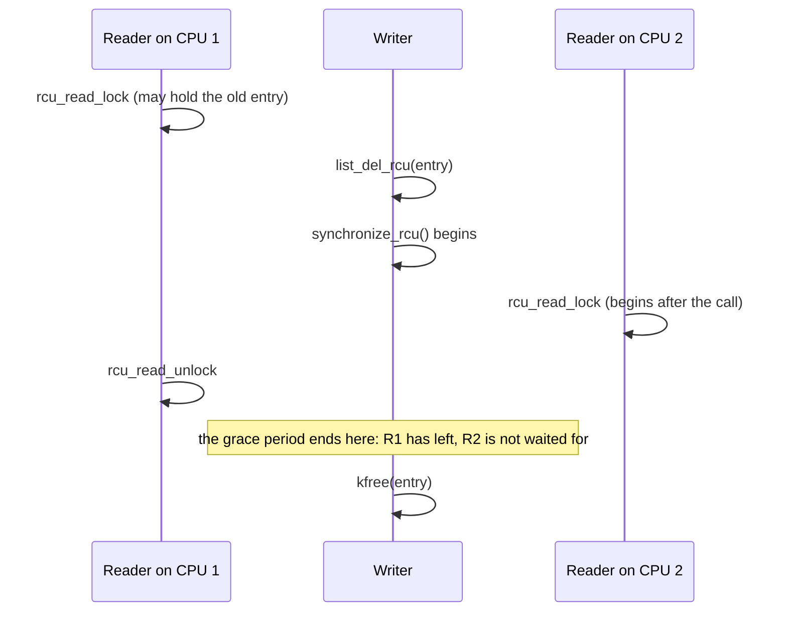

# DSA 04.07: Skip Lists, Lock-Free Lists and RCU

*Part of the [Linked lists plan](00_plan.md) · Time: about 7 hours (4 reading, 3 problems) · You need: [Lists inside real systems](06_systems_level_lists.md) (intrusive lists, free lists) and [Classic interview problems](05_classic_interview_problems.md) (the LRU cache) · Companion code: none, every listing is in this file*

By the end of this tutorial you can:

- build a skip list, explain why its search takes O(log n) steps on average, and describe how Redis's sorted sets use one with *spans* to answer `ZRANK`;
- write a lock-free stack with compare-and-swap, replay the ABA problem by hand, and fix it with a tag or with hazard pointers;
- explain why a lock-free sorted list marks a node before it unlinks it (Harris's list);
- explain what a grace period is, what the kernel's `list_add_rcu` and `list_del_rcu` guarantee, and when RCU is the right tool.

**Where the numbers come from.** The timings and counts below were measured on one machine: a 2-core Intel Xeon VM (Ubuntu 24.04, GCC 13.3 with `-O2`, glibc 2.39, 64-bit). Your numbers will differ; the shapes should not. Every C++ listing was compiled with `-Wall -Wextra` and tested before it went into this file: the skip list passed 260,811 checks against `std::map` under AddressSanitizer and UBSan, and the lock-free classes passed 50,427 checks (including multi-thread stress runs) under both AddressSanitizer and ThreadSanitizer. The test programs are not part of the course files. Statements about Redis, LevelDB, the JDK and the Linux kernel were checked against their source code (see Sources). The kernel-style C in section 3 is written for this tutorial and was not compiled.

This is the second of two tutorials on Phase 6 of the plan. The first one covered intrusive lists, free lists and why lists are slow.

---

## 1. Skip lists

### 1.1 The problem: a sorted list cannot be binary searched

A sorted array can be searched in O(log n) because you jump to the middle. A sorted linked list cannot: reaching the middle costs a walk. The skip list fixes that with *express lanes*. Take the sorted list and put a second list on top that links only some of the nodes, then a third on top of that with fewer still. A search rides the top lane as far as it can without overshooting, drops down one lane, rides again, and ends on the bottom lane, which holds every node.

Here is one, produced by the class of section 1.4 with fixed heights (a node of height 3 is on three lanes):

```text
level 3:  H                 -> 17                   -> nil
level 2:  H      -> 9       -> 17       -> 40       -> nil
level 1:  H -> 3 -> 9 -> 12 -> 17 -> 25 -> 40 -> 52 -> nil
```

`H` is the head, a sentinel that is on every lane. Level 1 is an ordinary sorted linked list. Every other level is a sorted list of the nodes tall enough to be on it, so each level is a subsequence of the one below.

### 1.2 Search by hand

Search for 25. Start at `H` on the top level and repeat: while the next node on this level has a key less than 25, move right; then go down one level.

| Level | At | Next on this level | Action |
|---|---|---|---|
| 3 | `H` | 17 | 17 < 25: move right |
| 3 | 17 | nil | go down |
| 2 | 17 | 40 | 40 is not less than 25: go down |
| 1 | 17 | 25 | 25 is not less than 25: stop |

The node after the stopping point on level 1 is the first key that is not less than 25. It is 25, so the search succeeds. It made three key comparisons (17, 40, 25) plus one to confirm equality; the plain list would walk 3, 9, 12, 17, 25.

### 1.3 Where the heights come from

If the heights were chosen by hand, the structure would need rebalancing like a tree. The skip list instead draws each height at random when the node is created: every node is on level 1, and a node that is on level `h` is also on level `h + 1` with probability `p`. Redis and LevelDB both use `p` = 1/4. Then:

- about `n * p` nodes are on level 2, `n * p^2` on level 3, and so on, so the top level is near `log_{1/p}(n)`;
- a node has `1 / (1 - p)` links on average: 1.33 for `p` = 1/4, 2 for `p` = 1/2;
- the height of a node does not depend on its key, so an adversary who does not see the random numbers cannot build a bad input. The structure can still be unlucky, but with a probability that falls quickly.

### 1.4 The code

The class is one piece, shown here in three parts. Put the parts one after the other inside `class SkipList`. The class needs `<cstddef>`, `<functional>`, `<random>`, `<utility>` and `<vector>`. The first part has the data, the random height, the search for the predecessors, and `find`. The head is built with `K()` and `V()`, so both types must be default-constructible.

```cpp
// A sorted map with unique keys. Each node has a random height; level i links the nodes that are at least i + 1 tall.
// Branch = 4 means a node that is h tall becomes h + 1 tall with probability 1/4 (the value Redis uses).
template <class K, class V, class Less = std::less<K>, int Branch = 4>
class SkipList {
    static constexpr int kMaxHeight = 32;

    struct Node {
        K key;
        V value;
        std::vector<Node*> next;  // next[i] is the successor on level i; next.size() is the node's height
        Node(const K& k, const V& v, int height) : key(k), value(v), next(height, nullptr) {}
        explicit Node(int height) : key(), value(), next(height, nullptr) {}  // the head
    };

    Node* head_ = new Node(kMaxHeight);  // sentinel: holds no key, is as tall as any node can be
    int height_ = 1;                     // number of levels in use
    std::size_t size_ = 0;
    Less less_;
    std::mt19937 rng_{12345};

    int randomHeight() {
        int h = 1;
        while (h < kMaxHeight && rng_() % Branch == 0) ++h;
        return h;
    }

    // For every level i, update[i] is the last node whose key is less than `key` (the head if there is none).
    void findPredecessors(const K& key, Node* update[]) const {
        Node* x = head_;
        for (int i = height_ - 1; i >= 0; --i) {
            while (x->next[i] && less_(x->next[i]->key, key)) x = x->next[i];
            update[i] = x;
        }
    }

public:
    SkipList() = default;
    SkipList(const SkipList&) = delete;
    SkipList& operator=(const SkipList&) = delete;
    ~SkipList() {
        for (Node* x = head_; x;) {
            Node* next = x->next[0];
            delete x;
            x = next;
        }
    }

    std::size_t size() const { return size_; }

    V* find(const K& key) {
        Node* x = head_;
        for (int i = height_ - 1; i >= 0; --i)
            while (x->next[i] && less_(x->next[i]->key, key)) x = x->next[i];
        x = x->next[0];  // the first node with a key >= `key`
        return (x && !less_(key, x->key)) ? &x->value : nullptr;
    }
```

`findPredecessors` is the walk of section 1.2, but it records, for every level, the node where the walk went down. Those are exactly the nodes whose links change when a node is inserted or erased, so insert and erase reuse it. Two details: `head_` is always `kMaxHeight` (32) tall, so no code has to check whether the head has a link on some level; and `Node` keeps its links in a `std::vector`, which is easy to read but costs an extra memory hop (section 1.6).

```cpp
    // Returns true if the key was new; an existing key just gets the new value.
    bool insert(const K& key, const V& value) { return insertWithHeight(key, value, randomHeight()); }

    // The height is a parameter so that a test or a trace can fix it.
    bool insertWithHeight(const K& key, const V& value, int h) {
        Node* update[kMaxHeight] = {};
        findPredecessors(key, update);
        Node* x = update[0]->next[0];
        if (x && !less_(key, x->key)) {
            x->value = value;
            return false;
        }
        if (h > height_) {  // new levels: the head is the predecessor there
            for (int i = height_; i < h; ++i) update[i] = head_;
            height_ = h;
        }
        Node* n = new Node(key, value, h);
        for (int i = 0; i < h; ++i) {  // splice into each of its levels, as in a singly linked list
            n->next[i] = update[i]->next[i];
            update[i]->next[i] = n;
        }
        ++size_;
        return true;
    }
```

`insertWithHeight` is "insert into a singly linked list" done once per level of the new node. If the new node is taller than any before it, the levels above the old top get the head as their predecessor.

```cpp
    bool erase(const K& key) {
        Node* update[kMaxHeight] = {};
        findPredecessors(key, update);
        Node* x = update[0]->next[0];
        if (!x || less_(key, x->key)) return false;
        for (int i = 0; i < height_ && update[i]->next[i] == x; ++i)  // x occupies levels 0 .. height-1
            update[i]->next[i] = x->next[i];
        delete x;
        while (height_ > 1 && !head_->next[height_ - 1]) --height_;  // drop empty top levels
        --size_;
        return true;
    }
};
```

`erase` unlinks the node at each level where the predecessor points at it (it occupies levels 1 to its height, so the loop can stop at the first level where it does not), then lowers `height_` while the top level is empty.

Take the list of section 1.1 and insert 20 with height 2, then erase 17 (height 3). Both pictures come from the class:

```text
after insert 20 (height 2)
level 3:  H                 -> 17                         -> nil
level 2:  H      -> 9       -> 17 -> 20       -> 40       -> nil
level 1:  H -> 3 -> 9 -> 12 -> 17 -> 20 -> 25 -> 40 -> 52 -> nil

after erase 17 (height 3)
level 2:  H      -> 9       -> 20       -> 40       -> nil
level 1:  H -> 3 -> 9 -> 12 -> 20 -> 25 -> 40 -> 52 -> nil
```

For the insert, the predecessors are 17 on levels 1 and 2 (the walk went down at 17), so 20 is spliced after 17 on those two levels only. Erasing 17 also removes the whole third level, because 17 was the only node there.

### 1.5 Why the search is O(log n): a measurement, then the argument

Counting comparisons for 200,000 random successful finds (or `n`, if smaller), with a comparator that counts its calls:

| `n` | log2 `n` | skip list, p = 1/2 | skip list, p = 1/4 | `std::map` |
|---|---|---|---|---|
| 1,000 | 10.0 | 18.2 | 22.5 | 11.3 |
| 100,000 | 16.6 | 32.7 | 31.6 | 18.0 |
| 1,000,000 | 19.9 | 39.2 | 37.1 | 21.4 |

The comparisons grow with log n, and `p` = 1/4 and `p` = 1/2 cost about the same. The argument: walk the search path *backwards* from the target to the head. At each step you either climb (if the node you stand on is tall enough to be on the next level, probability `p`) or move left. You need about `log_{1/p}(n)` climbs, and each climb costs on average `1/p` steps, so about `(1/p) * log_{1/p}(n)` comparisons: for `p` = 1/4 and `n` = 1,000,000 that is `4 * 9.97`, about 40, and the table shows 37. The same formula for `p` = 1/2 gives `2 * 19.9`, also about 40. So the smaller `p` buys fewer links per node (1.33 against 2) at no cost in comparisons, which is why it is the common choice. The expected time is O(log n); the worst case is O(n), reached only with a negligible probability.

Measured at a million keys, a node had 1.33 links on average with p = 1/4 and 2.00 with p = 1/2 (the formula gives 1.33 and 2). The tallest node, for `n` = 1,000,000 and `p` = 1/4, was 10 to 14 levels over twelve seeds of the height generator, so 32 is a safe ceiling.

### 1.6 Skip list or balanced tree?

The same `find` for random keys, in nanoseconds per call, best of three runs of the program. "Inline links" is the same algorithm with the links inside the node in one allocation (the C layout below), which I measured on a variant of the class:

| `n` | skip list, vector links | skip list, inline links | `std::map` | inline / `std::map` |
|---|---|---|---|---|
| 1,000 | 58 | 43 | 34 | 1.3 |
| 100,000 | 655 | 457 | 359 | 1.3 |
| 1,000,000 | 2,629 | 1,554 | 1,050 | 1.5 |

On one thread a balanced tree wins: `std::map` is about 1.5 times faster than the inline-link skip list at a million keys, and the vector links cost 1.7 times more again. Two reasons stand out: the skip list makes 1.7 times as many comparisons (37.1 against 21.4 for `std::map`, counted the same way as in section 1.5), and every step of a vector-link skip list is two dependent loads (node, then its link array). I did not read CPU counters, so that is my reading of the numbers.

The inline layout is what Redis does with a C99 flexible array member. This C fragment compiles on its own:

```c
#include <stdlib.h>

struct node {
    int key;
    int value;
    int height;
    struct node *next[];  /* flexible array member: `height` links, in the same allocation */
};

struct node *new_node(int key, int value, int height)
{
    struct node *n = malloc(sizeof *n + (size_t)height * sizeof n->next[0]);

    if (n) {
        n->key = key;
        n->value = value;
        n->height = height;
        for (int i = 0; i < height; i++)
            n->next[i] = NULL;
    }
    return n;
}
```

So why are skip lists everywhere? Their strengths are not single-thread speed:

1. **Simple code.** No rotations. An insert changes a few links, found in one downward walk.
2. **Range scans are a linked-list walk.** After one search, level 1 is the sorted order. Redis answers `ZRANGE` and `ZRANGEBYSCORE` this way.
3. **Local changes make concurrent versions practical.** A lock-free skip list is far easier to write than a lock-free balanced tree, because an insert touches only the predecessors, never an ancestor chain. LevelDB's memtable skip list allows readers with no locks; the JDK's `ConcurrentSkipListMap` is a concurrent skip list. Sections 2 and 3 show the machinery.
4. **Rank queries with spans** (next section).

### 1.7 Redis sorted sets

A Redis sorted set (`ZADD`, `ZRANK`, `ZRANGE`) must answer two questions fast: "what is this member's score?" and "which members have scores in this range, and what is this member's rank?". Redis keeps two structures over the same elements: a hash table from member to score for the first question, and a skip list ordered by (score, member) for the second. The details below were checked in the Redis 8.6 branch (version 8.6.8):

- `ZSKIPLIST_MAXLEVEL` is 32 and `ZSKIPLIST_P` is 0.25. The random level is a loop that adds a level while `random()` is below `0.25 * RAND_MAX`, capped at 32.
- A node is `{ score, backward, level[] }` with `level[i] = { forward, span }`. `level[]` is a flexible array, so a node is one allocation. `backward` is a single back pointer, only on level 1, so the list is doubly linked at the bottom and `ZREVRANGE` can walk it backwards.
- Equal scores are allowed, ties are broken by the member, and the skip list is used only for large sets: small sets (by default up to 128 entries) use a compact listpack.

A *span* is the number of level-1 steps a link jumps. With spans, a search can add up how many nodes it skipped, which gives the **rank** of the target in the same O(log n) time. For the list of section 1.1 the spans are:

| Level | Links (with spans) |
|---|---|
| 3 | `H` -> 17 (4) |
| 2 | `H` -> 9 (2), 9 -> 17 (2), 17 -> 40 (2) |
| 1 | every link has span 1 |

In Redis a link that points to nil carries a span too (the number of nodes after its node), so the same formulas work at the end of a level; it is left out here.

Searching for 25 with the rule "move right while the next key is at most 25" (Redis's `zslGetRank` uses this form): `H` -> 17 on level 3 (span 4), no move on level 2, 17 -> 25 on level 1 (span 1). The spans of the moves add up to 5, the rank of 25. Insert and erase must maintain the spans: after inserting a node, every link that *passes over* it, on any level, gets its span increased by 1, and the links on either side of the new node are split. That is Code problem 2, and the core of the `rkv` project.

One more fact, because it changes how you should tell this story in an interview. In the Redis release branches I checked (8.0, 8.2, 8.4 and 8.6) the skip list is the storage for large sorted sets. The development branch (`unstable`, fetched on 2026-11-01) has a new file `zset_btree.c` that stores large sorted sets in a packed B+ tree, and keeps the skip list only as a temporary structure for `ZUNION`, `ZINTER` and `ZDIFF`. The pull request that introduced it describes a large memory saving; I did not measure that. The reason fits section 1.6: a skip list spends pointers and cache lines per element that a B+ tree packs into pages.

---

## 2. Lock-free lists

### 2.1 What "lock-free" means, and when it is worth it

Three levels, from weakest to strongest guarantee:

- **Blocking:** a thread that holds a lock and is descheduled can stall everyone who waits for it.
- **Lock-free:** if many threads are running, at least one of them completes its operation in a bounded number of steps, whatever the others are doing, even if they are suspended. A single thread can still be unlucky and retry for a long time.
- **Wait-free:** every thread completes in a bounded number of steps.

The structures below are lock-free. Lock-free is not "faster": a compare-and-swap on a cache line that many cores fight for serializes them, and the retries burn cycles. A list under a mutex is often the right answer. Reach for lock-free when you cannot block (a signal handler, an interrupt handler: the kernel's `llist` below says it cannot be used in an NMI handler on architectures without an NMI-safe `cmpxchg`), when a lock's worst-case delay is not acceptable, or when you have measured contention that a lock cannot fix.

### 2.2 Compare-and-swap in C++

`std::atomic<T>::compare_exchange_weak(expected, desired, success_order, failure_order)` does this as one indivisible step: if the atomic equals `expected`, store `desired` and return true; otherwise copy the current value into `expected` and return false. `_weak` may also fail spuriously (it can be cheaper on some CPUs), so it lives in a loop; `_strong` does not fail spuriously. Every lock-free update has the same shape:

1. read the current value;
2. compute the new value from what you read;
3. CAS it in; if someone else changed it first, `expected` now holds their value, so go back to step 2.

One rule of memory ordering covers this whole tutorial: **publish with release, read with acquire.** If thread A fills in a node and then installs it with a release CAS, a thread B that reads the pointer with acquire is guaranteed to see the node's contents. Where a listing uses `relaxed`, the value is only a hint that a later CAS will verify.

### 2.3 The simplest lock-free list: a stack

The listings of this section, of sections 2.4 to 2.7 and of section 3.4 need `<algorithm>`, `<atomic>`, `<cstdint>`, `<cstdio>`, `<limits>`, `<memory>`, `<mutex>` and `<vector>`. Push and pop each retry a CAS on the top pointer:

```cpp
struct StackNode {
    int value;
    StackNode* next;
};

// A lock-free stack. It is correct as long as no node is freed or reused while some thread may still read it.
class NaiveStack {
public:
    std::atomic<StackNode*> top{nullptr};

    void push(StackNode* n) {
        n->next = top.load(std::memory_order_relaxed);
        // When the CAS fails it reloads `top` into n->next, so the loop needs no body.
        while (!top.compare_exchange_weak(n->next, n, std::memory_order_release, std::memory_order_relaxed)) {
        }
    }

    StackNode* pop() {  // nullptr when empty
        StackNode* old = top.load(std::memory_order_acquire);
        while (old && !top.compare_exchange_weak(old, old->next, std::memory_order_acquire, std::memory_order_acquire)) {
        }
        return old;
    }
};
```

`push` points the new node at the current top and tries to make the new node the top. If another thread pushed first, the CAS fails and `n->next` is refreshed with the new top, so the retry is automatic. `pop` is the mirror image: it tries to replace the top by the top's `next`.

The Linux kernel has this structure as `llist` (`include/linux/llist.h`), a lock-less singly linked list that ends in NULL. Its header comment says which combinations need a lock: any number of producers can call `llist_add` and any number of consumers can call `llist_del_all` (it takes the whole list with one exchange, so there is no node to read and nothing to go wrong) at the same time with no lock, and one consumer can call `llist_del_first` while producers call `llist_add`. But `llist_del_first` in one consumer together with `llist_del_first` or `llist_del_all` in another consumer needs a lock. The comment gives the reason: `llist_del_first` reads `first->next` and then does a CAS, and if `first` has come back to the same node by then, the CAS succeeds although the list has changed. That is the next section.

### 2.4 The ABA problem

A CAS compares *values*. "The top is still `a`" does not mean "nothing happened"; it means the address is the same. Here is the damage, played one step at a time so that it is the same on every run:

```cpp
inline void showStack(const char* label, const NaiveStack& s) {
    std::printf("%-20s", label);
    for (StackNode* p = s.top.load(); p; p = p->next) std::printf(" %d", p->value);
    std::printf("\n");
}

// Plays the bad interleaving one step at a time, so the result is the same on every run.
inline void abaReplay() {
    StackNode a{1, nullptr}, b{2, nullptr}, c{3, nullptr};
    NaiveStack s;
    s.push(&c);
    s.push(&b);
    s.push(&a);
    showStack("start:", s);

    // Thread 1 starts pop(): it has loaded top (a) and a.next (b), and is paused before its CAS.
    StackNode* seenTop = s.top.load();
    StackNode* seenNext = seenTop->next;

    // Thread 2 runs three operations.
    StackNode* x = s.pop();  // a
    s.pop();                 // b: thread 2 now owns it and may free or reuse it
    s.push(x);               // a goes back on top, and its next is now c
    showStack("after thread 2:", s);

    // Thread 1 resumes. top is a again, so its CAS succeeds and installs b, which is not in the stack any more.
    bool ok = s.top.compare_exchange_strong(seenTop, seenNext);
    std::printf("thread 1's CAS %s\n", ok ? "succeeded" : "failed");
    showStack("after thread 1:", s);
}
```

Output:

```text
start:               1 2 3
after thread 2:      1 3
thread 1's CAS succeeded
after thread 1:      2 3
```

| Step | Thread | Action | Stack (top first) |
|---|---|---|---|
| 1 | 1 | `pop()` begins: loads top `a` and `a.next` = `b` | 1 2 3 |
| 2 | 2 | `pop()` returns `a` | 2 3 |
| 3 | 2 | `pop()` returns `b`, thread 2 keeps it | 3 |
| 4 | 2 | `push(a)` | 1 3 |
| 5 | 1 | CAS(top: `a` -> `b`) succeeds, so thread 1's `pop` returns `a` | 2 3 |

After step 5 thread 1's `pop` has returned `a`, which is fine, but the stack is `2 3` where it should be `3`: node `b`, which thread 2 popped and owns (it may free it or reuse it), is back in the stack. A later `pop` returns `b` a second time.

ABA needs a node to come back at the same address, which means memory reuse. It is not rare: tutorial 06 showed that glibc hands the most recently freed block of a size to the next `malloc` of that size, so `delete` followed by `new` is the pattern that triggers it. The problem splits in two. **Identity:** the CAS cannot tell the old `a` from the new one. **Lifetime:** `old->next` is read from a node that another thread may already have freed. The next two sections fix one each; hazard pointers fix both.

### 2.5 Fix 1: a tag in the CAS word

If the CAS word also carries a counter that every successful push and pop increments, the address coming back no longer matches. The classic form is a 16-byte (pointer, counter) pair, but on this machine `std::atomic` of a 16-byte struct reported `is_lock_free() == 0`, with or without `-mcx16`: GCC 13 sends it through `libatomic`. A word that fits in 64 bits is lock-free everywhere (`std::atomic<std::uint64_t>::is_always_lock_free` is 1). So pack a 32-bit tag and a 32-bit *index* into one `uint64_t`, and keep the nodes in a fixed array:

```cpp
// A lock-free stack of the indexes 0 .. n-1. Node i's link is next_[i]. The head packs a 32-bit tag and a 32-bit
// index into one 64-bit word, and every successful push or pop adds 1 to the tag.
class IndexStack {
public:
    static constexpr std::uint32_t kNil = 0xFFFFFFFFu;

    explicit IndexStack(std::uint32_t n) : next_(new std::atomic<std::uint32_t>[n]) {
        for (std::uint32_t i = 0; i < n; ++i) next_[i].store(kNil, std::memory_order_relaxed);
    }

    void push(std::uint32_t i) {
        std::uint64_t h = head_.load(std::memory_order_relaxed);
        std::uint64_t desired;
        do {
            next_[i].store(index(h), std::memory_order_relaxed);
            desired = pack(tag(h) + 1, i);
        } while (!head_.compare_exchange_weak(h, desired, std::memory_order_release, std::memory_order_relaxed));
    }

    std::uint32_t pop() {  // kNil when empty
        std::uint64_t h = head_.load(std::memory_order_acquire);
        for (;;) {
            std::uint32_t i = index(h);
            if (i == kNil) return kNil;
            std::uint64_t desired = pack(tag(h) + 1, next_[i].load(std::memory_order_relaxed));
            if (head_.compare_exchange_weak(h, desired, std::memory_order_acquire, std::memory_order_acquire)) return i;
        }
    }

private:
    static std::uint32_t index(std::uint64_t h) { return static_cast<std::uint32_t>(h); }
    static std::uint32_t tag(std::uint64_t h) { return static_cast<std::uint32_t>(h >> 32); }
    static std::uint64_t pack(std::uint32_t tag, std::uint32_t i) { return (std::uint64_t{tag} << 32) | i; }

    std::unique_ptr<std::atomic<std::uint32_t>[]> next_;
    std::atomic<std::uint64_t> head_{pack(0, kNil)};
};
```

Node `i`'s link is `next_[i]`; the payload lives in an array of your own indexed by `i`, written before `push(i)` and read after `pop()` returns `i`, and the release/acquire pair on `head_` makes that safe. The replay of section 2.4 fails on this class: the stale CAS expects the old tag, and the tag has moved on by 3. I checked that in a test, and I checked that a copy of the class with the tag increments removed fails the same test.

The tag wraps after 2^32 operations; an ABA then needs exactly that many operations to pass while one thread sleeps in the middle of a CAS loop. Widen the tag if that worries you.

This class is also the free list of tutorial 06 made thread-safe. Two `IndexStack`s make a buffer pool: `freeStack` starts holding every index, a producer pops an index, fills `payload[i]`, pushes it on `usedStack`, and a consumer does the reverse. It is the shape of a packet-buffer pool between an interrupt-side producer and a worker. I ran it with 4 threads and 50,000 rounds each, then drained both stacks: every index was present exactly once.

### 2.6 Fix 2: hazard pointers

A pointer-based stack that really calls `delete` needs more. The hazard-pointer idea: before a thread reads through a shared pointer, it **announces** the pointer in a slot only it writes. A thread that removes a node may not free it at once; it puts the node on its own retired list and, when the list is long enough, frees every retired node that **no announcement names**.

```cpp
// A lock-free stack whose popped nodes are really freed. Each thread owns one slot number (0 .. kMaxThreads-1).
class HazardStack {
    static constexpr int kMaxThreads = 4;
    struct Node {
        int value;
        Node* next;
    };

    std::atomic<Node*> top_{nullptr};
    std::atomic<Node*> hazard_[kMaxThreads] = {};  // hazard_[s]: the node thread s is about to read
    std::vector<Node*> retired_[kMaxThreads];      // popped nodes thread s has not freed yet

public:
    HazardStack() = default;
    HazardStack(const HazardStack&) = delete;
    HazardStack& operator=(const HazardStack&) = delete;
    ~HazardStack() {  // no other thread may be running
        for (Node* n = top_.load(); n;) {
            Node* next = n->next;
            delete n;
            n = next;
        }
        for (auto& list : retired_)
            for (Node* n : list) delete n;
    }

    void push(int value) {
        Node* n = new Node{value, top_.load(std::memory_order_relaxed)};
        while (!top_.compare_exchange_weak(n->next, n, std::memory_order_release, std::memory_order_relaxed)) {
        }
    }

    bool pop(int slot, int& out) {
        for (;;) {
            Node* old = top_.load(std::memory_order_acquire);
            if (!old) {
                hazard_[slot].store(nullptr, std::memory_order_release);
                return false;
            }
            hazard_[slot].store(old, std::memory_order_seq_cst);  // 1. announce: "I am about to read old"
            if (top_.load(std::memory_order_seq_cst) != old) continue;  // 2. still the top? then it was not retired yet
            Node* next = old->next;  // 3. safe: nobody frees a node that a hazard slot names
            if (top_.compare_exchange_strong(old, next, std::memory_order_acquire, std::memory_order_relaxed)) {
                hazard_[slot].store(nullptr, std::memory_order_release);
                out = old->value;
                retire(slot, old);
                return true;
            }
        }
    }

private:
    void retire(int slot, Node* n) {
        std::vector<Node*>& list = retired_[slot];
        list.push_back(n);
        if (list.size() < 2 * kMaxThreads) return;
        Node* announced[kMaxThreads];
        for (int s = 0; s < kMaxThreads; ++s) announced[s] = hazard_[s].load(std::memory_order_seq_cst);
        std::vector<Node*> keep;
        for (Node* p : list) {
            if (std::find(announced, announced + kMaxThreads, p) == announced + kMaxThreads) delete p;
            else keep.push_back(p);  // somebody may still read it; try again at the next scan
        }
        list.swap(keep);
    }
};
```

The three numbered lines in `pop` are the protocol, and the order matters:

1. **Announce** `old` in `hazard_[slot]`.
2. **Check that `old` is still the top.** If the top changed between the load and the announcement, `old` may already have been retired and scanned, and the announcement came too late, so start again. If it is still the top, then it had not been retired when the announcement became visible, and any later scan will see the announcement.
3. **Read `old->next`.** It is safe: the node cannot be freed while the slot names it.

This also removes the ABA problem for this stack: while a slot names `a`, `a` is not freed, so `new` cannot give its address to another node, so the top cannot return to `a` as a different node. The announcement needs `seq_cst` ordering (a store followed by a load of a different variable must not be reordered), and the scan reads every slot. Cost: a store and a fence per protected read, and a scan of `kMaxThreads` slots per batch of retirements. Garbage is bounded: a thread holds at most `2 * kMaxThreads` retired nodes.

I tested it with 4 threads, one test that checks that a node named by a slot survives the scans (and is freed after the slot is cleared), and another that hammers a 3-node stack. Breaking the class on purpose showed the limits of testing: deleting retired nodes without the scan was caught at once by AddressSanitizer, but deleting step 2 passed all my stress tests. The race window is a few instructions wide. For this kind of code the argument is the proof; the tests only catch the bugs they happen to hit.

Other ways to reclaim memory: **epoch-based reclamation** (threads announce the epoch they are in; garbage is freed two epochs later), **RCU** (section 3), **reference counting**, or **never freeing** while the structure lives, as LevelDB's skip list does (its header lists "nodes are never deleted until the list is destroyed" among the invariants that make lock-free reads safe). C++26 adds `std::hazard_pointer` in `<hazard_pointer>` and RCU support in `<rcu>` to the standard library (cppreference lists both); I did not check which compilers ship them.

### 2.7 A lock-free sorted list: Harris's list

A stack changes only at one end. A sorted set changes in the middle, and the middle is where the trouble is. Suppose the list is `10 -> 20 -> 30` and two threads act at once: thread 1 deletes 20 (CAS `10.next` from 20 to 30), thread 2 inserts 25 (CAS `20.next` from 30 to 25). Both CASes succeed, because they touch different words. The result is `10 -> 30`, with 25 hanging off the deleted node: the insert is lost.

Harris's fix: **delete in two steps.** First *mark* the node, by setting a bit in the node's own `next` word. From then on nobody can change that `next` (every CAS on it expects an unmarked value and fails), so nothing can be inserted after a deleted node. The node is now *logically* deleted. Second, *unlink* it. The unlink can be done by anyone who walks past the marked node, so a stalled deleter cannot block the others.

```cpp
// A sorted set of ints with lock-free insert, erase and contains. A node's `next` word holds the successor's address
// and, in its lowest bit, a mark that means "this node is deleted".
class HarrisSet {
    using Word = std::uintptr_t;
    struct Node {
        int key;
        std::atomic<Word> next;
        Node* graveNext = nullptr;  // links the retired nodes
        Node(int k, Word n) : key(k), next(n) {}
    };

    static_assert(alignof(Node) >= 2, "bit 0 of a node address must be free for the mark");

    static bool marked(Word w) { return (w & 1) != 0; }
    static Node* ptr(Word w) { return reinterpret_cast<Node*>(w & ~Word{1}); }
    static Word word(Node* n) { return reinterpret_cast<Word>(n); }

    Node* head_;                          // key is not used; head_->next is the first real node
    Node* tail_;                          // key is INT_MAX: the end marker, never deleted
    std::atomic<Node*> graveyard_{nullptr};

    // Sets `prev` to the word that points at the first unmarked node with key >= `key`, and `curr` to that node.
    // On the way it unlinks the marked nodes it meets. Returns true if curr->key == key.
    bool find(int key, std::atomic<Word>*& prev, Node*& curr) {
    retry:
        prev = &head_->next;
        curr = ptr(prev->load(std::memory_order_acquire));
        for (;;) {
            Word succ = curr->next.load(std::memory_order_acquire);
            while (marked(succ)) {  // curr is deleted: take it out
                Word expected = word(curr);
                if (!prev->compare_exchange_strong(expected, succ & ~Word{1}, std::memory_order_acq_rel, std::memory_order_acquire))
                    goto retry;  // prev changed or was itself marked: start over
                retire(curr);
                curr = ptr(succ);
                succ = curr->next.load(std::memory_order_acquire);
            }
            if (curr->key >= key) return curr->key == key;
            prev = &curr->next;
            curr = ptr(succ);
        }
    }

    void retire(Node* n) {  // other threads may still be reading n, so it is freed only in the destructor
        n->graveNext = graveyard_.load(std::memory_order_relaxed);
        while (!graveyard_.compare_exchange_weak(n->graveNext, n, std::memory_order_release, std::memory_order_relaxed)) {
        }
    }

public:
    HarrisSet() {
        tail_ = new Node(std::numeric_limits<int>::max(), 0);
        head_ = new Node(std::numeric_limits<int>::min(), word(tail_));
    }
    HarrisSet(const HarrisSet&) = delete;
    HarrisSet& operator=(const HarrisSet&) = delete;
    ~HarrisSet() {  // no other thread may be running
        for (Node* n = head_; n;) {
            Node* next = ptr(n->next.load());
            delete n;
            n = next;
        }
        for (Node* n = graveyard_.load(); n;) {
            Node* next = n->graveNext;
            delete n;
            n = next;
        }
    }

    bool insert(int key) {  // key must be less than INT_MAX
        Node* n = new Node(key, 0);
        for (;;) {
            std::atomic<Word>* prev;
            Node* curr;
            if (find(key, prev, curr)) {
                delete n;
                return false;
            }
            n->next.store(word(curr), std::memory_order_relaxed);
            Word expected = word(curr);
            if (prev->compare_exchange_strong(expected, word(n), std::memory_order_release, std::memory_order_relaxed)) return true;
        }
    }

    bool erase(int key) {
        for (;;) {
            std::atomic<Word>* prev;
            Node* curr;
            if (!find(key, prev, curr)) return false;
            Word succ = curr->next.load(std::memory_order_acquire);
            if (marked(succ)) continue;  // another thread is deleting it: look again
            // Step 1, the deletion itself: mark curr's own next word.
            if (!curr->next.compare_exchange_strong(succ, succ | 1, std::memory_order_acq_rel, std::memory_order_acquire)) continue;
            // Step 2, tidying up: unlink it. If this fails, a later find() will do it.
            Word expected = word(curr);
            if (prev->compare_exchange_strong(expected, succ, std::memory_order_acq_rel, std::memory_order_acquire)) retire(curr);
            else find(key, prev, curr);
            return true;
        }
    }

    bool contains(int key) const {  // reads only; never writes
        Node* curr = ptr(head_->next.load(std::memory_order_acquire));
        while (curr->key < key) curr = ptr(curr->next.load(std::memory_order_acquire));
        return curr->key == key && !marked(curr->next.load(std::memory_order_acquire));
    }
};
```

How it works:

- **The mark** lives in bit 0 of the `next` word. Nodes are at least 8-byte aligned, so bit 0 of an address is always 0.
- **`find`** walks the list, and when it meets a marked node it unlinks it with a CAS on the previous node's `next`. That CAS expects an *unmarked* pointer to the node, so if the previous node was itself deleted in the meantime the CAS fails and `find` restarts from the head.
- **`insert`** links the new node with one CAS on `prev`. If `prev` has been marked, the CAS fails (the word no longer equals the unmarked value), and the insert tries again. This is the repair of the lost insert above.
- **`erase`** is the two steps: mark `curr->next`, then try to unlink. Whoever succeeds in the *unlink* CAS (in `find` or in `erase`) retires the node, so each node is retired exactly once.
- **`contains`** only reads and never writes. It may pass over a marked node, which is why it checks the mark of the node it stops on.

Limits: nodes go to a `graveyard_` and are freed only in the destructor, because another thread may still be reading them. Memory therefore grows with every erase for as long as the set lives. A production version protects `prev` and `curr` with hazard pointers or uses epochs (Code problem 4). The JDK's `ConcurrentSkipListMap` is built on the same idea: its source comment says that the bottom lists use a variant of the Harris-Michael ordered-set algorithm, and that the `next` pointers of deleted nodes are marked so that concurrent inserts do not conflict with deletes; a lock-free skip list is this list on every level.

### 2.8 The queue, in words

The Michael-Scott queue is the standard lock-free FIFO. It keeps a dummy node, so that `head` and `tail` always point at a node. **Enqueue:** CAS `tail->next` from null to the new node, then try to swing `tail` forward. If a thread sees that `tail->next` is not null, `tail` is lagging, and it helps by swinging `tail` itself before doing its own work. **Dequeue:** read `head->next`; if it is null the queue is empty; otherwise CAS `head` to it and return the value of the new head. It has the same ABA and reclamation issues as the stack (Code problem 3).

### 2.9 How to test lock-free code

- **ThreadSanitizer** (`-fsanitize=thread`) models the C++ memory model. It flagged my copy of the stack with the release replaced by `relaxed`, though that copy runs correctly on x86. Run it on every lock-free change.
- **AddressSanitizer** catches use after free, which is the symptom of a reclamation bug.
- **Stress tests with a checkable invariant**: in my Harris test, four threads did 150,000 random operations each, and for every key (successful inserts) minus (successful erases) had to equal 1 if the key was in the set at the end and 0 if not. Removing the mark step made the test run forever, and the sanitizers reported data races and a use after free.
- **Break it on purpose.** A test that cannot fail proves nothing. I made seven deliberate breakages of the classes in this section (a `relaxed` publish, no tag, no scan, no validation step, no mark bit, a plain store instead of a CAS, no writer mutex). Six were detected, one of them (the missing writer mutex) only after I added a test with two writers. One survived: the missing validation step of section 2.6. Removing the tag increment from only `push` or only `pop` is not a breakage at all, since either one alone breaks the replay.

---

## 3. RCU lists

### 3.1 The idea

Locks make readers and writers take turns. For a structure that is read constantly and changed rarely (a routing table, a table of connected Wi-Fi stations, a list of loaded modules), that is a poor trade: every reader pays for the rare writer. **RCU** (read-copy-update) makes readers free:

- **Readers** walk the structure between `rcu_read_lock()` and `rcu_read_unlock()`. They take no lock and write nothing to shared memory. They see either the old version or the new one, never a half-built one. In the classic kernel flavor a reader must not block inside its read-side section.
- **Writers** take an ordinary lock among themselves, build the change off to the side, and *publish* it with one pointer store (`rcu_assign_pointer`, a release store).
- **Freeing is deferred.** A removed object may still be in the hands of a reader that started before the removal. The writer waits for a **grace period**: a time by which every read-side section that was running at the start has finished. `synchronize_rcu()` waits for it; `call_rcu()` and `kfree_rcu()` free the object afterwards without making the writer wait.

The kernel documentation points out that `synchronize_rcu()` waits only for the sections that already exist when it is called, not for sections that begin later:



### 3.2 The list primitives

All of these are in `include/linux/rculist.h` (checked in the kernel source, version 7.3.0 of the `master` branch):

| Operation | Call |
|---|---|
| Add after a node (a stack) | `list_add_rcu(new, head)` |
| Add before a node (a queue) | `list_add_tail_rcu(new, head)` |
| Remove | `list_del_rcu(entry)` |
| Replace | `list_replace_rcu(old, new)` |
| Walk (reader) | `list_for_each_entry_rcu(pos, head, member)` |
| Hash chain add and remove | `hlist_add_head_rcu`, `hlist_del_rcu` |

Two details connect to tutorial 06.

**The order of the writes in `__list_add_rcu`.** It sets `new->next`, then `new->prev`, then publishes with `rcu_assign_pointer(prev->next, new)` (the release store), and only then sets `next->prev`. A reader that reaches the new node through `prev->next` finds it complete. The ordinary RCU walk goes forwards only. The kernel comment adds a rule: a list that is walked backwards under RCU must use `list_bidir_prev_rcu()` and `list_bidir_del_rcu()`, because plain `list_del_rcu` poisons `prev`.

**What `list_del_rcu` does not do.** Tutorial 06's `list_del` poisons both links of the removed entry. `list_del_rcu` unlinks the entry and poisons only `prev` (`LIST_POISON2`). It leaves `next` intact on purpose: a reader that is standing on the entry right now must still be able to step forward. The kernel comment says the entry is left in an undefined state, that `list_empty()` on it does not return true, and that the caller must not free it at once: use `synchronize_rcu()` or `call_rcu()`.

### 3.3 Kernel-style example

A table of Wi-Fi stations, read for every packet and changed when a station associates or leaves. This is written for the tutorial in the kernel's style and was not compiled:

```c
struct station {
    struct list_head list;       /* its place in the table */
    struct rcu_head  rcu;        /* used by kfree_rcu() */
    u8  addr[6];
    int state;
};

static LIST_HEAD(stations);
static DEFINE_SPINLOCK(stations_lock);   /* serializes writers only */

int station_state(const u8 *addr)        /* reader: no lock, never blocks */
{
    struct station *sta;
    int state = -1;

    rcu_read_lock();
    list_for_each_entry_rcu(sta, &stations, list) {
        if (ether_addr_equal(sta->addr, addr)) {
            state = READ_ONCE(sta->state);
            break;
        }
    }
    rcu_read_unlock();
    return state;                        /* sta must not be used after the unlock */
}

void station_add(struct station *sta)
{
    spin_lock(&stations_lock);
    list_add_tail_rcu(&sta->list, &stations);
    spin_unlock(&stations_lock);
}

void station_remove(struct station *sta)
{
    spin_lock(&stations_lock);
    list_del_rcu(&sta->list);
    spin_unlock(&stations_lock);
    kfree_rcu(sta, rcu);                 /* freed after a grace period */
}
```

The real thing: Linux's `mac80211` (the Wi-Fi stack) keeps a `struct sta_info` with a `list_head list`, an `rcu_head` and a hash node. In `net/mac80211/sta_info.c` the station list is extended with `list_add_tail_rcu(&sta->list, &local->sta_list)`, removed with `list_del_rcu(&sta->list)` followed by `synchronize_net()` (a wrapper around `synchronize_rcu` used in the networking code), walked with `list_for_each_entry_rcu`, and station lookups by address go through a hash table inside `rcu_read_lock()`. Other parts of the same file free small objects with `call_rcu`.

### 3.4 In user space: the copy-on-write cousin

User-space code usually has no grace-period machinery (the C++26 standard adds `<rcu>`; I did not check compiler support; the `liburcu` library exists but I did not use it). The same shape is easy to get with a shared pointer to an immutable snapshot:

```cpp
// A read-mostly list with copy-on-write updates, the user-space cousin of RCU. Readers never lock; a writer copies
// the list, changes the copy, and publishes it with one atomic store.
class AclTable {
public:
    using List = std::vector<int>;

    AclTable() : cur_(std::make_shared<const List>()) {}

    bool allows(int id) const {
        std::shared_ptr<const List> snapshot = cur_.load(std::memory_order_acquire);  // the reader's private view
        return std::find(snapshot->begin(), snapshot->end(), id) != snapshot->end();
    }

    void add(int id) {
        std::lock_guard<std::mutex> lock(writer_);  // writers take turns; readers are not blocked
        auto next = std::make_shared<List>(*cur_.load(std::memory_order_relaxed));
        next->push_back(id);
        cur_.store(std::move(next), std::memory_order_release);
    }

    void remove(int id) {
        std::lock_guard<std::mutex> lock(writer_);
        auto next = std::make_shared<List>(*cur_.load(std::memory_order_relaxed));
        next->erase(std::remove(next->begin(), next->end(), id), next->end());
        cur_.store(std::move(next), std::memory_order_release);
    }

private:
    std::mutex writer_;
    std::atomic<std::shared_ptr<const List>> cur_;
};
```

A reader takes a snapshot and walks it with no lock. A writer copies the whole list, changes the copy, and publishes it with one atomic store; the old snapshot is destroyed when its last reader lets go. It is RCU's idea with the roles of "grace period" and "reference count" swapped: reclamation here is by reference counting, so every read updates a count, which real RCU avoids. Two honest limits: each update copies the list (fine for a few hundred entries, not for millions), and `std::atomic<std::shared_ptr<T>>` on GCC 13.3 reported `is_lock_free() == 0` on this machine, so a reader can briefly wait for another thread. I tested it with 3 readers and 1 writer, where every reader snapshot had to be an in-order prefix, and with 2 writers adding disjoint ranges, where no update may be lost; a copy without the writer mutex failed the second test.

### 3.5 Rules that prevent most RCU bugs

1. **Never free right after `list_del_rcu`.** Wait for the grace period.
2. **Do not block in a read-side section** (the callback of `call_rcu` cannot block either).
3. **Do not keep a pointer past `rcu_read_unlock`.** Take a reference count first if you need to.
4. **Readers can see stale data** for up to a grace period: an entry removed a moment ago may still be found. Design for that.
5. **Writers still need mutual exclusion** among themselves. RCU does not provide it.
6. **Use the `_rcu` variants on both sides.** A plain `list_add` on a list that readers walk can publish a half-built node.

---

## 4. Which one to use

| Situation | Use | Why |
|---|---|---|
| Ordered map, one thread | `std::map` or a B-tree | faster than a skip list (section 1.6) |
| Ordered map with range scans, rank, or many writers | skip list | simple, local changes, spans for rank |
| Threads hand nodes or buffers to each other | a mutex first; then an index stack with a tag, or hazard pointers | simplest correct thing first |
| Read-mostly shared list in the kernel | RCU list | readers take no lock |
| Read-mostly table in user space, small | copy-on-write snapshot | simple, readers never block |
| Sorted set under heavy mixed contention | lock-free list or skip list from a tested library | write it yourself only to learn |
| Anything else | one mutex | measure before leaving it |

---

## 5. Common mistakes

1. **Skip list height not reduced on erase.** Searches then start on empty levels. The loop at the end of `erase` is what fixes it.
2. **Skip list heights that depend on the key** or come from a poor generator. The expected bounds assume independent coin flips.
3. **Duplicate keys with no decision.** The class above updates the value; Redis allows equal scores and orders by member; LeetCode 1206 allows duplicate values. Decide, and test it.
4. **Reading `old->next` of a node another thread may have freed.** The CAS will catch a changed top, but the read has already happened.
5. **Trusting pointer equality (ABA).** "The same address" does not mean "unchanged".
6. **`relaxed` where publication needs `release`.** It runs correctly on x86 and fails elsewhere; ThreadSanitizer sees it.
7. **Freeing a node as soon as it is unlinked** in a lock-free structure, or in RCU.
8. **Assuming lock-free is fast.** Contended CAS loops can be slower than a mutex.
9. **Testing only on x86.** x86 hides many ordering bugs. Use ThreadSanitizer, and try an ARM machine if you can.
10. **Walking an RCU list backwards with `list_del_rcu` in use** (it poisons `prev`).

---

## 6. Questions to answer out loud

1. How does a skip list work, and why is the search O(log n) on average? What is the worst case?
2. Skip list or balanced tree: when would you pick each?
3. How does Redis answer `ZRANK` in O(log n)? What does a span record, and what must an insert do about spans?
4. What is the difference between blocking, lock-free and wait-free?
5. What is the ABA problem? Give an example, and two ways to fix it.
6. Why does Harris's list mark a node before it unlinks it?
7. What is a hazard pointer? Why is the check after the announcement needed?
8. What is a grace period? What does `list_del_rcu` do and what does it leave undone?
9. When would you not use a lock-free structure?
10. A Wi-Fi driver looks up a station for every received packet, and stations join and leave a few times a minute. Design the table.

---

## 7. Problems

### 7.1 On paper

**Problem A. Trace a skip list.**
*Where:* paper.
*Goal:* draw the levels after each step.
*How:* start with an empty list and call `insertWithHeight` for the keys 10, 20, 15, 30, 25 with the heights 1, 3, 2, 1, 2, in that order. Draw all levels. Then erase 20 and draw again. Mark the `update` nodes of the last insert.

**Problem B. Do the arithmetic.**
*Where:* paper.
*Goal:* expected counts for `n` = 1,000,000 and `p` = 1/4.
*How:* (a) How many nodes are expected to have height at least 3, at least 5, at least 10? (b) How many links in all, and how many more than a plain sorted list? (c) What is the chance that some node reaches height 13? (d) What does `(1/p) * log_{1/p}(n)` predict for a search, and how does it compare with the 37.1 measured?

**Problem C. Another ABA.**
*Where:* paper, using `NaiveStack`.
*Goal:* find the damage in a different interleaving.
*How:* the stack holds P -> Q -> R. Thread 1 starts `pop()` and pauses after loading `top` (P) and `P.next` (Q). Thread 2 pops P, pushes a new node S, then pushes P back. Thread 1's CAS runs. Write the stack after every step. Which node is lost?

**Problem D. Two adjacent deletes.**
*Where:* paper, using `HarrisSet`.
*Goal:* see why one CAS per delete is not enough, and why marking is.
*How:* the list is 10 -> 20 -> 30. Thread 1 runs `erase(20)` and thread 2 runs `erase(30)`; both finish `find` before either changes anything. (a) With a delete that is just one CAS on the previous node's `next`, run both and write the final list. (b) With the real two-step delete, write every word that changes, in the order thread 1 marks, thread 2 marks, thread 1 unlinks, thread 2 tries to unlink, and the final list.

**Problem E. The grace period.**
*Where:* paper.
*Goal:* find when `kfree` may run.
*How:* a writer calls `list_del_rcu(e)` at time 9 and `synchronize_rcu()` at time 10. Readers run during these intervals: A from 2 to 12, B from 8 to 20, C from 9.5 to 14, D from 11 to 30. When can `synchronize_rcu()` return? Which reader could have held `e`, and which could not? Is it a problem that C started after the removal?

### 7.2 In your editor

**Problem 1. LeetCode 1206, Design Skiplist.**
*Where:* LeetCode (labelled Hard on the mirror sites I looked at), written in your editor first.
*Goal:* `add(num)`, `search(target)` and `erase(num)` with duplicates allowed; `erase` removes one copy and returns whether there was one.
*How:* start from the class of section 1.4 with `int` keys and no value. Decide which position an equal key is inserted at, and make `erase` unlink one node only. Test against a `std::multiset` with random operations.

**Problem 2. Ranks with spans (the heart of `rkv`).**
*Where:* your editor.
*Goal:* add `rank(key)` (1-based, 0 if absent) and `select(k)` (the k-th smallest) in O(log n).
*How:* store `{next, span}` per level. Insert: for each level, record the rank of the predecessor while walking, then split the span of the link that the new node lands in; for the levels above the new node's height, add 1 to the span of the predecessor's link. Erase: merge the spans of the two links around the node, and subtract 1 on the levels above. Check against a sorted `std::vector` after every operation, including `select(rank(x)) == x`.

**Problem 3. The Michael-Scott queue.**
*Where:* your editor.
*Goal:* `enqueue` and `dequeue` for `int`, lock-free.
*How:* follow section 2.8. First leak removed nodes, as `HarrisSet` does, and test with 4 threads under ThreadSanitizer: every enqueued value must be dequeued exactly once and each producer's values must come out in order. Then try an `IndexStack`-style fixed pool.

**Problem 4. Hazard pointers for the Harris set.**
*Where:* your editor.
*Goal:* free erased nodes while the set is alive.
*How:* each thread needs two slots (for `prev`'s node and `curr`). Add the announce-and-validate steps to `find`, replace `retire` by a per-thread retired list with a scan, and test with AddressSanitizer. Then break your own protocol on purpose, as in section 2.6, and see whether the tests notice.

**Problem 5. Measure the copy-on-write table.**
*Where:* your editor, with `-O2`.
*Goal:* reader throughput of `AclTable` against the same list guarded by a `std::mutex` (or `std::shared_mutex`).
*How:* 3 reader threads each doing `allows()` in a loop, 1 writer calling `add` and `remove` at a fixed rate (try 10 and 1,000 times a second), tables of 8, 64 and 1,024 entries. Report operations per second per reader. Say where each design wins and why, and state your machine.

**Problem 6. A lock-free packet-buffer pool.**
*Where:* whiteboard first, then your editor.
*Goal:* design the receive path of a driver: an interrupt-side producer fills buffers, a worker thread consumes them.
*How:* use two `IndexStack`s as in section 2.5. Answer: what happens when the free stack is empty (drop? count? back-pressure?), what ordering the payload write and the `push` need, whether one tag width is enough for your packet rate (compute the time to 2^32 operations at one million packets a second), and whether a per-CPU pool would be better than one shared pool.

---

## Answers

**Problem A.** Before the erase:

```text
level 3:  H             -> 20             -> nil
level 2:  H       -> 15 -> 20 -> 25       -> nil
level 1:  H -> 10 -> 15 -> 20 -> 25 -> 30 -> nil
```

After `erase(20)` (20 was the only node on level 3, so level 3 disappears):

```text
level 2:  H       -> 15 -> 25       -> nil
level 1:  H -> 10 -> 15 -> 25 -> 30 -> nil
```

For the last insert (25, height 2) the walk moves from `H` to 20 on level 3 and then goes down at 20 on every level: nothing lies to the right of 20 on levels 3 and 2, and on level 1 the node to its right is 30, which is greater than 25. So `update` is 20 on all three levels, and with height 2 only the first two are used: the level 2 link `20 -> nil` becomes `20 -> 25 -> nil`, and the level 1 link `20 -> 30` becomes `20 -> 25 -> 30`.

**Problem B.** (a) `n * p^2` = 62,500 nodes of height at least 3; `n * p^4` = 3,906; `n * p^9` = 3.8. (b) `n / (1 - p)` = 1,333,333 links, which is 333,333 more than the 1,000,000 of a plain list. (c) About `n * p^12` = 1,000,000 / 16,777,216 = 0.06, so about 6%. (Over the twelve seeds I tried, the tallest node was 13 once and 14 once, so seeing 13 or more in a few runs is normal.) (d) `4 * log_4(1,000,000)` = `4 * 9.97` = 39.9 against 37.1 measured: the formula is about 7% above the measurement, close enough to explain the growth.

**Problem C.** Start: P Q R. Thread 1 has `top` = P and `next` = Q. Thread 2: pop P gives Q R; push S gives S Q R; push P gives P S Q R. Thread 1's CAS finds the top still equal to P and installs Q: the stack becomes Q R. **S is lost**: it was pushed and never popped, yet it is no longer in the stack. (Thread 1's `pop` returns P, which is legitimate, since P was on top.) I ran this with `NaiveStack`: the stack printed `1 2 3`, then `1 4 2 3`, then `2 3`.

**Problem D.** (a) One CAS each: thread 1 sets `10.next` from 20 to 30, which succeeds. Thread 2 sets `20.next` from 30 to the end, which also succeeds, because node 20 is no longer in the list and nobody looks at its `next`. The list is 10 -> 30: `erase(30)` returned true, and 30 is still there. (b) Thread 1 marks: `20.next` goes from 30 to 30 + mark. Thread 2 marks: `30.next` goes from end to end + mark. Thread 1 unlinks: `10.next` goes from 20 to 30 (succeeds; the list is 10 -> 30(marked) -> end). Thread 2 tries to unlink with a CAS on `20.next` expecting the unmarked 30: the word is 30 + mark, so it fails. Thread 2 calls `find(30)` again: the walk meets the marked 30 after 10 and unlinks it, `10.next` going from 30 to the end. Final list: 10 -> end. Both deletes took effect.

**Problem E.** `synchronize_rcu()` must wait for every read-side section that began before the call at time 10: A (ends at 12), B (ends at 20) and C (ends at 14). D begins at 11, after the call, so it is not waited for. The call returns at **time 20**, when B ends, and `kfree(e)` may run then. A and B began before the removal at 9 and could hold `e`; D began after the call and cannot, because the entry was unreachable by then. C began after the removal (at 9.5), so it cannot reach `e` through the list, but RCU does not track what each reader holds: it waits for all sections that began before the call, which is simpler and safe. C does not extend the wait here, since B ends later.

**Problem 1.** Keep the class and drop the value. In `insert`, remove the "key exists" branch so that an equal key just gets another node: the predecessors found with "less than" end just before the first equal node, so the new node is placed before the equal ones, which is valid. `erase` is unchanged: it finds the first node with an equal key and unlinks it. Every operation is still O(log n) on average. Seed the generator once; the problem's tests are deterministic about results, not about heights.

**Problem 2.** The invariant: the span of a link is the number of level-1 steps it jumps. While walking, keep `rank[i]`, the rank (position) of `update[i]`; after the walk `rank[0]` is the position of the predecessor on level 1. For a new node at position `r + 1` where `r = rank[0]`: on every level `i` below the new height, the new node's span is `rank[i] + span(update[i]) - r` and the predecessor's span becomes `r + 1 - rank[i]`; on every higher level, the predecessor's span gets +1. Erase is the reverse. `rank(key)` is the sum of the spans of the moves in a search that moves while the next key is at most `key`; `select(k)` moves while the accumulated rank plus the span is at most `k`. Redis's `zslInsertNode` and its delete counterpart do exactly this, and a link that points to nil gets a span too (the number of nodes after its node), so the formulas need no special case.

**Problem 3.** `enqueue`: allocate a node; loop: read `tail` and `tail->next`; if `tail->next` is null, CAS it from null to the new node and then CAS `tail` forward (this second CAS may fail harmlessly: someone helped); otherwise help by CASing `tail` to `tail->next` and retry. `dequeue`: loop: read `head`, `head->next`; if null, empty; otherwise CAS `head` to `next` and return the value stored in `next` (the old head is the new dummy and is the node to retire). The ordering test: give each producer an increasing counter and check that each consumer sees each producer's values in increasing order.

**Problem 4.** In `find` protect the pair as you walk: announce the next node in slot 1, re-read the link it came from to validate, then keep the old `curr` in slot 0 while moving on (hand over hand). The marked bit is part of the validation: re-read the whole word, mark included. After the unlink CAS succeeds, put the node on the thread's retired list; scan when the list reaches twice the number of slots. Without the validation step, AddressSanitizer may still pass, as it did for `HazardStack`.

**Problem 5.** Expect the shape rather than my numbers: a mutex makes readers wait for each other and for the writer; the snapshot table lets readers run in parallel but does an atomic reference-count update per read and a full copy per write. The write rate and table size decide the winner. Write down what you measured, and the reason you believe it.

**Problem 6.** Sketch: `freeStack` holds all indexes, `payload[i]` is a buffer. The interrupt handler pops an index; if it gets `kNil` it drops the packet and increments a counter (never block in an interrupt). It fills `payload[i]` and then pushes `i` on `usedStack`; the release store in `push` publishes the contents. The worker pops from `usedStack` (acquire), processes, and pushes the index back on `freeStack`. With a 32-bit tag, 2^32 operations at one million per second is about 4,295 seconds (about 72 minutes); an ABA needs exactly that many operations to pass while one thread sleeps inside a single CAS loop, which is not realistic, but the tag can be widened (for example 24 bits of index and 40 of tag) if the pool is small. A per-CPU pool avoids sharing the head cache line between cores and is usually better; the cost is that one CPU's buffers cannot be used by another.

---

## Cheat sheet

- **Skip list:** levels are sorted sublists; heights are random with `p` = 1/4; search is O(log n) expected, about `(1/p) * log_{1/p}(n)` comparisons; 1.33 links per node; spans give rank; a balanced tree is faster on one thread.
- **Redis:** sorted set = hash table + skip list (`MAXLEVEL` 32, `P` 0.25, `level[]` with `forward` and `span`, `backward` on level 1) in the release branches checked; `unstable` moves large sets to a B+ tree.
- **CAS loop:** read, compute, `compare_exchange`, retry; publish with release, read with acquire.
- **ABA:** same address, different history. Fix with a tag in the CAS word or with hazard pointers (identity and lifetime).
- **Hazard pointer:** announce, validate, read; retire, scan, free what nobody names.
- **Harris list:** mark `next` (logical delete), then unlink (physical); searches help unlink.
- **RCU:** readers lock nothing; writers publish with a release store; free after a grace period; `list_del_rcu` keeps `next` valid.
- **Default:** a mutex, until measurement says otherwise.

---

## Sources

- Redis, branch `8.6` (version 8.6.8): [`src/server.h`](https://github.com/redis/redis/blob/8.6/src/server.h) (`ZSKIPLIST_MAXLEVEL`, `ZSKIPLIST_P`, the node and list structures) and [`src/t_zset.c`](https://github.com/redis/redis/blob/8.6/src/t_zset.c) (`zslRandomLevel`, `zslGetRank`, the design comment). Branches 8.0, 8.2 and 8.4 have the same skip list design. Branch `unstable`, fetched 2026-11-01: [`src/zset_btree.c`](https://github.com/redis/redis/blob/unstable/src/zset_btree.c) and the pull request [redis/redis#15635](https://github.com/redis/redis/pull/15635).
- LevelDB: [`db/skiplist.h`](https://github.com/google/leveldb/blob/main/db/skiplist.h) (`kMaxHeight` 12, branching 4, thread-safety notes, release stores).
- OpenJDK: [`ConcurrentSkipListMap.java`](https://github.com/openjdk/jdk/blob/master/src/java.base/share/classes/java/util/concurrent/ConcurrentSkipListMap.java) (the design comment).
- Linux kernel, `master` branch as fetched on 2026-11-01 (its `Makefile` says version 7.3.0): [`include/linux/rculist.h`](https://github.com/torvalds/linux/blob/master/include/linux/rculist.h), [`include/linux/rcupdate.h`](https://github.com/torvalds/linux/blob/master/include/linux/rcupdate.h), [`Documentation/RCU/whatisRCU.rst`](https://github.com/torvalds/linux/blob/master/Documentation/RCU/whatisRCU.rst), [`include/linux/llist.h`](https://github.com/torvalds/linux/blob/master/include/linux/llist.h) and [`lib/llist.c`](https://github.com/torvalds/linux/blob/master/lib/llist.c), [`net/mac80211/sta_info.c`](https://github.com/torvalds/linux/blob/master/net/mac80211/sta_info.c). I describe the code in my own words.
- C++26 headers: cppreference, [`<hazard_pointer>`](https://cppreference-45864d.gitlab-pages.liu.se/en/cpp/header/hazard_pointer.html) and [`<rcu>`](https://cppreference.com/cpp/header/rcu).
- Papers: W. Pugh, "Skip Lists: A Probabilistic Alternative to Balanced Trees" (Communications of the ACM, 1990); M. Michael, "Hazard Pointers: Safe Memory Reclamation for Lock-Free Objects" (IEEE Transactions on Parallel and Distributed Systems, 2004); M. Michael and M. Scott, "Simple, Fast, and Practical Non-Blocking and Blocking Concurrent Queue Algorithms" (PODC, 1996); T. Harris, "A Pragmatic Implementation of Non-Blocking Linked-Lists" (DISC, 2001).
- LeetCode [1206, Design Skiplist](https://leetcode.com/problems/design-skiplist/); the Hard label comes from mirror sites, not from LeetCode itself.

---

**Next:** the Linked lists track is complete (Phases 7 and 8 of its plan are folded into the C++ track and the mock schedule). Next in DSA is area 05, stacks and queues. Say "next" when you are ready.
