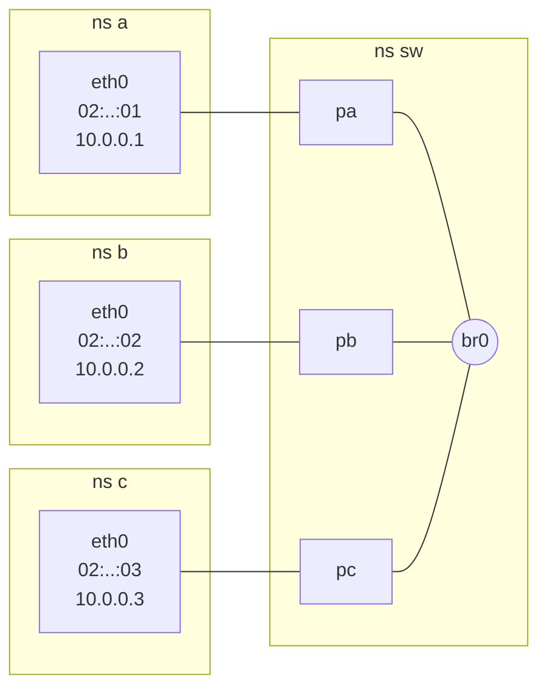
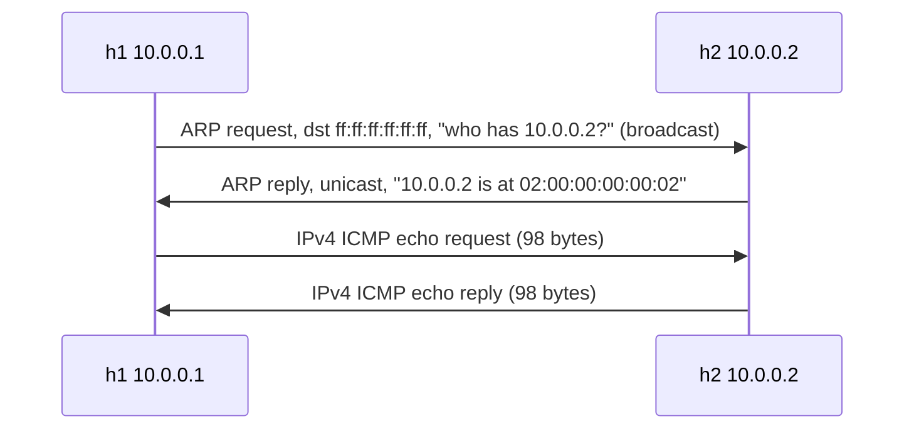
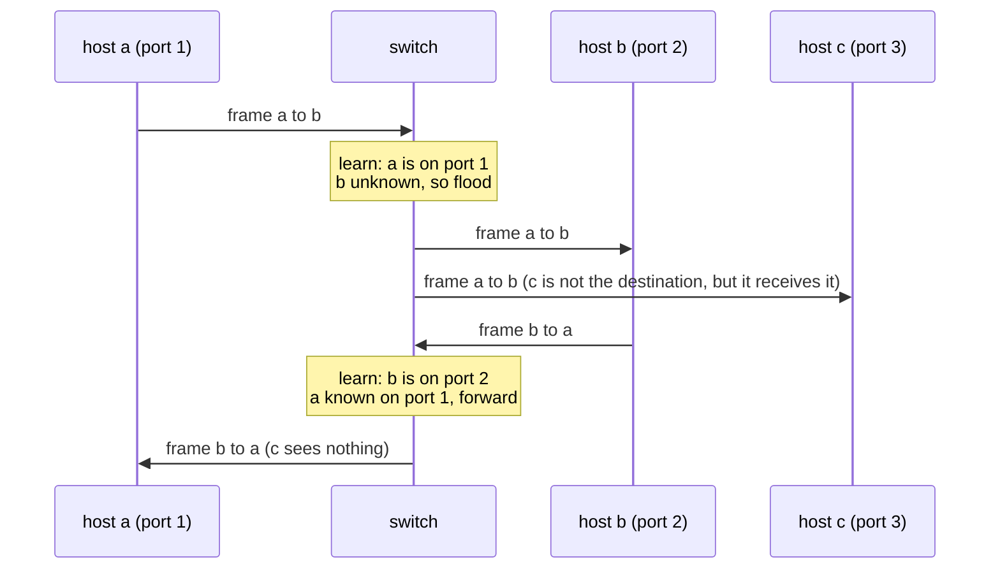
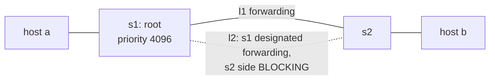
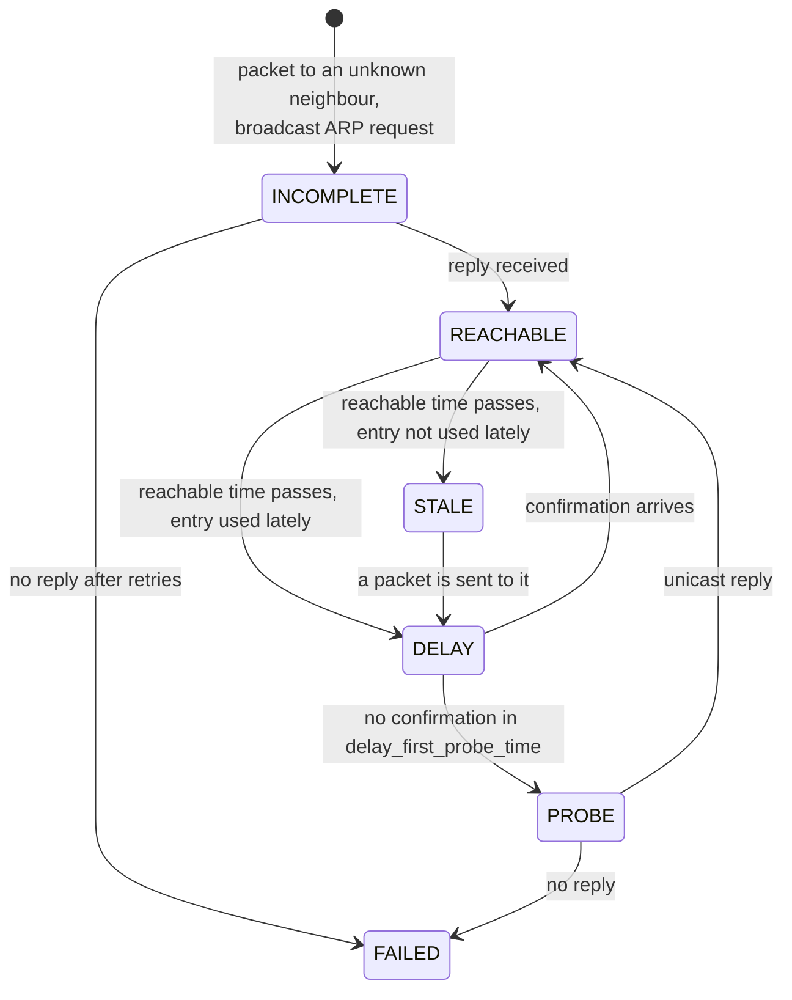
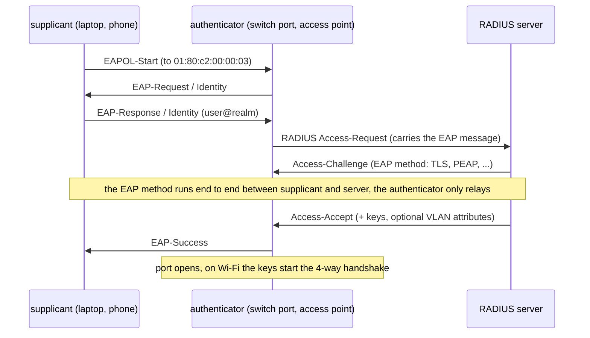

# NET 01: Network models and layer 2

*Part of the [networking plan](00_plan.md) · Time: about 5 hours · You need: [LX 08](../06_linux/08_linux_networking_toolbox.md) (network namespaces, `ip`, `tcpdump`), [C 02 to C 04](../02_c_language/00_plan.md) (pointers, structs, byte order) and [OS 01 to OS 03](../05_operating_systems/00_plan.md) (system calls). This tutorial follows one frame from the application's bytes to the cable and back: the layering models, the Ethernet frame, how a switch learns and forwards, VLANs, spanning tree, ARP and its IPv6 replacement, MTU, link aggregation, 802.1X, and how 802.11 framing differs. Every mechanism is run on a small lab built from network namespaces, so you can rebuild all of it.*

A frame is the smallest thing a network moves, and most "the network is broken" tickets end at layer 2: a switch that floods because it never learned an address, a loop that melts a campus in seconds, a tag that one device strips and another does not, an ARP entry that points at the wrong machine, an MTU that is 100 bytes short on one port. Interviewers ask about this layer because it is where you can show that you know what the hardware really does. This tutorial builds the lab (section 2), takes the frame apart (3), builds a switch's table by watching one work (4), adds VLANs (5), breaks the network with a loop and fixes it with spanning tree (6), covers ARP and IPv6 neighbour discovery (7), MTU (8), link aggregation and 802.1X (9), compares 802.11 with Ethernet (10), and teaches the capture and filter skills (11). Section 12 is a triage order for layer 2 faults, then come limits, costs, mistakes, questions and five problems.

**Eight honest limits, stated first.**

1. Everything is measured on **one Linux 6.18 VM** (Firecracker, 2 vCPUs) as **root**, with iproute2 6.1.0 and tcpdump 4.99.4. The lab traffic goes over **`veth` pairs between network namespaces** and a **Linux bridge**: there is **no NIC, no wire and no hardware switch**. Timing shows shapes, not network speeds.
2. **A `veth` pair does not add a preamble, padding or a frame check sequence.** A capture of an ARP request shows **42 bytes**, where the cable would carry 64 (60 padded bytes plus a 4 byte FCS). The FCS is therefore **computed by a program in section 3 and not captured**.
3. **This kernel has no VLAN devices (`8021q`), no bridge `vlan_filtering`, no bonding, no `dummy` and no `macvlan`**; each fails with `Unknown device type` or `Operation not supported`. VLAN tags are therefore **injected with a raw socket** (a small C program, section 2) and observed. The commands for VLAN sub-interfaces, a VLAN-aware bridge and an `802.3ad` bond are given **from memory** and marked.
4. **There is no IPv6** in this VM (`ip -6 addr add` fails with `Operation not supported`, and `/proc/sys/net/ipv6` does not exist). IPv6 neighbour discovery is explained **from memory and the RFCs**; only the address arithmetic is run.
5. **`tc netem` is not available**, which does not matter at layer 2; it matters in NET 03.
6. **`tcpdump` hides the VLAN tag from raw offsets.** On Linux the kernel strips the tag into packet metadata, and `libpcap` puts it back for the `vlan` filter and for `-e` output; a filter such as `ether[12:2] = 0x8100` matched nothing here, while `vlan` matched. Section 11 explains this.
7. **Single runs.** The packet counts of a storm vary by tens of percent between runs; ARP neighbour timers are randomised by the kernel (the reachable time is drawn from 0.5 to 1.5 times its base), so a state change can come a second earlier or later.
8. **Names and addresses are those of the lab**: hosts `a`, `b`, `c` with MACs `02:00:00:00:00:01` to `03` and addresses `10.0.0.1` to `3`, and a switch namespace `sw` with ports `pa`, `pb`, `pc`. MACs starting with `02` are locally administered ones chosen for readability.

By the end you can:

- say which header each device looks at (**a hub copies bits, a switch reads the Ethernet header, a router the IP header, a load balancer or firewall the transport header**), and draw the encapsulation of a web request down to the frame;
- **take an Ethernet frame apart byte by byte** (measured: an ARP request of **42 bytes** parsed by a 40 line C program as a broadcast to `ff:ff:ff:ff:ff:ff`, EtherType `0x0806`, 28 bytes of payload; padded to the **60 byte minimum**, its FCS came out as `e8 6f 4d f8`, and a CRC over frame plus FCS gave the fixed residue **`0xdebb20e3`**);
- do the **line-rate arithmetic** (measured by a script: a 64 byte frame occupies **84 bytes on the wire**, so 10 Gbit/s is **14.88 million frames a second**, 100 Gbit/s is **148.81 million**, and a 3 GHz core gets about **20 cycles** per packet);
- explain how a switch **learns, floods, forwards and ages** (measured: a frame to an address the switch had never heard from reached the third host as well, a **flood**; after the destination had spoken, the third host saw **0**; after the aging time, the frame **flooded again**; a frame with a copied source address **moved** the entry to another port; **3,000 frames with random source addresses left 3,001 entries** in the table);
- read an **802.1Q** and an **802.1ad** tag (measured: `vlan 10, p 5` and `vlan 100 ... vlan 10`; an ARP request for a host's address was **answered when untagged and ignored when tagged**, because the host had no VLAN interface);
- explain a **broadcast storm** and **spanning tree** (measured: **one** broadcast frame in a two switch loop produced **290,810 received packets in half a second**; with STP on, the blocked port was on the switch with the larger bridge ID, the other port went through `listening`, `learning` and `forwarding`, and the same frame arrived **once**);
- read the **neighbour cache** states of ARP and explain **spoofing** (measured: `REACHABLE` for 2.1 s, then `STALE`; one use took it to `DELAY` and, 2.0 s later, back to `REACHABLE` after a **unicast** probe; **one forged ARP request** changed the entry to the attacker's MAC, and a `PERMANENT` entry **ignored** the same forgery);
- explain **MTU** (measured: **1514 byte** frames pass at MTU 1500 and **1515** fails with `Message too long`; with one VLAN tag the limit is **1518**; a bridge port at MTU 1400 made 1,000 byte pings pass and 1,400 byte pings vanish with **100 percent loss and no drop counter moving**);
- say why a switch **does not forward** frames to `01:80:c2:00:00:03` (measured: **0** frames seen across the bridge; **1** after `group_fwd_mask 0x8`), which is the reason 802.1X, LLDP and BPDUs stop at the first switch;
- write a **learning switch table** in C with aging and MAC moves (Problem E) and answer the standard interview questions on all of the above.

**Where the numbers come from.** Ten experiment scripts (`e1` to `e10`) and five problem-answer scripts were run in this session; the scripts are in this tutorial's `prog/` folder, with the three C tools. Transcripts print `$ command` before each command's output, and `nse NS cmd` means `ip netns exec NS cmd`. A line "a saw 0   b saw 1   c saw 1" counts the frames of the test EtherType that each host received. Numbers that are not from these runs are marked "from memory" or come from a source listed at the end.

**Data and timing.** No data sets. The lab is created in about a second by the shell functions in section 2, and each experiment takes a few seconds; the ARP aging experiment takes about 25 seconds and the spanning tree experiment about 12 seconds. All timings are single runs.

---

## 1. The models, and who looks at which header

Two models describe the same thing. The **OSI model** has seven layers and the **TCP/IP model** has four or five; interviews use both vocabularies, so you need the mapping.

```text
  OSI                       TCP/IP               What the unit is called     Example
  7 Application  \
  6 Presentation  >------>  Application          message / data              HTTP, DNS, TLS records
  5 Session      /
  4 Transport      ------>  Transport            segment (TCP) / datagram    TCP, UDP, QUIC
  3 Network        ------>  Internet             packet                      IPv4, IPv6, ICMP
  2 Data link      \
  1 Physical        >----->  Link                 frame (L2) / bits (L1)      Ethernet, 802.11
```

The seven layers are a teaching tool; the Internet was built from the four. Where they disagree, the honest answer in an interview is "OSI for naming, TCP/IP for what runs", and you should be able to place **TLS** (between 4 and 7, and OSI would call it 5 or 6), **ARP** (between 2 and 3, it is carried directly in an Ethernet frame but exists to serve IP), **VLAN tags** (2, a tag inside the frame) and **MPLS** (the "2.5" layer).

**Encapsulation** is each layer wrapping the data of the layer above in its own header (and, at layer 2, a trailer). A browser's `GET /` leaves the host like this:

```text
 application   |GET / HTTP/1.1 ...|                                  (inside a TLS record, usually)
 TCP segment   |TCP hdr 20+|GET / HTTP/1.1 ...|
 IP packet     |IP hdr 20|TCP hdr 20+|GET / HTTP/1.1 ...|
 Ethernet      |dst 6|src 6|type 2|IP hdr|TCP hdr|GET / ...........|FCS 4|
               <------ 14 bytes ->                                  <- 4 ->
 on the wire   preamble 7 + SFD 1 | frame | inter-frame gap 12 byte times
```

Each device on the path opens the packet only as far as its job requires. That table is the answer to "what is the difference between a hub, a switch, a router and a load balancer":

| Device | Reads | Decides on | Changes |
| --- | --- | --- | --- |
| Repeater, hub (L1) | nothing | nothing: copies every bit to every other port | nothing |
| Bridge, switch (L2) | the **Ethernet header** | destination MAC, VLAN | nothing (it may add or strip a VLAN tag) |
| Router (L3) | the **IP header** | destination IP, longest-prefix match | **rewrites the Ethernet header** at every hop, decrements TTL |
| Firewall, L4 load balancer | the **TCP/UDP header**, often with a connection table | the 5-tuple (addresses, ports, protocol) | may rewrite addresses and ports (NAT) |
| L7 proxy, application firewall | the **payload** | URL, headers, content | anything |

Two consequences matter for the rest of the track. First, **an Ethernet frame never leaves its segment**: a router receives the frame, discards its header and builds a new one for the next link, so the source and destination MAC addresses **change at every hop while the IP addresses do not** (except where NAT rewrites them). Second, **a layer 2 segment is a broadcast domain**: a frame sent to `ff:ff:ff:ff:ff:ff` reaches every host on it, which is why segments are kept small and why VLANs exist.

**What happens, at layer 2, when you type a URL.** The browser resolves the name (NET 08), opens a TCP connection to the address (NET 03), and TCP hands a segment to IP (NET 02). IP looks at its routing table: if the destination is in a directly connected subnet, the next hop is the destination itself, otherwise it is the **default gateway**. Either way the host now needs the **MAC address of the next hop**, and the first frame on the wire is usually not the SYN but an **ARP request** (section 7). Only when the reply arrives can the Ethernet frame carrying the SYN be built, with the next hop's MAC as destination. A frame sent to the gateway for a destination on the other side of the world therefore has the **gateway's MAC and the server's IP**. Interviewers like this detail; it is the clearest way to show that you know the two address spaces are different.

| Address | Layer | Scope | Changes along the path? |
| --- | --- | --- | --- |
| MAC (48 bit) | 2 | one segment | at every router |
| IP (32 or 128 bit) | 3 | end to end | not unless NAT |
| Port (16 bit) | 4 | one host | not unless NAT |

---

## 2. The lab, and three small tools

The lab is three hosts and a switch, all in network namespaces on one machine. `lan3.sh` builds it and deletes it again when the script ends, so nothing touches the VM's own network.

```bash
. prog/h.sh
cleanup() { for n in a b c sw; do ip netns del $n 2>/dev/null; done; }
trap cleanup EXIT; cleanup
for n in a b c sw; do ip netns add $n; done
nse sw ip link add br0 type bridge
nse sw ip link set br0 up
i=0
for h in a b c; do
  i=$((i+1))
  ip link add eth0 netns $h type veth peer name p$h netns sw
  nse $h ip link set eth0 address 02:00:00:00:00:0$i
  nse $h ip addr add 10.0.0.$i/24 dev eth0
  nse $h ip link set eth0 up
  nse sw ip link set p$h master br0
  nse sw ip link set p$h up
done
A=02:00:00:00:00:01; B=02:00:00:00:00:02; C=02:00:00:00:00:03
cap() { nse $1 timeout ${4:-1.5} tcpdump -nn --immediate-mode -U -Q in -i eth0 -p -w $2 "$3" 2>/dev/null & sleep 0.5; }
ip4hex() { printf '%02x%02x%02x%02x' ${1//./ }; }
arp() { echo 00010800 0604 000$1 ${2//:/} $(ip4hex $3) ${4//:/} $(ip4hex $5) | tr -d ' '; }
```

The first line sources `h.sh`, which defines `show` (print a command with `$ ` in front and run it), `nse` (run a command inside a namespace), and builds three C tools into `/tmp`:

```bash
show() { local cmd=$1; shift; printf '$ %s\n' "$cmd"; eval "$cmd" 2>&1; }
nse() { local ns=$1; shift; ip netns exec "$ns" "$@"; }
mkhost() { ip netns add "$1"; }
for t in sendframe parseframe fcs; do [ -x /tmp/$t ] || gcc -O1 -o /tmp/$t prog/$t.c; done
export PATH=/tmp:$PATH
```

Each host has one interface `eth0` with a fixed MAC and an address `10.0.0.N/24`; each is connected by a `veth` pair to a port of a **Linux bridge** `br0` in the namespace `sw`. A Linux bridge is a software switch, the same code that connects containers on a host. The helper `cap HOST FILE FILTER [SECONDS]` starts a `tcpdump` on a host that only records frames **received** (`-Q in`) and writes them to a file, so a host's own transmissions are not counted; `--immediate-mode` matters (section 11).



**`sendframe`** injects any frame you describe, with an `AF_PACKET` raw socket. It is the tool that makes this tutorial possible on a kernel without VLAN support, and it is the first piece of the raw-socket material of NET 04. It takes an interface, destination and source MAC, an EtherType, an optional VLAN specification and the payload as hex.

```c
/* sendframe IFACE DST SRC ETHERTYPE VLAN PAYLOADHEX [COUNT]
   Send raw Ethernet frames on an interface with an AF_PACKET socket.
   VLAN: "-" for none, "10" for one 802.1Q tag, "10p5" for VLAN 10 with priority 5,
   "100/10" for an 802.1ad outer tag and an inner tag.
   SRC "rand" uses a different random source MAC for every frame. */
#include <arpa/inet.h>
#include <net/if.h>
#include <netpacket/packet.h>
#include <stdio.h>
#include <stdlib.h>
#include <string.h>
#include <sys/socket.h>
#include <unistd.h>

static int mac(const char *s, unsigned char *m) {
    return sscanf(s, "%hhx:%hhx:%hhx:%hhx:%hhx:%hhx", m, m + 1, m + 2, m + 3, m + 4, m + 5) == 6;
}

int main(int argc, char **argv) {
    if (argc < 7) { fprintf(stderr, "usage: sendframe IFACE DST SRC ETHERTYPE VLAN PAYLOADHEX [COUNT]\n"); return 2; }
    unsigned char f[2048], dst[6], src[6];
    int n = 0, count = argc > 7 ? atoi(argv[7]) : 1, randsrc = !strcmp(argv[3], "rand");
    if (!mac(argv[2], dst) || (!randsrc && !mac(argv[3], src))) { fprintf(stderr, "bad MAC\n"); return 2; }
    memcpy(f, dst, 6);
    n = 12;
    unsigned type = strtoul(argv[4], 0, 16), outer = 0, inner = 0, pcp = 0;
    if (strcmp(argv[5], "-")) {
        char *slash = strchr(argv[5], '/');
        if (slash) { outer = atoi(argv[5]);
            f[n++] = 0x88; f[n++] = 0xa8; f[n++] = outer >> 8; f[n++] = outer & 255; }
        const char *in = slash ? slash + 1 : argv[5], *p = strchr(in, 'p');
        inner = atoi(in);
        if (p) pcp = atoi(p + 1);
        f[n++] = 0x81; f[n++] = 0x00; f[n++] = (pcp << 5) | (inner >> 8); f[n++] = inner & 255;
    }
    f[n++] = type >> 8; f[n++] = type & 255;
    for (const char *p = argv[6]; p[0] && p[1]; p += 2) { unsigned b; sscanf(p, "%2x", &b); f[n++] = b; }
    int s = socket(AF_PACKET, SOCK_RAW, 0);
    struct sockaddr_ll sa = { .sll_family = AF_PACKET, .sll_ifindex = if_nametoindex(argv[1]) };
    for (int i = 0; i < count; i++) {
        if (randsrc) { for (int k = 0; k < 6; k++) src[k] = rand(); src[0] = (src[0] & 0xfe) | 2; }
        memcpy(f + 6, src, 6);
        if (sendto(s, f, n, 0, (struct sockaddr *)&sa, sizeof sa) < 0) { perror("sendto"); return 1; }
    }
    printf("sent %d frame(s) of %d bytes\n", count, n);
    return 0;
}
```

Three details to notice. `socket(AF_PACKET, SOCK_RAW, 0)` gives you the frame as you build it, **including the Ethernet header**; with `SOCK_DGRAM` the kernel would build the header from the `sockaddr_ll`. The tag is part of the buffer, because the kernel does not know or care that it is a VLAN tag unless a VLAN device is involved. And `sendto` **refuses frames larger than the interface MTU plus header** with `EMSGSIZE`, which section 8 uses as a measurement.

**`parseframe`** reads the hex bytes of one frame and prints its fields, walking through any number of VLAN tags:

```c
/* parseframe: read hex bytes of one Ethernet frame on stdin (tcpdump -xx output is fine) and print its fields. */
#include <ctype.h>
#include <stdio.h>
#include <string.h>

int main(void) {
    unsigned char f[2048];
    int n = 0, c, hi = -1;
    while ((c = getchar()) != EOF && n < 2048) {
        if (!isxdigit(c)) { hi = -1; continue; }
        int v = isdigit(c) ? c - '0' : (tolower(c) - 'a' + 10);
        if (hi < 0) hi = v; else { f[n++] = hi * 16 + v; hi = -1; }
    }
    if (n < 14) { puts("short frame"); return 1; }
    printf("dst  %02x:%02x:%02x:%02x:%02x:%02x%s%s\n", f[0], f[1], f[2], f[3], f[4], f[5],
           (f[0] & 1) ? "  group (I/G bit 1)" : "", (f[0] & 2) ? "  locally administered (U/L bit 1)" : "");
    printf("src  %02x:%02x:%02x:%02x:%02x:%02x%s\n", f[6], f[7], f[8], f[9], f[10], f[11],
           (f[6] & 2) ? "  locally administered (U/L bit 1)" : "");
    int off = 12;
    while (off + 4 <= n && ((f[off] == 0x81 && f[off + 1] == 0x00) || (f[off] == 0x88 && f[off + 1] == 0xa8))) {
        int tci = f[off + 2] << 8 | f[off + 3];
        printf("tag  %s  PCP %d  DEI %d  VID %d\n", f[off] == 0x81 ? "802.1Q " : "802.1ad", tci >> 13, (tci >> 12) & 1, tci & 0xfff);
        off += 4;
    }
    int type = f[off] << 8 | f[off + 1];
    const char *name = type == 0x0800 ? "IPv4" : type == 0x0806 ? "ARP" : type == 0x86dd ? "IPv6" :
                       type == 0x888e ? "EAPOL (802.1X)" : type == 0x88cc ? "LLDP" : type < 0x600 ? "length field (802.3)" : "other";
    printf("type 0x%04x  %s\n", type, name);
    printf("payload %d bytes, frame %d bytes (no preamble, no FCS)\n", n - off - 2, n);
    return 0;
}
```

It reads the output of `tcpdump -xx` (after the line offsets are stripped), which is how the next section feeds it a real frame.

---

## 3. The Ethernet frame

### 3.1 The layout

```text
 byte  0         6          12         14                             14+n    14+n+4
       +---------+----------+----------+------------------------------+-------+
       | dst MAC | src MAC  | EtherType|  payload (46 to 1500 bytes)  |  FCS  |
       | 6 bytes | 6 bytes  | 2 bytes  |                              | 4 B   |
       +---------+----------+----------+------------------------------+-------+
 before the frame: preamble 7 x 0xAA, start-of-frame delimiter 0xAB     (8 bytes)
 after the frame:  inter-frame gap, 12 byte times of silence
```

The **preamble and start-of-frame delimiter** let the receiver's clock lock on; the **FCS** is a CRC-32 over the header and payload, checked by the receiving NIC, which **drops a frame with a bad FCS** and counts it (`rx_crc_errors`). Software never sees the preamble or the FCS: a capture on a real NIC shows the frame from the destination MAC to the end of the payload. The **minimum frame is 64 bytes** (header 14, payload 46, FCS 4): a shorter payload is **padded** with zeros by the sender. The rule goes back to shared coaxial Ethernet, where a station had to still be transmitting when a collision came back from the far end of the cable, so a frame had to last at least one round trip, 512 bit times; on full-duplex switched links there are no collisions, but the minimum stayed. The **maximum payload is 1500 bytes** (the MTU), so the maximum frame is 1518 (1522 with one VLAN tag).

**EtherType or length.** The two bytes after the addresses are an **EtherType** in Ethernet II (the framing nearly everything uses) and a **length** in IEEE 802.3 framing. Values **below 0x0600 (1536) are lengths, values from 0x0600 up are types**, which is how a receiver tells them apart. The types you must know:

| EtherType | Protocol | Where |
| --- | --- | --- |
| `0x0800` | IPv4 | NET 02 |
| `0x0806` | ARP | section 7 |
| `0x86DD` | IPv6 | NET 02 |
| `0x8100` | 802.1Q VLAN tag | section 5 |
| `0x88A8` | 802.1ad service tag (QinQ) | section 5 |
| `0x8847` | MPLS unicast | NET 02 |
| `0x888E` | EAPOL (802.1X) | section 9 |
| `0x88CC` | LLDP | section 4.5 |
| `0x8809` | slow protocols (LACP) | section 9 |

### 3.2 MAC addresses

A MAC address is 48 bits written as six bytes. Two bits of the **first byte** matter:

```text
   first byte of a MAC:    b7 b6 b5 b4 b3 b2 [U/L] [I/G]
                                              bit 1  bit 0
   I/G = 0 unicast         I/G = 1 group (multicast; all ones = broadcast)
   U/L = 0 globally unique (burned in, first three bytes are the manufacturer's OUI)
   U/L = 1 locally administered (set by software: VMs, containers, `ip link set address`)
```

So `ff:ff:ff:ff:ff:ff` is the broadcast address, `01:00:5e:xx:xx:xx` is the IPv4 multicast range and `33:33:xx:xx:xx:xx` the IPv6 multicast range (section 7), and the `02:` addresses of this lab are locally administered unicast. The first three bytes of a burned-in address are the **OUI**, assigned to a manufacturer, which is how tools tell you that a device is "Apple" or "Ruckus" from its MAC. **MAC addresses are not secure identities**: any host can set its own, which section 4.4 and section 7.4 use.

### 3.3 A real frame, parsed

`e1_frames.sh` builds two hosts on one segment, pings once, and captures the result on the receiving side:

```bash
. prog/h.sh
trap 'ip netns del h1; ip netns del h2' EXIT
ip netns add h1; ip netns add h2
ip link add e1 netns h1 type veth peer name e2 netns h2
nse h1 ip link set e1 address 02:00:00:00:00:01; nse h2 ip link set e2 address 02:00:00:00:00:02
nse h1 ip addr add 10.0.0.1/24 dev e1; nse h2 ip addr add 10.0.0.2/24 dev e2
nse h1 ip link set e1 up; nse h2 ip link set e2 up
echo "--- 1. one ping between two hosts on one segment, seen on h2"
nse h2 tcpdump -nn -e -i e2 -c 4 -w /tmp/n1.pcap 2>/dev/null &
sleep 0.5
show "nse h1 ping -c 1 -W 1 10.0.0.2 | grep -E 'bytes from'"
wait
show "tcpdump -nn -e -r /tmp/n1.pcap 2>&1 | tail -n +2 | cut -c17-140"
echo "--- 2. the bytes of the first frame, and the same frame parsed"
show "tcpdump -nn -xx -r /tmp/n1.pcap -c 1 2>&1 | grep -E '0x'"
tcpdump -nn -xx -r /tmp/n1.pcap -c 1 2>/dev/null | grep -E '0x' | sed -E 's/^[[:space:]]*0x[0-9a-f]+://' | parseframe
echo "--- 3. the neighbour cache on h1 after the exchange"
show "nse h1 ip neigh show dev e1"
echo "--- 4. the frame check sequence the NIC adds, over the frame padded to the 60 byte minimum"
(tcpdump -nn -xx -r /tmp/n1.pcap -c 1 2>/dev/null | grep -E '0x' | sed -E 's/^[[:space:]]*0x[0-9a-f]+://'; printf '00 %.0s' $(seq 18)) | fcs
```

```text
--- 1. one ping between two hosts on one segment, seen on h2
$ nse h1 ping -c 1 -W 1 10.0.0.2 | grep -E 'bytes from'
64 bytes from 10.0.0.2: icmp_seq=1 ttl=64 time=0.197 ms
$ tcpdump -nn -e -r /tmp/n1.pcap 2>&1 | tail -n +2 | cut -c17-140
02:00:00:00:00:01 > ff:ff:ff:ff:ff:ff, ethertype ARP (0x0806), length 42: Request who-has 10.0.0.2 tell 10.0.0.1, length 28
02:00:00:00:00:02 > 02:00:00:00:00:01, ethertype ARP (0x0806), length 42: Reply 10.0.0.2 is-at 02:00:00:00:00:02, length 28
02:00:00:00:00:01 > 02:00:00:00:00:02, ethertype IPv4 (0x0800), length 98: 10.0.0.1 > 10.0.0.2: ICMP echo request, id 480, s
02:00:00:00:00:02 > 02:00:00:00:00:01, ethertype IPv4 (0x0800), length 98: 10.0.0.2 > 10.0.0.1: ICMP echo reply, id 480, seq
--- 2. the bytes of the first frame, and the same frame parsed
$ tcpdump -nn -xx -r /tmp/n1.pcap -c 1 2>&1 | grep -E '0x'
        0x0000:  ffff ffff ffff 0200 0000 0001 0806 0001
        0x0010:  0800 0604 0001 0200 0000 0001 0a00 0001
        0x0020:  0000 0000 0000 0a00 0002
dst  ff:ff:ff:ff:ff:ff  group (I/G bit 1)  locally administered (U/L bit 1)
src  02:00:00:00:00:01  locally administered (U/L bit 1)
type 0x0806  ARP
payload 28 bytes, frame 42 bytes (no preamble, no FCS)
--- 3. the neighbour cache on h1 after the exchange
$ nse h1 ip neigh show dev e1
10.0.0.2 lladdr 02:00:00:00:00:02 REACHABLE
--- 4. the frame check sequence the NIC adds, over the frame padded to the 60 byte minimum
frame 60 bytes, FCS on the wire: e8 6f 4d f8
CRC over frame plus FCS (not inverted): 0xdebb20e3
```

Read the first part: a single `ping` produced **four frames, and two of them are ARP**. The first frame is `02:00:00:00:00:01 > ff:ff:ff:ff:ff:ff`, an ARP **request** to the broadcast address: "who has 10.0.0.2, tell 10.0.0.1". The reply is a **unicast** frame back to the asker. Only then does the ICMP echo go out, in a frame of **98 bytes**: 14 header, 20 IP, 8 ICMP and 56 bytes of data. After the exchange the neighbour cache of `h1` holds the pair (`10.0.0.2 lladdr 02:00:00:00:00:02 REACHABLE`), so a second ping needs no ARP.



The second part prints the 42 bytes of the first frame and runs `parseframe` on them: destination **all ones** (a group address, so broadcast), source `02:00:00:00:00:01` (locally administered), type `0x0806`, **28 bytes of payload** (an ARP packet), **42 bytes in all**, which is 14 plus 28. A real ARP request is padded to the 60 byte minimum on the wire; the 18 missing bytes are what a `veth` pair never adds.

### 3.4 The frame check sequence

The last section of that transcript computes the FCS that a NIC would append, with `fcs.c`:

```c
/* fcs: read hex bytes of a frame on stdin, print the Ethernet FCS (CRC-32, reflected, polynomial 0xEDB88320)
   as it goes on the wire (least significant byte first), then the CRC over frame plus FCS. */
#include <ctype.h>
#include <stdint.h>
#include <stdio.h>

static uint32_t crc32(const unsigned char *p, int n) {
    uint32_t c = 0xffffffff;
    for (int i = 0; i < n; i++) {
        c ^= p[i];
        for (int k = 0; k < 8; k++) c = (c >> 1) ^ (0xedb88320 & -(c & 1));
    }
    return ~c;
}

int main(void) {
    unsigned char f[2048];
    int n = 0, c, hi = -1;
    while ((c = getchar()) != EOF && n < 2040) {
        if (!isxdigit(c)) { hi = -1; continue; }
        int v = isdigit(c) ? c - '0' : (tolower(c) - 'a' + 10);
        if (hi < 0) hi = v; else { f[n++] = hi * 16 + v; hi = -1; }
    }
    uint32_t fcs = crc32(f, n);
    printf("frame %d bytes, FCS on the wire: %02x %02x %02x %02x\n", n, fcs & 255, fcs >> 8 & 255, fcs >> 16 & 255, fcs >> 24);
    for (int i = 0; i < 4; i++) f[n + i] = fcs >> (8 * i);
    printf("CRC over frame plus FCS (not inverted): 0x%08x\n", ~crc32(f, n + 4));
    return 0;
}
```

The CRC is the standard **CRC-32** with the reflected polynomial `0xEDB88320`, started from `0xFFFFFFFF`, with the final value inverted, and sent **least significant byte first**. Run over the 42 bytes padded with 18 zeros to the minimum of 60, it gave **`e8 6f 4d f8`**. The last line is the useful property: the CRC computed over **the frame followed by its own FCS** is a **constant, `0xdebb20e3`** (before the final inversion), which is how receiving hardware checks a frame without comparing four bytes: it runs the CRC over everything and tests for the constant. Two interview points follow. **A switch recomputes the FCS when it changes a frame** (for example by adding a VLAN tag), and a **cut-through** switch, which starts sending a frame before it has received the end, cannot know whether the FCS is good, so it forwards a bad frame and the next store-and-forward device drops it (from memory; the latency numbers are in section 13). And **captures usually do not contain the FCS**, because the NIC strips it, so you cannot find a bad FCS from a capture on the receiver; you read the NIC's `rx_crc_errors` counter.

### 3.5 What the preamble and the gap cost: line-rate arithmetic

A link's headline rate counts every bit, including the 8 byte preamble and the 12 byte gap that follow each frame, so the frame rate at a given speed is fixed by the frame size. This arithmetic shows up in every question about packet processing (NET 06, NET 07, DPDK, NICs, switches):

```python
# Ethernet line rate: packets per second and payload efficiency by frame size.
# On the wire each frame also carries an 8 byte preamble and is followed by a 12 byte inter-frame gap.
OVERHEAD = 8 + 12
print("frame bytes include header and FCS; MTU 1500 payload gives a 1518 byte frame")
print("%-7s %-12s %10s %10s %10s %12s" % ("frame", "wire bytes", "10G Mpps", "25G Mpps", "100G Mpps", "payload %"))
for frame in (64, 128, 256, 512, 1024, 1518):
    wire = frame + OVERHEAD
    payload = frame - 18
    row = [1e9 * g / (wire * 8) / 1e6 for g in (10, 25, 100)]
    print("%-7d %-12d %10.2f %10.2f %10.2f %11.1f%%" % (frame, wire, *row, 100.0 * payload / wire))
print()
print("time budget per packet at 100G with 64 byte frames: %.2f ns" % (84 * 8 / 100))
print("time budget per packet at 100G with 1518 byte frames: %.1f ns" % (1538 * 8 / 100))
print("a 3 GHz core has %.0f cycles per 64 byte packet at 100G" % (84 * 8 / 100 * 3))
```

```text
frame bytes include header and FCS; MTU 1500 payload gives a 1518 byte frame
frame   wire bytes     10G Mpps   25G Mpps  100G Mpps    payload %
64      84                14.88      37.20     148.81        54.8%
128     148                8.45      21.11      84.46        74.3%
256     276                4.53      11.32      45.29        86.2%
512     532                2.35       5.87      23.50        92.9%
1024    1044               1.20       2.99      11.97        96.4%
1518    1538               0.81       2.03       8.13        97.5%

time budget per packet at 100G with 64 byte frames: 6.72 ns
time budget per packet at 100G with 1518 byte frames: 123.0 ns
a 3 GHz core has 20 cycles per 64 byte packet at 100G
```

A 64 byte frame occupies **84 byte times** (64 + 8 + 12), so 10 Gbit/s carries **14.88 million frames a second** and 100 Gbit/s carries **148.81 million**. At 100 Gbit/s the budget per minimum size frame is **6.72 ns**, about **20 cycles of a 3 GHz core**, which is why software cannot forward 100G of small packets one at a time on one core, and why DPDK and XDP batch, why NICs offload checksums and segmentation, and why switches use fixed-function hardware. The **payload efficiency** column says why a link carrying 64 byte frames delivers only **54.8 percent** of its rate as upper-layer bytes, against 97.5 percent for full frames. Jumbo frames (9000 byte MTU) raise that figure again and cut the packet rate by six, at a cost described in section 8.


---

## 4. Switching: learn, flood, forward, age

### 4.1 The four things a switch does

A switch keeps a **forwarding database** (FDB, also called the MAC address table or CAM table): a map from (VLAN, MAC address) to a port, with an age. For every frame that arrives it does two things:

1. **Learn:** record that the frame's **source** MAC is reachable through the **ingress port**, and refresh its age.
2. **Forward:** look up the frame's **destination** MAC.
   - **Known** unicast, on another port: send to that port only (**forward**).
   - Known, on the **same port** it came in: do nothing (**filter**), because the destination already heard it.
   - **Unknown** unicast, **broadcast**, or (without snooping) multicast: send to **all ports except the ingress port** (**flood**).

Entries that are not refreshed for the **aging time** (300 seconds by default on most switches and on Linux) are removed. Nothing is configured: a switch is a plug-and-play device because it learns by watching. That is also what makes it attackable, as 4.4 shows.



### 4.2 Watching a switch learn

`e2_switch.sh` builds the lab of section 2 and sends frames with a private EtherType (`0x88b5`, reserved for experiments) between the hosts, so that no ARP or other traffic interferes. After each frame it counts, on every host, how many frames of that type were received:

```bash
. prog/lan3.sh
watch() { for h in a b c; do nse $h timeout 1 tcpdump -nn --immediate-mode -U -Q in -i eth0 -p -w /tmp/w_$h.pcap ether proto 0x88b5 2>/dev/null & done; sleep 0.4; }
seen() { wait; for h in a b c; do printf '%s saw %s   ' $h $(tcpdump -nn -e -r /tmp/w_$h.pcap 2>/dev/null | grep -c ethertype); done; echo; }
echo "--- 1. a new switch knows nothing: only its own permanent entries"
show "nse sw bridge fdb show br br0 | grep -v -E 'permanent' | wc -l"
echo "--- 2. a sends to b, who has never spoken: unknown unicast is flooded, so c sees it too"
watch
nse a sendframe eth0 $B $A 88b5 - 68656c6c6f >/dev/null
seen
show "nse sw bridge fdb show br br0 | grep -v permanent | sed 's/ master br0//; s/ \\(self\\)//'"
echo "--- 3. b answers a: a is now known, so the frame goes to the a port only"
watch
nse b sendframe eth0 $A $B 88b5 - 7265706c79 >/dev/null
seen
show "nse sw bridge fdb show br br0 | grep -v permanent | sed 's/ master br0//'"
echo "--- 4. a sends to b again: both are known, c sees nothing"
watch
nse a sendframe eth0 $B $A 88b5 - 68656c6c6f >/dev/null
seen
echo "--- 5. aging: set the aging time to 3 s, wait 5 s, the entries are gone, the next frame floods again"
nse sw ip link set br0 type bridge ageing_time 300
sleep 5
show "nse sw bridge fdb show br br0 | grep -v permanent | wc -l"
watch
nse a sendframe eth0 $B $A 88b5 - 68656c6c6f >/dev/null
seen
echo "--- 6. MAC move: c sends a frame with a's source address, and a's entry moves to c's port"
nse sw ip link set br0 type bridge ageing_time 30000
nse a sendframe eth0 $B $A 88b5 - 68656c6c6f >/dev/null
show "nse sw bridge fdb show br br0 | grep $A | sed 's/ master br0//'"
nse c sendframe eth0 $B $A 88b5 - 73706f6f66 >/dev/null
show "nse sw bridge fdb show br br0 | grep $A | sed 's/ master br0//'"
echo "--- 7. table exhaustion: 3000 frames with random source addresses from c"
nse c sendframe eth0 $B rand 88b5 - 00 3000
show "nse sw bridge fdb show br br0 | grep -v permanent | wc -l"
```

```text
--- 1. a new switch knows nothing: only its own permanent entries
$ nse sw bridge fdb show br br0 | grep -v -E 'permanent' | wc -l
0
--- 2. a sends to b, who has never spoken: unknown unicast is flooded, so c sees it too
a saw 0   b saw 1   c saw 1
$ nse sw bridge fdb show br br0 | grep -v permanent | sed 's/ master br0//; s/ \(self\)//'
02:00:00:00:00:01 dev pa
--- 3. b answers a: a is now known, so the frame goes to the a port only
a saw 1   b saw 0   c saw 0
$ nse sw bridge fdb show br br0 | grep -v permanent | sed 's/ master br0//'
02:00:00:00:00:01 dev pa
02:00:00:00:00:02 dev pb
--- 4. a sends to b again: both are known, c sees nothing
a saw 0   b saw 1   c saw 0
--- 5. aging: set the aging time to 3 s, wait 5 s, the entries are gone, the next frame floods again
$ nse sw bridge fdb show br br0 | grep -v permanent | wc -l
0
a saw 0   b saw 1   c saw 1
--- 6. MAC move: c sends a frame with a's source address, and a's entry moves to c's port
$ nse sw bridge fdb show br br0 | grep 02:00:00:00:00:01 | sed 's/ master br0//'
02:00:00:00:00:01 dev pa
$ nse sw bridge fdb show br br0 | grep 02:00:00:00:00:01 | sed 's/ master br0//'
02:00:00:00:00:01 dev pc
--- 7. table exhaustion: 3000 frames with random source addresses from c
sent 3000 frame(s) of 15 bytes
$ nse sw bridge fdb show br br0 | grep -v permanent | wc -l
3001
```

Read it step by step:

1. **A new switch knows nothing**: the table has no learned entries (the `permanent` ones are the bridge's own addresses).
2. **`a` sends to `b`, who has never spoken.** The switch learned `a` on port `pa`, but `b` is unknown, so it **floods**: **`b` saw 1 and `c` saw 1**. Host `c` was never addressed and still received the frame. This is **unknown unicast flooding**, and it is the reason layer 2 is not private: a host can see frames meant for others until the switch has learned their addresses.
3. **`b` answers.** The switch learns `b` on `pb`; `a` is known, so the reply goes to **`a` only**: `a saw 1`, `b saw 0`, **`c saw 0`**.
4. **`a` sends to `b` again.** Both are known: **only `b` saw it**, and `c` saw nothing.
5. **Aging.** With the aging time cut to 3 seconds (`ageing_time` is in hundredths of a second, so `300`), the table was empty five seconds later, and the next frame to `b` **flooded again** (`c saw 1`).
6. **A MAC move.** The entry for `a` pointed to port `pa`; after a frame **from `c` with `a`'s source address**, it pointed to **`pc`**. A switch trusts the last frame it saw: it has no way to know that the source address is forged, and legitimate moves (a laptop going from one port to another, a virtual machine migrating, a failover pair) look exactly the same.
7. **Exhaustion.** `3,000` frames from random source addresses left **3,001** entries. The table has a finite size (tens of thousands of entries in a small hardware switch, more in a large one; from memory), and what a switch does when it is full is the point of 4.4.

### 4.3 Collision domains and broadcast domains

Two terms to keep apart. A **collision domain** is the set of devices that can interfere at the physical layer: all ports of a **hub**, one segment of coaxial cable, or, today, nothing (each switched, full-duplex link is its own collision domain with no collisions, which is why CSMA/CD is history on wired links; on Wi-Fi the equivalent problem remains, section 10). A **broadcast domain** is the set of devices that receive each other's broadcasts: all ports of a switch in the same VLAN, **and everything bridged to them**. A switch splits collision domains; **only a router (or a VLAN boundary) splits a broadcast domain**. A flat network of thousands of hosts is a bad idea for this reason: every ARP request, DHCP discover and mDNS announcement reaches every host, and every unknown unicast frame is flooded to all.

### 4.4 Attacks and protections

- **MAC flooding** (the 3,000 frames of step 7): fill the table with junk so that **legitimate entries are evicted**. A switch that cannot learn a destination **floods** it, so a flooded switch behaves like a hub and the attacker sees other hosts' traffic. The tool of the classic attack is `macof`. **Protection: port security**, which limits the number of MACs per port (often 1 to 5) and, on violation, drops the frames, shuts the port, or alerts.
- **MAC spoofing** (step 6): steal another host's identity at layer 2, to receive its frames or to bypass a MAC-based access list. Protection is the same port security plus **802.1X** (section 9), which authenticates the device and not just its address.
- **ARP spoofing**: section 7.4. Protection: **dynamic ARP inspection** (the switch checks ARP packets against a trusted table, usually built from DHCP snooping).
- **Rogue DHCP servers**: protection is **DHCP snooping**, which only trusts offers arriving on marked ports.

All of these are features of managed switches. Linux bridges have far fewer; the Linux bridge's newer `fdb_max_learned` option (from memory, introduced in kernel 6.13) caps the table, but iproute2 6.1.0 here has no name for it, so it is not demonstrated.

### 4.4a Static entries

Learning goes wrong in one standard way: a host that **never transmits** never gets an entry, so every frame to it is flooded for as long as it stays silent (a one-way UDP stream, a printer, a monitoring port). Problem A reproduces this and fixes it with `bridge fdb add ... static`.

### 4.5 Frames a switch will not forward

IEEE 802.1D reserves **16 group addresses, `01:80:c2:00:00:00` to `0f`**, for protocols that talk to the **adjacent** device only: STP BPDUs, pause frames, LACP, 802.1X, LLDP and others. A compliant bridge **never forwards frames sent to these addresses**; it consumes or drops them. That is the correct behaviour (a BPDU that crossed a switch would confuse the root election, section 6) and it is why you cannot run 802.1X or LLDP through a dumb switch. `e9_groupfwd.sh` shows it with 802.1X start frames (EtherType `0x888e`):

```bash
. prog/lan3.sh
eapol() { nse a sendframe eth0 $1 $A 888e - 02010000 >/dev/null; }
seen() { wait; printf '%-44s c saw %s frame(s)\n' "$1" "$(tcpdump -nn -e -r /tmp/n9.pcap 2>/dev/null | grep -c ethertype)"; }
echo "--- 1. 802.1X start frames to the reserved group address 01:80:c2:00:00:03, then to an ordinary multicast"
cap c /tmp/n9.pcap 'ether proto 0x888e'
eapol 01:80:c2:00:00:03
seen "to 01:80:c2:00:00:03 (PAE group)"
cap c /tmp/n9.pcap 'ether proto 0x888e'
eapol 01:80:c2:00:00:21
seen "to 01:80:c2:00:00:21 (outside 00 to 0f)"
echo "--- 2. the bridge setting that lets a reserved address through"
show "nse sw cat /sys/class/net/br0/bridge/group_fwd_mask"
show "nse sw ip link set br0 type bridge group_fwd_mask 0x7"
show "nse sw ip link set br0 type bridge group_fwd_mask 0x8"
show "nse sw cat /sys/class/net/br0/bridge/group_fwd_mask"
cap c /tmp/n9.pcap 'ether proto 0x888e'
eapol 01:80:c2:00:00:03
seen "to 01:80:c2:00:00:03 with the mask set"
echo "--- 3. what tcpdump makes of the frame"
show "tcpdump -nn -e -v -r /tmp/n9.pcap 2>&1 | tail -n +2 | cut -c17-150"
```

```text
--- 1. 802.1X start frames to the reserved group address 01:80:c2:00:00:03, then to an ordinary multicast
to 01:80:c2:00:00:03 (PAE group)             c saw 0 frame(s)
to 01:80:c2:00:00:21 (outside 00 to 0f)      c saw 1 frame(s)
--- 2. the bridge setting that lets a reserved address through
$ nse sw cat /sys/class/net/br0/bridge/group_fwd_mask
0x0
$ nse sw ip link set br0 type bridge group_fwd_mask 0x7
RTNETLINK answers: Invalid argument
$ nse sw ip link set br0 type bridge group_fwd_mask 0x8
$ nse sw cat /sys/class/net/br0/bridge/group_fwd_mask
0x8
to 01:80:c2:00:00:03 with the mask set       c saw 1 frame(s)
--- 3. what tcpdump makes of the frame
$ tcpdump -nn -e -v -r /tmp/n9.pcap 2>&1 | tail -n +2 | cut -c17-150
02:00:00:00:00:01 > 01:80:c2:00:00:03, ethertype EAPOL (0x888e), length 18: EAPOL start (1) v2, len 0
```

The frame to **`01:80:c2:00:00:03`** (the 802.1X group address) **did not cross the bridge**: `c saw 0`. The same frame to `01:80:c2:00:00:21`, outside the reserved range, was flooded like any multicast: `c saw 1`. Linux can be told to forward chosen reserved addresses with the bridge's `group_fwd_mask`, a bit mask whose bit N means "forward `01:80:c2:00:00:0N`". Bits 0, 1 and 2 (STP, pause, LACP) are **refused** (`Invalid argument` above), because forwarding them would break the bridge itself; bit 3 (`0x8`) was accepted, and then **the frame crossed**. This is used when a Linux bridge sits between a device and an authenticator, for example in virtualisation. The last lines show what `tcpdump -v` makes of the frame: `EAPOL start (1) v2, len 0`.

### 4.6 Store-and-forward and cut-through

A **store-and-forward** switch receives the whole frame, checks the FCS and then forwards it; its latency grows with frame size (at 10 Gbit/s, a 1500 byte frame takes 1.2 µs to arrive). A **cut-through** switch starts forwarding as soon as it has read the destination address (the first 6 bytes plus the lookup), so its latency is **constant, around a microsecond or less, whatever the frame size**, and it cannot discard a bad frame because it has not seen the FCS yet. Data centre and low-latency trading switches are cut-through; campus switches are store-and-forward. The catch of cut-through is that it only works when the egress port is free and at least as fast as the ingress port; otherwise the switch buffers and falls back to store-and-forward (all from memory; the next measurable consequences are in NET 12 and NET 14).

---

## 5. VLANs

### 5.1 Why and what

A **VLAN** (virtual LAN) splits one physical switch into several independent broadcast domains, identified by a 12 bit **VLAN ID** (1 to 4094 usable). Hosts in different VLANs cannot reach each other at layer 2; only a router (or a layer 3 switch) can move traffic between them. VLANs give security separation, limit the size of broadcast domains and let one cable carry several networks. Convention: **one VLAN, one IP subnet**.

A port is either an **access port** (one VLAN, frames go untagged: the host does not know about VLANs) or a **trunk port** (several VLANs, frames carry a **tag** naming theirs). One VLAN on a trunk can be the **native VLAN**, whose frames go untagged. A single physical trunk to a router with one sub-interface per VLAN is called **router on a stick**; a layer 3 switch does the same inside with a **switched virtual interface** (SVI) per VLAN.

### 5.2 The tag

An **802.1Q** tag is **4 bytes inserted between the source address and the EtherType**:

```text
       dst MAC      src MAC      TPID      TCI                 EtherType   payload
      +-----------+-----------+---------+-------------------+-----------+---------...
      |  6 bytes  |  6 bytes  | 0x8100  | PCP:3 DEI:1 VID:12|  2 bytes  |
      +-----------+-----------+---------+-------------------+-----------+---------...
                              |<------ 4 bytes tag -------->|

      PCP  priority code point, 0 to 7: the QoS class (802.1p), used in NET 14
      DEI  drop eligible indicator (formerly CFI)
      VID  VLAN ID, 0 to 4095 (0 = priority tag only, 4095 reserved)
```

The tag makes the frame 4 bytes longer, so the maximum frame is **1522** and the FCS is recomputed. **802.1ad** (QinQ, "provider bridging") stacks a second, **outer** tag with TPID `0x88a8` in front of the customer's `0x8100` tag, so a service provider can carry a customer's VLANs inside one of its own VLANs. Outer tag first, inner tag second.

### 5.3 Tags on the wire

Because this kernel has no VLAN device, the experiment injects tagged frames with `sendframe` and captures them. `e3_vlan.sh` runs three tests:

```bash
. prog/lan3.sh
echo "--- 1. a tagged frame through a bridge that does not know VLANs: c sees the tag"
cap c /tmp/n3.pcap vlan
nse a sendframe eth0 ff:ff:ff:ff:ff:ff $A 88b5 10p5 68656c6c6f
wait
show "tcpdump -nn -e -r /tmp/n3.pcap 2>&1 | tail -n +2 | cut -c17-110 | head -1"
tcpdump -nn -xx -r /tmp/n3.pcap 2>/dev/null | grep -E '^[[:space:]]+0x[0-9a-f]+:' | sed -E 's/^[[:space:]]*0x[0-9a-f]+://' | parseframe
echo "--- 2. the same ARP request for 10.0.0.2, untagged and then tagged: only the untagged one is answered"
cap a /tmp/n3b.pcap arp
nse a sendframe eth0 ff:ff:ff:ff:ff:ff $A 0806 - $(arp 1 $A 10.0.0.1 00:00:00:00:00:00 10.0.0.2)
sleep 0.3
nse a sendframe eth0 ff:ff:ff:ff:ff:ff $A 0806 10 $(arp 1 $A 10.0.0.1 00:00:00:00:00:00 10.0.0.2)
wait
show "tcpdump -nn -e -r /tmp/n3b.pcap 2>&1 | tail -n +2 | cut -c17-120"
echo "--- 3. two tags, 802.1ad outer service tag 100 and inner customer tag 10"
cap c /tmp/n3c.pcap vlan
nse a sendframe eth0 ff:ff:ff:ff:ff:ff $A 88b5 100/10 68656c6c6f
wait
show "tcpdump -nn -e -r /tmp/n3c.pcap 2>&1 | tail -n +2 | cut -c17-140 | head -1"
tcpdump -nn -xx -r /tmp/n3c.pcap 2>/dev/null | grep -E '^[[:space:]]+0x[0-9a-f]+:' | sed -E 's/^[[:space:]]*0x[0-9a-f]+://' | parseframe
```

```text
--- 1. a tagged frame through a bridge that does not know VLANs: c sees the tag
sent 1 frame(s) of 23 bytes
$ tcpdump -nn -e -r /tmp/n3.pcap 2>&1 | tail -n +2 | cut -c17-110 | head -1
02:00:00:00:00:01 > ff:ff:ff:ff:ff:ff, ethertype 802.1Q (0x8100), length 23: vlan 10, p 5, eth
dst  ff:ff:ff:ff:ff:ff  group (I/G bit 1)  locally administered (U/L bit 1)
src  02:00:00:00:00:01  locally administered (U/L bit 1)
tag  802.1Q   PCP 5  DEI 0  VID 10
type 0x88b5  other
payload 5 bytes, frame 23 bytes (no preamble, no FCS)
--- 2. the same ARP request for 10.0.0.2, untagged and then tagged: only the untagged one is answered
sent 1 frame(s) of 42 bytes
sent 1 frame(s) of 46 bytes
$ tcpdump -nn -e -r /tmp/n3b.pcap 2>&1 | tail -n +2 | cut -c17-120
02:00:00:00:00:02 > 02:00:00:00:00:01, ethertype ARP (0x0806), length 42: Reply 10.0.0.2 is-at 02:00:00:
--- 3. two tags, 802.1ad outer service tag 100 and inner customer tag 10
sent 1 frame(s) of 27 bytes
$ tcpdump -nn -e -r /tmp/n3c.pcap 2>&1 | tail -n +2 | cut -c17-140 | head -1
02:00:00:00:00:01 > ff:ff:ff:ff:ff:ff, ethertype 802.1Q-QinQ (0x88a8), length 27: vlan 100, p 0, ethertype 802.1Q (0x8100),
dst  ff:ff:ff:ff:ff:ff  group (I/G bit 1)  locally administered (U/L bit 1)
src  02:00:00:00:00:01  locally administered (U/L bit 1)
tag  802.1ad  PCP 0  DEI 0  VID 100
tag  802.1Q   PCP 0  DEI 0  VID 10
type 0x88b5  other
payload 5 bytes, frame 27 bytes (no preamble, no FCS)
```

1. **A tag passes through a bridge that does not know VLANs.** The frame sent with VLAN 10 and priority 5 arrived at `c` with its tag intact: `vlan 10, p 5`, parsed by our tool as `tag 802.1Q PCP 5 DEI 0 VID 10`. A non-VLAN-aware bridge treats the tag as part of the payload (the EtherType it sees is `0x8100`) and forwards by MAC address alone. A **VLAN-aware** bridge reads it and forwards only to ports that are members of VLAN 10.
2. **A tag decides whether a host answers.** The same ARP request for `10.0.0.2` was sent twice, once untagged and once tagged with VLAN 10. **Only one reply came back, to the untagged request.** The tagged request reached host `b` as well (the bridge forwarded it), but the host has **no interface in VLAN 10**, so its stack dropped it. This is the whole security idea of VLANs seen from the host: a tagged frame is for someone else's VLAN and is **not delivered** to an untagged interface.
3. **QinQ.** With an outer service tag 100 and an inner customer tag 10, `tcpdump -e` printed `vlan 100, p 0, ethertype 802.1Q (0x8100), vlan 10 ...`, and `parseframe` listed both tags in order, outer first.

### 5.4 What it takes on Linux (from memory, not run here)

```text
# a VLAN sub-interface: tag outgoing frames with VLAN 10, accept only VLAN 10 frames
ip link add link eth0 name eth0.10 type vlan id 10
ip addr add 10.10.0.2/24 dev eth0.10 && ip link set eth0.10 up

# a VLAN-aware bridge (one bridge, many VLANs), then access and trunk ports
ip link add br0 type bridge vlan_filtering 1
bridge vlan add dev port1 vid 10 pvid untagged     # access port: untagged on the wire, VLAN 10 inside
bridge vlan add dev port2 vid 10                   # trunk member: tagged
bridge vlan show
```

This kernel refuses `type vlan` and `vlan_filtering`, so none of this ran. Docker and Kubernetes use **macvlan** and **ipvlan** drivers for similar jobs; `VXLAN` is the data-centre successor to VLANs (NET 11): a **24 bit VNI** gives 16 million segments, carried over UDP/IP, at a cost of 50 bytes of extra header, which is why overlay networks often use an MTU of 1450.

### 5.5 VLAN attacks

- **Switch spoofing**: a host negotiates a trunk with the switch (DTP on some vendors) and receives all VLANs. **Fix:** disable trunk negotiation on access ports.
- **Double tagging**: an attacker on the native VLAN sends a frame with **two tags**; the first switch strips the outer (native) tag and the second reads the inner, delivering the frame into a VLAN the attacker is not in, in one direction only. **Fix:** do not use the native VLAN for hosts, or tag the native VLAN as well.
- **VLAN is not encryption.** It separates traffic at layer 2 but does not authenticate or protect it.

---

## 6. Loops and the spanning tree

### 6.1 A broadcast storm

Ethernet has **no TTL**. In IP, a packet that loops dies when its TTL reaches zero; a frame that loops circulates **for ever**, and a **flooded** frame in a looped network is copied at every switch. Two links between two switches are enough:

```text
          host a --- s1 ===== s2 --- host b           (two parallel links between s1 and s2)
                       l1  l2
```

A broadcast from `a` reaches `s1`, which floods it out of `l1` and `l2`. `s2` receives the copy from `l1` and floods it to `b` and **out of `l2`**, the copy from `l2` it floods **out of `l1`**, and so on: every frame gets **copied again at every lap**, the traffic **grows** until the links and switch CPUs are saturated, MAC tables flap as the same source appears on different ports, and the whole network is down within seconds. `e4_stp.sh` builds exactly this and counts the receptions at host `b`:

```bash
. prog/h.sh
cleanup() { for n in a b s1 s2; do ip netns del $n 2>/dev/null; done; }
trap cleanup EXIT; cleanup
for n in a b s1 s2; do ip netns add $n; done
for s in s1 s2; do nse $s ip link add br0 type bridge; done
ip link add l1 netns s1 type veth peer name l1 netns s2
ip link add l2 netns s1 type veth peer name l2 netns s2
ip link add eth0 netns a type veth peer name pa netns s1
ip link add eth0 netns b type veth peer name pb netns s2
nse a ip link set eth0 address 02:00:00:00:00:01; nse b ip link set eth0 address 02:00:00:00:00:02
for p in l1 l2 pa; do nse s1 ip link set $p master br0; nse s1 ip link set $p up; done
for p in l1 l2 pb; do nse s2 ip link set $p master br0; nse s2 ip link set $p up; done
nse a ip link set eth0 up; nse b ip link set eth0 up
nse s1 ip link set br0 up; nse s2 ip link set br0 up
sleep 1
rx() { nse b cat /sys/class/net/eth0/statistics/rx_packets; }
echo "--- 1. a loop of two switches with STP off: one broadcast frame circulates"
before=$(rx)
nse a sendframe eth0 ff:ff:ff:ff:ff:ff 02:00:00:00:00:01 88b5 - 68656c6c6f
sleep 0.5
echo "packets b received in 0.5 s from ONE sent frame: $(( $(rx) - before ))"
nse s1 ip link set l2 down
sleep 1
echo "--- 2. turn STP on, bring the second link back, and watch the port states settle (forward delay 2 s)"
for s in s1 s2; do nse $s ip link set br0 type bridge stp_state 1 forward_delay 200; done
nse s1 ip link set br0 type bridge priority 4096
nse s1 ip link set l2 up
states() { nse $1 bridge link | sed -E 's/^[0-9]+: ([a-z0-9]+)(@[a-z0-9]+)?: .*state ([a-z]+) .*/\1=\3/' | tr '\n' ' '; }
for t in 0 2 4 7; do
  sleep $([ $t = 0 ] && echo 0.3 || echo 2)
  echo "t=${t}s  s1: $(states s1)  s2: $(states s2)"
done
echo "--- 3. who is the root, and which port of the other switch points to it"
for s in s1 s2; do
  echo "$s: bridge_id $(nse $s cat /sys/class/net/br0/bridge/bridge_id)  root_id $(nse $s cat /sys/class/net/br0/bridge/root_id)  root_port $(nse $s cat /sys/class/net/br0/bridge/root_port)  root_path_cost $(nse $s cat /sys/class/net/br0/bridge/root_path_cost)"
done
echo "--- 4. one broadcast frame again, with STP on"
sleep 3
nse b timeout 1 tcpdump -nn --immediate-mode -U -Q in -i eth0 -p -w /tmp/n4b.pcap 2>/dev/null &
sleep 0.5
nse a sendframe eth0 ff:ff:ff:ff:ff:ff 02:00:00:00:00:01 88b5 - 68656c6c6f
wait
echo "frames b received from ONE sent frame: $(tcpdump -nn -e -r /tmp/n4b.pcap 2>/dev/null | grep -c ethertype)"
```

```text
--- 1. a loop of two switches with STP off: one broadcast frame circulates
sent 1 frame(s) of 19 bytes
packets b received in 0.5 s from ONE sent frame: 290810
--- 2. turn STP on, bring the second link back, and watch the port states settle (forward delay 2 s)
t=0s  s1: l1=forwarding l2=disabled pa=forwarding   s2: l1=forwarding l2=listening pb=forwarding
t=2s  s1: l1=forwarding l2=listening pa=forwarding   s2: l1=forwarding l2=blocking pb=forwarding
t=4s  s1: l1=forwarding l2=learning pa=forwarding   s2: l1=forwarding l2=blocking pb=forwarding
t=7s  s1: l1=forwarding l2=forwarding pa=forwarding   s2: l1=forwarding l2=blocking pb=forwarding
--- 3. who is the root, and which port of the other switch points to it
s1: bridge_id 1000.a6e716d599a3  root_id 1000.a6e716d599a3  root_port 0  root_path_cost 0
s2: bridge_id 8000.1231e3615f08  root_id 1000.a6e716d599a3  root_port 1  root_path_cost 2
--- 4. one broadcast frame again, with STP on
sent 1 frame(s) of 19 bytes
frames b received from ONE sent frame: 1
```

With STP off, **one 19 byte frame produced 290,810 received packets at `b` in half a second**, about **580,000 a second from a single frame**, with nothing but a CPU limit (two vCPUs here) to stop it. The script then took one link down to end the storm before it switched spanning tree on.

### 6.2 The spanning tree protocol

**STP** (IEEE 802.1D) makes the switches agree on a **loop-free tree** by **blocking** redundant ports. The steps:

1. **Elect a root bridge.** Each switch has a **bridge ID** (a 16 bit **priority**, default 32768, followed by its MAC address). The switch with the **lowest bridge ID** becomes root; set the priority to choose it deliberately. Switches exchange **BPDUs** (bridge protocol data units, sent to `01:80:c2:00:00:00` every 2 seconds) that carry the root ID they believe in and their cost to it.
2. **Each non-root switch picks one root port**: the port with the lowest **path cost** to the root (cost depends on link speed, 2 for 10 Gbit/s in the Linux default here, 19 for 100 Mbit/s in the original scale; ties go to the lower sender bridge ID and port ID).
3. **Each segment picks one designated port**: the port on the segment with the lowest cost to the root (ties: lower bridge ID).
4. **Everything else is blocked**: it receives BPDUs but forwards no data.

The result is a tree rooted at the root bridge. The stated sources are shown in the transcript above: the script gave `s1` priority 4096; afterwards **`s1` was root (`root_id` equal to its own `bridge_id`, `root_port 0`)**, and **`s2` showed the root's ID, `root_port 1` and a cost of 2**. The second link of `s2` was **`blocking`**, and one broadcast frame reached `b` **once**.



### 6.3 Port states and convergence

Classic STP ports pass through states so that a new link cannot open a loop before the topology is known:

| State | Receives BPDUs | Learns MACs | Forwards data | Lasts |
| --- | --- | --- | --- | --- |
| Blocking | yes | no | no | until a topology change (max age 20 s) |
| Listening | yes | no | no | forward delay, 15 s |
| Learning | yes | yes | no | forward delay, 15 s |
| Forwarding | yes | yes | yes | until the topology changes |

So a new link takes **30 seconds** (2 x 15) to forward in classic STP, and a failure that has to be noticed by BPDU timeout takes up to **50** (max age 20 + 30), from memory of the standard values. The experiment shortens the **forward delay to 2 seconds** to fit in a script, and the second part of the transcript shows the same path in 2 second steps: `l2` on `s1` was `disabled` when the link came back (t=0), then `listening` (t=2 s), `learning` (t=4 s) and `forwarding` (by t=7 s), while its partner on `s2` was `listening` at t=0 and `blocking` from t=2 s onwards.

**RSTP** (802.1w, now part of 802.1D-2004) replaces timers with a **proposal and agreement handshake** between neighbours and moves a link to forwarding in well under a second; it adds explicit **alternate** and **backup** port roles so that a replacement path is ready before the failure. **MSTP** runs several spanning trees for groups of VLANs; Cisco's **PVST+** runs one per VLAN. Problem D asks you to predict the blocked port of a triangle before running it.

### 6.4 Protection and alternatives

- **BPDU guard** on an access port: if a BPDU arrives (someone plugged in a switch), shut the port. **Root guard**: never accept a better root on this port. **Loop guard** and **UDLD** protect against unidirectional links, where a port stops receiving BPDUs and wrongly decides it can forward.
- **Storm control** limits the rate of broadcast and unknown unicast per port.
- **Blocking wastes capacity**: half the links in a redundant design carry nothing. Modern designs avoid L2 loops altogether: **L3 to the access layer** with equal-cost multipath (the leaf-spine fabric of NET 11), **MLAG** (two switches appear as one to the neighbour, so a bond can span both), **TRILL** and **SPB** (routing at layer 2, from memory).
- **Linux bridges and STP**: the in-kernel implementation used here is the classic STP with its timers (hello, forward delay, max age), not RSTP; most Linux hosts run bridges **without** STP and rely on the network design (containers on a host bridge have no loops). If you plug a loop into a Linux bridge with STP off, it behaves as in 6.1.


---

## 7. ARP and IPv6 neighbour discovery

### 7.1 The problem and the packet

A host that wants to send an IP packet to a neighbour on its own segment knows an **IP address** and needs a **MAC address**. **ARP** (RFC 826) finds it: broadcast "who has this IP?" and the owner answers with its MAC. It is not carried in IP at all; it has its own EtherType, `0x0806`. A packet is **28 bytes** for IPv4 over Ethernet:

```text
   0                   1                   2                   3
   0 1 2 3 4 5 6 7 8 9 0 1 2 3 4 5 6 7 8 9 0 1 2 3 4 5 6 7 8 9 0 1
  +-------------------------------+-------------------------------+
  | hardware type = 1 (Ethernet)  | protocol type = 0x0800 (IPv4) |
  +---------------+---------------+-------------------------------+
  | hlen = 6      | plen = 4      | opcode: 1 request, 2 reply    |
  +---------------+---------------+-------------------------------+
  | sender hardware address (6 bytes)                             |
  +---------------------------------------------------------------+
  | sender protocol address (4 bytes)                             |
  +---------------------------------------------------------------+
  | target hardware address (6 bytes; zeros in a request)         |
  +---------------------------------------------------------------+
  | target protocol address (4 bytes)                             |
  +---------------------------------------------------------------+
```

The `arp` helper in `lan3.sh` builds exactly this: `00010800 0604 000N` is the fixed head with opcode `N`, followed by the four addresses. A request goes to `ff:ff:ff:ff:ff:ff`; the **reply is unicast** (section 3.3 showed both). Every host that sees a request also **learns the sender's mapping** from it, which is why the target's own cache entry for the asker appears without a request of its own.

Variants worth knowing:

- **Gratuitous ARP**: a request (or reply) in which **sender IP and target IP are the same address**. Nobody is asked; it tells everyone on the segment "this IP is at this MAC now", and neighbours **update** their caches. Hosts send one when an interface comes up, and failover systems (VRRP, keepalived, a bond failing over, a VM that has migrated) send one so that traffic moves to the new owner at once (Problem B).
- **ARP probe** (RFC 5227): sender IP `0.0.0.0`, target IP the address to be claimed. A host sends probes before using an address (DHCP clients do); a reply means the address is already taken.
- **Proxy ARP**: a router answers for addresses that are not on the segment, so that hosts without a route still reach them. It is a legacy trick that hides mistakes in subnet masks.

### 7.2 The neighbour cache and its states

Linux stores the answers in a **neighbour table**; `ip neigh` shows it. An entry is not just "valid or not": it has a state that says how recently reachability was confirmed.

| State | Meaning |
| --- | --- |
| `INCOMPLETE` | a request is out and nothing has answered yet; packets are queued |
| `REACHABLE` | confirmed recently, within the reachable time |
| `STALE` | not confirmed for a while; **usable without delay**, but it will be checked the next time it is used |
| `DELAY` | in use after `STALE`; waiting `delay_first_probe_time` in case traffic from the neighbour confirms it |
| `PROBE` | unicast ARP requests are being sent to re-check |
| `FAILED` | probes unanswered; the entry is removed and the sender gets an error (`Destination Host Unreachable`) |
| `PERMANENT` | set by an administrator, never ages or changes |



The defaults (from memory) are a base reachable time of **30 seconds** (the actual value is drawn uniformly between half and one and a half times that), a delay before probing of **5 seconds**, a retransmit time of 1 second and 3 unicast and 3 multicast probes. The experiment shortens the first two so that the cycle fits in a few seconds (`base_reachable_time_ms` 2000, `delay_first_probe_time` 2).

```bash
. prog/lan3.sh
echo "--- 1. the neighbour cache on a is empty until a talks to b"
show "nse a ip neigh show"
nse a sysctl -qw net.ipv4.neigh.eth0.base_reachable_time_ms=2000
nse a sysctl -qw net.ipv4.neigh.eth0.delay_first_probe_time=2
echo "--- 2. the first packet pays for ARP: round trip times of five pings, 0.2 s apart"
show "nse a ping -c 5 -i 0.2 10.0.0.2 | grep -o 'time=.*' | tr '\n' ' '; echo"
track() {
  local last="" t0=$(date +%s.%N) st
  while [ "$(awk -v a=$t0 -v b=$(date +%s.%N) -v n=$1 'BEGIN { print (b - a < n) }')" = 1 ]; do
    st=$(nse a ip neigh show 10.0.0.2 | awk '{print $NF}')
    [ "$st" != "$last" ] && printf 't=%4.1f s  %s\n' "$(awk -v a=$t0 -v b=$(date +%s.%N) 'BEGIN { print b - a }')" "$st"
    last=$st
    sleep 0.1
  done
}
echo "--- 3. no more traffic: the state changes of a's entry for b over 12 s"
track 12
echo "--- 4. use the STALE entry with one ping: DELAY, a unicast probe, REACHABLE, and the probe on the wire"
cap b /tmp/n5.pcap arp 8
nse a ping -c 1 -W 1 10.0.0.2 >/dev/null
track 6
wait
show "tcpdump -nn -e -r /tmp/n5.pcap 2>&1 | tail -n +2 | cut -c17-130"
echo "--- 5. c sends a spoofed ARP request that claims 10.0.0.2 is at c's address; a believes it"
nse a ping -c 1 -W 1 10.0.0.2 >/dev/null
show "nse a ip neigh show 10.0.0.2"
spoof() { nse c sendframe eth0 $A $C 0806 - $(arp 1 $C 10.0.0.2 00:00:00:00:00:00 10.0.0.1) >/dev/null; }
spoof
show "nse a ip neigh show 10.0.0.2"
echo "--- 6. a permanent entry ignores the spoof"
nse a ip neigh replace 10.0.0.2 lladdr $B dev eth0 nud permanent
spoof
show "nse a ip neigh show 10.0.0.2"
```

```text
--- 1. the neighbour cache on a is empty until a talks to b
$ nse a ip neigh show
--- 2. the first packet pays for ARP: round trip times of five pings, 0.2 s apart
$ nse a ping -c 5 -i 0.2 10.0.0.2 | grep -o 'time=.*' | tr '\n' ' '; echo
time=0.044 ms time=0.058 ms time=0.066 ms time=0.054 ms time=0.065 ms
--- 3. no more traffic: the state changes of a's entry for b over 12 s
t= 0.0 s  REACHABLE
t= 2.1 s  STALE
--- 4. use the STALE entry with one ping: DELAY, a unicast probe, REACHABLE, and the probe on the wire
t= 0.0 s  DELAY
t= 2.0 s  REACHABLE
t= 4.9 s  STALE
$ tcpdump -nn -e -r /tmp/n5.pcap 2>&1 | tail -n +2 | cut -c17-130
02:00:00:00:00:01 > 02:00:00:00:00:02, ethertype ARP (0x0806), length 42: Request who-has 10.0.0.2 tell 10.0.0.1,
--- 5. c sends a spoofed ARP request that claims 10.0.0.2 is at c's address; a believes it
$ nse a ip neigh show 10.0.0.2
10.0.0.2 dev eth0 lladdr 02:00:00:00:00:02 DELAY
$ nse a ip neigh show 10.0.0.2
10.0.0.2 dev eth0 lladdr 02:00:00:00:00:03 STALE
--- 6. a permanent entry ignores the spoof
$ nse a ip neigh show 10.0.0.2
10.0.0.2 dev eth0 lladdr 02:00:00:00:00:02 PERMANENT
```

Reading the transcript:

- **The cache starts empty** and is filled by the first packet. The five pings took 44 to 72 microseconds each and **the first was not slower**: on a `veth` the extra round trip of an ARP exchange is a few microseconds and drowns in the noise. On a real link it costs one more round trip (and, for an unreachable host, the timeout of the probes before the sender hears an error).
- **Section 3** shows the aging: `REACHABLE`, then **`STALE` after 2.1 seconds** (the random reachable time of this run). The entry is not deleted: it stays usable, which is why a silent host does not lose its mapping and why `STALE` is not a problem to be fixed.
- **Section 4** uses it once: the ping moves the entry to **`DELAY`**, and **2.0 seconds later** (the delay setting) it moves to `REACHABLE`: the kernel sent a **unicast** ARP request (the one frame captured on `b`) and `b` answered. The probe is unicast because the entry is already known; only an `INCOMPLETE` entry broadcasts.

**Capacity.** The table has a hard limit (`gc_thresh1`, `gc_thresh2`, `gc_thresh3`, default 128, 512 and 1024, from memory): when it overflows the kernel logs `neighbour table overflow!` and drops. A big flat layer 2 domain, or a node of a container cluster that talks to thousands of peers on one subnet, needs these raised. It is a real production failure and a good interview example of "the network is fine, the host table is full".

### 7.3 Duplicate addresses and ARP flux

If two hosts have the same IP, both answer every request and the asker keeps the **last** reply: traffic goes to one or the other at random, which looks like intermittent failures. `ip monitor neigh` showing one IP flipping between two MACs is the signature. A multi-homed Linux host with two interfaces on one segment answers ARP for **any** local address on **any** interface by default (**ARP flux**), which is why `arp_ignore` and `arp_announce` exist (from memory). Hosts that sit behind a **direct-server-return load balancer** (NET 13) use them on purpose: the virtual IP is bound to a loopback and must not be answered by ARP.

### 7.4 ARP spoofing

ARP has **no authentication**: any host can claim any IP. Section 5 of the transcript shows the standard attack: host `c` sent **one ARP request** claiming "10.0.0.2 is at `02:00:00:00:00:03`" (its own MAC), and `a`'s entry for `b` changed from `...:02` to **`...:03`** in a single frame. From then on `a` sends `b`'s packets to `c`, which can read them and forward them to `b` (a **man in the middle**) or drop them (a denial of service). It is a layer 2 attack, so it only works on the same segment. Section 6 shows a **`PERMANENT` entry** (`ip neigh replace ... nud permanent`) staying unchanged under the same forgery. Network-side protection is **dynamic ARP inspection** on a managed switch (it checks every ARP packet against bindings learned by DHCP snooping, and drops lies), and the real fix is not to trust the local network: **TLS** and **SSH** make a man in the middle detectable.

### 7.5 IPv6 neighbour discovery (from memory and the RFC; not run here)

IPv6 has **no ARP and no broadcast**. **Neighbour discovery** (RFC 4861) does the same job with **ICMPv6** messages carried in IPv6 packets: a **neighbour solicitation** (type 135) asks "who has this address?" and a **neighbour advertisement** (type 136) answers. To avoid waking every host, the solicitation is sent to the target's **solicited-node multicast address**, `ff02::1:ff` followed by the last 24 bits of the address, which maps to an Ethernet multicast address `33:33` followed by the last 32 bits of the IPv6 address. Only hosts whose addresses end in the same 24 bits listen to it, normally one. The two other jobs are **router discovery** (a router advertisement, type 134, carries the prefix, so hosts configure themselves, **SLAAC**) and **duplicate address detection** (a solicitation for your own tentative address; no answer means it is free). The arithmetic is exactly what a small script can run:

```python
# IPv6 neighbour discovery addresses: solicited-node multicast and the Ethernet address it maps to,
# and the EUI-64 link-local address a MAC produces.
import ipaddress, sys

def solicited_node(addr):
    low24 = int(ipaddress.IPv6Address(addr)) & 0xFFFFFF
    return ipaddress.IPv6Address(int(ipaddress.IPv6Address("ff02::1:ff00:0")) | low24)

def multicast_mac(addr):
    low32 = int(ipaddress.IPv6Address(addr)) & 0xFFFFFFFF
    return "33:33:" + ":".join("%02x" % ((low32 >> s) & 255) for s in (24, 16, 8, 0))

def eui64_link_local(mac):
    b = [int(x, 16) for x in mac.split(":")]
    b[0] ^= 2
    iid = b[:3] + [0xFF, 0xFE] + b[3:]
    return ipaddress.IPv6Address(bytes([0xFE, 0x80] + [0] * 6 + iid))

mac = "02:00:00:00:00:01"
ll = eui64_link_local(mac)
sn = solicited_node(ll)
print("MAC                      ", mac)
print("EUI-64 link-local address", ll)
print("solicited-node multicast ", sn)
print("Ethernet multicast MAC   ", multicast_mac(sn))
other = ipaddress.IPv6Address("2001:db8::5:aabb:ccdd")
print("another host, global addr", other)
print("its solicited-node group ", solicited_node(other), "->", multicast_mac(solicited_node(other)))
```

```text
MAC                       02:00:00:00:00:01
EUI-64 link-local address fe80::ff:fe00:1
solicited-node multicast  ff02::1:ff00:1
Ethernet multicast MAC    33:33:ff:00:00:01
another host, global addr 2001:db8::5:aabb:ccdd
its solicited-node group  ff02::1:ffbb:ccdd -> 33:33:ff:bb:cc:dd
```

A MAC `02:00:00:00:00:01` gives the **EUI-64** interface identifier by flipping the U/L bit and inserting `ff:fe` in the middle, hence the link-local address `fe80::ff:fe00:1`; the group its owner listens to is `ff02::1:ff00:1`, and the frame for it goes to `33:33:ff:00:00:01`. Modern hosts often use random identifiers instead of EUI-64 for privacy, but the solicited-node mapping is the same.

| | ARP (IPv4) | NDP (IPv6) |
| --- | --- | --- |
| Carried in | its own EtherType `0x0806` | ICMPv6 over IPv6 |
| Query goes to | broadcast, every host | solicited-node multicast, a handful of hosts |
| Router discovery | DHCP or manual | router advertisement (SLAAC) |
| Duplicate detection | ARP probe (optional) | DAD, built in |
| Authentication | none | none by default; SEND (rarely used) and **RA guard** on switches |
| Spoofing | ARP spoofing | NA spoofing, **rogue router advertisements** |

---

## 8. MTU: what the number means and what breaks

### 8.1 What 1500 limits

The **MTU** is the largest **payload** an interface will send in one frame, **not** the frame size. With MTU 1500 the frame is 1514 bytes without the FCS (1518 with it). `e6_mtu.sh` measures it by asking a raw socket to send bigger and bigger frames, then through IP, then through a bridge whose port has a smaller MTU:

```bash
. prog/lan3.sh
pl() { printf '00%.0s' $(seq $1); }
echo "--- 1. what MTU 1500 limits: the payload after the 14 byte header, not the whole frame"
for len in 1500 1501; do
  printf 'payload %d, frame %d: ' $len $((len + 14)); nse a sendframe eth0 $B $A 88b5 - $(pl $len) 2>&1
done
for len in 1500 1501; do
  printf 'payload %d with one VLAN tag, frame %d: ' $len $((len + 18)); nse a sendframe eth0 $B $A 88b5 10 $(pl $len) 2>&1
done
echo "--- 2. the IP view: the largest ping that fits is 1472 bytes of data (1500 minus 20 IP and 8 ICMP)"
show "nse a ping -c 1 -W 1 -M do -s 1472 10.0.0.2 | grep -E 'bytes from|transmitted'"
show "nse a ping -c 1 -W 1 -M do -s 1473 10.0.0.2 2>&1 | head -2"
echo "--- 3. a bridge port with a smaller MTU than the hosts: small frames pass, big ones vanish"
nse sw ip link set pb mtu 1400
show "nse sw ip link show br0 | grep -o 'mtu [0-9]*'"
show "nse a ping -c 2 -W 1 -s 1000 10.0.0.2 | grep -E 'transmitted'"
show "nse a ping -c 2 -W 1 -s 1400 10.0.0.2 | grep -E 'transmitted'"
show "nse sw ip -s link show pb | sed -n 3,6p"
show "nse sw ip -s link show br0 | sed -n 3,6p"
show "nse sw ip -s link show pa | sed -n 3,6p"
```

```text
--- 1. what MTU 1500 limits: the payload after the 14 byte header, not the whole frame
payload 1500, frame 1514: sent 1 frame(s) of 1514 bytes
payload 1501, frame 1515: sendto: Message too long
payload 1500 with one VLAN tag, frame 1518: sent 1 frame(s) of 1518 bytes
payload 1501 with one VLAN tag, frame 1519: sendto: Message too long
--- 2. the IP view: the largest ping that fits is 1472 bytes of data (1500 minus 20 IP and 8 ICMP)
$ nse a ping -c 1 -W 1 -M do -s 1472 10.0.0.2 | grep -E 'bytes from|transmitted'
1480 bytes from 10.0.0.2: icmp_seq=1 ttl=64 time=0.053 ms
1 packets transmitted, 1 received, 0% packet loss, time 0ms
$ nse a ping -c 1 -W 1 -M do -s 1473 10.0.0.2 2>&1 | head -2
PING 10.0.0.2 (10.0.0.2) 1473(1501) bytes of data.
ping: local error: message too long, mtu=1500
--- 3. a bridge port with a smaller MTU than the hosts: small frames pass, big ones vanish
$ nse sw ip link show br0 | grep -o 'mtu [0-9]*'
mtu 1400
$ nse a ping -c 2 -W 1 -s 1000 10.0.0.2 | grep -E 'transmitted'
2 packets transmitted, 2 received, 0% packet loss, time 1009ms
$ nse a ping -c 2 -W 1 -s 1400 10.0.0.2 | grep -E 'transmitted'
2 packets transmitted, 0 received, 100% packet loss, time 1020ms
$ nse sw ip -s link show pb | sed -n 3,6p
    RX:  bytes packets errors dropped  missed   mcast
          3640       4      0       0       0       0
    TX:  bytes packets errors dropped carrier collsns
          6722       7      0       0       0       0
$ nse sw ip -s link show br0 | sed -n 3,6p
    RX:  bytes packets errors dropped  missed   mcast
            28       1      0       0       0       0
    TX:  bytes packets errors dropped carrier collsns
           108       2      0       0       0       0
$ nse sw ip -s link show pa | sed -n 3,6p
    RX:  bytes packets errors dropped  missed   mcast
          9556       8      0       0       0       0
    TX:  bytes packets errors dropped carrier collsns
          3694       5      0       0       0       0
```

- **A frame of 1514 bytes (payload 1500) was sent; 1515 failed with `Message too long`.** The kernel checks the frame against the MTU plus the 14 byte header. With **one VLAN tag** the limit moved to **1518**, so the kernel allows room for a tag and the usual rule holds: the MTU counts what is **inside** the Ethernet header, tags excluded. That is why 1500 stays valid when VLANs are added and why switch ports are configured for 1518 or 1522 or more.
- **`ping -M do -s 1472` works, `-s 1473` fails locally** with `message too long, mtu=1500`. The reason is IP arithmetic: 1472 bytes of data plus 8 bytes of ICMP header plus 20 bytes of IP header is **1500**. `-M do` sets the don't-fragment bit, so nothing is fragmented and the error is immediate. IP and fragmentation are in NET 02.
- **A mismatch inside a layer 2 segment is silent.** A bridge port was set to MTU 1400 while the hosts kept 1500; the bridge itself adopted 1400 (it shows `mtu 1400`). Pings of **1,000 bytes passed and pings of 1,400 bytes lost all packets**, and **none of the drop columns of `pb`, `br0` or `pa` moved**. A layer 2 device cannot fragment (there is nothing like an IP header to carry fragment information) and **does not send an error message**: it drops the frame. That is the classic **MTU black hole**: small packets (ARP, DNS, TCP handshakes, `ping`) work, large ones hang, and a tool that only tests with defaults shows nothing wrong. Problem C finds the limit by bisection.

At layer 3 the problem is handled by **path MTU discovery** (a router that cannot forward a packet that has the don't-fragment bit sends back an ICMP "fragmentation needed" message carrying the MTU it can accept; NET 02) and **TCP MSS clamping**. Both rely on routers; **neither helps when the narrow point is a switch**.

### 8.2 What eats MTU, and jumbo frames

Every encapsulation takes bytes out of the payload the inside traffic can use, unless the underlay MTU is raised to match. Common figures (from memory): **PPPoE 8 bytes** (hence 1492 on many DSL links), **GRE 24**, **VXLAN 50** (outer Ethernet 14, IP 20, UDP 8, VXLAN 8) so a 1500 byte inner frame needs a 1550 byte underlay, **IPsec tunnel mode** roughly 50 to 70 depending on the cipher, **WireGuard** 60 over IPv4. **Jumbo frames** (MTU 9000) cut the packet rate by six for the same data (the table in section 3.5) and the per-packet CPU cost with it, at the price that **every device on the path must support it**: one port at 1500 in the middle and the jumbo traffic black-holes exactly as above. Storage and RDMA networks (NET 12) often use 4200 or 9000.

---

## 9. Link aggregation and 802.1X (from memory, not run here)

### 9.1 LACP and bonding

**Link aggregation** (IEEE 802.3ad, now 802.1AX) bundles several physical links into one logical link between two devices, for **capacity and failover**. **LACP** is the protocol that negotiates it: each side sends **LACPDUs** (EtherType `0x8809`, destination `01:80:c2:00:00:02`, one of the reserved addresses of section 4.5, so they stay on the link), and only links that both ends agree on join the bundle. A static bundle without LACP works too, but a mis-cabled link then silently breaks it.

The part interviewers ask: **a single flow does not get more than one link's speed.** The sender picks a link by **hashing** header fields (source and destination MAC; or plus IP; or plus ports, per policy) and sends every frame of one flow down the same link, because frames of one flow sent on different links could arrive **out of order**, which TCP treats as loss (NET 03). So a bond of four 10G links carries **many** flows at up to 40G in total, but one `iperf` stream stays at 10G. Distribution is only as even as the hash: a few large flows can collide on one link (the same polarisation problem as ECMP in NET 11). On Linux the module is `bonding` (modes `active-backup`, `802.3ad`, `balance-xor`, and others), shown in `/proc/net/bonding/bond0`; the commands are `ip link add bond0 type bond mode 802.3ad` and `ip link set eth0 master bond0`. **MLAG** lets the two ends of a bond be on two different switches, which is how you get switch redundancy without spanning tree blocking a link.

### 9.2 802.1X: port-based access control

**802.1X** decides whether a device may use a port at all. Three roles: the **supplicant** (the device that wants access), the **authenticator** (the switch port or the Wi-Fi access point) and the **authentication server**, usually **RADIUS**. The supplicant and the authenticator talk **EAPOL** (EAP over LAN, EtherType `0x888e`) frames to the reserved group address `01:80:c2:00:00:03` of section 4.5, which is why they never cross a bridge. Until authentication succeeds the port is **closed to everything except EAPOL**.



The authenticator **does not understand the credentials**; it relays EAP messages between EAPOL and RADIUS and opens the port on `Access-Accept`. The RADIUS reply can also place the port in a **VLAN** chosen per user, which is how one switch serves employees, guests and printers from the same wall socket. Devices without a supplicant (printers, cameras) get **MAC authentication bypass**: the switch authenticates the MAC address itself, which is only as strong as a MAC (section 4.4). On Wi-Fi, WPA2 and WPA3 **Enterprise** use exactly this exchange, and its success produces the master key from which the **4-way handshake** derives the session keys (the Wi-Fi sub-track, WF 04). The experiment in section 4.5 captured the first frame of the exchange, `EAPOL start (1) v2`.

---

## 10. Ethernet and 802.11 framing compared

Your wireless platform work is the best material for the question "how is Wi-Fi different from Ethernet at layer 2?" The framing differences follow from the medium: it is shared, half-duplex, lossy, and the receiver cannot hear while it transmits (from memory; the Wi-Fi sub-track WF 03 goes deeper).

| | Ethernet (802.3) | Wi-Fi (802.11) |
| --- | --- | --- |
| Medium | point to point, full duplex (switched) | shared radio channel, half duplex |
| Access | none needed (CSMA/CD only on legacy shared cable) | **CSMA/CA**: carrier sense, random backoff, optional RTS/CTS; collisions cannot be detected, so they are **avoided** |
| Delivery | no per-frame acknowledgement; the FCS only lets the receiver drop bad frames; upper layers recover | **every unicast frame is acknowledged** at the MAC; no ACK means retransmit with a new backoff window |
| Addresses in header | 2 (destination, source) | **3 or 4**, whose meaning depends on the ToDS and FromDS bits |
| Header | 14 bytes | 24 to 36 bytes before the body (frame control, duration/ID, 3 or 4 addresses, sequence control, optional QoS and HT/VHT/HE control) |
| Frame types | data only (control frames: pause) | **management** (beacon, probe, authentication, association), **control** (ACK, RTS, CTS, block ack), **data** |
| Max payload | 1500 (jumbo 9000) | MSDU 2304; aggregation (A-MSDU, A-MPDU) packs many into one transmission |
| Security | none at L2 (802.1X and MACsec optional) | encryption built into the MAC (CCMP, GCMP) with a per-frame packet number |
| Association | none; plug in | scan, authenticate, associate, then data |
| Priority | 802.1p PCP in the tag | EDCA access categories (voice, video, best effort, background) |

The **four addresses** are the part that catches people. In an infrastructure network a station talks only to its access point, but the frame must say who the original sender or final receiver is:

| ToDS | FromDS | Direction | Address 1 | Address 2 | Address 3 | Address 4 |
| --- | --- | --- | --- | --- | --- | --- |
| 0 | 0 | ad hoc, management | destination | source | BSSID | not present |
| 1 | 0 | station to AP | **BSSID** (the AP, receiver) | **source** (the station, transmitter) | **destination** | not present |
| 0 | 1 | AP to station | **destination** (the station, receiver) | **BSSID** (the AP, transmitter) | **source** | not present |
| 1 | 1 | AP to AP (mesh, WDS bridge) | receiver | transmitter | destination | **source** |

Address 1 is always the **receiver** and address 2 the **transmitter** of this radio hop; addresses 3 and 4 carry the end-to-end addresses when they differ. The **AP is a bridge**: it takes a frame from the radio, rebuilds an 802.3 header from the right addresses and bridges it into its wired segment, and the reverse. Everything in this tutorial about switching therefore applies **inside the AP**, which learns the wireless stations on its radio interface the way a switch learns ports. It is also why a client **cannot** bridge other Ethernet devices behind itself over a normal station link: the access point only knows the station's own MAC, so the extra source addresses are dropped, unless the link uses **4-address mode** (the WDS row above) or the client rewrites addresses (MAC NAT, as repeaters do).

---

## 11. Reading captures: `tcpdump`, BPF and the kernel's view

### 11.1 The commands

`tcpdump -nn -e` prints one line per frame **with the Ethernet header** (`-e`), without name lookups (`-nn`); `-xx` prints the bytes from the **start of the frame** (`-x` starts at the IP header); `-w FILE` saves a capture that Wireshark opens; `-r FILE` reads it back with any filter. Three habits from this tutorial's lab:

- **Count only what you want.** `-Q in` records only frames **received** by the interface, so the host's own transmissions are not counted; without it every frame sent from the capturing host is counted too.
- **Use `--immediate-mode -U` for short captures.** `libpcap` uses a ring buffer that hands packets to the program **in blocks, after up to a second**; a `tcpdump` stopped after one second then reports `0 packets captured` for a frame that did arrive (the first version of `e2_switch.sh` printed zeros because of this). Immediate mode delivers each packet at once.
- **Read the counters as well as the capture.** `ip -s link` and `/sys/class/net/IF/statistics/` count what the capture may miss under load, as in the storm: a capture on a saturated CPU recorded **1 frame** where the interface counters recorded hundreds of thousands.

### 11.2 A filter is a program

A `tcpdump` filter is compiled to **BPF**, a tiny virtual machine in the kernel, and run on every packet **before** it is copied to user space (the same machine that became eBPF; LX 11). `-d` prints the program, and `e8_bpf.sh` then applies filters to one capture of seven frames of different kinds:

```bash
. prog/lan3.sh
echo "--- 1. a filter is a small program: the kernel runs it on every packet"
show "tcpdump -y EN10MB -d 'arp'"
show "tcpdump -y EN10MB -d 'ether[0] & 1 = 1'"
show "tcpdump -y EN10MB -d 'ether dst ff:ff:ff:ff:ff:ff'"
echo "--- 2. one capture of mixed traffic on b, then the same file under different filters"
nse b timeout 3 tcpdump -nn --immediate-mode -U -Q in -i eth0 -p -w /tmp/n8.pcap 2>/dev/null &
sleep 0.5
nse a ping -c 2 -W 1 10.0.0.2 >/dev/null
nse a sendframe eth0 ff:ff:ff:ff:ff:ff $A 88b5 - 68656c6c6f >/dev/null
nse a sendframe eth0 ff:ff:ff:ff:ff:ff $A 88b5 10 68656c6c6f >/dev/null
nse a sendframe eth0 01:00:5e:00:00:01 $A 88b5 - 68656c6c6f >/dev/null
nse a sendframe eth0 $B $A 88b5 - 68656c6c6f >/dev/null
wait
for f in "" "arp" "ether broadcast" "ether multicast" "not ether broadcast and not ether multicast" "vlan" "ether proto 0x88b5" "ip" "not arp and not ip"; do
  printf '%-45s %s packets\n' "[${f:-no filter}]" "$(tcpdump -nn -r /tmp/n8.pcap $f 2>/dev/null | grep -c -E '^[0-9]')"
done
```

```text
--- 1. a filter is a small program: the kernel runs it on every packet
$ tcpdump -y EN10MB -d 'arp'
(000) ldh      [12]
(001) jeq      #0x806           jt 2    jf 3
(002) ret      #262144
(003) ret      #0
$ tcpdump -y EN10MB -d 'ether[0] & 1 = 1'
(000) ldb      [0]
(001) and      #0x1
(002) jeq      #0x1             jt 3    jf 4
(003) ret      #262144
(004) ret      #0
$ tcpdump -y EN10MB -d 'ether dst ff:ff:ff:ff:ff:ff'
(000) ld       [2]
(001) jeq      #0xffffffff      jt 2    jf 5
(002) ldh      [0]
(003) jeq      #0xffff          jt 4    jf 5
(004) ret      #262144
(005) ret      #0
--- 2. one capture of mixed traffic on b, then the same file under different filters
[no filter]                                   8 packets
[arp]                                         1 packets
[ether broadcast]                             3 packets
[ether multicast]                             5 packets
[not ether broadcast and not ether multicast] 3 packets
[vlan]                                        1 packets
[ether proto 0x88b5]                          3 packets
[ip]                                          3 packets
[not arp and not ip]                          4 packets
```

Read the first program: `ldh [12]` loads the 16 bit EtherType at offset 12, `jeq #0x806` compares it with ARP, and the two `ret` instructions return the number of bytes to keep (`262144`) or `0` (discard). The second program tests the **multicast bit** (`ether[0] & 1 = 1`: the I/G bit of section 3.2). Then the counts: of **7 frames**, `arp` matches 1, `ether broadcast` matches **3** (the ARP request and two test frames), and `ether multicast` matches **4**, because broadcast is a special multicast: the group bit is set in `ff:ff:ff:ff:ff:ff`. `vlan` matches 1, and `ether proto 0x88b5` matches 3: **the tagged frame is not counted as `0x88b5`**, because with a tag the EtherType that libpcap's `ether proto` looks at is the outer `0x8100`; this is the reason for the next point.

**The tag is not where the offset says.** On Linux the kernel **removes the VLAN tag from the frame data and keeps it as metadata** (so that NICs with VLAN offload and software behave alike). `libpcap` puts the tag back in the capture for you, and its `vlan` keyword and `-e` output know about it, **but a raw offset test such as `ether[12:2] = 0x8100` does not see it**, which is why that filter matched nothing in the lab. Use `vlan` and `vlan 10`. After a `vlan` primitive, offsets in the rest of the filter shift by 4 for the tag, which is another reason to prefer keywords to offsets.

### 11.3 What a capture can see

A capture on a host sees frames that **reach that host's interface**: its own, broadcasts, multicasts it joined, and **only the unicast frames addressed to it** (the NIC discards the rest unless it is in **promiscuous mode**, and a switch would not send them anyway: step 3 of section 4.2, `c saw 0`). To see a conversation between two other hosts you must capture **on the path**: at one of them, on a router, or on a **mirror (SPAN) port** that the switch configures to copy another port's traffic (from memory). **Wireshark** equivalents of the filters above: `eth.addr == 02:00:00:00:00:01`, `eth.dst == ff:ff:ff:ff:ff:ff`, `eth.type == 0x0806`, `arp.opcode == 1`, `vlan.id == 10` (from memory).

---

## 12. Where is the layer 2 fault? A triage order

Layer 2 faults look like "can't reach the host on my own subnet", "everything is slow", "only big transfers hang" or "works for some hosts". Look in this order; each step names the tool and what a bad answer looks like. The same tools appear in LX 08.

```text
 1  Is the link up?                     ip -br link; ethtool eth0 (carrier, speed, duplex)
    no carrier .......................... cable, port, peer admin down. Stop here.
    speed or duplex wrong ............... auto-negotiation failure: slow, many errors
 2  Do the interface counters show errors?   ip -s link; ethtool -S eth0
    rx_crc_errors, rx_errors rising ..... bad cable, optics, duplex mismatch (FCS, section 3.4)
 3  Is the neighbour resolved?          ip neigh show dev eth0
    INCOMPLETE or FAILED ................ no ARP answer: wrong VLAN, host down, port blocked, 802.1X not authorised
    REACHABLE with the wrong MAC ........ duplicate IP or ARP spoofing (section 7.3, 7.4)
 4  Does the request arrive?            tcpdump -nn -e -i eth0 (here and at the far end)
    request seen at the far end, no reply ... the far host's problem (VLAN tag, firewall, no route back)
    request not seen at the far end ..... the switch path: VLAN, STP-blocked port, port security, MAC table
 5  Do big frames fail and small ones work?    ping -M do -s N (bisect, Problem C)
    yes ................................. an MTU smaller somewhere in the path (section 8)
 6  Is the whole segment slow, or does it flap?    ip -s link on the switch ports (packets per second);
                                                   bridge monitor fdb (MACs moving between ports)
    huge packet rate, CPU high .......... a loop or storm (section 6.1); MACs flapping: same cause
 7  Are only some hosts affected?       compare the MAC and VLAN of a working and a failing host
    one VLAN, one port, one switch ...... a trunk that does not carry the VLAN, a native VLAN mismatch
```

Do not skip to the top of the stack: a failing HTTP request at step 7 of the stack is, a third of the time, a failure at step 1 or 3 of this list.


---

## 13. What this VM could not run

Four things in this tutorial are explained but were **not** run, because the kernel or the VM lacks the feature. Each is marked "from memory" where it appears.

| Topic | Why it was not run | Where it is covered |
| --- | --- | --- |
| VLAN sub-interfaces, VLAN-aware bridge (`vlan_filtering`) | no `8021q`, bridge refuses the option | 5.4, the raw-frame substitute in 5.3 |
| Bonding and LACP | no `bonding` module | 9.1 |
| IPv6 neighbour discovery on the wire | no IPv6 in this kernel | 7.5, address arithmetic run in `e10_ndp` |
| 802.1X exchange with a RADIUS server, Wi-Fi framing | no supplicant, no server, no radio | 9.2, 10 |

If you have a lab machine with a real NIC, repeat 5.4 and 9.1 there: they take ten minutes, and being able to type them from memory is a good interview skill.

---

## 14. Costs and numbers to remember

| Quantity | Value | Where it came from |
| --- | --- | --- |
| Ethernet frame, minimum / maximum (with FCS) | 64 / 1518 bytes (1522 with one VLAN tag) | section 3, `e6_mtu` |
| Per-frame overhead on the wire | 20 bytes (preamble 8, gap 12) plus 4 FCS | section 3.5 |
| Smallest frame on the wire | 84 bytes | `e7_rates` |
| Frames per second, 64 byte | 14.88 M at 10G, 37.20 M at 25G, 148.81 M at 100G | `e7_rates` |
| Frames per second, 1518 byte | 0.81 M at 10G, 8.13 M at 100G | `e7_rates` |
| Time per 64 byte frame at 100G | 6.72 ns, about 20 cycles of a 3 GHz core | `e7_rates` |
| Payload share of a 64 byte frame | 54.8 percent (97.5 percent at 1518) | `e7_rates` |
| Switch table in this lab after 3,000 random sources | 3,001 entries (nothing evicts them while space remains) | `e2_switch` |
| Broadcast storm from one frame, STP off | 290,810 packets in 0.5 s | `e4_stp` |
| Spanning tree convergence in the lab | 7 s with a 2 s forward delay (classic STP default: up to 50 s, from memory) | `e4_stp` |
| ARP reachable time, default | 30 s base, randomised 0.5 to 1.5 times (from memory); 2.1 s in the lab with the base set to 2 s | `e5_arp` |
| MTU limit: payload / frame / IP ping data | 1500 / 1514 / 1472 | `e6_mtu` |
| Encapsulation overhead | PPPoE 8, GRE 24, VXLAN 50, WireGuard 60 (from memory) | 8.2 |
| Wi-Fi header | 24 to 36 bytes against 14 for Ethernet (from memory) | section 10 |

---

## 15. Common mistakes

- **Saying a switch "routes".** A switch reads the Ethernet header and keeps a table of MAC addresses; a router reads the IP header. A "layer 3 switch" is a switch with a routing table in the same box.
- **Saying a hub and a switch are alike because both have ports.** A hub repeats every bit to every port (one collision domain); a switch forwards a frame to the port where the destination was learned (section 4.3).
- **Believing a switch never floods.** It floods **broadcasts, multicasts and unicasts to unknown destinations**. Problem A is a silent host that is flooded forever.
- **Thinking MTU is the frame size.** It counts the payload, not the 14 byte header or the tag or the FCS (section 8).
- **Believing a layer 2 device sends an error when a frame is too big.** It drops silently. Only a router at layer 3 sends "fragmentation needed".
- **Expecting a bond of four links to give one flow four times the speed.** One flow hashes to one link (section 9.1).
- **Thinking STP "blocks a link".** It blocks **one port** on one end of the link; the link is up and carries BPDUs.
- **Forgetting that a tagged frame needs a VLAN interface to be accepted.** The experiment of 5.3 shows an ARP request answered untagged and ignored tagged.
- **Capturing with a raw offset on a VLAN.** The tag is metadata on Linux (section 11.2).
- **Trusting ARP.** Any host can answer for any IP (section 7.4).
- **Treating `STALE` as a fault.** It means "not confirmed lately, still usable" (section 7.2).
- **Debugging at the application first.** Walk the triage order of section 12 from the bottom.

---

## 16. Questions to answer out loud

Each has the key points to say; practise them in about a minute each.

1. **What happens, layer by layer, when a browser requests a page on the same subnet?** DNS lookup (UDP), TCP handshake, HTTP; each segment becomes an IP packet; the host needs the neighbour's MAC, so an **ARP request is broadcast**, the answer is unicast and cached; the frame has the destination MAC, source MAC, EtherType `0x0800`, the IP packet and a FCS; the switch learns the source and forwards by the destination.
2. **How does a switch decide where to send a frame?** Learn the source MAC into the table (MAC, port, time); look up the destination; known and on another port: forward; same port: filter; unknown, broadcast or multicast: flood on all ports but the one it came in on. Entries age out (about 300 s default).
3. **What is the difference between a collision domain and a broadcast domain?** A switch port is its own collision domain; a broadcast domain is everything a broadcast reaches, until a router or a VLAN boundary.
4. **What is a VLAN, and what do access, trunk and native VLAN mean?** A logical LAN on shared hardware; an 802.1Q tag of 4 bytes carries a 12 bit ID (4,094 usable); an access port carries one VLAN untagged, a trunk carries many tagged, the native VLAN is the one sent untagged on a trunk (both ends must agree).
5. **What causes a broadcast storm, and how is it stopped?** A loop: a broadcast is copied forever because Ethernet frames have no TTL. Measured here: one frame gave 290,810 packets in half a second. STP (or RSTP, MSTP) blocks ports to form a tree; storm control and loop guard are defences.
6. **How is the root bridge chosen?** Lowest bridge ID (priority then MAC); then each switch picks the root port by lowest path cost, and each segment the designated port; the rest block. Problem D.
7. **How does ARP work, and what is a gratuitous ARP for?** Broadcast request, unicast reply, cache with timeouts; gratuitous ARP announces a new owner of an IP so caches update (failover, VRRP, VM migration). Problem B.
8. **How would you attack ARP, and how do you defend?** Forged replies or requests move a victim's cache entry to your MAC (man in the middle); defences: dynamic ARP inspection, static entries, and end-to-end encryption.
9. **Why does a large transfer hang while pings work?** MTU black hole: a narrower link in the path with no ICMP feedback; bisect with `ping -M do -s`; fix the MTU or clamp the TCP MSS. Problem C.
10. **What is link aggregation, and why does one flow not use all links?** Several links as one; frames of a flow are hashed to one link to keep order. LACP negotiates it.
11. **How is Wi-Fi different from Ethernet at layer 2?** Shared half duplex medium, CSMA/CA, per-frame ACK, 3 or 4 addresses, management frames, built-in encryption, association.
12. **What does 802.1X do?** Port-based authentication: supplicant, authenticator (switch or AP), RADIUS; the port is closed except for EAPOL until success; it can assign a VLAN.
13. **How does IPv6 find a neighbour without ARP?** Neighbour solicitation to the solicited-node multicast address `ff02::1:ffXX:XXXX`; the target answers with an advertisement.
14. **A host on my subnet is unreachable. What do you check?** Link up and counters, neighbour cache state, capture at both ends, VLAN and port state on the switch, MTU (section 12).

---

## 17. Problems

Each problem says where to solve it and how to approach it. Problems A to D run in the lab of section 2 (create it with `lan3.sh`; you need root). Problem E is a C program. Allow about 30 minutes each. Solve before reading section 18.

**Problem A. The silent host.** In the three host lab, host `b` never transmits. Show that a frame sent to `b` **also reaches `c`**, explain why, and **stop the flooding** without making `b` talk. *Where:* the lab, with `sendframe` from `a` to `b` and `cap` on `c`. *Approach:* the switch learns only from source addresses (section 4.2); read the table with `bridge fdb show`; a static entry can be added with `bridge fdb add MAC dev PORT master static`.

**Problem B. Failover and the stale address.** Give host `b` a virtual address `10.0.0.100/24` and ping it from `a`. Then **move** the address to `c` (delete on `b`, add on `c`). Show that `a` keeps sending to `b`'s MAC, and **fix it with one frame**. *Where:* the lab. *Approach:* print the neighbour entry with `ip neigh show`; build a gratuitous ARP with the `arp` helper (sender and target IP equal) and send it from `c` with `sendframe`; to keep the experiment readable raise `base_reachable_time_ms` on `a`.

**Problem C. Find the hidden MTU.** Set one switch port to MTU 1400 so that the hosts still believe 1500. Pings of small sizes work. **Find the largest size that passes** with a **bisection** shell loop, in at most 11 probes. *Where:* the lab. *Approach:* `ping -c 1 -W 1 -s N 10.0.0.2` (the bridge never fragments, so no flag is needed); keep `lo` and `hi` and test the middle; add 28 to the data size for the IP packet size.

**Problem D. Predict the blocked port.** Build **three switches in a triangle**, give `s1` a better priority, turn STP on, wait for convergence, and **predict before looking** which port blocks. *Where:* the lab, three namespaces with a bridge each and three veth links. *Approach:* the root is the lowest bridge ID; links to the root are root ports; on the link between the other two the **bridge with the lower ID is designated** and the other end blocks (section 6.2). Check with `bridge link` and `/sys/class/net/br0/bridge/bridge_id`.

**Problem E. A learning switch in C.** Write `fdb.c`: read lines `TIME PORT SRC DST` (MACs as 12 hex digits) and for each frame print **flood**, **forward to N** or **filter**. Requirements: a fixed table of 64 slots with open addressing; entries **age out** after 300 time units; **never learn a group address** as a source; report a **MAC move** when a known source appears on another port. *Where:* any machine with `gcc`; no root needed. *Approach:* first write the decision with a table you fill by hand; then the lookup (hash of the MAC, probe on collision, reuse expired slots); keep the `age` test in one place (a `known()` helper) so lookups and learning agree. Test with the trace in the answer.

---

## 18. Answers

### Problem A

```bash
. prog/lan3.sh
count() { wait; tcpdump -nn -e -r /tmp/na.pcap 2>/dev/null | grep -c ethertype; }
echo "--- A: b never transmits, so the switch never learns it and floods everything sent to it"
cap c /tmp/na.pcap 'ether proto 0x88b5'
nse a sendframe eth0 $B $A 88b5 - 68656c6c6f 3 >/dev/null
echo "frames to b that c also received: $(count)"
show "nse sw bridge fdb show br br0 | grep -v permanent | sed 's/ master br0//'"
echo "--- fix: a static entry for b on its port"
show "nse sw bridge fdb add $B dev pb master static"
cap c /tmp/na.pcap 'ether proto 0x88b5'
nse a sendframe eth0 $B $A 88b5 - 68656c6c6f 3 >/dev/null
echo "frames to b that c also received: $(count)"
show "nse sw bridge fdb show br br0 | grep $B | sed 's/ master br0//'"
```

```text
--- A: b never transmits, so the switch never learns it and floods everything sent to it
frames to b that c also received: 3
$ nse sw bridge fdb show br br0 | grep -v permanent | sed 's/ master br0//'
02:00:00:00:00:01 dev pa
--- fix: a static entry for b on its port
$ nse sw bridge fdb add 02:00:00:00:00:02 dev pb master static
frames to b that c also received: 0
$ nse sw bridge fdb show br br0 | grep 02:00:00:00:00:02 | sed 's/ master br0//'
02:00:00:00:00:02 dev pb static
```

`a` sent three frames to `b`; **`c` received all three**: the switch has learned `a` (the table shows only `02:00:00:00:00:01`) but never saw `b` transmit, so it does not know where `b` is and floods. After `bridge fdb add 02:00:00:00:00:02 dev pb master static`, `c` received **0**. Real switches do the same with a **static MAC table entry**, and the same flooding also happens when an entry has aged out or when asymmetric routing means a host's frames never come back through the switch (the classic "unknown unicast flooding" in data centres, which hurts a host with a slow NIC). A static entry is a patch: the lasting fix is to make the host send something (even a periodic gratuitous ARP).

### Problem B

```bash
. prog/lan3.sh
VIP=10.0.0.100
nse a sysctl -qw net.ipv4.neigh.eth0.base_reachable_time_ms=60000
nse b ip addr add $VIP/24 dev eth0
echo "--- B: b owns the virtual address 10.0.0.100, then it fails over to c"
show "nse a ping -c 1 -W 1 $VIP | grep -E 'transmitted'"
show "nse a ip neigh show $VIP | cut -d' ' -f1-6"
nse b ip addr del $VIP/24 dev eth0
nse c ip addr add $VIP/24 dev eth0
echo "--- failover done, no gratuitous ARP yet"
show "nse a ping -c 2 -W 1 $VIP | grep -E 'transmitted'"
show "nse a ip neigh show $VIP | cut -d' ' -f1-6"
echo "--- c announces itself: a gratuitous ARP request, sender and target address both the virtual address"
nse c sendframe eth0 ff:ff:ff:ff:ff:ff $C 0806 - $(arp 1 $C $VIP 00:00:00:00:00:00 $VIP) >/dev/null
show "nse a ip neigh show $VIP | cut -d' ' -f1-6"
show "nse a ping -c 2 -W 1 $VIP | grep -E 'transmitted'"
```

```text
--- B: b owns the virtual address 10.0.0.100, then it fails over to c
$ nse a ping -c 1 -W 1 10.0.0.100 | grep -E 'transmitted'
1 packets transmitted, 1 received, 0% packet loss, time 0ms
$ nse a ip neigh show 10.0.0.100 | cut -d' ' -f1-6
10.0.0.100 dev eth0 lladdr 02:00:00:00:00:02 REACHABLE
--- failover done, no gratuitous ARP yet
$ nse a ping -c 2 -W 1 10.0.0.100 | grep -E 'transmitted'
2 packets transmitted, 0 received, 100% packet loss, time 1022ms
$ nse a ip neigh show 10.0.0.100 | cut -d' ' -f1-6
10.0.0.100 dev eth0 lladdr 02:00:00:00:00:02 REACHABLE
--- c announces itself: a gratuitous ARP request, sender and target address both the virtual address
$ nse a ip neigh show 10.0.0.100 | cut -d' ' -f1-6
10.0.0.100 dev eth0 lladdr 02:00:00:00:00:03 STALE
$ nse a ping -c 2 -W 1 10.0.0.100 | grep -E 'transmitted'
2 packets transmitted, 2 received, 0% packet loss, time 1025ms
```

Before the move `a` has `b`'s MAC for the virtual address and the ping works. After the address moves to `c`, **`a` still sends to `02:00:00:00:00:02`**: 2 pings, **100 percent loss**, and the entry is still `REACHABLE` (the kernel has no reason to doubt it: the reachable time was raised to 60 seconds for this run). One **gratuitous ARP** (a request whose sender and target IP are both the virtual address) made `a` replace the MAC: the entry shows `02:00:00:00:00:03` in state **`STALE`** (updated by an unsolicited message, so it is usable at once but will be confirmed on next use), and the following ping got **2 of 2**. This is exactly what keepalived or a bond does on failover. Without it, traffic is lost for as long as the old entry lives, so failover tools send it several times.

### Problem C

```bash
. prog/lan3.sh
nse sw ip link set pb mtu 1400
echo "--- C: small pings work, big ones vanish. Find the limit by halving the interval"
lo=0; hi=1472
while [ $((hi - lo)) -gt 1 ]; do
  mid=$(( (lo + hi) / 2 ))
  if nse a ping -c 1 -W 1 -s $mid 10.0.0.2 >/dev/null 2>&1; then r=ok; lo=$mid; else r=lost; hi=$mid; fi
  printf 'data %4d bytes (IP packet %4d): %s\n' $mid $((mid + 28)) $r
done
echo "largest ping that passes: $lo bytes of data, an IP packet of $((lo + 28)) bytes"
show "nse sw ip -o link show | sed -E 's/^[0-9]+: ([^:@]+).* mtu ([0-9]+) .*/\\1 mtu \\2/' | grep -v '^lo'"
```

```text
--- C: small pings work, big ones vanish. Find the limit by halving the interval
data  736 bytes (IP packet  764): ok
data 1104 bytes (IP packet 1132): ok
data 1288 bytes (IP packet 1316): ok
data 1380 bytes (IP packet 1408): lost
data 1334 bytes (IP packet 1362): ok
data 1357 bytes (IP packet 1385): ok
data 1368 bytes (IP packet 1396): ok
data 1374 bytes (IP packet 1402): lost
data 1371 bytes (IP packet 1399): ok
data 1372 bytes (IP packet 1400): ok
data 1373 bytes (IP packet 1401): lost
largest ping that passes: 1372 bytes of data, an IP packet of 1400 bytes
$ nse sw ip -o link show | sed -E 's/^[0-9]+: ([^:@]+).* mtu ([0-9]+) .*/\1 mtu \2/' | grep -v '^lo'
br0 mtu 1400
pa mtu 1500
pb mtu 1400
pc mtu 1500
```

Eleven probes (`ceil(log2(1472))`) found the limit: **1372 bytes of data, an IP packet of 1400 bytes**, which equals the MTU of the narrow port (the switch table at the end shows `pb mtu 1400`). Note the output at probe 4: 1380 lost and 1334 ok, then the interval halves each time. In real life you cannot see the switch, so the bisection is how you find the number, and then you either lower the host MTU (or clamp the TCP MSS) to match or fix the port. Always test with the don't-fragment flag on a routed path (`-M do`), or the kernel hides the problem by fragmenting.

### Problem D

```bash
. prog/h.sh
cleanup() { for n in s1 s2 s3; do ip netns del $n 2>/dev/null; done; }
trap cleanup EXIT; cleanup
for n in s1 s2 s3; do ip netns add $n; nse $n ip link add br0 type bridge; done
ip link add a12 netns s1 type veth peer name a21 netns s2
ip link add a13 netns s1 type veth peer name a31 netns s3
ip link add a23 netns s2 type veth peer name a32 netns s3
for p in a12 a13; do nse s1 ip link set $p master br0 up; done
for p in a21 a23; do nse s2 ip link set $p master br0 up; done
for p in a31 a32; do nse s3 ip link set $p master br0 up; done
for s in s1 s2 s3; do nse $s ip link set br0 type bridge stp_state 1 forward_delay 200; nse $s ip link set br0 up; done
nse s1 ip link set br0 type bridge priority 4096
sleep 9
id() { nse $1 cat /sys/class/net/br0/bridge/bridge_id; }
echo "--- D: a triangle of three switches, s1 has the best priority"
for s in s1 s2 s3; do echo "$s bridge_id $(id $s)  root_port $(nse $s cat /sys/class/net/br0/bridge/root_port)"; done
for s in s1 s2 s3; do echo "$s ports: $(nse $s bridge link | sed -E 's/^[0-9]+: ([a-z0-9]+)(@[a-z0-9]+)?: .*state ([a-z]+) .*/\1=\3/' | tr '\n' ' ')"; done
if [ "$(id s2)" \> "$(id s3)" ]; then pred=s2; else pred=s3; fi
echo "predicted: the switch with the larger bridge_id blocks its end of the s2-s3 link, which is $pred"
```

```text
--- D: a triangle of three switches, s1 has the best priority
s1 bridge_id 1000.86d4fcca5b57  root_port 0
s2 bridge_id 8000.76049fb39840  root_port 1
s3 bridge_id 8000.32c5a43e4e98  root_port 1
s1 ports: a12=forwarding a13=forwarding
s2 ports: a21=forwarding a23=blocking
s3 ports: a31=forwarding a32=forwarding
predicted: the switch with the larger bridge_id blocks its end of the s2-s3 link, which is s2
```

`s1` (priority 4096, bridge ID `1000...`) is the **root**: `root_port 0`, and both its ports forward. `s2` and `s3` each have **root port 1** (the link toward `s1`). On the link between them both are candidates for designated port, and the switch with the **lower bridge ID wins** it: the IDs are `8000.7604...` for `s2` and `8000.32c5...` for `s3`, so `s3` is lower and **`s2` blocks `a23`**, its end of the link (`a23=blocking`). The script's prediction line applied the rule and matched the result. (The MAC part of the ID is random per run, so on another run `s3` may be the one that blocks: the rule is what to remember, not the name.) In production you set priorities on purpose, so the root is a core switch and not whichever switch has the smallest MAC.

### Problem E

```c
/* fdb: a learning switch table. Input lines: "TIME PORT SRC DST" with MACs as 12 hex digits; ff..ff is broadcast.
   For each frame print what a switch with NPORTS ports would do. Entries older than AGE time units are ignored. */
#include <stdio.h>
#include <stdlib.h>

#define SLOTS 64
#define NPORTS 4
#define AGE 300

struct ent { unsigned long long mac; int port; long last; int used; };
static struct ent tab[SLOTS];

/* Find the slot holding mac, or the slot where it should go: the first free or expired one on its probe path. */
static struct ent *slot(unsigned long long mac, long now) {
    struct ent *spare = NULL;
    for (int i = 0; i < SLOTS; i++) {
        struct ent *e = &tab[(mac * 2654435761u + i) % SLOTS];
        if (!e->used) return spare ? spare : e;
        if (e->mac == mac) return e;
        if (!spare && now - e->last > AGE) spare = e;
    }
    return spare;
}

static int known(unsigned long long mac, long now) {
    struct ent *e = slot(mac, now);
    return e && e->used && e->mac == mac && now - e->last <= AGE;
}

int main(void) {
    long now;
    int port;
    unsigned long long src, dst;
    while (scanf("%ld %d %llx %llx", &now, &port, &src, &dst) == 4) {
        if (!(src >> 40 & 1)) {                                  /* never learn a group address as a source */
            struct ent *e = slot(src, now);
            if (e && e->used && e->mac == src && e->port != port && now - e->last <= AGE)
                printf("t=%-4ld  MAC %012llx moved from port %d to port %d\n", now, src, e->port, port);
            if (e) { e->used = 1; e->mac = src; e->port = port; e->last = now; }
        }
        printf("t=%-4ld  port %d  %012llx -> %012llx: ", now, port, src, dst);
        if ((dst >> 40 & 1) || !known(dst, now)) {
            printf("flood to");
            for (int p = 1; p <= NPORTS; p++) if (p != port) printf(" %d", p);
            printf("\n");
        } else {
            int out = slot(dst, now)->port;
            if (out == port) printf("filter (same port)\n"); else printf("forward to %d\n", out);
        }
    }
    return 0;
}
```

```bash
gcc -Wall -Wextra -O1 -o /tmp/fdb prog/fdb.c
echo "--- E: the table from section 4 as a program, fed the frames of the experiment and a few more"
/tmp/fdb <<'TRACE'
0    1 020000000001 020000000002
1    2 020000000002 020000000001
2    1 020000000001 020000000002
3    3 020000000003 ffffffffffff
4    2 020000000004 020000000002
5    1 020000000001 010000000099
400  1 020000000001 020000000002
401  3 020000000001 020000000002
402  2 020000000002 020000000001
TRACE
```

```text
--- E: the table from section 4 as a program, fed the frames of the experiment and a few more
t=0     port 1  020000000001 -> 020000000002: flood to 2 3 4
t=1     port 2  020000000002 -> 020000000001: forward to 1
t=2     port 1  020000000001 -> 020000000002: forward to 2
t=3     port 3  020000000003 -> ffffffffffff: flood to 1 2 4
t=4     port 2  020000000004 -> 020000000002: filter (same port)
t=5     port 1  020000000001 -> 010000000099: flood to 2 3 4
t=400   port 1  020000000001 -> 020000000002: flood to 2 3 4
t=401   MAC 020000000001 moved from port 1 to port 3
t=401   port 3  020000000001 -> 020000000002: flood to 1 2 4
t=402   port 2  020000000002 -> 020000000001: forward to 3
```

Reading the trace: `t=0` port 1 sends to an unknown MAC: **flood to the other three ports**. `t=1` port 2 answers: the source is learned, the destination is known: **forward to 1**. `t=2` is forward to 2, because the first frame taught the table where `...01` lives. `t=3` is a broadcast: **flood** (and the source `...03` is learned). `t=4` is a frame from port 2 to a destination known on port 2: **filter (same port)**. `t=5` goes to a group address, which is never in the table: **flood**. `t=400` is more than 300 units after the last frame from either `...01` or `...02` was learned, so both entries have **aged**, and the same frame floods again. At `t=401` `...01` appears on port 3: **`MAC ... moved from port 1 to port 3`**, and the table follows (`t=402` goes to port 3).

Design notes an interviewer will ask about: the `slot()` function returns the first **free or expired** slot on the probe path, so dead entries are reused and a lookup never walks past a free slot; `known()` checks the age, so aging needs no timer thread; and with **64 slots and 3,000 sources** this table would be full and **drop new learning silently**, which is the MAC flooding attack of section 4.4 in miniature: a full table means unknown destinations flood. Real switches have 8,000 to 1,000,000+ entries (from memory).

---

## 19. Cheat sheet

**Layers and devices.**

| Device | Reads | Table |
| --- | --- | --- |
| Hub | nothing, repeats bits | none |
| Switch | Ethernet header | MAC to port |
| Router | IP header | prefix to next hop |
| Firewall, load balancer | transport header, sometimes more | connection state |

**Frame.** 6 dst, 6 src, [4 VLAN tag], 2 EtherType, payload 46 to 1500, 4 FCS. EtherType `0x0800` IPv4, `0x0806` ARP, `0x86dd` IPv6, `0x8100` VLAN, `0x88a8` QinQ, `0x8809` LACP, `0x888e` EAPOL. I/G bit = lowest bit of the first byte (group); U/L bit = next one (locally administered). Overhead on the wire 24 bytes (20 plus FCS).

**Switch.** Learn source, look up destination, flood if unknown/broadcast/multicast, filter if same port, age out (300 s). `01:80:c2:00:00:0x` is never forwarded.

**Commands.**

| Task | Command |
| --- | --- |
| Link state and speed | `ip -br link`, `ethtool eth0` |
| Counters | `ip -s link`, `ethtool -S eth0` |
| Neighbour cache | `ip neigh show`, `ip monitor neigh` |
| MAC table | `bridge fdb show` |
| Bridge and STP | `bridge link`, `ip -d link show br0` |
| Capture with Ethernet header | `tcpdump -nn -e -i eth0 -w f.pcap` |
| Test MTU | `ping -M do -s 1472 host` |
| Gratuitous ARP | `arping -U -I eth0 IP` (from memory) |

**Rules to say.** A switch floods what it cannot place. A loop at layer 2 melts the network because frames have no TTL. MTU counts the payload. Layer 2 drops silently. STP blocks a port, not a link. One flow, one link in a bond. ARP and NDP have no authentication. 802.1X and BPDUs stop at the first switch. Capture on the path.

---

## 20. Sources

- IEEE 802.3 (Ethernet), 802.1Q (VLANs and RSTP), 802.1AD (QinQ), 802.1AX (link aggregation), 802.1X (port-based access control), 802.11 (Wi-Fi MAC).
- RFC 826 (ARP), RFC 5227 (IPv4 address conflict detection), RFC 4861 (IPv6 neighbour discovery), RFC 4862 (SLAAC), RFC 894 (IP over Ethernet).
- Linux kernel documentation, `Documentation/networking/bridge.rst`, `ip-neighbour(8)`, `bridge(8)`, `ip-link(8)`, `pcap-filter(7)`, `tcpdump(8)`, `packet(7)` (AF_PACKET), <https://man7.org/linux/man-pages/>.
- Kurose and Ross, *Computer Networking: A Top-Down Approach*, chapter 6 (the link layer); Tanenbaum and Wetherall, *Computer Networks*, chapters 3 and 4.
- Radia Perlman, *Interconnections* (spanning tree and bridging).
- Candela Technologies, Wi-Fi training course (the 802.11 material in section 10).
- The experiments of this tutorial: scripts `e1_frames` to `e10_ndp` and `ans_a` to `ans_e`, with the tools `sendframe`, `parseframe`, `fcs` and `fdb`, run in this session.
- Earlier tutorials: [LX 08](../06_linux/08_linux_networking_toolbox.md) (network namespaces, `ip`, `tcpdump`), [LX 11](../06_linux/11_ftrace_ebpf_and_bpftrace.md) (BPF), [the networking plan](00_plan.md).
