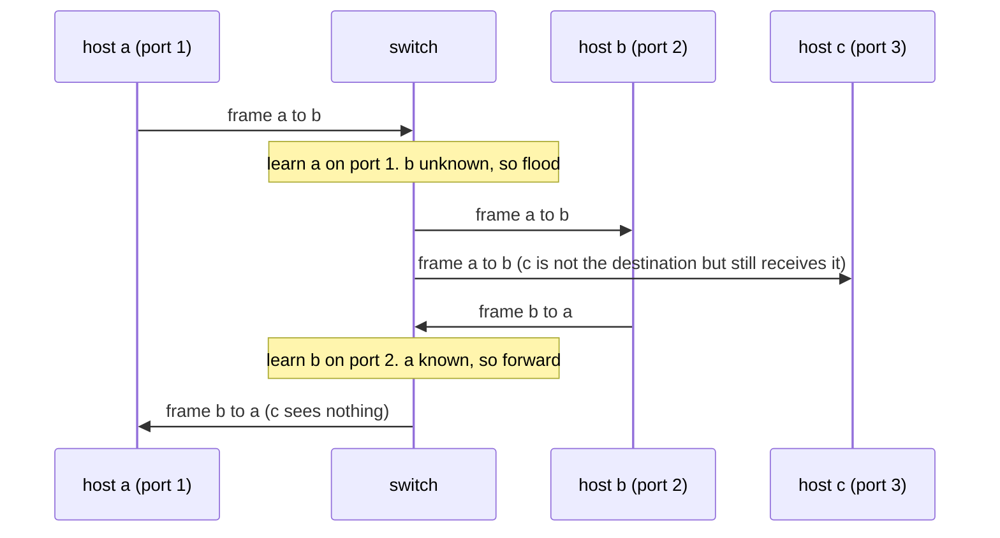
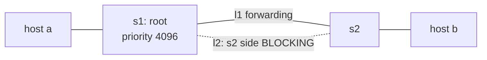
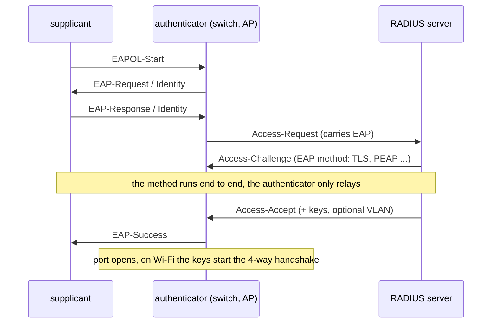

# NET 01: Network models and layer 2: frames, switching, VLANs, spanning tree, ARP and MTU

*Part of the [networking plan](00_plan.md) · You need: [LX 08](../06_linux/08_linux_networking_toolbox.md) (network namespaces, `ip`, `tcpdump`), [C 02 to C 04](../02_c_language/00_plan.md) (structs, byte order), [OS 01 to OS 03](../05_operating_systems/00_plan.md) (system calls)*

A frame is the smallest thing a network moves, and most "the network is broken" tickets end at layer 2: a switch that floods because it never learned an address, a loop that melts a campus in seconds, a tag that one device strips and another does not, an ARP entry that points at the wrong machine, an MTU that is 100 bytes short on one port. This tutorial follows one frame from the application's bytes to the cable and back, and builds the mental model of each device on the path: what it reads, what it decides, what it changes.

Interviewers ask about this layer because it is where you show that you know what hardware really does. The weak answer recites the OSI layers. The strong answer says why a router rewrites the Ethernet header at every hop and leaves the IP header alone, why a switch that has not learned a MAC floods, why a broadcast storm needs only one frame, and why a layer 2 device that drops an oversized frame sends no error message. For a Wi-Fi platform engineer there is a bonus: an access point is a bridge, so everything about switching applies inside the AP.

By the end you can:

- say which header each device reads, and draw the encapsulation of a web request down to the frame;
- take an Ethernet frame apart byte by byte, and explain padding, the minimum size, the FCS and the cost of preamble and gap;
- explain how a switch learns, floods, forwards and ages, why unknown unicast floods, and how MAC flooding and spoofing attack that;
- explain VLANs, access and trunk ports, the 802.1Q and 802.1ad tags and the attacks on them;
- explain a broadcast storm and how spanning tree (STP, RSTP) prevents it, with the protections and the modern alternatives;
- explain ARP, its cache states, gratuitous ARP, spoofing, and IPv6 neighbour discovery;
- explain MTU, why a layer 2 mismatch is silent, and what eats MTU;
- explain link aggregation and 802.1X, why reserved group addresses never cross a switch, and how 802.11 framing differs from Ethernet;
- read a capture with `tcpdump` and run a layer 2 triage in order.

---

## 1. The models, and who looks at which header

Two models describe the same thing. The **OSI model** has seven layers and the **TCP/IP model** four or five; interviews use both, so know the mapping.

| OSI | TCP/IP | Unit | Example |
|---|---|---|---|
| 7 Application, 6 Presentation, 5 Session | Application | message | HTTP, DNS, TLS records |
| 4 Transport | Transport | segment (TCP), datagram (UDP) | TCP, UDP, QUIC |
| 3 Network | Internet | packet | IPv4, IPv6, ICMP |
| 2 Data link, 1 Physical | Link | frame, bits | Ethernet, 802.11 |

The honest answer is "OSI for naming, TCP/IP for what runs". Be ready to place the awkward ones: **TLS** (between 4 and 7), **ARP** (carried directly in an Ethernet frame but exists to serve IP, so between 2 and 3), **VLAN tags** (layer 2, a tag inside the frame) and **MPLS** (the "2.5" layer).

**Encapsulation** is each layer wrapping the data above in its own header (and, at layer 2, a trailer):

```text
 application   |GET / HTTP/1.1 ...|                       (usually inside TLS)
 TCP segment   |TCP hdr 20+|GET / ...|
 IP packet     |IP hdr 20|TCP hdr|GET / ...|
 Ethernet      |dst 6|src 6|type 2| IP packet ...... |FCS 4|
 on the wire   preamble 7 + SFD 1 | frame | inter-frame gap 12 byte times
```

Each device opens the packet only as far as its job requires:

| Device | Reads | Decides on | Changes |
|---|---|---|---|
| Repeater, hub (L1) | nothing | nothing, copies bits to every port | nothing |
| Bridge, switch (L2) | Ethernet header | destination MAC, VLAN | nothing (may add or strip a VLAN tag) |
| Router (L3) | IP header | destination IP, longest-prefix match | **rewrites the Ethernet header**, decrements TTL |
| Firewall, L4 load balancer | TCP or UDP header, connection table | the 5-tuple | may rewrite addresses and ports (NAT) |
| L7 proxy, WAF | the payload | URL, headers, content | anything |

Two consequences carry through the whole track. First, **an Ethernet frame never leaves its segment**: a router discards the header and builds a new one for the next link, so MAC addresses change at every hop while IP addresses do not (except under NAT). Second, **a layer 2 segment is a broadcast domain**: a frame to `ff:ff:ff:ff:ff:ff` reaches everyone, which is why segments are kept small and why VLANs exist.

**What happens at layer 2 when you type a URL.** The browser resolves the name ([NET 08](08_application_protocols_dns_http_tls.md)), opens a TCP connection ([NET 03](03_tcp_udp_and_transport.md)), and TCP hands a segment to IP ([NET 02](02_ip_routing_and_layer3.md)). IP consults the routing table: a directly connected destination is its own next hop, otherwise the next hop is the **default gateway**. Either way the host now needs the **MAC address of the next hop**, so the first frame on the wire is usually an **ARP request**, not the SYN. A frame to a server on the other side of the world therefore carries the **gateway's MAC and the server's IP**. That detail is the clearest way to show you understand that the two address spaces differ:

| Address | Layer | Scope | Changes along the path? |
|---|---|---|---|
| MAC (48 bit) | 2 | one segment | at every router |
| IP (32 or 128 bit) | 3 | end to end | only with NAT |
| Port (16 bit) | 4 | one host | only with NAT |

## 2. The Ethernet frame

### 2.1 The layout

```text
 | dst MAC 6 | src MAC 6 | EtherType 2 | payload 46..1500 | FCS 4 |
 before: preamble 7 x 0xAA + SFD 0xAB (8 bytes)     after: inter-frame gap, 12 byte times
```

The **preamble** lets the receiver's clock lock on. The **FCS** is a CRC-32 over header and payload, checked by the NIC, which **drops a frame with a bad FCS** and counts it (`rx_crc_errors`). Software never sees the preamble or the FCS: a capture on a real NIC shows the frame from the destination MAC to the end of the payload. The **minimum frame is 64 bytes** (14 header, 46 payload, 4 FCS), so shorter payloads are **padded** with zeros. The rule goes back to shared coaxial Ethernet, where a station had to still be transmitting when a collision came back from the far end of the cable, which took 512 bit times. Full-duplex switched links have no collisions, but the minimum stayed. The maximum payload is **1500 bytes** (the MTU), so the maximum frame is 1518 (1522 with one VLAN tag).

**EtherType or length.** In Ethernet II (what nearly everything uses) the two bytes after the addresses are a type; in IEEE 802.3 they are a length. Values **below 0x0600 are lengths, 0x0600 and up are types**. The ones to know:

| EtherType | Protocol |
|---|---|
| `0x0800` | IPv4 |
| `0x0806` | ARP |
| `0x86DD` | IPv6 |
| `0x8100` | 802.1Q VLAN tag |
| `0x88A8` | 802.1ad service tag (QinQ) |
| `0x8847` | MPLS unicast |
| `0x888E` | EAPOL (802.1X) |
| `0x88CC` | LLDP |
| `0x8809` | slow protocols (LACP) |

### 2.2 MAC addresses

Two bits of the **first byte** matter: **I/G** (bit 0: 0 unicast, 1 group, all ones broadcast) and **U/L** (bit 1: 0 globally unique, 1 locally administered by software: VMs, containers, randomised Wi-Fi addresses). So `ff:ff:ff:ff:ff:ff` is broadcast, `01:00:5e:xx:xx:xx` is IPv4 multicast, `33:33:xx:xx:xx:xx` is IPv6 multicast, and `02:...` is a locally administered unicast. The first three bytes of a burned-in address are the manufacturer's **OUI**. **A MAC is not a secure identity**: any host can set its own, which is the basis of the attacks in sections 3.4 and 6.4.

### 2.3 A frame, parsed, and its FCS

A small parser that handles stacked VLAN tags, run on the 42 bytes of a real ARP request (as captured on a virtual Ethernet pair, which adds neither padding nor FCS):

```python
import struct, zlib

def parse_eth(frame: bytes):
    dst, src = frame[0:6], frame[6:12]
    off, tags = 12, []
    et = struct.unpack('!H', frame[off:off+2])[0]
    while et in (0x8100, 0x88A8):                         # stacked VLAN tags, outer first
        tci = struct.unpack('!H', frame[off+2:off+4])[0]
        tags.append((hex(et), tci >> 13, tci & 0xFFF))    # (TPID, PCP, VID)
        off += 4
        et = struct.unpack('!H', frame[off:off+2])[0]
    mac = lambda b: ':'.join(f'{x:02x}' for x in b)
    return dict(dst=mac(dst), src=mac(src), tags=tags, ethertype=hex(et),
                group=bool(dst[0] & 1), local=bool(src[0] & 2), payload=len(frame) - off - 2)

arp = bytes.fromhex('ffffffffffff020000000001' '0806' '0001080006040001'
                    '020000000001' '0a000001' '000000000000' '0a000002')
print(parse_eth(arp))
# {'dst': 'ff:ff:ff:ff:ff:ff', 'src': '02:00:00:00:00:01', 'tags': [], 'ethertype': '0x806',
#  'group': True, 'local': True, 'payload': 28}
tagged = arp[:12] + bytes.fromhex('8100a00a') + arp[12:]   # insert a tag: PCP 5, VID 10
print(parse_eth(tagged)['tags'])                           # [('0x8100', 5, 10)]

padded = arp + bytes(60 - len(arp))                        # a NIC pads to the 60 byte minimum, then appends the FCS
fcs = zlib.crc32(padded) & 0xffffffff
print(struct.pack('<I', fcs).hex(' '))                     # e8 6f 4d f8 (least significant byte first on the wire)
```

Read it: the frame is a **broadcast** (group bit set) from a locally administered address, EtherType ARP, **28 bytes** of payload. A ping between two fresh hosts produces **four frames, two of them ARP**: the broadcast request "who has 10.0.0.2, tell 10.0.0.1", a **unicast** reply, and only then the echo request and reply (98 bytes: 14 + 20 IP + 8 ICMP + 56 data). After that the neighbour cache holds the pair, so a second ping needs no ARP. The CRC over a frame plus its own FCS gives a **fixed residue**, which is how hardware checks it in one pass.

### 2.4 What preamble and gap cost: line rate

Every frame also occupies 8 bytes of preamble and 12 bytes of gap on the wire, so the smallest frame costs **84 byte times**:

```python
def line_rate(gbps, frame):          # frame includes FCS; add 8 preamble and 12 gap
    return gbps*1e9 / ((frame + 20) * 8)

for g in (10, 100):
    print(g, round(line_rate(g, 64)/1e6, 2), round(line_rate(g, 1518)/1e6, 2))
# 10   14.88  0.81     million frames per second at 64 and 1518 bytes
# 100 148.81  8.13
print(round(3e9 / line_rate(100, 64)))      # about 20 cycles of a 3 GHz core per packet
```

This is why **packet rate, not bit rate, is what breaks a software datapath**: at 100 Gbit/s with small frames a core has roughly 20 cycles per packet, which motivates XDP, DPDK and offloads ([NET 06](06_linux_network_stack.md), [NET 07](07_zero_copy_networking.md)). A 64 byte frame carries 46 payload bytes in 84 on the wire (about 55 percent efficiency); a 1518 byte frame about 97 percent.

## 3. Switching: learn, flood, forward, age

### 3.1 The four things a switch does

A switch keeps a **forwarding database** (FDB, MAC table, CAM table): a map from (VLAN, MAC) to a port with an age. For every frame:

1. **Learn**: record that the **source** MAC is reachable through the **ingress port**, and refresh its age.
2. **Forward**: look up the **destination**. A known unicast goes to that port only. If it is on the **ingress port**, filter (the destination already heard it). If **unknown**, **broadcast**, or multicast without snooping, **flood** to every port except the ingress.
3. **Age**: entries not refreshed for the **aging time** (300 s by default on most switches and on Linux) are removed.
4. **Move**: if a known source address appears on a different port, the entry moves.

Nothing is configured: a switch is plug and play because it learns by watching. That is also what makes it attackable.



The behaviours to be able to describe, each reproducible on a Linux bridge between network namespaces: a frame to an address the switch has **never heard from** reaches every host (a flood); once the destination has spoken, the third host sees nothing; after the aging time the same frame **floods again**; a frame with a **copied source address** moves the entry to the attacker's port; and thousands of frames with random source addresses fill the table. A host that **never transmits** (a one-way UDP receiver, a printer) never gets an entry, so every frame to it floods for as long as it stays silent. The fix is a static entry (`bridge fdb add ... static`) or making it send a frame.

A learning switch is small enough to write in an interview. This one handles learning, flooding, filtering, aging and MAC moves (tested):

```c
#include <stdio.h>
#include <string.h>
#include <stdint.h>
#define SLOTS 64
#define AGE 300
typedef struct { uint8_t mac[6]; int port; long seen; int used; } ent;
static ent fdb[SLOTS];

static ent *find(const uint8_t *m) {
    for (int i = 0; i < SLOTS; i++) if (fdb[i].used && !memcmp(fdb[i].mac, m, 6)) return &fdb[i];
    return NULL;
}
static void learn(const uint8_t *m, int port, long now) {
    ent *e = find(m);
    if (!e) for (int i = 0; i < SLOTS; i++) if (!fdb[i].used) { e = &fdb[i]; e->used = 1; memcpy(e->mac, m, 6); break; }
    if (e) { e->port = port; e->seen = now; }                 /* new entry, refresh, or MAC move */
}
/* returns the egress port, -1 to flood, -2 to filter */
int handle(const uint8_t *dst, const uint8_t *src, int in, long now) {
    if (!(src[0] & 1)) learn(src, in, now);                   /* never learn a group address as a source */
    ent *e = (dst[0] & 1) ? NULL : find(dst);                 /* group destinations always flood */
    if (e && now - e->seen > AGE) { e->used = 0; e = NULL; }  /* aged out: treat as unknown */
    if (!e) return -1;
    return e->port == in ? -2 : e->port;
}
```

Driven with a to b (unknown), b to a, a to b, a broadcast, a to b after 500 s, and a frame whose source moved ports, it returns flood, port 1, port 2, flood, flood, filter. The interview follow-ups write themselves: hash instead of linear search, eviction when full (oldest first), per-VLAN keys, and locking for multiple forwarding threads.

### 3.2 Collision and broadcast domains

A **collision domain** is the set of devices that can interfere physically: all ports of a hub, a coax segment; today a switched full-duplex link is its own collision domain with no collisions. A **broadcast domain** is the set of devices receiving each other's broadcasts: all ports in the same VLAN and everything bridged to them. A switch splits collision domains; **only a router or a VLAN boundary splits a broadcast domain**. A flat network of thousands of hosts is a bad idea because every ARP, DHCP discover and mDNS announcement reaches everyone and every unknown unicast floods everywhere.

### 3.3 Frames a switch will not forward

IEEE 802.1D reserves **16 group addresses, `01:80:c2:00:00:00` to `0f`**, for protocols that talk to the **adjacent** device only: STP BPDUs, pause frames, LACP, 802.1X, LLDP. A compliant bridge never forwards them. That is why **802.1X, LLDP and BPDUs stop at the first switch** and why you cannot run 802.1X through a dumb switch. On Linux, `group_fwd_mask` on the bridge lets chosen addresses through (bit N forwards `01:80:c2:00:00:0N`); bits for STP, pause and LACP are refused because forwarding them would break the bridge itself, while the 802.1X bit is accepted, which matters when a Linux bridge sits between a device and an authenticator in virtualisation.

### 3.4 Attacks and protections

- **MAC flooding**: fill the table with junk so legitimate entries are evicted. A switch that cannot learn a destination **floods**, so it behaves like a hub and the attacker sees other hosts' traffic. **Protection: port security**, limiting MACs per port and dropping, shutting down or alerting on violation.
- **MAC spoofing**: steal another host's address to receive its frames or bypass a MAC-based list. Protection: port security plus **802.1X**, which authenticates the device and not just an address.
- **ARP spoofing**: section 6.4. Protection: **dynamic ARP inspection**.
- **Rogue DHCP servers**: **DHCP snooping**, trusting offers only on marked ports.

### 3.5 Store-and-forward and cut-through

A **store-and-forward** switch receives the whole frame, checks the FCS, then forwards; latency grows with frame size (a 1500 byte frame takes 1.2 µs to arrive at 10 Gbit/s). A **cut-through** switch starts forwarding once it has the destination address, so latency is about constant and small whatever the size, but it cannot discard a bad frame because it has not seen the FCS. Data-centre and low-latency switches are cut-through; campus switches usually store-and-forward. Cut-through only works when the egress port is free and at least as fast as the ingress; otherwise the switch buffers and falls back.

## 4. VLANs

### 4.1 Why and what

A **VLAN** splits one switch into independent broadcast domains, identified by a 12 bit **VLAN ID** (1 to 4094 usable). Hosts in different VLANs reach each other only through a router or layer 3 switch. VLANs give separation, smaller broadcast domains and several networks on one cable. Convention: **one VLAN, one subnet**.

A port is an **access port** (one VLAN, untagged, the host knows nothing about VLANs) or a **trunk port** (several VLANs, frames carry a **tag**). One VLAN on a trunk may be the **native VLAN**, sent untagged. A single trunk to a router with one sub-interface per VLAN is **router on a stick**; a layer 3 switch does the same internally with a **switched virtual interface (SVI)** per VLAN.

### 4.2 The tag

An **802.1Q** tag is **4 bytes inserted between the source address and the EtherType**: a TPID of `0x8100`, then a TCI with **PCP** (3 bits, the 802.1p priority used for QoS in [NET 14](14_queueing_qos_and_traffic_management.md)), **DEI** (1 bit, drop eligible) and **VID** (12 bits). The frame grows to **1522** and the FCS is recomputed. **802.1ad (QinQ)** stacks an outer service tag (`0x88A8`) in front of the customer's tag so a provider can carry a customer's VLANs inside one of its own.

A host with no VLAN interface **ignores tagged frames**: a test that sent the same ARP request untagged and tagged got an answer only for the untagged one. The common production failure is exactly that: a trunk that does not carry the VLAN, a native VLAN mismatch between two switches, or a server NIC that expects tags the port does not send. Captures need care, too: on Linux the kernel strips the tag into packet metadata and `libpcap` restores it for the `vlan` filter and for `-e` output, so a raw-offset filter such as `ether[12:2] = 0x8100` can match nothing while `vlan` matches.

On Linux (not run in the lab, from memory), a VLAN sub-interface and a VLAN-aware bridge:

```bash
ip link add link eth0 name eth0.10 type vlan id 10          # tags outgoing frames with VLAN 10
ip link add br0 type bridge vlan_filtering 1                # one bridge, many VLANs
bridge vlan add dev eth1 vid 10 pvid untagged               # access port in VLAN 10
bridge vlan add dev eth2 vid 10                             # trunk port carrying VLAN 10 tagged
```

### 4.3 VLAN attacks

- **Switch spoofing**: a host negotiates a trunk (dynamic trunking on some vendors) and receives all VLANs. Fix: disable negotiation on access ports.
- **Double tagging**: an attacker on the native VLAN sends two tags; the first switch strips the outer, the second reads the inner and delivers into a VLAN the attacker is not in, in one direction only. Fix: do not use the native VLAN for hosts, or tag it too.
- **A VLAN is separation, not encryption.**

## 5. Loops and the spanning tree

### 5.1 A broadcast storm

Connect two switches with two cables and send **one** broadcast frame. Each switch floods it out of every port, so each copy arrives at the other switch on the other cable, is flooded again, and nothing ever removes it, because an Ethernet frame has **no TTL**. In a test of exactly this, **one frame produced about 290,000 received packets in half a second**. The symptoms: link utilisation at 100 percent, switch CPUs pinned, **MAC addresses flapping between ports** in the table, and the network unusable until the loop is removed. A single mistaken patch cable can do it.

### 5.2 The spanning tree protocol

**STP** (IEEE 802.1D) makes switches agree on a loop-free tree by **blocking** redundant ports:

1. **Elect a root bridge.** Each switch has a **bridge ID** (16 bit priority, default 32768, then its MAC). The **lowest** wins; set the priority to choose the root deliberately. Switches exchange **BPDUs** (to `01:80:c2:00:00:00`, every 2 s) carrying the root they believe in and their cost to it.
2. **Each non-root switch picks one root port**: lowest path cost to the root (ties: lower sender bridge ID, then port ID).
3. **Each segment picks one designated port**: the lowest cost to the root on that segment.
4. **Everything else blocks**: it receives BPDUs but forwards no data.

In a test with two switches and two links, the switch given priority 4096 became root, the other showed the root's ID and a root port, its second link went to **blocking**, and one broadcast reached the host **once**.



### 5.3 Port states and convergence

| State | Learns MACs | Forwards data | Lasts |
|---|---|---|---|
| Blocking | no | no | until topology change (max age 20 s) |
| Listening | no | no | forward delay, 15 s |
| Learning | yes | no | forward delay, 15 s |
| Forwarding | yes | yes | until the topology changes |

A new link takes **30 seconds** (two forward delays) to forward in classic STP, and a failure noticed by BPDU timeout up to **50**, from the standard defaults. **RSTP** (802.1w, now in 802.1D-2004) replaces timers with a **proposal and agreement handshake** between neighbours and converges in well under a second; it adds **alternate** and **backup** port roles so a replacement path is ready before the failure. **MSTP** runs one tree per group of VLANs; Cisco's **PVST+** one per VLAN. In the lab the forward delay was shortened to 2 s, and a re-enabled link visibly stepped through listening, learning and forwarding.

### 5.4 Protection and alternatives

- **BPDU guard** on access ports: a BPDU arriving (someone plugged in a switch) shuts the port. **Root guard**: never accept a better root on this port. **Loop guard** and **UDLD** protect against unidirectional links, where a port stops receiving BPDUs and wrongly forwards.
- **Storm control** rate-limits broadcast and unknown unicast per port.
- **Blocking wastes capacity**: half the links in a redundant design carry nothing. Modern designs avoid layer 2 loops: **layer 3 to the access layer** with equal-cost multipath (the leaf-spine fabric of [NET 11](11_routing_protocols_and_datacenter_fabrics.md)), **MLAG** (two switches appear as one, so a bond spans both), and overlays such as VXLAN with EVPN for layer 2 reach over a routed fabric.
- **Linux bridges**: the in-kernel STP is the classic one with timers, and most Linux hosts run bridges without STP and rely on design (a container bridge has no loops). Plug a loop into a Linux bridge with STP off and it behaves as in 5.1.

## 6. ARP and IPv6 neighbour discovery

### 6.1 The problem and the packet

A host that wants to send to a neighbour knows an IP and needs a MAC. **ARP** (RFC 826) broadcasts "who has this IP?" and the owner answers. It has its own EtherType (`0x0806`), not IP. The IPv4-over-Ethernet packet is **28 bytes**: hardware type 1, protocol type `0x0800`, lengths 6 and 4, opcode (1 request, 2 reply), then sender MAC, sender IP, target MAC (zeros in a request), target IP. A request goes to broadcast; the **reply is unicast**. Every host that sees a request also **learns the sender's mapping** from it.

Variants worth knowing:

- **Gratuitous ARP**: sender IP equals target IP. It tells everyone "this IP is at this MAC now", and neighbours update. Hosts send one when an interface comes up, and failover systems (VRRP and keepalived, a bond failing over, a migrated VM) send one so traffic moves at once.
- **ARP probe** (RFC 5227): sender IP `0.0.0.0`, target the address to claim. A reply means the address is taken. DHCP clients use it.
- **Proxy ARP**: a router answers for addresses not on the segment. A legacy trick that hides subnet-mask mistakes.

### 6.2 The neighbour cache and its states

The kernel keeps the IP-to-MAC mapping in a **neighbour cache** with states (`ip neigh`): `INCOMPLETE` (request sent, no answer), `REACHABLE` (confirmed recently), `STALE` (not confirmed for a while but usable), `DELAY` (stale entry just used, waiting briefly for upper-layer confirmation such as a TCP ACK), `PROBE` (a **unicast** probe is being sent), `FAILED` and `PERMANENT` (static). Observed behaviour with a short reachable time: `REACHABLE` for about its base time (randomised 0.5 to 1.5 times; 30 s default), then `STALE`; one use of a stale entry moves it to `DELAY` and then, if nothing confirms it, to `PROBE` with a **unicast** request, back to `REACHABLE` on the reply. The point to say aloud: **a healthy entry costs no broadcasts**, and a cache entry in `INCOMPLETE` or `FAILED` is the first sign that the far host, the VLAN or the port is wrong.

### 6.3 Duplicate addresses and ARP flux

With the same IP on two hosts, both answer and the asker keeps the **last** reply, so traffic goes to either at random: intermittent failure. `ip monitor neigh` showing one IP flipping between two MACs is the signature. A multi-homed Linux host answers ARP for **any** local address on **any** interface by default (**ARP flux**), hence `arp_ignore` and `arp_announce`. Direct-server-return load balancers use them on purpose: the virtual IP sits on a loopback and must not be answered by ARP ([NET 13](13_load_balancing_proxies_and_anycast.md)).

### 6.4 ARP spoofing

ARP has **no authentication**. In a test, one forged ARP request from a third host claiming "10.0.0.2 is at my MAC" changed the victim's entry in a single frame; a `PERMANENT` entry stayed unchanged under the same forgery. From then on the attacker receives the victim's traffic and can forward it (man in the middle) or drop it. It only works on the same segment. Defences: **dynamic ARP inspection** (check ARP against DHCP-snooping bindings), static entries for critical gateways, and not trusting the local network at all: TLS and SSH make a man in the middle detectable.

### 6.5 IPv6 neighbour discovery

IPv6 has **no ARP and no broadcast**. **Neighbour discovery** (RFC 4861) uses ICMPv6: a **neighbour solicitation** (type 135) and **advertisement** (136). To avoid waking every host, the solicitation goes to the target's **solicited-node multicast address**, `ff02::1:ff` plus the last 24 bits, mapped to Ethernet `33:33` plus the last 32 bits, so normally only one host listens. The other jobs are **router discovery** (router advertisement, type 134, carries the prefix for **SLAAC**) and **duplicate address detection**. The arithmetic:

```python
def solicited_node(addr_hex):                         # address as 32 hex digits
    low = addr_hex[-6:]                               # last 24 bits
    return f'ff02::1:ff{low[:2]}:{low[2:]}', '33:33:ff:' + ':'.join(low[i:i+2] for i in range(0, 6, 2))
print(solicited_node('2001db8000000000021122fffe334455'))   # ('ff02::1:ff33:4455', '33:33:ff:33:44:55')

def eui64(mac):                                       # flip the U/L bit, insert ff:fe in the middle
    b = bytearray(int(x, 16) for x in mac.split(':')); b[0] ^= 2
    return bytes(b[:3] + b'\xff\xfe' + b[3:]).hex()
print(eui64('00:11:22:33:44:55'))                     # 021122fffe334455
```

IPv6 neighbour discovery was not run on a wire in the lab (that kernel had no IPv6); the address arithmetic is the part checked. The security parallel is **RA guard** and neighbour discovery inspection, the analogues of the IPv4 protections, since a rogue router advertisement is as dangerous as a rogue DHCP server.

## 7. MTU: what the number means and what breaks

The **MTU** is the largest **payload** an interface sends in one frame, not the frame size. At MTU 1500 the frame is 1514 bytes without the FCS. Measured with a raw socket: **1514 byte frames pass and 1515 fail with `Message too long`**; with one VLAN tag the limit moved to **1518**, so the MTU counts what is **inside** the Ethernet header and tags are on top, which is why 1500 stays valid when VLANs are added and why switch ports are set to 1518, 1522 or more. At IP level `ping -M do -s 1472` works and 1473 fails locally: 1472 data + 8 ICMP + 20 IP = 1500, and `-M do` forbids fragmentation, so the error is immediate.

**A mismatch inside a layer 2 segment is silent.** In the lab a bridge port was set to MTU 1400 while hosts kept 1500: pings of 1,000 bytes passed, pings of 1,400 bytes lost 100 percent, and **no drop counter moved**. A layer 2 device cannot fragment (there is no field to carry fragment information) and **sends no error message**; it drops. That is the classic **MTU black hole**: small packets (ARP, DNS, TCP handshakes) work, big ones hang, and a test with default sizes shows nothing wrong. At layer 3 the problem is handled by **path MTU discovery** (a router that cannot forward a don't-fragment packet sends ICMP "fragmentation needed" with the MTU it accepts) and **TCP MSS clamping** ([NET 02](02_ip_routing_and_layer3.md), [NET 03](03_tcp_udp_and_transport.md)). Both rely on routers: **neither helps when the narrow point is a switch.** Find the limit by bisecting `ping -M do -s N`.

**What eats MTU** (typical figures, from memory): PPPoE 8 bytes (hence 1492), GRE 24, **VXLAN 50** (a 1500 byte inner frame needs a 1550 byte underlay), IPsec tunnel mode roughly 50 to 70, WireGuard about 60. **Jumbo frames** (9000) cut the packet rate about six times for the same data, at the price that **every device on the path must support them**; one 1500 byte port in the middle black-holes the jumbo traffic exactly as above. Storage and RDMA networks often use 4200 or 9000 ([NET 12](12_rdma_roce_and_lossless_fabrics.md)).

## 8. Link aggregation and 802.1X

### 8.1 LACP and bonding

**Link aggregation** (IEEE 802.3ad, now 802.1AX) bundles links into one logical link for **capacity and failover**. **LACP** negotiates it with LACPDUs (EtherType `0x8809`, to `01:80:c2:00:00:02`, one of the reserved addresses, so they stay on the link); only links both ends agree on join. A static bundle works too, but a mis-cabled link then silently breaks it.

What interviewers ask: **a single flow does not get more than one link's speed.** The sender **hashes** header fields (MACs, or plus IPs, or plus ports) to pick a link and keeps one flow on one link, because frames of one flow on different links could arrive out of order, which TCP treats as loss. A bond of four 10G links carries many flows at up to 40G total, but one `iperf` stream stays at 10G. Distribution is only as even as the hash: a few big flows can collide on one link (the same polarisation problem as ECMP). On Linux it is the `bonding` module (modes `active-backup`, `802.3ad`, `balance-xor`), shown in `/proc/net/bonding/bond0`; not run in the lab. **MLAG** puts the two ends of a bond on two switches, redundancy without STP blocking.

### 8.2 802.1X: port-based access control

**802.1X** decides whether a device may use a port at all. Roles: **supplicant** (the device), **authenticator** (switch port or Wi-Fi AP) and **authentication server** (usually RADIUS). Supplicant and authenticator speak **EAPOL** (EtherType `0x888e`) to the reserved group address `01:80:c2:00:00:03`, which is why it never crosses a bridge. Until success the port is **closed to everything except EAPOL**.



The authenticator **does not understand the credentials**; it relays and opens the port on `Access-Accept`. The reply can also place the port in a **VLAN** chosen per user. Devices with no supplicant (printers, cameras) get **MAC authentication bypass**, only as strong as a MAC. **WPA2 and WPA3 Enterprise** use exactly this exchange, and its success yields the master key from which the 4-way handshake derives session keys ([WF 04](10_wifi/04_wifi_security.md)). **MACsec** (802.1AE) adds hop-by-hop encryption of Ethernet frames.

## 9. Ethernet and 802.11 framing compared

Your wireless platform work is the best material for "how is Wi-Fi different from Ethernet at layer 2?" The differences follow from the medium: shared, half duplex, lossy, and the receiver cannot hear while it transmits.

| | Ethernet (802.3) | Wi-Fi (802.11) |
|---|---|---|
| Medium | point to point, full duplex when switched | shared radio channel, half duplex |
| Access | none needed | **CSMA/CA**: carrier sense, random backoff, optional RTS/CTS; collisions are avoided, not detected |
| Delivery | no per-frame ACK; FCS only lets the receiver drop bad frames | **every unicast frame is acknowledged**; no ACK means retry |
| Addresses | 2 | **3 or 4**, depending on ToDS and FromDS |
| Header | 14 bytes | 24 to 36 bytes |
| Frame types | data (and pause) | **management**, **control**, **data** |
| Security | none at L2 (802.1X, MACsec optional) | encryption in the MAC (CCMP, GCMP) with a per-frame packet number |
| Association | none; plug in | scan, authenticate, associate, then data |
| Priority | 802.1p PCP | EDCA access categories |

The **four addresses** catch people. In an infrastructure network a station talks only to its AP, so the frame must say who the original sender or final receiver is:

| ToDS | FromDS | Direction | Addr 1 | Addr 2 | Addr 3 | Addr 4 |
|---|---|---|---|---|---|---|
| 0 | 0 | ad hoc, management | destination | source | BSSID | none |
| 1 | 0 | station to AP | **BSSID** (receiver) | **source** (transmitter) | **destination** | none |
| 0 | 1 | AP to station | **destination** (receiver) | **BSSID** (transmitter) | **source** | none |
| 1 | 1 | AP to AP (mesh, WDS) | receiver | transmitter | destination | **source** |

Address 1 is always the **receiver** and address 2 the **transmitter** of this radio hop. The **AP is a bridge**: it takes a frame from the radio, rebuilds an 802.3 header and bridges it into the wired segment, and the reverse. So all of section 3 applies inside the AP, which learns wireless stations on the radio interface the way a switch learns ports. It is also why a client cannot bridge other Ethernet devices behind itself over a normal station link: the AP knows only the station's own MAC, so other source addresses are dropped, unless the link uses 4-address mode (WDS) or the client rewrites addresses (MAC NAT, as repeaters do). More in [WF 03](10_wifi/03_wifi_mac.md) and [WF 07](10_wifi/07_wifi_architectures_mesh_and_services.md).

## 10. Reading captures

`tcpdump -nn -e` prints one line per frame **with the Ethernet header** (`-e`), without name lookups; `-xx` prints bytes from the start of the frame (`-x` starts at the IP header); `-w FILE` saves a capture Wireshark opens; `-r FILE` reads it with any filter. Habits from the lab:

- **Count only what you want.** `-Q in` records only received frames; otherwise the host's own transmissions are counted too.
- **Use `--immediate-mode -U` for short captures.** `libpcap` hands packets over in blocks after up to a second; a capture stopped after one second can report 0 packets for a frame that did arrive.
- **A filter is a program.** The kernel runs a **BPF** program per packet and only copies matches to user space, which is why capturing with a tight filter is cheap and capturing everything is not. `tcpdump -d 'filter'` prints the compiled program.
- **A capture sees what the interface sees.** On a switch port you see only your own unicast plus broadcast and flooded frames; to see another host's traffic you need a **mirror (SPAN) port** or a tap. Offloads (segmentation, checksum) mean a capture on the sending host can show **frames larger than the MTU** and wrong checksums that never reach the wire.

## 11. Where is the layer 2 fault? A triage order

Look in this order; each step names the tool and what a bad answer looks like.

| Step | Check | Bad answer means |
|---|---|---|
| 1 | Link up? `ip -br link`, `ethtool eth0` | no carrier: cable, port, peer down; wrong speed or duplex: auto-negotiation failure |
| 2 | Errors? `ip -s link`, `ethtool -S` | `rx_crc_errors` rising: cable, optics, duplex mismatch |
| 3 | Neighbour resolved? `ip neigh show` | `INCOMPLETE` or `FAILED`: wrong VLAN, host down, port blocked, 802.1X not authorised. Wrong MAC: duplicate IP or spoofing |
| 4 | Does the request arrive? `tcpdump -nn -e` at both ends | seen at far end, no reply: the far host. Not seen: the switch path (VLAN, STP-blocked port, port security, MAC table) |
| 5 | Big frames fail, small work? `ping -M do -s N` | an MTU smaller somewhere on the path |
| 6 | Whole segment slow or flapping? port packet rates, `bridge monitor fdb` | huge packet rate or MACs moving between ports: a loop |
| 7 | Only some hosts? compare MAC and VLAN of a working and a failing host | a trunk missing the VLAN, native VLAN mismatch |

Do not skip to the top of the stack: a failing HTTP request is, a third of the time, a failure at step 1 or 3.

## 12. Common mistakes

1. **Saying a switch "routes."** A switch reads the Ethernet header; a "layer 3 switch" has a routing table in the same box.
2. **Treating a hub and a switch alike.** A hub is one collision domain; a switch forwards to the learned port.
3. **Believing MAC addresses are identities.** They are set in software.
4. **Thinking a VLAN is a security boundary on its own.** Double tagging and trunk negotiation exist.
5. **Expecting a layer 2 device to report an oversized frame.** It drops silently.
6. **Forgetting that Ethernet frames have no TTL**, so a loop never dies.
7. **Expecting one flow to use a whole bond.**
8. **Trusting ARP.** It has no authentication.
9. **Forgetting that tags are not counted in the MTU** and sizing switch ports at exactly 1500.
10. **Capturing on the wrong port**, then concluding a frame was never sent.
11. **Disabling STP without a loop-free design.**
12. **Forgetting that 802.1X and LLDP stop at the first switch.**

## 13. Interview questions

1. **What is the difference between a hub, a switch, a router and a load balancer?** The header each reads and what it decides on (table in section 1).
2. **Walk me through what happens at layer 2 when I open a web page on a new host.** ARP for the gateway, then the frame with the gateway's MAC and the server's IP.
3. **Why do MAC addresses change at every hop but IP addresses do not?** A frame never leaves its segment; the router builds a new header.
4. **How does a switch learn and forward?** Learn the source, look up the destination, forward, filter or flood, age out.
5. **What happens when the destination MAC is unknown?** Flood to every port but the ingress.
6. **How do you attack a switch's table and defend?** MAC flooding and spoofing; port security, 802.1X.
7. **What is a VLAN and what is the difference between access and trunk ports?** Separate broadcast domains; untagged one VLAN versus tagged many.
8. **What is the native VLAN and why is it a risk?** Untagged on a trunk; double tagging.
9. **How does one broadcast frame take down a network, and how does STP stop it?** No TTL; root election, one root port and designated port per segment, block the rest.
10. **What are the improvements in RSTP, and what replaces STP in modern designs?** Handshake convergence; routed access with ECMP, MLAG, EVPN.
11. **What does a gratuitous ARP do and who sends one?** Updates caches on failover or interface up.
12. **How does ARP spoofing work and how do you defend?** One forged reply; dynamic ARP inspection, static entries, TLS.
13. **Why can a ping work but a large transfer hang?** An MTU black hole at layer 2; path MTU discovery cannot help.
14. **Why does one TCP flow not use the whole LACP bond?** Hash per flow to avoid reordering.
15. **How is Wi-Fi framing different from Ethernet, and what do the four addresses mean?** Section 9; address 1 receiver, 2 transmitter, 3 and 4 end-to-end.
16. **Why does 802.1X never cross a plain switch?** Reserved group address.

## 14. Scenarios and design questions

**S1. Users on one floor lose connectivity every few weeks for a minute, and switch CPUs spike.** *Where to practise:* two Linux bridges in network namespaces with a loop, STP on and off. *Approach:* a loop and a storm; check STP topology changes, MAC flapping, storm control, BPDU guard on access ports.

**S2. A new server in VLAN 20 can ping its gateway but not its neighbours.** *Where to practise:* a bridge with a trunk and a tagged raw frame. *Approach:* neighbour cache, VLAN on the port and trunk, the gateway's ARP, tcpdump with `-e` on both sides.

**S3. Large file copies hang but browsing works.** *Where to practise:* a bridge port at a smaller MTU. *Approach:* bisect with `ping -M do`, check every hop's MTU including tunnels and VLAN-tag overhead, MSS clamping.

**S4. Intermittent failures to one IP; `ip neigh` shows two MACs.** *Where to practise:* duplicate an IP in a namespace lab. *Approach:* duplicate address or spoofing, find the MACs' switch ports, DHCP snooping and dynamic ARP inspection.

**S5. Design the access layer for an office with guest, staff and printers on shared ports and Wi-Fi.** *Where to practise:* a diagram with VLANs and a RADIUS flow. *Approach:* 802.1X with per-user VLAN, MAC authentication bypass for printers, guest isolation, trunk to APs, routed or MLAG uplinks.

**S6. Explain why an AP cannot bridge a client's laptop plugged into the client.** *Where to practise:* the four-address table. *Approach:* the AP knows only the station's MAC; 4-address mode or MAC NAT.

**S7. A bond of two 10G links gives 10G in `iperf`. Is it broken?** *Where to practise:* a hash calculation on a few flow tuples. *Approach:* a single flow stays on one link; use parallel streams and a hash policy that includes ports.

## 15. Strong answers (outlines)

**S1.** Check the symptom signature: MAC flapping and huge packet rates point to a loop. Find the port with `bridge monitor fdb` or switch counters, look for a recent patch, confirm STP is on and BPDU guard and storm control are configured, and fix the topology rather than only the port.

**S2.** Same VLAN on both ends of every link on the path? A host sends ARP for the gateway: if the entry is `INCOMPLETE`, the frames are not arriving, so capture with `-e` on the host and on the far side to see where the tag is lost. If the gateway answers but neighbours do not, check isolation features on the port or VLAN.

**S3.** Small works, large fails means a size limit. Bisect the largest working ping, compare to the expected 1472 data bytes, then walk the path. A tunnel or a VLAN-unaware port is the usual cause. Fix the MTU consistently or clamp MSS, and remember a switch will not send ICMP.

**S4.** Two MACs for one IP: a duplicate or a spoofer. Look at which port each MAC lives on, check DHCP bindings, and enable snooping and inspection. If it is a VRRP or bond failover, check for gratuitous ARP.

**S5.** Use VLANs per role, 802.1X with RADIUS returning the VLAN, MAB for printers on a restricted VLAN, guest on an isolated VLAN with only internet access, trunks to APs with only needed VLANs, no native VLAN for hosts, routed uplinks or MLAG instead of a big STP domain.

**S6.** An AP maps each associated station to its MAC; a frame from an unknown source on the station's link is not accepted. Either use WDS four-address mode, which both ends must support, or have the client rewrite source addresses.

**S7.** Not broken. Hashing is per flow. Use several parallel streams, or hash on L3 and L4, and know that the test shows per-flow limits, not the bond's capacity.

## 16. Cheat sheet

| Fact | Value |
|---|---|
| Frame | 14 header + 46 to 1500 payload + 4 FCS; 64 to 1518 bytes (1522 with a tag) |
| On the wire | plus 8 preamble and 12 gap; smallest frame 84 byte times |
| 64 byte rate | 14.88 M frames/s at 10G, 148.81 M at 100G |
| EtherType below | 0x0600 means length |
| ARP | 28 bytes, EtherType 0x0806, request broadcast, reply unicast |
| Reserved group addresses | 01:80:c2:00:00:00 to 0f, never forwarded |
| MAC aging | 300 s |
| VLAN | 12 bit ID, 4 byte tag, TPID 0x8100; QinQ outer 0x88A8 |
| STP | lowest bridge ID is root; classic convergence 30 to 50 s; RSTP under a second |
| Storm | no TTL at L2, one frame can loop forever |
| MTU | counts payload, not header or tags; L2 mismatch is silent |
| Overheads | PPPoE 8, GRE 24, VXLAN 50, WireGuard about 60 |
| LACP | per-flow hash, one flow one link |
| 802.1X | supplicant, authenticator, RADIUS; EAPOL 0x888e |
| 802.11 addresses | Addr 1 receiver, Addr 2 transmitter, 3 and 4 end to end |

## 17. Sources and caveats

Web sources used for interview framing: [AlgoMaster data link layer interview questions](https://algomaster.io/learn/computer-networks/data-link-layer-interview-questions), [Simplilearn network engineer questions](https://www.simplilearn.com/network-engineer-interview-questions-article) and [a 2026 routing and switching playbook](https://thelinuxcode.com/routing-switching-interview-questions-computer-networks-a-senior-engineers-2026-playbook/). Standards behind the content: IEEE 802.3, 802.1Q, 802.1ad, 802.1D and 802.1AX, RFC 826, RFC 5227 and RFC 4861.

Caveats. The Python parser, FCS and line-rate arithmetic, the IPv6 address arithmetic and the C learning table were run for this tutorial. The measured behaviours quoted for the lab (flooding, aging, the broadcast storm count, STP states, ARP cache timing, the spoofing test, the MTU limits and the silent 1400 byte drop) come from earlier runs of the previous version of this tutorial on one Linux 6.18 VM with virtual Ethernet pairs between network namespaces and a Linux bridge, and were not re-run here. That VM had no VLAN device, no VLAN-aware bridge, no bonding and no IPv6, so VLAN sub-interface and bridge commands, bonding and IPv6 neighbour discovery, and 802.1X exchanges are explained from memory and the standards and were not run. Storm counts and ARP timers vary between runs. Cisco-style defaults and vendor feature names (port security, dynamic ARP inspection, BPDU guard) differ in detail between vendors.
