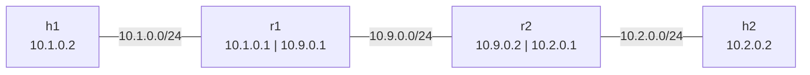
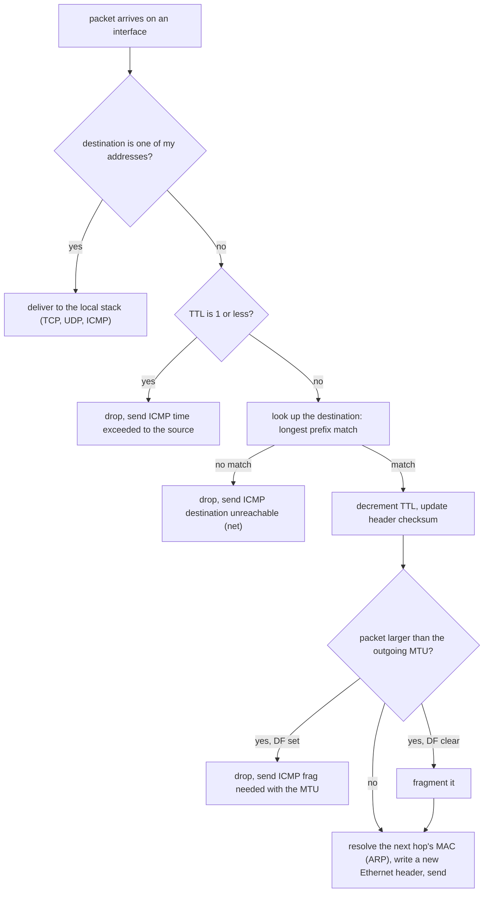
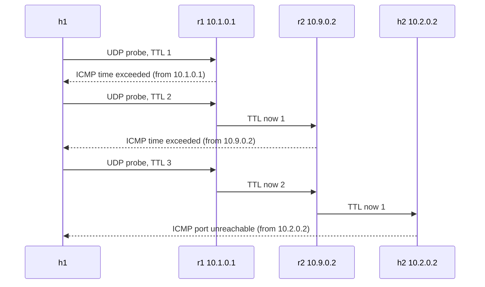
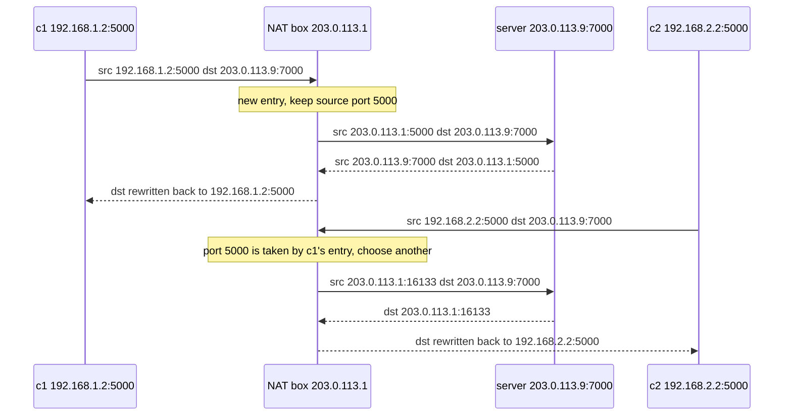
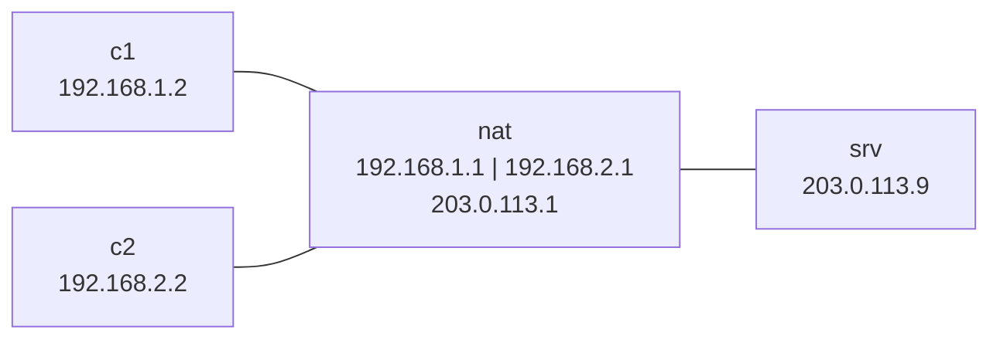
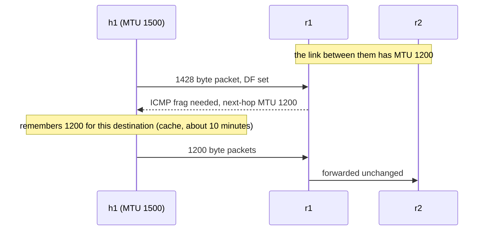

# NET 02: IP, routing and layer 3

*Part of the [networking plan](00_plan.md) · Time: about 6 hours · You need: [NET 01](01_network_models_and_layer2.md) (frames, ARP, MTU), [LX 08](../06_linux/08_linux_networking_toolbox.md) (network namespaces, `ip`, `tcpdump`), [C 02 to C 04](../02_c_language/00_plan.md) (pointers, structs, byte order). This tutorial follows one packet across two routers: the IPv4 header byte by byte, subnetting by hand, how a routing table decides, the data structures that make that decision fast, ICMP and `traceroute`, the Internet checksum, NAT, fragmentation and path MTU discovery, then multicast and a glance at IPv6, MPLS, OSPF and BGP. Every mechanism is run on a small lab of network namespaces, so you can rebuild all of it.*

Layer 2 moves a frame across one segment; layer 3 is what turns segments into an internet. The questions are the classic ones: what is in an IP header, how does a router choose, why does a ping across a NAT work when the addresses differ, why does a large transfer hang while small ones work. Interviewers also ask you to **write** the pieces: a header parser, the checksum, a longest-prefix-match structure. This tutorial builds all three in C in under 250 lines in total, and checks each against a real capture or against a slower reference.

**Eight honest limits, stated first.**

1. Everything is measured on **one Linux 6.18 VM** (Firecracker, 2 vCPUs) as **root**, with iproute2 6.1.0, tcpdump 4.99.4, `nft` and `conntrack`. Traffic goes over **`veth` pairs between network namespaces**: there is **no NIC, no wire and no hardware router**. Timings show shapes, not network speeds, and a router here is a namespace with `ip_forward=1`.
2. **There is no IPv6** in this kernel (as in NET 01). The IPv6 header, ICMPv6 and neighbour discovery are covered **from memory and the RFCs**, marked as such.
3. **`veth` uses checksum offload.** `tcpdump` therefore prints `cksum ... (incorrect)` for a TCP segment that the sender's kernel never summed; the IP header checksum is always computed and is correct. Section 1.3 shows this, because you will meet it on real hosts too.
4. **The routing protocols (OSPF, BGP, IS-IS) are not run**; there is no routing daemon in this VM. Section 10 is from memory and the RFCs, and NET 11 is the full treatment.
5. **Longest-prefix-match timings** (section 4) come from a **single run** on two vCPUs of a shared host, on **random routes and random addresses**; they show the **ratios** (a scan, a trie, two table lookups), not the figures of a router with real traffic and real caches.
6. **IGMP snooping did not behave as the documentation says in this VM**: with a group entry in the bridge's table, a frame for the group **still reached a non-member's wire**. I did not find out why; section 9 reports what was measured and no more.
7. **Random values change from run to run**: IP identifiers, ICMP ids, TCP sequence numbers, and the port NAT picks when two clients collide. The *structure* of each output is what to read.
8. **Names and addresses are those of the labs**: `h1`, `h2` hosts and `r1`, `r2` routers in a chain (`10.1.0.0/24`, `10.9.0.0/24`, `10.2.0.0/24`); a NAT box with two inside clients and one server in `203.0.113.0/24` (a documentation range, RFC 5737). Interface names are two or more letters: iproute2 reads a one letter name such as `a` as the keyword `address` and fails (a mistake I made while building the lab).

By the end you can:

- **parse an IPv4 header by hand and in 50 lines of C** (measured: a ping that crossed two routers arrived with **TTL 62**, **DF set**, total length **84**, and a header checksum that verifies to zero; a TCP SYN parsed as port **47742 to 9000**, flags **S**, window **64240**, a **40 byte** TCP header);
- **subnet without a calculator** (the block-size method, eight drills with answers, a variable-length plan checked by a script, and the trap in `192.168.10.0/22`, whose network address is **192.168.8.0**);
- explain **longest-prefix match** and show it (measured: of four overlapping routes the **/32** won for `10.2.0.2`, the **/24** for `10.2.0.9`, the **/16 blackhole** for `10.2.9.9`, the default for `10.7.7.7`; a **lower metric beat a dead gateway**);
- **compare lookup structures on one table** (measured: at **1,000 routes** a linear scan took **about 1,100 ns** per lookup, a binary trie **44 ns** and DIR-24-8 **5.5 ns**; at **500,000 routes** the trie took **206 ns** and DIR-24-8 still **8.4 ns**, at **46 MB** of tables; all three agreed on every address checked);
- explain **`traceroute`** and read its output (measured: the replies arrived with TTL **64** from the first router, **63** from the second and **62** from the destination, because each carries the TTL its sender started with);
- compute the **Internet checksum** and its **incremental update** (measured: a ping's header checksum went from **0x7824** to **0x7924** when a router decremented the TTL, and the update formula predicted it exactly; one flipped address bit made the sum **0x0fff**, not zero);
- explain **NAT and PAT** with a table (measured: two clients using **source port 5000** to the same server port reached it as **203.0.113.1:5000** and **203.0.113.1:16133**, and the translation table held both; one forged **destination NAT** rule published an inside port; and a **NAT box's checksum update was predicted** from the TTL and the new address, to the bit);
- explain **fragmentation and path MTU discovery** (measured: with a 1200 byte link in the path, a DF ping of **1400 bytes** got `Frag needed and DF set (mtu = 1200)`; a 3000 byte ping without DF was cut into **3 fragments** by the host and **5** at the narrow link; with the ICMP error filtered, **DF traffic lost 100 percent** while small packets passed, and a TCP transfer of **200,000 bytes** stalled until the MSS was clamped, then finished at once);
- say what each **ICMP error** means and who sends it (measured: five different errors from five different causes);
- write a **longest-prefix-match trie** and **DIR-24-8** (Problem E) and answer the standard interview questions on all of the above.

**Where the numbers come from.** Ten experiment scripts (`e1` to `e10`) and five problem-answer scripts were run in this session; the scripts are in this tutorial's `prog/` folder, with four C programs (`ipparse`, `cksum`, `nat_csum`, `lpm`). Transcripts print `$ command` before each command's output, and `nse NS cmd` means `ip netns exec NS cmd`. Numbers not from these runs are marked "from memory" or come from a source listed at the end.

**Data and timing.** No data sets. The chain lab is built in about a second by the shell functions in section 2; each experiment takes a few seconds, except the ARP-failure case in `e10_icmp` (a few seconds) and the multicast experiment (about 12 seconds). The route tables for the lookup benchmark are random and are generated inside `lpm.c`. All timings are single runs.

---

## 1. The IPv4 header

### 1.1 Why layer 3 exists

Layer 2 addresses (MACs) are flat and local: a switch keeps one entry per host, and a broadcast reaches every host on the segment. That cannot scale to a planet. Layer 3 adds a **hierarchical address**: an IP address is split into a network part and a host part, so a router keeps **one entry per network** and forwards on that. It also adds a **hop limit** (so a loop does not circulate forever, the property Ethernet lacks), **fragmentation** (to cross links of different sizes) and a **protocol field** (so the receiver knows what is inside: TCP, UDP, ICMP).

### 1.2 The fields

```text
   0                   1                   2                   3
   0 1 2 3 4 5 6 7 8 9 0 1 2 3 4 5 6 7 8 9 0 1 2 3 4 5 6 7 8 9 0 1
  +-------+-------+---------------+-------------------------------+
  |Version|  IHL  |   DSCP + ECN  |         Total Length          |
  +-------+-------+---------------+---+---------------------------+
  |         Identification        |Fl |      Fragment Offset      |
  +---------------+---------------+---+---------------------------+
  |      TTL      |   Protocol    |        Header Checksum        |
  +---------------+---------------+-------------------------------+
  |                       Source Address                          |
  +---------------------------------------------------------------+
  |                    Destination Address                        |
  +---------------------------------------------------------------+
  |                   Options (rare), up to 40 bytes              |
  +---------------------------------------------------------------+
```

| Field | Bits | What it does |
| --- | --- | --- |
| Version | 4 | always 4 |
| IHL | 4 | header length in **32 bit words**: 5 means 20 bytes; the maximum 15 means 60 |
| DSCP, ECN | 6, 2 | traffic class for queueing (NET 14); ECN lets routers signal congestion without dropping (NET 03) |
| Total length | 16 | header plus data, so a packet is at most **65,535** bytes |
| Identification | 16 | the same value on every fragment of one original packet |
| Flags | 3 | reserved, **DF** (do not fragment), **MF** (more fragments follow) |
| Fragment offset | 13 | where this piece starts, in **units of 8 bytes** |
| TTL | 8 | decremented by every router; at zero the packet is dropped and an ICMP error returns |
| Protocol | 8 | 1 ICMP, 2 IGMP, 6 TCP, 17 UDP, 47 GRE, 50 ESP, 89 OSPF |
| Header checksum | 16 | covers **the header only** (section 6) |
| Source, destination | 32 each | the addresses |

Three details that interviews probe. The **fragment offset counts 8 byte units** because 13 bits cannot count to 65,535, so every fragment but the last carries a multiple of 8 data bytes. **IHL is in words**, so a parser must multiply by 4 before looking for the transport header; ignoring options is a classic bug. **Fields are in network byte order** (big endian), so on a little endian host a `uint16_t` read straight from the buffer has its bytes swapped.

### 1.3 A real header, parsed

The program reads one packet as hex and prints the fields. It is written the way you would write it on a whiteboard: bytes in an array, shifts for the multi-byte fields, a checksum helper, and the transport header found by multiplying IHL by 4.

```c
/* ipparse: read one IPv4 packet as hex on stdin; print the header fields and check the header checksum. */
#include <stdio.h>
#include <stdint.h>
#include <stdlib.h>
#include <string.h>

static uint16_t csum(const uint8_t *p, int n) {
    uint32_t s = 0;
    for (int i = 0; i + 1 < n; i += 2) s += p[i] << 8 | p[i + 1];
    while (s >> 16) s = (s & 0xffff) + (s >> 16);
    return ~s;
}

int main(void) {
    char hex[4096];
    uint8_t b[2048];
    if (scanf("%4095s", hex) != 1) return 1;
    int n = strlen(hex) / 2;
    for (int i = 0; i < n; i++) sscanf(hex + 2 * i, "%2hhx", &b[i]);
    int ihl = (b[0] & 15) * 4, frag = b[6] << 8 | b[7];
    printf("version %d  header %d bytes  tos 0x%02x (dscp %d, ecn %d)  total length %d\n", b[0] >> 4, ihl, b[1], b[1] >> 2, b[1] & 3, b[2] << 8 | b[3]);
    printf("id %d  flags %s%s  fragment offset %d bytes\n", b[4] << 8 | b[5], frag & 0x4000 ? "DF " : "", frag & 0x2000 ? "MF" : "", (frag & 0x1fff) * 8);
    printf("ttl %d  protocol %d  checksum 0x%04x  sum over the header with the checksum included, complemented: 0x%04x (%s)\n", b[8], b[9], b[10] << 8 | b[11], csum(b, ihl), csum(b, ihl) == 0 ? "valid" : "BAD");
    printf("src %d.%d.%d.%d  dst %d.%d.%d.%d\n", b[12], b[13], b[14], b[15], b[16], b[17], b[18], b[19]);
    const uint8_t *t = b + ihl;
    if (b[9] == 6 && n >= ihl + 20) {                  /* TCP: ports, sequence numbers, flags, window */
        static const char *fl = "FSRPAUEC";
        char f[9] = "";
        for (int i = 0, k = 0; i < 8; i++) if (t[13] >> i & 1) f[k++] = fl[i];
        printf("tcp  %d -> %d  seq %u  ack %u  header %d bytes  flags %s  window %d\n", t[0] << 8 | t[1], t[2] << 8 | t[3],
               t[4] << 24 | t[5] << 16 | t[6] << 8 | t[7], t[8] << 24 | t[9] << 16 | t[10] << 8 | t[11], (t[12] >> 4) * 4, f, t[14] << 8 | t[15]);
    } else if (b[9] == 17 && n >= ihl + 8) {
        printf("udp  %d -> %d  length %d\n", t[0] << 8 | t[1], t[2] << 8 | t[3], t[4] << 8 | t[5]);
    }
    return 0;
}
```

`e3_hdr.sh` captures one ping and one TCP connection at `h2` (two routers away) and feeds the bytes to it. `tcpdump -x` prints from the IP header, which is what the parser wants.

```bash
. prog/chain.sh
nse h2 python3 -c "
import socket
s=socket.socket(); s.setsockopt(socket.SOL_SOCKET,socket.SO_REUSEADDR,1); s.bind(('10.2.0.2',9000)); s.listen(1)
c,_=s.accept(); c.recv(10); c.close()" &
sleep 0.5
cap h2 /tmp/h.pcap 'tcp or icmp' 5 h2w
nse h1 ping -c1 -W1 10.2.0.2 >/dev/null
nse h1 python3 -c "
import socket
s=socket.socket(); s.connect(('10.2.0.2',9000)); s.send(b'hi'); s.close()"
sleep 1
echo "--- 1. the first ICMP packet at h2, as tcpdump decodes it"
show "tcpdump -nn -v -r /tmp/h.pcap icmp 2>/dev/null | head -2 | cut -c1-150"
echo "--- 2. the same packet as bytes (tcpdump -x starts at the IP header) and parsed by ipparse"
tcpdump -nn -x -r /tmp/h.pcap icmp 2>/dev/null | sed -n '2,4p' | hex > /tmp/p.hex
echo "bytes: $(cut -c1-40 /tmp/p.hex)..."
ipparse < /tmp/p.hex
echo "--- 3. the TCP SYN of a connection to port 9000"
tcpdump -nn -x -r /tmp/h.pcap 'tcp[tcpflags] = tcp-syn' 2>/dev/null | sed -n '2,5p' | hex > /tmp/s.hex
ipparse < /tmp/s.hex
echo "--- 4. the same SYN as tcpdump prints it"
show "tcpdump -nn -v -r /tmp/h.pcap 'tcp[tcpflags] = tcp-syn' 2>/dev/null | head -2 | sed 's/, options.*//'"
wait
```

```text
--- 1. the first ICMP packet at h2, as tcpdump decodes it
$ tcpdump -nn -v -r /tmp/h.pcap icmp 2>/dev/null | head -2 | cut -c1-150
02:19:13.165614 IP (tos 0x0, ttl 62, id 49709, offset 0, flags [DF], proto ICMP (1), length 84)
    10.1.0.2 > 10.2.0.2: ICMP echo request, id 10635, seq 1, length 64
--- 2. the same packet as bytes (tcpdump -x starts at the IP header) and parsed by ipparse
bytes: 45000054c22d40003e0166750a0100020a020002...
version 4  header 20 bytes  tos 0x00 (dscp 0, ecn 0)  total length 84
id 49709  flags DF   fragment offset 0 bytes
ttl 62  protocol 1  checksum 0x6675  sum over the header with the checksum included, complemented: 0x0000 (valid)
src 10.1.0.2  dst 10.2.0.2
--- 3. the TCP SYN of a connection to port 9000
version 4  header 20 bytes  tos 0x00 (dscp 0, ecn 0)  total length 60
id 37485  flags DF   fragment offset 0 bytes
ttl 62  protocol 6  checksum 0x9648  sum over the header with the checksum included, complemented: 0x0000 (valid)
src 10.1.0.2  dst 10.2.0.2
tcp  47742 -> 9000  seq 1631583581  ack 0  header 40 bytes  flags S  window 64240
--- 4. the same SYN as tcpdump prints it
$ tcpdump -nn -v -r /tmp/h.pcap 'tcp[tcpflags] = tcp-syn' 2>/dev/null | head -2 | sed 's/, options.*//'
02:19:13.185342 IP (tos 0x0, ttl 62, id 37485, offset 0, flags [DF], proto TCP (6), length 60)
    10.1.0.2.47742 > 10.2.0.2.9000: Flags [S], cksum 0x1435 (incorrect -> 0xe4b3), seq 1631583581, win 64240
```

Reading the transcript:

- **Section 2** parses `45 00 00 54 ...`: the first byte `45` is version 4 and IHL 5 (20 bytes); `0054` is **84**, the length of a default ping (20 IP, 8 ICMP, 56 data). The flags show **DF**, which Linux sets on most traffic so that path MTU discovery works (section 8). The **TTL is 62** although the host sent 64: two routers decremented it.
- **The checksum check** adds up the header **with its checksum included** and complements it; a valid header gives zero. `ipparse` prints `0x0000 (valid)`.
- **Section 3** shows a **TCP SYN**: ports 47742 to 9000 (the client port is chosen by the kernel), flags `S`, window 64240, and a **TCP header of 40 bytes** (20 fixed plus 20 of options: MSS, SACK permitted, timestamps, window scale; NET 03).
- **Section 4 is the trap.** `tcpdump` prints the TCP checksum as **`0x1435 (incorrect -> 0xe4b3)`**. Nothing is wrong with the packet: the sender's `veth` passes it on with the checksum **left to be completed by hardware** (a partial sum; `ethtool -k` lists `tx-checksumming`), and `tcpdump` sees it before anyone has completed it. On a real network a capture **taken on the sending host** shows the same false alarm for the same reason. The IP header checksum is never offloaded by this driver, so it was valid.

### 1.4 The lab

All routing experiments use one chain of four namespaces. Hosts have one interface and a default route to their router; each router has two interfaces and one static route to the far network.



```bash
. prog/h.sh
cleanup() { for n in h1 r1 r2 h2; do ip netns del $n 2>/dev/null; done; }
trap cleanup EXIT; cleanup
for n in h1 r1 r2 h2; do ip netns add $n; done
ip link add h1e netns h1 type veth peer name r1w netns r1
ip link add r1e netns r1 type veth peer name r2w netns r2
ip link add r2e netns r2 type veth peer name h2w netns h2
nse h1 sh -c 'ip addr add 10.1.0.2/24 dev h1e; ip link set h1e up; ip route add default via 10.1.0.1'
nse r1 sh -c 'ip addr add 10.1.0.1/24 dev r1w; ip addr add 10.9.0.1/24 dev r1e; ip link set r1w up; ip link set r1e up; ip route add 10.2.0.0/24 via 10.9.0.2'
nse r2 sh -c 'ip addr add 10.9.0.2/24 dev r2w; ip addr add 10.2.0.1/24 dev r2e; ip link set r2w up; ip link set r2e up; ip route add 10.1.0.0/24 via 10.9.0.1'
nse h2 sh -c 'ip addr add 10.2.0.2/24 dev h2w; ip link set h2w up; ip route add default via 10.2.0.1'
nse r1 sysctl -qw net.ipv4.ip_forward=1
nse r2 sysctl -qw net.ipv4.ip_forward=1
cap() { local ns=$1 f=$2 flt=$3 secs=${4:-3}; (sleep 0.5; nse $ns timeout $secs tcpdump -nn --immediate-mode -U -p -w $f -i $5 $flt >/dev/null 2>&1) & sleep 0.7; }
```

```bash
show() { local cmd=$1; shift; printf '$ %s\n' "$cmd"; eval "$cmd" 2>&1; }
nse() { local ns=$1; shift; ip netns exec "$ns" "$@"; }
hex() { sed -E 's/^[[:space:]]*0x[0-9a-f]+:[[:space:]]*//' | tr -d ' \n'; }
for t in ipparse cksum lpm nat_csum; do [ -x /tmp/$t ] || gcc -O2 -o /tmp/$t prog/$t.c; done
export PATH=/tmp:$PATH
```

`cap NS FILE FILTER SECONDS IFACE` starts a short capture in the background (the same helper as NET 01, with the `--immediate-mode -U` options that make short captures reliable). The NAT lab (`nat.sh`) is introduced in section 7.

---

## 2. Subnetting and addressing by hand

### 2.1 What the prefix length means

An IPv4 address is 32 bits. `10.4.77.130/26` says the **first 26 bits are the network** and the last 6 identify the host: the **mask** is 26 ones followed by 6 zeros, `255.255.255.192`. The network address is the address with the host bits cleared (AND with the mask), the broadcast address has them all set, and the usable hosts are everything between: **2^(32-p) - 2** addresses, because the all-zeros and all-ones host values are reserved (**except on /31 and /32**, below).

**The block-size method** (no binary): find the interesting octet, the one where the mask is neither 255 nor 0; the **block size** is 256 minus the mask value in that octet; the network address is the **largest multiple of the block size not above the address's octet**. For `/26` the interesting octet is the last, the mask there is 192, the block is 64: 130 sits in the block starting at 128, so the network is `.128`, the broadcast `.191`, and the hosts `.129` to `.190`. For `/20` (mask `255.255.240.0`) the interesting octet is the third, the block is 16 addresses wide in that octet, and `172.16.45.9` is in `172.16.32.0` (the multiples are 0, 16, 32, 48).

| Prefix | Mask | Addresses | Usable hosts | Block in the interesting octet |
| --- | --- | --- | --- | --- |
| /24 | 255.255.255.0 | 256 | 254 | 1 (in the third octet) |
| /25 | 255.255.255.128 | 128 | 126 | 128 |
| /26 | 255.255.255.192 | 64 | 62 | 64 |
| /27 | 255.255.255.224 | 32 | 30 | 32 |
| /28 | 255.255.255.240 | 16 | 14 | 16 |
| /29 | 255.255.255.248 | 8 | 6 | 8 |
| /30 | 255.255.255.252 | 4 | 2 | 4 |
| /31 | 255.255.255.254 | 2 | 2 (RFC 3021) | point to point links: no network or broadcast address |
| /32 | 255.255.255.255 | 1 | 1 | one host (a loopback address, a host route) |
| /22 | 255.255.252.0 | 1,024 | 1,022 | 4 (third octet) |
| /20 | 255.255.240.0 | 4,096 | 4,094 | 16 (third octet) |
| /16 | 255.255.0.0 | 65,536 | 65,534 | 1 (second octet) |

### 2.2 Special blocks

| Block | Meaning |
| --- | --- |
| `10.0.0.0/8`, `172.16.0.0/12`, `192.168.0.0/16` | **private** space (RFC 1918): not routed on the Internet; reached through NAT |
| `100.64.0.0/10` | **carrier grade NAT** shared space (RFC 6598) |
| `127.0.0.0/8` | **loopback**: the host itself (the whole /8, not only `127.0.0.1`) |
| `169.254.0.0/16` | **link local**: what a host picks when DHCP fails |
| `192.0.2.0/24`, `198.51.100.0/24`, `203.0.113.0/24` | **documentation** (RFC 5737), used in this tutorial |
| `224.0.0.0/4` | **multicast** (section 9) |
| `240.0.0.0/4` | reserved; `255.255.255.255` is the limited broadcast |
| `0.0.0.0/0` | the **default route**; `0.0.0.0` as a source means "I have no address yet" (DHCP) |

### 2.3 Drills

Solve these on paper first, then compare with the answers in section 17. Questions 9 and 10 are about **summarising**: collapsing adjacent blocks into one route, which is how an address plan keeps routing tables small.

```text
--- questions
1. 192.168.10.0/22: how many addresses, usable hosts, network address, broadcast address
2. 10.4.77.130/26: network address, broadcast address, first and last host
3. 172.16.45.9/20: network address, broadcast address
4. 200.1.2.3/30: usable hosts and both host addresses
5. 10.0.0.0/8: split into /10 subnets: list them
6. 192.168.0.0/24: split into /27 subnets: how many, and the third one
7. 10.1.2.3/31: the two addresses and why /31 works on a point to point link
8. 203.0.113.77/28: which block does it belong to
```

9. Four networks `10.8.0.0/24`, `10.8.1.0/24`, `10.8.2.0/24`, `10.8.3.0/24`: what is the smallest number of routes that covers exactly these?
10. The same without `10.8.2.0/24`: can it be one route?

A habit worth building: **always compute the network address first**. Question 1 is a trap on purpose: `192.168.10.0/22` is written with host bits set, because a /22 starts on a multiple of 4 in the third octet (8, 12, ...) and 10 is not one. A router rejects it as a route; a careless engineer sums the wrong block.

### 2.4 Planning an address space (VLSM)

**Variable length subnet masking** hands each segment the smallest block that fits: the plan goes **largest first**, each block aligned to its own size, so that the leftovers stay contiguous and can be summarised. Problem A does this with a script and checks that the pieces are disjoint and inside the allocation.

**Subnet design rules of thumb.** Leave room to grow (a /24 for 100 hosts, not a /25). Use /31 (or /30) on router to router links. Give each site or function an aligned block so that **one route** describes it. Keep private ranges apart from those you may need to join through a VPN later: overlapping 10.0.0.0/8 plans after a merger are a classic and expensive problem, and the reason NAT between them exists.

---

## 3. Routing: how a router decides

### 3.1 The table

A **routing table** maps prefixes to a next hop and an outgoing interface. Linux builds it from three sources: **connected** routes (added when an address is configured: `10.1.0.0/24 dev h1e proto kernel scope link`), **static** routes (added by hand or by DHCP) and **dynamic** routes (installed by a routing daemon; NET 11). The decision is the same one everywhere: **find the most specific matching prefix, then send the packet to its next hop** (or deliver it directly if the prefix is connected).

```bash
. prog/chain.sh
echo "--- 1. what a host and a router know"
show "nse h1 ip route"
show "nse r1 ip route"
echo "--- 2. longest prefix wins: h1 gets four overlapping routes"
nse h1 ip route add blackhole 10.2.0.0/16
nse h1 ip route add 10.2.0.0/24 via 10.1.0.1
nse h1 ip route add 10.2.0.2/32 via 10.1.0.1 metric 5
show "nse h1 ip route show | grep -v '^10.1.0.0'"
rg() { nse h1 ip route get $1 | head -1 | sed "s/ uid 0//"; }
for d in 10.2.0.2 10.2.0.9 10.2.9.9 10.7.7.7; do show "rg $d"; done
echo "--- 3. remove the /24 and the /32: the /16 blackhole now catches 10.2.0.9"
nse h1 ip route del 10.2.0.0/24; nse h1 ip route del 10.2.0.2/32
show "rg 10.2.0.9"
show "nse h1 ping -c1 -W1 10.2.0.9 2>&1 | head -2"
echo "--- 4. two default routes: the lower metric wins, even if its gateway is dead"
nse h1 ip route del 10.2.0.0/16
nse h1 ip route del default; nse h1 ip route add default via 10.1.0.1 metric 100
nse h1 ip route add default via 10.1.0.77 metric 50
show "nse h1 ip route | grep default"
show "rg 8.8.8.8"
show "nse h1 ping -c1 -W4 8.8.8.8 2>&1 | grep transmitted"
echo "--- 5. the source address is part of the decision"
show "nse r1 ip route get 10.2.0.2 | head -1"
show "nse r1 ip route get 10.2.0.2 from 10.1.0.2 iif r1w | head -1"
```

```text
--- 1. what a host and a router know
$ nse h1 ip route
default via 10.1.0.1 dev h1e
10.1.0.0/24 dev h1e proto kernel scope link src 10.1.0.2
$ nse r1 ip route
10.1.0.0/24 dev r1w proto kernel scope link src 10.1.0.1
10.2.0.0/24 via 10.9.0.2 dev r1e
10.9.0.0/24 dev r1e proto kernel scope link src 10.9.0.1
--- 2. longest prefix wins: h1 gets four overlapping routes
$ nse h1 ip route show | grep -v '^10.1.0.0'
default via 10.1.0.1 dev h1e
10.2.0.0/24 via 10.1.0.1 dev h1e
blackhole 10.2.0.0/16
10.2.0.2 via 10.1.0.1 dev h1e metric 5
$ rg 10.2.0.2
10.2.0.2 via 10.1.0.1 dev h1e src 10.1.0.2
$ rg 10.2.0.9
10.2.0.9 via 10.1.0.1 dev h1e src 10.1.0.2
$ rg 10.2.9.9
RTNETLINK answers: Invalid argument
$ rg 10.7.7.7
10.7.7.7 via 10.1.0.1 dev h1e src 10.1.0.2
--- 3. remove the /24 and the /32: the /16 blackhole now catches 10.2.0.9
$ rg 10.2.0.9
RTNETLINK answers: Invalid argument
$ nse h1 ping -c1 -W1 10.2.0.9 2>&1 | head -2
ping: connect: Invalid argument
--- 4. two default routes: the lower metric wins, even if its gateway is dead
$ nse h1 ip route | grep default
default via 10.1.0.77 dev h1e metric 50
default via 10.1.0.1 dev h1e metric 100
$ rg 8.8.8.8
8.8.8.8 via 10.1.0.77 dev h1e src 10.1.0.2
$ nse h1 ping -c1 -W4 8.8.8.8 2>&1 | grep transmitted
1 packets transmitted, 0 received, 100% packet loss, time 0ms
--- 5. the source address is part of the decision
$ nse r1 ip route get 10.2.0.2 | head -1
10.2.0.2 via 10.9.0.2 dev r1e src 10.9.0.1 uid 0
$ nse r1 ip route get 10.2.0.2 from 10.1.0.2 iif r1w | head -1
10.2.0.2 from 10.1.0.2 via 10.9.0.2 dev r1e
```

Reading the transcript:

- **Section 1.** A host's table is two lines: the connected network and a **default route** via its router. The router's table has its two connected networks and one static route (`10.2.0.0/24 via 10.9.0.2`) for the far side. Everything not listed is "unreachable" unless a default exists.
- **Section 2: longest prefix wins.** Four overlapping routes were installed on `h1`. The **/32** (a host route) won for `10.2.0.2`, the **/24** for `10.2.0.9`, and the **/16 blackhole** for `10.2.9.9`: `ip route get` answers `Invalid argument` because a blackhole discards silently (a sender would see EINVAL, as `ping` did in section 3). `10.7.7.7` matches nothing but the default. The **/16 being listed after the /24** did not matter: order in the table is irrelevant, **prefix length decides**.
- **Section 3.** With the /24 and the /32 removed, `10.2.0.9` falls to the blackhole.
- **Section 4: metric.** Two default routes can coexist; the **lower metric is preferred**, **even though its gateway (`10.1.0.77`) does not exist**: the route is valid as long as the interface is up, so the host chooses it, fails to resolve the gateway's MAC (NET 01, section 7: `INCOMPLETE` ARP) and the ping gets **no reply**. A dead gateway does not fail over by itself. Real failover needs the route removed (a routing protocol, a monitoring script, or `ip route ... nexthop` with a health check; BFD in NET 11).
- **Section 5.** `ip route get ... from SRC iif IFACE` asks "what would the router do with a packet from this source arriving on this interface": the source and interface matter for **policy routing** (`ip rule`, from memory) and for **reverse path filtering** (below).

### 3.2 The forwarding decision, step by step



Each box is something this tutorial measures: the TTL step in section 5, the checksum update in section 6, the MTU branch in section 8. Note the **new Ethernet header at the last step**: a router **discards the frame header and builds a new one on every hop**, with its own MAC as source and the next hop's MAC as destination, while the IP addresses stay the same (except under NAT). This is the cleanest answer to "what is the difference between a MAC address and an IP address in a path".

### 3.3 Three things that go wrong

- **Asymmetric routing.** The forward and the return path differ. It works until a stateful device (a firewall, a NAT box) sees only one direction and drops the other, or until **reverse path filtering** (`rp_filter`, from memory) on a host or router drops packets whose source address would not be routed back out of the interface they arrived on. If a ping works one way and fails the other, check both routing tables (Problem B).
- **Routing loops.** Two routers each pointing the other as next hop for a prefix bounce a packet until the **TTL reaches zero**: the TTL is the reason a loop at layer 3 is a nuisance and not a meltdown (contrast with the layer 2 storm of NET 01, section 6).
- **Overlapping or missing summaries.** A /16 summary advertised by two routers attracts the traffic of the networks that one of them does not actually have: the more specific route must exist where it is needed, or the traffic is blackholed.

---

## 4. Longest-prefix match: the data structures

A software router does a lookup per packet; a hardware router does one per **clock cycle** or two. At 100 Gbit/s with 64 byte frames, section 3.5 of NET 01 computed **6.72 ns per packet**: no time for a loop over a table. The question "implement longest-prefix match" is an interview favourite because the naive answer is wrong, and the good answers are different data structures with different costs.

### 4.1 Why not a hash table?

A hash table finds **exact** keys. The destination `10.2.0.9` is not a key in a table of prefixes; to match it you would have to try the key `10.2.0.9/32`, then `/31`, `/30`, and so on down to `/0`: **up to 33 lookups**, each with its own hash. (A technique called **binary search on prefix lengths** reduces this to about 5 hash lookups, and some software routers use it; it complicates insertion.) Ordered structures and tries follow the bits of the address directly, so the **longest match falls out of the walk**.

### 4.2 Three structures on one table

`lpm.c` implements three lookups over the same random table and checks each against the definition. Read it in pieces.

The **definition** is a scan: test every prefix and keep the longest that matches.

```c
static int linear(uint32_t ip, int n) {
    int best = -1, hop = 0;
    for (int i = 0; i < n; i++)
        if ((ip & mask(rt[i].len)) == rt[i].net && rt[i].len >= best) { best = rt[i].len; hop = rt[i].hop; }
    return hop;
}
```

The **binary trie** has one node per bit position. A route is inserted by walking its bits, creating nodes as needed, and marking the last node with the next hop. A lookup walks the destination's bits and **remembers the last node that carried a next hop**: when it runs out of children, that memory is the longest match.

```c
static void trie_add(struct route *r) {
    int cur = 0;
    for (int d = 0; d < r->len; d++) {
        int bit = r->net >> (31 - d) & 1;
        if (!tr[cur].child[bit]) tr[cur].child[bit] = ntr++;
        cur = tr[cur].child[bit];
    }
    tr[cur].hop = r->hop;
}

static int trie_find(uint32_t ip) {
    int cur = 0, hop = 0;
    for (int d = 0; ; d++) {
        if (tr[cur].hop) hop = tr[cur].hop;             /* remember the longest prefix seen so far */
        if (d == 32 || !(cur = tr[cur].child[ip >> (31 - d) & 1])) return hop;
    }
}
```

**DIR-24-8** (used in software routers such as DPDK's LPM library and in many hardware designs) trades memory for speed. A table of **2^24 entries** is indexed by the **top 24 bits** of the address; an entry holds the next hop directly, or, for the few prefixes **longer than /24**, a pointer to a small table of 256 entries indexed by the **last 8 bits**. Every lookup is **one or two memory accesses**, whatever the number of routes. Insertion fills every slot a prefix covers (a /16 writes 256 slots of the big table), which is why routes must be inserted **shortest first**: a longer prefix then overwrites part of what a shorter one wrote.

```c
static void d24_add(struct route *r) {                 /* routes arrive sorted by length, so longer ones overwrite shorter */
    if (r->len <= 24) {
        for (uint32_t i = r->net >> 8; i < (r->net >> 8) + (1u << (24 - r->len)); i++)
            if (t24[i] & 0x8000) for (int k = 0; k < 256; k++) t8[(t24[i] & 0x7fff) * 256 + k] = r->hop;
            else t24[i] = r->hop;
        return;
    }
    uint32_t i = r->net >> 8;
    if (!(t24[i] & 0x8000)) {                          /* first long prefix in this /24: allocate a 256 entry group */
        for (int k = 0; k < 256; k++) t8[ngrp * 256 + k] = t24[i];
        t24[i] = 0x8000 | ngrp++;
    }
    for (uint32_t k = r->net & 255; k < (r->net & 255) + (1u << (32 - r->len)); k++) t8[(t24[i] & 0x7fff) * 256 + k] = r->hop;
}

static int d24_find(uint32_t ip) {
    uint16_t e = t24[ip >> 8];
    return e & 0x8000 ? t8[(e & 0x7fff) * 256 + (ip & 255)] : e;
}
```

### 4.3 Measured

```bash
. prog/h.sh
for n in 1000 100000 500000; do echo "--- $n routes"; lpm $n 2000000; done
```

```text
--- 1000 routes
routes 1000, lookups 2000000, mismatches among the first 20000 checked against the linear scan: 0
trie nodes 13071, 0.2 MB;  DIR-24-8 tables 33.6 MB with 42 long-prefix groups
trie        43.9 ns per lookup
DIR-24-8     5.5 ns per lookup
linear    1141.1 ns per lookup
--- 100000 routes
routes 100000, lookups 2000000, mismatches among the first 20000 checked against the linear scan: 0
trie nodes 697313, 8.4 MB;  DIR-24-8 tables 36.1 MB with 5068 long-prefix groups
trie       133.2 ns per lookup
DIR-24-8     8.5 ns per lookup
--- 500000 routes
routes 500000, lookups 2000000, mismatches among the first 20000 checked against the linear scan: 0
trie nodes 2527157, 30.3 MB;  DIR-24-8 tables 46.4 MB with 25135 long-prefix groups
trie       206.2 ns per lookup
DIR-24-8     8.4 ns per lookup
```

- **All three agree** on the first 20,000 addresses at each table size ("mismatches 0"): the trie and DIR-24-8 compute what the scan defines. (An earlier version of the check reported thousands of mismatches; the cause was **duplicate prefixes** in the random table, where the scan kept the first and the structures the last. Real tables have no duplicates; a test table must be built the same way.)
- **The scan is linear in the table**: **1,141 ns** per lookup at 1,000 routes; it was not run at 100,000 routes, where, being linear, it would be about a hundred times slower. It is the definition, not a design.
- **The trie costs one memory access per bit**, up to 32 dependent loads, and grows with the table because the nodes stop fitting in cache: **44 ns** at 1,000 routes (0.2 MB), **133 ns** at 100,000 (8.4 MB), **206 ns** at 500,000 (30 MB).
- **DIR-24-8 is flat**: **5.5 ns** at 1,000 routes and **8.4 ns** at 500,000. Its cost is memory: **33.6 MB for the top table alone** regardless of how few routes there are, plus 512 bytes per long-prefix group (25,135 groups made 46.4 MB).

The trade is the standard one: a small structure that is slow and deep, against a large one that is shallow. Production designs sit between them. A **multibit trie** consumes several bits per step (say 8 or 4), cutting the depth to 4 or 8 loads at the price of wider nodes and **prefix expansion** (a /22 stored in a stride of 8 bits is expanded to four /24 entries). **TCAM** (ternary content addressable memory, from memory) in hardware routers compares the address with **every prefix at once** in one cycle and returns the longest match by entry order; it is fast and power hungry and its capacity limits the table size, which is why a "full Internet table" (about a million IPv4 prefixes, from memory) was once a hardware upgrade event. **Linux** keeps the FIB as a **LC-trie** (a level and path compressed trie, from memory) and, since 2012, **no longer has a per-route cache**, so lookup cost depends on the table, not on the traffic mix.

**Updates.** Interview follow-up: "how do you update the table while lookups run?" The trie needs only atomic pointer swaps with **RCU** (K 05) on the node being changed; DIR-24-8 insertion rewrites up to 65,536 slots for a /8, so large tables are rebuilt aside and swapped, or the structure keeps depth information per slot to allow in-place updates. Withdrawing a route must **re-expose the shorter prefix** beneath it, which is why real tables keep the prefixes and not only the expanded slots.


---

## 5. ICMP, `ping` and `traceroute`

### 5.1 What ICMP is for

IP gives no delivery guarantee and no feedback. **ICMP** (RFC 792) is the feedback channel: a router or host that cannot deliver a packet sends an **ICMP error** to the packet's source, quoting the **IP header and the first 8 bytes of the offending packet** so the sender can tell which connection it concerns. ICMP rides inside IP (protocol 1), so it is itself unreliable, and it is **never sent in response to an ICMP error** (to avoid storms).

| Type, code | Name | Sent by | When |
| --- | --- | --- | --- |
| 8, 0 / 0, 0 | echo request / reply | any host | `ping` |
| 11, 0 | **time exceeded** in transit | a router | the TTL reached zero |
| 3, 0 | destination unreachable, **net** | a router | no route to the destination network |
| 3, 1 | destination unreachable, **host** | the last router | the host did not answer ARP |
| 3, 3 | destination unreachable, **port** | the destination host | UDP datagram to a port nobody listens on |
| 3, 4 | **fragmentation needed and DF set** | a router | the packet exceeds the next link's MTU and may not be fragmented; carries the MTU |
| 3, 13 | communication administratively prohibited | a filter | a firewall rejects instead of dropping |
| 5 | redirect | a router | "there is a better next hop on your own segment" |

### 5.2 Five errors, five causes

`e10_icmp.sh` provokes five different errors in the chain and then shows what the capture at `h1` saw.

```bash
. prog/chain.sh
cap h1 /tmp/i.pcap icmp 9 h1e
echo "--- 1. the five errors a sender can get back, each from a different place"
echo "TTL ran out at r1:"
show "nse h1 ping -c1 -W1 -t 1 10.2.0.2 2>&1 | grep -E 'From|bytes from'"
echo "r1 has no route to the destination:"
nse r1 ip route del 10.2.0.0/24
show "nse h1 ping -c1 -W1 10.2.0.2 2>&1 | grep -E 'From|bytes from'"
nse r1 ip route add 10.2.0.0/24 via 10.9.0.2
echo "the last router cannot resolve the host (its ARP request gets no answer):"
show "nse h1 ping -c1 -W4 10.2.0.77 2>&1 | grep -E 'From|bytes from'"
echo "the host is there but nothing listens on the UDP port:"
show "nse h1 python3 prog/udp_probe.py"
echo "the packet is too big for a link and DF is set (needs a smaller MTU on the path):"
nse r1 ip link set r1e mtu 1200
show "nse h1 ping -M do -s 1300 -c1 -W1 10.2.0.2 2>&1 | grep -E 'From|bytes from'"
sleep 1
echo "--- 2. the same errors as the capture at h1 saw them (type and code)"
tcpdump -nn -r /tmp/i.pcap 2>/dev/null | grep -E 'unreachable|exceeded|need to frag' | sed -E 's/^[0-9:.]+ IP //; s/, length [0-9]+$//' | head -8
```

```text
--- 1. the five errors a sender can get back, each from a different place
TTL ran out at r1:
$ nse h1 ping -c1 -W1 -t 1 10.2.0.2 2>&1 | grep -E 'From|bytes from'
From 10.1.0.1 icmp_seq=1 Time to live exceeded
r1 has no route to the destination:
$ nse h1 ping -c1 -W1 10.2.0.2 2>&1 | grep -E 'From|bytes from'
From 10.1.0.1 icmp_seq=1 Destination Net Unreachable
the last router cannot resolve the host (its ARP request gets no answer):
$ nse h1 ping -c1 -W4 10.2.0.77 2>&1 | grep -E 'From|bytes from'
From 10.9.0.2 icmp_seq=1 Destination Host Unreachable
the host is there but nothing listens on the UDP port:
$ nse h1 python3 prog/udp_probe.py
send to a closed UDP port: Connection refused
the packet is too big for a link and DF is set (needs a smaller MTU on the path):
$ nse h1 ping -M do -s 1300 -c1 -W1 10.2.0.2 2>&1 | grep -E 'From|bytes from'
From 10.1.0.1 icmp_seq=1 Frag needed and DF set (mtu = 1200)
--- 2. the same errors as the capture at h1 saw them (type and code)
10.1.0.1 > 10.1.0.2: ICMP time exceeded in-transit
10.1.0.1 > 10.1.0.2: ICMP net 10.2.0.2 unreachable
10.9.0.2 > 10.1.0.2: ICMP host 10.2.0.77 unreachable
10.2.0.2 > 10.1.0.2: ICMP 10.2.0.2 udp port 4444 unreachable
10.1.0.1 > 10.1.0.2: ICMP 10.2.0.2 unreachable - need to frag (mtu 1200)
```

```bash
import socket
s = socket.socket(socket.AF_INET, socket.SOCK_DGRAM)
s.settimeout(1)
s.connect(("10.2.0.2", 4444))
s.send(b"x")
try:
    s.recv(10)
except OSError as e:
    print("send to a closed UDP port: %s" % e.strerror)
```

- **Time exceeded** came from `10.1.0.1`, the first router, after `ping -t 1` set the TTL to 1.
- **Net unreachable** also came from `10.1.0.1` once its route to `10.2.0.0/24` was removed: the router **has no route**.
- **Host unreachable** came from `10.9.0.2`, the **last router**, for an address on its connected network (`10.2.0.77`) that **did not answer ARP** (the ping returned only after the router had given up on ARP, a few seconds later). This is the layer 2 failure of NET 01 reported through layer 3, and it tells you the path is fine up to that router.
- **Port unreachable** came from the destination host itself, and the sending program saw `Connection refused` on a UDP socket: the error was **delivered to the application** because the socket was connected (an unconnected UDP socket would not see it, from memory).
- **Fragmentation needed** came from the router in front of the narrow link and carried the **MTU, 1200** (section 8).

### 5.3 How `traceroute` works

`traceroute` exploits the TTL. It sends probes with **TTL 1, 2, 3, ...**; the router at which the TTL reaches zero **drops the probe and reports itself** in an ICMP time exceeded message, so the sender learns the address of hop *n*. The last hop is recognised because the destination answers differently (port unreachable for UDP probes to an unused high port, echo reply for ICMP probes).



```bash
. prog/chain.sh
echo "--- 1. traceroute from h1 to h2 across two routers (UDP probes, one per hop)"
cap h1 /tmp/tr.pcap icmp 8 h1e
show "nse h1 traceroute -n -q1 -w1 10.2.0.2"
sleep 1
echo "--- 2. the ICMP errors h1 received, with the sender, type and the TTL they arrived with"
tcpdump -nn -v -r /tmp/tr.pcap 2>/dev/null | awk '/^[0-9]/ { t = $0; sub(/.*ttl /, "", t); sub(/,.*/, "", t) } /^    [0-9.]+ > .*ICMP/ { sub(/^ +/, ""); print "ttl " t "  " $0 }' | head -4
echo "--- 3. the TTL of a ping as it reaches h2: sent with 64, two routers decrement it"
cap h2 /tmp/p.pcap 'icmp[icmptype] = 8' 4 h2w
nse h1 ping -c1 -W1 10.2.0.2 >/dev/null
sleep 1
show "tcpdump -nn -v -r /tmp/p.pcap 2>/dev/null | head -1 | cut -c1-100"
show "nse h1 ping -c1 -W1 -t 1 10.2.0.2 | head -2"
show "nse h1 ping -c1 -W1 -t 2 10.2.0.2 | head -2"
show "nse h1 ping -c1 -W1 -t 3 10.2.0.2 | head -2"
```

```text
--- 1. traceroute from h1 to h2 across two routers (UDP probes, one per hop)
$ nse h1 traceroute -n -q1 -w1 10.2.0.2
traceroute to 10.2.0.2 (10.2.0.2), 30 hops max, 60 byte packets
 1  10.1.0.1  0.050 ms
 2  10.9.0.2  0.017 ms
 3  10.2.0.2  0.015 ms
--- 2. the ICMP errors h1 received, with the sender, type and the TTL they arrived with
ttl 64  10.1.0.1 > 10.1.0.2: ICMP time exceeded in-transit, length 68
ttl 63  10.9.0.2 > 10.1.0.2: ICMP time exceeded in-transit, length 68
ttl 62  10.2.0.2 > 10.1.0.2: ICMP 10.2.0.2 udp port 33436 unreachable, length 68
ttl 62  10.2.0.2 > 10.1.0.2: ICMP 10.2.0.2 udp port 33437 unreachable, length 68
--- 3. the TTL of a ping as it reaches h2: sent with 64, two routers decrement it
$ tcpdump -nn -v -r /tmp/p.pcap 2>/dev/null | head -1 | cut -c1-100
02:19:10.830629 IP (tos 0x0, ttl 62, id 57849, offset 0, flags [DF], proto ICMP (1), length 84)
$ nse h1 ping -c1 -W1 -t 1 10.2.0.2 | head -2
PING 10.2.0.2 (10.2.0.2) 56(84) bytes of data.
From 10.1.0.1 icmp_seq=1 Time to live exceeded
$ nse h1 ping -c1 -W1 -t 2 10.2.0.2 | head -2
PING 10.2.0.2 (10.2.0.2) 56(84) bytes of data.
From 10.9.0.2 icmp_seq=1 Time to live exceeded
$ nse h1 ping -c1 -W1 -t 3 10.2.0.2 | head -2
PING 10.2.0.2 (10.2.0.2) 56(84) bytes of data.
64 bytes from 10.2.0.2: icmp_seq=1 ttl=62 time=0.055 ms
```

Reading it:

- **The hop list** is `10.1.0.1`, `10.9.0.2`, `10.2.0.2`: the address shown is the **interface that sent the error**, normally the one **facing the sender**, so it is the router's near side, not necessarily the one on the path forward.
- **The TTL of the replies** is **64, 63, 62**. Each router originates its error with a fresh TTL of 64, and the error then crosses the routers between it and `h1`, losing one per hop. This is a useful trick: **the TTL of a reply tells you how far away the sender is**, if you know its starting value (64 for Linux, 128 for Windows, 255 for many network devices; from memory).
- **A ping to `h2`** arrived with **TTL 62**, and `ping -t 1`, `-t 2` and `-t 3` reproduced the three outcomes: expired at the first router, at the second, and answered.
- **UDP probes use ports 33434 and up**, one more for each probe (the capture shows 33436, 33437, ...), which is how replies are matched to probes.

**Reading real `traceroute` output.** A `*` means no reply within the timeout. It does **not** mean the packet was lost beyond that point: many routers **rate-limit or ignore** ICMP, or answer only if the probe is addressed to them (**control plane policing**, a theme of NET 09), so a hop that shows `* * *` followed by hops that answer is normal. Probes of one run may take **different paths** through ECMP routers (NET 11), so consecutive hops can come from different routes; `traceroute -I` (ICMP) and `-T` (TCP, to a real port) often pass where UDP is filtered; and **MTR** (`mtr`) repeats probes and shows per-hop loss over time, which is the better tool for a flaky path. The **latency of one hop is unreliable** as evidence of that hop's health, because the router answers the probe on its slow path; only the **final hop's loss and latency** show what the traffic experiences.

---

## 6. The Internet checksum

### 6.1 The algorithm

The IPv4 header checksum (RFC 1071) is the **one's complement of the one's complement sum of the header taken as 16 bit words**, with the checksum field counted as zero while computing. To verify, sum the header **including** the checksum and complement: the result is zero. It is weak (it catches single bit flips and many burst errors but misses swapped words), and cheap: that is the point, since a router does it for **every packet**. IPv6 has **no header checksum** at all, because link layers (the Ethernet FCS of NET 01) and transport checksums already protect the data, and removing it saves every router a step. TCP and UDP checksums cover the **payload and a pseudo header** (source and destination addresses, protocol and length, from memory), which is why **NAT must rewrite them** too (section 7).

```c
static uint16_t sum16(const uint8_t *p, int n) {
    uint32_t s = 0;
    for (int i = 0; i + 1 < n; i += 2) s += p[i] << 8 | p[i + 1];
    while (s >> 16) s = (s & 0xffff) + (s >> 16);
    return s;
}

static uint16_t update(uint16_t hc, uint16_t m, uint16_t m2) {
    uint32_t s = (uint16_t)~hc + (uint16_t)~m + m2;
    s = (s & 0xffff) + (s >> 16);
    s = (s & 0xffff) + (s >> 16);
    return ~s;
}
```

### 6.2 The incremental update

A router decrements the TTL on every packet. Recomputing the whole checksum each time is wasteful; **RFC 1624** gives a formula to change one 16 bit word `m` into `m'` without looking at the rest: `HC' = ~(~HC + ~m + m')`. The TTL shares a 16 bit word with the protocol field, so decrementing it replaces that one word. `e4_cksum.sh` catches the same ping entering and leaving `r1`, then compares the recomputed checksum with the updated one.

```bash
. prog/chain.sh
cap r1 /tmp/in.pcap 'icmp[icmptype] = 8' 4 r1w
cap r1 /tmp/out.pcap 'icmp[icmptype] = 8' 4 r1e
nse h1 ping -c1 -W1 10.2.0.2 >/dev/null
sleep 1
hdr() { tcpdump -nn -x -r $1 2>/dev/null | sed -n '2,3p' | hex | cut -c1-40; }
IN=$(hdr /tmp/in.pcap); OUT=$(hdr /tmp/out.pcap)
echo "--- 1. the same ping entering and leaving router r1"
echo "in : $IN"; echo "out: $OUT"
echo "in : $(echo $IN | ipparse | sed -n 3p)"
echo "out: $(echo $OUT | ipparse | sed -n 3p)"
echo "--- 2. cksum on the incoming header: recompute it, then decrement the TTL both ways"
cksum $IN
echo "--- 3. flip one bit of the destination address in the header: the checksum catches it"
BAD=$(echo $IN | sed -E 's/^(.{32})0/\1f/')
echo "$BAD" | ipparse | sed -n 3,4p
```

```text
--- 1. the same ping entering and leaving router r1
in : 45000054ae7e4000400178240a0100020a020002
out: 45000054ae7e40003f0179240a0100020a020002
in : ttl 64  protocol 1  checksum 0x7824  sum over the header with the checksum included, complemented: 0x0000 (valid)
out: ttl 63  protocol 1  checksum 0x7924  sum over the header with the checksum included, complemented: 0x0000 (valid)
--- 2. cksum on the incoming header: recompute it, then decrement the TTL both ways
header checksum field   0x7824
recomputed              0x7824
after ttl-1, recomputed 0x7924
after ttl-1, updated    0x7924
--- 3. flip one bit of the destination address in the header: the checksum catches it
ttl 64  protocol 1  checksum 0x7824  sum over the header with the checksum included, complemented: 0x0fff (BAD)
src 10.1.0.2  dst 250.2.0.2
```

- **Section 1.** The packet entered with TTL 64 and checksum `0x7824` and left with TTL 63 and `0x7924`: the **checksum rose by `0x0100`**, exactly what decrementing the high byte of one word does to a complemented sum. The identification, addresses and length did not change; only TTL and checksum did.
- **Section 2.** The program recomputes the incoming checksum (matches), then applies the TTL decrement **both ways**: a full recomputation and the incremental update. Both give `0x7924`, **and that is what the router put on the wire**.
- **Section 3.** One bit of the destination address was flipped (`10.2.0.2` became `250.2.0.2`): the verification sum is **`0x0fff`**, not zero, so a receiver would drop the packet. A real router **discards** a packet with a bad header checksum silently (and counts it).

Remember this for the NAT problem: any device that rewrites an address must update the checksum, and the incremental formula is how a fast path does it without touching the payload.

---

## 7. NAT and PAT

### 7.1 Why and what

IPv4 has about 4.3 billion addresses and far more devices, so most networks use **private** addresses internally (section 2.2) and share one or a few **public** addresses at the edge. A **NAT** (network address translation) box rewrites addresses as packets pass. **PAT** (port address translation, also called NAPT, "masquerade" or "overload", and what people usually mean by NAT) also rewrites the **source port**, so that many inside hosts can share one outside address: the box tells their connections apart by the port it assigns.

| Kind | Rewrites | Used for |
| --- | --- | --- |
| **Source NAT**, masquerade | source address (and port) of **outbound** packets | inside hosts reaching the Internet |
| **Destination NAT**, port forwarding | destination address (and port) of **inbound** packets | publishing a server that lives inside |
| **Static NAT** (1:1) | address only, both directions | mapping a public address to one inside server |
| **NAT64**, **CGNAT** (from memory) | IPv6 to IPv4; a carrier's shared pool for its subscribers | transition; address shortage |

The box keeps a **translation table** (**connection tracking**, `conntrack` on Linux): one entry per flow, holding the original and the translated tuple, created by the **first outbound packet**. Replies are matched against the table and translated back. A packet from outside that matches **no entry** is not translated and goes to the box's own stack, where it is usually dropped: this is the accidental **firewall effect** of NAT (not a security feature, see the mistakes).



### 7.2 The experiment

The NAT lab has two inside clients on different subnets, the NAT box (kernel `nftables`, which uses the same connection tracker) and one outside server.



```bash
. prog/h.sh
cleanup() { for n in c1 c2 nat srv; do ip netns del $n 2>/dev/null; done; }
trap cleanup EXIT; cleanup
for n in c1 c2 nat srv; do ip netns add $n; done
ip link add c1e netns c1 type veth peer name n1 netns nat
ip link add c2e netns c2 type veth peer name n2 netns nat
ip link add nout netns nat type veth peer name se netns srv
nse c1 sh -c 'ip addr add 192.168.1.2/24 dev c1e; ip link set c1e up; ip route add default via 192.168.1.1'
nse c2 sh -c 'ip addr add 192.168.2.2/24 dev c2e; ip link set c2e up; ip route add default via 192.168.2.1'
nse nat sh -c 'ip addr add 192.168.1.1/24 dev n1; ip addr add 192.168.2.1/24 dev n2; ip addr add 203.0.113.1/24 dev nout; ip link set n1 up; ip link set n2 up; ip link set nout up; sysctl -qw net.ipv4.ip_forward=1'
nse srv sh -c 'ip addr add 203.0.113.9/24 dev se; ip link set se up'
nse nat nft add table ip nat
nse nat nft 'add chain ip nat post { type nat hook postrouting priority 100; }'
nse nat nft 'add chain ip nat pre { type nat hook prerouting priority -100; }'
cap() { local ns=$1 f=$2 flt=$3 secs=${4:-3}; (sleep 0.5; nse $ns timeout $secs tcpdump -nn --immediate-mode -U -p -w $f -i $5 $flt >/dev/null 2>&1) & sleep 0.7; }
```

Two small programs generate the traffic: a UDP server that prints the address and port it sees, and a client that **binds to source port 5000** before sending, so both clients collide on purpose.

```python
import socket, sys
s = socket.socket(socket.AF_INET, socket.SOCK_DGRAM)
s.bind((sys.argv[1], 7000))
while True:
    data, (ip, port) = s.recvfrom(100)
    print("server saw %s from %s:%d" % (data.decode(), ip, port), flush=True)
    try:
        s.sendto(b"ack " + data, (ip, port))
    except OSError as e:
        print("server cannot reply to %s: %s" % (ip, e.strerror), flush=True)
```

```python
import socket, sys
s = socket.socket(socket.AF_INET, socket.SOCK_DGRAM)
s.bind((sys.argv[1], 5000))
s.settimeout(2)
s.sendto(sys.argv[3].encode(), (sys.argv[2], 7000))
try:
    print("%s got %s" % (sys.argv[3], s.recvfrom(100)[0].decode()))
except socket.timeout:
    print("%s got nothing" % sys.argv[3])
```

```bash
. prog/nat.sh
nse srv python3 prog/udp_server.py 203.0.113.9 > /tmp/srv.log 2>&1 &
sleep 0.5
echo "--- 1. no NAT yet: the clients use private addresses, the server cannot answer them"
show "nse c1 python3 prog/udp_client.py 192.168.1.2 203.0.113.9 one"
echo "--- 2. add masquerade on the outside interface; both clients use source port 5000 to the same server port"
nse nat nft add rule ip nat post oifname nout masquerade
show "nse c1 python3 prog/udp_client.py 192.168.1.2 203.0.113.9 from-c1"
show "nse c2 python3 prog/udp_client.py 192.168.2.2 203.0.113.9 from-c2"
echo "--- 3. what the server saw"
cat /tmp/srv.log
echo "--- 4. the translation table on the NAT box"
show "nse nat conntrack -L 2>/dev/null | sed -E 's/ mark=0 use=1//'"
echo "--- 5. the ruleset, and inbound traffic with no matching entry"
show "nse nat nft list ruleset | grep -E 'masq|chain|hook'"
show "nse srv python3 prog/udp_client.py 203.0.113.9 203.0.113.1 unsolicited"
echo "--- 6. destination NAT: publish c1's TCP port 8080 on the outside address"
nse nat nft add rule ip nat pre iifname nout tcp dport 80 dnat to 192.168.1.2:8080
nse c1 python3 -u prog/tcp_server.py 192.168.1.2 8080 > /tmp/tcp.log 2>&1 &
sleep 1
show "nse srv curl -s --noproxy '*' -m 2 http://203.0.113.1:80/"
cat /tmp/tcp.log
show "nse nat conntrack -L -p tcp 2>/dev/null | sed -E 's/ mark=0 use=1//; s/ \\[ASSURED\\]//'"
kill %1 %2 2>/dev/null
```

```text
--- 1. no NAT yet: the clients use private addresses, the server cannot answer them
$ nse c1 python3 prog/udp_client.py 192.168.1.2 203.0.113.9 one
one got nothing
--- 2. add masquerade on the outside interface; both clients use source port 5000 to the same server port
$ nse c1 python3 prog/udp_client.py 192.168.1.2 203.0.113.9 from-c1
from-c1 got ack from-c1
$ nse c2 python3 prog/udp_client.py 192.168.2.2 203.0.113.9 from-c2
from-c2 got ack from-c2
--- 3. what the server saw
server saw one from 192.168.1.2:5000
server cannot reply to 192.168.1.2: Network is unreachable
server saw from-c1 from 203.0.113.1:5000
server saw from-c2 from 203.0.113.1:16133
--- 4. the translation table on the NAT box
$ nse nat conntrack -L 2>/dev/null | sed -E 's/ mark=0 use=1//'
udp      17 29 src=192.168.1.2 dst=203.0.113.9 sport=5000 dport=7000 src=203.0.113.9 dst=203.0.113.1 sport=7000 dport=5000
udp      17 29 src=192.168.2.2 dst=203.0.113.9 sport=5000 dport=7000 src=203.0.113.9 dst=203.0.113.1 sport=7000 dport=16133
--- 5. the ruleset, and inbound traffic with no matching entry
$ nse nat nft list ruleset | grep -E 'masq|chain|hook'
        chain post {
                type nat hook postrouting priority srcnat; policy accept;
                oifname "nout" masquerade
        chain pre {
                type nat hook prerouting priority dstnat; policy accept;
$ nse srv python3 prog/udp_client.py 203.0.113.9 203.0.113.1 unsolicited
unsolicited got nothing
--- 6. destination NAT: publish c1's TCP port 8080 on the outside address
$ nse srv curl -s --noproxy '*' -m 2 http://203.0.113.1:80/
hello c1
c1 accepted a connection from 203.0.113.9:54772 on its own address 192.168.1.2
$ nse nat conntrack -L -p tcp 2>/dev/null | sed -E 's/ mark=0 use=1//; s/ \[ASSURED\]//'
tcp      6 119 TIME_WAIT src=203.0.113.9 dst=203.0.113.1 sport=54772 dport=80 src=192.168.1.2 dst=203.0.113.9 sport=8080 dport=54772
```

- **Section 1.** Without NAT the server **cannot answer**: it saw `192.168.1.2` and has no route to a private address (its log says `Network is unreachable`). Private addresses are not routable outside, which is the whole reason for NAT.
- **Section 2 and 3.** One masquerade rule on the outside interface fixed it. The server saw `c1` as **`203.0.113.1:5000`**: the box kept the source port, since it was free. `c2` also used source port 5000, so the box **chose another one**, here **16133** (a different port each run), and the server saw `203.0.113.1:16133`. **Both clients got their answers**: the box translated each reply back using the table.
- **Section 4.** The conntrack table holds both flows. Read one entry as **original tuple** (`src=192.168.2.2 sport=5000 -> dst=203.0.113.9 dport=7000`) followed by the **reply tuple** the server will use (`src=203.0.113.9 sport=7000 -> dst=203.0.113.1 dport=16133`): the difference between the reply tuple and the original, mirrored, is the translation. The entry's timeout (about 30 seconds for UDP here) is the reason an **idle connection can be silently broken** by a NAT box, and why long-lived connections send keepalives (NET 03).
- **Section 5.** The ruleset is two chains hooked into the kernel's `prerouting` and `postrouting` points; `nft list ruleset` shows them. A packet **from the server to an unmapped port** found no entry: nothing reached an inside host.
- **Section 6: destination NAT.** A rule in `prerouting` rewrites packets for `203.0.113.1:80` to `192.168.1.2:8080`. The server's `curl` got `hello c1`, and `c1`'s own log shows it accepted a connection **from the real client, `203.0.113.9`**, on its own private address: **the destination changed, the source did not**. The reply path works only because **`c1`'s default route points back through the NAT box**, which can then undo the translation; if the inside server's route bypassed the box, the client would see a reply from an address it never contacted and reset the connection. The conntrack entry appears as `TIME_WAIT` after the transfer, with the original and translated destinations.

### 7.3 What NAT breaks, and what it costs

- **End to end addressing.** An inside host cannot receive connections unless a rule or an outbound flow exists. Protocols that carry addresses in their payload (FTP active mode, SIP, some games) need an **application layer gateway** to rewrite them, or fail. **Hole punching** (STUN, ICE: how video calls reach each other) works by sending from both sides at once so that each NAT creates an entry.
- **State.** The table is memory per flow and a lookup per packet; on a busy box **entries are the scarce resource** (the table's size is a sysctl; when it fills, new flows are dropped, a well-known failure under attack or under a burst of short connections). **Port exhaustion** is the other limit: one outside address has about 64,000 ports **per destination**, so a service talking to one server through one address can run out.
- **Hairpinning.** An inside client using the **outside address** of an inside server needs the box to translate both directions (source and destination NAT on the same packet), or the server answers the client directly and the client sees an unexpected source (from memory; this is the most common NAT puzzle after "why can't I reach my own port forward").
- **Checksums.** The IP header checksum changes with every address rewrite, and the TCP or UDP checksum covers the pseudo header, so it changes too. The incremental update of section 6 does it without reading the payload: **Problem D** predicts the exact value a NAT box puts on the wire.
- **IPv6 does not need NAT**, and a NAT66 is rarely used; the firewall effect is obtained with a stateful firewall instead (NET 09).


---

## 8. Fragmentation and path MTU discovery

### 8.1 The mechanism

A link's **MTU** is the largest IP packet it carries (NET 01, section 8). If a packet is larger than the next link's MTU, a router has two choices, decided by the **DF bit**. With **DF clear** it **fragments**: it splits the data into pieces, each with its own IP header, the same **identification**, a **fragment offset** (in 8 byte units) and the **MF** flag set on all but the last. With **DF set** it **drops** the packet and sends **ICMP type 3 code 4** ("fragmentation needed and DF set") carrying the MTU of the link that was too small. Only the **destination** reassembles; routers never do, because the fragments may take different paths.

Fragmentation is expensive and fragile, so modern stacks avoid it: a lost fragment loses the whole packet, reassembly holds memory and is an attack surface, and **UDP over a fragmented path** loses the transport header after the first fragment, so a firewall cannot filter the later ones by port. Instead the sender sets DF on everything and uses **path MTU discovery (PMTUD, RFC 1191)**: send big, wait for the ICMP error, shrink, try again.



### 8.2 The experiments

```bash
. prog/chain.sh
nse r1 ip link set r1e mtu 1200; nse r2 ip link set r2w mtu 1200
echo "--- 1. DF set, packet bigger than the narrow link: the router answers with an ICMP error carrying the MTU"
show "nse h1 ping -M do -s 1400 -c1 -W1 10.2.0.2 2>&1 | grep -E 'From|bytes from'"
show "nse h1 ip route get 10.2.0.2 | grep -E 'mtu' | sed 's/ uid 0//'"
echo "--- 2. the same discovery with tracepath: it learns the path MTU hop by hop"
show "nse h1 tracepath -n 10.2.0.2 | grep -E 'pmtu|reached' | sed -E 's/ +[0-9.]+ms//'"
echo "--- 3. no DF: a 3000 byte ping is fragmented. The capture at h1's link and at the narrow link"
cap h1 /tmp/f1.pcap icmp 4 h1e
cap r2 /tmp/f2.pcap 'icmp' 4 r2w
nse h1 ip route flush cache; nse h1 ip route show cache | head -2
nse h1 sysctl -qw net.ipv4.ip_no_pmtu_disc=1
show "nse h1 ping -s 3000 -c1 -W2 10.2.0.2 2>&1 | grep -E 'transmitted'"
sleep 1
for f in f1 f2; do
  echo "$f:"; tcpdump -nn -v -r /tmp/$f.pcap 2>/dev/null | grep -E '^[0-9:.]+ IP' | sed -E 's/^[0-9:.]+ IP \(tos 0x0, ttl ([0-9]+), id ([0-9]+), offset ([0-9]+), flags \[([^]]*)\], proto ICMP \(1\), length ([0-9]+)\)/ttl \1  id \2  offset \3  flags \4  length \5/' | head -8
done
echo "--- 4. an ICMP filter on the router: the 'fragmentation needed' message never arrives, DF traffic vanishes"
nse h1 sysctl -qw net.ipv4.ip_no_pmtu_disc=0; nse h1 ip route flush cache
nse r1 nft add table ip filter
nse r1 nft 'add chain ip filter out { type filter hook output priority 0; }'
nse r1 nft add rule ip filter out icmp type destination-unreachable drop
show "nse h1 ping -M do -s 1400 -c2 -W1 10.2.0.2 2>&1 | grep -E 'transmitted'"
show "nse h1 ping -M do -s 1100 -c2 -W1 10.2.0.2 2>&1 | grep -E 'transmitted'"
```

```text
--- 1. DF set, packet bigger than the narrow link: the router answers with an ICMP error carrying the MTU
$ nse h1 ping -M do -s 1400 -c1 -W1 10.2.0.2 2>&1 | grep -E 'From|bytes from'
From 10.1.0.1 icmp_seq=1 Frag needed and DF set (mtu = 1200)
$ nse h1 ip route get 10.2.0.2 | grep -E 'mtu' | sed 's/ uid 0//'
    cache expires 599sec mtu 1200
--- 2. the same discovery with tracepath: it learns the path MTU hop by hop
$ nse h1 tracepath -n 10.2.0.2 | grep -E 'pmtu|reached' | sed -E 's/ +[0-9.]+ms//'
 1?: [LOCALHOST]                      pmtu 1500
 2:  10.1.0.1 pmtu 1200
 3:  10.2.0.2 reached
     Resume: pmtu 1200 hops 3 back 3
--- 3. no DF: a 3000 byte ping is fragmented. The capture at h1's link and at the narrow link
$ nse h1 ping -s 3000 -c1 -W2 10.2.0.2 2>&1 | grep -E 'transmitted'
1 packets transmitted, 1 received, 0% packet loss, time 0ms
f1:
ttl 64  id 37842  offset 0  flags +  length 1500
ttl 64  id 37842  offset 1480  flags +  length 1500
ttl 64  id 37842  offset 2960  flags none  length 68
ttl 62  id 49737  offset 0  flags +  length 1196
ttl 62  id 49737  offset 1176  flags +  length 324
ttl 62  id 49737  offset 1480  flags +  length 1196
ttl 62  id 49737  offset 2656  flags +  length 324
ttl 62  id 49737  offset 2960  flags none  length 68
f2:
ttl 63  id 37842  offset 0  flags +  length 1196
ttl 63  id 37842  offset 1176  flags +  length 324
ttl 63  id 37842  offset 1480  flags +  length 1196
ttl 63  id 37842  offset 2656  flags +  length 324
ttl 63  id 37842  offset 2960  flags none  length 68
ttl 63  id 49737  offset 0  flags +  length 1196
ttl 63  id 49737  offset 1176  flags +  length 324
ttl 63  id 49737  offset 1480  flags +  length 1196
--- 4. an ICMP filter on the router: the 'fragmentation needed' message never arrives, DF traffic vanishes
$ nse h1 ping -M do -s 1400 -c2 -W1 10.2.0.2 2>&1 | grep -E 'transmitted'
2 packets transmitted, 0 received, 100% packet loss, time 1009ms
$ nse h1 ping -M do -s 1100 -c2 -W1 10.2.0.2 2>&1 | grep -E 'transmitted'
2 packets transmitted, 2 received, 0% packet loss, time 1011ms
```

- **Section 1.** A ping of 1400 data bytes (a 1428 byte packet) with DF set got **`Frag needed and DF set (mtu = 1200)`** from `10.1.0.1`. The host then **cached the answer**: `ip route get` shows `cache expires 599sec mtu 1200`, so for about ten minutes every packet to that destination is sized to 1200.
- **Section 2.** `tracepath` automates the discovery: it sends probes with growing TTL and DF set, learns `pmtu 1200` at the second hop and ends with `Resume: pmtu 1200 hops 3`. It is the tool to find **where** the narrow link is.
- **Section 3: fragmentation.** With PMTUD turned off and no DF, a ping of 3000 data bytes (3008 bytes of ICMP) worked. At `h1`'s link the capture shows first the request as **three fragments**: offsets **0, 1480 and 2960**, lengths **1500, 1500 and 68**, all with the same identification, `+` (MF set) on the first two and none on the last: `1480 + 1480 + 48 = 3008`. Then it shows the **reply** (TTL 62: it crossed two routers) as **five fragments**, because at the narrow link the router **split each of the first two pieces again**: 1196 at offset 0 (1176 data bytes), 324 at 1176, 1196 at 1480, 324 at 2656 and 68 at 2960. The capture at the narrow link (`f2`) shows the same five pieces for the request. **Fragments of fragments** is exactly what happens when links of decreasing MTU follow each other, and it is why the first split is usually the right size to avoid it. Each side's kernel reassembled what it received, and the ping succeeded.

- **Section 4: the black hole.** A filter on `r1` dropped its ICMP **destination unreachable** messages, as an over-zealous firewall does. The DF ping of 1400 bytes now got **100 percent loss**, no error at all, because the notice never arrived; a ping of **1100 bytes still passed**. This is the classic PMTUD black hole of NET 01 (there at layer 2; here at layer 3, where it has a cure that fails when the cure is filtered). **Never filter ICMP type 3 code 4** (nor type 11, nor most of type 3); filter selectively.

### 8.3 The cure when ICMP cannot be trusted: MSS clamping

TCP carries its own estimate of the largest segment, the **MSS**, exchanged in the SYN. If the middle box rewrites the MSS in the SYN to fit the path, **the sender never builds a segment that is too large**, with no need for ICMP. The rule in Problem C does this on the router: `tcp option maxseg size set rt mtu` sets the MSS from the MTU of the route (minus 40 bytes of IP and TCP header). The usual deployments: a router in front of a **PPPoE** link (MTU 1492), a **VPN or tunnel** endpoint, and **cloud networks** whose overlay adds headers (NET 11). It only helps TCP; UDP applications (QUIC, DNS) must size their datagrams themselves (QUIC keeps packets near 1,200 bytes, from memory).

**IPv6** removes fragmentation by routers entirely: only the source fragments (with an extension header), and the minimum MTU is **1280**. PMTUD therefore relies on ICMPv6 "packet too big" and is *more* dependent on ICMP, not less (from memory).

---

## 9. Multicast and IGMP

**Multicast** sends one packet to a **group** of receivers that asked for it, each group having an address in `224.0.0.0/4`. Hosts announce membership with **IGMP** (RFC 3376 for IGMPv3); routers and snooping switches use the reports to forward the group only where members exist. IGMP is IPv4 only; IPv6 uses MLD, carried in ICMPv6.

**The group MAC.** An IPv4 multicast address maps to an Ethernet address by placing its **low 23 bits** after the prefix `01:00:5e` with the next bit zero. Since an IP address has 28 group bits and the MAC takes 23, **32 groups share every MAC address**, so a host can receive frames for a group it did not join and must filter in software. The program in the experiment shows `239.1.1.1` and `238.129.1.1` colliding on `01:00:5e:01:01:01`.

```bash
. prog/h.sh
cleanup() { for n in ms mm mn sw; do ip netns del $n 2>/dev/null; done; }
trap cleanup EXIT; cleanup
for n in ms mm mn sw; do ip netns add $n; done
nse sw ip link add br0 type bridge
i=1
for h in ms mm mn; do
  ip link add ${h}e netns $h type veth peer name p$h netns sw
  nse $h sh -c "ip addr add 10.5.0.$i/24 dev ${h}e; ip link set ${h}e up"
  nse sw sh -c "ip link set p$h master br0 up"
  i=$((i+1))
done
nse sw ip link set br0 up
cat > /tmp/join.py <<'P'
import socket, sys, time
s = socket.socket(socket.AF_INET, socket.SOCK_DGRAM)
s.setsockopt(socket.SOL_SOCKET, socket.SO_REUSEADDR, 1)
s.bind(("", 7777))
s.setsockopt(socket.IPPROTO_IP, socket.IP_ADD_MEMBERSHIP, socket.inet_aton(sys.argv[1]) + socket.inet_aton(sys.argv[2]))
s.settimeout(1)
end = time.time() + float(sys.argv[4])
while time.time() < end:
    try:
        print("%s received: %s" % (sys.argv[3], s.recv(100).decode()), flush=True)
    except socket.timeout:
        pass
P
send() { nse ms python3 -c "
import socket
s = socket.socket(socket.AF_INET, socket.SOCK_DGRAM)
s.setsockopt(socket.IPPROTO_IP, socket.IP_MULTICAST_IF, socket.inet_aton('10.5.0.1'))
s.sendto(b'$1', ('239.1.1.1', 7777))"; }
wire() { grep -c '239.1.1.1.7777' $1; }
echo "--- 1. mm joins 239.1.1.1: the membership report on the wire (IGMPv3, to 224.0.0.22), and the group MAC"
(nse sw timeout 3 tcpdump -l -nn -e -v -i br0 igmp 2>/dev/null | grep -B1 'gaddr 239.1.1.1' | head -2 | sed -E 's/^[0-9:.]+ //; s/ethertype IPv4 \(0x0800\), length [0-9]+: \(tos 0xc0, ttl 1, id 0, offset 0, flags \[DF\], proto IGMP \(2\), length 40, options \(RA\)\)/IPv4, TTL 1, router alert/' > /tmp/igmp.txt) &
sleep 1
nse mm python3 /tmp/join.py 239.1.1.1 10.5.0.2 mm 14 > /tmp/mm.log &
nse mn python3 /tmp/join.py 239.9.9.9 10.5.0.3 mn 14 > /tmp/mn.log &
sleep 2.5
cat /tmp/igmp.txt
show "nse mm ip maddr show dev mme | grep -E 'link|inet'"
echo "--- 2. ms sends one datagram to 239.1.1.1; mm is a member, mn is not. The bridge's group table:"
show "nse sw bridge mdb show | sed -E 's/ (temp|permanent)//; s/ +offload.*//'"
(nse mn timeout 2.5 tcpdump -l -nn -e -i mne 'udp port 7777' 2>/dev/null > /tmp/w1.txt) &
sleep 0.5
send "hello group"
sleep 3
echo "frames for the group that reached mn's wire: $(wire /tmp/w1.txt)"
echo "--- 3. what the two hosts delivered to their applications (the group member got it, the other host did not)"
sleep 4
cat /tmp/mm.log /tmp/mn.log
echo "--- 4. 32 group addresses share one MAC: 239.1.1.1 and 238.129.1.1"
python3 - <<'P'
def mac(g):
    o = [int(x) for x in g.split(".")]
    return "01:00:5e:%02x:%02x:%02x" % (o[1] & 0x7f, o[2], o[3])
for g in ("239.1.1.1", "238.129.1.1", "224.0.0.22"):
    print("%-12s -> %s" % (g, mac(g)))
P
```

```text
--- 1. mm joins 239.1.1.1: the membership report on the wire (IGMPv3, to 224.0.0.22), and the group MAC
d6:b3:34:40:8c:d1 > 01:00:5e:00:00:16, IPv4, TTL 1, router alert
    10.5.0.2 > 224.0.0.22: igmp v3 report, 1 group record(s) [gaddr 239.1.1.1 to_ex, 0 source(s)]
$ nse mm ip maddr show dev mme | grep -E 'link|inet'
        link  01:00:5e:00:00:01
        link  01:00:5e:01:01:01
        inet  239.1.1.1
        inet  224.0.0.1
--- 2. ms sends one datagram to 239.1.1.1; mm is a member, mn is not. The bridge's group table:
$ nse sw bridge mdb show | sed -E 's/ (temp|permanent)//; s/ +offload.*//'
dev br0 port pmm grp 239.1.1.1
dev br0 port pmn grp 239.9.9.9
frames for the group that reached mn's wire: 1
--- 3. what the two hosts delivered to their applications (the group member got it, the other host did not)
mm received: hello group
--- 4. 32 group addresses share one MAC: 239.1.1.1 and 238.129.1.1
239.1.1.1    -> 01:00:5e:01:01:01
238.129.1.1  -> 01:00:5e:01:01:01
224.0.0.22   -> 01:00:5e:00:00:16
```

- **Section 1.** When `mm` joined `239.1.1.1`, one frame appeared on the wire: an **IGMPv3 membership report** from `10.5.0.2` to **`224.0.0.22`** (the all-IGMPv3-routers group), TTL 1 and the **router alert** option. `ip maddr` shows the host listening on the group's MAC `01:00:5e:01:01:01` (and on `224.0.0.1`, the all-hosts group every host is in).
- **Section 2.** The bridge's multicast table lists the group on `mm`'s port. One datagram sent to the group was **delivered to `mm`'s application** and **not to `mn`'s**: `mn`'s kernel dropped it because `mn` had not joined this group. **But the frame still reached `mn`'s wire** (one frame counted) even though the bridge had a group entry that should have kept it off that port. IGMP snooping is supposed to prune exactly this; in this VM it did not, and I did not find out why (no querier was present, and I tried enabling one without a change). Treat the transcript as showing **receiver side filtering by group membership**, which is real, and not as evidence about what a snooping switch does.
- **Section 4** is the arithmetic of the MAC mapping.

**Multicast routing** between networks needs a protocol (PIM, from memory) and a **reverse path check** on every packet: a multicast packet is forwarded only if it arrived on the interface that unicast routing would use to reach its **source**. It is a different forwarding model from unicast (a tree from the source, not a lookup of the destination), which is why multicast is common inside one data centre or one video head-end and rare across the Internet.

---

## 10. A glance at what comes next (from memory)

This section is a map, not a tutorial. Each topic has its own place in the plan.

**The IPv6 header** is fixed at **40 bytes**: version (4 bits), traffic class (8), **flow label** (20), payload length (16), **next header** (8; the same role as IPv4 protocol, and the way **extension headers** chain), **hop limit** (8; the TTL renamed), and two **128 bit** addresses. Compared with IPv4 it has **no header checksum, no IHL, no fragmentation fields in the base header, and no options**; routers never fragment. Addresses come in scopes: `::1` loopback, `fe80::/10` link local (every interface has one), `fc00::/7` unique local (the private range), `2000::/3` global unicast, `ff00::/8` multicast. A /64 is the standard subnet; **SLAAC** (NET 01, section 7) builds the host part from the router's advertised prefix.

**MPLS** puts a **32 bit label** (20 bit label, 3 bit traffic class, 1 bit bottom-of-stack, 8 bit TTL) between layers 2 and 3. A router forwards by **exact match on the label** (a table lookup, not a longest-prefix match) and **swaps** it at every hop; a label is assigned per destination class at the network's edge. It gives fast forwarding, traffic engineering and **VPN service** for carriers. The label stack means a packet can carry several (a transport label and a VPN label). Modern fabrics use **segment routing** (labels as a source route) and **VXLAN/EVPN** overlays instead for datacenters (NET 11).

**OSPF and BGP** fill the routing table dynamically.

| | OSPF | BGP |
| --- | --- | --- |
| Role | interior routing inside one organisation (an IGP) | routing **between** organisations (EGP), and increasingly inside data centres |
| Algorithm | **link state**: every router floods its links, every router runs **Dijkstra** on the same map | **path vector**: each route carries the list of networks it crossed (the AS path), and policy decides |
| Metric | link cost | attributes and **policy**: local preference, AS path length, origin, MED, then tie breakers |
| Transport | its own IP protocol (89) | **TCP port 179** |
| Converges | seconds, faster with tuning | minutes at Internet scale, a notorious weakness |

Two ideas to hold on to: **OSPF** exists so that all routers agree on one topology and compute shortest paths themselves, so a link failure is flooded and every router recomputes; **BGP** exists so that independent networks can exchange reachability **without revealing or agreeing on topology**, with policy (who may transit whom) as the main design input. NET 11 covers best-path selection, route reflectors, ECMP and how BGP became the data centre IGP.

---

## 11. Where is the layer 3 fault? A triage order

Layer 3 faults look like "I can ping the gateway but nothing beyond", "one site is unreachable", "it works one way", "small requests work, big ones hang". Walk this list in order; each step names the tool and what a bad answer looks like.

```text
 1  Does the host have an address, a mask and a default route?     ip -br addr; ip route
    no default route ................. only the connected network is reachable (Network is unreachable)
    wrong mask ....................... part of the "local" network is sent to ARP and fails (host unreachable)
 2  What route does the kernel choose for this destination?        ip route get DEST
    via an unexpected gateway or dev ... a more specific route or a lower metric is hijacking the traffic
    EINVAL / unreachable ............. a blackhole or unreachable route covers it
 3  Does the gateway answer (layer 2 first)?                        ip neigh show; ping GATEWAY
    INCOMPLETE or FAILED ............. NET 01 problem: VLAN, port, wrong address
 4  Where does the path stop?                                       traceroute -n DEST (or tracepath, mtr)
    stops at hop N, errors from hop N ... the router at hop N has no route onward, or filters
    stops at hop N, silence after .... a firewall or a missing return route beyond it (Problem B)
 5  Does the packet arrive but the reply not return?                tcpdump -ni IF on both sides of a router
    request seen leaving, no reply back ... asymmetric path, missing route at the far router, rp_filter
 6  Do large packets fail and small ones work?                      ping -M do -s SIZE; tracepath
    yes .............................. path MTU below the host's; ICMP frag-needed filtered (clamp the MSS)
 7  Is something rewriting addresses?                               conntrack -L; nft list ruleset
    reply source differs from the destination that was sent ... NAT, or a proxy, in the path
    connections die after idle ....... a NAT or firewall entry timed out
 8  Are there errors on a router in the path?                       ip -s link; nstat; router logs
    ICMP rate limited, CPU high ...... a control plane policer or a routing churn
```

Do not trust the first symptom: "the website is down" is a layer 3 fault a third of the time and a layer 2 fault another third, and the quickest way to tell is to step through this list and the one in NET 01 section 12 from the bottom up.

---

## 12. What this VM could not run

| Topic | Why it was not run | Where it is covered |
| --- | --- | --- |
| IPv6 header, ICMPv6, neighbour discovery on the wire | no IPv6 in this kernel | sections 6 (checksum) and 10; address arithmetic in NET 01 |
| OSPF, BGP, IS-IS | no routing daemon installed or runnable here | section 10; NET 11 |
| MPLS forwarding | no MPLS modules | section 10 |
| Multicast routing (PIM) | no multicast routing daemon | section 9 |
| IGMP snooping pruning a port | did not behave as documented in this VM (reported honestly in section 9) | section 9 |
| Real router throughput | a namespace with `ip_forward=1` on two vCPUs is not a router | section 4 (lookup structures only) |
| Rate limiting of ICMP, reverse path filter drops | not run, to keep the labs small | sections 5 and 3, from memory |

---

## 13. Costs and numbers to remember

| Quantity | Value | Where it came from |
| --- | --- | --- |
| IPv4 header | 20 bytes minimum, 60 maximum (IHL 5 to 15) | section 1 |
| IP packet maximum | 65,535 bytes (16 bit total length) | section 1 |
| Default ping | 56 data, 64 ICMP, 84 IP bytes | `e3_hdr` |
| TTL start values | 64 Linux, 128 Windows, 255 many devices (from memory) | section 5 |
| TTL after two routers | 62; replies from hops seen at 64, 63, 62 | `e2_traceroute` |
| Header checksum after a TTL decrement | rises by `0x0100` | `e4_cksum` |
| Fragment offset unit | 8 bytes | section 1 |
| IPv6 header | 40 bytes, no checksum | section 10 |
| Lookup, 1,000 routes | scan 1,141 ns, trie 44 ns, DIR-24-8 5.5 ns | `e7_lpm` |
| Lookup, 500,000 routes | trie 206 ns, DIR-24-8 8.4 ns | `e7_lpm` |
| DIR-24-8 memory | 33.6 MB base plus 512 bytes per long-prefix group (46.4 MB at 25,135 groups) | `e7_lpm` |
| Trie memory | 12 bytes per node; 2.5 million nodes for 500,000 routes (30 MB) | `e7_lpm` |
| Path MTU cache entry in the lab | `expires 599sec` right after it was learned (about ten minutes) | `e6_frag` |
| Fragments of a 3008 byte payload | 3 at MTU 1500, 5 at MTU 1200 (after refragmentation) | `e6_frag` |
| Tunnel overheads | GRE 24, VXLAN 50, IPsec 50 to 70, WireGuard 60 (from memory) | NET 01 section 8.2 |
| Private ranges | `10/8`, `172.16/12`, `192.168/16` | section 2 |

---

## 14. Common mistakes

- **Reading a subnet from the written address.** Always compute the network address first (`192.168.10.0/22` is really `192.168.8.0/22`).
- **Using /30 where /31 is allowed**, or forgetting that /31 and /32 have no network or broadcast address.
- **Saying the router "knows the MAC of the destination".** It knows the next hop's MAC, via ARP on the outgoing link; the Ethernet header is rebuilt on every hop.
- **Believing route order matters.** The most specific prefix wins; among equals the lowest metric.
- **Expecting a dead next hop to fail over.** A route stays valid while its interface is up (section 3).
- **Treating `traceroute` stars as loss.** They usually mean rate-limited or filtered ICMP.
- **Trusting hop latency in `traceroute`.** It measures the router's slow path, not the forwarding path.
- **Filtering all ICMP "for security".** It breaks PMTUD (the black hole of section 8) and diagnostics. Filter by type.
- **Calling NAT a firewall.** The drop of unsolicited inbound traffic is a side effect of having no table entry; a rule or a flow can open it and nothing inspects the content.
- **Forgetting that NAT breaks protocols that carry addresses in their payload**, and that long idle connections need keepalives.
- **Believing a tcpdump `cksum (incorrect)` on the sending host.** It is checksum offload (section 1.3).
- **Implementing longest-prefix match with a hash table of exact prefixes**, or by sorting once and binary searching (which finds a nearby prefix, not the longest that contains the address).
- **Forgetting that fragment offsets are in 8 byte units**, in a parser and in a reassembler.

---

## 15. Questions to answer out loud

1. **What is in an IPv4 header, and which fields does a router change?** Version, IHL, DSCP/ECN, length, id, flags, offset, TTL, protocol, checksum, addresses. A router decrements the **TTL** and so updates the **checksum** (incrementally); it may change DSCP/ECN, and fragments the packet (changing length, flags, offset) when needed and permitted. NAT changes addresses and ports.
2. **How does a router forward a packet?** Check the destination against its own addresses; drop if TTL expired (send time exceeded); longest-prefix lookup; decrement TTL and update the checksum; check MTU (fragment or send frag-needed); resolve the next hop's MAC; write a new Ethernet header. Section 3.2.
3. **Given 192.168.10.0/22, how many hosts, and the network and broadcast addresses?** The network is 192.168.8.0 (the written address has host bits set), the broadcast 192.168.11.255, 1,022 usable hosts. Drill 1.
4. **Explain longest-prefix match and how you would implement it.** The most specific prefix that contains the address wins. A hash table of exact prefixes needs up to 33 probes. A binary trie remembers the last next hop seen on the walk; DIR-24-8 does one or two array lookups. Measured: 44 ns against 5.5 ns at 1,000 routes. Section 4.
5. **What happens when a million routes must be looked up every few nanoseconds?** Hardware: TCAM or a multibit trie in SRAM; software: DIR-24-8 or a compressed trie, tuned for cache lines; the table is updated aside and swapped (RCU).
6. **How does `traceroute` work, and why do stars appear?** TTL 1, 2, 3 probes; each router that drops one reports itself with ICMP time exceeded; the destination replies differently. Stars mean no ICMP came back (rate limit, filter, lost).
7. **How does NAT handle two inside hosts using the same source port to reach the same server?** The box keeps a table of flows; the second flow is assigned a different outside port, so the server sees two distinct tuples; replies are translated back by the table. Measured: 5000 kept, 16133 chosen. Section 7.
8. **What is the difference between source NAT and destination NAT?** Source NAT rewrites the source of outbound packets so inside hosts can reach out; destination NAT rewrites the destination of inbound packets so an outside host can reach an inside server (port forwarding). Both need the return path to cross the box.
9. **What are fragmentation and path MTU discovery, and why is DF set by default?** Section 8. Fragments lose the whole packet on one loss and hide ports from filters; DF plus ICMP frag-needed lets the sender size packets.
10. **A large download hangs and small requests work. What do you check?** Path MTU: DF ping bisect, `tracepath`, whether ICMP frag-needed is filtered; the fix is to allow ICMP or clamp the MSS. Problem C.
11. **Why does the IP header checksum change at every hop, and how is it computed cheaply?** The TTL changes; the incremental update changes only one word's contribution (RFC 1624). IPv6 has no header checksum.
12. **Why does a ping work in one direction only?** An asymmetric path or a missing return route; check both routing tables and capture on each side of a router. Problem B.
13. **What does an ICMP "host unreachable" from a router tell you, compared with "net unreachable"?** Net: the router has no route. Host: the router is the last hop and the host did not answer ARP.
14. **What are OSPF and BGP for?** Section 10: link state inside an organisation (everyone computes shortest paths on the same map) against path vector between organisations (policy, no shared topology).


---

## 16. Problems

Each problem says where to solve it and how to approach it. Problems B, C and D run in the labs of sections 1.4 and 7.2 (create them with `chain.sh` and `nat.sh`; you need root). Problems A and E need only Python and `gcc`. Allow about 30 minutes each. Solve before reading section 17.

**Problem A. Address a small company.** The block `10.20.0.0/22` must serve **sales (500 hosts), engineering (120), labs (60)** and **two router to router links**. Produce the plan: one subnet per need, the smallest that fits, **no overlaps**, and say how many addresses are left. *Where:* Python with the `ipaddress` module. *Approach:* work **largest first**; hosts plus two (network and broadcast) rounded up to a power of two gives the host bits; carve each block from the first free range that is large enough, and remove it from the free list with `address_exclude`; use /31 for the links (RFC 3021). Then check disjointness and containment in code.

**Problem B. Ping works one way.** In the chain lab, remove router `r2`'s route to `10.1.0.0/24` and ping `h2` from `h1`. Show **where the packet stops** using captures, explain it, and fix it. *Where:* `chain.sh` plus `tcpdump` in the router namespaces. *Approach:* capture ICMP on **each link** and count requests and replies; the point where requests appear and replies do not is the router that cannot send them back; `ip route get 10.1.0.2` in that router names the problem.

**Problem C. Large transfers hang.** Set the MTU of the link between the routers to 1200, make `r1` **drop its ICMP destination unreachable** messages, and transfer 200,000 bytes over TCP from `h1` to `h2`. Show that it **stalls**, then **fix it on the router without allowing ICMP**. *Where:* `chain.sh`, `nft` on `r1`, and a small client and server pair in Python. *Approach:* the handshake works (small packets) and the data stalls (large segments with DF, no error returns); read `ss -ti` for the MSS and retransmissions; the fix is to clamp the MSS on SYN packets in the forward path to the route's MTU.

**Problem D. Predict a NAT box's checksum.** A ping from `c1` crosses the NAT box; the box decrements the TTL and rewrites the source address from `192.168.1.2` to `203.0.113.1`. **Predict the header checksum on the outgoing packet** using only incremental updates, then compare with the capture. *Where:* `nat.sh`, two captures at the box, and a short C program. *Approach:* the TTL and protocol share one 16 bit word; each half of the source address is another word; apply `HC' = ~(~HC + ~m + m')` three times (the function from section 6).

**Problem E. Longest-prefix match in C.** Implement `insert(prefix, length, next_hop)` and `lookup(address)` with a **binary trie**, then **DIR-24-8**, and check both against a **linear scan** on random tables. Report the lookup time at three table sizes. *Where:* any machine with `gcc`; no root. *Approach:* the trie node holds two child indices and a next hop; lookup walks the address bits and **remembers the last next hop seen**; for DIR-24-8 sort routes **by length** before inserting so longer prefixes overwrite shorter ones, and allocate a 256 entry group for each /24 that contains a longer prefix. Test with **no duplicate prefixes** or normalise them first (the mistake noted in section 4.3).

---

## 17. Answers

### Problem A

```python
import ipaddress as ip

block = ip.ip_network("10.20.0.0/22")
need = [("sales", 500), ("engineering", 120), ("labs", 60), ("link r1-r2", 2), ("link r2-r3", 2)]
free = [block]
plan = []
for name, hosts in sorted(need, key=lambda x: -x[1]):
    bits = (hosts + 2 - 1).bit_length()                # host bits for hosts plus network and broadcast
    prefix = 32 - bits
    if hosts == 2:
        prefix = 31 if name.startswith("link") else prefix
    for i, f in enumerate(free):
        if f.prefixlen <= prefix:
            sub = next(f.subnets(new_prefix=prefix))
            free[i:i + 1] = list(f.address_exclude(sub))
            free.sort(key=lambda n: (n.prefixlen, n))
            plan.append((name, hosts, sub))
            break
print("%-12s %6s  %-16s %s" % ("name", "hosts", "subnet", "usable"))
for name, hosts, sub in plan:
    usable = sub.num_addresses if sub.prefixlen == 31 else sub.num_addresses - 2
    print("%-12s %6d  %-16s %d" % (name, hosts, sub, usable))
print("left over:", ", ".join(str(f) for f in ip.collapse_addresses(free)))
print("all inside the block and disjoint:", all(s.subnet_of(block) for _, _, s in plan) and
      not any(a.overlaps(b) for i, (_, _, a) in enumerate(plan) for _, _, b in plan[i + 1:]))
sup = block
print("smallest single route that covers every subnet of the plan:", sup)
```

```text
name          hosts  subnet           usable
sales           500  10.20.0.0/23     510
engineering     120  10.20.2.0/25     126
labs             60  10.20.3.0/26     62
link r1-r2        2  10.20.2.128/31   2
link r2-r3        2  10.20.3.128/31   2
left over: 10.20.2.130/31, 10.20.2.132/30, 10.20.2.136/29, 10.20.2.144/28, 10.20.2.160/27, 10.20.2.192/26, 10.20.3.64/26, 10.20.3.130/31, 10.20.3.132/30, 10.20.3.136/29, 10.20.3.144/28, 10.20.3.160/27, 10.20.3.192/26
all inside the block and disjoint: True
smallest single route that covers every subnet of the plan: 10.20.0.0/22
```

Sales needs 500 hosts plus two, which is 502 addresses, so **9 host bits: a /23**. Engineering 122 addresses need 7 bits: **/25**. Labs 62 need 6 bits: **/26**. Each link is a **/31**. The blocks are placed **largest first** and each starts on a multiple of its own size, so there are no overlaps and the leftovers are as contiguous as possible (the longer list at the end shows what remains; collapsing adjacent free blocks is what `collapse_addresses` does). Everything fits in the `/22` and the check prints `True`. The mistakes this problem catches: sizing for the hosts alone and forgetting the network and broadcast addresses (a /25 holds 126, not 128), and placing a small block first so that a large one no longer fits on a boundary.

### Problem B

```bash
. prog/chain.sh
nse r2 ip route del 10.1.0.0/24
echo "--- B: h1 cannot reach h2, although every link is up. Where does the packet stop?"
show "nse h1 ping -c2 -W1 10.2.0.2 2>&1 | grep -E 'transmitted'"
cap r1 /tmp/b1.pcap 'icmp' 4 r1e
cap r2 /tmp/b2.pcap 'icmp' 4 r2e
nse h1 ping -c2 -W1 10.2.0.2 >/dev/null 2>&1
sleep 1
echo "on the r1-r2 link:  $(tcpdump -nn -r /tmp/b1.pcap 2>/dev/null | grep -c 'echo request') requests, $(tcpdump -nn -r /tmp/b1.pcap 2>/dev/null | grep -c 'echo reply') replies"
echo "on the r2-h2 link:  $(tcpdump -nn -r /tmp/b2.pcap 2>/dev/null | grep -c 'echo request') requests, $(tcpdump -nn -r /tmp/b2.pcap 2>/dev/null | grep -c 'echo reply') replies"
show "nse h2 ip route get 10.1.0.2 | head -1"
show "nse r2 ip route get 10.1.0.2 2>&1 | head -1"
echo "--- fix: the route back to the first LAN"
nse r2 ip route add 10.1.0.0/24 via 10.9.0.1
show "nse h1 ping -c2 -W1 10.2.0.2 2>&1 | grep -E 'transmitted'"
```

```text
--- B: h1 cannot reach h2, although every link is up. Where does the packet stop?
$ nse h1 ping -c2 -W1 10.2.0.2 2>&1 | grep -E 'transmitted'
2 packets transmitted, 0 received, 100% packet loss, time 1004ms
on the r1-r2 link:  2 requests, 0 replies
on the r2-h2 link:  2 requests, 2 replies
$ nse h2 ip route get 10.1.0.2 | head -1
10.1.0.2 via 10.2.0.1 dev h2w src 10.2.0.2 uid 0
$ nse r2 ip route get 10.1.0.2 2>&1 | head -1
RTNETLINK answers: Network is unreachable
--- fix: the route back to the first LAN
$ nse h1 ping -c2 -W1 10.2.0.2 2>&1 | grep -E 'transmitted'
2 packets transmitted, 2 received, 0% packet loss, time 1005ms
```

The ping lost everything. The captures show **both requests on the link between the routers and on the link to `h2`**, and **both replies on the link to `h2`**: `h2` answered, so the destination is reachable and the forward path is fine. **No reply came back on the r1 to r2 link**: `r2` received the replies from `h2` and **could not forward them**. `h2` itself has a correct default route (`via 10.2.0.1`), but `ip route get 10.1.0.2` on **`r2`** says **`Network is unreachable`**: it had no route to the first LAN. The fix is one route (`ip route add 10.1.0.0/24 via 10.9.0.1`) and the ping returned 2 of 2. Note what the first symptom was: **100 percent loss with no error message**. `r2` would normally send an ICMP "net unreachable" to the source, but the packet it could not forward was an **echo reply from `h2`**, so the error went to `h2`, which cannot report it to `h1`. The method matters more than the answer: **capture on both sides of each router and find the first place a packet stops**.

### Problem C

```bash
. prog/chain.sh
nse r1 ip link set r1e mtu 1200; nse r2 ip link set r2w mtu 1200
nse r1 nft add table ip filter
nse r1 nft 'add chain ip filter out { type filter hook output priority 0; }'
nse r1 nft add rule ip filter out icmp type destination-unreachable drop
run() { nse h2 python3 prog/tcp_sink.py > /tmp/sink.txt & sleep 0.5; nse h1 python3 prog/tcp_source.py; wait %1 2>/dev/null; cat /tmp/sink.txt; }
echo "--- C: the path MTU is 1200, a filter swallows the ICMP errors. Connect works, bulk data does not"
run
show "nse h1 ss -ti dst 10.2.0.2 | grep -oE '\\bmss:[0-9]+|unacked:[0-9]+|retrans:[0-9]+/[0-9]+' | paste -sd' '"
echo "--- fix: clamp the MSS in the forwarding path so segments fit before they are sent"
nse r1 nft 'add chain ip filter clamp { type filter hook forward priority 0; }'
nse r1 nft add rule ip filter clamp tcp flags syn tcp option maxseg size set rt mtu
show "nse r1 nft list chain ip filter clamp | grep maxseg"
run
```

```python
import socket, sys, time
s = socket.socket()
s.setsockopt(socket.SOL_SOCKET, socket.SO_REUSEADDR, 1)
s.bind(("10.2.0.2", 9100))
s.listen(1)
s.settimeout(8)
c, _ = s.accept()
c.settimeout(3)
n = 0
try:
    while True:
        d = c.recv(65536)
        if not d: break
        n += len(d)
except socket.timeout:
    pass
print("server received %d bytes" % n)
```

```python
import socket, time
s = socket.socket()
s.connect(("10.2.0.2", 9100))
t = time.time()
s.settimeout(3)
try:
    s.sendall(b"x" * 200000)
    print("client sent 200000 bytes in %.2f s" % (time.time() - t))
except socket.timeout:
    print("client stalled: the send did not finish in 3 s")
s.close()
```

```text
--- C: the path MTU is 1200, a filter swallows the ICMP errors. Connect works, bulk data does not
client stalled: the send did not finish in 3 s
server received 0 bytes
$ nse h1 ss -ti dst 10.2.0.2 | grep -oE '\bmss:[0-9]+|unacked:[0-9]+|retrans:[0-9]+/[0-9]+' | paste -sd' '
mss:1448 unacked:11 retrans:1/3
--- fix: clamp the MSS in the forwarding path so segments fit before they are sent
$ nse r1 nft list chain ip filter clamp | grep maxseg
                tcp flags syn tcp option maxseg size set rt mtu
client sent 200000 bytes in 0.00 s
server received 200000 bytes
```

The connection **opened** (the SYN and its reply are small) and the client then **stalled**: `ss -ti` shows an MSS of **1448** (the host believes the path is 1500), eleven unacknowledged segments and retransmissions, and the server received **0 bytes**. Every full segment was larger than the 1200 byte link, carried DF, and was dropped by the router that then **could not tell the sender**, because its ICMP was filtered. After adding the rule `tcp flags syn tcp option maxseg size set rt mtu` in the forward path, **new connections negotiate an MSS that fits** (the router rewrites it in the SYN), and the 200,000 bytes were sent and received in one go. Two details to say: the clamp must apply to **both directions' SYNs** (the SYN-ACK carries the server's MSS), and it fixes **TCP only**. The better long-term fix is to **stop filtering ICMP type 3 code 4**, because UDP and IPv6 depend on it.

### Problem D

```c
/* nat_csum: the checksum of an IPv4 header after a NAT box rewrites the source address and decrements the TTL,
   computed by RFC 1624 updates only. Usage: nat_csum HEADER_HEX NEW_SOURCE (dotted) */
#include <stdio.h>
#include <stdint.h>
#include <string.h>
#include <arpa/inet.h>

static uint16_t update(uint16_t hc, uint16_t m, uint16_t m2) {
    uint32_t s = (uint16_t)~hc + (uint16_t)~m + m2;
    s = (s & 0xffff) + (s >> 16);
    s = (s & 0xffff) + (s >> 16);
    return ~s;
}

int main(int argc, char **argv) {
    uint8_t b[20], n[4];
    if (argc < 3) return 1;
    for (int i = 0; i < 20; i++) sscanf(argv[1] + 2 * i, "%2hhx", &b[i]);
    inet_pton(AF_INET, argv[2], n);
    uint16_t hc = b[10] << 8 | b[11];
    hc = update(hc, b[8] << 8 | b[9], (b[8] - 1) << 8 | b[9]);        /* ttl and protocol share a word */
    hc = update(hc, b[12] << 8 | b[13], n[0] << 8 | n[1]);             /* source address, high half */
    hc = update(hc, b[14] << 8 | b[15], n[2] << 8 | n[3]);             /* source address, low half */
    printf("predicted checksum after ttl-1 and the new source address: 0x%04x\n", hc);
    return 0;
}
```

```bash
. prog/nat.sh
nse nat nft add rule ip nat post oifname nout masquerade
cap nat /tmp/d_in.pcap 'icmp[icmptype] = 8' 4 n1
cap nat /tmp/d_out.pcap 'icmp[icmptype] = 8' 4 nout
nse c1 ping -c1 -W1 203.0.113.9 >/dev/null 2>&1
sleep 1
hdr() { tcpdump -nn -x -r $1 2>/dev/null | sed -n '2,3p' | hex | cut -c1-40; }
IN=$(hdr /tmp/d_in.pcap); OUT=$(hdr /tmp/d_out.pcap)
echo "--- D: the NAT box rewrites the source address and decrements the TTL. Predict the new header checksum"
echo "in : $(echo $IN | ipparse | sed -n 3p | sed -E 's/  sum over.*//')  $(echo $IN | ipparse | sed -n 4p)"
echo "out: $(echo $OUT | ipparse | sed -n 3p | sed -E 's/  sum over.*//')  $(echo $OUT | ipparse | sed -n 4p)"
nat_csum $IN 203.0.113.1
echo "checksum on the wire after NAT:                       0x$(echo $OUT | cut -c21-24)"
```

```text
--- D: the NAT box rewrites the source address and decrements the TTL. Predict the new header checksum
in : ttl 64  protocol 1  checksum 0x6851  src 192.168.1.2  dst 203.0.113.9
out: ttl 63  protocol 1  checksum 0xeef9  src 203.0.113.1  dst 203.0.113.9
predicted checksum after ttl-1 and the new source address: 0xeef9
checksum on the wire after NAT:                       0xeef9
```

The box received the ping with TTL 64 and checksum `0x6851` and sent it with TTL 63, source `203.0.113.1` and checksum **`0xeef9`**. The program applied three incremental updates: the **TTL/protocol word** (the TTL fell by one), then the **two halves of the new source address**. Its prediction **`0xeef9` equals the checksum on the wire**. That is how a fast path does it: **no payload access and no full sum**, three small additions per packet. A NAT box also updates the **TCP or UDP checksum** (which covers the pseudo header) the same way, using the old and new address and port.

### Problem E

The structures are the ones of section 4.2 (`trie_add`, `trie_find`, `d24_add`, `d24_find`). The harness builds a random table, sorts it by length, inserts into both structures, and compares every answer with the linear scan.

```bash
. prog/h.sh
echo "--- E: the trie against the definition, then at a table size of a real router"
lpm 2000 1000000
lpm 300000 1000000
```

```text
--- E: the trie against the definition, then at a table size of a real router
routes 2000, lookups 1000000, mismatches among the first 20000 checked against the linear scan: 0
trie nodes 24185, 0.3 MB;  DIR-24-8 tables 33.6 MB with 94 long-prefix groups
trie        53.8 ns per lookup
DIR-24-8     7.8 ns per lookup
linear    2239.2 ns per lookup
routes 300000, lookups 1000000, mismatches among the first 20000 checked against the linear scan: 0
trie nodes 1694349, 20.3 MB;  DIR-24-8 tables 41.3 MB with 15073 long-prefix groups
trie       214.2 ns per lookup
DIR-24-8     9.7 ns per lookup
```

At 2,000 routes the scan costs **2,239 ns** per lookup, the trie **54 ns** and DIR-24-8 **7.8 ns**; at 300,000 routes the trie is at **214 ns** (1.7 million nodes, 20 MB) and DIR-24-8 at **9.7 ns** (41 MB). **Zero mismatches** against the scan at both sizes is the correctness check; the numbers are single runs. The points an interviewer will push on: **why sort by length** (so a longer prefix overwrites the part of a shorter one that it covers, in DIR-24-8), **why the trie must remember the last next hop** (the longest match may be several levels above the node where the walk ends), **what a withdrawal does** (the covered shorter prefix must reappear, which needs the original prefixes kept), and **how updates run concurrently with lookups** (copy and swap, or RCU).

---

## 18. Cheat sheet

**IPv4 header (20 bytes).** `ver|IHL`, `DSCP|ECN`, total length, id, `flags|offset` (offset in 8 byte units), TTL, protocol (1 ICMP, 6 TCP, 17 UDP), checksum (header only), source, destination. IHL is in 4 byte words.

**Subnetting.** Network = address AND mask. Hosts = 2^(32-p) - 2 (/31 has 2 and /32 has 1). Block size = 256 minus the mask octet; the network is the largest multiple of it not above the address. Compute the network address first.

**Routing.** Most specific prefix wins, then lowest metric. A dead gateway does not fail over. A router rewrites the Ethernet header on every hop and decrements the TTL (and updates the checksum). No route gives ICMP net unreachable; no ARP answer at the last hop gives host unreachable.

**LPM.** Scan: the definition. Binary trie: up to 32 loads, remember the last next hop. DIR-24-8: one or two loads, 33.6 MB base. TCAM: one cycle, fixed capacity. A hash table of exact prefixes needs up to 33 probes.

**ICMP.** 8/0 echo, 11 time exceeded, 3/0 net, 3/1 host, 3/3 port, 3/4 frag needed (carries the MTU). Never filter 3/4 and 11.

**Checksum.** One's complement sum of 16 bit words; verifies to zero. Incremental update: `HC' = ~(~HC + ~m + m')`. IPv6 has none.

**NAT.** Source NAT for outbound, destination NAT for port forwarding; a table of flows (conntrack); a port is rewritten only when it collides; the return path must cross the box; entries time out.

**PMTUD.** DF set, router answers 3/4 with the MTU; if ICMP is filtered the connection stalls (a black hole); clamp the TCP MSS to the route's MTU as the cure.

**Commands.**

| Task | Command |
| --- | --- |
| Routes | `ip route`, `ip route get DEST [from SRC iif IF]` |
| Path | `traceroute -n DEST`, `tracepath -n DEST`, `mtr -n DEST` |
| MTU test | `ping -M do -s SIZE DEST` |
| NAT state | `conntrack -L`, `nft list ruleset` |
| Capture with IP header | `tcpdump -nn -v -i IF` (`-x` for bytes from the IP header) |
| Multicast groups | `ip maddr`, `bridge mdb show` |

**Rules to say.** A router decrements the TTL and rebuilds the frame at every hop. The longest prefix wins. A loop at layer 3 ends at TTL zero. Do not filter all ICMP. NAT is not a firewall. Fragment, but avoid it. Capture on both sides of the router.

---

## 19. Sources

- RFC 791 (IP), RFC 792 (ICMP), RFC 1071 and RFC 1624 (Internet checksum and its incremental update), RFC 1191 (path MTU discovery), RFC 1918 (private addresses), RFC 3021 (/31 links), RFC 3376 (IGMPv3), RFC 3022 and RFC 4787 (NAT), RFC 5737 (documentation addresses), RFC 6598 (shared address space), RFC 8200 (IPv6), RFC 4271 (BGP-4), RFC 2328 (OSPF), RFC 3032 (MPLS label stack).
- Linux man pages and documentation: `ip-route(8)`, `ip-neighbour(8)`, `nft(8)`, `conntrack(8)`, `traceroute(8)`, `tracepath(8)`, `ip(7)`, `icmp(7)`, <https://man7.org/linux/man-pages/>; the kernel's `Documentation/networking/ip-sysctl.rst`, <https://docs.kernel.org/>.
- Kurose and Ross, *Computer Networking: A Top-Down Approach*, chapters 4 and 5; Peterson and Davie, *Computer Networks: A Systems Approach* (free online), chapters on internetworking and routing.
- Stanford CS144 (the IP router and NAT labs) and Berkeley CS168 (addressing, routing) as drills for this topic.
- Nilsson and Karlsson, "IP-address lookup using LC-tries" (the structure behind the Linux FIB), and the DPDK LPM library documentation (DIR-24-8), cited from memory.
- The experiments of this tutorial: scripts `e1_route` to `e10_icmp` and `ans_a` to `ans_e`, with the programs `ipparse`, `cksum`, `nat_csum` and `lpm`, run in this session.
- Earlier tutorials: [NET 01](01_network_models_and_layer2.md), [LX 08](../06_linux/08_linux_networking_toolbox.md), [the kernel track](../08_kernel/00_plan.md) (K 05, RCU), [the networking plan](00_plan.md).
