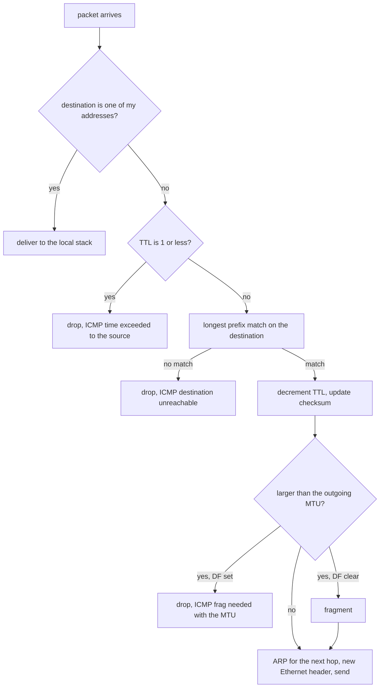
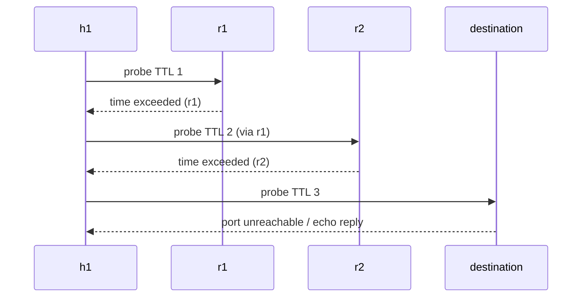
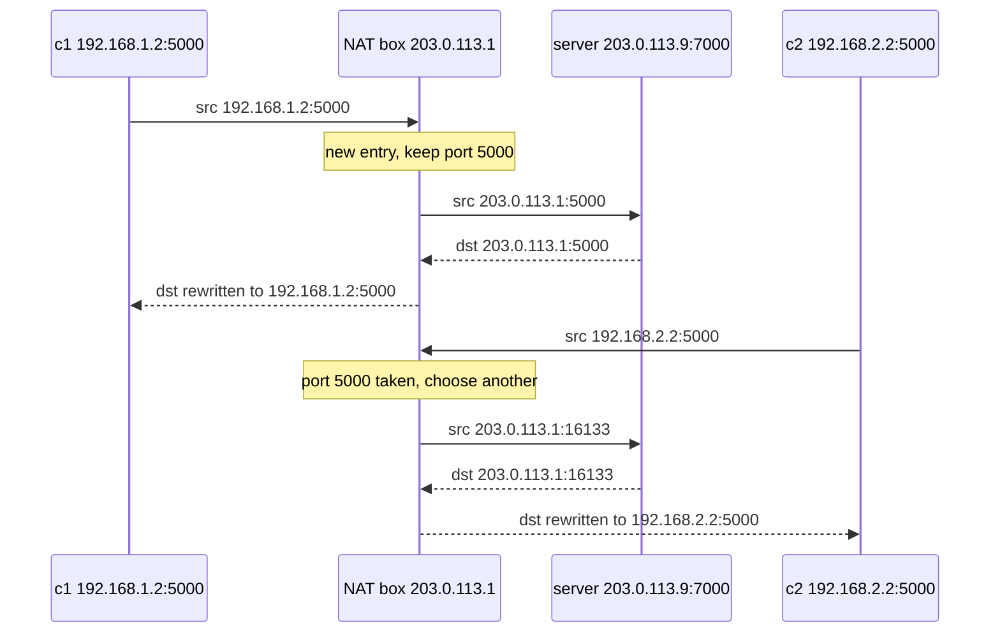
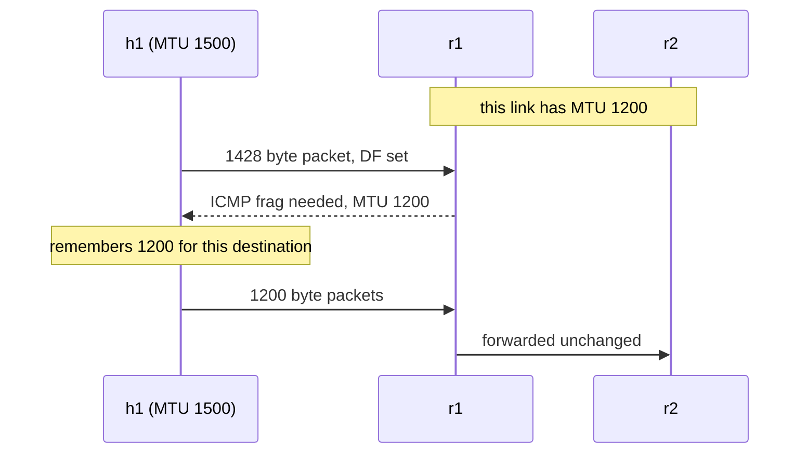

# NET 02: IP, routing and layer 3: the header, subnetting, longest-prefix match, ICMP, NAT, fragmentation and path MTU

*Part of the [networking plan](00_plan.md) · You need: [NET 01](01_network_models_and_layer2.md) (frames, ARP, MTU), [LX 08](../06_linux/08_linux_networking_toolbox.md) (network namespaces, `ip`, `tcpdump`), [C 02 to C 04](../02_c_language/00_plan.md) (structs, byte order)*

Layer 2 moves a frame across one segment; layer 3 turns segments into an internet. The classic questions are: what is in an IP header, how does a router choose, why does a ping across a NAT work when the addresses differ, why does a large transfer hang while small ones work. Interviewers also ask you to **write** the pieces: a header parser, the checksum, a longest-prefix-match structure. This tutorial builds the mental model of a packet crossing two routers, and gives you small tested snippets for each piece.

The weak answer to "what does a router do" is "forwards packets". The strong answer is a sequence: check the destination is not local, check and decrement the TTL, longest-prefix match, check the MTU against DF, update the checksum, resolve the next hop with ARP and **write a brand new Ethernet header**. Everything below hangs off that sequence.

By the end you can:

- parse an IPv4 header by hand and in code, and explain every field and its traps (IHL in words, fragment offset in 8-byte units, byte order);
- subnet without a calculator, summarise routes, and plan address space with variable-length masks;
- trace the forwarding decision step by step and explain asymmetric routing, loops and bad summaries;
- explain longest-prefix match, why a hash table is the wrong tool, and compare a trie, DIR-24-8 and a scan;
- read ICMP errors and explain `ping` and `traceroute` from the TTL up;
- compute the Internet checksum and its incremental update, and explain why NAT must rewrite transport checksums;
- explain NAT and PAT, conntrack, what NAT breaks, and hairpinning;
- explain fragmentation, path MTU discovery, the ICMP black hole and MSS clamping;
- explain multicast and IGMP, and sketch IPv6, MPLS, OSPF and BGP in their places;
- triage a layer 3 fault in order.

---

## 1. The IPv4 header

### 1.1 Why layer 3 exists

Layer 2 addresses are flat and local: a switch keeps one entry per host and a broadcast reaches everyone. That cannot scale to a planet. Layer 3 adds a **hierarchical address** (network part plus host part) so a router keeps **one entry per network**; a **hop limit** so a loop does not circulate forever (the property Ethernet lacks); **fragmentation** to cross links of different sizes; and a **protocol field** so the receiver knows what is inside.

### 1.2 The fields

| Field | Bits | What it does |
|---|---|---|
| Version | 4 | always 4 |
| IHL | 4 | header length in **32-bit words**: 5 means 20 bytes, 15 means 60 |
| DSCP, ECN | 6, 2 | traffic class for queueing ([NET 14](14_queueing_qos_and_traffic_management.md)); ECN lets routers signal congestion without dropping ([NET 03](03_tcp_udp_and_transport.md)) |
| Total length | 16 | header plus data, so a packet is at most 65,535 bytes |
| Identification | 16 | same value on every fragment of one packet |
| Flags | 3 | reserved, **DF** (do not fragment), **MF** (more fragments) |
| Fragment offset | 13 | where this piece starts, in **units of 8 bytes** |
| TTL | 8 | decremented by every router; at zero the packet is dropped and ICMP time exceeded returns |
| Protocol | 8 | 1 ICMP, 2 IGMP, 6 TCP, 17 UDP, 47 GRE, 50 ESP, 89 OSPF |
| Header checksum | 16 | covers **the header only** |
| Source, destination | 32 each | addresses |

Three details interviews probe. The **fragment offset counts 8-byte units** because 13 bits cannot count to 65,535, so every fragment but the last carries a multiple of 8 data bytes. **IHL is in words**, so a parser must multiply by 4 before looking for the transport header; ignoring options is a classic bug. **Fields are big endian**, so on a little-endian host a `uint16_t` read straight from the buffer has its bytes swapped.

### 1.3 A parser and a builder

```python
import struct, ipaddress

def csum(b: bytes) -> int:                         # RFC 1071 Internet checksum
    if len(b) % 2: b += b'\0'
    s = sum(struct.unpack('!%dH' % (len(b)//2), b))
    while s >> 16: s = (s & 0xffff) + (s >> 16)
    return ~s & 0xffff

def parse_ipv4(p: bytes):
    vihl, tos, tot, ident, ff, ttl, proto, ck, src, dst = struct.unpack('!BBHHHBBH4s4s', p[:20])
    ihl = (vihl & 0xf) * 4
    return dict(version=vihl >> 4, ihl=ihl, dscp=tos >> 2, ecn=tos & 3, total=tot, id=ident,
                df=bool(ff & 0x4000), mf=bool(ff & 0x2000), frag_off=(ff & 0x1fff) * 8, ttl=ttl,
                proto=proto, ok=csum(p[:ihl]) == 0,           # a header with a good checksum sums to zero
                src=str(ipaddress.IPv4Address(src)), dst=str(ipaddress.IPv4Address(dst)))

def build(src, dst, ttl=64, proto=1, payload=b'', ident=0x1234, df=True):
    h = struct.pack('!BBHHHBBH4s4s', 0x45, 0, 20 + len(payload), ident, 0x4000 if df else 0, ttl, proto, 0,
                    ipaddress.IPv4Address(src).packed, ipaddress.IPv4Address(dst).packed)
    return h[:10] + struct.pack('!H', csum(h)) + h[12:] + payload

pkt = build('10.1.0.2', '10.2.0.2', payload=bytes(64))
print(parse_ipv4(pkt))
# {'version': 4, 'ihl': 20, 'dscp': 0, 'ecn': 0, 'total': 84, 'id': 4660, 'df': True, 'mf': False,
#  'frag_off': 0, 'ttl': 64, 'proto': 1, 'ok': True, 'src': '10.1.0.2', 'dst': '10.2.0.2'}
```

A ping that crosses two routers in a namespace lab arrived with **TTL 62**, DF set (Linux sets it by default), total length 84 and a header checksum that verifies to zero. A TCP SYN parsed as a 40-byte TCP header with a SYN flag and a window of 64240. If a capture shows a TCP checksum marked "incorrect" on the sending host, that is **checksum offload**: the kernel left the field for the NIC to fill, so a capture before the NIC sees an unfinished value. The IP header checksum is always computed in software and is right.

## 2. Subnetting and addressing

### 2.1 What the prefix length means

`10.4.77.130/26` says the **first 26 bits are the network**; the **mask** is 26 ones then 6 zeros, `255.255.255.192`. The network address is the address with host bits cleared, the broadcast has them all set, and usable hosts are **2^(32-p) - 2**, except **/31** (point-to-point links, RFC 3021, no network or broadcast address) and **/32** (one host, a loopback or host route).

**The block-size method** needs no binary. Find the interesting octet (the one where the mask is neither 255 nor 0); the block size is 256 minus the mask value there; the network is the largest multiple of the block not above the address's octet. For `/26`, mask 192, block 64: 130 is in the block starting at 128, so network `.128`, broadcast `.191`, hosts `.129` to `.190`. For `/20` the third octet has block 16, and `172.16.45.9` is in `172.16.32.0`.

```python
import ipaddress
for c in ('10.4.77.130/26', '172.16.45.9/20', '203.0.113.77/28'):
    n = ipaddress.ip_interface(c).network
    print(c, n.network_address, n.broadcast_address, n.num_addresses - 2)
# 10.4.77.130/26  10.4.77.128  10.4.77.191  62
# 172.16.45.9/20  172.16.32.0  172.16.47.255  4094
# 203.0.113.77/28 203.0.113.64 203.0.113.79  14

print(ipaddress.ip_network('192.168.10.0/22', strict=False))      # 192.168.8.0/22: the trap, 10 is not a multiple of 4
print(list(ipaddress.collapse_addresses([ipaddress.ip_network(f'10.8.{i}.0/24') for i in range(4)])))      # one /22
print(list(ipaddress.collapse_addresses([ipaddress.ip_network(f'10.8.{i}.0/24') for i in (0, 1, 3)])))      # a /23 and a /24
```

**Always compute the network address first.** `192.168.10.0/22` is written with host bits set because a /22 starts on a multiple of 4 in the third octet, and a router rejects it as a route. **Summarisation** (collapsing adjacent aligned blocks into one route) is how an address plan keeps tables small: four contiguous /24s become one /22, but leave one out and you get a /23 and a /24, not one route.

### 2.2 Special blocks

| Block | Meaning |
|---|---|
| `10.0.0.0/8`, `172.16.0.0/12`, `192.168.0.0/16` | private (RFC 1918), reached through NAT |
| `100.64.0.0/10` | carrier-grade NAT shared space (RFC 6598) |
| `127.0.0.0/8` | loopback, the whole /8 |
| `169.254.0.0/16` | link local, what a host picks when DHCP fails |
| `192.0.2.0/24`, `198.51.100.0/24`, `203.0.113.0/24` | documentation (RFC 5737) |
| `224.0.0.0/4` | multicast |
| `240.0.0.0/4`, `255.255.255.255` | reserved, limited broadcast |
| `0.0.0.0/0` | default route; as a source, "I have no address yet" |

### 2.3 Planning with VLSM

**Variable-length subnet masking** hands each segment the smallest block that fits, **largest first**, each aligned to its own size so leftovers stay contiguous and summarisable. Rules of thumb: leave room to grow; use /31 or /30 on router links; give each site or function an aligned block so **one route describes it**; keep private ranges apart from those you may join through a VPN later, because overlapping `10.0.0.0/8` plans after a merger are a classic and expensive problem, and the reason NAT between networks exists.

## 3. Routing: how a router decides

### 3.1 The table

A routing table maps prefixes to a next hop and outgoing interface. Linux builds it from **connected** routes (added when an address is configured), **static** routes (by hand or DHCP) and **dynamic** routes (a daemon, [NET 11](11_routing_protocols_and_datacenter_fabrics.md)). The decision is the same everywhere: **the most specific matching prefix wins**, then the packet goes to its next hop, or directly if the prefix is connected. In a lab with four overlapping routes, the /32 won for its address, the /24 for another, a /16 blackhole for a third and the default for the rest; and a **lower metric beat a dead gateway**, because the kernel does not check whether the gateway is alive, only whether the route exists. `ip route get DEST` shows the route the kernel really chooses and is the first command to run.

### 3.2 The forwarding decision, step by step



Note the **new Ethernet header at the last step**: a router builds a fresh header at every hop with its own MAC as source and the next hop's MAC as destination, while IP addresses stay the same (except under NAT). Also note what the router checks that a switch does not: the TTL, the MTU, and a routing table that can say "no route".

### 3.3 Three things that go wrong

- **Asymmetric routing**: the forward and return paths differ. It works until a stateful device (firewall, NAT) sees one direction only, or **reverse path filtering** (`rp_filter`) drops packets whose source would not be routed back out of the arrival interface. If a ping works one way, check both tables.
- **Routing loops**: two routers pointing at each other bounce a packet until the **TTL reaches zero**. The TTL is why a layer 3 loop is a nuisance and not a meltdown (contrast the layer 2 storm in NET 01).
- **Bad or overlapping summaries**: a /16 advertised by two routers attracts traffic for networks one of them lacks, so the specific routes must exist where needed or traffic is blackholed.

Policy routing (`ip rule`, multiple tables) and ECMP (several equal next hops, chosen by a per-flow hash) are the Linux features to name when the answer is "it depends on the source" or "it uses several paths".

## 4. Longest-prefix match: the data structures

A software router looks up once per packet; hardware does it in a cycle or two. At 100 Gbit/s with 64-byte frames there are about 6.7 ns per packet (NET 01), so a loop over a table is out. "Implement longest-prefix match" is an interview favourite because the naive answer is wrong.

**Why not a hash table?** It finds exact keys. To match `10.2.0.9` you would have to try `/32`, then `/31`, and so on to `/0`: up to 33 lookups. (Binary search on prefix lengths cuts it to about 5, at the cost of complicated insertion.) Tries follow the bits of the address, so the longest match falls out of the walk.

```python
class Node:
    __slots__ = ('c', 'hop')
def mk(): n = Node(); n.c = [None, None]; n.hop = None; return n

def insert(root, net, plen, hop):                  # net as a 32-bit int
    n = root
    for i in range(plen):
        b = (net >> (31 - i)) & 1
        if n.c[b] is None: n.c[b] = mk()
        n = n.c[b]
    n.hop = hop

def lookup(root, ip):
    n, best = root, None
    for i in range(32):
        if n.hop is not None: best = n.hop         # remember the longest prefix seen so far
        n = n.c[(ip >> (31 - i)) & 1]
        if n is None: return best
    return n.hop if n.hop is not None else best

root = mk(); ip = lambda s: int(ipaddress.IPv4Address(s))
for net, l, hop in (('0.0.0.0', 0, 'default'), ('10.2.0.0', 16, 'blackhole'), ('10.2.0.0', 24, 'r1'), ('10.2.0.2', 32, 'r1-metric5')):
    insert(root, ip(net), l, hop)
for a in ('10.2.0.2', '10.2.0.9', '10.2.9.9', '10.7.7.7'):
    print(a, lookup(root, ip(a)))        # r1-metric5, r1, blackhole, default
```

Three structures to compare:

| Structure | Lookup | Memory | Notes |
|---|---|---|---|
| Linear scan (the definition) | O(n) | smallest | a correctness reference, not a design |
| **Binary trie** (compress it into a Patricia or LC-trie) | up to 32 steps | pointer per node | what the Linux kernel uses in the compressed form (LC-trie) |
| **DIR-24-8** | one or two memory reads | tens of MB | a 2^24 table indexed by the top 24 bits, with a second level for the rare longer prefixes; used in DPDK |

In an earlier measurement on random tables, at 1,000 routes a scan took about 1,100 ns per lookup, a binary trie 44 ns and DIR-24-8 5.5 ns; at 500,000 routes the trie took about 200 ns and DIR-24-8 still about 8 ns, at the cost of tens of megabytes. The ratios are the lesson: **speed is bought with memory and with update cost** (changing a /8 in DIR-24-8 rewrites millions of entries). Hardware uses **TCAM**, which matches all prefixes in parallel and picks the longest by priority, at high power and cost per entry.

## 5. ICMP, `ping` and `traceroute`

### 5.1 What ICMP is for

IP gives no delivery guarantee and no feedback. **ICMP** (RFC 792) is the feedback channel: a router or host that cannot deliver sends an **error** to the packet's source, quoting the **IP header and the first 8 bytes** of the offender so the sender can tell which connection it concerns. ICMP rides inside IP (protocol 1), so it is itself unreliable, and it is **never sent in response to an ICMP error** (to avoid storms).

| Type, code | Name | Sent by | When |
|---|---|---|---|
| 8, 0 / 0, 0 | echo request / reply | any host | `ping` |
| 11, 0 | time exceeded | a router | TTL reached zero |
| 3, 0 | destination unreachable, net | a router | no route |
| 3, 1 | unreachable, host | last router | host did not answer ARP |
| 3, 3 | unreachable, port | destination | UDP to a closed port |
| 3, 4 | **fragmentation needed, DF set** | a router | packet exceeds next MTU; carries the MTU |
| 3, 13 | administratively prohibited | a filter | a firewall rejects instead of dropping |
| 5 | redirect | a router | "better next hop on your own segment" |

Five different causes produced five distinguishable errors in a lab, which is why reading the exact ICMP type is the fastest way to localise a fault: "net unreachable" is a routing problem at that router, "host unreachable" an ARP problem on the last segment, "port unreachable" a closed port at the destination, "admin prohibited" a deliberate filter, and total silence means a drop or a filter that sends nothing. Routers also **rate-limit** ICMP, so missing replies from a hop in `traceroute` do not mean the hop is down.

### 5.2 How `traceroute` works

`traceroute` sends probes with **TTL 1, 2, 3, ...**; the router where the TTL reaches zero drops the probe and reports itself in ICMP time exceeded, so the sender learns hop *n*. The last hop is recognised because the destination answers differently (port unreachable for UDP probes to an unused port, echo reply for ICMP probes).



A neat detail: the replies arrived with TTL **64, 63 and 62** from the first router, second router and destination, because each reply carries the TTL its *sender* started with, decremented by the routers on the way back. Comparing the received TTL with a guess of the sender's starting value (64, 128 or 255 by OS) tells you how far away it is. Real paths are asymmetric and load balanced by flow hash, so `traceroute` shows one of several paths, and **`mtr`** shows loss and latency per hop over time. Beware: a hop that drops probes but forwards traffic looks bad in `traceroute` and is fine.

## 6. The Internet checksum

The IPv4 header checksum (RFC 1071) is the **one's complement of the one's complement sum of the header's 16-bit words**, with the checksum field zero while computing. To verify, sum including the checksum: a good header sums to zero (the `ok` field in the parser above). It is weak (catches single-bit flips and many bursts, misses swapped words) and cheap, which is the point because a router does it for **every packet**. IPv6 has **no header checksum**, since link layers and transport checksums already protect the data. TCP and UDP checksums cover the payload plus a **pseudo header** (addresses, protocol, length), which is why **NAT must rewrite them**.

**The incremental update** avoids recomputing everything: RFC 1624 gives `HC' = ~(~HC + ~m + m')` for changing one 16-bit word `m` into `m'`. The TTL shares a word with the protocol field, so decrementing it changes that one word:

```python
def incr(hc, m, m2):                               # RFC 1624
    s = (~hc & 0xffff) + (~m & 0xffff) + m2
    s = (s & 0xffff) + (s >> 16); s = (s & 0xffff) + (s >> 16)
    return ~s & 0xffff

old_ck   = struct.unpack('!H', pkt[10:12])[0]
word_old = struct.unpack('!H', pkt[8:10])[0]        # TTL and protocol
word_new = word_old - 0x100                          # TTL minus one
fwd = pkt[:8] + struct.pack('!H', word_new) + struct.pack('!H', incr(old_ck, word_old, word_new)) + pkt[12:]
print(hex(old_ck), hex(struct.unpack('!H', fwd[10:12])[0]), parse_ipv4(fwd)['ok'], parse_ipv4(fwd)['ttl'])
# 0x146f 0x156f True 63
```

The checksum went up by 0x0100 when the TTL went down by one, and the updated header verifies. In a lab capture of the same ping entering and leaving a router, the real change was exactly this (0x7824 to 0x7924). A single flipped bit anywhere makes the sum non-zero, so the receiver or the next router drops the packet; a NAT box that rewrites an address must apply the same update to the IP checksum and the TCP or UDP checksum.

## 7. NAT and PAT

### 7.1 Why and what

IPv4 has about 4.3 billion addresses and far more devices, so most networks use **private** addresses inside and share one or a few public ones at the edge. **NAT** rewrites addresses as packets pass. **PAT** (NAPT, masquerade, "overload", what people usually mean) also rewrites the **source port**, so many inside hosts share one outside address and the box tells connections apart by port.

| Kind | Rewrites | Used for |
|---|---|---|
| Source NAT, masquerade | source address (and port) of outbound packets | inside hosts reaching the Internet |
| Destination NAT, port forwarding | destination address (and port) of inbound packets | publishing an inside server |
| Static NAT (1:1) | address only, both directions | one public address per server |
| NAT64, CGNAT | IPv6 to IPv4; a carrier's shared pool | transition; address shortage |

The box keeps a **translation table** (connection tracking, `conntrack`): one entry per flow with the original and translated tuple, created by the **first outbound packet**. Replies match the table and are translated back. A packet from outside that matches no entry is not translated and goes to the box's own stack, usually dropped: the accidental **firewall effect** of NAT, which is not a security feature.



In the lab, two clients using source port 5000 to the same server port reached it as `203.0.113.1:5000` and `203.0.113.1:16133`, and the conntrack table held both. On Linux the rule is one line in nftables (`oifname "eth0" masquerade`), and `conntrack -L` shows the table.

### 7.2 What NAT breaks, and what it costs

- **End-to-end addressing.** An inside host cannot receive connections unless a rule or an outbound flow exists. Protocols that carry addresses in their payload (FTP active mode, SIP) need an **application layer gateway** or fail. **Hole punching** (STUN, ICE: how video calls connect) works by sending from both sides at once so each NAT creates an entry.
- **State.** The table is memory per flow and a lookup per packet; **entries are the scarce resource**, and when the table fills new flows are dropped, a known failure under attack or a burst of short connections. **Port exhaustion**: one outside address has about 64,000 ports **per destination**, so a service talking to one server through one address can run out.
- **Timeouts.** Idle entries expire, so long-lived idle connections die unless keepalives refresh them.
- **Hairpinning.** An inside client using the **outside address** of an inside server needs source and destination NAT on the same packet, or the server answers directly and the client sees an unexpected source. The most common NAT puzzle after "why can't I reach my own port forward".
- **Checksums**: every rewrite needs the incremental update of section 6; a lab prediction of the checksum a NAT box puts on the wire matched to the bit.
- **IPv6 does not need NAT**; the firewall effect comes from a stateful firewall ([NET 09](09_network_security_firewalls_ips_dpi.md)).

## 8. Fragmentation and path MTU discovery

### 8.1 The mechanism

If a packet exceeds the next link's MTU, the **DF bit** decides. With **DF clear** the router **fragments**: pieces with their own IP header, the same **identification**, a **fragment offset** and **MF** on all but the last. With **DF set** it **drops** the packet and sends **ICMP type 3 code 4** carrying the MTU that was too small. Only the **destination reassembles**, because fragments may take different paths.

Fragmentation is fragile: a lost fragment loses the whole packet, reassembly holds memory and is an attack surface, and later fragments of a UDP datagram lack the transport header, so a firewall cannot filter them by port. Modern stacks set DF on everything and use **path MTU discovery (PMTUD, RFC 1191)**: send big, wait for the ICMP error, shrink, retry. Linux caches the result per destination for about ten minutes.



### 8.2 What the lab showed

With a 1200-byte link in the path, a DF ping of 1400 bytes got `Frag needed and DF set (mtu = 1200)`; a 3000-byte ping without DF was cut into 3 fragments by the host and 5 at the narrow link. With the ICMP error **filtered**, DF traffic lost 100 percent while small packets passed, and a 200,000-byte TCP transfer **stalled** until the MSS was clamped, then finished at once. That is the **PMTUD black hole**, among the most common production network bugs: a firewall that blocks all ICMP "for security" breaks every path with a smaller MTU, and the symptom is that handshakes work and bulk transfers hang.

### 8.3 MSS clamping

TCP exchanges its **MSS** in the SYN. If a middle box rewrites the MSS in the SYN to fit the path, **the sender never builds a too-large segment**, with no need for ICMP. On Linux: `tcp option maxseg size set rt mtu` in nftables. Typical places: in front of a **PPPoE** link (MTU 1492), at **VPN or tunnel** endpoints and in cloud overlays. It only helps TCP; UDP applications (QUIC, DNS) size their own datagrams (QUIC keeps packets near 1,200 bytes). **IPv6** forbids fragmentation by routers: only the source fragments, the minimum MTU is **1280**, and PMTUD relies on ICMPv6 "packet too big", so IPv6 is *more* dependent on ICMP, not less.

## 9. Multicast and IGMP

**Multicast** sends one packet to a **group** of receivers that asked for it, each group an address in `224.0.0.0/4`. Hosts announce membership with **IGMP** (IGMPv3, RFC 3376); routers and snooping switches use the reports to forward the group only where members exist. IPv6 uses MLD in ICMPv6.

**The group MAC.** An IPv4 multicast address maps to Ethernet by placing its **low 23 bits** after `01:00:5e` with the next bit zero. IP has 28 group bits and the MAC takes 23, so **32 groups share every MAC**, and a host can receive frames for a group it did not join and must filter in software: `239.1.1.1` and `238.129.1.1` both map to `01:00:5e:01:01:01`. On the wire, joining a group produced one **IGMPv3 membership report** to `224.0.0.22`, TTL 1, with the router-alert option.

**IGMP snooping** lets a switch prune a group to member ports. In the lab VM it did not behave as documented (a frame still reached a non-member's wire, receiver-side filtering by the host kernel did the job), so treat that experiment as showing host filtering, not switch behaviour. **Multicast routing** between networks needs a protocol (PIM) and a **reverse path check**: a packet is forwarded only if it arrived on the interface unicast routing would use to reach its source. It builds a tree from the source instead of looking up a destination, which is why multicast is common inside one data centre or video head-end and rare across the Internet. Wi-Fi adds a twist: multicast is sent at a low basic rate to all stations after the DTIM beacon, which is why multicast-to-unicast conversion matters ([WF 07](10_wifi/07_wifi_architectures_mesh_and_services.md)).

## 10. What comes next (a map)

**IPv6 header**: fixed 40 bytes: version, traffic class, **flow label** (20 bits), payload length, **next header** (the protocol field, and the way **extension headers** chain), **hop limit** (TTL renamed) and two 128-bit addresses. No header checksum, no IHL, no fragmentation fields in the base header, no options; routers never fragment. Scopes: `::1` loopback, `fe80::/10` link local (every interface has one), `fc00::/7` unique local, `2000::/3` global unicast, `ff00::/8` multicast. A /64 is the standard subnet; SLAAC builds the host part from the advertised prefix (NET 01). The IPv6 header was explained from memory and the RFCs; the lab kernel had no IPv6.

**MPLS** puts a **32-bit label** (20-bit label, 3-bit traffic class, bottom-of-stack bit, 8-bit TTL) between layers 2 and 3. A router forwards by **exact match on the label** and **swaps** it per hop, which gives fast forwarding, traffic engineering and carrier VPNs. Data centres use VXLAN and EVPN overlays or segment routing instead.

| | OSPF | BGP |
|---|---|---|
| Role | interior routing in one organisation | routing between organisations, and increasingly inside data centres |
| Algorithm | **link state**: every router floods its links and runs Dijkstra on the same map | **path vector**: routes carry the AS path, policy decides |
| Metric | link cost | attributes and policy (local preference, AS path length, MED, tie breakers) |
| Transport | IP protocol 89 | TCP port 179 |
| Convergence | seconds | minutes at Internet scale |

OSPF exists so all routers agree on one topology and compute paths themselves; BGP exists so independent networks can exchange reachability **without revealing or agreeing on topology**, with policy as the main design input. [NET 11](11_routing_protocols_and_datacenter_fabrics.md) covers both in depth. No routing daemon was run in the lab.

## 11. Where is the layer 3 fault? A triage order

| Step | Check | Bad answer means |
|---|---|---|
| 1 | Address, mask, default route? `ip -br addr`, `ip route` | no default route: only the connected network works; wrong mask: part of the local network goes to ARP and fails |
| 2 | Which route does the kernel choose? `ip route get DEST` | an unexpected gateway or device: a more specific route or a lower metric is hijacking; unreachable: a blackhole route covers it |
| 3 | Does the gateway answer? `ip neigh`, ping | `INCOMPLETE` or `FAILED`: a layer 2 problem (NET 01) |
| 4 | Where does the path stop? `traceroute -n`, `mtr` | stops at hop N with errors: that router lacks a route or filters; silence after N: a firewall or a missing return route |
| 5 | Request arrives, reply does not return? `tcpdump` on both sides of a router | asymmetric path, missing far-side route, `rp_filter` |
| 6 | Big packets fail, small work? `ping -M do -s N`, `tracepath` | path MTU below the host's and ICMP filtered; clamp the MSS |
| 7 | Something rewriting addresses? `conntrack -L`, `nft list ruleset` | NAT or proxy in the path; connections dying after idle: an entry timed out |
| 8 | Errors on a router? `ip -s link`, `nstat` | ICMP rate limits, CPU high, routing churn |

"The website is down" is a layer 3 fault a third of the time and a layer 2 fault another third; step through this list and NET 01's triage from the bottom up.

## 12. Common mistakes

1. **Saying the source and destination IP change at each hop.** The MACs change; the IPs do not (except NAT).
2. **Ignoring IHL** and reading the transport header at a fixed offset.
3. **Reading multi-byte fields without byte-order conversion.**
4. **Using a hash table for longest-prefix match.**
5. **Blocking all ICMP.** It breaks path MTU discovery and `traceroute`.
6. **Treating NAT as a firewall.**
7. **Forgetting NAT rewrites checksums and state.**
8. **Writing `/22` networks with host bits set.**
9. **Believing a hop that does not answer `traceroute` is down.**
10. **Forgetting rate limiting of ICMP when reading `mtr` loss.**
11. **Assuming a route with a dead gateway is skipped.**
12. **Forgetting asymmetric routing when a stateful device sits in the path.**

## 13. Interview questions

1. **What does a router do with a packet, in order?** Section 3.2.
2. **Why do the MAC addresses change at each hop but not the IPs?**
3. **Why is the fragment offset counted in 8-byte units and why is IHL in words?**
4. **How do you find the network and broadcast address of `10.4.77.130/26`?** Block size 64, network .128, broadcast .191.
5. **What is longest-prefix match and how would you implement it?** Binary trie, DIR-24-8, TCAM.
6. **Why not a hash table?** Up to 33 lookups.
7. **How does `traceroute` work and what can fool it?** TTL probes; ICMP rate limiting, load balancing, asymmetric paths.
8. **What does each ICMP unreachable code tell you?**
9. **Why is the IPv4 header checksum recomputed at every hop, and how cheaply?** TTL changes; incremental update (RFC 1624).
10. **How does PAT let many hosts share one address and what breaks?** Port rewriting and conntrack; inbound connections, ALG protocols, table exhaustion, hairpinning.
11. **Large transfers hang but small ones work. Why?** An MTU black hole; PMTUD fails when ICMP is filtered; clamp MSS.
12. **Why is IPv6 more dependent on ICMP?** No router fragmentation, packet too big, neighbour discovery.
13. **What is asymmetric routing and what does it break?** Stateful devices, `rp_filter`.
14. **Compare OSPF and BGP.** Link state versus path vector, scope, policy.
15. **How does multicast map to Ethernet, and what is the 32-to-1 problem?**
16. **What is ECMP and how are packets assigned to paths?** A per-flow hash so one flow stays on one path.

## 14. Scenarios and design questions

**S1. A web server's large responses hang for users on one ISP only.** *Where to practise:* a namespace chain with a narrow-MTU link and an ICMP filter. *Approach:* check handshake works, test with DF pings at different sizes, find the path MTU, check whether ICMP frag-needed is filtered, clamp MSS on the edge router.

**S2. Two offices that merged both use `10.0.0.0/16`.** *Where to practise:* a two-namespace lab with overlapping subnets and NAT between them. *Approach:* renumber if possible; otherwise NAT one side into an unused block (twice NAT), mind DNS and embedded addresses.

**S3. A ping works from A to B but TCP does not.** *Where to practise:* a router with a stateful firewall on one of two paths. *Approach:* asymmetric routing, so the firewall sees only SYN or only SYN-ACK; capture on both paths.

**S4. A NAT gateway starts dropping new connections at peak.** *Where to practise:* conntrack with a small table and a connection flood. *Approach:* conntrack count versus max, timeouts, port exhaustion per destination, add addresses, tune or shard.

**S5. Design the addressing for 40 sites with 20 to 2,000 hosts each.** *Where to practise:* a VLSM script with `ipaddress`. *Approach:* largest first, aligned blocks, one summary per site, room to grow, /31 links, a documentation range kept free.

**S6. Implement longest-prefix match for a router with 1 million routes.** *Where to practise:* the trie above, then a compressed version. *Approach:* a compressed trie or DIR-24-8 with updates in mind, discuss memory versus update cost and TCAM for hardware.

**S7. Explain what happens on the wire for `curl http://server` through two routers.** *Where to practise:* a three-namespace chain with `tcpdump -e`. *Approach:* ARP for the gateway, SYN with gateway MAC and server IP, TTL decrement and a new Ethernet header at each hop, MAC changes, TCP handshake.

## 15. Strong answers (outlines)

**S1.** Small works and large hangs means a size limit. Confirm with DF pings, bisect to find the largest working size, and check for a tunnel or PPPoE hop. If the ICMP error is blocked the sender never learns, so fix the filter (allow type 3 code 4 and ICMPv6 packet too big) and clamp MSS on the edge as a belt-and-braces measure.

**S2.** Renumbering is clean but slow. Otherwise translate one network into an unused range at the boundary (NAT in both directions), and then DNS answers and any protocol that carries addresses in the payload need care. Document the mapping and plan a renumbering.

**S3.** A stateful firewall that sees only one direction treats the other as invalid. Capture both paths, fix the routing symmetry or make the firewall state-synchronised, and check `rp_filter` on hosts.

**S4.** Compare conntrack count with its maximum, look at the timeouts for established and time-wait entries, check source port exhaustion towards a single destination, then add outside addresses, shorten timeouts for known short flows or shard across gateways.

**S5.** Sort by size, allocate aligned blocks largest first, give each site a block that is a power of two with growth headroom, so one route per site, /31s for links, keep a reserved block, and validate with a script that checks blocks are disjoint and inside the allocation.

**S6.** Start with a binary trie, then path-compress; DIR-24-8 for speed if memory allows (tens of megabytes), with the second level for long prefixes. Updates are the hard part: a short prefix in DIR-24-8 rewrites many entries, so batch updates and double-buffer the table. Hardware uses TCAM.

**S7.** The host sees the server off-subnet so it ARPs for the gateway, builds a frame with the gateway's MAC and the server's IP; each router decrements TTL, updates the checksum, ARPs the next hop and writes a new Ethernet header; TCP's three-way handshake follows; DNS happens first if a name is used.

## 16. Cheat sheet

| Fact | Value |
|---|---|
| IPv4 header | 20 to 60 bytes; IHL in words; fragment offset in 8-byte units |
| Max packet | 65,535 bytes |
| Router steps | local? TTL, LPM, TTL minus one and checksum, MTU and DF, ARP, new Ethernet header |
| Usable hosts | 2^(32-p) - 2, except /31 and /32 |
| Private | 10/8, 172.16/12, 192.168/16; CGNAT 100.64/10 |
| LPM structures | scan, trie, DIR-24-8, TCAM |
| Checksum update | HC' = ~(~HC + ~m + m') |
| ICMP | 8 echo, 11 time exceeded, 3/4 frag needed, 3/3 port, 3/13 prohibited |
| Traceroute | increasing TTL; replies' TTL tells hop count |
| NAT | conntrack per flow; breaks inbound, ALG, hairpin; port exhaustion |
| PMTUD | DF plus ICMP 3/4; black hole when ICMP is filtered; MSS clamp |
| IPv6 | 40-byte header, no checksum, no router fragmentation, min MTU 1280 |
| OSPF / BGP | link state, IP proto 89 / path vector, TCP 179 |

## 17. Sources and caveats

Web sources used for interview framing: [thelinuxcode TCP/IP interview playbook](https://thelinuxcode.com/top-50-tcpip-interview-questions-and-answers-2026-senior-engineers-playbook/), [GoLinuxCloud computer networks questions](https://www.golinuxcloud.com/computer-networks-interview-questions/) and [Dice network engineer preparation](https://dice.com/career-advice/network-engineer-interview-questions-how-to-prepare). Standards behind the content: RFC 791, 792, 1071, 1191, 1624, 1918, 3021, 3376, 4861, 5737, 6598.

Caveats. The header parser and builder, the checksum and incremental update, the subnet drills, route collapsing and the trie were run for this tutorial. The measured behaviours quoted (TTL 62 across two routers, the lookup timings, the NAT port assignment, the ICMP errors, the PMTUD black hole and MSS clamp, the IGMP behaviour) come from earlier runs of the previous version of this tutorial on one Linux 6.18 VM with network namespaces and virtual Ethernet pairs, and were not re-run here. The lookup timings were single runs on random tables and show ratios only. That VM had no IPv6 and no routing daemon, so IPv6, MPLS, OSPF and BGP are explained from memory and the RFCs. IGMP snooping did not behave as documented in that VM and I did not find out why. Linux defaults mentioned (PMTU cache lifetime, conntrack timeouts) vary by kernel and distribution.
