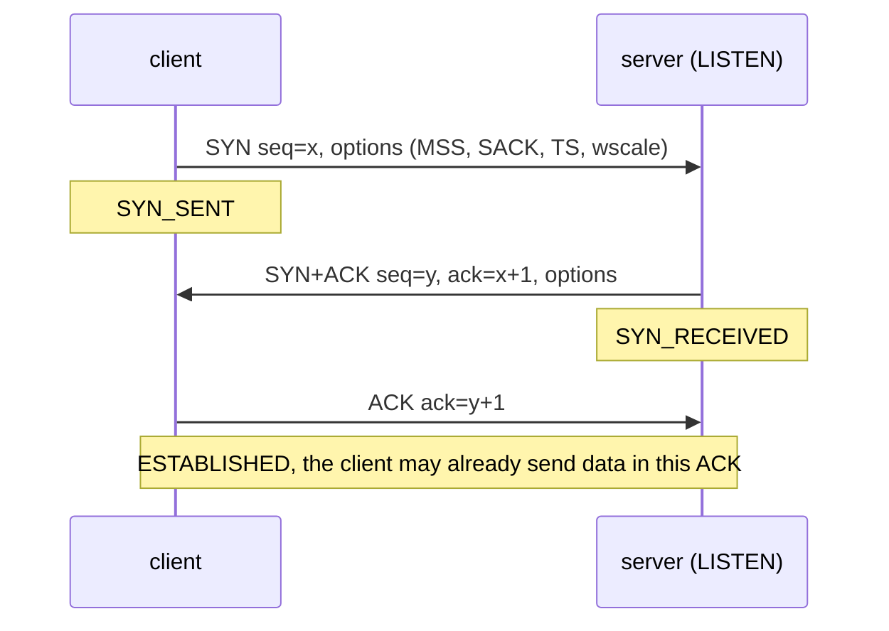
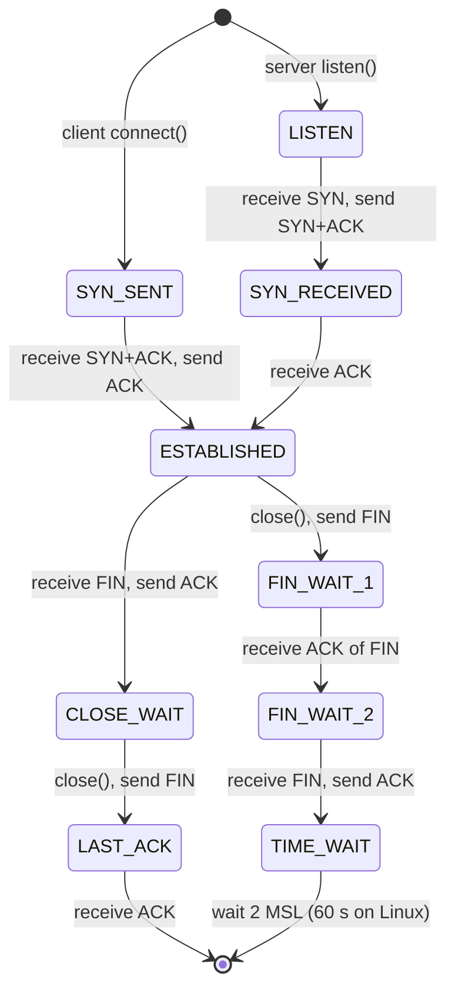
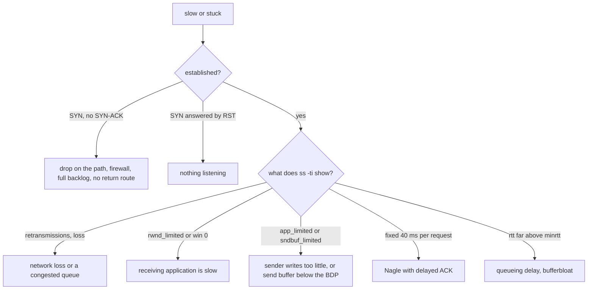

# NET 03: TCP, UDP and the transport layer: handshake, state machine, loss, windows, congestion, timeouts and retries

*Part of the [networking plan](00_plan.md) · You need: [NET 02](02_ip_routing_and_layer3.md) (IP, ICMP, MTU, NAT), [LX 08](../06_linux/08_linux_networking_toolbox.md) (`ip`, `ss`, `tcpdump`, `nft`), [OS 17](../05_operating_systems/00_plan.md) (sockets and system calls)*

IP delivers a packet to a host, or does not. The transport layer turns that into something an application can use: **a port** (which program on the host) and, for TCP, **a byte stream that arrives complete, in order and at a rate the network and the receiver can take**. Almost every systems interview has a transport question in it: what happens in the handshake, why `TIME_WAIT` exists, why a request takes 40 ms, how TCP finds the right sending rate, why a connection to a dead host hangs for fifteen minutes, how to retry without making an outage worse.

The weak answer recites "SYN, SYN-ACK, ACK". The strong answer says what each side learned, what state each side holds, what happens when a segment is lost at each step, and which counter or `ss` field proves it. This tutorial follows one connection from the first SYN to the last ACK, then widens to many connections, dead peers, retries and QUIC.

By the end you can:

- explain ports, sockets and the 5-tuple, and what UDP gives and withholds;
- read a TCP header, its options, sequence and acknowledgement arithmetic, and the handshake including SYN cookies and the two queues;
- explain a byte stream and why you must frame messages;
- draw the state machine and diagnose CLOSE_WAIT, TIME_WAIT and refused versus filtered ports;
- explain RTO, fast retransmit, SACK and RACK-TLP, and say what each loss signal costs;
- explain flow control, window scaling and the bandwidth-delay product;
- explain congestion control (slow start, AIMD, CUBIC, BBR, ECN) and why Wi-Fi loss hurts TCP;
- explain the Nagle and delayed-ACK stall and the fixes in order;
- explain port exhaustion, dead-peer detection and retry design with backoff and jitter;
- read `ss -ti` and `nstat`, triage a slow connection in order, and explain what QUIC fixes.

---

## 1. Ports, sockets and what the transport layer adds

IP addresses a **host**, loses, duplicates and reorders packets, and gives no feedback on rate. The transport layer adds:

| Service | UDP | TCP |
|---|---|---|
| Which program (ports) | yes | yes |
| Detects corruption (checksum) | yes (optional over IPv4, mandatory over IPv6) | yes |
| Message boundaries kept | **yes** | no: a byte stream |
| Guaranteed delivery | no | yes (retransmission) |
| In order | no | yes |
| Connection set-up and tear-down | no | yes |
| Slowed to the receiver (flow control) | no | yes |
| Slowed to the network (congestion control) | no | yes |

A **port** is a 16-bit number. A server **binds** a socket to a local address and port; a client usually lets the kernel pick an **ephemeral** port (32768 to 60999 by default on Linux). The kernel **demultiplexes** an arriving segment by: for **UDP**, destination address and port (one socket receives datagrams from any peer); for **TCP**, the **5-tuple** (protocol, source address and port, destination address and port). A `listen` socket owns the port; each `accept` returns a **new socket** for one 5-tuple. Two connections with identical 5-tuples cannot exist, which is why a client has only as many simultaneous connections to one server address and port as it has source ports (section 9).

## 2. UDP

The UDP header is **8 bytes**: source port, destination port, length, checksum. That is all. One `sendto` is one datagram and one `recvfrom` returns one whole datagram (or truncates it); there is no connection, no ordering, no retransmission and no flow control. Sending to a closed port makes the destination answer with ICMP port unreachable, which a **connected** UDP socket reports as an error on the next call and an unconnected one ignores. A datagram larger than the path MTU is fragmented by IP (NET 02), and one lost fragment loses the datagram, so applications keep datagrams under about 1,200 to 1,400 bytes.

**When UDP is the right choice:** the application does its own recovery or does not want recovery (DNS, which retries by itself; real-time audio and video, where a late packet is worthless); **small request-response** where a handshake would double the cost; **multicast and broadcast** (TCP is point to point); and **a new transport built in user space** (QUIC, section 13). The price is that **you** now own the timeout, retry, ordering and congestion behaviour, and a UDP sender that ignores congestion is a bad network citizen.

## 3. TCP: the segment, the handshake, the numbers

### 3.1 The header and the options

A TCP header is 20 bytes plus up to 40 of options. The fields to know:

- **Sequence number**: the number of the first **data byte** in this segment. TCP numbers **bytes**, not segments.
- **Acknowledgement number** (when ACK is set): the next byte the sender **expects**. Everything before it has arrived (**cumulative**).
- **Data offset**: header length in 4-byte words, like IHL.
- **Flags**: SYN, ACK, FIN (done sending), RST (abort), PSH (deliver now), URG (almost unused), ECE and CWR (congestion notification).
- **Window**: how many more bytes the sender of this segment will accept (flow control), scaled by a shift negotiated in the handshake.
- **Checksum**: over a pseudo-header, header and data. Mandatory.

| Option | Meaning | Why it exists |
|---|---|---|
| **MSS** | largest data the sender will receive per segment | MTU minus 40 (1460 on Ethernet); the NET 02 clamp rewrites it |
| **SACK permitted**, SACK blocks | the receiver reports ranges it holds beyond a gap | selective retransmission |
| **Timestamps** | each segment carries the sender's clock and echoes the peer's | an RTT sample on every ACK, protection against old duplicates (PAWS), makes `tcp_tw_reuse` safe |
| **Window scale** | the window field means `window << n` | the field is 16 bits, so without scaling the window tops out at 65,535 bytes |

Options are negotiated only in the **SYN** and **SYN-ACK**, and a feature is used only if both sides offered it, so a middlebox that strips options from SYNs quietly cripples a connection. With timestamps a data segment has 12 bytes of options, so the usable MSS on a 1500-byte MTU is **1448**.

### 3.2 The three-way handshake



What each side learned: the **initial sequence numbers** (random, so an off-path attacker cannot guess them), the peer's options, and, for the client, the **round trip time** from the first exchange. The handshake costs **one round trip** before the client can send data (plus one or two more for TLS, [NET 08](08_application_protocols_dns_http_tls.md)).

**Two queues on the server.** A SYN creates an entry in the **SYN queue** (half-open connections); the final ACK moves it to the **accept queue**, from which `accept()` takes it. If the accept queue is full because the application is slow to `accept`, the kernel drops the final ACK or the SYN: the client sees timeouts and `nstat` shows `ListenOverflows` and `ListenDrops`. The `Recv-Q` and `Send-Q` of a LISTEN socket in `ss -ltn` are the current accept queue and its limit. **SYN cookies** let the server survive a SYN flood by encoding the connection state in the sequence number it sends instead of storing it; the cost is that TCP options carried in the SYN cannot be remembered (a reduced set is encoded). A SYN dropped by the network is retried by the client after 1 s, then with backoff (Linux `tcp_syn_retries` is 6, so `connect` to a dead host can take over a minute).

### 3.3 Sequence arithmetic

The rule: **the next sequence number is the current one plus the data length, plus one for a SYN, plus one for a FIN.** The acknowledgement number is the next number expected from the peer. Drill: a capture line `seq 101:301, ack 1, length 200` means the same side's next segment starts at **301** and the peer will acknowledge **301**. Numbers are 32-bit and wrap, compared modulo 2^32 where "newer" means within half the space; at 10 Gbit/s the space wraps in about 3.4 seconds, so the timestamp option (PAWS) tells a wrapped old segment from a new one.

```python
nxt   = lambda seq, ln, syn=0, fin=0: (seq + ln + syn + fin) % 2**32
newer = lambda a, b: ((a - b) % 2**32) < 2**31
print(nxt(101, 200), nxt(2**32 - 10, 100))        # 301 90
print(newer(5, 2**32 - 5), 2**32 * 8 / 10e9)      # True 3.43...  seconds to wrap at 10 Gbit/s
```

### 3.4 A byte stream has no message boundaries

Two `send` calls of 100 and 200 bytes may arrive as one segment, three, or be split anywhere; `recv(4096)` may return any prefix of what has arrived. **TCP never promises that one `send` is one `recv`.** A protocol on TCP must frame its own messages: a length prefix, a delimiter (HTTP's blank line) or a fixed size. The most common TCP bug in interview code is a `recv` that assumes it got the whole message.

```python
import socket, struct

def recv_exact(sock, n):
    buf = b''
    while len(buf) < n:
        chunk = sock.recv(n - len(buf))
        if not chunk: raise ConnectionError('peer closed mid-message')
        buf += chunk
    return buf

def send_msg(sock, payload): sock.sendall(struct.pack('!I', len(payload)) + payload)
def recv_msg(sock):          return recv_exact(sock, struct.unpack('!I', recv_exact(sock, 4))[0])

a, b = socket.socketpair()
send_msg(a, b'x' * 100); send_msg(a, b'y' * 200)      # may arrive as one chunk
print(len(recv_msg(b)), len(recv_msg(b)))             # 100 200
```

Note `sendall` (a plain `send` may write only part) and the empty `recv` that means the peer closed.

### 3.5 Closing: FIN, half-close, RST

A **FIN** means "I have no more data to send": a one-way close. The peer acknowledges it at once (the kernel does that without the program), and its program may keep sending until it calls `close`. Each direction closes separately: the **four-way close**, usually seen as three packets when the ACK and FIN travel together. Between the two FINs the connection is **half-closed**: a client calls `shutdown(SHUT_WR)` to say "that was the whole request" and keeps reading. An **RST** is different: it aborts immediately, discards queued data and is not acknowledged. A program that closes a socket with **unread data** in its receive queue sends RST instead of FIN, a known source of lost last responses.

## 4. The state machine



Two diagnostic rules interviewers like:

- **Many CLOSE_WAIT sockets on a server mean the application is not closing connections.** The peer hung up and your program never called `close`: a leak in your code, not a network problem. The kernel keeps them forever.
- **Many TIME_WAIT sockets are normal on the side that closes first.** They cost memory and, on a client, ports.

**Why TIME_WAIT exists.** The side that sends the first FIN (the active closer) waits **2 MSL, 60 seconds on Linux**, for two reasons. First, **the last ACK may be lost**: if the peer's FIN is retransmitted, the closer must still be there to acknowledge it again, or the peer sees an error on a connection that completed. Second, **old duplicates must expire**: a delayed segment from this 5-tuple must not be accepted by a **new connection with the same 5-tuple**. It is a protection, not a bug. `tcp_tw_reuse` allows reuse for outgoing connections when timestamps make old duplicates detectable; `tcp_tw_recycle` was the fashionable wrong answer, broke clients behind NAT and was removed in Linux 4.12. **Who closes first decides who carries the TIME_WAIT cost.**

**Refused, filtered, overflowing**: a SYN answered by **RST** means nothing listens on that port; a SYN with **no answer** (retried at 1, 2, 4 s) means a drop: a firewall, a full backlog or no route back. This difference is the first thing to check on "cannot connect".

## 5. Reliability: acknowledgements, timers and retransmission

The sender must learn about a loss **using only what comes back**. Two signals: **silence** (no ACK within the **retransmission timeout, RTO**, always correct, always slow) and **a pattern in the ACKs** (the receiver keeps acknowledging the same number because the next segment is missing while later ones arrive; fast, but wrong if packets are merely reordered).

**The RTO** tracks the measured round trip (RFC 6298): a smoothed RTT and a variance, `RTO = SRTT + 4 * RTTVAR`, with exponential smoothing of each new sample. The RFC wants a minimum of 1 second; **Linux uses 200 ms**. **Karn's algorithm**: never take an RTT sample from the ACK of a retransmitted segment (you cannot tell which copy it answers); timestamps remove the ambiguity. **Exponential backoff**: each time the timer fires for the same segment, double the RTO (cap 120 s on Linux). Retrying at a fixed rate would add to congestion; doubling backs off geometrically.

**Fast retransmit and SACK.** One lost segment makes every later arrival trigger an ACK for the same number. **Three duplicate ACKs** mean "lost, not just late": retransmit at once and halve the window. A cumulative ACK says only where the first hole is; **SACK** adds the ranges that did arrive, so the sender resends only what is missing. Linux detects loss with **RACK-TLP** (RFC 8985): RACK marks a segment lost when a later-sent one has been acknowledged and a small reordering window passed, which beats counting duplicates; **TLP** sends a probe when the tail of a burst may be lost, because no later segment will arrive to generate a duplicate ACK. A **tail loss** with no TLP is the worst case: only the RTO can recover it, so a request's last segment lost costs 200 ms or more.

**Where TCP gives up.** `connect`: SYN retries (`tcp_syn_retries`, 6). An established connection: `tcp_retries2` (15), which with a 200 ms RTO doubling to a 120 s cap is **about 925 seconds**; per socket, `TCP_USER_TIMEOUT` bounds it.

```python
rto, total = 0.2, 0.0
for i in range(16):                      # the initial attempt plus 15 retries
    total += rto; rto = min(rto * 2, 120)
print(round(total, 1))                   # 924.6 seconds before ETIMEDOUT
print(7200 + 9 * 75)                     # 7875: idle keepalive defaults (2 h, then 9 probes 75 s apart)
```

## 6. Flow control: the receiver sets the pace

Every ACK carries a **window**: the bytes beyond the acknowledged point the receiver will accept. The sender keeps unacknowledged data within it (the **sliding window**: as ACKs arrive the window slides right). In flight is bounded by the minimum of the receiver's window and the congestion window.

A slow receiving application shows up as a **shrinking window, then a zero window**: the sender stops and sends small **window probes**; when the application reads, a window update restarts the flow. In `ss -ti` it appears as `rwnd_limited`. **Silly window syndrome** (tiny windows advertised and tiny segments sent) is avoided on the receiver by not advertising a small increase until it is at least one MSS, and on the sender by Nagle.

**Window scale and the bandwidth-delay product.** One window per round trip means `throughput <= window / RTT`: a 64 KB window at 50 ms is **10.5 Mbit/s whatever the link speed**. To fill a link the window must cover the **BDP** (bandwidth times RTT); window scale multiplies the field by `2^n`. Linux auto-tunes the receive buffer (`tcp_rmem`, a 32 MB ceiling by default here), and **a small `SO_RCVBUF` set by the application turns auto-tuning off**.

```python
import math
def ceilings(rtt_ms, window_bytes, loss, mss=1448):
    win    = window_bytes * 8 / (rtt_ms / 1000) / 1e6                           # window / RTT
    mathis = 1.22 * mss * 8 / ((rtt_ms / 1000) * math.sqrt(loss)) / 1e6         # loss-limited Reno
    return round(win, 1), round(mathis, 1)
print(ceilings(50, 65535, 0.0001))        # (10.5, 28.3) Mbit/s: unscaled window, and 0.01 percent loss
bdp = lambda mbps, rtt_ms: mbps * 1e6 / 8 * rtt_ms / 1000
print(bdp(1000, 50) / 1e3, bdp(10000, 80) / 1e6)   # 6250 KB and 100 MB in flight to fill 1G/50ms and 10G/80ms
```

## 7. Congestion control: the network sets the pace

Flow control protects the receiver; **congestion control protects the network**. A sender that kept as much in flight as the receiver allows would collapse a network whose bottleneck is slower (the Internet did in 1986). TCP keeps a second window, the **congestion window `cwnd`**, a sender-side estimate of what the network can hold, and sends at most `min(cwnd, receiver window)`; throughput is about `cwnd * MSS / RTT`.

- **Slow start**: begin with 10 segments (Linux, RFC 6928) and **double every round trip** (each ACK adds a segment) until a loss or `ssthresh`.
- **Congestion avoidance**: above `ssthresh`, **+1 segment per round trip**.
- **On loss**: multiplicative decrease (Reno halves; a timeout drops `cwnd` to 1 and restarts slow start). Together this is **AIMD**, shown to converge to a fair share among competing flows.

| | Signal | Growth | On loss |
|---|---|---|---|
| **Reno** | loss | +1 segment per RTT | halve |
| **CUBIC** (long the Linux default, RFC 8312) | loss | cubic function of time since the last loss, independent of RTT | multiply by 0.7 |
| **BBR** | estimated **bandwidth and minimum RTT** | paces at the estimated bottleneck rate, keeps `cwnd` near the BDP | does not treat loss as the signal |

Loss-based algorithms fill the bottleneck queue until it overflows, so the queue is full most of the time: **bufferbloat**, high delay on a loaded link. BBR aims at the bottleneck rate with an almost empty queue; BBR version 1 was criticised for unfairness to loss-based flows, and later versions address it. In a lab with a 20 Mbit/s bottleneck and a small buffer, CUBIC showed a sawtooth and round trips of 6 to 11 ms (queueing), while BBR held a lower queue; single runs show the shape, not a ranking.

Points interviewers ask:

- **cwnd against rwnd**: receiver's window protects the receiver, `cwnd` protects the network; the sender uses the smaller.
- **Why does throughput collapse with random loss?** Mathis: `rate ≈ 1.22 * MSS / (RTT * sqrt(p))`; at 50 ms and 0.01 percent loss a Reno flow gets about 28 Mbit/s whatever the link speed. **Wi-Fi loses frames for reasons that are not congestion**, and TCP reads loss as congestion; link-layer retransmission ([WF 03](10_wifi/03_wifi_mac.md)) and BBR are the mitigations.
- **Why is the first request after idle slow?** `tcp_slow_start_after_idle`: after idle `cwnd` resets, because the estimate may be stale; many servers turn it off.
- **ECN** (RFC 3168): routers **mark** packets instead of dropping; the receiver echoes the mark (ECE and CWR) and the sender reduces its window without a loss. Data-centre TCP (DCTCP) uses it to keep queues very short ([NET 12](12_rdma_roce_and_lossless_fabrics.md), [NET 14](14_queueing_qos_and_traffic_management.md)).
- **Queue size**: about one BDP lets a loss-based flow keep the link full after a halving; much more adds only delay.

## 8. Nagle, delayed ACK and the 40 millisecond request

- **Nagle** (RFC 896): do not send a small segment while earlier data is unacknowledged; collect more first. Send at once if you can fill an MSS or nothing is in flight.
- **Delayed ACK** (RFC 1122): do not ACK every segment alone; wait up to a short time (Linux **40 ms** minimum) for a reply to carry it or a second segment.

Together: a sender that writes a **small request in two pieces** sends the first, holds the second (Nagle), and the receiver, with nothing to reply yet, delays its ACK. Each waits for the other, and **every request takes about 40 ms with an idle CPU**. In a lab the stall measured 43.9 ms. It shows up only after the first few exchanges on a long-lived connection (new connections start in quick-ACK mode), so it is intermittent in tests and constant in production.

Fixes, in the order to prefer:

1. **Write the request in one call** (build the buffer, or `writev`). The right fix, and it saves system calls.
2. **`TCP_NODELAY`** turns Nagle off for the socket; latency-sensitive RPC libraries do it by default. Code that writes tiny pieces then really sends tiny packets.
3. **`TCP_CORK` or `MSG_MORE`** is the opposite tool: hold data until uncork, to assemble a header and a file into full segments.
4. **`TCP_QUICKACK` on the receiver** is the fragile one: it is not permanent and the kernel may switch back; it did not remove the delay in the lab.

## 9. Many connections: ports, TIME_WAIT and reuse

A client connecting to one server address and port from one source address can vary only the **source port**: 28,232 ports by default. Each closed connection leaves a TIME_WAIT entry for 60 seconds that holds its port, so the sustained rate of new connections to one destination is about 28,232 / 60, **roughly 470 per second**. It hits **load generators, proxies and API gateways** first, and appears as `EADDRNOTAVAIL`, "Cannot assign requested address", a confusing message for a shortage of source ports.

What to do, in order:

1. **Reuse connections**: keep-alive, pools, multiplexed protocols (HTTP/2, gRPC). One connection serving many requests uses one port. The real fix.
2. **Let the server close** where possible (TIME_WAIT moves to the side with many more tuples).
3. **More tuples**: widen `ip_local_port_range`, use more source addresses, or more destination addresses or ports.
4. **`tcp_tw_reuse=1`** for outgoing connections (needs timestamps on both ends).
5. **Never** `tcp_tw_recycle`, and never shrink TIME_WAIT by patching the kernel.

A NAT box has the same arithmetic in its conntrack table: a full table drops new connections ([NET 02](02_ip_routing_and_layer3.md)). **`SO_REUSEPORT`** (Linux 3.9) lets several sockets bind the same port and the kernel spreads connections or datagrams by a hash of the 4-tuple: how a multi-process server gets one accept queue per worker ([NET 05](05_epoll_and_io_uring.md)). Do not confuse it with `SO_REUSEADDR`, which concerns the TIME_WAIT rule on bind.

## 10. Timeouts, keepalive and dead peers

If the peer's machine loses power, or a firewall silently forgets the connection, **nothing is sent to you**: no FIN, no RST. A program blocked in `recv` waits forever on a quiet connection. TCP finds out only by **sending something that goes unanswered**: when you are sending data, retransmission eventually gives up (the 925 seconds of section 5); when you are idle, you send nothing, so nothing fails unless **keepalive** probes are on (off by default; the default timers are 2 hours then 9 probes 75 seconds apart, **7,875 seconds**).

What to configure for a service:

| Layer | Setting | Use |
|---|---|---|
| Connecting | an application **connect timeout** (2 to 5 s) | `connect` to a dead host can wait over a minute |
| Request | a per-call **deadline**, passed downstream | stops work nobody waits for |
| Reading | a **read timeout** | a hung peer that never answers |
| Idle connection | **keepalive** (idle 30 to 60 s, interval 10 s, 3 to 5 probes) or an application heartbeat | find dead peers, keep NAT and firewall entries alive |
| Sending | **`TCP_USER_TIMEOUT`** (for example 30 s) | bounds the wait on unacknowledged data |
| Application | protocol heartbeats (gRPC pings, WebSocket pings, Redis `PING`) | prove the program is alive |

Keepalive has a second job: NAT boxes, stateful firewalls and load balancers **forget idle connections** after a few minutes, so a probe every 30 to 60 seconds keeps the entry; without it the connection fails on the first write after a quiet period. And its limit: **keepalive proves the peer's kernel is alive, not that the peer's program makes progress**; a deadlocked server still answers it. After a peer **reboots**, your next segment reaches a host with no such connection, which answers RST, and your program gets `ECONNRESET`; that is why "connection reset by peer" after a deploy is routine and clients must reconnect and retry.

## 11. Retries, exponential backoff and jitter

A call can fail for transient reasons, so clients retry, and the hazard is that **retries add load exactly when the server is struggling**, and **clients that fail together retry together**. Three failure modes: a **retry storm** (immediate repeated retries multiply load), **synchronisation** (clients that failed at the same instant retry at the same instants, in waves, the thundering herd) and **amplification across layers** (three layers each retrying three times turn one failure into 27 calls at the bottom).

A small model makes the point: 1,000 clients whose calls fail until a server recovers at 5 s, after which it handles 20 requests per 100 ms window, each client giving up after 12 attempts:

```python
import random, heapq

def sim(strategy, n=1000, cap=30.0, base=0.1, attempts=12, seed=1):
    random.seed(seed); recover = 5.0; load = {}
    done = [None] * n; att = [0] * n
    ev = [(random.uniform(0, 0.05), i) for i in range(n)]; heapq.heapify(ev); sent = 0
    while ev:
        now, i = heapq.heappop(ev); sent += 1
        win = int(now * 10)
        if now >= recover and load.get(win, 0) < 20:       # the server's 100 ms budget
            load[win] = load.get(win, 0) + 1; done[i] = now; continue
        att[i] += 1
        if att[i] >= attempts: continue                     # give up
        d = min(cap, base * 2 ** att[i])
        if strategy == 'fixed': d = 0.5
        elif strategy == 'full_jitter': d = random.uniform(0, d)
        heapq.heappush(ev, (now + d, i))
    ok = [d for d in done if d is not None]
    return sent, len(ok)

for s in ('fixed', 'exp', 'full_jitter'): print(s, sim(s))
# fixed (11980, 40)   exp (11580, 140)   full_jitter (7344, 1000)    (requests sent, clients served)
```

The shape is the lesson: fixed and un-jittered exponential retries stay **synchronised**, flood the server in waves, burn most of their attempts and serve few clients; **full jitter spreads the retries**, sends far fewer requests and serves everyone. The absolute numbers depend on my toy model.

Rules for a good client:

1. **Cap retries** (3 to 5) and the **total time** (a deadline). Unbounded retry is a denial of service against yourself.
2. **Exponential backoff with jitter**: `delay = random(0, min(cap, base * 2^attempt))` (full jitter); decorrelated jitter is a variant.
3. **Retry only what is safe and likely to help**: network errors, 503, 429, timeouts, not 400s; and only **idempotent** operations or calls with an **idempotency key**, because a retry after a timeout may repeat a request that succeeded and whose reply was lost.
4. **Honour `Retry-After`.**
5. **A retry budget**: retries limited to a fraction (about 10 percent) of normal traffic, so a failing service is not multiplied.
6. **Retry at one layer**, usually the outermost, and pass the deadline down.
7. **Hedging** (a second copy to another replica after the 95th percentile latency) cuts the tail for idempotent reads at a few percent more load.
8. **A circuit breaker** stops calling a service that keeps failing and probes occasionally.

For UDP the same loop is a DNS stub resolver's: timeouts that double, a few attempts, then give up, and the timeout is yours to choose because no RTO is doing it.

## 12. Observing TCP and triage

**`ss -ti`** shows one connection's internals: `rtt` and `minrtt`, `cwnd`, `ssthresh`, `mss`, `rto`, `retrans`, `lost`, `bytes_sent`, `delivery_rate`, `pacing_rate`, and the limiter fields `rwnd_limited`, `sndbuf_limited`, `app_limited` that say who is the bottleneck. Counters in **`nstat -az`** (or `netstat -s`): `TcpRetransSegs`, `TcpExtTCPTimeouts`, `TcpExtTCPFastRetrans`, `TcpExtTCPSackRecovery`, `TcpExtTCPLossProbes`, `TcpExtListenOverflows`, `TcpExtListenDrops`, `TcpAttemptFails`, `TcpExtTCPAbortOnTimeout`. A host-wide retransmission rate above about 1 percent deserves a look.

| What `tcpdump` shows | What it means |
|---|---|
| `[S]` repeated, no `[S.]` | the SYN is being dropped (firewall, backlog full, no route back) |
| `[S]` answered by `[R.]` at once | nothing listens on that port |
| `ack N` repeated, with `sack` blocks | a hole: segment N lost or reordered |
| the same `seq` resent after 0.2, 0.4, 0.8 s | RTO retransmissions: the path (or the ACKs) is dropping |
| `win 0` then tiny segments | the receiving application is not reading |
| `[R]` mid-connection | an abort by the peer or a middlebox |
| a 40 ms gap between a small send and its ACK | Nagle with delayed ACK |
| segments below MSS in a bulk transfer | the application writes small pieces |



Ask **who is the limit**: the network, the receiver, or the sender's own application. Look for loss or delay (`retrans`, `rto`, `rtt` against `minrtt`), then the long tail (timeouts, zero windows, a request pattern of exactly 40 or 200 ms), and only then the application: thread pools, locks, the database.

## 13. QUIC and the other transports

**QUIC** (RFC 9000 to 9002; HTTP/3 is RFC 9114) is a transport built in user space on UDP, to fix what could not be fixed in TCP:

- **Head-of-line blocking.** TCP delivers one ordered stream, so a lost segment blocks everything behind it, including unrelated HTTP/2 requests on the same connection. QUIC has independent streams; a loss stalls only its own.
- **Handshake latency.** TCP plus TLS 1.3 needs one round trip for each; QUIC combines transport and TLS in **one**, and **zero** for a resumed connection (0-RTT, with replay caveats).
- **Ossification.** Middleboxes read and rewrite TCP headers and options, so changing TCP is slow. QUIC encrypts almost everything, so the network cannot depend on it and new versions deploy by updating a library.
- **Connection migration.** A connection ID, not the 5-tuple, identifies the connection, so a phone moving from Wi-Fi to cellular keeps it.
- It implements loss recovery and congestion control itself (usually CUBIC or BBR), with better RTT measurement (a unique number per packet, so no retransmission ambiguity).

The costs: CPU (user-space packet handling and encryption per packet, less offload), UDP **blocked or throttled** on some networks (clients fall back to TCP), and kernel tooling that can say little without the keys. Others: **TCP Fast Open** (data in the SYN on repeat connections; little used because middleboxes mishandle it), **MPTCP** (one connection over several paths, used by phones for handover), **SCTP** (message-oriented, multi-stream, used in telephony and WebRTC data channels).

## 14. Common mistakes

1. **Assuming one `send` is one `recv`.**
2. **Not looping on partial `send` or `recv`.**
3. **Leaving connections in CLOSE_WAIT** by not closing after the peer closes.
4. **"Fixing" TIME_WAIT with `tcp_tw_recycle`** or by hiding the real cause (no connection reuse).
5. **Blaming the network for a 40 ms latency** that is Nagle with delayed ACK.
6. **Retrying without backoff, jitter, a cap or idempotency.**
7. **Relying on keepalive to prove the application is alive.**
8. **No application timeouts**, so a hung peer hangs the caller for 15 minutes or forever.
9. **Reading throughput limits from the link speed** and ignoring window, RTT and loss.
10. **Setting a small `SO_RCVBUF`** and disabling auto-tuning on a long fat path.
11. **Treating Wi-Fi loss as congestion** and tuning TCP when the link layer is the cause.
12. **Blocking all ICMP**, which breaks PMTUD (NET 02).

## 15. Interview questions

1. **Walk through the three-way handshake. What does each side learn?** Section 3.2.
2. **What are the two queues on a listening socket and what happens when they fill?** SYN queue, accept queue; overflow and drops; SYN cookies.
3. **Why does TIME_WAIT exist and who gets it?** Lost last ACK, old duplicates; the active closer.
4. **A server has thousands of CLOSE_WAIT sockets. What is wrong?** The application is not closing.
5. **Why can a TCP stream not preserve message boundaries and how do you frame?** Length prefix, delimiter.
6. **How does TCP detect and recover from loss?** RTO, three duplicate ACKs, SACK, RACK-TLP.
7. **What is the RTO and why is the Linux minimum 200 ms?** Smoothed RTT plus four variances; Karn; backoff.
8. **Flow control versus congestion control?** Receiver window against `cwnd`.
9. **Why can a 64 KB window not fill a 1 Gbit/s long path?** window / RTT, BDP, window scale.
10. **Compare Reno, CUBIC and BBR.** Loss-based AIMD, cubic growth, model-based pacing.
11. **Why does Wi-Fi hurt TCP and what helps?** Non-congestion loss read as congestion; link-layer retries, BBR.
12. **Why does each request take 40 ms?** Nagle with delayed ACK; write once, `TCP_NODELAY`.
13. **A proxy fails with "cannot assign requested address". Why?** Source-port exhaustion with TIME_WAIT; reuse connections.
14. **How long does TCP take to notice a dead peer?** About 925 s when sending, never when idle without keepalive.
15. **How would you design retries for a client?** Cap, backoff with jitter, idempotency, budget, one layer.
16. **What does QUIC fix that TCP cannot?** Head-of-line blocking, handshake RTTs, ossification, migration.

## 16. Scenarios and design questions

**S1. A service calls a backend and p99 latency is exactly 40 ms above p50.** *Where to practise:* a two-process lab writing a request in two `send` calls, capture with `tcpdump`. *Approach:* a fixed 40 ms means Nagle with delayed ACK; confirm the gap in a capture; fix by one write or `TCP_NODELAY`.

**S2. After a deploy, 5 percent of requests fail with connection reset.** *Where to practise:* kill and restart a server with pooled client connections. *Approach:* the pool holds connections to the old process; the new host answers RST; add retry on idempotent calls, health checks and connection-age limits.

**S3. A load tester hits "cannot assign requested address" at 500 requests a second.** *Where to practise:* count TIME_WAIT with `ss -s`. *Approach:* port arithmetic, connection reuse, source addresses, `tcp_tw_reuse`, and checking the server side too.

**S4. A cross-region copy reaches only 80 Mbit/s on a 1 Gbit/s link at 80 ms RTT.** *Where to practise:* compute the BDP, check `ss -ti` for `rwnd_limited`. *Approach:* window or buffer too small, loss with CUBIC, parallel streams, BBR, tune `tcp_rmem` and `tcp_wmem`.

**S5. Design a client library's timeout and retry policy.** *Where to practise:* the backoff model above. *Approach:* connect, read and total deadlines, idempotency keys, jittered backoff, a retry budget, circuit breaker, metrics.

**S6. A health check says the peer is up but requests hang.** *Where to practise:* a server that stops reading. *Approach:* keepalive proves only the kernel; look at zero windows, `rwnd_limited`, application heartbeats and read timeouts.

**S7. Connections through a firewall die after exactly 15 minutes idle.** *Where to practise:* compare the timeout with keepalive settings. *Approach:* a middlebox timeout; send keepalives or heartbeats at under half of it; raise the timeout if you control it.

## 17. Strong answers (outlines)

**S1.** The constant 40 ms matches the delayed-ACK minimum on Linux. Capture: a small segment, no ACK for 40 ms, then the second piece. The sender writes the request in two parts and Nagle holds the second. Fix by building the request in one buffer, or `TCP_NODELAY` if tiny writes are unavoidable; do not rely on `TCP_QUICKACK`.

**S2.** A reset after a restart is expected: the pooled connection points at a process that no longer holds its state. Reconnect and retry only idempotent calls, cap connection lifetime so pools refresh, drain servers gracefully (stop accepting, finish in-flight work, then close), and verify with `nstat` and a capture.

**S3.** 28,232 ports and a 60 s TIME_WAIT give about 470 new connections per second to one destination. Reuse connections first, then add source addresses or destinations, then `tcp_tw_reuse`. Also check the server's accept queue and the load tester's own behaviour.

**S4.** Window over RTT gives the ceiling: 80 Mbit/s at 80 ms is a window of about 800 KB, far below the 10 MB BDP. Check whether auto-tuning is capped by buffer settings, whether loss is collapsing `cwnd` (Mathis), then use more parallel streams, BBR, or larger buffer ceilings.

**S5.** Short connect timeout, a read timeout below the caller's deadline, total deadline passed downstream, three attempts with full jitter, retry only idempotent or keyed calls and only on retryable errors, a retry budget, a circuit breaker, and metrics for retries and give-ups.

**S6.** Kernel-level liveness is not application liveness. Look for a zero window and `rwnd_limited` in `ss -ti`, add application heartbeats and read deadlines, and check thread pools or deadlocks on the server.

**S7.** An idle timeout at the middlebox drops its state; the next packet gets RST or silence. Send keepalives or heartbeats at under half of the timeout, or raise the timeout where you control it.

## 18. Cheat sheet

| Fact | Value |
|---|---|
| UDP header / TCP header | 8 bytes / 20 to 60 bytes |
| MSS on Ethernet | 1460, or 1448 with timestamps |
| Handshake | one RTT before data; two queues; SYN cookies against floods |
| Next sequence | seq + length + 1 per SYN or FIN |
| TIME_WAIT | 60 s, on the active closer; CLOSE_WAIT means your app did not close |
| RTO | SRTT + 4 RTTVAR, Linux minimum 200 ms, doubling, cap 120 s |
| Loss signals | RTO, three duplicate ACKs, SACK, RACK-TLP |
| Give up | about 925 s sending, never idle without keepalive (7,875 s with defaults) |
| Window scale | field << n; throughput <= window / RTT |
| BDP | bandwidth x RTT; 1 Gbit/s at 50 ms is 6.25 MB |
| Initial cwnd | 10 segments |
| Mathis | rate ≈ 1.22 MSS / (RTT sqrt p) |
| Nagle with delayed ACK | about 40 ms; one write or TCP_NODELAY |
| Ports per client address | 28,232, about 470 new connections per second to one destination |
| Retries | cap, backoff, jitter, idempotency, budget |
| QUIC | UDP, streams, 1-RTT, migration, user space |

## 19. Sources and caveats

Web sources used for interview framing: [thelinuxcode TCP/IP interview playbook](https://thelinuxcode.com/top-50-tcpip-interview-questions-and-answers-2026-senior-engineers-playbook/) and [GoLinuxCloud computer networks questions](https://www.golinuxcloud.com/computer-networks-interview-questions/). Standards behind the content: RFC 9293 (TCP), 793, 1122, 896, 2018, 3168, 5681, 6298, 6928, 7323, 8312, 8985, 9000 to 9002 and 9114.

Caveats. The window and Mathis arithmetic, the retransmission give-up and keepalive arithmetic, the sequence helpers, the framing code and the retry model were run for this tutorial. The measured behaviours quoted (the 40 ms and 43.9 ms stall, the 200 ms RTO, the 60 s TIME_WAIT, the congestion-control runs over a 20 Mbit/s bottleneck, the ephemeral-port figures) come from earlier runs of the previous version of this tutorial on one Linux 6.18 VM over virtual Ethernet pairs between network namespaces. That VM had no `netem`, so delay-dependent results (BDP, window-limited throughput) are computed, not measured, and the congestion-control runs were single runs showing shape, not a ranking. QUIC, MPTCP and SCTP are described from the RFCs and general knowledge and were not run. Kernel defaults (RTO minimum, retries, buffer sizes, default congestion control) differ across versions and distributions.
