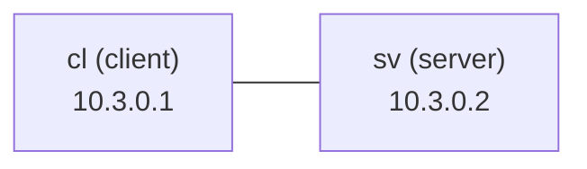
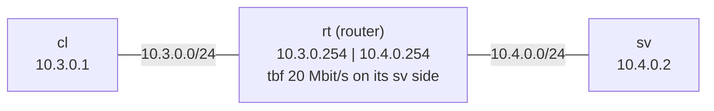
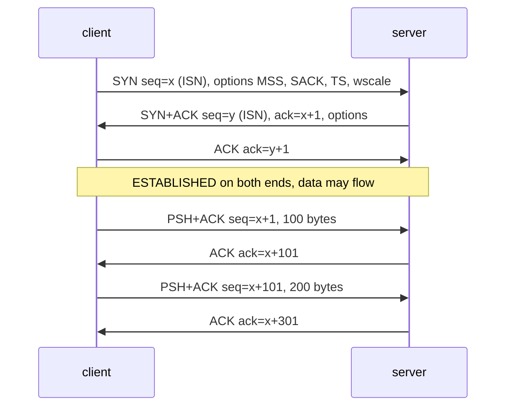
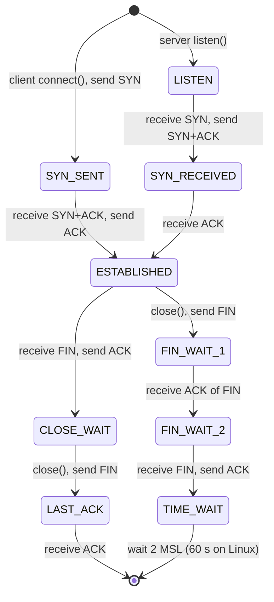
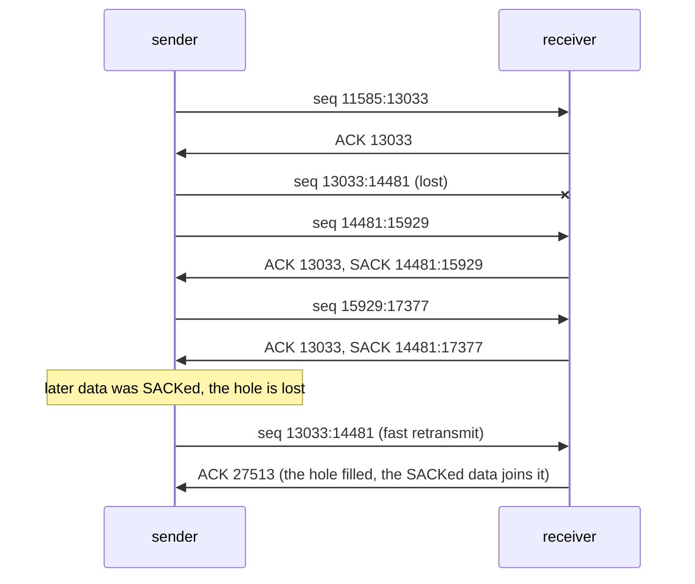
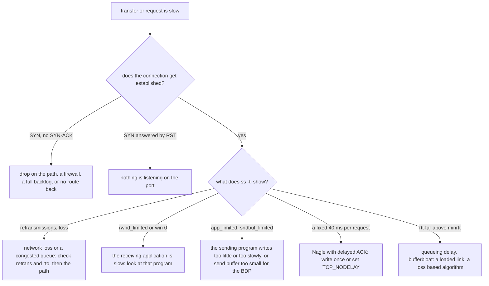

# NET 03: TCP, UDP and the transport layer

*Part of the [networking plan](00_plan.md) · Time: about 7 hours · You need: [NET 02](02_ip_routing_and_layer3.md) (IP, ICMP, MTU, NAT), [LX 08](../06_linux/08_linux_networking_toolbox.md) (network namespaces, `ip`, `ss`, `tcpdump`, `nft`), [OS 17](../05_operating_systems/00_plan.md) (sockets and system calls). This tutorial follows one connection from the first SYN to the last ACK: ports and sockets, UDP, the TCP header and handshake, the state machine, loss and retransmission, flow control, congestion control, Nagle and delayed ACK, connections at scale, dead peers, retries with backoff and jitter, and how to read `ss -ti`. Each mechanism is run on a small lab of network namespaces, so you can rebuild all of it.*

IP delivers a packet to a host, or does not. The transport layer turns that into something an application can use: **a port** (which program on the host), and for TCP **a byte stream that arrives complete, in order and at a rate the network and the receiver can take**. Almost every systems interview has a transport question in it: what happens in the handshake, why `TIME_WAIT` exists, why a request takes 40 ms, how TCP finds the right sending rate, why a connection to a dead host hangs for fifteen minutes, how to retry without making an outage worse. This tutorial answers each with a measurement you can repeat.

**Eight honest limits, stated first.**

1. Everything is measured on **one Linux 6.18 VM** (Firecracker, 2 vCPUs) as **root**, over **`veth` pairs between network namespaces**, with iproute2 6.1.0, tcpdump 4.99.4, `nft` and `ethtool`. There is **no NIC and no wire**, so the round trip time is **0.02 to 0.1 ms** and **there is no propagation delay at all**.
2. **The kernel has no `netem`.** I could not add delay, jitter or reordering. Loss comes from **`nft` drop rules** and from a **token bucket filter (`tbf`) bottleneck**. So everything that depends on a long round trip (the bandwidth delay product, window limited throughput, how slow start scales with RTT) is **computed** in section 6 and in Problem E, **not measured**. The congestion control runs of section 7 see round trips of **6 to 11 ms**, which is queueing delay in a 30 KB buffer.
3. **Segmentation offload is switched off** on the lab links (`tso off gso off gro off`, in `lab.sh`). With it on, `tcpdump` shows 7240 byte "packets", which are several segments the kernel has not yet cut. Checksum offload stays on, so `tcpdump -v` prints `cksum ... (incorrect)` for TCP, as in NET 02.
4. **Congestion control results are single runs of 8 MB over a 20 Mbit/s bottleneck**, 3.4 seconds each. They show the *shape* of each algorithm (a sawtooth, a lower queue). They do not rank the algorithms for real networks, where RTT, loss and competing flows decide. This VM's default congestion control is **BBR** (`cubic` and `reno` are selected per socket).
5. **The timer values are Linux 6.18's**: minimum RTO 200 ms, delayed ACK 40 ms, `TIME_WAIT` 60 s, SYN retries spaced 1 s for the first five. Other systems differ (Windows and BSD in particular), and older Linux kernels back off the SYN in 1, 2, 4 seconds.
6. **QUIC, TCP Fast Open, MPTCP and SCTP are not run.** Section 13 covers them **from memory and the RFCs**, marked as such.
7. **Random values change from run to run**: source ports, initial sequence numbers, timestamps, and the pattern of Problem A's random drops. The *structure* of each output is what to read. The loss rule of `e1_udp` is a counter, so its 6 of 20 is exact.
8. **Names and addresses are those of the labs**: `cl` (client) and `sv` (server) on `10.3.0.0/24`; a three namespace chain `cl`, `rt` (router) and `sv` for the bottleneck, on `10.3.0.0/24` and `10.4.0.0/24`. Interface names have two or more letters (iproute2 reads a one letter name as a keyword, NET 02).

By the end you can:

- explain **ports and demultiplexing** and show it (measured: two UDP sockets on ports **5001** and **5002** each got only their own datagrams, **three sends of 10, 20 and 30 bytes arrived as three datagrams**, and a send to a closed port came back as **ICMP port unreachable**, which a connected socket reports as **`Connection refused`**);
- read a **TCP handshake and teardown** in `tcpdump` and compute the sequence and acknowledgement numbers (measured: SYN options **MSS 1460, SACK, timestamps, window scale 10**; a 100 byte and a 200 byte write ended at sequence **301**, the FIN **consumed one number**, so its ACK said **302**);
- name the **TCP state** of each end at each moment and say why (measured: **ESTABLISHED**, then **FIN-WAIT-2** on the side that closed and **CLOSE-WAIT** on the other, then **TIME-WAIT** with a timer of **59 seconds**);
- tell **refused from filtered** from **overflowing** (measured: a closed port answered with **RST at once**; a firewall drop made the client wait the **full 3 seconds**; a listener with backlog 1 that never called `accept` admitted **2** connections and **dropped 4** SYNs);
- explain **RTO and its doubling** and **fast retransmit** (measured: a lost segment was resent after **0.2 s (a probe), then 0.4, 0.8, 1.7, 3.3 and 6.7 seconds** (each gap double the last); a SYN was resent at **1, 2, 3, 4 and 5 seconds, then 7**; one lost segment in a 40,000 byte transfer was repaired in **under a millisecond** by SACK, with **no timeout**);
- explain **flow control** (measured: a receiver that stopped reading drove the advertised window **7240, 6240, 2896, 1448, 0**; the sender then sent **zero window probes at 0.35, 0.80, 1.69 and 3.45 seconds**; the sender could push only **18,000 bytes** before `send` would block);
- explain **congestion control** with a trace (measured: over a **20 Mbit/s** bottleneck with a 30 KB queue, all three algorithms reached **19.0 Mbit/s**; Reno's window swung between **10 and 20 segments**, CUBIC's backed off to **14**, which is **0.7 of 20**, and BBR held **10** with the lowest queue, **about 6 ms** against 8 to 11 ms; the router dropped **57, 26 and 157** segments);
- diagnose the **40 ms request** (measured: a request written as a 4 byte header and a 96 byte body took **41.8 ms** on average; with `TCP_NODELAY` or one write, **0.05 ms** or less);
- explain **`TIME_WAIT`**, **port exhaustion** and **`Address already in use`** (measured: with **50** local ports the **51st** connection failed with `Cannot assign requested address`; `tcp_tw_reuse` let **100** through; a server restart failed to bind until **both** the old and the new server had set `SO_REUSEADDR`);
- set up **keepalive, `TCP_USER_TIMEOUT` and retries** and say how long a dead peer takes to detect (measured: keepalive with 1 s, 1 s and 3 probes gave `ETIMEDOUT` **3.6 s** after the silence; a 3 s user timeout, **3.7 s**; the kernel default **15 retries is 924.6 seconds, about 15 minutes**, computed, and the computed formula agreed with a measured run at 5 retries, **12.6 s computed, 13.5 s measured**);
- design **retries with exponential backoff and jitter** (measured by simulation: 1000 clients retrying after a 5 s outage sent **1000 requests in one 100 ms window** with a fixed delay and **26** with full jitter, and **30,500** requests in all against **3,935**);
- read **`ss -ti`** and **`TCP_INFO`** and use a **triage** order for a slow or stuck connection.

**Where the numbers come from.** Eleven experiment scripts (`e1` to `e11`; `e10` is a Python simulation) and five problem-answer scripts were run in this session; the scripts are in this tutorial's `prog/` folder. Transcripts print `$ command` before each command's output, and `nse NS cmd` means `ip netns exec NS cmd`. Numbers not from these runs are marked "from memory" or come from a source listed at the end.

**Data and timing.** No data sets. The labs are built in about a second by the shell functions of section 1.4. Most experiments take 3 to 15 seconds; `e4_loss` takes about 25 seconds (it waits for retransmission timers), `e8_timewait` and `e9_dead_peer` about 10 seconds each. The bottleneck runs move 8 MB in 3.4 seconds. All timings are single runs.

---

## 1. Ports, sockets and the transport layer

### 1.1 What IP does not give you

IP addresses a **host**. A host runs many programs, and a program may talk to many peers at once. IP also loses, duplicates and reorders packets, and it gives no feedback on how fast to send. The transport layer adds, on top of IP:

| Service | UDP | TCP |
| --- | --- | --- |
| Which program (port numbers) | yes | yes |
| Detects corrupted data (checksum) | yes (optional over IPv4) | yes |
| Message boundaries kept | **yes** | no: a byte stream |
| Delivery guaranteed, no loss | no | yes (retransmission) |
| In order | no | yes |
| Connection set up and torn down | no | yes (handshake, FIN) |
| Sender slowed to the receiver (flow control) | no | yes |
| Sender slowed to the network (congestion control) | no | yes |

The rest of the tutorial is how TCP buys the right-hand column, what it costs, and when UDP's empty left column is the better deal.

### 1.2 Ports, the 5-tuple and demultiplexing

A **port** is a 16 bit number in the UDP or TCP header. A server **binds** a socket to a local address and port; a client usually lets the kernel pick an **ephemeral** port (on Linux 32768 to 60999 by default, `net.ipv4.ip_local_port_range`). The kernel **demultiplexes** an arriving segment by:

- **UDP**: the destination address and port. One socket receives every datagram sent to its port, from any peer.
- **TCP**: the **5-tuple**: protocol, source address, source port, destination address, destination port. Many connections share one server port (80, 443) because their source addresses or ports differ. A `listen` socket owns the port; each `accept` returns a **new socket** for one 5-tuple.

The 5-tuple is why the numbers in section 9 matter: **a client can have only as many simultaneous connections to one server address and port as it has source ports** (per source address). Two connections with identical 5-tuples cannot exist.

Port ranges, from the IANA registry (from memory): 0 to 1023 **well-known** (needs privilege on Linux to bind), 1024 to 49151 **registered**, 49152 to 65535 **dynamic**. Linux's own ephemeral range starts lower, at 32768.

### 1.3 Sockets, briefly

The interface is the **socket** (OS 17 has the full story). The calls the rest of the tutorial uses:

```text
server:  socket()  bind(addr, port)  listen(backlog)  accept()  recv()/send()  close()
client:  socket()  [bind()]          connect(addr, port)        send()/recv()  close()
UDP:     socket()  bind()  sendto()/recvfrom()          (connect() only fixes the peer)
```

`listen(backlog)` and `accept()` are separate on purpose: **the kernel completes the TCP handshake before the program calls `accept`**, and parks finished connections in a queue (section 4.4 measures its size).

### 1.4 The labs

Two namespaces joined by a `veth` pair for UDP and the single-link TCP experiments (`lab.sh`), a three namespace chain with a router for the bottleneck (`lab3.sh`), and the two helper functions every script uses (`h.sh`).



```bash
show() { local cmd=$1; shift; printf '$ %s\n' "$cmd"; eval "$cmd" 2>&1; }
nse() { local ns=$1; shift; ip netns exec "$ns" "$@"; }
```

```bash
. prog/h.sh
cleanup() { for n in cl sv; do ip netns del $n 2>/dev/null; done; }
trap cleanup EXIT; cleanup
for n in cl sv; do ip netns add $n; done
ip link add cle netns cl type veth peer name sve netns sv
nse cl sh -c 'ip addr add 10.3.0.1/24 dev cle; ip link set cle up; ip link set lo up'
nse sv sh -c 'ip addr add 10.3.0.2/24 dev sve; ip link set sve up; ip link set lo up'
for n in cl sv; do nse $n ethtool -K $([ $n = cl ] && echo cle || echo sve) tso off gso off gro off >/dev/null 2>&1; done
cap() { local f=$1 flt=$2 secs=${3:-4}; (sleep 0.3; nse sv timeout $secs tcpdump -nn --immediate-mode -U -p -w $f -i sve $flt >/dev/null 2>&1) & sleep 0.6; }
```



```bash
. prog/h.sh
cleanup() { for n in cl rt sv; do ip netns del $n 2>/dev/null; done; }
trap cleanup EXIT; cleanup
for n in cl rt sv; do ip netns add $n; done
ip link add cle netns cl type veth peer name rtw netns rt
ip link add rte netns rt type veth peer name sve netns sv
nse cl sh -c 'ip addr add 10.3.0.1/24 dev cle; ip link set cle up; ip route add default via 10.3.0.254'
nse rt sh -c 'ip addr add 10.3.0.254/24 dev rtw; ip addr add 10.4.0.254/24 dev rte; ip link set rtw up; ip link set rte up; sysctl -qw net.ipv4.ip_forward=1'
nse sv sh -c 'ip addr add 10.4.0.2/24 dev sve; ip link set sve up; ip route add default via 10.4.0.254'
for p in cl:cle rt:rtw rt:rte sv:sve; do nse ${p%:*} ethtool -K ${p#*:} tso off gso off gro off >/dev/null 2>&1; done
```

`cap FILE FILTER SECONDS` starts a `tcpdump` in the server namespace and writes a file that the script reads back afterwards. Note where it captures: **before the netfilter hooks**. A packet that an `nft` rule later drops still appears in the capture; that is why section 5.4 can show a segment arriving whose loss is visible only in the ACKs.

---

## 2. UDP

### 2.1 The datagram

UDP is IP plus ports plus a checksum. The whole header is **8 bytes**:

```text
   0                   1                   2                   3
   0 1 2 3 4 5 6 7 8 9 0 1 2 3 4 5 6 7 8 9 0 1 2 3 4 5 6 7 8 9 0 1
  +-------------------------------+-------------------------------+
  |          Source Port          |       Destination Port        |
  +-------------------------------+-------------------------------+
  |            Length             |           Checksum            |
  +-------------------------------+-------------------------------+
  |                          data ...                             |
```

The **length** is header plus data. The **checksum** is the Internet checksum of NET 02 section 6, over a **pseudo header** (source address, destination address, protocol, UDP length) plus the UDP header and data. The pseudo header is why a NAT box that rewrites an address must fix the UDP and TCP checksums too (NET 02, Problem D). Over IPv4 a zero checksum means "none"; over IPv6 it is mandatory (RFC 8200, from memory).

What UDP **does not** do is the list that matters: no connection, no retransmission, no ordering, no congestion control, no flow control. A datagram is one IP packet (up to the MTU, or fragmented by IP, which NET 02 section 8 warned against). The sender hears nothing back except an ICMP error when it gets one.

### 2.2 UDP in the lab

`e1_udp.sh` starts two echo servers, on ports 5001 and 5002, and sends to them.

```bash
. prog/lab.sh
nse sv python3 -u prog/udp_echo.py 5001 > /tmp/u1.log 2>&1 &
nse sv python3 -u prog/udp_echo.py 5002 > /tmp/u2.log 2>&1 &
sleep 0.6
echo "--- 1. two sockets, two ports: the port number picks the process"
show "nse cl python3 prog/udp_send.py 5001 10"
show "nse cl python3 prog/udp_send.py 5002 20"
echo "--- 2. message boundaries survive: three sends of 10, 20 and 30 bytes arrive as three datagrams"
show "nse cl python3 prog/udp_send.py 5001 10 20 30"
sleep 0.3
cat /tmp/u1.log
echo "--- 3. the sockets the server holds (one per port, no connection state)"
show "nse sv ss -uanp | sed -E 's/users:\(\(\"python3\",pid=[0-9]+,fd=[0-9]+\)\)/python3/'"
echo "--- 4. nobody on port 5003: the host answers with ICMP port unreachable"
cat > /tmp/closed.py <<'PY'
import socket
s = socket.socket(socket.AF_INET, socket.SOCK_DGRAM)
s.settimeout(1)
s.connect(("10.3.0.2", 5003))
s.send(b"x")
try:
    s.recv(10)
except OSError as e:
    print("connected UDP socket: %s" % e.strerror)
PY
cap /tmp/e1.pcap icmp 2
show "nse cl python3 /tmp/closed.py"
sleep 2
show "tcpdump -nn -r /tmp/e1.pcap 2>/dev/null | sed -E 's/^[0-9:.]+ //'"
echo "--- 5. 3 of every 10 packets arriving at the server are dropped: UDP does not retry, the application must"
nse sv nft add table ip lossy
nse sv nft add chain ip lossy in '{ type filter hook input priority 0; }'
nse sv nft add rule ip lossy in udp dport 5001 numgen inc mod 10 lt 3 drop
for i in $(seq 1 20); do nse cl python3 prog/udp_send.py 5001 10; done | sort | uniq -c
kill %1 %2 2>/dev/null
```

```bash
import socket, sys
s = socket.socket(socket.AF_INET, socket.SOCK_DGRAM)
s.bind(("10.3.0.2", int(sys.argv[1])))
while True:
    data, peer = s.recvfrom(2000)
    print("port %s got %d bytes from %s:%d" % (sys.argv[1], len(data), peer[0], peer[1]), flush=True)
    s.sendto(data[:5].upper(), peer)
```

```bash
import socket, sys
s = socket.socket(socket.AF_INET, socket.SOCK_DGRAM)
s.settimeout(1)
port = int(sys.argv[1])
for size in sys.argv[2:]:
    s.sendto(b"a" * int(size), ("10.3.0.2", port))
for _ in sys.argv[2:]:
    try:
        print("reply %s from port %d" % (s.recvfrom(100)[0].decode(), port))
    except socket.timeout:
        print("no reply from port %d" % port)
        break
```

```text
--- 1. two sockets, two ports: the port number picks the process
$ nse cl python3 prog/udp_send.py 5001 10
reply AAAAA from port 5001
$ nse cl python3 prog/udp_send.py 5002 20
reply AAAAA from port 5002
--- 2. message boundaries survive: three sends of 10, 20 and 30 bytes arrive as three datagrams
$ nse cl python3 prog/udp_send.py 5001 10 20 30
reply AAAAA from port 5001
reply AAAAA from port 5001
reply AAAAA from port 5001
port 5001 got 10 bytes from 10.3.0.1:33765
port 5001 got 10 bytes from 10.3.0.1:54377
port 5001 got 20 bytes from 10.3.0.1:54377
port 5001 got 30 bytes from 10.3.0.1:54377
--- 3. the sockets the server holds (one per port, no connection state)
$ nse sv ss -uanp | sed -E 's/users:\(\("python3",pid=[0-9]+,fd=[0-9]+\)\)/python3/'
State  Recv-Q Send-Q Local Address:Port Peer Address:PortProcess
UNCONN 0      0           10.3.0.2:5001      0.0.0.0:*    python3
UNCONN 0      0           10.3.0.2:5002      0.0.0.0:*    python3
--- 4. nobody on port 5003: the host answers with ICMP port unreachable
$ nse cl python3 /tmp/closed.py
connected UDP socket: Connection refused
$ tcpdump -nn -r /tmp/e1.pcap 2>/dev/null | sed -E 's/^[0-9:.]+ //'
IP 10.3.0.2 > 10.3.0.1: ICMP 10.3.0.2 udp port 5003 unreachable, length 37
--- 5. 3 of every 10 packets arriving at the server are dropped: UDP does not retry, the application must
      6 no reply from port 5001
     14 reply AAAAA from port 5001
```

- **Part 1**: each datagram reached the server **bound to its port**, and no other. The destination port is the whole demultiplexing key.
- **Part 2**: three `sendto` calls of 10, 20 and 30 bytes arrived as **three separate datagrams** of 10, 20 and 30 bytes. **UDP keeps message boundaries**, which TCP does not (section 3.5). The first line of the server log is the earlier send from part 1; the three that follow come from one client socket, with one source port.
- **Part 3**: `ss -uan` shows two sockets in state `UNCONN` with no peer. A UDP server holds **no per-client state**, which is why one socket can serve a million clients, and why a UDP server has no idea whether a client is still there.
- **Part 4**: nothing listens on port 5003. The host sent **ICMP destination unreachable, port unreachable** (NET 02 section 5). The sending program had called `connect` on its UDP socket, which tells the kernel to accept errors for that peer, and its `recv` failed with **`Connection refused`**. An **unconnected** UDP socket would not have seen the error (from memory of `udp(7)`).
- **Part 5**: with a counter rule dropping 3 of every 10 packets at the server, **6 of 20** one-shot requests got no reply. **Nobody retries for you.** Problem A writes the retry loop, and section 11 says how to write it so that it helps instead of hurting.

### 2.3 When UDP is the right choice

- **Small request, small reply, the application can retry**: DNS (a lookup is one datagram each way; a retry is cheaper than a handshake).
- **Latency matters more than completeness**: voice and video (RTP), games, telemetry. An old packet is useless, so retransmitting it is waste.
- **You want to build your own transport**: QUIC (section 13) runs over UDP precisely because UDP is the one transport that middleboxes pass and that user space can implement freely.
- **Multicast and broadcast**: TCP is point to point (NET 02 section 9).

The costs of choosing UDP: you write reliability, ordering, pacing and congestion control yourself, **and you must still be a good citizen**: a UDP sender that ignores congestion takes bandwidth from TCP flows (RFC 8085, from memory, says UDP applications should implement congestion control).

---

## 3. TCP: the segment, the handshake, the numbers

### 3.1 The header

TCP's job needs more fields. The header is **20 bytes** plus options:

```text
   0                   1                   2                   3
   0 1 2 3 4 5 6 7 8 9 0 1 2 3 4 5 6 7 8 9 0 1 2 3 4 5 6 7 8 9 0 1
  +-------------------------------+-------------------------------+
  |          Source Port          |       Destination Port        |
  +-------------------------------+-------------------------------+
  |                        Sequence Number                        |
  +---------------------------------------------------------------+
  |                    Acknowledgment Number                      |
  +-------+-----+-+-+-+-+-+-+-+-+-+-------------------------------+
  |  Data |     |C|E|U|A|P|R|S|F|          Window Size           |
  | Offset| Rsv |W|E|R|C|S|S|Y|I|                                |
  |       |     |R|C|G|K|H|T|N|N|                                |
  +-------+-----+-+-+-+-+-+-+-+-+-------------------------------+
  |           Checksum            |         Urgent Pointer        |
  +-------------------------------+-------------------------------+
  |                    Options (up to 40 bytes)                   |
```

- **Sequence number**: the number of the first **data byte** in this segment. TCP numbers **bytes**, not segments.
- **Acknowledgement number** (valid when ACK is set): the next byte the sender of this segment **expects**. Everything before it has arrived. This is a **cumulative** acknowledgement.
- **Data offset**: header length in 4 byte words, like IHL.
- **Flags**: **SYN** (open, carries the initial sequence number), **ACK**, **FIN** (done sending), **RST** (abort), **PSH** (deliver now; `tcpdump` shows `P`), URG (almost unused), **ECE** and **CWR** (explicit congestion notification).
- **Window**: how many more bytes the sender of this segment is **willing to receive** (flow control, section 6). It is scaled by a shift negotiated in the handshake.
- **Checksum**: over a pseudo header (as for UDP), the header and the data. Mandatory.

### 3.2 The options that matter

All appear in the SYN of `e2_handshake` below.

| Option | Meaning | Why it exists |
| --- | --- | --- |
| **MSS** | Maximum segment size: the largest data the sender will receive in one segment | Set from the interface MTU minus 40 (1500 minus 20 minus 20 is **1460**). The MSS clamp of NET 02 section 8 rewrites it. |
| **SACK permitted**, then **SACK blocks** | The receiver may report ranges it holds beyond a gap | Selective retransmission (section 5.3) |
| **Timestamps** (TSval, TSecr) | Each segment carries the sender's clock and echoes the peer's | A round trip time sample for every ACK; protection against old duplicates (PAWS); makes `tcp_tw_reuse` safe |
| **Window scale** | A shift count `n`: the window field means `window << n` | The field is 16 bits, so without scaling the window tops out at **65,535 bytes** (section 6.3) |

Options are only negotiated in the **SYN** and **SYN-ACK**: each side offers, and a feature is used only if both offered it. This is why a middlebox that strips options from SYNs quietly cripples a connection.

### 3.3 The three-way handshake

`e2_handshake.sh` opens one connection, writes 100 bytes and then 200 bytes, and closes. The server program accepts, reads to end of file, then **waits two seconds before closing**, so that the half-closed states can be observed. The capture is taken at the server.

```bash
. prog/lab.sh
echo "--- 1. a listening socket"
nse sv python3 -u prog/tcp_srv.py 9000 2 > /tmp/s2.log 2>&1 &
sleep 0.5
show "nse sv ss -tln"
cap /tmp/e2.pcap 'tcp port 9000' 6
echo "--- 2. one connection: connect, send 100 bytes, send 200 bytes, close; the state of each end along the way"
nse cl python3 prog/tcp_cli.py 9000 &
sleep 0.2
show "nse cl ss -tan"
sleep 0.9
echo "(client has closed, the server has not)"
show "nse cl ss -tan"
show "nse sv ss -tan"
sleep 2.3
echo "(server has closed too)"
show "nse cl ss -tan"
show "nse sv ss -tan"
sleep 2
cat /tmp/s2.log
echo "--- 3. the packets (tcpdump shows the SYNs with absolute numbers and the rest relative to them)"
show "tcpdump -nn -r /tmp/e2.pcap 2>/dev/null | sed -E 's/^[0-9:.]+ //; s/ IP //'"
echo "--- 4. the same capture with absolute numbers (-S): the data and the closing packets"
show "tcpdump -nn -S -r /tmp/e2.pcap 2>/dev/null | sed -E 's/^[0-9:.]+ IP //; s/, options.*,/,/; s/options.*//; s/10\\.3\\.0\\.//g'"
```

```bash
import socket, sys, time
s = socket.socket()
s.setsockopt(socket.SOL_SOCKET, socket.SO_REUSEADDR, 1)
s.bind(("10.3.0.2", int(sys.argv[1])))
s.listen(5)
c, peer = s.accept()
n = 0
while True:
    d = c.recv(65536)
    if not d:
        break
    n += len(d)
print("server: peer closed after %d bytes, holding the socket for %s s" % (n, sys.argv[2]), flush=True)
time.sleep(float(sys.argv[2]))
c.close()
print("server: closed", flush=True)
```

```bash
import socket, sys, time
s = socket.socket()
s.connect(("10.3.0.2", int(sys.argv[1])))
s.sendall(b"a" * 100)
time.sleep(0.3)
s.sendall(b"b" * 200)
time.sleep(0.3)
s.close()
```

```text
--- 1. a listening socket
$ nse sv ss -tln
State  Recv-Q Send-Q Local Address:Port Peer Address:PortProcess
LISTEN 0      5           10.3.0.2:9000      0.0.0.0:*
--- 2. one connection: connect, send 100 bytes, send 200 bytes, close; the state of each end along the way
$ nse cl ss -tan
State Recv-Q Send-Q Local Address:Port  Peer Address:PortProcess
ESTAB 0      0           10.3.0.1:57398     10.3.0.2:9000
(client has closed, the server has not)
$ nse cl ss -tan
State      Recv-Q Send-Q Local Address:Port  Peer Address:PortProcess
FIN-WAIT-2 0      0           10.3.0.1:57398     10.3.0.2:9000
$ nse sv ss -tan
State      Recv-Q Send-Q Local Address:Port Peer Address:Port Process
LISTEN     0      5           10.3.0.2:9000      0.0.0.0:*
CLOSE-WAIT 0      0           10.3.0.2:9000     10.3.0.1:57398
(server has closed too)
$ nse cl ss -tan
State     Recv-Q Send-Q Local Address:Port  Peer Address:PortProcess
TIME-WAIT 0      0           10.3.0.1:57398     10.3.0.2:9000
$ nse sv ss -tan
State Recv-Q Send-Q Local Address:Port Peer Address:PortProcess
server: peer closed after 300 bytes, holding the socket for 2 s
server: closed
--- 3. the packets (tcpdump shows the SYNs with absolute numbers and the rest relative to them)
$ tcpdump -nn -r /tmp/e2.pcap 2>/dev/null | sed -E 's/^[0-9:.]+ //; s/ IP //'
IP 10.3.0.1.57398 > 10.3.0.2.9000: Flags [S], seq 3338286983, win 64240, options [mss 1460,sackOK,TS val 3890272740 ecr 0,nop,wscale 10], length 0
IP 10.3.0.2.9000 > 10.3.0.1.57398: Flags [S.], seq 1552558231, ack 3338286984, win 65160, options [mss 1460,sackOK,TS val 2222009408 ecr 3890272740,nop,wscale 10], length 0
IP 10.3.0.1.57398 > 10.3.0.2.9000: Flags [.], ack 1, win 63, options [nop,nop,TS val 3890272740 ecr 2222009408], length 0
IP 10.3.0.1.57398 > 10.3.0.2.9000: Flags [P.], seq 1:101, ack 1, win 63, options [nop,nop,TS val 3890272740 ecr 2222009408], length 100
IP 10.3.0.2.9000 > 10.3.0.1.57398: Flags [.], ack 101, win 64, options [nop,nop,TS val 2222009408 ecr 3890272740], length 0
IP 10.3.0.1.57398 > 10.3.0.2.9000: Flags [P.], seq 101:301, ack 1, win 63, options [nop,nop,TS val 3890273040 ecr 2222009408], length 200
IP 10.3.0.2.9000 > 10.3.0.1.57398: Flags [.], ack 301, win 64, options [nop,nop,TS val 2222009708 ecr 3890273040], length 0
IP 10.3.0.1.57398 > 10.3.0.2.9000: Flags [F.], seq 301, ack 1, win 63, options [nop,nop,TS val 3890273341 ecr 2222009708], length 0
IP 10.3.0.2.9000 > 10.3.0.1.57398: Flags [.], ack 302, win 64, options [nop,nop,TS val 2222010053 ecr 3890273341], length 0
IP 10.3.0.2.9000 > 10.3.0.1.57398: Flags [F.], seq 1, ack 302, win 64, options [nop,nop,TS val 2222012012 ecr 3890273341], length 0
IP 10.3.0.1.57398 > 10.3.0.2.9000: Flags [.], ack 2, win 63, options [nop,nop,TS val 3890275344 ecr 2222012012], length 0
--- 4. the same capture with absolute numbers (-S): the data and the closing packets
$ tcpdump -nn -S -r /tmp/e2.pcap 2>/dev/null | sed -E 's/^[0-9:.]+ IP //; s/, options.*,/,/; s/options.*//; s/10\.3\.0\.//g'
1.57398 > 2.9000: Flags [S], seq 3338286983, win 64240, length 0
2.9000 > 1.57398: Flags [S.], seq 1552558231, ack 3338286984, win 65160, length 0
1.57398 > 2.9000: Flags [.], ack 1552558232, win 63, length 0
1.57398 > 2.9000: Flags [P.], seq 3338286984:3338287084, ack 1552558232, win 63, length 100
2.9000 > 1.57398: Flags [.], ack 3338287084, win 64, length 0
1.57398 > 2.9000: Flags [P.], seq 3338287084:3338287284, ack 1552558232, win 63, length 200
2.9000 > 1.57398: Flags [.], ack 3338287284, win 64, length 0
1.57398 > 2.9000: Flags [F.], seq 3338287284, ack 1552558232, win 63, length 0
2.9000 > 1.57398: Flags [.], ack 3338287285, win 64, length 0
2.9000 > 1.57398: Flags [F.], seq 1552558232, ack 3338287285, win 64, length 0
1.57398 > 2.9000: Flags [.], ack 1552558233, win 63, length 0
```



Read the first three lines:

1. **`Flags [S], seq 3338286983`**: the client's **initial sequence number (ISN)** is random-looking, not zero. `win 64240` is its window; the options offer **MSS 1460, SACK, timestamps and window scale 10**.
2. **`Flags [S.], seq 1552558231, ack 3338286984`**: the server picks **its own ISN** and acknowledges the client's ISN **plus one**. The `.` after `S` is the ACK flag. The SYN **occupies one sequence number**, which is why the acknowledgement is `x+1`.
3. **`Flags [.], ack 1`**: the client acknowledges the server's SYN. (`tcpdump` shows **relative** numbers after the SYNs, so `ack 1` means the server's ISN plus one. Part 4 of the output, with `-S`, shows the absolute ones.)

Why a random ISN: if every connection started at zero, a delayed packet from an old connection between the same two ports could be mistaken for a new one, and an attacker who can guess the number can inject data (RFC 6528, from memory). The three way exchange is the minimum for **both sides** to agree the other's ISN and to know the other can hear them.

### 3.4 Sequence arithmetic, with the numbers from the run

The absolute numbers (part 4 of the output, `-S`), with `x` = 3338286983 as the client's ISN:

| Packet | Sequence | Length | Acknowledgement | Next expected |
| --- | --- | --- | --- | --- |
| client SYN | x | 0 (SYN counts 1) | none | x+1 = 3338286984 |
| client data 1 | x+1 = 3338286984 | 100 | | 3338287084 |
| server ACK | | | 3338287084 | |
| client data 2 | 3338287084 | 200 | | 3338287284 |
| server ACK | | | 3338287284 | |
| client FIN | 3338287284 | 0 (FIN counts 1) | | 3338287285 |
| server ACK | | | 3338287285 | |

The rule: **the next sequence number is the current one plus the data length, plus one more for a SYN and one more for a FIN**. The acknowledgement number is the next sequence number expected from the peer. Your interview drill: given a capture line `seq 101:301, ack 1, length 200`, say what the next segment from the same side starts with (**301**) and what the peer acknowledges (**301**).

**The window of numbers**: sequence numbers are **32 bits** and wrap around after 4 GiB. TCP compares them modulo 2^32, so "newer" means within half the space. At 10 Gbit/s the space wraps in **3.4 seconds**, which is why the timestamp option (PAWS) is needed to tell a wrapped old segment from a new one (from memory, RFC 7323).

### 3.5 A byte stream has no message boundaries

Part 2 of the capture shows two `send` calls (100 and 200 bytes) as two segments **because they were 0.3 s apart**. Send them back to back and the kernel may merge them into one segment, or split one into several, and the receiver's `recv(4096)` may return any prefix of what has arrived. **TCP never promises that one `send` is one `recv`.** A protocol on TCP must frame its messages itself: a length prefix, a delimiter (HTTP's blank line), or a fixed size. The commonest TCP bug in interview code is a `recv` that assumes it got the whole message (the loop in `rr_srv.py` below reads until it has 100 bytes for exactly this reason).

### 3.6 Closing: FIN, half-close, RST

The last six lines of part 3:

1. client `[F.]`: "**I have no more data to send.**" (A FIN is a one-way close.)
2. server `[.] ack 302`: the FIN is acknowledged at once, by the kernel, without the program doing anything.
3. server `[F.]`, **about two seconds later**: the server program called `close`. Each direction is closed **separately**: this is the **four way close**, usually seen as three packets when the ACK and FIN are sent together.
4. client `[.] ack 2`: the final ACK.

Between steps 2 and 3 the connection is **half-closed**: the client can still **receive** (a program calls `shutdown(SHUT_WR)` to send its FIN and keep reading, which is how a client says "that was the whole request" and waits for the reply). An **RST** is different: it **aborts** immediately, discards queued data and is not acknowledged. A program that closes a socket with unread data in its receive queue sends RST instead of FIN (from memory, a known source of lost last responses).

---

## 4. The state machine

### 4.1 The states

TCP's behaviour is a finite state machine (RFC 9293, from memory). The path of a normal connection:



(`FIN_WAIT_1` to `CLOSING` and `TIME_WAIT` when both sides close at once is omitted.)

### 4.2 The states in the run

Part 2 of `e2_handshake` printed `ss -tan` on both ends at four moments:

- **LISTEN** (part 1): `Recv-Q 0, Send-Q 5`. For a listening socket `Send-Q` is the **backlog** passed to `listen` (5 in `tcp_srv.py`); `Recv-Q` is how many finished connections wait for `accept` (section 4.4).
- **ESTAB** on the client while the server held the connection.
- After the client closed: the client in **FIN-WAIT-2** ("my FIN was acknowledged, waiting for the peer's FIN") and the server in **CLOSE-WAIT** ("the peer closed; **my program has not yet called `close`**").
- After the server closed: the client in **TIME-WAIT**; the server's entry **gone**.

Two diagnostic rules follow, and interviewers like them:

- **Many `CLOSE-WAIT` sockets on a server** mean **the application is not closing connections**: the peer has hung up and your program never called `close`. It is a **leak in your code**, not a network problem, and the kernel will keep them forever.
- **Many `TIME-WAIT` sockets** are normal on the side that closes first; they cost memory and, on a client, ports (section 9).

### 4.3 Why TIME_WAIT exists

The side that sends the **first FIN** (the **active closer**) ends in TIME-WAIT, and stays there for **2 MSL**, **60 seconds on Linux** (the `timer:(timewait,59sec,0)` in section 9's output). Two reasons:

1. **The last ACK may be lost.** If the server's FIN is retransmitted because the final ACK never arrived, the client must still be there to acknowledge it again. Without the wait the client's reply would be an RST, and the server would see an **error on a connection that completed**.
2. **Old duplicates must expire.** A delayed segment from this 5-tuple, still wandering the network, must not be accepted by a **new connection with the same 5-tuple**. Waiting twice the maximum segment lifetime guarantees the old ones are gone.

It is a protection, not a bug, and the answer to "can we just turn it off?" is: for a client with many connections, reuse is allowed by `tcp_tw_reuse` **only when timestamps make an old duplicate detectable** (section 9.3). Setting `tcp_tw_recycle` was once the fashionable wrong answer; it **broke clients behind NAT** and was **removed in Linux 4.12** (from memory).

**Who closes first** therefore decides who carries the TIME-WAIT cost. A server that closes every connection itself (as plain HTTP/1.0 did) accumulates TIME-WAIT entries; a client that closes first moves them to itself.

### 4.4 Refused, filtered, overflowing

`e3_reset_backlog.sh` shows three ways a connection attempt fails, because the symptom (the time it takes, the error) names the cause.

```bash
. prog/lab.sh
echo "--- 1. connect to a port nobody listens on: the host answers the SYN with RST"
cap /tmp/e3a.pcap 'tcp port 9999' 3
show "nse cl python3 prog/tcp_conn.py 9999 5"
sleep 2.5
show "tcpdump -nn -r /tmp/e3a.pcap 2>/dev/null | sed -E 's/^[0-9:.]+ IP //; s/, options.*,/,/; s/10\\.3\\.0\\.//g'"
echo "--- 2. the same port, but a firewall drops the SYN: no answer, the client waits"
nse sv nft add table ip fw
nse sv nft add chain ip fw in '{ type filter hook input priority 0; }'
nse sv nft add rule ip fw in tcp dport 9999 drop
show "nse cl python3 prog/tcp_conn.py 9999 3"
nse sv nft delete table ip fw
echo "--- 3. a listener with backlog 1 that never calls accept: how many connections does it take?"
nse sv python3 prog/tcp_backlog.py 1 &
sleep 0.5
for i in 1 2 3 4; do nse cl python3 prog/tcp_conn.py 9100 1.5; done
show "nse sv ss -tan 'sport = :9100'"
show "nse sv ss -tln 'sport = :9100'"
show "nse sv nstat -az TcpExtListenOverflows TcpExtListenDrops"
echo "--- 4. the knobs (from the kernel, current values)"
show "nse sv sysctl net.ipv4.tcp_syncookies net.core.somaxconn net.ipv4.tcp_max_syn_backlog net.ipv4.tcp_abort_on_overflow"
kill %1 2>/dev/null
```

```bash
import socket, sys, time
t = time.time()
s = socket.socket()
s.settimeout(float(sys.argv[2]))
try:
    s.connect(("10.3.0.2", int(sys.argv[1])))
    print("connected after %.2f s" % (time.time() - t))
except OSError as e:
    print("connect failed after %.2f s: %s" % (time.time() - t, e.strerror or "timed out"))
```

```bash
import socket, sys, time
s = socket.socket()
s.bind(("10.3.0.2", 9100))
s.listen(int(sys.argv[1]))
time.sleep(12)
```

```text
--- 1. connect to a port nobody listens on: the host answers the SYN with RST
$ nse cl python3 prog/tcp_conn.py 9999 5
connect failed after 0.00 s: Connection refused
$ tcpdump -nn -r /tmp/e3a.pcap 2>/dev/null | sed -E 's/^[0-9:.]+ IP //; s/, options.*,/,/; s/10\.3\.0\.//g'
1.53774 > 2.9999: Flags [S], seq 222477488, win 64240, length 0
2.9999 > 1.53774: Flags [R.], seq 0, ack 222477489, win 0, length 0
--- 2. the same port, but a firewall drops the SYN: no answer, the client waits
$ nse cl python3 prog/tcp_conn.py 9999 3
connect failed after 3.00 s: timed out
--- 3. a listener with backlog 1 that never calls accept: how many connections does it take?
connected after 0.00 s
connected after 0.00 s
connect failed after 1.50 s: timed out
connect failed after 1.50 s: timed out
$ nse sv ss -tan 'sport = :9100'
State      Recv-Q Send-Q Local Address:Port Peer Address:Port Process
LISTEN     2      1           10.3.0.2:9100      0.0.0.0:*
CLOSE-WAIT 1      0           10.3.0.2:9100     10.3.0.1:40154
CLOSE-WAIT 1      0           10.3.0.2:9100     10.3.0.1:40138
$ nse sv ss -tln 'sport = :9100'
State  Recv-Q Send-Q Local Address:Port Peer Address:PortProcess
LISTEN 2      1           10.3.0.2:9100      0.0.0.0:*
$ nse sv nstat -az TcpExtListenOverflows TcpExtListenDrops
#kernel
TcpExtListenOverflows           4                  0.0
TcpExtListenDrops               4                  0.0
--- 4. the knobs (from the kernel, current values)
$ nse sv sysctl net.ipv4.tcp_syncookies net.core.somaxconn net.ipv4.tcp_max_syn_backlog net.ipv4.tcp_abort_on_overflow
net.ipv4.tcp_syncookies = 1
net.core.somaxconn = 4096
net.ipv4.tcp_max_syn_backlog = 512
net.ipv4.tcp_abort_on_overflow = 0
```

- **Part 1, refused**: a SYN to a port with no listener is answered **at once** by **`RST+ACK`** (`Flags [R.]`, `win 0`). The client's error is `Connection refused` after **0.00 s**. Meaning: the host is up and reachable and **nothing is listening**.
- **Part 2, filtered**: a firewall rule **drops** the SYN silently. The client sees nothing and waits the whole **3.00 seconds** of its own timeout (the kernel would keep retrying the SYN for minutes, section 5.5). Meaning: **something on the path discards packets**. A firewall that **rejects** (sends an RST or ICMP) instead makes a fast failure, which is kinder to clients.
- **Part 3, overflowing**: `listen(1)` and a program that never calls `accept`. The first **two** connections completed (the kernel queue holds `backlog + 1`), and the next two **timed out**: their SYNs were dropped. `ss` shows `Recv-Q 2, Send-Q 1` for the listener: **2 finished connections waiting, capacity 1**. `nstat` counts **`TcpExtListenOverflows` 4** and **`TcpExtListenDrops` 4**: each of the two clients sent its SYN twice within the 1.5 s (the first and its 1 s retransmission) and both were dropped. (The two `CLOSE-WAIT` entries are the connections whose client program had already exited, with the FIN waiting unread in the queue.)
- **Part 4, the knobs**: `somaxconn` (4096 here) is the ceiling on any `listen` backlog. `tcp_max_syn_backlog` bounds **half-open** connections (SYN received, handshake not finished). `tcp_syncookies = 1` makes the kernel **encode the connection state in the SYN-ACK's sequence number** when the half-open queue is full, so a **SYN flood** cannot exhaust memory, at the price of dropping options such as window scale for those connections (from memory).

**Two queues**, which interviewers confuse: the **SYN queue** (half-open connections) and the **accept queue** (established connections waiting for the program). A slow `accept` loop fills the accept queue; a flood of spoofed SYNs fills the SYN queue.

**I met the accept queue by accident.** My first `e8_timewait` run (section 9) took **13 seconds for 100 connections** because the test server called `listen(5)` in a slow Python loop, the client connected faster than the server accepted, and **every seventh connection hit a full queue** and waited out a **1 second SYN retransmission**. A capture showed bursts of about seven SYNs answered, then a gap of 1.0 second. With `listen(128)` the 100 connections took a fraction of a second. **A small backlog turns a burst into one-second stalls.**


---

## 5. Reliability: acknowledgements, timers and retransmission

### 5.1 The problem

The sender must learn that a segment was lost **using only what comes back**. TCP has two signals:

- **Silence**: no ACK for it within a timeout. This is the **retransmission timeout (RTO)**, a timer. It is always correct and always slow.
- **A pattern in the ACKs**: the receiver keeps acknowledging the **same** number because the next expected segment has not arrived, while later segments do. These are **duplicate ACKs** (and, with SACK, ACKs that also say what *did* arrive). This is fast and can be wrong if packets are merely **reordered**.

The sender keeps every unacknowledged segment in a **retransmission queue** until a cumulative ACK covers it.

### 5.2 How long to wait: the RTO

Too short and TCP resends data that was only delayed (waste, and it feeds congestion). Too long and a loss stalls the connection. The timer tracks the **measured round trip time**. The algorithm (RFC 6298, from memory) keeps a smoothed RTT and a variance:

```text
first sample R:    SRTT = R         RTTVAR = R / 2        RTO = SRTT + 4 * RTTVAR
each new sample R: RTTVAR = 3/4 * RTTVAR + 1/4 * |SRTT - R|
                   SRTT   = 7/8 * SRTT   + 1/8 * R
                   RTO    = SRTT + 4 * RTTVAR
```

- The RFC wants a **minimum of 1 second**; **Linux uses 200 ms** (`net.ipv4.tcp_rto_min_us = 200000` in the output below), the value this VM measured.
- **Karn's algorithm**: never take an RTT sample from an ACK of a **retransmitted** segment, because you cannot tell which transmission it answers. The timestamp option removes the ambiguity: the echoed `TSecr` says which copy was acknowledged.
- **Exponential backoff**: each time the timer fires for the same segment, **double the RTO** (up to a cap of 120 s on Linux). If the network is congested, retrying at a fixed rate would add to the congestion; doubling makes the sender back off geometrically. Section 11 applies the same idea to applications.

### 5.3 Fast retransmit and SACK

When one segment of a window is lost, every later segment that arrives makes the receiver send an ACK for **the same number** (the first missing byte). The classic rule (RFC 5681, from memory): **three duplicate ACKs** mean "a segment is lost, not just late"; the sender **retransmits it at once**, without waiting for the RTO, and halves its congestion window (section 7).

A cumulative ACK says only where the first hole is. **SACK** (RFC 2018, negotiated in the SYN) adds **blocks of ranges that did arrive** beyond the hole. The sender then knows exactly which segments to resend and **does not resend ones the receiver already holds**. Linux 6.18 detects loss by **RACK-TLP** (RFC 8985, from memory): RACK marks a segment lost when a **later-sent** segment has been acknowledged and a reordering window has passed, which works better than counting three duplicates; **TLP (tail loss probe)** sends a probe when the last segments of a burst may have been lost, because no later segment will arrive to generate a duplicate ACK.

### 5.4 What it looks like: three losses

`e4_loss.sh` drops packets with `nft` rules on the server's input, in three experiments.

```bash
. prog/lab.sh
nse sv python3 -u prog/tcp_sink.py 9200 > /tmp/s4.log 2>&1 &
sleep 0.5
nse sv nft add table ip fw
nse sv nft add chain ip fw in '{ type filter hook input priority 0; }'
echo "--- 1. a lost data segment: the sender waits for the retransmission timer (RTO), and doubles it each time"
nse sv nft add rule ip fw in tcp dport 9200 meta length gt 100 drop
cap /tmp/e4a.pcap 'tcp port 9200' 7
nse cl nstat > /dev/null
nse cl python3 prog/tcp_one.py 9200 100 9 &
sleep 1.3
show "nse cl nstat TcpExtTCPLossProbes TcpExtTCPTimeouts TcpRetransSegs"
show "nse cl ss -tin 'dport = :9200' | grep -oE '(^| )(rto|backoff|retrans|unacked|cwnd):[^ ]*' | tr '\\n' ' '; echo"
sleep 2.6
nse sv nft flush chain ip fw in
sleep 3
kill %2 2>/dev/null
show "tcpdump -nn -tt -r /tmp/e4a.pcap 2>/dev/null | grep 'length 100' | awk 'NR==1{t=\$1} {printf \"%6.3f s  %s %s\\n\", \$1-t, \$7, \$9}'"
echo "--- 2. the SYN is lost for 7 seconds: when does the client retry?"
nse sv nft add rule ip fw in tcp dport 9200 tcp flags syn drop
cap /tmp/e4b.pcap 'tcp port 9200' 12
(sleep 7; nse sv nft flush chain ip fw in) &
show "nse cl python3 prog/tcp_conn.py 9200 10"
show "nse cl sysctl net.ipv4.tcp_syn_linear_timeouts net.ipv4.tcp_rto_min_us"
sleep 3
show "tcpdump -nn -tt -r /tmp/e4b.pcap 2>/dev/null | grep -E 'Flags \\[S\\]' | awk 'NR==1{t=\$1} {printf \"%6.3f s  SYN\\n\", \$1-t}'"
nse cl nstat > /dev/null
echo "--- 3. one lost segment in a bulk transfer: duplicate ACKs trigger a retransmission without waiting for the timer"
nse sv nft add rule ip fw in tcp dport 9200 meta length gt 100 numgen inc mod 20 eq 9 drop
cap /tmp/e4c.pcap 'tcp port 9200' 4
show "nse cl python3 prog/tcp_send.py 9200 40000"
sleep 1.5
show "nse cl nstat TcpRetransSegs TcpExtTCPFastRetrans TcpExtTCPTimeouts TcpExtTCPSackRecovery TcpExtTCPLossProbes"
echo "the capture (the receiver's capture sees every packet arrive, including the one its stack then drops; its ACKs show the loss):"
tcpdump -nn -tt -r /tmp/e4c.pcap 2>/dev/null | awk 'NR==1{t=$1} {$1=sprintf("%8.5f", $1-t); print}' | sed -E 's/ IP / /; s/10\.3\.0\.//g; s/, options \[nop,nop,TS val [0-9]+ ecr [0-9]+,?(nop,nop,)?/ /; s/\]//; s/Flags //; s/, win [0-9]+//' > /tmp/e4c.txt
n=$(grep -n -m1 'sack [0-9]' /tmp/e4c.txt | cut -d: -f1)
m=$(grep -n 'sack [0-9]' /tmp/e4c.txt | tail -1 | cut -d: -f1)
sed -n "$((n-3)),$((n+3))p" /tmp/e4c.txt
echo "   ... (the receiver repeats ACK 13033, each time with a longer SACK block) ..."
sed -n "$((m-1)),$((m+4))p" /tmp/e4c.txt
kill %1 2>/dev/null
```

```bash
import socket, sys, threading
s = socket.socket()
s.setsockopt(socket.SOL_SOCKET, socket.SO_REUSEADDR, 1)
s.bind(("", int(sys.argv[1])))
s.listen(128)
def handle(c, peer):
    n = 0
    while True:
        d = c.recv(65536)
        if not d:
            break
        n += len(d)
    print("sink: %d bytes from port %d" % (n, peer[1]), flush=True)
    c.close()
while True:
    c, peer = s.accept()
    threading.Thread(target=handle, args=(c, peer)).start()
```

```bash
import socket, sys, time
s = socket.socket()
s.connect(("10.3.0.2", int(sys.argv[1])))
s.sendall(b"x" * int(sys.argv[2]))
time.sleep(float(sys.argv[3]))
```

```bash
import socket, sys, time
s = socket.socket()
s.connect(("10.3.0.2", int(sys.argv[1])))
t = time.time()
s.sendall(b"x" * int(sys.argv[2]))
s.shutdown(socket.SHUT_WR)
s.recv(1)
print("client: %s bytes sent and acknowledged, took %.2f s" % (sys.argv[2], time.time() - t))
```

```text
--- 1. a lost data segment: the sender waits for the retransmission timer (RTO), and doubles it each time
$ nse cl nstat TcpExtTCPLossProbes TcpExtTCPTimeouts TcpRetransSegs
#kernel
TcpRetransSegs                  3                  0.0
TcpExtTCPTimeouts               2                  0.0
TcpExtTCPLossProbes             1                  0.0
$ nse cl ss -tin 'dport = :9200' | grep -oE '(^| )(rto|backoff|retrans|unacked|cwnd):[^ ]*' | tr '\n' ' '; echo
 rto:816  backoff:2  cwnd:1  unacked:1  retrans:1/3
$ tcpdump -nn -tt -r /tmp/e4a.pcap 2>/dev/null | grep 'length 100' | awk 'NR==1{t=$1} {printf "%6.3f s  %s %s\n", $1-t, $7, $9}'
 0.000 s  [P.], 1:101,
 0.204 s  [P.], 1:101,
 0.412 s  [P.], 1:101,
 0.844 s  [P.], 1:101,
 1.676 s  [P.], 1:101,
 3.340 s  [P.], 1:101,
 6.668 s  [P.], 1:101,
--- 2. the SYN is lost for 7 seconds: when does the client retry?
$ nse cl python3 prog/tcp_conn.py 9200 10
connected after 7.14 s
$ nse cl sysctl net.ipv4.tcp_syn_linear_timeouts net.ipv4.tcp_rto_min_us
net.ipv4.tcp_syn_linear_timeouts = 4
net.ipv4.tcp_rto_min_us = 200000
$ tcpdump -nn -tt -r /tmp/e4b.pcap 2>/dev/null | grep -E 'Flags \[S\]' | awk 'NR==1{t=$1} {printf "%6.3f s  SYN\n", $1-t}'
 0.000 s  SYN
 1.026 s  SYN
 2.050 s  SYN
 3.074 s  SYN
 4.098 s  SYN
 5.122 s  SYN
 7.138 s  SYN
--- 3. one lost segment in a bulk transfer: duplicate ACKs trigger a retransmission without waiting for the timer
$ nse cl python3 prog/tcp_send.py 9200 40000
client: 40000 bytes sent and acknowledged, took 0.00 s
$ nse cl nstat TcpRetransSegs TcpExtTCPFastRetrans TcpExtTCPTimeouts TcpExtTCPSackRecovery TcpExtTCPLossProbes
#kernel
TcpRetransSegs                  1                  0.0
TcpExtTCPSackRecovery           1                  0.0
TcpExtTCPFastRetrans            1                  0.0
the capture (the receiver's capture sees every packet arrive, including the one its stack then drops; its ACKs show the loss):
 0.00021 2.9200 > 1.46056: [., ack 13033 ], length 0
 0.00021 1.46056 > 2.9200: [P., seq 13033:14481, ack 1 ], length 1448
 0.00024 1.46056 > 2.9200: [., seq 14481:15929, ack 1 ], length 1448
 0.00025 2.9200 > 1.46056: [., ack 13033 sack 1 {14481:15929}], length 0
 0.00025 1.46056 > 2.9200: [., seq 15929:17377, ack 1 ], length 1448
 0.00026 2.9200 > 1.46056: [., ack 13033 sack 1 {14481:17377}], length 0
 0.00026 1.46056 > 2.9200: [., seq 17377:18825, ack 1 ], length 1448
   ... (the receiver repeats ACK 13033, each time with a longer SACK block) ...
 0.00027 1.46056 > 2.9200: [P., seq 26065:27513, ack 1 ], length 1448
 0.00027 2.9200 > 1.46056: [., ack 13033 sack 1 {14481:27513}], length 0
 0.00030 1.46056 > 2.9200: [., seq 13033:14481, ack 1 ], length 1448
 0.00031 2.9200 > 1.46056: [., ack 27513 ], length 0
 0.00034 1.46056 > 2.9200: [., seq 27513:28961, ack 1 ], length 1448
 0.00035 2.9200 > 1.46056: [., ack 28961 ], length 0
```

**Part 1: one data segment, every transmission dropped** (the rule drops any packet longer than 100 bytes, so the 152 byte segment never gets through). The sender's own view, captured by `ss -ti` 1.3 s after the first send, is `rto:816 backoff:2 cwnd:1 unacked:1 retrans:1/3`: the **RTO has doubled twice** from about 200 ms, `backoff:2` records it, and **`cwnd` has collapsed to 1** (a timeout is the strongest sign of trouble, so TCP restarts from one segment). The times of the sends on the wire:

| Time | What it was | Gap |
| --- | --- | --- |
| 0.000 s | the original | |
| 0.204 s | **tail loss probe**: `TcpExtTCPLossProbes` 1. With one segment in flight Linux waits about the minimum RTO (200 ms) before probing, because a delayed ACK might still arrive | 0.204 s |
| 0.412 s | **RTO fires**, the first timeout | 0.208 s |
| 0.844 s | second timeout, RTO doubled | 0.432 s |
| 1.676 s | third | 0.832 s |
| 3.340 s | fourth | 1.664 s |
| 6.668 s | fifth | 3.328 s |

`nstat` at 1.3 s agrees: **1 loss probe, 2 timeouts, 3 retransmitted segments**. From the first timeout on, each gap is about **twice the previous one**. This is why a lost packet on an otherwise idle connection costs a **visible stall of 200 ms or more**, and why repeated losses cost seconds. After the script removed the rule the next retransmission got through and the transfer completed.

**Part 2: the SYN dropped for 7 seconds.** The client resent its SYN at **1.0, 2.0, 3.1, 4.1 and 5.1 seconds, then at 7.1** (a gap of 2 s), and connected at 7.14 s when the rule was removed. The first retransmission timer for a SYN is **1 second** (nobody has an RTT estimate yet). Linux 6.7 and later keeps the spacing **linear for the first `tcp_syn_linear_timeouts` retries** (4 in the output above) so that a connection to a briefly unreachable server is retried sooner than the older **1, 2, 4, 8** pattern, then doubles. The SYN retry limit is `tcp_syn_retries` (6), which with the older doubling gave **127 seconds** before `connect` failed (from memory; 1+2+4+8+16+32+64). An **application connect timeout** is the thing to set; do not wait for the kernel's.

**Part 3: one data segment lost out of 28 in a 40,000 byte transfer** (a counter rule drops one packet in 20). The capture shows the receiver's behaviour. The server's capture sees every packet **arrive**, including 13033:14481, because `tcpdump` records before the netfilter hook that dropped it. The receiver's ACKs tell the truth: **`ack 13033` repeated, each with a longer SACK block** (`sack 1 {14481:15929}`, then `{14481:17377}`, and so on up to `{14481:27513}`). The sender resent exactly **13033:14481** about **0.05 ms after the first duplicate ACK**, and the next ACK was **`ack 27513`**, because the receiver already held everything from 14481 to 27513 and the cumulative ACK jumped over it. Counters: **`TcpExtTCPFastRetrans` 1, `TcpExtTCPSackRecovery` 1, `TcpRetransSegs` 1, no timeouts.** Compare with part 1: **0.05 ms against 200 ms and more**, which is the whole value of having later segments to generate feedback.



**What to say in an interview**: "TCP detects loss two ways, by timer and by feedback. Feedback (duplicate ACKs, SACK, RACK) repairs a loss in about one round trip. The timer is the slow path and doubles each time; it is the only path when too little data is in flight to produce feedback, which is why the **last segments of a request** are the ones that stall. Tail loss probe exists to shorten that case."

### 5.5 Where TCP does not retransmit: connect and give-up limits

Retransmission stops when a limit is hit and the connection is **aborted** with `ETIMEDOUT`. The limits (Linux):

- `connect`: SYN retries (`tcp_syn_retries`, 6).
- Established connection: `tcp_retries2` (15), described in section 10: **about 15 minutes**.
- Per socket: `TCP_USER_TIMEOUT` (section 10).

---

## 6. Flow control: the receiver sets the pace

### 6.1 The window

The receiver has a finite buffer. Every ACK carries a **window**: the number of bytes beyond the acknowledged point that the receiver will accept. The sender must keep **unacknowledged data within that window**:

```text
          acknowledged     sent, not yet ACKed        may send now         not yet allowed
  ... | 1 2 3 4 5 6 | 7 8 9 10 11 12 | 13 14 15 16 | 17 18 19 ...
                     ^                ^             ^
                  SND.UNA          SND.NXT     SND.UNA + window
```

The **sliding window**: as ACKs arrive, `SND.UNA` moves right and the whole box slides, letting more data out. The amount in flight is bounded by the **minimum of the receiver's window and the congestion window** (section 7).

### 6.2 What a stalled receiver looks like

`e5_flow.sh` runs a receiver that sets a tiny receive buffer (`SO_RCVBUF` 8192) and **does not read for 3.5 seconds**, and a sender that fills its own small send buffer.

```bash
. prog/lab.sh
nse sv python3 -u prog/rx_slow.py > /tmp/rx.log 2>&1 &
sleep 0.5
cap /tmp/e5.pcap 'tcp port 9300' 7
nse cl python3 -u prog/tx_fill.py > /tmp/tx.log 2>&1 &
sleep 1.5
echo "--- 1. the receiver has not read anything for 1.5 s"
show "nse cl ss -tin 'dport = :9300' | grep -oE '(snd_wnd|rcv_space|unacked|rto|wscale|send)[:][^ ]*' | tr '\\n' ' '; echo"
show "nse sv ss -tn 'sport = :9300'"
sleep 5
cat /tmp/tx.log /tmp/rx.log
echo "--- 2. the advertised window in the receiver's ACKs (win, scaled: this connection has no window scaling because of the small buffer)"
show "tcpdump -nn -tt -r /tmp/e5.pcap 2>/dev/null | awk 'NR==1{t=\$1} \$3 ~ /^10.3.0.2/ {printf \"%7.3f s  \", \$1-t; for (i=7;i<=NF;i++) if (\$i==\"win\") printf \"win %s \", \$(i+1); for (i=7;i<=NF;i++) if (\$i==\"ack\") printf \"ack %s\", \$(i+1); print \"\"}' | tr -d ','"
echo "--- 3. what the sender put on the wire while the window was zero (the zero-window probes)"
show "tcpdump -nn -tt -r /tmp/e5.pcap 2>/dev/null | awk 'NR==1{t=\$1} \$3 ~ /^10.3.0.1/ && \$1-t > 0.14 && \$1-t < 3.5 {printf \"%7.3f s  %s %s %s\\n\", \$1-t, \$7, \$8, \$9}' | tr -d ','"
```

```bash
import socket, time
s = socket.socket()
s.setsockopt(socket.SOL_SOCKET, socket.SO_RCVBUF, 8192)
s.bind(("10.3.0.2", 9300))
s.listen(1)
c, _ = s.accept()
time.sleep(3.5)
n = 0
t = time.time()
while n < 60000:
    n += len(c.recv(4096))
    time.sleep(0.01)
print("rx: read %d bytes after the sleep" % n, flush=True)
```

```bash
import socket, time
s = socket.socket()
s.setsockopt(socket.SOL_SOCKET, socket.SO_SNDBUF, 8192)
s.connect(("10.3.0.2", 9300))
s.setblocking(False)
n = 0
try:
    while True:
        n += s.send(b"x" * 1000)
except BlockingIOError:
    pass
print("tx: the kernel took %d bytes, then send() would block" % n, flush=True)
s.setblocking(True)
t = time.time()
s.sendall(b"y" * (60000 - n))
print("tx: the other %d bytes went out after %.1f s" % (60000 - n, time.time() - t), flush=True)
```

```text
--- 1. the receiver has not read anything for 1.5 s
$ nse cl ss -tin 'dport = :9300' | grep -oE '(snd_wnd|rcv_space|unacked|rto|wscale|send)[:][^ ]*' | tr '\n' ' '; echo
wscale:0,10 rto:216 rcv_space:14480
$ nse sv ss -tn 'sport = :9300'
State Recv-Q Send-Q Local Address:Port Peer Address:Port Process
ESTAB 14688  0           10.3.0.2:9300     10.3.0.1:55298
tx: the kernel took 18000 bytes, then send() would block
tx: the other 42000 bytes went out after 3.6 s
rx: read 60000 bytes after the sleep
--- 2. the advertised window in the receiver's ACKs (win, scaled: this connection has no window scaling because of the small buffer)
$ tcpdump -nn -tt -r /tmp/e5.pcap 2>/dev/null | awk 'NR==1{t=$1} $3 ~ /^10.3.0.2/ {printf "%7.3f s  ", $1-t; for (i=7;i<=NF;i++) if ($i=="win") printf "win %s ", $(i+1); for (i=7;i<=NF;i++) if ($i=="ack") printf "ack %s", $(i+1); print ""}' | tr -d ','
  0.000 s  win 7240 ack 531107069
  0.000 s  win 7240 ack 1001
  0.000 s  win 7240 ack 2001
  0.000 s  win 6240 ack 3001
  0.000 s  win 6240 ack 5449
  0.044 s  win 2896 ack 10345
  0.088 s  win 1448 ack 13241
  0.132 s  win 0 ack 14689
  0.352 s  win 0 ack 14689
  1.692 s  win 0 ack 14689
  3.452 s  win 0 ack 14689
  3.531 s  win 7240 ack 14689
  3.541 s  win 4344 ack 21929
  3.552 s  win 1448 ack 26273
  3.562 s  win 1448 ack 27721
  3.572 s  win 7240 ack 29169
  3.582 s  win 4344 ack 36409
  3.593 s  win 1448 ack 40753
  3.603 s  win 1448 ack 42201
  3.613 s  win 7240 ack 43649
  3.623 s  win 4344 ack 50889
  3.634 s  win 1448 ack 55233
  3.645 s  win 1448 ack 56681
  3.655 s  win 7240 ack 58129
  3.665 s  win 7240 ack 60002
  3.676 s  win 7240 ack 60002
--- 3. what the sender put on the wire while the window was zero (the zero-window probes)
$ tcpdump -nn -tt -r /tmp/e5.pcap 2>/dev/null | awk 'NR==1{t=$1} $3 ~ /^10.3.0.1/ && $1-t > 0.14 && $1-t < 3.5 {printf "%7.3f s  %s %s %s\n", $1-t, $7, $8, $9}' | tr -d ','
  0.352 s  [.] ack 1
  0.796 s  [.] ack 1
  1.692 s  [.] ack 1
  3.452 s  [.] ack 1
```

- **Part 1**: after 1.5 s the receiver's `Recv-Q` is **14,688**: data the kernel has accepted and **the program has not read**. This queue **is** the window: when it is full the window is zero.
- The sender's `send` accepted **18,000 bytes** and would then block (non-blocking mode returned `EAGAIN`): the send buffer plus what the receiver could hold. **TCP back-pressure reaches the application as a blocking `send`.** This is the property that makes a slow consumer slow the producer without any code, and why an unbounded queue in front of a slow TCP consumer hides a problem until memory runs out.
- **Part 2, the receiver's advertised window**: **7240, 6240, 2896, 1448, 0**. The window falls as the unread queue fills and reaches **0 at 0.13 s**. It stays 0 until the program reads at **3.53 s**, when it jumps back to **7240** and the sender resumes, in steps as the receiver drains (the 10 ms sleeps in `rx_slow.py` set the rhythm of the 7240 to 1448 cycle). These numbers are unscaled because this tiny buffer needs no window scale.
- **Part 3, zero window probes**: while the window was 0 the sender was not idle. It sent a **tiny probe** at **0.35, 0.80, 1.69 and 3.45 seconds**: gaps of 0.45, 0.90 and 1.76 s, **doubling**. This is the **persist timer**. It exists because the update that **reopens** the window is itself an unreliable packet: if the receiver's "window is open again" ACK is lost, both sides would wait forever. The probes make the receiver repeat its current window.

A **zero window** therefore means "**the application at the other end is not reading**". If you see `win 0` in a capture, look at that program, not the network.

### 6.3 Window scale and the bandwidth delay product

The window field is 16 bits: at most **65,535 bytes** in flight. How much throughput does a window allow? One window per round trip:

```text
max throughput = window / RTT
```

A 64 KB window at a 50 ms RTT is **10.5 Mbit/s** whatever the link speed. To fill a link you need the **bandwidth delay product (BDP)**: bandwidth times RTT, the amount of data "in the pipe". The **window scale** option (RFC 7323) multiplies the field by `2^n`, up to 2^14, for windows up to a gigabyte. The handshake of section 3.3 negotiated `wscale 10`: the later segments' `win 63` meant `63 << 10 = 64,512` bytes, and `win 64` meant **65,536**.

Problem E tabulates the BDP for real paths (computed, since this VM has no delay): a **1 Gbit/s, 50 ms** path has a BDP of **6,250 KB** and needs a scale of 7; a **10 Gbit/s, 80 ms** path needs **100 MB** in flight and a scale of 11. **Linux sizes its receive buffer automatically** (`tcp_rmem`, here `4096 131072 33554432`: minimum, default and a 32 MB ceiling), so for a long fat network the ceiling matters, and a **small `SO_RCVBUF` set by the application turns auto-tuning off**, as `rx_slow.py` did on purpose.

### 6.4 Silly window syndrome, briefly

If the receiver advertises a tiny window as soon as 1 byte is freed and the sender sends 1 byte at once, the link carries a 40 byte header for 1 byte. TCP avoids it on both sides: the **receiver** does not advertise a small increase until it is at least one MSS (or half the buffer), and the **sender** does not send small segments when it can wait (section 8: Nagle). The steps 7240, 4344, 1448 in the capture above are the receiver advertising in whole-segment amounts (from memory of RFC 1122 section 4.2.3).

---

## 7. Congestion control: the network sets the pace

### 7.1 The problem flow control does not solve

The receiver may be able to take 10 Gbit/s while some link on the path carries 20 Mbit/s. Packets that arrive faster than a router can send them wait in its queue; when the queue is full they are **dropped**. If every sender kept as much in flight as the receivers allowed, the network would collapse, as the Internet did in 1986 (Van Jacobson's work, from memory). TCP therefore keeps a second window, the **congestion window `cwnd`**, a **sender-side estimate of how much the network can hold**, and sends at most `min(cwnd, receiver window)`.

```text
throughput  is about  cwnd * MSS / RTT
```

### 7.2 The phases

- **Slow start**: begin with a small `cwnd` (**10 segments** on Linux since 2.6.39, RFC 6928) and **double it every round trip**: each ACK adds one segment. "Slow" is relative: the growth is exponential. It continues until a loss or until `cwnd` reaches `ssthresh`.
- **Congestion avoidance**: above `ssthresh` grow **by one segment per round trip**: additive increase.
- **On loss**: reduce `cwnd`, **multiplicatively** (Reno halves it). A timeout is harsher: `cwnd` goes back to **1** and slow start repeats up to half the old value.

Together: **AIMD** (additive increase, multiplicative decrease). It is the rule shown to converge to a **fair share** among competing flows: a flow with more than its share loses more packets and gives up more.

### 7.3 Three algorithms

| | Signal it reacts to | Growth | On loss |
| --- | --- | --- | --- |
| **Reno** | loss | +1 segment per RTT | halve |
| **CUBIC** (Linux default for years; RFC 8312) | loss | a cubic function of time since the last loss: fast at first, flat near the old maximum, then probing beyond it, **independent of RTT** | multiply by **0.7** |
| **BBR** (Google; the default on this VM) | **bandwidth and minimum RTT**, estimated from the ACK stream | paces at the estimated bottleneck rate and keeps `cwnd` at a small multiple of the BDP | **does not treat loss as the signal** |

Reno and CUBIC are **loss based**: they fill the bottleneck's queue until it overflows, then back off, so the **queue is full most of the time** (the effect is **bufferbloat**, large delay on a loaded link). BBR is **model based**: it tries to run at the bottleneck rate with **an almost empty queue**. (BBR v1 has been criticised for unfairness to loss-based flows and for ignoring loss; BBRv2 and BBRv3 address this; all from memory.)

### 7.4 The experiment

`e6_cong.sh` builds the chain of `lab3.sh`, limits the router's link toward the server to **20 Mbit/s with a 30 KB queue** (a token bucket filter that drops what does not fit), and sends 8,000,000 bytes with each algorithm. `cc_probe.py` selects the algorithm **per socket** (`TCP_CONGESTION`) and every 0.25 s reads **`TCP_INFO`** for `cwnd`, `ssthresh`, the smoothed RTT and the retransmission count.

```bash
. prog/lab3.sh
nse sv python3 -u prog/tcp_sink.py 9400 > /dev/null 2>&1 &
sleep 0.5
echo "=== the bottleneck in the router: 20 Mbit/s towards the server, a queue of 30 KB, the excess is dropped"
for a in reno cubic bbr; do
  nse rt tc qdisc del dev rte root 2>/dev/null
  nse rt tc qdisc add dev rte root tbf rate 20mbit burst 20000 limit 30000
  echo "--- $((++k)). $a over the bottleneck"
  nse cl python3 prog/cc_probe.py $a 8000000 0.25 10.4.0.2
  show "nse rt tc -s qdisc show dev rte | grep -oE 'dropped [0-9]+'"
done
kill %1 2>/dev/null
```

```python
import socket, struct, sys, time
algo, total, step = sys.argv[1], int(sys.argv[2]), float(sys.argv[3])
s = socket.socket()
s.setsockopt(socket.IPPROTO_TCP, socket.TCP_CONGESTION, algo.encode())
s.connect((sys.argv[4], 9400))
def info():
    f = struct.unpack("8B24I", s.getsockopt(socket.IPPROTO_TCP, socket.TCP_INFO, 104))
    return dict(rtt=f[8 + 15] / 1000, ssthresh=f[8 + 17], cwnd=f[8 + 18], total_retrans=f[8 + 23], mss=f[8 + 2])
t0 = time.time(); nxt = t0; sent = 0; rows = []
while sent < total:
    sent += s.send(b"x" * 65536)
    if time.time() >= nxt:
        i = info()
        rows.append((time.time() - t0, i["cwnd"], i["ssthresh"], i["rtt"], i["total_retrans"]))
        nxt += step
s.shutdown(socket.SHUT_WR)
s.recv(1)
dt = time.time() - t0
print("%s: %d bytes in %.2f s = %.1f Mbit/s, %d segments retransmitted" % (algo, total, dt, total * 8 / dt / 1e6, info()["total_retrans"]))
print("   time   cwnd ssthresh rtt_ms retrans")
for r in rows:
    print("  %5.2f  %5d %8s %6.1f %7d" % (r[0], r[1], "-" if r[2] > 1e6 else r[2], r[3], r[4]))
```

```text
=== the bottleneck in the router: 20 Mbit/s towards the server, a queue of 30 KB, the excess is dropped
--- 1. reno over the bottleneck
reno: 8000000 bytes in 3.36 s = 19.0 Mbit/s, 57 segments retransmitted
   time   cwnd ssthresh rtt_ms retrans
   0.00     23        -    0.1       0
   0.26     20       10   10.9      26
   0.51     10       10   11.2      30
   0.78     16       10    8.3      32
   1.02     18       10    9.9      34
   1.27     20       10   11.1      36
   1.51     10       10   11.2      40
   1.79     16       10    8.6      42
   2.01     16       10    8.4      44
   2.25     18       10    9.9      46
   2.52     12       10    7.9      49
   2.80     17       10    9.0      52
   3.01     16       10    8.7      54
   3.26     19       10   10.1      56
$ nse rt tc -s qdisc show dev rte | grep -oE 'dropped [0-9]+'
dropped 57
--- 2. cubic over the bottleneck
cubic: 8000000 bytes in 3.36 s = 19.0 Mbit/s, 26 segments retransmitted
   time   cwnd ssthresh rtt_ms retrans
   0.00     23        -    0.0       0
   0.29     15       14   10.6       6
   0.52     18       14    9.8       7
   0.76     15       14    9.2       9
   1.04     14       14   11.2      11
   1.27     17       14    9.8      12
   1.50     15       14   10.1      14
   1.78     20       14   11.4      15
   2.02     16       14    9.7      17
   2.26     14       14   11.1      19
   2.53     19       14   11.0      20
   2.76     16       14    9.4      22
   3.00     20       14   11.4      23
   3.28     19       14   10.9      25
$ nse rt tc -s qdisc show dev rte | grep -oE 'dropped [0-9]+'
dropped 26
--- 3. bbr over the bottleneck
bbr: 8000000 bytes in 3.36 s = 19.0 Mbit/s, 157 segments retransmitted
   time   cwnd ssthresh rtt_ms retrans
   0.00     23        -    0.0       0
   0.30     10      142    3.3     157
   0.51     10      142    5.8     157
   0.79     10      142    6.0     157
   1.01     10      142    6.1     157
   1.28     10      142    6.1     157
   1.55     10      142    5.9     157
   1.77     12      142    7.0     157
   2.04     10      142    6.1     157
   2.26     10      142    6.0     157
   2.53     10      142    6.1     157
   2.75     10      142    5.9     157
   3.02     10      142    6.0     157
   3.30     10      142    6.0     157
$ nse rt tc -s qdisc show dev rte | grep -oE 'dropped [0-9]+'
dropped 157
```

All three finished in **3.36 s at 19.0 Mbit/s**: the bottleneck was full whichever algorithm ran (8,000,000 bytes at 20 Mbit/s would take 3.2 s, plus headers). Everything else differs:

- **Reno**: `cwnd` **ramps up, hits about 20 segments (the queue is full: 30 KB is about 20 packets), loses a packet, halves to 10, and climbs again**: the trace `20, 10, 16, 18, 20, 10, 16, 16, 18, 12, 17, 16, 19` is the **sawtooth**. `ssthresh` is 10, the halved value. **57 retransmissions**; the RTT swings between **7.9 and 11.2 ms**, which is **queueing delay**: the base RTT of this lab is about 0.1 ms, so almost all of it is the router's queue.
- **CUBIC**: `ssthresh` is **14**, which is `0.7 * 20`: the first loss happened at a window of 20 segments and CUBIC cut to 70 percent, so it spends more time near the maximum. The window ranges **14 to 20**; **26 retransmissions**, fewer than Reno, because it spends less time far below the limit and its probing is gentler.
- **BBR**: **157 retransmissions, all in the first 0.3 s** (the startup phase overshoots the 30 KB queue, as `retrans` stays at 157 for the rest of the run), then **no loss at all**: `cwnd` sits at **10 and the RTT at about 6.0 ms**, lower than Reno's and CUBIC's queue. The arithmetic checks: `10 segments * 1448 bytes * 8 / 0.006 s` is **19.3 Mbit/s**, the link rate. BBR found the operating point (the link full, the queue about half as long) and stayed there; the price was the startup burst.

Do **not** conclude "BBR is best" from this: a single run, a tiny RTT, one flow. The real points are the three **shapes**: loss-based algorithms **oscillate around the queue limit**, CUBIC **backs off less** than Reno, and BBR **chooses a rate and holds it**. The counts the router kept are the same as TCP's own: **57, 26 and 157** segments dropped by the `tbf` queue.

```text
Reno cwnd (segments) over time at the bottleneck:

  20 |   *       *               *
  16 |       *       *   *   *       *
  12 |                                   *
  10 |   .       .
     +----------------------------------------> time (one sample per 0.25 s)
        loss halves the window; additive growth until the next loss
```

### 7.5 What interviewers ask about congestion control

- **cwnd against rwnd**: the receiver's window protects the receiver; `cwnd` protects the network. The sender uses the smaller.
- **Why does throughput suffer on high loss?** The Mathis formula (from memory, computed in Problem E): `rate is about 1.22 * MSS / (RTT * sqrt(p))`. At RTT 50 ms and 0.01 percent loss a single Reno flow gets **28 Mbit/s**, whatever the link speed; this is why Wi-Fi, which loses frames for reasons that are not congestion, hurts TCP (the loss is read as congestion), and why BBR and link-layer retransmission (NET 01 and the `WF` track) matter.
- **Why is the first request after idle slow?** `tcp_slow_start_after_idle = 1`: after an idle period `cwnd` is reset, since the old estimate may be stale (a reason long-lived pooled connections still pay slow start after quiet spells; many servers set it to 0).
- **ECN** (RFC 3168): a router **marks** packets (two bits of the IP header, NET 02) instead of dropping them, and the receiver echoes the mark (the ECE and CWR flags). The sender reduces its window **without a loss**. Datacenter TCP (DCTCP) uses it to keep queues very short (from memory).
- **Queue size**: a buffer of about one BDP lets a loss-based flow keep the link full after a halving; much bigger buffers only add delay.

---

## 8. Nagle, delayed ACK and the 40 millisecond request

### 8.1 Two good ideas that interact badly

- **Nagle's algorithm** (RFC 896): to avoid sending many tiny packets, **do not send a small segment while earlier data is still unacknowledged**; collect more bytes first. The rule: send immediately if you can fill an MSS or if nothing is in flight; otherwise wait for the ACK.
- **Delayed ACK** (RFC 1122): do not ACK every segment on its own; **wait up to a short time** (Linux: **40 ms** minimum) for a reply to carry the ACK, or for a second segment.

Together: a sender that writes a **small request in two pieces** sends the first, then, because it is unacknowledged, **holds the second** (Nagle). The receiver got the first piece, has no reply to send yet and **delays its ACK** (up to 40 ms). Each is waiting for the other.

### 8.2 The measurement

`e7_nagle.sh` sends a request of 100 bytes in two writes (a 4 byte header and a 96 byte body) and waits for a one byte answer, 20 times. The server reads until it has the 100 bytes. Then the same request is sent with `TCP_NODELAY`, and in one write.

```bash
. prog/lab.sh
nse sv python3 -u prog/rr_srv.py > /dev/null 2>&1 &
sleep 0.5
echo "--- 1. a request of 100 bytes in two writes (4 byte header, 96 byte body), a one byte answer"
for m in two nodelay one; do nse cl python3 prog/rr_cli.py $m; done
echo "--- 2. one request in the slow case, taken from the middle of the run: where the 40 ms go"
cap /tmp/e7.pcap 'tcp port 9500' 3
nse cl python3 prog/rr_cli.py two > /dev/null
sleep 2.5
show "tcpdump -nn -tt -r /tmp/e7.pcap 2>/dev/null | awk 'NR==1{t=\$1} {printf \"%7.4f s  \", \$1-t; print \$3, \$4, \$5, \$6, \$7, \$8, \$9, \$NF}' | tr -d ',' | sed -n '29,35p'"
kill %1 2>/dev/null
```

```bash
import socket, sys
s = socket.socket()
s.setsockopt(socket.SOL_SOCKET, socket.SO_REUSEADDR, 1)
s.bind(("10.3.0.2", 9500))
s.listen(5)
while True:
    c, _ = s.accept()
    while True:
        got = 0
        while got < 100:
            d = c.recv(100 - got)
            if not d:
                break
            got += len(d)
            if len(sys.argv) > 1:
                c.setsockopt(socket.IPPROTO_TCP, socket.TCP_QUICKACK, 1)
        if got < 100:
            break
        c.send(b"k")
    c.close()
```

```bash
import socket, sys, time
mode = sys.argv[1]
s = socket.socket()
if mode == "nodelay":
    s.setsockopt(socket.IPPROTO_TCP, socket.TCP_NODELAY, 1)
s.connect(("10.3.0.2", 9500))
lat = []
for _ in range(20):
    t = time.time()
    if mode == "one":
        s.sendall(b"h" * 4 + b"b" * 96)
    else:
        s.sendall(b"h" * 4)
        s.sendall(b"b" * 96)
    s.recv(1)
    lat.append((time.time() - t) * 1000)
print("%-8s 20 requests: mean %6.2f ms, min %6.2f ms, max %6.2f ms" % (mode, sum(lat) / 20, min(lat), max(lat)))
```

```text
--- 1. a request of 100 bytes in two writes (4 byte header, 96 byte body), a one byte answer
two      20 requests: mean  41.82 ms, min   0.28 ms, max  44.30 ms
nodelay  20 requests: mean   0.05 ms, min   0.03 ms, max   0.25 ms
one      20 requests: mean   0.04 ms, min   0.03 ms, max   0.19 ms
--- 2. one request in the slow case, taken from the middle of the run: where the 40 ms go
$ tcpdump -nn -tt -r /tmp/e7.pcap 2>/dev/null | awk 'NR==1{t=$1} {printf "%7.4f s  ", $1-t; print $3, $4, $5, $6, $7, $8, $9, $NF}' | tr -d ',' | sed -n '29,35p'
 0.1741 s  10.3.0.2.9500 > 10.3.0.1.56452: Flags [P.] seq 5:6 1
 0.1741 s  10.3.0.1.56452 > 10.3.0.2.9500: Flags [P.] seq 501:505 4
 0.2180 s  10.3.0.2.9500 > 10.3.0.1.56452: Flags [.] ack 505 0
 0.2180 s  10.3.0.1.56452 > 10.3.0.2.9500: Flags [P.] seq 505:601 96
 0.2180 s  10.3.0.2.9500 > 10.3.0.1.56452: Flags [.] ack 601 0
 0.2182 s  10.3.0.2.9500 > 10.3.0.1.56452: Flags [P.] seq 6:7 1
 0.2182 s  10.3.0.1.56452 > 10.3.0.2.9500: Flags [P.] seq 601:605 4
```

- **Two writes, Nagle on**: **mean 41.82 ms** per request, **maximum 44.30 ms**. The **minimum was 0.28 ms**: the first request of a connection is answered quickly because a new connection starts in "quick ACK" mode; after a few exchanges the receiver delays.
- **`TCP_NODELAY`**: **0.05 ms**, **about 800 times faster**. **One write**: **0.04 ms**.
- **The capture of one slow request** shows the mechanism. The server answered the previous request at 0.1741 s; the client sent the **4 byte header** at 0.1741 s; the **server's ACK came at 0.2180 s, 43.9 ms later** (the delayed ACK timer); only **then** did the client send the **96 byte body** (0.2180 s), and the server's one byte answer followed 0.2 ms later. The 44 ms of silence has two packets on either side and **no network problem in it**.

### 8.3 The fixes, in the order to prefer

1. **Write the request in one call**: build the whole message in a buffer, or use `writev` / `sendmsg` with several buffers. This removes the problem and also saves system calls. **This is the right fix.**
2. **`TCP_NODELAY`** (`setsockopt(IPPROTO_TCP, TCP_NODELAY, 1)`): turn Nagle off for this socket. Latency-sensitive RPC libraries do it by default. The price is that code which writes tiny pieces really does send tiny packets.
3. **`TCP_CORK`** (Linux) or **`MSG_MORE`**: the opposite tool: **hold** data until you uncork, to assemble a header and a file into full segments (a web server sending headers and then `sendfile`).
4. **`TCP_QUICKACK` on the receiver**: `ans_b.sh` (Problem B) tried it and it **did not remove the delay here**: the ACK decision for the 4 byte segment is made when the segment arrives, and the option is **not permanent**: the man page says it only affects the current mode of acknowledging and the kernel may switch back (from memory of `tcp(7)`). It is the fragile fix.

**Why the first request was fast**: new connections start in quick-ack mode; and why a client that does request-response on **one long-lived connection** sees the 40 ms only after the first few exchanges, which makes the bug **intermittent in tests and constant in production**: a perfect interview story. The usual signature: **latency of about 40 ms (200 ms on some systems), the same for every request, with a CPU that is idle**.


---

## 9. Many connections: ports, TIME_WAIT and reuse

### 9.1 How many connections can a client open?

A connection is identified by its 5-tuple. A client connecting to **one server address and port** from **one source address** can vary only the **source port**. The default range holds **28,232 ports** (32768 to 60999); each closed connection leaves a TIME-WAIT entry for **60 seconds** that holds its port. So the sustained rate of **new connections to one destination** is about

```text
ports / 60 seconds   =   28,232 / 60   =   about 470 connections per second
```

`ans_c.py` (Problem C) prints this for other setups. The ceiling hits **load generators, proxies and API gateways** (a proxy opening a new connection to the same backend for every request) first, and it appears as **`EADDRNOTAVAIL`, "Cannot assign requested address"**, a confusing message for what is a shortage of source ports.

### 9.2 The experiment

`e8_timewait.sh` runs four parts against a server that accepts and reads (`tcp_sink.py`, with `listen(128)`; section 4.4 explains why not 5).

```bash
. prog/lab.sh
nse sv python3 -u prog/tcp_sink.py 9600 > /dev/null 2>&1 &
sleep 0.5
echo "--- 1. the side that closes first keeps the TIME-WAIT entry: 100 short connections, closed by the client"
nse cl python3 prog/tw_cli.py 100 0
sleep 0.6
show "nse cl ss -tan | tail -n +2 | awk '{print \$1}' | sort | uniq -c"
show "nse sv ss -tan | tail -n +2 | awk '{print \$1}' | sort | uniq -c"
show "nse cl ss -tano state time-wait | sed -n '2,3p'"
echo "--- 2. the client has only 50 local ports to use, one connection every 30 ms: the 51st connection to the same server address and port"
nse cl sysctl -qw net.ipv4.ip_local_port_range="40000 40049"
sleep 0.2
show "nse cl python3 prog/tw_cli.py 100 0.03"
echo "--- 3. tcp_tw_reuse=1 lets a new outgoing connection reuse a TIME-WAIT port that is more than a second old"
sleep 1.5
nse cl sysctl -qw net.ipv4.tcp_tw_reuse=1
show "nse cl python3 prog/tw_cli.py 100 0.03"
nse cl sysctl -qw net.ipv4.tcp_tw_reuse=2
echo "--- 4. a server restart: the old server closed first, so its port sits in TIME-WAIT"
for old in plain reuse; do
  port=$((9700 + ++n))
  (sleep 0.8; nse cl python3 prog/tcp_conn.py $port 2 >/dev/null) &
  show "nse sv python3 prog/bind_once.py $old $port accept"
  show "nse sv ss -tan state time-wait sport = :$port | tail -n +2"
  show "nse sv python3 prog/bind_once.py plain $port"
  show "nse sv python3 prog/bind_once.py reuse $port"
done
kill %1 2>/dev/null
```

```bash
import socket, sys, time
ok = 0
for i in range(int(sys.argv[1])):
    s = socket.socket()
    try:
        s.connect(("10.3.0.2", 9600))
    except OSError as e:
        print("connection %d failed: %s" % (i + 1, e.strerror))
        break
    s.close()
    ok += 1
    time.sleep(float(sys.argv[2]))
print("%d connections opened and closed by the client" % ok)
```

```bash
import socket, sys
mode, port = sys.argv[1], int(sys.argv[2])
s = socket.socket()
if mode == "reuse":
    s.setsockopt(socket.SOL_SOCKET, socket.SO_REUSEADDR, 1)
try:
    s.bind(("10.3.0.2", port))
except OSError as e:
    print("%s server on %d: bind failed: %s" % (mode, port, e.strerror))
    sys.exit()
s.listen(1)
if len(sys.argv) > 3:
    c, _ = s.accept()
    c.close()
    print("%s server on %d: bound, accepted one connection, closed it first" % (mode, port))
else:
    print("%s server on %d: bound" % (mode, port))
```

```text
--- 1. the side that closes first keeps the TIME-WAIT entry: 100 short connections, closed by the client
100 connections opened and closed by the client
$ nse cl ss -tan | tail -n +2 | awk '{print $1}' | sort | uniq -c
    100 TIME-WAIT
$ nse sv ss -tan | tail -n +2 | awk '{print $1}' | sort | uniq -c
      1 LISTEN
$ nse cl ss -tano state time-wait | sed -n '2,3p'
0      0           10.3.0.1:58502     10.3.0.2:9600 timer:(timewait,59sec,0)
0      0           10.3.0.1:58510     10.3.0.2:9600 timer:(timewait,59sec,0)
--- 2. the client has only 50 local ports to use, one connection every 30 ms: the 51st connection to the same server address and port
$ nse cl python3 prog/tw_cli.py 100 0.03
connection 51 failed: Cannot assign requested address
50 connections opened and closed by the client
--- 3. tcp_tw_reuse=1 lets a new outgoing connection reuse a TIME-WAIT port that is more than a second old
$ nse cl python3 prog/tw_cli.py 100 0.03
100 connections opened and closed by the client
--- 4. a server restart: the old server closed first, so its port sits in TIME-WAIT
$ nse sv python3 prog/bind_once.py plain 9701 accept
plain server on 9701: bound, accepted one connection, closed it first
$ nse sv ss -tan state time-wait sport = :9701 | tail -n +2
0      0           10.3.0.2:9701     10.3.0.1:40020
$ nse sv python3 prog/bind_once.py plain 9701
plain server on 9701: bind failed: Address already in use
$ nse sv python3 prog/bind_once.py reuse 9701
reuse server on 9701: bind failed: Address already in use
$ nse sv python3 prog/bind_once.py reuse 9702 accept
reuse server on 9702: bound, accepted one connection, closed it first
$ nse sv ss -tan state time-wait sport = :9702 | tail -n +2
0      0           10.3.0.2:9702     10.3.0.1:40004
$ nse sv python3 prog/bind_once.py plain 9702
plain server on 9702: bind failed: Address already in use
$ nse sv python3 prog/bind_once.py reuse 9702
reuse server on 9702: bound
```

- **Part 1**: 100 short connections, **closed by the client**. The client holds **100 sockets in TIME-WAIT**, each with a timer of **59 seconds**; the server holds **none** (only its listening socket). **The side that closes first keeps the state.**
- **Part 2**: the client's range is cut to **50 ports** (`ip_local_port_range 40000 40049`) and it opens a connection every 30 ms. **Connections 1 to 50 succeed; the 51st fails with `Cannot assign requested address`.** All 50 ports are held in TIME-WAIT toward the same server address and port. (Connections to a **different** server port or address would still work: the 5-tuple differs.)
- **Part 3**: `tcp_tw_reuse=1` lets a new **outgoing** connection take a TIME-WAIT port **if the old entry is more than one second old and the timestamps are increasing**, which makes an old duplicate detectable (the safety argument of section 4.3). All **100 succeeded** with the same 50 ports. A first version of this experiment that opened connections **without pausing** still failed at the 51st even with reuse on: all 50 ports had been used again within the **same second**, so none was old enough. Reuse raises the ceiling to about **ports per second**, not to unlimited. The default value is 2: reuse **only for loopback traffic**.
- **Part 4**: the server side. A server accepted one connection and **closed it first**, so **its own port 9701 sits in TIME-WAIT** (`ss` shows `10.3.0.2:9701` with the client's address). Starting a new server on 9701 then failed with **`Address already in use`** even when the new server set `SO_REUSEADDR`. The rule the second round shows: **`SO_REUSEADDR` must be set by both**. With the old server also having set it (port 9702), a new server **without** the option still failed, and a new server **with** it bound. The TIME-WAIT entry remembers whether its owner had asked for reuse. This is why every server sets `SO_REUSEADDR` before `bind` (`tcp_sink.py` and `tcp_srv.py` do), so that a restart does not wait a minute.

### 9.3 What to do about port exhaustion, in order

1. **Reuse connections**: HTTP keep-alive, a connection pool, multiplexed protocols (HTTP/2, gRPC). One connection serving many requests uses one port. **This is the real fix.**
2. **Let the server close** where possible (moves TIME-WAIT to the server, which has many more tuples available because every client differs). HTTP/1.0 style servers do this; it has its own cost on the server.
3. **More tuples**: widen `ip_local_port_range`; use **more source addresses**; or spread across **more destination addresses or ports**. The table in `ans_c.py` shows each multiplies the ceiling.
4. **`tcp_tw_reuse=1`** for outgoing connections (needs timestamps on both ends).
5. **Never** `tcp_tw_recycle` (removed) and **never** shrinking TIME-WAIT by patching the kernel: the protection in section 4.3 is real.

A **NAT box** (NET 02 section 7) has the same arithmetic in its connection table: `nf_conntrack_max` entries, and a TIME-WAIT-like timer for closed TCP flows. A full conntrack table drops new connections with only a log line (`nf_conntrack: table full, dropping packet`, from memory).

### 9.4 SO_REUSEPORT, briefly

`SO_REUSEPORT` (Linux 3.9) lets **several sockets bind the same address and port**; the kernel spreads new connections (or UDP datagrams) across them by a hash of the 4-tuple. It is how a multi-process or multi-thread server gives each worker **its own accept queue** and avoids a single `accept` bottleneck (from memory; NET 05 uses it). Do not confuse it with `SO_REUSEADDR`, which is about the **TIME-WAIT** rule above.

---

## 10. Timeouts, keepalive and dead peers

### 10.1 A silent connection cannot detect a dead peer

If the peer's machine loses power, or a firewall silently forgets the connection, **nothing is sent to you**: no FIN, no RST. A program blocked in `recv` waits **forever** on a connection with no traffic. TCP finds out only by **sending something that is not answered**. Two situations:

- **You are sending data**: the data is not acknowledged, TCP retransmits with exponential backoff (section 5.2) until it **gives up**. The limit is `tcp_retries2`.
- **You are idle** (waiting for a request or a response): you send nothing, so nothing fails. **Keepalive** probes make the idle connection send something.

### 10.2 The defaults, computed and measured

`ans_d.py` (Problem D) sums the backoff. With a 200 ms initial RTO doubling to a cap of 120 s, `tcp_retries2 = 15` gives **924.6 seconds, about 15 minutes**, before the kernel gives up on unacknowledged data. The keepalive defaults are worse: the **first probe after 7200 s (two hours)**, then **9 probes 75 seconds apart**: a dead idle peer is noticed after **7,875 seconds** (about 2 hours 11 minutes). Both defaults are far longer than any user will wait.

`e9_dead_peer.sh` makes the peer go silent (an `nft` drop rule at the server, while the connection is open) and times how long the client takes to notice, in two ways.

```bash
. prog/lab.sh
nse sv python3 -u prog/tcp_sink.py 9800 > /dev/null 2>&1 &
sleep 0.5
nse sv nft add table ip fw
nse sv nft add chain ip fw in '{ type filter hook input priority 0; }'
echo "--- 1. keepalive (idle 1 s, interval 1 s, 3 probes): the peer vanishes while the connection is idle"
cap /tmp/e9a.pcap 'tcp port 9800' 9
nse cl timeout 20 python3 -u prog/dead_cli.py keepalive &
P=$!
sleep 0.5
date +%s.%N > /tmp/drop_time
nse sv nft add rule ip fw in tcp dport 9800 drop
wait $P
sleep 1.5
show "tcpdump -nn -tt -r /tmp/e9a.pcap 2>/dev/null | awk 'NR==1{t=\$1} \$3 ~ /^10.3.0.1/ && \$1-t > 0.45 {printf \"%6.2f s  %s %s %s %s\\n\", \$1-t-0.5, \$7, \$8, \$9, \$NF}' | tr -d ','"
nse sv nft flush chain ip fw in
echo "--- 2. no keepalive, data in flight (TCP_USER_TIMEOUT 3000 ms): the connection gives up after the user timeout"
nse cl timeout 20 python3 -u prog/dead_cli.py usertimeout &
P=$!
sleep 0.5
date +%s.%N > /tmp/drop_time
nse sv nft add rule ip fw in tcp dport 9800 drop
wait $P
nse sv nft flush chain ip fw in
echo "--- 3. the same without a user timeout, only the kernel default (net.ipv4.tcp_retries2)"
show "sysctl net.ipv4.tcp_retries2 net.ipv4.tcp_keepalive_time net.ipv4.tcp_keepalive_intvl net.ipv4.tcp_keepalive_probes"
kill %1 2>/dev/null
```

```bash
import socket, sys, time
mode = sys.argv[1]
s = socket.socket()
s.connect(("10.3.0.2", 9800))
if mode == "keepalive":
    s.setsockopt(socket.SOL_SOCKET, socket.SO_KEEPALIVE, 1)
    s.setsockopt(socket.IPPROTO_TCP, socket.TCP_KEEPIDLE, 1)
    s.setsockopt(socket.IPPROTO_TCP, socket.TCP_KEEPINTVL, 1)
    s.setsockopt(socket.IPPROTO_TCP, socket.TCP_KEEPCNT, 3)
if mode == "usertimeout":
    s.setsockopt(socket.IPPROTO_TCP, socket.TCP_USER_TIMEOUT, 3000)
print("%s: connected, waiting" % mode, flush=True)
try:
    while True:
        if mode == "keepalive":
            s.recv(10)
        else:
            s.send(b"x")
            time.sleep(0.2)
except OSError as e:
    drop = float(open("/tmp/drop_time").read())
    print("%s: %s, %.1f s after the peer went silent" % (mode, e.strerror, time.time() - drop), flush=True)
```

```text
--- 1. keepalive (idle 1 s, interval 1 s, 3 probes): the peer vanishes while the connection is idle
keepalive: connected, waiting
keepalive: Connection timed out, 3.6 s after the peer went silent
$ tcpdump -nn -tt -r /tmp/e9a.pcap 2>/dev/null | awk 'NR==1{t=$1} $3 ~ /^10.3.0.1/ && $1-t > 0.45 {printf "%6.2f s  %s %s %s %s\n", $1-t-0.5, $7, $8, $9, $NF}' | tr -d ','
  0.51 s  [.] ack 1 0
  1.53 s  [.] ack 1 0
  2.55 s  [.] ack 1 0
  3.58 s  [R.] seq 1 0
--- 2. no keepalive, data in flight (TCP_USER_TIMEOUT 3000 ms): the connection gives up after the user timeout
usertimeout: connected, waiting
usertimeout: Connection timed out, 3.7 s after the peer went silent
--- 3. the same without a user timeout, only the kernel default (net.ipv4.tcp_retries2)
$ sysctl net.ipv4.tcp_retries2 net.ipv4.tcp_keepalive_time net.ipv4.tcp_keepalive_intvl net.ipv4.tcp_keepalive_probes
net.ipv4.tcp_retries2 = 15
net.ipv4.tcp_keepalive_time = 7200
net.ipv4.tcp_keepalive_intvl = 75
net.ipv4.tcp_keepalive_probes = 9
```

- **Keepalive** with `TCP_KEEPIDLE 1`, `TCP_KEEPINTVL 1`, `TCP_KEEPCNT 3`: the client was idle in `recv`. The capture shows **probes at 0.51, 1.53 and 2.55 seconds** (times from about when the peer went silent), then an **RST at 3.58**: the program got **`Connection timed out`, 3.6 s after the silence**. A keepalive probe is an **empty ACK with the sequence number one lower** than the next (`ack 1, length 0`), which a live peer answers with its current ACK; a dead one answers nothing.
- **`TCP_USER_TIMEOUT` 3000**: the client was sending small writes. TCP gave up **3.7 s after the silence**, a little over the 3 s set. This option is the **right tool for connections with traffic**: "if data stays unacknowledged for this long, fail", independent of the RTO arithmetic.
- **Part 3**: the sysctls: `tcp_retries2 15`, `tcp_keepalive_time 7200`, `tcp_keepalive_intvl 75`, `tcp_keepalive_probes 9`.
- `ans_d.sh` (Problem D) measured the formula with `tcp_retries2 = 5`: **12.6 s computed, 13.5 s measured**. The 0.9 s difference I did not chase (the first retransmission starts from the connection's measured RTO and the time of the last good ACK, not exactly 200 ms); the computed value is the right order, and **the 15 minute figure is computed, not measured**, because I did not wait that long.

### 10.3 What to configure, for a service

| Layer | Setting | Typical use |
| --- | --- | --- |
| Connecting | an application **connect timeout** (2 to 5 s) | `connect` to a dead host would wait 127 s (older kernels) |
| Request | a **deadline** per call, passed downstream | stops work nobody waits for |
| Reading | a **read timeout** | a hung peer that never answers |
| Idle connection | **keepalive** (idle 30 to 60 s, interval 10 s, 3 to 5 probes) or an **application heartbeat** | find dead peers and keep NAT and firewall entries alive |
| Sending | **`TCP_USER_TIMEOUT`** (for example 30 s) | bounds the data-in-flight wait |
| Application | **heartbeats** at the protocol level | proves the **program** is alive, not just the kernel |

Keepalive has a second job: **middleboxes** (NAT boxes, stateful firewalls, load balancers) **forget idle connections** after a fixed time (a few minutes is common). A probe every 30 to 60 s keeps the entry alive; without it the connection later fails on the first write after the idle period. Note the limit of kernel keepalive: **it proves the peer's kernel is alive, not that the peer's program is making progress**. A deadlocked server still answers keepalives. Application heartbeats (gRPC pings, WebSocket pings, Redis `PING`) cover that.

**After a peer reboots**, the surviving side still thinks the connection is open. Its next data segment reaches the rebooted host, which has no such connection and answers **RST**; the surviving program then gets `ECONNRESET` on its next call. That is why a "connection reset by peer" after a deploy or reboot is routine, and why clients must **reconnect and retry** (section 11).

---

## 11. Retries, exponential backoff and jitter

### 11.1 Retrying is a loop with a hazard

A call can fail for transient reasons (a lost packet, a restart, an overloaded server), so a client retries. The hazard: **retries add load exactly when the server is already struggling**, and **clients that fail together retry together**. Three failure modes:

- **Retry storm**: every client retries immediately and repeatedly; the load becomes a multiple of normal.
- **Synchronisation (the thundering herd)**: clients that failed at the same instant retry at the same instants. With a doubling delay and no randomness the retries arrive in **waves**.
- **Amplification across layers**: if each of three layers retries three times, one failure becomes **27** calls to the bottom service.

### 11.2 The simulation

`backoff_sim.py` models 1000 clients whose requests fail until a server recovers at 5 s. After recovery the server can handle **20 requests per 100 ms window**. Each strategy decides how long a client waits after each failure.

```python
import random
N, DOWN, CAP = 1000, 5.0, 20          # clients, server down until 5 s, 20 requests served per 100 ms window
def run(delay):
    rnd = random.Random(1)
    next_try = [0.0] * N
    attempts = [0] * N
    done = [None] * N
    load = {}
    t = 0.0
    while any(d is None for d in done) and t < 120:
        w = int(t * 10)
        batch = [i for i in range(N) if done[i] is None and w * 0.1 <= next_try[i] < (w + 1) * 0.1]
        load[w] = len(batch)
        served = 0
        for i in batch:
            attempts[i] += 1
            if t >= DOWN and served < CAP:
                served += 1
                done[i] = t
            else:
                next_try[i] = t + delay(attempts[i], rnd)
        t += 0.1
    return max(v for w, v in load.items() if w >= DOWN * 10), sum(attempts), max(d for d in done if d is not None)
fixed = lambda n, r: 1.0
expo = lambda n, r: min(30, 0.5 * 2 ** (n - 1))
jit = lambda n, r: r.uniform(0, min(30, 0.5 * 2 ** (n - 1)))
print("%-28s %13s %14s %12s" % ("strategy", "peak after up", "total requests", "all done at"))
for name, f in (("retry every 1 s", fixed), ("exponential, no jitter", expo), ("exponential, full jitter", jit)):
    p, a, d = run(f)
    print("%-28s %13d %14d %10.1f s" % (name, p, a, d))
```

```text
strategy                     peak after up total requests  all done at
retry every 1 s                       1000          30500       54.0 s
exponential, no jitter                1000           8800       91.6 s
exponential, full jitter                26           3935       32.2 s
```

- **Retry every 1 s**: all 1000 clients fail at 0 s and retry at 1, 2, 3, 4, 5 s, **in lockstep**. When the server comes up the next tick delivers **1000 requests in one 100 ms window**, 50 times its capacity. It takes **54 seconds** and **30,500 requests** to serve everyone.
- **Exponential, no jitter** (0.5 s, 1, 2, 4 ... up to 30 s): fewer requests (**8,800**), but still in **waves**: **1000 requests land in one window** after recovery, and since the waves spread further apart the last client is served at **91.6 s**. Backoff alone **lowers the average load and does not remove the burst**.
- **Exponential with full jitter** (a random wait between 0 and the backoff cap): the peak after recovery is **26 requests per window**, close to the capacity of 20, **3,935 requests** in all, and **everyone served by 32.2 s**. Randomness **spreads the clients over time**, which is what lets the server recover.

(This is a model, with my parameters; it is not a measurement of a real service. The ranking is what generalises.)

### 11.3 Rules for a good client

1. **Cap the retries** (3 to 5 attempts) **and the total time** (a deadline). Unbounded retry is a denial of service you run against yourself.
2. **Exponential backoff with jitter**: `delay = random(0, min(cap, base * 2^attempt))` ("full jitter"). A variant, **decorrelated jitter**, picks the next delay from a range based on the previous one (both from the AWS architecture blog, from memory).
3. **Retry only what is safe and likely to help**: network errors and `503`, `429`, timeouts. Not `400`s. And only **idempotent** operations (a `GET`, a `PUT` of a full value), or calls that carry an **idempotency key** so that the server can recognise a repeat (payments). A retry after a timeout may repeat a request that **succeeded** and whose reply was lost.
4. **Honour the server's hint**: `Retry-After` on 429 and 503.
5. **A retry budget**: allow retries as a **fraction of the normal rate** (for example 10 percent). When the service is down, the budget runs out and **the client stops multiplying load**.
6. **Retry at one layer**, usually the outermost, or pass a **deadline** so that inner layers know how much time is left.
7. **Hedging** (send a second copy to another replica after the 95th percentile latency) cuts tail latency for idempotent reads, at a cost of a few percent more load (from memory of "The Tail at Scale").
8. **A circuit breaker** stops calling a service that keeps failing, and probes occasionally.

The UDP version is Problem A: the loop that a DNS stub resolver runs (timeouts that double, a few attempts, then give up), and the fact that for a datagram the **timeout must be chosen by you**, since no RTO is doing it.

---

## 12. Observing TCP: `ss -ti`, `TCP_INFO` and triage

### 12.1 One connection, every field

`e11_ss.sh` starts an 8 MB transfer over the bottleneck of section 7 and, 1.5 s in, prints `ss -ti` from both ends.

```bash
. prog/lab3.sh
nse sv python3 -u prog/tcp_sink.py 9400 > /dev/null 2>&1 &
sleep 0.5
nse rt tc qdisc add dev rte root tbf rate 20mbit burst 20000 limit 30000
nse cl python3 prog/cc_probe.py cubic 8000000 1 10.4.0.2 > /dev/null &
sleep 1.5
echo "--- 1. the sender's view of one live connection (ss -ti), mid-transfer"
show "nse cl ss -tin 'dport = :9400' | sed -n '2,3p' | fold -w 100 -s"
echo "--- 2. the receiver's view of the same connection"
show "nse sv ss -tin 'sport = :9400' | sed -n '2,3p' | fold -w 100 -s"
wait %2
kill %1 2>/dev/null
```

```text
--- 1. the sender's view of one live connection (ss -ti), mid-transfer
$ nse cl ss -tin 'dport = :9400' | sed -n '2,3p' | fold -w 100 -s
ESTAB 0      91224       10.3.0.1:37506     10.4.0.2:9400
         cubic wscale:10,10 rto:212 rtt:11.361/0.815 mss:1448 pmtu:1500 rcvmss:536 advmss:1448
cwnd:20 ssthresh:14 bytes_sent:3624344 bytes_retrans:20272 bytes_acked:3575113 segs_out:2505
segs_in:1538 data_segs_out:2503 send 20392571bps lastrcv:1488 pacing_rate 24470544bps delivery_rate
18822880bps delivered:2470 busy:1488ms unacked:20 retrans:0/14 rcv_space:14480 rcv_ssthresh:64088
notsent:62264 minrtt:0.021 snd_wnd:567296
--- 2. the receiver's view of the same connection
$ nse sv ss -tin 'sport = :9400' | sed -n '2,3p' | fold -w 100 -s
ESTAB 0      0           10.4.0.2:9400     10.3.0.1:37506
         bbr wscale:10,10 rto:204 rtt:0.017/0.008 ato:40 mss:1448 pmtu:1500 rcvmss:1448 advmss:1448
cwnd:10 bytes_received:3589592 segs_out:1541 segs_in:2481 data_segs_in:2479
bbr:(bw:0bps,mrtt:0.017) send 6814117647bps lastsnd:1496 pacing_rate 19473735600bps delivered:1
app_limited rcv_rtt:10.125 rcv_space:49232 rcv_ssthresh:567035 minrtt:0.017 rcv_ooopack:201
snd_wnd:64512
```

The fields you read in an interview, from the **sender's** line:

| Field | Meaning | In the output |
| --- | --- | --- |
| `Recv-Q`, `Send-Q` (first line) | For an established socket: bytes **received but not read by the program**, and bytes **sent but not yet acknowledged** (or queued) | `Send-Q` 91,224: the kernel's send queue is full of data waiting for the window |
| `cubic`, `bbr` | the congestion control in use | the sender was set to `cubic`, the receiver's own default is `bbr` |
| `wscale:10,10` | window scale for each direction | both sides scale by 2^10 |
| `rto:212` | current retransmission timeout, ms | 212 ms (200 ms minimum plus variance) |
| `rtt:11.361/0.815` | smoothed RTT and variance, ms | 11 ms: the bottleneck queue, not the wire |
| `mss`, `pmtu`, `advmss` | segment size in use; path MTU; the MSS the peer advertised | 1448 (1460 minus the 12 byte timestamp option), 1500 |
| `cwnd`, `ssthresh` | congestion window and slow start threshold, **in segments** | `cwnd:20 ssthresh:14` |
| `bytes_sent`, `bytes_retrans`, `bytes_acked` | totals since connect | 20,272 bytes retransmitted of 3.6 MB |
| `segs_out`, `segs_in`, `data_segs_out` | packet counters | |
| `send`, `pacing_rate`, `delivery_rate` | the rate `cwnd*mss/rtt` implies; the rate the pacer uses; the rate actually **delivered** in the last window | `delivery_rate` about 18.8 Mbit/s: **the bottleneck's rate, measured by TCP itself** |
| `unacked`, `retrans:0/14`, `lost`, `sacked` | segments in flight; **current retransmissions in flight / total so far**; and the loss estimators | `retrans:0/14` |
| `notsent` | bytes the program has written that the kernel has not yet put on the wire | 62,264: the sender is **limited by cwnd, not by the application** |
| `rcv_space`, `rcv_ssthresh`, `snd_wnd` | receiver-side buffer estimates; the peer's advertised window | `snd_wnd:567296`: the receiver allows 567 KB, `cwnd` is the limit |
| `minrtt` | the smallest RTT seen | 0.021 ms: the **empty-queue RTT**, against 11 ms now |
| `lastsnd`, `lastrcv`, `lastack` | ms since the last send, receive, ACK | stale values flag a stalled connection |
| `busy`, `rwnd_limited`, `sndbuf_limited`, `app_limited` | how long the connection was limited by the **application**, the **receiver's window**, the **send buffer** | shows who is the bottleneck |

The two **RTTs** are the lesson of the output: `rtt` **11.4 ms** against `minrtt` **0.02 ms**. The difference is **queueing delay in the bottleneck's buffer**: the sender is using the full link and a **loss-based algorithm** is keeping the queue full. The receiver's line shows `delivered` and `app_limited` and a very high `send` figure (it sends only ACKs).

`TCP_INFO` is the same structure, read from a socket with `getsockopt(IPPROTO_TCP, TCP_INFO)`; `cc_probe.py` unpacks the first 104 bytes (eight single-byte fields, then twenty-four 32 bit counters) for `cwnd`, `ssthresh`, `rtt` (in microseconds), `retrans`. A service that logs `TCP_INFO` at the end of each request (RTT, retransmissions, `cwnd`) can say from its own logs which connections were slow because of the **network** and which because of **the application**.

### 12.2 Counters and captures

- **`nstat -az`** (or `netstat -s`): the kernel's per-protocol event counters. The ones seen in this tutorial: `TcpRetransSegs` (every retransmitted segment), `TcpExtTCPTimeouts` (RTO expirations), `TcpExtTCPFastRetrans`, `TcpExtTCPSackRecovery`, `TcpExtTCPLossProbes`, `TcpExtListenOverflows` and `TcpExtListenDrops` (accept queue full), and `TcpExtTCPSynRetrans`, `TcpAttemptFails`, `TcpExtTCPAbortOnTimeout`. A host-wide **retransmission rate** (`TcpRetransSegs / TcpOutSegs`) above about 1 percent deserves a look.
- **`tcpdump`** patterns and what they say:

| What you see | What it means |
| --- | --- |
| `[S]` repeated with no `[S.]` | the SYN is being **dropped** (firewall, backlog full, no route back) |
| `[S]` answered by `[R.]` at once | **nothing listens** on that port |
| `ack N` repeated, with `sack` blocks | a **hole**: segment N is lost or reordered |
| the same `seq` sent again with gaps 0.2, 0.4, 0.8 s | **RTO retransmissions**: the path is dropping (or the ACKs are) |
| `win 0` then tiny segments with `length 0` | the **receiving application** is not reading (zero window and probes) |
| `[R]` in the middle of a connection | an **abort**: the peer or a middlebox rejected it |
| `[F.]` from the server about every request | the **server closes first** (TIME-WAIT on the server) |
| a 40 ms gap between a small send and its ACK | **Nagle and delayed ACK** |
| segments of less than MSS in a bulk transfer | an **application that writes small pieces**, or the sender limited by the application |

### 12.3 Triage: a slow or stuck connection

The order that works. Ask **who is the limit**: the network, the receiver, or the sender's own application.



1. **Is it established?** `ss -tan` and a capture of the first packets (section 4.4).
2. **Who is the limit?** `ss -ti`: `rwnd_limited` (the receiver), `sndbuf_limited` and `app_limited` (the sender's side), or neither (the network and `cwnd`).
3. **Loss or delay?** `retrans`, `lost`, `rto`; `nstat` counters; a capture for the patterns above. **`rtt` against `minrtt`** separates "the path is long" from "the queue is full".
4. **The long tail.** Look for the stalls: timeouts (`rto` growing, `backoff`), zero windows, and a request pattern of exactly 40 ms or 200 ms.
5. **Only then** the application: thread pools, locks, the database.

---

## 13. QUIC and the other transports (from memory)

I did not run any of this; it is from the RFCs and general knowledge, and an interviewer will test the reasoning, not the bytes.

**QUIC** (RFC 9000, 9001, 9002; HTTP/3 is RFC 9114) is a transport built **in user space on UDP**. It exists to fix what could not be fixed in TCP:

- **Head-of-line blocking.** TCP delivers one ordered stream: a lost segment blocks everything behind it, **including unrelated HTTP/2 requests** multiplexed on the one connection. QUIC has **many independent streams** in one connection; a loss stalls only its own stream.
- **Handshake latency.** TCP plus TLS 1.3 needs **one round trip for TCP and one for TLS**. QUIC combines transport and TLS 1.3 in **one round trip**, and **zero** for a resumed connection (0-RTT, with replay caveats).
- **Ossification.** Middleboxes read and modify TCP headers and options, so changing TCP is slow. QUIC **encrypts** almost everything, including most of its transport header, so the network cannot depend on it, and new versions can be deployed by updating the library, not the kernel.
- **Connection migration.** A QUIC connection is identified by a **connection ID**, not the 5-tuple, so a phone moving from Wi-Fi to cellular keeps its connection. (A TCP connection dies when the address changes.)
- It implements **loss recovery and congestion control itself** (the algorithms of this tutorial, usually CUBIC or BBR), with better RTT measurement (a unique number per packet, so no retransmission ambiguity).

The costs: **CPU** (user-space packet processing, encryption on every packet, historically less offload than TCP), UDP being **blocked or throttled** on some networks (so clients fall back to TCP), and the loss of the **kernel's** tooling: `ss -ti` and `tcpdump` can say little about a QUIC connection without its keys.

**TCP Fast Open** (RFC 7413): data in the SYN on a repeat connection, saving a round trip; used by few because middleboxes mishandle it. **MPTCP** (RFC 8684): one connection over several paths (Wi-Fi and cellular), used by phones for handover. **SCTP**: message-oriented, multi-stream, multi-homed, used in telephony signalling and WebRTC data channels. **DCCP** exists and is nearly unused. **TLS** (NET 08) sits **above** TCP and is the reason a "connection" costs two more round trips before the first byte of data.

---

## 14. What this VM could not run

- **No `netem`**: no delay, jitter, reordering or random loss rate from the kernel. Consequences: the window-limited throughput `window / RTT`, the **slow start ramp as a function of RTT**, the benefit of **window scaling**, and **BBR's behaviour on a long path** are **computed** (Problem E), not measured. The congestion experiments ran at RTTs of 6 to 11 ms (the queue).
- **No reordering**, so the duplicate-ACK versus reordering question (when does TCP wrongly retransmit?) is unobserved.
- **No real NIC**: no offload effects other than the ones I turned off (the 7240 byte "packets" of section 3 would appear with GSO on), no interrupt coalescing, no RSS, and the speeds (a transfer of 20 MB in 0.02 s) are the CPU's, not a link's.
- **One kernel, one set of timer defaults**: other systems differ.
- **No IPv6**, so TCP over IPv6 (the pseudo header, extension headers, ICMPv6 Packet Too Big in PMTUD) is from memory.
- **QUIC, TFO, MPTCP, SCTP**: not run (section 13).
- **A bottleneck that is a token bucket**: real bottlenecks are shared and bursty; the sawtooth would be less regular.

---

## 15. What it costs: numbers to remember

| Quantity | Value | Source |
| --- | --- | --- |
| UDP header | 8 bytes | section 2 |
| TCP header | 20 bytes, up to 60 with options; a timestamped data segment has 12 bytes of options, so MSS 1448 on a 1500 byte MTU | measured (`mss:1448`) |
| Handshake | **1 round trip** before the client can send data (plus 1 for TLS 1.3) | section 3 |
| Minimum RTO | **200 ms** on Linux (1 s in the RFC) | measured |
| SYN retransmit | 1 s, spaced linearly for the first retries on Linux 6.7+, then doubling | measured |
| Delayed ACK | **40 ms** minimum on Linux | measured (43.9 ms) |
| `TIME_WAIT` | **60 s** | measured (`59sec`) |
| Ports per client address | 28,232 by default, so about **470 new connections per second** to one destination | computed |
| Dead peer, default, sending | **924.6 s** (`tcp_retries2 = 15`) | computed |
| Dead peer, default, idle keepalive | **7,875 s** | computed |
| Initial `cwnd` | 10 segments (14,480 bytes) | RFC 6928, from memory |
| Window without scaling | 65,535 bytes: **10.5 Mbit/s at 50 ms RTT** | computed |
| BDP of 1 Gbit/s at 50 ms | 6.25 MB | computed |
| Loss-limited Reno at 50 ms, 0.01 percent loss | about **28 Mbit/s** | computed (Mathis) |

---

## 16. Common mistakes

1. **Assuming one `send` is one `recv`.** TCP is a byte stream. Frame your messages, and loop until you have the length (section 3.5).
2. **Not closing connections**: a pile of `CLOSE-WAIT` sockets is the program's bug (section 4.2).
3. **Setting `TCP_NODELAY` to "fix latency" without finding the cause**, or **writing a header and a body as two `send` calls**. Write once (section 8).
4. **A tiny `listen` backlog**, or an accept loop that does work before accepting again: bursts become 1 second stalls (section 4.4).
5. **No application timeouts**: relying on kernel defaults (127 s to connect, 15 minutes to notice a dead peer, 2 hours of idle) (section 10).
6. **Retrying without backoff, jitter, a limit or idempotency** (section 11).
7. **Dropping an output hook packet in a test and wondering why the program dies**: an `nft` drop on the **output** hook makes `sendto` return `EPERM` in the sending program. My first UDP loss test did this and my server crashed, which looked like "97 percent loss". Drop on the **input** side of the receiver.
8. **Comparing congestion control algorithms on one tiny run** and generalising (section 7.4).
9. **Blaming the network for a zero window**: `win 0` is the *application* not reading (section 6).
10. **Misreading `tcpdump` on offloaded interfaces**: 7240 byte segments are GSO; `cksum incorrect` is checksum offload, not corruption.
11. **Filtering ICMP "fragmentation needed"**, which breaks path MTU discovery (NET 02 section 8): the transfer that stalls after the handshake.
12. **Shrinking `SO_RCVBUF` or `SO_SNDBUF`** on a fast, long path: it disables auto-tuning and caps the window.
13. **Treating TIME-WAIT as a bug** and turning off safety, instead of reusing connections (section 9).


---

## 17. Fourteen interview questions

1. **Walk through the TCP handshake and say why it takes three packets.** SYN (client's ISN and options), SYN-ACK (server's ISN, acknowledges the client's), ACK. Both sides must **choose and confirm an initial sequence number** and learn that the other can hear them; two packets confirm only one direction. The SYN and FIN each use one sequence number. A server in this lab answered with `ack = client ISN + 1` (section 3.3).
2. **Why is the initial sequence number random?** So a delayed packet from an old connection on the same ports is not accepted as new, and so an off-path attacker cannot guess the numbers to inject data or reset the connection.
3. **What is TIME_WAIT, who gets it, how long, and why?** The side that sends the first FIN waits **2 MSL (60 s on Linux)** to re-ACK a lost final ACK and to let old duplicates die. A client with many short connections can run out of ports (section 9).
4. **A server shows thousands of `CLOSE-WAIT`. What is wrong?** The peers closed; **your program has not called `close`**. A bug in the application, not a network problem.
5. **A connect fails immediately with "refused" versus hangs for seconds.** Refused: the host answered RST, **nothing listens**. Hang: SYNs are **silently dropped** (firewall, full accept queue, a path problem). Section 4.4 timed both: 0.00 s against the full timeout.
6. **How does TCP detect and repair loss?** By **timer** (RTO from smoothed RTT and variance, doubled on each expiry, 200 ms minimum on Linux) and by **feedback** (duplicate ACKs, SACK blocks, RACK). Feedback repairs in about a round trip (**0.05 ms** in section 5.4); the timer path costs 200 ms and then doubles. Tail loss probe covers the case of too few segments in flight to produce feedback.
7. **Flow control against congestion control.** Flow control protects the **receiver** (the advertised window, zero window probes). Congestion control protects the **network** (`cwnd`, slow start, AIMD). The sender uses the **smaller** of the two windows.
8. **Explain slow start and AIMD, and compare Reno, CUBIC and BBR.** Section 7. Slow start doubles `cwnd` per RTT from 10 segments; congestion avoidance adds one segment per RTT; loss halves (Reno) or multiplies by 0.7 (CUBIC); BBR estimates bandwidth and minimum RTT and paces, so it keeps a **short queue** and is not driven by loss. The lab showed 57, 26 and 157 drops and queue delays of 8 to 11 ms, 8 to 11 ms and 6 ms.
9. **Every request takes 40 ms with an idle CPU. Why?** **Nagle with delayed ACK**: the client writes a small request in two pieces; the second waits for the ACK of the first, which the server delays 40 ms (section 8). Fix: **one write** (`writev`), or `TCP_NODELAY`.
10. **"Cannot assign requested address" under load, and "Address already in use" on restart.** The first: **source ports exhausted** by TIME-WAIT (28,232 ports / 60 s is about 470 connections per second per destination); reuse connections, add tuples, `tcp_tw_reuse`. The second: the old server's port is in TIME-WAIT; set **`SO_REUSEADDR` before `bind`** (in both the old and the new program).
11. **How long does TCP take to notice a dead peer? How do you make it faster?** Sending: `tcp_retries2 = 15` is about **15 minutes**; idle: the keepalive defaults are **2 hours 11 minutes**. Set an application **connect timeout**, **deadlines**, **`TCP_USER_TIMEOUT`**, **keepalive** with short intervals, and **application heartbeats**. The lab detected silence in 3.6 s and 3.7 s with such settings.
12. **Design a retry policy.** Bounded attempts and total time, exponential backoff with **jitter**, retry only idempotent or keyed operations and only on transient errors, honour `Retry-After`, a **retry budget**, one layer retries, a circuit breaker (section 11.3). Show the thundering herd: 1000 requests in one window against 26 (section 11.2).
13. **When would you choose UDP, and what is QUIC for?** UDP: small request-reply with app retries, latency over completeness, multicast, building your own transport. **QUIC** is a user-space transport on UDP with **independent streams** (no cross-stream head-of-line blocking), a **1 RTT** combined transport and TLS handshake, **connection IDs** (migration) and an encrypted header against ossification (section 13, from memory).
14. **A link is 1 Gbit/s with a 50 ms RTT and a transfer gets 10 Mbit/s. Why?** A **window** of 64 KB per round trip is **10.5 Mbit/s**: window scaling is off, or the receive buffer is capped. The BDP is **6.25 MB**; the window must reach that (scale 7 or more) and the sender's `cwnd` must too (Problem E).

---

## 18. Problems

Each problem says where to solve it and how to approach it. Problems A to D run in the labs (`lab.sh`, `lab3.sh`; you need root and `nft`, `tcpdump`); Problem E needs only Python. Allow about 30 minutes each. Solve before reading section 19.

**Problem A. A UDP client that survives loss.** The server `udp_id_srv.py` echoes each datagram. **30 percent of requests and 30 percent of replies are dropped at random**. Write a client that sends 100 numbered requests and, for each, **retries with exponential backoff and full jitter** (at most 6 attempts), **accepts only the reply with the matching number**, and reports **how many attempts each request needed** and how many gave up. *Where:* `lab.sh`, the two `nft` rules on `input` hooks (never on `output`), and a Python file. *Approach:* a round trip survives with probability 0.7 times 0.7, which is **0.49**, so the number of attempts is geometric; check that your histogram is near 49 percent first try and that the expected give-up rate is 0.51 to the sixth power, about **1.8 percent**. Ignore stale replies by comparing the request number, because a late reply to attempt 1 can arrive during attempt 2.

**Problem B. The 40 ms request.** With `rr_srv.py` and the client mode `two` of `rr_cli.py`, show with a **capture** where the 40 ms go, and **fix it three ways**: one write, `TCP_NODELAY`, and a server-side change. *Where:* `lab.sh`, `tcpdump` in the server namespace, Python. *Approach:* find the gap between a small segment and its ACK in `tcpdump -tt`; the fixes on the client are the obvious two; for the server try `TCP_QUICKACK` and **measure whether it helps** (it may not, section 8.3).

**Problem C. Run out of ports.** A load generator opens a new connection per request to one backend and fails after a while with `Cannot assign requested address`. Compute **how many new connections per second it can sustain** with the default port range, with 4 source addresses and with a widened range, and reproduce the failure in the lab. *Where:* Python for the arithmetic, `e8_timewait.sh` for the lab. *Approach:* ports divided by the TIME-WAIT time (60 s) for each (source address, destination address, destination port) combination; shrink `ip_local_port_range` to 50 ports so that the failure appears after 50 connections, then show `tcp_tw_reuse` and connection reuse as fixes.

**Problem D. Notice a dead peer in 10 seconds.** A client holds a connection to a server that may disappear without a FIN. With default kernel settings, **how long until the client notices**, while sending and while idle? Then set options so that **both cases are detected in about 10 seconds** or less, and measure. *Where:* `lab.sh`, an `nft` drop rule to make the peer go silent, Python. *Approach:* sum the RTO series (`give_up(R)` for `tcp_retries2 = R`), check the formula against a run with a small `R`; use `TCP_USER_TIMEOUT` for the sending case and `TCP_KEEPIDLE`, `TCP_KEEPINTVL`, `TCP_KEEPCNT` for the idle case; note what neither detects (a deadlocked peer program).

**Problem E. How big a window?** For a 100 Mbit/s, 20 ms path; a 1 Gbit/s, 50 ms path; a 10 Gbit/s, 80 ms path; and a 25 Gbit/s, 0.1 ms data centre path, compute the **BDP**, the **window scale** needed, the **throughput a 64 KB window allows**, and, for a 50 ms RTT with loss of 1, 0.1, 0.01 and 0.001 percent, the **loss-limited throughput** of one Reno-like flow. *Where:* Python; no root. *Approach:* BDP is bandwidth in bytes per second times RTT; the scale is the smallest `n` with `65,535 * 2^n` at least the BDP; the loss bound is the **Mathis** formula `1.22 * MSS / (RTT * sqrt(p))`. Then compare with the window your capture of section 3 negotiated (`win 63`, scale 10).

---

## 19. Answers

### Problem A

```python
import socket
s = socket.socket(socket.AF_INET, socket.SOCK_DGRAM)
s.bind(("10.3.0.2", 5100))
while True:
    data, peer = s.recvfrom(100)
    s.sendto(data, peer)
```

```python
import random, socket, time
rnd = random.Random(7)
s = socket.socket(socket.AF_INET, socket.SOCK_DGRAM)
def call(n, tries=6, base=0.02, cap=0.5):
    for attempt in range(1, tries + 1):
        s.sendto(b"req%03d" % n, ("10.3.0.2", 5100))
        deadline = time.time() + rnd.uniform(0, min(cap, base * 2 ** (attempt - 1)))
        while time.time() < deadline:
            s.settimeout(max(deadline - time.time(), 0.001))
            try:
                if s.recv(100) == b"req%03d" % n:
                    return attempt
            except socket.timeout:
                break
    return 0
hist = {}
t = time.time()
for n in range(100):
    a = call(n)
    hist[a] = hist.get(a, 0) + 1
print("100 requests in %.1f s; attempts needed (0 = gave up): %s" % (time.time() - t, dict(sorted(hist.items()))))
```

```bash
. prog/lab.sh
nse sv python3 -u prog/udp_id_srv.py > /dev/null 2>&1 &
sleep 0.5
nse sv nft add table ip lossy
nse sv nft add chain ip lossy in '{ type filter hook input priority 0; }'
nse sv nft add rule ip lossy in udp dport 5100 numgen random mod 10 lt 3 drop
nse cl nft add table ip lossy
nse cl nft add chain ip lossy in '{ type filter hook input priority 0; }'
nse cl nft add rule ip lossy in udp sport 5100 numgen random mod 10 lt 3 drop
echo "30 percent of requests and 30 percent of replies are dropped at random: a round trip succeeds about half the time"
show "nse cl python3 prog/udp_retry.py"
kill %1 2>/dev/null
```

```text
30 percent of requests and 30 percent of replies are dropped at random: a round trip succeeds about half the time
$ nse cl python3 prog/udp_retry.py
100 requests in 4.6 s; attempts needed (0 = gave up): {0: 2, 1: 44, 2: 26, 3: 12, 4: 9, 5: 3, 6: 4}
```

The client sends `req007` and **waits a random time between 0 and `min(0.5, 0.02 * 2^(attempt-1))` seconds**, so the first wait is up to 20 ms, then 40, 80 and so on to 0.5 s. A reply counts only if its payload equals the request it is waiting for, so a **late answer to attempt 1 that arrives during attempt 2 still completes the request** (the loop reads until the deadline) and a reply to an older request is ignored. The histogram is the **geometric distribution** the arithmetic predicts: **44 of 100 requests needed one attempt** (49 expected), 26 two, 12 three, 9 four, 3 five, 4 six, and **2 gave up** (1.8 expected). The run took 4.6 s. Two notes: the randomness changes every run (the output shown is the one that was frozen); and a counter-based loss rule, as in `e1_udp`, would give a **correlated** pattern (my first try gave 74 requests on the first attempt and 18 on the fourth), which shows why test loss should be **random**.

### Problem B

```bash
. prog/lab.sh
echo "--- the client writes header and body separately; three servers"
nse sv python3 -u prog/rr_srv.py > /dev/null 2>&1 &
sleep 0.5
echo "default server, default client:"
nse cl python3 prog/rr_cli.py two
kill %1; sleep 0.3
echo "the same server with TCP_QUICKACK set after every read (it does not stay set):"
nse sv python3 -u prog/rr_srv.py quickack > /dev/null 2>&1 &
sleep 0.5
nse cl python3 prog/rr_cli.py two
nse cl python3 prog/rr_cli.py nodelay
nse cl python3 prog/rr_cli.py one
kill %1 2>/dev/null
```

```text
--- the client writes header and body separately; three servers
default server, default client:
two      20 requests: mean  41.64 ms, min   0.25 ms, max  44.12 ms
the same server with TCP_QUICKACK set after every read (it does not stay set):
two      20 requests: mean  41.67 ms, min   0.22 ms, max  46.46 ms
nodelay  20 requests: mean   0.06 ms, min   0.04 ms, max   0.22 ms
one      20 requests: mean   0.04 ms, min   0.03 ms, max   0.14 ms
```

The capture of section 8.2 is the diagnosis: **the 4 byte header leaves at once, its ACK comes 43.9 ms later, and only then does the 96 byte body leave**. The fixes measured here: client writes **header and body in one `sendall`** (mode `one`): **0.04 ms**; **`TCP_NODELAY`**: **0.06 ms**; and the server-side **`TCP_QUICKACK`** after each read: **41.67 ms, no improvement**, as the default (**41.64 ms**). The server-side option does not work because the kernel decided how to acknowledge the first segment **when it arrived**, before the program could change the mode, and the mode is not permanent. So **fix the sender**: build the message in one buffer, or `writev`.

### Problem C

```python
LOW, HIGH, TIME_WAIT = 32768, 60999, 60
def rate(lo, hi, src_ips=1, dst_ports=1):
    return (hi - lo + 1) * src_ips * dst_ports / TIME_WAIT
print("%-52s %10s %12s" % ("client setup (one destination address)", "ports", "conn/s"))
for name, lo, hi, ips, dp in (
        ("default range 32768-60999, 1 source IP, 1 server port", LOW, HIGH, 1, 1),
        ("range widened to 1024-65535", 1024, 65535, 1, 1),
        ("default range, 4 source IPs", LOW, HIGH, 4, 1),
        ("default range, server listens on 4 ports", LOW, HIGH, 1, 4),
        ("the lab of e8: range of 50 ports", 40000, 40049, 1, 1)):
    print("%-52s %10d %12.0f" % (name, (hi - lo + 1) * ips * dp, rate(lo, hi, ips, dp)))
```

```text
client setup (one destination address)                    ports       conn/s
default range 32768-60999, 1 source IP, 1 server port      28232          471
range widened to 1024-65535                               64512         1075
default range, 4 source IPs                              112928         1882
default range, server listens on 4 ports                 112928         1882
the lab of e8: range of 50 ports                             50            1
```

The default range gives **28,232 ports and a ceiling of about 471 new connections per second** to one destination address and port (60 s of TIME-WAIT each). Widening the range to 1024 to 65535 gives **1,075 per second**. **Four source addresses**, or **four server ports**, give **1,882**: the multiplier is the number of distinct (source address, destination address, destination port) combinations. The lab of section 9 reproduced the failure with 50 ports: the **51st** connection failed with `Cannot assign requested address`; `tcp_tw_reuse=1` let **100** through when paced (old entries must be a second old); and a server restart needed **`SO_REUSEADDR` on both programs**. The real fix is to **stop opening a connection per request**: reuse one connection (keep-alive, pooling, HTTP/2), which uses **one port for many requests**.

### Problem D

```python
def give_up(retries2, rto0=0.2, cap=120):
    return sum(min(rto0 * 2 ** i, cap) for i in range(retries2 + 1))
print("time for TCP to give up on unanswered data (initial RTO 200 ms, doubling, capped at 120 s)")
for r in (5, 8, 15):
    print("  tcp_retries2 = %2d: %6.1f s" % (r, give_up(r)))
print("keepalive defaults: first probe after 7200 s, then 9 probes 75 s apart, dead after %d s" % (7200 + 9 * 75))
```

```bash
. prog/lab.sh
nse sv python3 -u prog/tcp_sink.py 9800 > /dev/null 2>&1 &
sleep 0.5
python3 prog/ans_d.py
echo "--- measured with tcp_retries2 = 5 on the client (the default 15 would take 15 minutes)"
nse cl sysctl -qw net.ipv4.tcp_retries2=5
nse sv nft add table ip fw
nse sv nft add chain ip fw in '{ type filter hook input priority 0; }'
nse cl timeout 60 python3 -u prog/dead_cli.py plain &
P=$!
sleep 0.5
date +%s.%N > /tmp/drop_time
nse sv nft add rule ip fw in tcp dport 9800 drop
wait $P
kill %1 2>/dev/null
```

```text
time for TCP to give up on unanswered data (initial RTO 200 ms, doubling, capped at 120 s)
  tcp_retries2 =  5:   12.6 s
  tcp_retries2 =  8:  102.2 s
  tcp_retries2 = 15:  924.6 s
keepalive defaults: first probe after 7200 s, then 9 probes 75 s apart, dead after 7875 s
--- measured with tcp_retries2 = 5 on the client (the default 15 would take 15 minutes)
plain: connected, waiting
plain: Connection timed out, 13.5 s after the peer went silent
```

With defaults, **sending to a dead peer takes 924.6 s** (15 retries, 200 ms doubling to a 120 s cap) and an **idle** connection **7,875 s** (7200 s of idle, then 9 probes 75 s apart). The formula was checked with `tcp_retries2 = 5`: **12.6 s computed, 13.5 s measured**. To get under 10 s: set **`TCP_USER_TIMEOUT` to 8000 ms** on the socket for the **sending** case (measured in section 10.2 with 3000 ms: detected after 3.7 s), and for the **idle** case **`TCP_KEEPIDLE` 3, `TCP_KEEPINTVL` 2, `TCP_KEEPCNT` 2**, which detects after `3 + 2 * 2 = 7` s (measured in section 10.2 with 1, 1 and 3: **3.6 s**, matching `idle + count * interval` minus the time the peer had already been silent). **Neither** detects a peer whose kernel is alive but whose **program is hung**: that needs an application heartbeat. Short keepalives cost a packet per interval per connection, which matters with a million connections.

### Problem E

```python
import math
MSS = 1448
def bdp(mbit, rtt_ms):
    return mbit * 1e6 / 8 * rtt_ms / 1000
print("%-32s %12s %8s %18s" % ("path", "BDP", "wscale", "64 KB window gives"))
for name, mbit, rtt in (("home, 100 Mbit/s, 20 ms", 100, 20), ("WAN, 1 Gbit/s, 50 ms", 1000, 50),
                        ("transatlantic, 10 Gbit/s, 80 ms", 10000, 80), ("data centre, 25 Gbit/s, 0.1 ms", 25000, 0.1)):
    b = bdp(mbit, rtt)
    shift = max(0, math.ceil(math.log2(b / 65535)))
    print("%-32s %9.0f KB %8d %13.1f Mbit/s" % (name, b / 1000, shift, 65535 * 8 / (rtt / 1000) / 1e6))
print()
print("loss-limited rate, Mathis: rate = 1.22 * MSS / (RTT * sqrt(p))   (RTT 50 ms, MSS %d)" % MSS)
for p in (1e-2, 1e-3, 1e-4, 1e-5):
    print("  loss %.3f percent: %8.1f Mbit/s" % (p * 100, 1.22 * MSS * 8 / (0.05 * math.sqrt(p)) / 1e6))
print()
print("from the handshake of e2: advertised window field 63, window scale 10 -> %d bytes" % (63 * 2 ** 10))
```

```text
path                                      BDP   wscale 64 KB window gives
home, 100 Mbit/s, 20 ms                250 KB        2          26.2 Mbit/s
WAN, 1 Gbit/s, 50 ms                  6250 KB        7          10.5 Mbit/s
transatlantic, 10 Gbit/s, 80 ms     100000 KB       11           6.6 Mbit/s
data centre, 25 Gbit/s, 0.1 ms         312 KB        3        5242.8 Mbit/s

loss-limited rate, Mathis: rate = 1.22 * MSS / (RTT * sqrt(p))   (RTT 50 ms, MSS 1448)
  loss 1.000 percent:      2.8 Mbit/s
  loss 0.100 percent:      8.9 Mbit/s
  loss 0.010 percent:     28.3 Mbit/s
  loss 0.001 percent:     89.4 Mbit/s

from the handshake of e2: advertised window field 63, window scale 10 -> 64512 bytes
```

The **100 Mbit/s, 20 ms** path has a BDP of **250 KB** and needs scale 2; a 64 KB window gives **26.2 Mbit/s**, a quarter of the link. The **1 Gbit/s, 50 ms** path needs **6,250 KB** and scale 7; the 64 KB window gives **10.5 Mbit/s**, one percent of the link: this is question 14. The **10 Gbit/s, 80 ms** path needs **100 MB** in flight and a scale of 11 (the receive buffer ceiling must allow that: `tcp_rmem` here is 32 MB, **not enough**). The **data centre path** needs only **312 KB**, and the 64 KB window already gives **5.2 Gbit/s**: a short RTT hides the window limit. The loss bound at 50 ms: **2.8 Mbit/s at 1 percent loss, 8.9 at 0.1, 28.3 at 0.01 and 89.4 at 0.001**: to fill a 1 Gbit/s long path with a loss-based flow the loss must be **below about 0.000001 percent**, which is why a long path needs a **model-based** algorithm (BBR) or a different design. The handshake of section 3 negotiated `wscale 10`: `win 63` means **64,512 bytes**.

---

## 20. Cheat sheet

**Ports and sockets.** UDP demultiplexes on the destination address and port; TCP on the **5-tuple**. A listener owns the port; `accept` returns one socket per 5-tuple. The kernel completes the handshake before `accept`.

**UDP.** 8 byte header. No connection, order or retransmission. Keeps message boundaries. Closed port gives ICMP port unreachable (a connected socket sees `ECONNREFUSED`). You write the retry loop.

**TCP header.** Sequence (first data byte), acknowledgement (next byte expected, cumulative), flags SYN ACK FIN RST PSH, window (scaled by the handshake's shift), checksum. SYN and FIN each use one sequence number. Options only in SYN: MSS, SACK, timestamps, window scale.

**States.** LISTEN, SYN-SENT, SYN-RECV, ESTABLISHED, FIN-WAIT-1/2, CLOSE-WAIT, LAST-ACK, TIME-WAIT. Many CLOSE-WAIT means your program does not close; TIME-WAIT is on the **active closer**, 60 s.

**Failure symptoms.** RST at once: refused. Silence: dropped. Timeout: path or firewall. `ListenOverflows`: accept queue full. 1 s stalls on connect: backlog too small.

**Reliability.** RTO = SRTT + 4 * RTTVAR, minimum 200 ms on Linux, doubles on each expiry. Duplicate ACKs, SACK and RACK repair loss in about one RTT. Tail loss probe helps the last segments.

**Flow control.** The receiver's window; zero window means the application is not reading; probes with doubling gaps. Throughput at most **window / RTT**. BDP = bandwidth * RTT.

**Congestion control.** cwnd starts at 10; slow start doubles per RTT; avoidance adds one per RTT; loss halves (Reno) or times 0.7 (CUBIC); BBR models bandwidth and minimum RTT. Throughput is about cwnd * MSS / RTT. Loss-limited rate is about 1.22 * MSS / (RTT * sqrt(p)).

**Latency traps.** Nagle plus delayed ACK gives 40 ms: write once, or `TCP_NODELAY`. `rtt` far above `minrtt` is queueing delay.

**Ports at scale.** 28,232 ports / 60 s is about 470 new connections per second per destination. Reuse connections; more tuples; `tcp_tw_reuse` (old entry over 1 s). `SO_REUSEADDR` before `bind` on both old and new server.

**Dead peers.** Sending: `tcp_retries2 = 15` is 924.6 s. Idle: keepalive 7,875 s. Set connect and read timeouts, `TCP_USER_TIMEOUT`, short keepalive, application heartbeats.

**Retries.** Bounded, exponential backoff with full jitter, only idempotent or keyed calls, honour `Retry-After`, retry budget, one layer.

**Commands.**

| Task | Command |
| --- | --- |
| Sockets and states | `ss -tan`, `ss -tln` (Recv-Q and Send-Q of a listener are queue and backlog), `ss -uan` |
| One connection in detail | `ss -ti`, `ss -tin 'dport = :PORT'`, `ss -tano state time-wait` |
| Kernel TCP event counters | `nstat -az`, `nstat TcpExtListenOverflows` |
| Packets | `tcpdump -nn -S -r FILE` (absolute numbers), `-tt` (times), `-v` (options, checksums) |
| Timer and limit knobs | `sysctl net.ipv4.tcp_retries2 net.ipv4.tcp_syn_retries net.ipv4.tcp_keepalive_time net.ipv4.ip_local_port_range net.ipv4.tcp_tw_reuse` |
| Segmentation offload | `ethtool -K IF tso off gso off gro off` |
| Bottleneck for tests | `tc qdisc add dev IF root tbf rate 20mbit burst 20000 limit 30000` |
| Loss for tests | `nft add rule ip T C numgen random mod 10 lt 3 drop` on an **input** hook |

**Socket options.** `SO_REUSEADDR`, `SO_REUSEPORT`, `SO_KEEPALIVE` with `TCP_KEEPIDLE`, `TCP_KEEPINTVL`, `TCP_KEEPCNT`, `TCP_USER_TIMEOUT`, `TCP_NODELAY`, `TCP_CORK`, `TCP_CONGESTION`, `TCP_INFO`, `SO_RCVBUF`, `SO_SNDBUF`.

**Rules to say.** TCP is a byte stream: frame your messages. The side that closes first keeps TIME-WAIT. A zero window is the receiver's program. Do not use kernel defaults for timeouts. Retries need jitter. Write a message in one call.

---

## 21. Sources

- RFC 9293 (TCP, the consolidated specification), RFC 793 (the original), RFC 1122 (host requirements: delayed ACK, silly window), RFC 896 (Nagle), RFC 2018 (SACK), RFC 5681 (congestion control: slow start, AIMD, fast retransmit), RFC 6298 (RTO), RFC 6928 (initial window 10), RFC 7323 (window scale, timestamps), RFC 8312 (CUBIC), RFC 8985 (RACK-TLP), RFC 3168 (ECN), RFC 6528 (initial sequence numbers), RFC 768 (UDP), RFC 8085 (UDP usage guidelines), RFC 9000, 9001, 9002 and 9114 (QUIC, TLS in QUIC, loss recovery, HTTP/3), RFC 7413 (TCP Fast Open), RFC 8684 (MPTCP).
- Linux man pages and documentation: `tcp(7)`, `udp(7)`, `socket(7)`, `ss(8)`, `nstat(8)`, `tc-tbf(8)`, `nft(8)`, `ethtool(8)`, <https://man7.org/linux/man-pages/>; the kernel's `Documentation/networking/ip-sysctl.rst` for every `net.ipv4.tcp_*` value used here, <https://docs.kernel.org/>.
- Cardwell et al., "BBR: Congestion-Based Congestion Control", ACM Queue 2016; Ha, Rhee and Xu, "CUBIC: a new TCP-friendly high-speed TCP variant"; Mathis, Semke, Mahdavi and Ott, "The macroscopic behavior of the TCP congestion avoidance algorithm" (1997); Jacobson, "Congestion avoidance and control" (1988); Dean and Barroso, "The Tail at Scale" (2013); the AWS Architecture Blog, "Exponential backoff and jitter".
- Stevens, *TCP/IP Illustrated*, volume 1; Kurose and Ross, *Computer Networking: A Top-Down Approach*, chapter 3; Peterson and Davie, *Computer Networks: A Systems Approach* (free online), the transport chapters.
- Stanford CS144 (the TCP and reliable transport labs: build a TCP) and Berkeley CS168 as drills for this topic.
- The experiments of this tutorial: scripts `e1_udp` to `e9_dead_peer`, `e10` (`backoff_sim.py`), `e11_ss` and `ans_a` to `ans_e`, with the helper programs listed in the text, run in this session.
- Earlier tutorials: [NET 01](01_network_models_and_layer2.md), [NET 02](02_ip_routing_and_layer3.md), [LX 08](../06_linux/08_linux_networking_toolbox.md), [the networking plan](00_plan.md).
