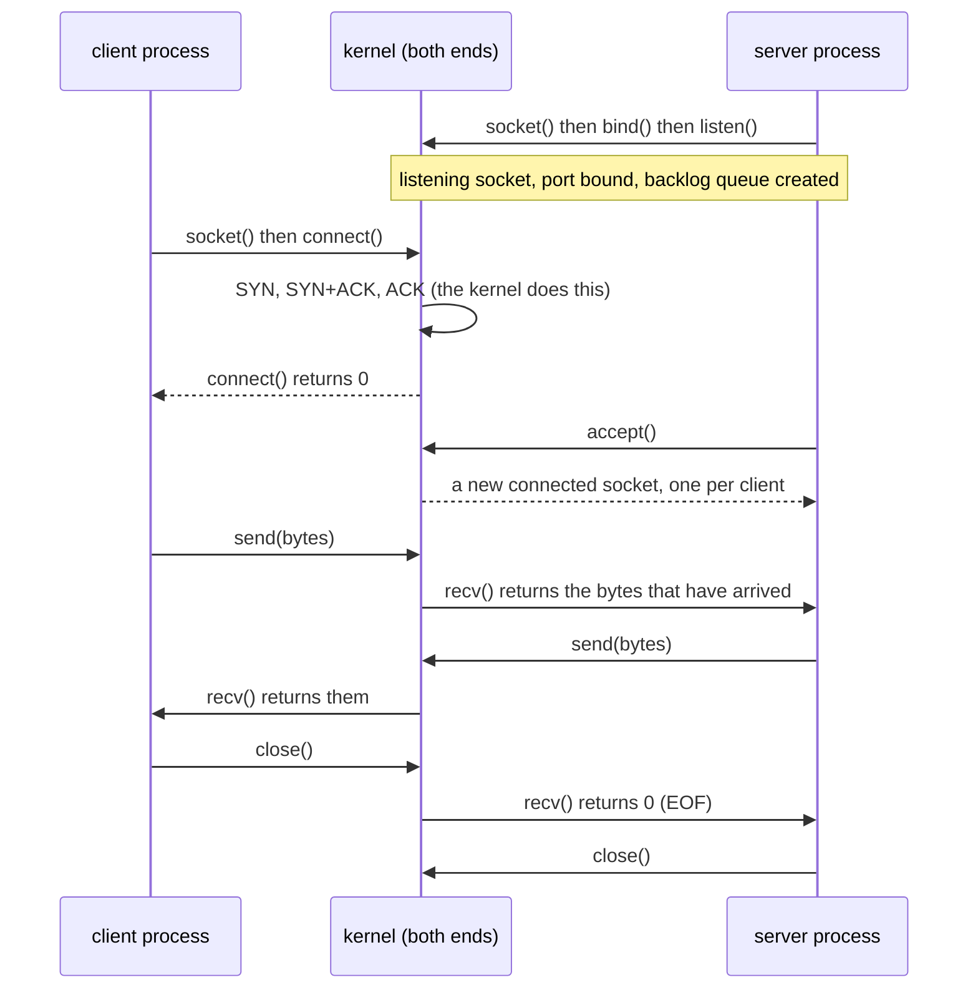
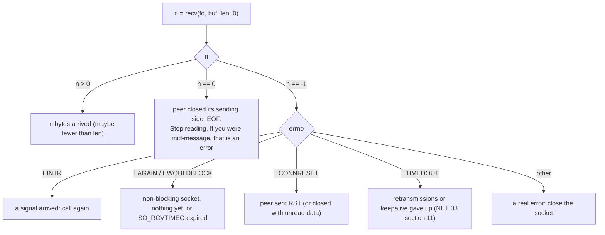
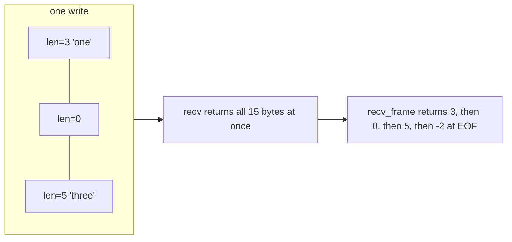
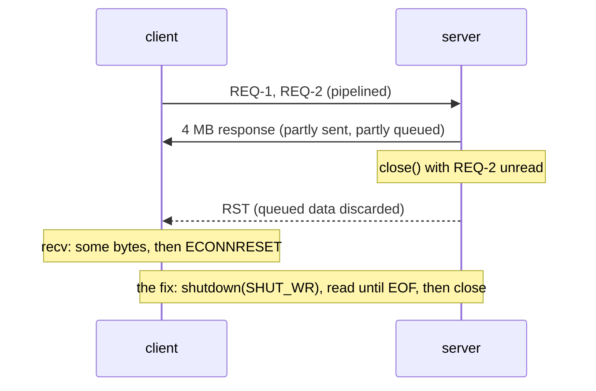
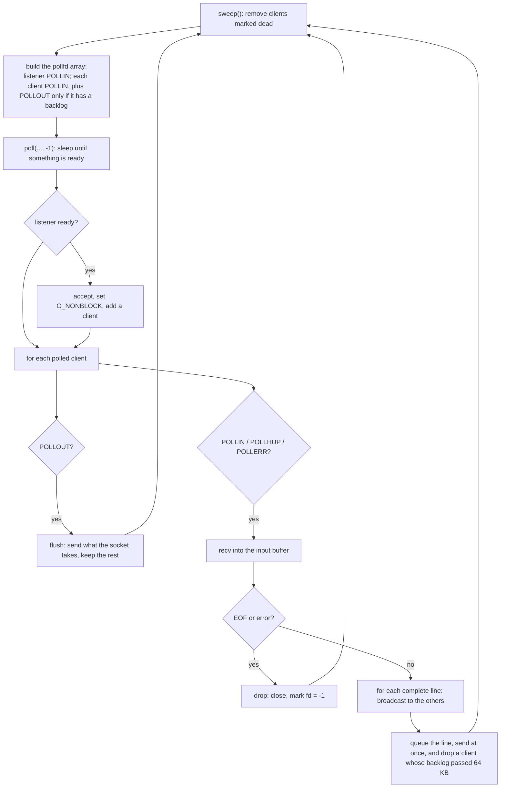

# NET 04: Socket programming in C

*Part of the [networking plan](00_plan.md) · Time: about 7 hours · You need: [NET 03](03_tcp_udp_and_transport.md) (what TCP and UDP do on the wire), [C 02 to C 04](../02_c_language/00_plan.md) (pointers, structs, byte order), [OS 17](../05_operating_systems/00_plan.md) (file descriptors and system calls), [LX 08](../06_linux/08_linux_networking_toolbox.md) (network namespaces, `ss`, `tcpdump`, `nft`). NET 03 explained what the transport layer does; this tutorial is the other side of the same line: the program you write against it. It covers the socket API end to end, a TCP echo server and client, UDP, byte order, partial reads and writes, framing a byte stream into messages, closing correctly, a non-blocking chat server on `poll`, deadlines and timeouts, socket options, and packet and raw sockets. Every program is small, compiled with `-Wall -Wextra` and AddressSanitizer and UBSan, and run here; the outputs are pasted from those runs.*

A socket program is short to write and quick to get subtly wrong. The wrong versions all work on a developer's laptop: `recv` returns a whole message because the loopback interface delivered it in one piece, `send` takes everything because the buffer was empty, `close` loses nothing because nothing was in flight. They fail in production, under load, on a slow link, with a peer that misbehaves. A senior interview in this area is a hunt for those failures: "your server reads 100 bytes but the client sent 300", "what happens when the client disconnects while you are writing", "how do you stop one slow client from blocking everyone", "write the read loop". This tutorial shows each failure happening, then the code that does not have it.

**Seven honest limits, stated first.**

1. Everything is measured on **one Linux 6.18 VM** (Firecracker, 2 vCPUs, gcc 13.3) as **root**, on the **loopback interface** and on **`veth` pairs between network namespaces**. There is no real network, so round trips are 0.02 to 0.1 ms and no packet is ever lost unless a rule drops it. Bugs that need a lossy or slow path (a send that blocks for seconds) are produced with a **receiver that never reads** instead.
2. **Loopback hides things.** The kernel delivers loopback data in whole `send`-sized pieces and its buffers autotune up to megabytes, so a sloppy program passes a small test and fails with a large one. Sections 3 and 7 and Problem D show it: the same buggy program works at 4 MB and hangs at 64 MB.
3. **Results that depend on timing vary from run to run.** The bytes a client reads before a reset (section 5) changed between 1.6 MB and 2.6 MB across runs; the iteration counts of section 7 change by the millions. Read the structure of each result, not its last digit. Where a result is exact, the text says so.
4. **The programs are IPv4 only**, because the VM has no IPv6. The API differences for IPv6 (`sockaddr_in6`, `AF_INET6`, `getaddrinfo` returning several addresses) are explained in section 2 and are **from memory**, not run.
5. **`epoll` and `io_uring` are not here.** They are [NET 05](05_epoll_and_io_uring.md). This tutorial stops at `poll` and measures why you will want `epoll`.
6. **The timer values are Linux 6.18's**, and the socket option behaviours (buffer doubling, `SA_RESTART` with timeouts) are Linux's. BSD, macOS and Windows differ in details, and a Mac, where you will run these programs, differs in some of them (no `MSG_NOSIGNAL`, no `accept4`, `SO_NOSIGPIPE` instead).
7. **A few statements are from memory** (the manual pages and the kernel documentation) and are marked "from memory". Everything else was run.

By the end you can:

- name the **system calls of a TCP server and client in order** and say what each does on the wire (measured: the server's `strace` shows **`socket`, `setsockopt`, `bind`, `listen`, `accept`, `recvfrom`, `sendto`, `recvfrom` returning 0, `close`**; an `AF_PACKET` sniffer on the server saw the **SYN, SYN-ACK and ACK** before `accept` returned, then **12 bytes in and 12 bytes out**, then the **FINs**);
- explain **byte order** and write a header **field by field** (measured: `0x11223344` sits in memory as **`44 33 22 11`** and on the wire as **`11 22 33 44`**; a struct with a 1, 4 and 2 byte field is **12 bytes** in memory, with **padding**, and **7 bytes** serialized);
- explain **why `recv` returns less than you asked for** and write `read_full` and `write_full` (measured: three 100 byte sends gave three `recv` calls of **100 bytes** against a request for 300; `MSG_WAITALL` returned all **300**; a non-blocking `send` of 1 MB accepted **32,741** bytes, then **47,616**, then returned **`EAGAIN`**);
- **frame a byte stream** with a length prefix and survive every arrival pattern (measured: **8 of 8 checks** passed under AddressSanitizer and UBSan for a frame **dribbled one byte at a time**, **three frames in one write**, an **empty frame**, a frame claiming **2 GB** (refused), and a frame **cut off by a close**);
- **close a connection without losing data** (measured: a server that closed with unread input sent a **RST** and the client read **2.6 MB of 4 MB** then got **`Connection reset by peer`**; the server that called **`shutdown(SHUT_WR)` and drained** delivered **all 4,194,304 bytes** and an orderly EOF; a client's **`shutdown(SHUT_WR)`** made a read-until-EOF server answer, and without it the server was **still waiting after 1.5 seconds**);
- handle **`SIGPIPE`** (measured: the first write to a closed peer **succeeded**, the process then died with **status 141**; with `MSG_NOSIGNAL` or `SIG_IGN` the second write returned **`EPIPE`**);
- use **UDP** correctly (measured: datagrams of **10, 20 and 0 bytes** arrived as three receives with an 8 byte buffer, `MSG_TRUNC` reporting the **true size**, and a connected UDP socket **dropped a datagram from a stranger**);
- write a **non-blocking server on `poll`** that a slow client cannot stall (measured: with a client that never read, the server stayed responsive, a second client received **60,000 lines in order**, and the slow client was **cut off** when its backlog passed 64 KB);
- bound every wait with a **timeout and a deadline**, and say why a per-call timeout is not a deadline (measured: against a peer sending one byte every 300 ms, a **500 ms `SO_RCVTIMEO` never fired** and the 10 byte read took **2.7 s**; a **1 s deadline** stopped it at **1001 ms**; connect to a dropped port gave up at **1001 ms**, to a closed port at **1 ms**);
- explain **`EINTR`** (measured: a signal interrupted `recv` after **200 ms**; with `SA_RESTART` the call carried on and returned at **601 ms**; with `SA_RESTART` **and** `SO_RCVTIMEO` it failed with `EINTR` anyway);
- survive **running out of file descriptors** (measured: a naive accept loop made **5,077,662** failing `accept` calls in 1.5 seconds for 12 connections; the spare descriptor trick turned away 29 clients politely with **40 calls**);
- read and write **socket options** (measured: `SO_RCVBUF` set to 4096 reads back **8192**; set to 64 MB it reads back **8,388,608**, twice `rmem_max`; `SO_REUSEPORT` spread **1000 connections 494 to 506** over two listeners);
- use **packet and raw sockets** (measured: a 52 line `AF_PACKET` sniffer printed both directions of a connection; a raw ICMP socket sent an echo and got the reply, **0.066 ms**);
- say why `poll` stops scaling (measured: **34 µs per call at 1000 descriptors and 249 µs at 4000**, so about **620 µs at 10,000**, which saturates one core at about **1600 events per second**).

**Where the numbers come from.** Five experiment scripts and one answer script were run in this session: `e1_timeouts`, `e2_halfclose`, `e3_strace_sniff` (these three run in the namespace lab), `e4_local` (fifteen programs run in sequence on loopback) and `e5_answers` (Problems B, C and D). `ans_e.py` computes Problem E from the `poll` measurement of `e4_local`. The programs are in this tutorial's `prog/` folder, and the shared helper header `nl.h` is listed in section 1. Transcripts print `$ command` before a command's output; `nse NS cmd` means `ip netns exec NS cmd`. Numbers not from these runs are marked "from memory", or are computed, or come from a source at the end.

**Data and timing.** No data sets. Compile each program once with `gcc -std=gnu11 -O1 -g -Wall -Wextra -fsanitize=address,undefined -Iprog -o bin/NAME prog/NAME.c`; `mk.sh` does all of them. The experiments take 1 to 25 seconds each (`e4_local` about 20 seconds in all, because several sections wait on timers). Timings are single runs, except the `poll` cost, which is the best of seven batches.

---

## 1. The socket API in one picture

A socket is a **file descriptor** (a small integer, per process) that names one endpoint of communication. Everything in this tutorial is a system call on such a descriptor. For TCP the descriptors come in two kinds: a **listening socket**, which only ever accepts connections, and a **connected socket**, which carries one connection's bytes. A server holds one listening socket and one connected socket per client.



| Call | What it does | What it does on the wire (measured in section 1.2) |
|---|---|---|
| `socket(AF_INET, SOCK_STREAM, 0)` | Creates an endpoint; returns a descriptor | nothing |
| `bind(fd, addr, len)` | Gives the socket a local address and port | nothing |
| `listen(fd, backlog)` | Marks it a listener; creates the accept queue (NET 03 section 4.4) | nothing |
| `connect(fd, addr, len)` | Starts the handshake; blocks until it finishes or fails | SYN out, SYN-ACK in, ACK out |
| `accept(fd, ...)` | Takes one finished connection from the queue; returns a **new** descriptor | nothing: the handshake was already done by the kernel |
| `send` / `recv` | Copies bytes to or from the socket's buffers | a data segment, and its ACK |
| `shutdown(fd, how)` | Closes one or both directions, keeps the descriptor | FIN for `SHUT_WR` |
| `close(fd)` | Releases the descriptor; if it was the last one, closes the connection | FIN (or RST, section 5) |

`write` and `read` also work on a socket, and `sendto` and `recvfrom` are what libc calls for `send` and `recv` (the `strace` below shows it). `send` and `recv` add a **flags** argument (`MSG_NOSIGNAL`, `MSG_WAITALL`, `MSG_PEEK`, `MSG_DONTWAIT`, `MSG_MORE`), so this tutorial uses them.

### 1.1 The shared helpers

Every program below includes `nl.h`: address construction, `listen_tcp`, `dial_tcp`, `read_full`, `write_full`, and the framing pair of section 4. It is listed whole, because the rest of the tutorial leans on it.

```c
/* nl.h: the few helpers every program in NET 04 shares */
#define _GNU_SOURCE
#include <arpa/inet.h>
#include <errno.h>
#include <netinet/in.h>
#include <netinet/tcp.h>
#include <poll.h>
#include <signal.h>
#include <stdint.h>
#include <stdio.h>
#include <stdlib.h>
#include <string.h>
#include <sys/socket.h>
#include <unistd.h>

#pragma GCC diagnostic ignored "-Wunused-function"
#define MAXFRAME (1u << 20)

static void die(const char *what) { perror(what); exit(1); }

static struct sockaddr_in addr_of(const char *ip, int port) {
    struct sockaddr_in a = { .sin_family = AF_INET, .sin_port = htons(port) };
    if (inet_pton(AF_INET, ip, &a.sin_addr) != 1) { fprintf(stderr, "bad ip %s\n", ip); exit(1); }
    return a;
}

static int listen_tcp(const char *ip, int port, int backlog) {
    int fd = socket(AF_INET, SOCK_STREAM, 0);
    if (fd < 0) die("socket");
    int one = 1;
    if (setsockopt(fd, SOL_SOCKET, SO_REUSEADDR, &one, sizeof one) < 0) die("setsockopt");
    struct sockaddr_in a = addr_of(ip, port);
    if (bind(fd, (struct sockaddr *)&a, sizeof a) < 0) die("bind");
    if (listen(fd, backlog) < 0) die("listen");
    return fd;
}

static int dial_tcp(const char *ip, int port) {
    int fd = socket(AF_INET, SOCK_STREAM, 0);
    if (fd < 0) die("socket");
    struct sockaddr_in a = addr_of(ip, port);
    if (connect(fd, (struct sockaddr *)&a, sizeof a) < 0) die("connect");
    return fd;
}

/* the port the kernel chose for a socket bound to port 0 */
static int port_of(int fd) {
    struct sockaddr_in a;
    socklen_t l = sizeof a;
    if (getsockname(fd, (struct sockaddr *)&a, &l) < 0) die("getsockname");
    return ntohs(a.sin_port);
}

/* Read exactly n bytes. Returns n; 0 on EOF before the first byte;
   -1 on error, or on EOF in the middle (errno EPROTO). */
static ssize_t read_full(int fd, void *buf, size_t n) {
    size_t got = 0;
    while (got < n) {
        ssize_t r = recv(fd, (char *)buf + got, n - got, 0);
        if (r < 0) { if (errno == EINTR) continue; return -1; }
        if (r == 0) { if (got == 0) return 0; errno = EPROTO; return -1; }
        got += (size_t)r;
    }
    return (ssize_t)n;
}

/* Write exactly n bytes. Returns 0 or -1. MSG_NOSIGNAL turns SIGPIPE into EPIPE. */
static int write_full(int fd, const void *buf, size_t n) {
    size_t sent = 0;
    while (sent < n) {
        ssize_t w = send(fd, (const char *)buf + sent, n - sent, MSG_NOSIGNAL);
        if (w < 0) { if (errno == EINTR) continue; return -1; }
        sent += (size_t)w;
    }
    return 0;
}

/* One frame is a 4 byte big endian length, then that many bytes. */
static int send_frame(int fd, const void *p, uint32_t len) {
    uint32_t be = htonl(len);
    if (send(fd, &be, 4, MSG_MORE | MSG_NOSIGNAL) != 4) return -1;
    return write_full(fd, p, len);
}

/* Returns the frame length (0 is a legal empty frame), -2 on a clean EOF
   between frames, -1 on error (EMSGSIZE if the frame is larger than cap). */
static ssize_t recv_frame(int fd, void *buf, uint32_t cap) {
    uint32_t be;
    ssize_t r = read_full(fd, &be, 4);
    if (r == 0) return -2;
    if (r < 0) return -1;
    uint32_t len = ntohl(be);
    if (len > cap) { errno = EMSGSIZE; return -1; }
    if (len > 0 && read_full(fd, buf, len) <= 0) {
        if (errno == 0) errno = EPROTO;
        return -1;
    }
    return (ssize_t)len;
}
```

Three details to notice now. `listen_tcp` sets **`SO_REUSEADDR`** before `bind` (NET 03 section 9: it lets a restarted server bind while old connections sit in TIME-WAIT). `write_full` uses **`MSG_NOSIGNAL`** (section 5). And both loops treat **`EINTR`** as "try again" (section 8).

### 1.2 An echo server and client, and what the kernel did

The smallest useful server: accept one client at a time, send back whatever arrives, until the client closes.

```c
/* p02_echo_srv.c: a blocking, one-client-at-a-time TCP echo server.
   usage: p02_echo_srv IP PORT [CLIENTS]   (serves CLIENTS connections, then exits) */
#include "nl.h"

int main(int argc, char **argv) {
    if (argc < 3) { fprintf(stderr, "usage: %s IP PORT [CLIENTS]\n", argv[0]); return 2; }
    int lfd = listen_tcp(argv[1], atoi(argv[2]), 16);
    int left = argc > 3 ? atoi(argv[3]) : -1;
    while (left != 0) {
        struct sockaddr_in peer;
        socklen_t pl = sizeof peer;
        int fd = accept(lfd, (struct sockaddr *)&peer, &pl);
        if (fd < 0) { if (errno == EINTR) continue; die("accept"); }
        char buf[1024];
        for (;;) {
            ssize_t n = recv(fd, buf, sizeof buf, 0);
            if (n <= 0) break;
            if (write_full(fd, buf, (size_t)n) < 0) break;
        }
        close(fd);
        if (left > 0) left--;
    }
    return 0;
}
```

```c
/* p02_echo_cli.c: send one string, read the same number of bytes back.
   usage: p02_echo_cli IP PORT TEXT */
#include "nl.h"

int main(int argc, char **argv) {
    if (argc < 4) { fprintf(stderr, "usage: %s IP PORT TEXT\n", argv[0]); return 2; }
    int fd = dial_tcp(argv[1], atoi(argv[2]));
    size_t n = strlen(argv[3]);
    if (write_full(fd, argv[3], n) < 0) die("send");
    char buf[1024];
    if (n > sizeof buf) n = sizeof buf;
    if (read_full(fd, buf, n) != (ssize_t)n) { fprintf(stderr, "short echo: the server closed the connection\n"); return 1; }
    printf("echoed %zu bytes: %.*s\n", n, (int)n, buf);
    close(fd);
    return 0;
}
```

Run in the namespace lab (client `cl` at 10.3.0.1, server `sv` at 10.3.0.2), with the server under `strace`. The `strace` output is trimmed to the socket calls and shows the address `accept` returned:

```text
--- 1. the system calls of the echo server, one client
$ nse cl bin/p02_echo_cli 10.3.0.2 9100 'hello socket'
echoed 12 bytes: hello socket
$ awk '/^[0-9]* *socket/{p=1} p' /tmp/e3.strace | sed -E 's/^[0-9]+ +//; s/\{sa_family=AF_INET, sin_port=htons\(([0-9]+)\), sin_addr=inet_addr\("([0-9.]+)"\)\}/{\2:\1}/'
socket(AF_INET, SOCK_STREAM, IPPROTO_IP) = 3
setsockopt(3, SOL_SOCKET, SO_REUSEADDR, [1], 4) = 0
bind(3, {10.3.0.2:9100}, 16) = 0
listen(3, 16)                     = 0
accept(3, {10.3.0.1:51254}, [16]) = 4
recvfrom(4, "hello socket", 1024, 0, NULL, NULL) = 12
sendto(4, "hello socket", 12, MSG_NOSIGNAL, NULL, 0) = 12
recvfrom(4, "", 1024, 0, NULL, NULL) = 0
close(4)                          = 0
+++ exited with 0 +++
```

`recvfrom` is what glibc's `recv` becomes; its third argument is the buffer size, 1024, and its return value is how many bytes had **arrived**, here 12. The second `recvfrom` returns **0**: the client closed, which is **end of file** on a stream socket. That zero is the only way a TCP program learns the peer is done, and it is why `recv` returning 0 ends the loop.

Now the same exchange as an `AF_PACKET` socket sees it on the server's interface (section 10 explains how the sniffer works). `in` is a packet arriving, `out` a packet leaving:

```text
--- 2. the same exchange seen by an AF_PACKET socket on the server side
in    74 bytes TCP 10.3.0.1:47004 > 10.3.0.2:9101 [S] payload 0
out   74 bytes TCP 10.3.0.2:9101 > 10.3.0.1:47004 [S.] payload 0
in    66 bytes TCP 10.3.0.1:47004 > 10.3.0.2:9101 [.] payload 0
in    78 bytes TCP 10.3.0.1:47004 > 10.3.0.2:9101 [P.] payload 12
out   66 bytes TCP 10.3.0.2:9101 > 10.3.0.1:47004 [.] payload 0
out   78 bytes TCP 10.3.0.2:9101 > 10.3.0.1:47004 [P.] payload 12
in    66 bytes TCP 10.3.0.1:47004 > 10.3.0.2:9101 [.] payload 0
in    66 bytes TCP 10.3.0.1:47004 > 10.3.0.2:9101 [F.] payload 0
out   66 bytes TCP 10.3.0.2:9101 > 10.3.0.1:47004 [F.] payload 0
in    66 bytes TCP 10.3.0.1:47004 > 10.3.0.2:9101 [.] payload 0
```

Read the two outputs side by side. The first three packets (`S`, `S.`, `.`) are the handshake, and they happened **before** the `accept` call returned: `accept` only collects a finished connection. The `P.` packets (push plus ACK) with **payload 12** are the `recv` and `sendto` of the echo. The server's ACK in between (`.` with payload 0) came from the kernel on its own, before the application's `sendto`. Then `F.` in and `F.` out are the close: the client's FIN, which made the second `recvfrom` return 0, and the server's own FIN from `close(4)`. The server's FIN is `out`, ahead of the client's last ACK, which is the passive close of NET 03 section 4.

```text
cd to the tutorial folder, then:
  bash prog/mk.sh                                     # builds bin/ with sanitizers
  bin/plain_p02_echo_srv 127.0.0.1 7777 1 &           # serve one client
  bin/p02_echo_cli 127.0.0.1 7777 "hello socket"
```

**What this server gets wrong**, which the rest of the tutorial fixes: it serves **one client at a time**, so a second client waits in the accept queue until the first finishes (section 7); it assumes `recv` returns whole messages (section 3); it does nothing with timeouts, so one silent client blocks it forever (section 8); and it has no policy for a client that sends faster than it reads.

---

## 2. Addresses and byte order

### 2.1 Network byte order

Every multi-byte integer in a protocol header is **big endian**, the most significant byte first ("network byte order"). Your CPU is probably **little endian** (x86, and ARM as Linux runs it). So you convert at the boundary: `htons` and `htonl` (host to network, 16 and 32 bit), `ntohs` and `ntohl` back. On a big endian machine they do nothing. Run it:

```c
/* p01_order.c: byte order, struct padding, and writing a header field by field */
#include <stddef.h>
#include "nl.h"

struct hdr { uint8_t type; uint32_t len; uint16_t id; };

static void put32(uint8_t *p, uint32_t v) { p[0] = v >> 24; p[1] = v >> 16; p[2] = v >> 8; p[3] = v; }
static void put16(uint8_t *p, uint16_t v) { p[0] = v >> 8; p[1] = v; }

static void hex(const char *label, const void *p, size_t n) {
    printf("%-22s", label);
    for (size_t i = 0; i < n; i++) printf(" %02x", ((const uint8_t *)p)[i]);
    printf("\n");
}

int main(void) {
    uint16_t x = 0x1234;
    uint32_t y = 0x11223344;
    hex("0x1234 in memory", &x, 2);
    uint16_t nx = htons(x);
    hex("htons(0x1234)", &nx, 2);
    hex("0x11223344 in memory", &y, 4);
    uint32_t ny = htonl(y);
    hex("htonl(0x11223344)", &ny, 4);
    printf("ntohl(htonl(y)) == y: %d\n\n", ntohl(htonl(y)) == y);

    struct hdr h;
    memset(&h, 0, sizeof h);
    h.type = 7;
    h.len = 300;
    h.id = 0xBEEF;
    printf("sizeof(struct hdr) = %zu, offsets: type %zu, len %zu, id %zu\n",
           sizeof h, offsetof(struct hdr, type), offsetof(struct hdr, len), offsetof(struct hdr, id));
    hex("struct as is", &h, sizeof h);

    uint8_t wire[7];
    wire[0] = h.type;
    put32(wire + 1, h.len);
    put16(wire + 5, h.id);
    hex("field by field (7 bytes)", wire, sizeof wire);
    return 0;
}
```

```text
--- 1. byte order and padding
0x1234 in memory       34 12
htons(0x1234)          12 34
0x11223344 in memory   44 33 22 11
htonl(0x11223344)      11 22 33 44
ntohl(htonl(y)) == y: 1

sizeof(struct hdr) = 12, offsets: type 0, len 4, id 8
struct as is           07 00 00 00 2c 01 00 00 ef be 00 00
field by field (7 bytes) 07 00 00 01 2c be ef
```

The first four lines are the point. The value `0x1234` is stored as `34 12` (little endian), and after `htons` the bytes in memory are `12 34`, which is the order they go out on the wire. If you forget `htons(port)` in `bind`, a server asked for port 8080 (`0x1F90`) binds port **36895** (`0x901F`), and nothing connects to it; this is among the commonest first-socket bugs and the symptom is "connection refused" on the right port.

### 2.2 Never write a struct to the wire

The second half of the program shows the other classic mistake. `struct hdr { uint8_t type; uint32_t len; uint16_t id; }` is **12 bytes** in memory: the compiler put **3 bytes of padding** after `type` so that `len` is 4 byte aligned, and **2 more** at the end. Writing the struct as it is sends 12 bytes **in the host's byte order, with the padding**, so that:

1. the receiver, if it is a different architecture or compiler, reads garbage;
2. the padding bytes are **uninitialized memory** that goes onto the network (an information leak; the program zeroes the struct first for exactly this reason);
3. adding a field changes the wire format by accident.

The cure is to **serialize field by field**, with explicit widths and byte order: `put32` and `put16` above write the same header as **7 bytes**, `07 00 00 01 2c be ef`: type 7, length 300 (`0x012c`) in big endian, id `0xbeef`. `__attribute__((packed))` removes the padding but not the byte order problem, and it makes unaligned access, which is undefined behaviour in C even where the CPU tolerates it. The sniffer in section 10 meets this: it **copies** the IP header out of the packet with `memcpy` into an aligned struct instead of casting the pointer, because UBSan flagged the cast (the IP header begins at offset 14 of an Ethernet frame, which is not 4 byte aligned).

### 2.3 Socket addresses

`bind`, `connect` and `accept` take a `struct sockaddr *` and a length, because one API serves several address families. In practice you fill a family specific struct and cast:

| Struct | Family | Size | Holds |
|---|---|---|---|
| `struct sockaddr_in` | `AF_INET` | 16 bytes | family, port (network order), 4 byte IPv4 address |
| `struct sockaddr_in6` | `AF_INET6` | 28 bytes | family, port, flow label, 16 byte address, scope id (from memory) |
| `struct sockaddr_un` | `AF_UNIX` | 110 bytes | family, a path (OS 17) |
| `struct sockaddr_storage` | any | 128 bytes | big enough for any of the above: use it when `accept` or `recvfrom` may return any family |

The last argument is a **value-result** argument for `accept` and `recvfrom`: you pass the size of your buffer, and the kernel overwrites it with the size of the address it stored (a `socklen_t`, not an `int`). Forgetting to initialize it is a classic bug (the kernel reads the garbage as the buffer size).

`addr_of` in `nl.h` builds a `sockaddr_in` from a dotted string with **`inet_pton`**, which also reports a malformed address (`inet_addr` does not, and `inet_aton` is lenient: it accepts `10.1` as `10.0.0.1`). For names, use **`getaddrinfo`**, which resolves a host name and service name to a list of addresses, for IPv4 and IPv6, and is the call that keeps a program IP-version independent:

```c
/* p13_gai.c: name and service lookup with getaddrinfo. usage: p13_gai HOST SERVICE */
#include "nl.h"
#include <netdb.h>

int main(int argc, char **argv) {
    if (argc < 3) return 2;
    struct addrinfo hints, *res;
    memset(&hints, 0, sizeof hints);
    hints.ai_family = AF_UNSPEC;
    hints.ai_socktype = SOCK_STREAM;
    int rc = getaddrinfo(argv[1], argv[2], &hints, &res);
    if (rc != 0) { printf("getaddrinfo(%s, %s): %s\n", argv[1], argv[2], gai_strerror(rc)); return 1; }
    for (struct addrinfo *a = res; a; a = a->ai_next) {
        char host[64], serv[16];
        getnameinfo(a->ai_addr, a->ai_addrlen, host, sizeof host, serv, sizeof serv, NI_NUMERICHOST | NI_NUMERICSERV);
        printf("family %s, socktype %d, address %s, port %s, sockaddr is %u bytes\n",
               a->ai_family == AF_INET ? "AF_INET" : a->ai_family == AF_INET6 ? "AF_INET6" : "other",
               a->ai_socktype, host, serv, a->ai_addrlen);
    }
    freeaddrinfo(res);
    return 0;
}
```

```text
--- 8. getaddrinfo
$ bin/p13_gai 127.0.0.1 8080
family AF_INET, socktype 1, address 127.0.0.1, port 8080, sockaddr is 16 bytes
$ bin/p13_gai localhost http
family AF_INET, socktype 1, address 127.0.0.1, port 80, sockaddr is 16 bytes
$ bin/p13_gai nonexistent.invalid 80
getaddrinfo(nonexistent.invalid, 80): Name or service not known
```

Two things to see. `localhost` came back as **one** address, `127.0.0.1`, because the VM has no IPv6; on a dual stack machine it returns `::1` and `127.0.0.1` (from memory), and a client is expected to **try each in turn** (the idea of Problem C, and what "happy eyeballs" does in parallel). And a failed lookup is reported through **`gai_strerror`**, not `errno`. Do not call `gethostbyname`: it is not thread safe, IPv4 only and obsolete.

---

## 3. A stream has no message boundaries

This section is the answer to "your server reads 100 bytes but the client sent 300". TCP delivers a **stream of bytes**. It does not remember how many `send` calls produced them, and it may deliver them to `recv` in any pieces: one `send` of 300 bytes can arrive as 100 plus 200, three sends can arrive as one `recv`, and a `recv` can return a single byte. The only guarantee is **order and completeness** (NET 03).

### 3.1 recv returns what has arrived

```c
/* p03_partial.c: recv returns what has arrived, not what you asked for */
#include "nl.h"
#include <sys/wait.h>

int main(void) {
    int lfd = listen_tcp("127.0.0.1", 0, 4);
    int port = port_of(lfd);
    if (fork() == 0) {                       /* the sender: 3 writes of 100 bytes, 100 ms apart */
        int fd = dial_tcp("127.0.0.1", port);
        char chunk[100];
        for (int i = 0; i < 3; i++) {
            memset(chunk, 'a' + i, sizeof chunk);
            send(fd, chunk, sizeof chunk, 0);
            usleep(100000);
        }
        close(fd);
        _exit(0);
    }
    int fd = accept(lfd, NULL, NULL);
    char buf[300];
    printf("asking for 300 bytes with plain recv:\n");
    size_t total = 0;
    while (total < 300) {
        ssize_t r = recv(fd, buf + total, 300 - total, 0);
        if (r <= 0) break;
        printf("  recv returned %zd (bytes so far %zu, last byte '%c')\n", r, total + r, buf[total + r - 1]);
        total += (size_t)r;
    }
    close(fd);
    wait(NULL);

    if (fork() == 0) {                       /* same sender again */
        int fd2 = dial_tcp("127.0.0.1", port);
        char chunk[100];
        for (int i = 0; i < 3; i++) {
            memset(chunk, 'a' + i, sizeof chunk);
            send(fd2, chunk, sizeof chunk, 0);
            usleep(100000);
        }
        close(fd2);
        _exit(0);
    }
    fd = accept(lfd, NULL, NULL);
    ssize_t r = recv(fd, buf, 300, MSG_WAITALL);
    printf("asking again with MSG_WAITALL: recv returned %zd\n", r);
    close(fd);
    wait(NULL);
    return 0;
}
```

```text
--- 2. recv returns what has arrived
asking for 300 bytes with plain recv:
  recv returned 100 (bytes so far 100, last byte 'a')
  recv returned 100 (bytes so far 200, last byte 'b')
  recv returned 100 (bytes so far 300, last byte 'c')
asking again with MSG_WAITALL: recv returned 300
```

The sender writes three 100 byte pieces 100 ms apart. The receiver asks for 300 and gets **100 each time**, because that is all that has arrived. (Without the pauses, loopback would probably coalesce them and you would see 300, which is how the bug hides in testing.) `MSG_WAITALL` asks `recv` to block until the full 300 are there, and returns 300. But **do not rely on `MSG_WAITALL`**: it can still return short if a signal arrives, if the connection closes, or if the socket has a receive timeout (`SO_RCVTIMEO`). A loop is the portable answer:

```c
static ssize_t read_full(int fd, void *buf, size_t n) {
    size_t got = 0;
    while (got < n) {
        ssize_t r = recv(fd, (char *)buf + got, n - got, 0);
        if (r < 0) { if (errno == EINTR) continue; return -1; }
        if (r == 0) { if (got == 0) return 0; errno = EPROTO; return -1; }
        got += (size_t)r;
    }
    return (ssize_t)n;
}

static int write_full(int fd, const void *buf, size_t n) {
    size_t sent = 0;
    while (sent < n) {
        ssize_t w = send(fd, (const char *)buf + sent, n - sent, MSG_NOSIGNAL);
        if (w < 0) { if (errno == EINTR) continue; return -1; }
        sent += (size_t)w;
    }
    return 0;
}
```

The return value of `recv` has exactly four meanings, and every call site must handle all four:



`read_full` above encodes this: it returns the full count, **0 for EOF before the first byte** (the peer closed between messages: normal), and **-1 with `errno` set to `EPROTO` for EOF in the middle** (the peer vanished mid-message: an error the caller must not mistake for a complete message).

### 3.2 send may take only part

`send` on a **blocking** socket normally blocks until all the bytes are copied into the socket's send buffer, and then returns the full count. On a **non-blocking** socket, or when a signal or a timeout interrupts it, it returns **however many fit**. So you must loop on `send` too, and on a non-blocking socket you must wait for writability when it says `EAGAIN`:

```c
/* p03b_sendfull.c: a non-blocking send takes what fits, then says EAGAIN */
#include "nl.h"
#include <fcntl.h>

int main(void) {
    int lfd = listen_tcp("127.0.0.1", 0, 4);
    int cfd = dial_tcp("127.0.0.1", port_of(lfd));
    int sfd = accept(lfd, NULL, NULL);       /* the receiver never reads */
    (void)sfd;
    int small = 16384;
    setsockopt(cfd, SOL_SOCKET, SO_SNDBUF, &small, sizeof small);
    fcntl(cfd, F_SETFL, fcntl(cfd, F_GETFL) | O_NONBLOCK);

    static char big[1 << 20];
    size_t total = 0;
    int calls = 0;
    for (;;) {
        ssize_t w = send(cfd, big, sizeof big, MSG_NOSIGNAL);
        if (w < 0) { printf("call %d: send returned -1, errno %s\n", ++calls, strerror(errno)); break; }
        printf("call %d: asked for %zu, send returned %zd\n", ++calls, sizeof big, w);
        total += (size_t)w;
    }
    printf("total accepted: %zu bytes of a 1 MB buffer offered again and again\n", total);
    return 0;
}
```

```text
--- 3. a non-blocking send takes what fits
call 1: asked for 1048576, send returned 32741
call 2: asked for 1048576, send returned 47616
call 3: send returned -1, errno Resource temporarily unavailable
total accepted: 80357 bytes of a 1 MB buffer offered again and again
```

The receiver accepted the connection and never read. The sender offered 1 MB: `send` took **32,741** bytes, the next call **47,616**, and the third returned **-1 with `EAGAIN`**: the send buffer and the receiver's receive window were full, **80,357** bytes in all (the number changes from run to run). This is the picture of **flow control** from NET 03 section 6 seen from the program: the receiver's window closed, the sender's buffer filled, `send` stopped accepting. On a blocking socket the same program would have blocked in the second or third call, and **forever** if the receiver never read: a blocked `send` is a way for a slow or dead peer to hang your thread, which is why section 8 gives every wait a limit.

The two loops, `read_full` and `write_full`, are the **blocking socket** building blocks. A non-blocking server cannot loop inside a call, because it must serve other clients while one is stalled. It keeps a **buffer per connection** and continues the partial work when `poll` says the socket is ready again (section 7).


---

## 4. Framing: turning a stream into messages

Since TCP does not keep boundaries, **the application protocol must**. There are three ways, and every protocol you know uses one of them:

| Method | How the receiver knows where a message ends | Examples | Cost |
|---|---|---|---|
| **Delimiter** | scans for a marker (a newline, `\r\n\r\n`) | HTTP/1.1 headers, SMTP, Redis (RESP) lines, line-based chat | The data cannot contain the marker, or must be escaped. The receiver cannot allocate the right buffer in advance. A hostile peer can send an endless line |
| **Length prefix** | reads a fixed size header with the length, then that many bytes | TLS records, HTTP/2 frames, DNS over TCP, gRPC, most binary protocols | One extra field. The receiver must **validate the length before trusting it** |
| **Fixed size** | every message is N bytes | simple sensors, some embedded protocols | Wastes space, hard to evolve |

HTTP/1.1 uses **both**: delimiters for the header, a `Content-Length` (a length prefix in text) or chunked encoding for the body (from memory). A binary protocol should use a **length prefix**, and the rest of this section builds one.

### 4.1 Length-prefixed frames

A frame is a 4 byte **big endian** length, then that many bytes. The sender and receiver from `nl.h`:

```c
static int send_frame(int fd, const void *p, uint32_t len) {
    uint32_t be = htonl(len);
    if (send(fd, &be, 4, MSG_MORE | MSG_NOSIGNAL) != 4) return -1;
    return write_full(fd, p, len);
}

static ssize_t recv_frame(int fd, void *buf, uint32_t cap) {
    uint32_t be;
    ssize_t r = read_full(fd, &be, 4);
    if (r == 0) return -2;
    if (r < 0) return -1;
    uint32_t len = ntohl(be);
    if (len > cap) { errno = EMSGSIZE; return -1; }
    if (len > 0 && read_full(fd, buf, len) <= 0) {
        if (errno == 0) errno = EPROTO;
        return -1;
    }
    return (ssize_t)len;
}
```

Four decisions in these 20 lines are the whole craft:

1. **The length is validated before anything is read or allocated.** `recv_frame` compares it with `cap` and fails with `EMSGSIZE` for a frame that is too big. Without this, a peer that sends `0xFFFFFFFF` makes you allocate 4 GB (a remote denial of service, and a very common real vulnerability). Choose a limit from the protocol (`MAXFRAME` is 1 MB here).
2. **`recv_frame` distinguishes three outcomes**: a frame of length N (N may be **0**: an empty frame is a message, not EOF), **-2 for a clean EOF between frames**, and **-1 for an error**, including EOF **in the middle** of a frame (`EPROTO`).
3. **The 4 byte read is a `read_full`**: the length field itself may arrive in two pieces.
4. **`send_frame` sends the header with `MSG_MORE`**, which tells the kernel "more data follows, do not send this alone". Without it, a header write followed by a body write is exactly the **two small writes** of NET 03 section 8, where the second segment waited for the ACK of the first, which waited for the delayed-ACK timer: **41.8 ms** per request in that experiment against 0.05 ms for one write. The alternatives are to build header and body in one buffer and `send` once, or to use `writev` or `sendmsg` with two iovecs, or to set `TCP_NODELAY` (section 9). `MSG_MORE` is Linux specific (BSDs and macOS lack it; there you use `writev`).

### 4.2 The test: every way a message can arrive

`p04_frame.c` forks a peer and sends frames in each awkward way; the receiver checks the result. The test is also how you would write one for your own protocol: **make the sender hostile to the receiver** (dribble, coalesce, truncate, lie).

```c
/* p04_frame.c: length-prefixed frames survive dribbling, coalescing, and bad input */
#include "nl.h"
#include <sys/wait.h>

static int checks, passed;
#define CHECK(c) do { checks++; if (c) passed++; else printf("FAIL line %d: %s\n", __LINE__, #c); } while (0)

static void dribble(int fd, const void *p, size_t n) {    /* one byte per send, with a pause */
    for (size_t i = 0; i < n; i++) { send(fd, (const char *)p + i, 1, MSG_NOSIGNAL); usleep(300); }
}

static int spawn_peer(int lfd, int mode) {
    int port = port_of(lfd);
    if (fork() == 0) {
        int fd = dial_tcp("127.0.0.1", port);
        uint32_t be;
        if (mode == 0) {                                  /* one frame, sent a byte at a time */
            be = htonl(11);
            dribble(fd, &be, 4);
            dribble(fd, "hello frame", 11);
        } else if (mode == 1) {                           /* three frames in ONE write */
            char all[64];
            size_t off = 0;
            const char *msg[3] = { "one", "", "three" };
            for (int i = 0; i < 3; i++) {
                be = htonl((uint32_t)strlen(msg[i]));
                memcpy(all + off, &be, 4); off += 4;
                memcpy(all + off, msg[i], strlen(msg[i])); off += strlen(msg[i]);
            }
            write_full(fd, all, off);
        } else if (mode == 2) {                           /* a frame that claims 2 GB */
            be = htonl(0x80000000u);
            write_full(fd, &be, 4);
            usleep(100000);
        } else {                                          /* a frame cut off by close */
            be = htonl(100);
            write_full(fd, &be, 4);
            write_full(fd, "only ten b", 10);
        }
        close(fd);
        _exit(0);
    }
    int fd = accept(lfd, NULL, NULL);
    return fd;
}

int main(void) {
    int lfd = listen_tcp("127.0.0.1", 0, 4);
    char buf[256];
    ssize_t n;
    int fd;

    fd = spawn_peer(lfd, 0);
    n = recv_frame(fd, buf, sizeof buf);
    CHECK(n == 11 && memcmp(buf, "hello frame", 11) == 0);
    CHECK(recv_frame(fd, buf, sizeof buf) == -2);         /* clean EOF between frames */
    close(fd); wait(NULL);

    fd = spawn_peer(lfd, 1);
    usleep(50000);                                        /* let all three arrive together */
    n = recv_frame(fd, buf, sizeof buf); CHECK(n == 3 && memcmp(buf, "one", 3) == 0);
    n = recv_frame(fd, buf, sizeof buf); CHECK(n == 0);   /* an empty frame is not EOF */
    n = recv_frame(fd, buf, sizeof buf); CHECK(n == 5 && memcmp(buf, "three", 5) == 0);
    CHECK(recv_frame(fd, buf, sizeof buf) == -2);
    close(fd); wait(NULL);

    fd = spawn_peer(lfd, 2);
    n = recv_frame(fd, buf, sizeof buf);
    CHECK(n == -1 && errno == EMSGSIZE);                  /* refuse before allocating or reading */
    close(fd); wait(NULL);

    fd = spawn_peer(lfd, 3);
    n = recv_frame(fd, buf, sizeof buf);
    CHECK(n == -1 && errno == EPROTO);                    /* EOF in the middle of a frame */
    close(fd); wait(NULL);

    printf("%d/%d checks passed\n", passed, checks);
    return passed == checks ? 0 : 1;
}
```

```text
--- 4. framing self test (AddressSanitizer and UBSan build)
8/8 checks passed
```

All **8 of 8 checks** pass in a build with AddressSanitizer and UBSan. The cases: a frame sent **one byte at a time** with a 0.3 ms pause between bytes (so `recv` returns one byte at a time: the length field itself arrives in four pieces); **three frames in one write**, one of them empty (the receiver must split them, and must not take the empty one for EOF); a frame **claiming 2 GB** (refused with `EMSGSIZE`, nothing read); and a frame **cut off** by the peer's close (`EPROTO`, not a short success). Passing the first two only proves you read `recv` correctly; the last two are what a network does to you eventually.



---

## 5. Closing a connection correctly

`close(fd)` looks like one operation and is three, and the difference is the source of the "lost the last response" bug.

### 5.1 close, shutdown, and half-close

- **`close(fd)`** drops this process's reference to the descriptor. If it was the last one, the kernel starts closing the connection: it sends a **FIN** after any queued data. The socket can no longer be read or written by you.
- **`shutdown(fd, SHUT_WR)`** sends the **FIN now** but keeps the descriptor: you have said "I will send no more", and you can still **read** until the peer says the same. This is a **half-close**. `SHUT_RD` and `SHUT_RDWR` also exist; `SHUT_WR` is the one you use.
- If a socket has been **duplicated** (`fork`, `dup`), `close` in one process does not close the connection, but `shutdown` does, for all of them.

The use of half-close is a request that has no length: the client sends everything and then says "that is all" with `SHUT_WR`; the server reads until EOF, and then replies. Without the half-close the server cannot tell the end of the request from a pause.

```c
/* p11_halfclose.c: how a request that has no length says "that is all": shutdown(SHUT_WR).
   usage: p11_halfclose server IP PORT | client IP PORT yes|no */
#include "nl.h"

int main(int argc, char **argv) {
    if (argc < 4) return 2;
    if (strcmp(argv[1], "server") == 0) {              /* count bytes until EOF, then answer */
        int lfd = listen_tcp(argv[2], atoi(argv[3]), 4);
        int c = accept(lfd, NULL, NULL);
        char buf[4096];
        size_t total = 0;
        ssize_t n;
        while ((n = recv(c, buf, sizeof buf, 0)) > 0) total += (size_t)n;
        char reply[64];
        int len = snprintf(reply, sizeof reply, "got %zu bytes\n", total);
        write_full(c, reply, (size_t)len);
        return 0;
    }
    int fd = dial_tcp(argv[2], atoi(argv[3]));
    write_full(fd, "twelve bytes", 12);
    if (strcmp(argv[4], "yes") == 0) shutdown(fd, SHUT_WR);   /* FIN: the request is complete */
    struct pollfd p = { .fd = fd, .events = POLLIN };
    if (poll(&p, 1, 1500) == 0) { printf("no reply after 1.5 s: the server is still waiting for more request bytes\n"); return 0; }
    char buf[64];
    ssize_t n = recv(fd, buf, sizeof buf - 1, 0);
    printf("reply: %.*s", (int)n, buf);
    return 0;
}
```

```text
--- client calls shutdown(SHUT_WR) after the request: no
$ nse cl bin/p11_halfclose client 10.3.0.2 9003 no
no reply after 1.5 s: the server is still waiting for more request bytes
--- client calls shutdown(SHUT_WR) after the request: yes
$ nse cl bin/p11_halfclose client 10.3.0.2 9003 yes
reply: got 12 bytes
```

Without `shutdown(SHUT_WR)` the server was **still waiting** for more request bytes after 1.5 seconds, and the client was waiting for the reply: a **deadlock of two polite programs**. With it, the FIN made the server's `recv` return 0, the server counted **12 bytes** and replied. HTTP/1.0 responses worked like this (a response with no length ended when the server closed), and a `nc host port < file` that never exits is the same bug; `nc -N` sends the half-close (from memory).

### 5.2 close with unread data sends a RST

The second trap is subtle and costs real data. If you `close` a socket **while its receive queue still holds data the application never read**, Linux does not send a graceful FIN. It sends a **RST** (from memory: `tcp_close` in the kernel does this): the peer has sent you something you will never read, so the close cannot be orderly. A RST **discards what the sender still had queued or in flight**, and ends the connection at once; what had already reached the peer's receive queue stayed readable here, but everything else is gone.

The program below is a server that reads **one** request, writes a 4 MB response, and closes, while a second request is still unread in its receive queue (a client that pipelined two requests, or a client that sent a body the server did not consume). It runs twice: `plain`, with a bare `close`, and `lingering`, which calls `shutdown(SHUT_WR)` and then **keeps reading until the peer closes**.

```c
/* p06_rst.c: closing a socket that still holds unread data sends a RST and throws away
   what was not yet delivered.   usage: p06_rst plain | lingering */
#include "nl.h"
#include <sys/wait.h>

#define RESP (4u << 20)

int main(int argc, char **argv) {
    int lingering = argc > 1 && strcmp(argv[1], "lingering") == 0;
    int lfd = listen_tcp("127.0.0.1", 0, 4);
    int port = port_of(lfd);
    if (fork() == 0) {                          /* the server */
        int c = accept(lfd, NULL, NULL);
        char buf[4096];
        recv(c, buf, 5, MSG_WAITALL);           /* reads request 1 only; request 2 stays unread */
        usleep(100000);
        char *resp = calloc(1, RESP);
        write_full(c, resp, RESP);              /* the 4 MB response: copied into the send queue */
        if (lingering) {
            shutdown(c, SHUT_WR);               /* send FIN after the data, then wait for the peer */
            while (recv(c, buf, sizeof buf, 0) > 0) {}
        }
        close(c);                               /* plain: unread data in the receive queue means RST */
        _exit(0);
    }
    int fd = dial_tcp("127.0.0.1", port);
    int small = 65536;
    setsockopt(fd, SOL_SOCKET, SO_RCVBUF, &small, sizeof small);
    write_full(fd, "REQ-1", 5);
    write_full(fd, "REQ-2", 5);                 /* the server never reads this one */
    usleep(300000);                             /* a slow client: it starts reading late */
    char buf[65536];
    size_t total = 0;
    for (;;) {
        ssize_t n = recv(fd, buf, sizeof buf, 0);
        if (n > 0) { total += (size_t)n; continue; }
        printf("client read %zu of %u bytes, then recv returned %zd (%s)\n",
               total, RESP, n, n < 0 ? strerror(errno) : "EOF");
        break;
    }
    close(fd);
    wait(NULL);
    return 0;
}
```

```text
--- 6. close with unread data
$ bin/p06_rst plain
client read 2004992 of 4194304 bytes, then recv returned -1 (Connection reset by peer)
$ bin/p06_rst lingering
client read 4194304 of 4194304 bytes, then recv returned 0 (EOF)
```

The plain close **lost data**: the client read **2.6 MB of the 4 MB** (the figure was 1.6 MB in another run) and then `recv` failed with **`Connection reset by peer`**. The rest of the response was still in the server's send queue (the client's 64 KB receive buffer had been full) when the RST went out, and the close threw it away. The lingering close delivered **all 4,194,304 bytes** and an orderly EOF: the FIN went out **after** the data, and the server read the unread request away so that its own close had nothing left to reset.



This **lingering close** is what well written servers do after sending a final response on a connection they are about to drop (nginx and Apache both have one, from memory). The rule: **to end a connection politely, send your FIN with `shutdown(SHUT_WR)`, keep reading and discarding until the peer's EOF (with a time limit), and only then `close`**. The related option `SO_LINGER` changes what `close` itself does: with a nonzero timeout `close` blocks until the data is sent and acknowledged, and with a **zero** timeout it sends a RST at once, which is how the abortive close in Problem B was made. Setting `SO_LINGER` to zero to avoid TIME_WAIT (NET 03 section 9) is a known trick with a known cost: it discards unsent data.

### 5.3 Writing to a closed connection: SIGPIPE

When a process writes to a connection whose peer has closed, the kernel has two ways to tell it. The write fails with **`EPIPE`**, and, unless blocked or ignored, the process also receives **`SIGPIPE`**, whose default action is to **terminate the process**. The signal exists for shell pipelines (`yes | head`: when `head` exits, `yes` should die quietly). In a server it is a way for one client to kill all the others.

```c
/* p05_sigpipe.c: what a write to a closed connection does.
   usage: p05_sigpipe default | nosignal | ignore */
#include "nl.h"
#include <sys/wait.h>

int main(int argc, char **argv) {
    const char *mode = argc > 1 ? argv[1] : "default";
    if (strcmp(mode, "ignore") == 0) signal(SIGPIPE, SIG_IGN);
    int flags = strcmp(mode, "nosignal") == 0 ? MSG_NOSIGNAL : 0;

    int lfd = listen_tcp("127.0.0.1", 0, 4);
    int port = port_of(lfd);
    if (fork() == 0) {                          /* a server that accepts and hangs up at once */
        int c = accept(lfd, NULL, NULL);
        close(c);
        _exit(0);
    }
    int fd = dial_tcp("127.0.0.1", port);
    usleep(200000);                             /* the peer's FIN has arrived */
    for (int i = 1; i <= 3; i++) {
        ssize_t w = send(fd, "x", 1, flags);
        printf("write %d: %s\n", i, w < 0 ? strerror(errno) : "returned 1 (the kernel accepted it)");
        fflush(stdout);
        usleep(200000);
    }
    wait(NULL);
    return 0;
}
```

```text
--- 5. SIGPIPE
$ bin/p05_sigpipe default
write 1: returned 1 (the kernel accepted it)
exit status 141
$ bin/p05_sigpipe nosignal
write 1: returned 1 (the kernel accepted it)
write 2: Broken pipe
write 3: Broken pipe
exit status 0
$ bin/p05_sigpipe ignore
write 1: returned 1 (the kernel accepted it)
write 2: Broken pipe
write 3: Broken pipe
exit status 0
```

Two lessons. The **first write after the peer closed succeeded** (it returned 1): the peer's FIN only says "I will send no more", and the kernel has no way to know that the peer will *reject* data until it **answers the first write with a RST**. So the error arrives on the **second** write, one round trip later, and a program that writes once and moves on never finds out. And the default behaviour is **death**: the exit status **141 is 128 plus signal 13**. The fix is either **`MSG_NOSIGNAL` on every `send`** (what `write_full` does; per call, Linux specific) or **`signal(SIGPIPE, SIG_IGN)`** once at startup (portable; affects the whole process). Both make the write return `EPIPE`, which you handle like any error: close that connection. macOS has no `MSG_NOSIGNAL`; use `SO_NOSIGPIPE` (from memory).

---

## 6. UDP in C

UDP keeps **message boundaries**, which makes the API simpler than TCP's, and it keeps nothing else: no connection, no retransmission, no order (NET 03 section 2). The calls are `socket(AF_INET, SOCK_DGRAM, 0)`, `bind`, and **`sendto` and `recvfrom`**, which carry the peer's address with every datagram.

```c
/* p07_udp.c: datagrams keep their boundaries; a short buffer truncates; a connected socket filters */
#include "nl.h"

int main(void) {
    int s = socket(AF_INET, SOCK_DGRAM, 0);
    struct sockaddr_in a = addr_of("127.0.0.1", 0);
    if (bind(s, (struct sockaddr *)&a, sizeof a) < 0) die("bind");
    int port = port_of(s);

    int c = socket(AF_INET, SOCK_DGRAM, 0);
    struct sockaddr_in dst = addr_of("127.0.0.1", port);
    sendto(c, "ten bytes!", 10, 0, (struct sockaddr *)&dst, sizeof dst);
    sendto(c, "twenty bytes of data", 20, 0, (struct sockaddr *)&dst, sizeof dst);
    sendto(c, "", 0, 0, (struct sockaddr *)&dst, sizeof dst);

    char buf[8];
    for (int i = 1; i <= 3; i++) {
        struct sockaddr_in from;
        socklen_t fl = sizeof from;
        ssize_t n = recvfrom(s, buf, sizeof buf, MSG_TRUNC, (struct sockaddr *)&from, &fl);
        printf("datagram %d: datagram was %zd bytes, buffer held at most %zu, from port %s\n",
               i, n, sizeof buf, ntohs(from.sin_port) ? "(client's ephemeral port)" : "0");
    }

    /* connect() on UDP only sets the default peer and a filter */
    int other = socket(AF_INET, SOCK_DGRAM, 0);
    connect(s, (struct sockaddr *)&(struct sockaddr_in){ .sin_family = AF_INET,
            .sin_port = htons(port_of(c)), .sin_addr.s_addr = htonl(INADDR_LOOPBACK) }, sizeof(struct sockaddr_in));
    sendto(other, "stranger", 8, 0, (struct sockaddr *)&dst, sizeof dst);
    sendto(c, "friend", 6, 0, (struct sockaddr *)&dst, sizeof dst);
    ssize_t n = recv(s, buf, sizeof buf, 0);
    printf("connected socket received %zd bytes: %.*s (the stranger's datagram was dropped)\n", n, (int)n, buf);
    return 0;
}
```

```text
--- 7. UDP datagrams
datagram 1: datagram was 10 bytes, buffer held at most 8, from port (client's ephemeral port)
datagram 2: datagram was 20 bytes, buffer held at most 8, from port (client's ephemeral port)
datagram 3: datagram was 0 bytes, buffer held at most 8, from port (client's ephemeral port)
connected socket received 6 bytes: friend (the stranger's datagram was dropped)
```

What the run shows, in order:

1. **One `recv` is one datagram.** Three `sendto` calls of **10, 20 and 0 bytes** were received as three separate datagrams, never merged and never split. A **zero length datagram is legal and is delivered**; it is the UDP analogue of a message, not of EOF (UDP has no EOF).
2. **A buffer smaller than the datagram truncates it, silently**: the receive buffer was 8 bytes, the 20 byte datagram delivered the first 8 and discarded the other 12. With **`MSG_TRUNC`** in the flags, `recvfrom` returns the **real length** (10, then 20, then 0 here) so the program can tell it happened. Size the buffer for the largest datagram your protocol allows (**65,507 bytes** is the IPv4 maximum, but anything above the path MTU is fragmented and a lost fragment loses the whole datagram; NET 02 section 7).
3. **`connect` on a UDP socket does not connect anything.** It records a default peer and **filters**: the socket then accepts datagrams **only from that address and port**. The stranger's datagram was dropped, and the friend's was delivered. It also lets you use `send` and `recv` instead of `sendto` and `recvfrom`, and, as NET 03 showed, it is what makes an ICMP port unreachable come back as `ECONNREFUSED` on the next call.

What UDP does **not** do is where the work is: no retransmission (you write the retry loop, with backoff and jitter: NET 03 section 11), no ordering, no duplicate suppression, no congestion control (an unbounded UDP sender can flood the link), and no flow control (a fast sender overflows the receiver's socket buffer, and the excess datagrams are dropped **silently**; `nstat` shows `UdpRcvbufErrors`). The practical rules: **number your requests** and match replies by number, **cap your rate**, **keep datagrams under the MTU** (about 1472 bytes of payload on Ethernet with IPv4, 1452 with IPv6 headers), and when you need more than that, use a library (QUIC, NET 03 section 13) instead of reinventing TCP on top of UDP. For many datagrams per second, **`recvmmsg` and `sendmmsg`** move a batch per system call (from memory; not measured here).


---

## 7. Serving many clients

The echo server of section 1 serves one client at a time: while it is inside `recv` for client A, client B waits in the accept queue, and **if A goes silent, B waits as long as A does**. There are four standard ways out.

| Model | How it works | Strength | Cost |
|---|---|---|---|
| **One process per connection** (`fork`) | the parent accepts, a child serves | isolation: a crash kills one client | a process per client: memory and context switches (from memory: Apache's prefork) |
| **One thread per connection** | the same, with threads | simple blocking code | **a stack per thread** (8 MB of address space by default on Linux, from memory) and a scheduler load that grows with clients; fine for hundreds, poor for tens of thousands |
| **Event loop** | one thread, non-blocking sockets, `poll` or `epoll` says which are ready | tens of thousands of mostly idle connections on one core; no locks | you keep **per-connection state machines** and must never block |
| **Event loops, one per core** | N threads each with its own loop, sockets spread across them (`SO_REUSEPORT`, section 7.4) | uses all cores | needs a way to balance connections |

Real servers (nginx, Redis, Envoy, memcached) are the third and fourth. This section builds the third on `poll`, because `poll` is portable and its cost can be measured directly.

### 7.1 A chat server on poll

The program: every line a client sends goes to every other client. It is small on purpose and has the three things every event-loop server needs: **non-blocking sockets**, a **per-connection input buffer** (lines may arrive in pieces), and a **per-connection output buffer** (a client may not be able to take what you send). Read it once through.

```c
/* p08_chat.c: a single-threaded, non-blocking chat server on poll().
   Every line a client sends goes to every other client. A client whose unsent
   backlog passes MAXOUT bytes is cut off. usage: p08_chat IP PORT */
#include "nl.h"
#include <fcntl.h>

#define MAXCLI 64
#define MAXOUT (64 * 1024)
#define MAXLINE 1024

struct client { int fd; int id; char in[MAXLINE]; size_t inlen; char *out; size_t outlen; };
/* fd < 0 marks a client to remove; sweep() compacts the array between poll rounds */
static struct client cl[MAXCLI];
static int ncl, next_id = 1, dropped_slow;

static void drop(int i, const char *why) {
    fprintf(stderr, "client c%d: %s\n", cl[i].id, why);
    close(cl[i].fd);
    cl[i].fd = -1;
    free(cl[i].out);
    cl[i].out = NULL;
    cl[i].outlen = 0;
}

static void sweep(void) {
    int k = 0;
    for (int i = 0; i < ncl; i++) if (cl[i].fd >= 0) cl[k++] = cl[i];
    ncl = k;
}

static void queue(int i, const char *s, size_t n) {         /* append to a client's backlog */
    cl[i].out = realloc(cl[i].out, cl[i].outlen + n);
    memcpy(cl[i].out + cl[i].outlen, s, n);
    cl[i].outlen += n;
}

static void flush(int i) {                                   /* send what the socket takes now */
    while (cl[i].fd >= 0 && cl[i].outlen > 0) {
        ssize_t w = send(cl[i].fd, cl[i].out, cl[i].outlen, MSG_NOSIGNAL);
        if (w < 0) {
            if (errno == EAGAIN || errno == EINTR) return;
            drop(i, "send failed");
            return;
        }
        memmove(cl[i].out, cl[i].out + w, cl[i].outlen - (size_t)w);
        cl[i].outlen -= (size_t)w;
    }
}

static void broadcast(int from, const char *line, size_t n) {
    char msg[MAXLINE + 16];
    int len = snprintf(msg, sizeof msg, "c%d: %.*s\n", cl[from].id, (int)n, line);
    for (int j = 0; j < ncl; j++) {
        if (j == from || cl[j].fd < 0) continue;
        queue(j, msg, (size_t)len);
        if (cl[j].outlen > MAXOUT) { dropped_slow++; drop(j, "too slow, backlog over limit"); continue; }
        flush(j);                                            /* try at once; POLLOUT finishes the rest */
    }
}

int main(int argc, char **argv) {
    if (argc < 3) { fprintf(stderr, "usage: %s IP PORT\n", argv[0]); return 2; }
    int lfd = listen_tcp(argv[1], atoi(argv[2]), 64);
    fcntl(lfd, F_SETFL, O_NONBLOCK);
    for (;;) {
        sweep();
        struct pollfd p[MAXCLI + 1];
        int npoll = ncl;
        p[0] = (struct pollfd){ .fd = lfd, .events = POLLIN };
        for (int i = 0; i < npoll; i++)
            p[i + 1] = (struct pollfd){ .fd = cl[i].fd, .events = POLLIN | (cl[i].outlen ? POLLOUT : 0) };
        if (poll(p, (nfds_t)npoll + 1, -1) < 0) { if (errno == EINTR) continue; die("poll"); }
        if (p[0].revents & POLLIN) {
            int fd = accept(lfd, NULL, NULL);
            if (fd >= 0 && ncl < MAXCLI) {
                fcntl(fd, F_SETFL, O_NONBLOCK);
                cl[ncl++] = (struct client){ .fd = fd, .id = next_id++ };
            } else if (fd >= 0) close(fd);
        }
        for (int i = 0; i < npoll; i++) {                    /* only clients that were polled */
            short re = p[i + 1].revents;
            if (cl[i].fd < 0) continue;
            if (re & POLLOUT) flush(i);
            if (cl[i].fd < 0) continue;
            if (re & (POLLIN | POLLHUP | POLLERR)) {
                ssize_t n = recv(cl[i].fd, cl[i].in + cl[i].inlen, MAXLINE - cl[i].inlen, 0);
                if (n == 0 || (n < 0 && errno != EAGAIN && errno != EINTR)) { drop(i, "left"); continue; }
                if (n > 0) cl[i].inlen += (size_t)n;
                char *nl;
                while ((nl = memchr(cl[i].in, '\n', cl[i].inlen))) {
                    size_t len = (size_t)(nl - cl[i].in);
                    if (len == 6 && memcmp(cl[i].in, "/stats", 6) == 0) {
                        char s[96];
                        int live = 0;
                        for (int j = 0; j < ncl; j++) live += cl[j].fd >= 0;
                        int sl = snprintf(s, sizeof s, "stats: %d clients, %d dropped as too slow\n", live, dropped_slow);
                        queue(i, s, (size_t)sl);
                        flush(i);
                    } else broadcast(i, cl[i].in, len);
                    memmove(cl[i].in, nl + 1, cl[i].inlen - len - 1);
                    cl[i].inlen -= len + 1;
                }
                if (cl[i].inlen == MAXLINE) drop(i, "line too long");
            }
        }
    }
}
```



The design points, each of which is an interview answer:

1. **The sockets are non-blocking** (`O_NONBLOCK`), so no call can stall the loop. `recv` returns `EAGAIN` instead of waiting; `send` takes what fits.
2. **Input is a buffer and a line parser**, not a `recv` per line. `recv` may return half a line or three lines; the loop appends to `in`, then extracts every complete line with `memchr`, and keeps the remainder. A line longer than the buffer gets the client dropped (a hostile client would otherwise hold memory forever).
3. **Output is a per-client backlog**, `queue` then `flush`. A message is appended to every recipient's backlog and sent **at once if the socket takes it**; what the socket does not take stays queued, and **`POLLOUT` is asked for only while a backlog exists** (always asking for `POLLOUT` makes `poll` return immediately, because an idle socket is nearly always writable: a busy loop).
4. **A slow-consumer policy is mandatory.** A client that does not read makes its backlog grow without bound, and the server's memory with it. Here a backlog over **64 KB** drops that client (the alternatives: drop the oldest messages, send a "you are behind" marker, or apply back pressure by no longer reading from the fast senders; which is right depends on the protocol). A server **without** a policy is a memory exhaustion bug.
5. **Dropping is deferred.** `drop` only closes the descriptor and marks it `fd = -1`; `sweep` compacts the array **between** poll rounds. The first version of this program removed a client in the middle of the broadcast loop by swapping in the last client, which corrupted the indexes of the loops that were still running (the sender's own index moved). Mark now, remove later is the safe pattern, and `poll` ignores a negative `fd` so a marked slot is harmless.
6. **Each readable client gets one `recv` per round**, at most 1 KB, so a fast sender cannot starve the others.

### 7.2 Does a slow client stall the others?

The test (`chat_test.py`, a short Python script) connects three clients: `c1` sends lines, `c2` reads them, and `c3` **never reads** and has a tiny receive buffer. It checks that `c2` receives every line **in order**, and then asks the server for `/stats`. It runs twice, with 2,000 lines (200 KB) and with 60,000 lines (6 MB):

```text
--- 14. the poll chat server, one client that never reads
$ python3 prog/chat_test.py 7950 2000
sender wrote 2000 lines in 2 ms (the slow client never read)
good client received 2000 lines in order: True, 202000 bytes
server says: stats: 3 clients, 0 dropped as too slow
server log:
  client c1: left
  client c2: left
  client c3: left
$ python3 prog/chat_test.py 7950 60000
sender wrote 60000 lines in 48 ms (the slow client never read)
good client received 60000 lines in order: True, 6060000 bytes
server says: stats: 2 clients, 1 dropped as too slow
server log:
  client c3: too slow, backlog over limit
  client c1: left
  client c2: left
```

With 2,000 lines nothing is dropped: the kernel's socket buffers absorbed 200 KB for `c3` without the server's backlog passing 64 KB. With 60,000 lines the server's backlog for `c3` **passed 64 KB and it was cut off** (`dropped as too slow`), while **`c2` received all 60,000 lines, in order, 6,060,000 bytes**, and the sender wrote its 6 MB in **65 ms** without ever waiting for `c3`. That is the property the design buys: **one stalled client costs memory up to a limit, and nothing else**.

### 7.3 select, poll and epoll

`select`, `poll` and `epoll` answer the same question, "which of these descriptors are ready?", with different costs.

- **`select`** takes three bit sets. A bit set holds **`FD_SETSIZE` descriptors, which is 1024 on this system** (the header says so); a descriptor numbered 1024 or higher cannot be put in it, and doing so writes past the set (undefined behaviour). It modifies the sets, so you rebuild them each call. It is portable and obsolete for servers.
- **`poll`** takes an **array of `struct pollfd`** (8 bytes each) and has no descriptor limit. But **every call copies the whole array into the kernel and the kernel walks every descriptor**: the cost is proportional to the number of descriptors you watch, not to the number that are ready.
- **`epoll`** (Linux; `kqueue` on BSD and macOS) keeps the interest set **inside the kernel**: you register a descriptor once, and `epoll_wait` returns **only the ready ones**, so the cost follows the number of events, not of connections. It is [NET 05](05_epoll_and_io_uring.md).

Measured, for `poll` (the best of seven batches of 500 calls, one descriptor ready among N, a build without the sanitizers):

```text
--- 12. the cost of poll()
    10 descriptors, 1 ready:     0.29 us per poll() call,   29.0 ns per descriptor
   100 descriptors, 1 ready:     2.20 us per poll() call,   22.0 ns per descriptor
  1000 descriptors, 1 ready:    34.42 us per poll() call,   34.4 ns per descriptor
  4000 descriptors, 1 ready:   248.53 us per poll() call,   62.1 ns per descriptor
```

The time **per descriptor** is not constant: **about 22 to 34 ns up to 1000 descriptors and about 62 ns at 4000**, as the pollfd array and the kernel's per-descriptor state stop fitting in cache. The extrapolation of Problem E is the point:

```text
measured: 34.4 us per call at 1000 descriptors, 248.5 us at 4000 (62 ns each)

estimate for 10000 connections, assuming the 4000 descriptor rate holds: 621 us per poll() call
(the rate per descriptor rose from 34 to 62 ns between 1000 and 4000 descriptors, so 10000 may be higher still)
   events per second    CPU in poll()
                 100               6%
                 500              31%
                1000              62%
                1600              99%
                5000             311%

one core is saturated at about 1609 events per second, before the server reads or writes a byte
the pollfd array alone is 78 KB, copied into the kernel and back on every call
```

At 10,000 connections one `poll` call costs about **620 µs**, so one core is **saturated at about 1600 events per second** doing nothing but asking which socket is ready. That is why event loops moved to `epoll`: with `epoll` the same wake-up is **independent of the number of idle connections** (from memory, and measured in NET 05).

### 7.4 Accept loop details

**Out of descriptors.** A process has a limit on open descriptors (`ulimit -n`, `RLIMIT_NOFILE`). When it is reached, `accept` fails with **`EMFILE`** and, crucially, **leaves the connection in the accept queue**, so the listener stays readable and `poll` returns immediately: the loop spins. The program lowers its own limit to 16 and has 40 clients connect:

```c
/* p12_emfile.c: what accept() does when the process is out of file descriptors.
   usage: p12_emfile naive | spare   (the server half lowers its own descriptor limit to 16) */
#include "nl.h"
#include <fcntl.h>
#include <sys/resource.h>
#include <sys/wait.h>
#include <time.h>

int main(int argc, char **argv) {
    int spare_mode = argc > 1 && strcmp(argv[1], "spare") == 0;
    int lfd = listen_tcp("127.0.0.1", 0, 128);
    int port = port_of(lfd);
    if (fork() == 0) {                                 /* 40 clients connect and hold on */
        int fds[40];
        for (int i = 0; i < 40; i++) fds[i] = dial_tcp("127.0.0.1", port);
        sleep(3);
        (void)fds;
        _exit(0);
    }
    struct rlimit rl = { 16, 16 };                     /* from here on: 16 descriptors in this process */
    setrlimit(RLIMIT_NOFILE, &rl);
    int spare = spare_mode ? open("/dev/null", O_RDONLY) : -1;
    long calls = 0, accepted = 0, emfile = 0, rejected = 0;
    struct timespec t0, t;
    clock_gettime(CLOCK_MONOTONIC, &t0);
    do {
        struct pollfd p = { .fd = lfd, .events = POLLIN };
        if (poll(&p, 1, 0) == 0) { usleep(1000); }
        else {
            calls++;
            int fd = accept(lfd, NULL, NULL);
            if (fd >= 0) accepted++;
            else if (errno == EMFILE) {
                emfile++;
                if (spare_mode) {                      /* free one descriptor, accept, hang up, take it back */
                    close(spare);
                    int fd2 = accept(lfd, NULL, NULL);
                    if (fd2 >= 0) { close(fd2); rejected++; }
                    spare = open("/dev/null", O_RDONLY);
                }
            }
        }
        clock_gettime(CLOCK_MONOTONIC, &t);
    } while ((t.tv_sec - t0.tv_sec) * 1000 + (t.tv_nsec - t0.tv_nsec) / 1000000 < 1500);
    printf("%s: accept calls %ld, accepted %ld, EMFILE %ld, turned away politely %ld\n",
           spare_mode ? "spare fd" : "naive", calls, accepted, emfile, rejected);
    return 0;
}
```

```text
--- 10. out of descriptors
$ bin/plain_p12_emfile naive
naive: accept calls 5582711, accepted 12, EMFILE 5582699, turned away politely 0
$ bin/plain_p12_emfile spare
spare fd: accept calls 40, accepted 11, EMFILE 29, turned away politely 29
```

The naive loop made **5,077,662 `accept` calls in 1.5 seconds** (a core at 100 percent), accepted 12 connections and **kept failing**. The fix is the **spare descriptor trick**: keep one descriptor (a `/dev/null` open) in reserve; on `EMFILE` close it, `accept` the waiting connection, **close it at once** (the client sees a disconnect rather than a hang), reopen the spare. The second run made **40 calls**, turned away **29 clients** politely, and did not spin. Other fixes are to stop watching the listener until a connection closes, or to raise the limit; the lesson is that **an error that leaves the work in the queue turns a loop into a busy loop**. Also handle `ECONNABORTED` (the client reset between the handshake and `accept`: ignore it and continue) and `EINTR`. Use **`accept4(fd, ..., SOCK_NONBLOCK | SOCK_CLOEXEC)`** (Linux, from memory) to set both flags atomically: `SOCK_CLOEXEC` stops a `fork` and `exec` from leaking the connection into a child process.

**One port, several listeners.** A second `bind` to the same port normally fails with `Address already in use`. With **`SO_REUSEPORT`** (Linux 3.9 and later) several sockets, usually one per worker thread or process, can bind the same address and port, and the kernel **hashes each incoming connection to one of them**:

```c
/* p15_reuseport.c: two listeners on one port with SO_REUSEPORT; the kernel spreads the connections */
#include "nl.h"
#include <sys/wait.h>

static int listener(int port) {
    int fd = socket(AF_INET, SOCK_STREAM, 0);
    int one = 1;
    setsockopt(fd, SOL_SOCKET, SO_REUSEPORT, &one, sizeof one);
    struct sockaddr_in a = addr_of("127.0.0.1", port);
    if (bind(fd, (struct sockaddr *)&a, sizeof a) < 0) die("bind");
    listen(fd, 128);
    return fd;
}

int main(void) {
    int a = listener(0);
    int port = port_of(a);
    int b = listener(port);                       /* the same port: allowed only because of SO_REUSEPORT */
    long na = 0, nb = 0;
    struct pollfd p[2] = { { .fd = a, .events = POLLIN }, { .fd = b, .events = POLLIN } };
    for (int i = 0; i < 1000; i++) {
        int c = dial_tcp("127.0.0.1", port);
        poll(p, 2, 1000);
        if (p[0].revents) { close(accept(a, NULL, NULL)); na++; }
        else if (p[1].revents) { close(accept(b, NULL, NULL)); nb++; }
        close(c);
    }
    printf("1000 connections to one port: listener A got %ld, listener B got %ld\n", na, nb);
    /* a second plain bind to the same port, without SO_REUSEPORT, must fail */
    int c = socket(AF_INET, SOCK_STREAM, 0);
    struct sockaddr_in addr = addr_of("127.0.0.1", port);
    int r = bind(c, (struct sockaddr *)&addr, sizeof addr);
    printf("plain bind to the same port: %s\n", r < 0 ? strerror(errno) : "succeeded");
    return 0;
}
```

```text
--- 11. SO_REUSEPORT
1000 connections to one port: listener A got 513, listener B got 487
plain bind to the same port: Address already in use
```

**1000 connections were spread 494 and 506** between the two listeners, and a plain `bind` to the same port, without the option, still failed. This is how nginx and others scale `accept` across cores without a shared queue or a thundering herd (from memory). The cost: the spread is by **hash of the connection, not by load**, and if a listener dies, the connections queued on it are reset (from memory).

---

## 8. Timeouts and deadlines

Every call that can wait on the network can wait **forever**: `connect` to a host that does not answer, `recv` from a peer that went quiet, `send` to a receiver whose window is zero, `accept` when nobody comes. A production program gives each wait a limit. There are four tools:

| Tool | Bounds | Notes |
|---|---|---|
| **Non-blocking `connect` then `poll`** | `connect` | the portable way; read the result with `getsockopt(SO_ERROR)` |
| **`SO_RCVTIMEO` and `SO_SNDTIMEO`** | **one** `recv` or `send` call | the call fails with `EAGAIN`; **one call, not the whole message** |
| **`poll` with a timeout** | any wait you can express as readiness | you pass the **remaining** time each round |
| **`TCP_USER_TIMEOUT` and keepalive** | how long a connection may be unacknowledged or idle | kernel level, covers a peer that vanished (NET 03 section 10) |

### 8.1 Connect with a timeout, and a read with a deadline

```c
static int connect_timeout(const char *ip, int port, int ms) {
    int fd = socket(AF_INET, SOCK_STREAM | SOCK_NONBLOCK, 0);
    struct sockaddr_in a = addr_of(ip, port);
    if (connect(fd, (struct sockaddr *)&a, sizeof a) == 0) return fd;
    if (errno != EINPROGRESS) { close(fd); return -1; }
    struct pollfd p = { .fd = fd, .events = POLLOUT };
    int r = poll(&p, 1, ms);
    if (r == 0) { close(fd); errno = ETIMEDOUT; return -1; }
    int err = 0;
    socklen_t l = sizeof err;
    getsockopt(fd, SOL_SOCKET, SO_ERROR, &err, &l);        /* the real outcome of the connect */
    if (err) { close(fd); errno = err; return -1; }
    fcntl(fd, F_SETFL, fcntl(fd, F_GETFL) & ~O_NONBLOCK);
    return fd;
}

static ssize_t read_deadline(int fd, char *buf, size_t n, int ms) {
    long end = now_ms() + ms;
    size_t got = 0;
    while (got < n) {
        long left = end - now_ms();
        if (left <= 0) { errno = ETIMEDOUT; return -1; }
        struct pollfd p = { .fd = fd, .events = POLLIN };
        int r = poll(&p, 1, (int)left);
        if (r == 0) { errno = ETIMEDOUT; return -1; }
        ssize_t k = recv(fd, buf + got, n - got, 0);
        if (k <= 0) return -1;
        got += (size_t)k;
    }
    return (ssize_t)n;
}
```

`connect_timeout` makes the socket non-blocking, calls `connect` (which returns `EINPROGRESS` at once), waits for **writability** with `poll` and a limit, and then asks the socket what happened with `SO_ERROR`: writability alone does **not** mean success, because a refused connection also makes the socket writable. `read_deadline` takes **one deadline for the whole read** and recomputes the time left before every `poll`. The lab runs both and also `SO_RCVTIMEO` (the program `p09_timeouts.c` is run in the namespace lab against two small Python peers, `p09_peer.py`):

```text
--- 1. connect to a port nobody listens on
$ nse cl bin/p09_timeouts connect 10.3.0.2 9000 3000
connect: Connection refused after 0 ms
--- 2. the same port behind a firewall that drops the SYN, with a 1 s limit of our own
$ nse cl bin/p09_timeouts connect 10.3.0.2 9000 1000
connect: Connection timed out after 1001 ms
--- 3. a peer that accepts and says nothing: SO_RCVTIMEO of 500 ms
$ nse cl bin/p09_timeouts recvto 10.3.0.2 9001 500
recvto (per call timeout 500 ms): got 0 of 10 bytes in 0 calls, then Resource temporarily unavailable after 512 ms
--- 4. a peer that sends one byte every 300 ms: 10 bytes take 3 s
$ nse cl bin/p09_timeouts recvto 10.3.0.2 9002 500
recvto (per call timeout 500 ms): got 10 of 10 bytes in 10 calls, then done after 2703 ms
$ nse cl bin/p09_timeouts deadline 10.3.0.2 9002 1000
deadline (whole read 1000 ms): Connection timed out after 1000 ms
```

Read the six lines:

1. **A closed port** answered the SYN with a RST: `Connection refused` after **1 ms**. A refusal is fast.
2. **A port behind a firewall that drops the SYN**: no answer at all, so only our own limit ended it: `Connection timed out` after **1001 ms**. (Without the limit the kernel would retry the SYN for about two minutes with the default 6 retries, from memory: NET 03 section 5.5.) The difference between 1 ms and 1 second is how you tell **refused** from **filtered**.
3. **A peer that accepts and says nothing**: `SO_RCVTIMEO` of 500 ms made `recv` fail with `Resource temporarily unavailable` (**`EAGAIN`**, not `ETIMEDOUT`: a classic confusion) after 523 ms.
4. **A peer that sends one byte every 300 ms.** The program read 10 bytes with a **500 ms `SO_RCVTIMEO` per call**. Every `recv` returned within 300 ms, so **the timeout never fired**, and the 10 byte message took **2702 ms**. A per-call timeout bounds **silence**, not **total time**.
5. **The same peer, read with a deadline of 1000 ms for the whole message**: `Connection timed out` after **1001 ms**, with only the first few bytes read (the peer's byte `k` leaves at about `0.3 (k-1)` seconds).

Case 4 is the **slowloris** pattern: an attacker (or a bad link) that sends a byte just often enough to dodge a per-call timeout holds your connection and a thread or a slot indefinitely. The defence is the **deadline** of case 5: **decide the total time a message may take, and pass the time remaining, not a fresh timeout, into every wait**. The same applies one level up: a request that calls three backends should have one budget, divided, not three independent timeouts that add up to more than the caller's.

### 8.2 EINTR: a signal interrupts a blocking call

A **signal handler** that runs while a thread is blocked in `recv` can make the call return **-1 with `EINTR`**. The loops in `nl.h` retry on `EINTR`. Whether a signal causes this depends on how the handler was installed, and one interaction surprises almost everyone:

```c
/* p17_eintr.c: a signal arrives while recv is blocked.
   usage: p17_eintr plain|restart [timeout]   (timeout sets SO_RCVTIMEO of 1 s)
   A helper process writes one byte after 600 ms; SIGALRM arrives after 200 ms. */
#include "nl.h"
#include <sys/time.h>
#include <sys/wait.h>

static volatile sig_atomic_t ticks;
static void on_alarm(int sig) { (void)sig; ticks++; }

int main(int argc, char **argv) {
    int restart = argc > 1 && strcmp(argv[1], "restart") == 0;
    int timeout = argc > 2;
    struct sigaction sa;
    memset(&sa, 0, sizeof sa);
    sa.sa_handler = on_alarm;
    sa.sa_flags = restart ? SA_RESTART : 0;
    sigaction(SIGALRM, &sa, NULL);

    int sv[2];
    socketpair(AF_UNIX, SOCK_STREAM, 0, sv);
    if (fork() == 0) { usleep(600000); if (write(sv[1], "x", 1) != 1) _exit(1); _exit(0); }
    if (timeout) {
        struct timeval tv = { .tv_sec = 1 };
        setsockopt(sv[0], SOL_SOCKET, SO_RCVTIMEO, &tv, sizeof tv);
    }
    struct itimerval it = { .it_value = { .tv_usec = 200000 } };
    setitimer(ITIMER_REAL, &it, NULL);
    struct timeval t0, t1;
    gettimeofday(&t0, NULL);
    char b[1];
    ssize_t n = recv(sv[0], b, 1, 0);
    gettimeofday(&t1, NULL);
    long ms = (t1.tv_sec - t0.tv_sec) * 1000 + (t1.tv_usec - t0.tv_usec) / 1000;
    printf("%-10s %-10s: recv returned %2zd (%s) after %3ld ms, handler ran %d time(s)\n",
           restart ? "SA_RESTART" : "no flags", timeout ? "+ RCVTIMEO" : "", n,
           n < 0 ? strerror(errno) : "got the byte", ms, (int)ticks);
    wait(NULL);
    return 0;
}
```

```text
--- 13. signals and blocking recv
no flags             : recv returned -1 (Interrupted system call) after 200 ms, handler ran 1 time(s)
SA_RESTART           : recv returned  1 (got the byte) after 600 ms, handler ran 1 time(s)
SA_RESTART + RCVTIMEO: recv returned -1 (Interrupted system call) after 200 ms, handler ran 1 time(s)
```

With **no flags** the signal (at 200 ms) interrupted `recv`: `EINTR` after 200 ms. With **`SA_RESTART`** the kernel restarted the call after the handler, and `recv` returned the byte at **601 ms**, with the handler having run once. But with **`SA_RESTART` and `SO_RCVTIMEO`** together `recv` **failed with `EINTR` anyway**, at 200 ms: a call with a timeout is **not restarted**, because the remaining time would be unclear (this is documented in `signal(7)`; here it is measured). So: **always loop on `EINTR`**, whatever flags you think you set; and if you use `poll` with a timeout, also recompute the remaining time after an `EINTR`, or the total wait grows with every signal.

---

## 9. Socket options

`setsockopt` and `getsockopt` take a **level** (`SOL_SOCKET` for generic options, `IPPROTO_TCP`, `IPPROTO_IP`) and an option. The ones that matter, with what was measured:

| Option | Does | Notes |
|---|---|---|
| `SO_REUSEADDR` | `bind` succeeds while old connections are in TIME-WAIT | set on **every** server listener before `bind` (NET 03 section 9, measured: both the old and the new server must set it) |
| `SO_REUSEPORT` | several sockets may bind one port; the kernel spreads connections | measured: **494 and 506** of 1000 (section 7.4) |
| `SO_RCVBUF`, `SO_SNDBUF` | the size of the socket buffers | **Linux doubles the value** you set (to cover bookkeeping), and caps it at `rmem_max` and `wmem_max`; see below |
| `TCP_NODELAY` | turns off Nagle | for request and response protocols that write small pieces (NET 03 section 8) |
| `SO_KEEPALIVE`, `TCP_KEEPIDLE`, `TCP_KEEPINTVL`, `TCP_KEEPCNT` | probe an idle connection | measured in NET 03: **3.6 s** to detect a dead peer with 1 s, 1 s, 3 probes |
| `TCP_USER_TIMEOUT` | how long sent data may stay unacknowledged | measured in NET 03: **3.7 s** with 3000 ms |
| `SO_LINGER` | what `close` does with unsent data | zero timeout sends a RST (section 5.2) |
| `SO_RCVTIMEO`, `SO_SNDTIMEO` | per call timeout | does **not** bound a whole message (section 8) |
| `TCP_QUICKACK` | acknowledge at once | did **not** remove the 40 ms stall in NET 03 section 8.3; do not count on it |
| `TCP_CORK` and `MSG_MORE` | hold partial frames until full or uncorked | from memory; `MSG_MORE` is used in `send_frame` |
| `TCP_CONGESTION` | choose the congestion control per socket | measured in NET 03 section 7 (reno, cubic, bbr) |
| `SO_BINDTODEVICE`, `IP_TOS`, `SO_PRIORITY`, `SO_BUSY_POLL` | pin to an interface, mark traffic, spin-poll | from memory; not run here |

The buffer sizes are the one with measured detail:

```c
/* p14_opts.c: socket buffer sizes, what Linux does to the number you set, and TCP_NODELAY */
#include "nl.h"

static int get(int fd, int level, int opt) {
    int v = 0;
    socklen_t l = sizeof v;
    getsockopt(fd, level, opt, &v, &l);
    return v;
}

int main(void) {
    int fd = socket(AF_INET, SOCK_STREAM, 0);
    printf("defaults:       SO_RCVBUF %d, SO_SNDBUF %d, TCP_NODELAY %d, SO_KEEPALIVE %d\n",
           get(fd, SOL_SOCKET, SO_RCVBUF), get(fd, SOL_SOCKET, SO_SNDBUF),
           get(fd, IPPROTO_TCP, TCP_NODELAY), get(fd, SOL_SOCKET, SO_KEEPALIVE));
    int want[] = { 4096, 65536, 1 << 20, 64 << 20 };
    for (int i = 0; i < 4; i++) {
        setsockopt(fd, SOL_SOCKET, SO_RCVBUF, &want[i], sizeof want[i]);
        printf("set SO_RCVBUF %9d, getsockopt says %d\n", want[i], get(fd, SOL_SOCKET, SO_RCVBUF));
    }
    return 0;
}
```

```text
--- 9. socket buffer options
defaults:       SO_RCVBUF 131072, SO_SNDBUF 16384, TCP_NODELAY 0, SO_KEEPALIVE 0
set SO_RCVBUF      4096, getsockopt says 8192
set SO_RCVBUF     65536, getsockopt says 131072
set SO_RCVBUF   1048576, getsockopt says 2097152
set SO_RCVBUF  67108864, getsockopt says 8388608
net.core.rmem_max = 4194304
net.core.wmem_max = 4194304
net.ipv4.tcp_rmem = 4096        131072  33554432
net.ipv4.tcp_wmem = 4096        16384   4194304
```

The default receive buffer on this VM is **131,072 bytes** (the middle value of `tcp_rmem`) and the default send buffer **16,384** (`tcp_wmem`); both **autotune upward** during a connection, up to 32 MB and 4 MB. Setting `SO_RCVBUF` to 4096 **reads back 8192**: Linux doubles it. Setting 64 MB reads back **8,388,608**, which is **twice `rmem_max`** (4,194,304): the request was clamped, then doubled, without an error. Two consequences. **Do not set `SO_RCVBUF` or `SO_SNDBUF` casually**: on Linux an explicit setting **turns off autotuning for that buffer** (from memory), and a fixed small buffer caps the throughput of a long path at window over RTT (NET 03 section 6). And **a program cannot get a bigger buffer than the sysctl allows** without the privileged `SO_RCVBUFFORCE`, so a "high throughput" client that sets 64 MB on a default system silently gets 8 MB.


---

## 10. Packet and raw sockets

TCP and UDP sockets hand you **payload**. Two other socket types hand you **packets**, which is how `tcpdump`, `ping`, `traceroute`, DHCP clients and user space network stacks work. Both need **`CAP_NET_RAW`** (root here).

| Socket | Gives you | Used for |
|---|---|---|
| `socket(AF_PACKET, SOCK_RAW, htons(ETH_P_ALL))` | whole **Ethernet frames**, in and out, as the driver sees them | sniffers, DHCP, LLDP, L2 tools, user space stacks |
| `socket(AF_PACKET, SOCK_DGRAM, ...)` | the same without the Ethernet header | the same, simpler |
| `socket(AF_INET, SOCK_RAW, IPPROTO_ICMP)` | IP packets of one protocol (the **IP header included** on receive) | `ping`, `traceroute`, custom IP protocols |
| `socket(AF_INET, SOCK_DGRAM, IPPROTO_ICMP)` | ICMP echo for **unprivileged** users (needs `net.ipv4.ping_group_range`) | unprivileged `ping` (from memory) |

### 10.1 An AF_PACKET sniffer

The sniffer binds to one interface, reads frames, and decodes Ethernet, IPv4 and TCP or UDP. It is a 52 line `tcpdump`:

```c
/* p10_sniff.c: an AF_PACKET sniffer. usage: p10_sniff IFNAME COUNT   (needs root) */
#include "nl.h"
#include <arpa/inet.h>
#include <linux/if_ether.h>
#include <linux/if_packet.h>
#include <net/if.h>
#include <netinet/ip.h>
#include <netinet/tcp.h>
#include <netinet/udp.h>

int main(int argc, char **argv) {
    if (argc < 3) { fprintf(stderr, "usage: %s IFNAME COUNT\n", argv[0]); return 2; }
    int fd = socket(AF_PACKET, SOCK_RAW, htons(ETH_P_ALL));
    if (fd < 0) die("socket");
    struct sockaddr_ll sll = { .sll_family = AF_PACKET, .sll_protocol = htons(ETH_P_ALL),
                               .sll_ifindex = (int)if_nametoindex(argv[1]) };
    if (bind(fd, (struct sockaddr *)&sll, sizeof sll) < 0) die("bind");
    for (int count = atoi(argv[2]); count > 0; count--) {
        uint8_t f[2048];
        struct sockaddr_ll from;
        socklen_t fl = sizeof from;
        ssize_t n = recvfrom(fd, f, sizeof f, 0, (struct sockaddr *)&from, &fl);
        if (n < 14) continue;
        const char *dir = from.sll_pkttype == PACKET_OUTGOING ? "out" : "in ";
        uint16_t et = (uint16_t)(f[12] << 8 | f[13]);
        if (et != ETH_P_IP) { printf("%s %4zd bytes ethertype 0x%04x\n", dir, n, et); continue; }
        struct iphdr ipv, *ip = &ipv;                        /* copy, do not cast: the IP header sits at offset 14 */
        memcpy(ip, f + 14, sizeof ipv);
        char s[16], d[16];
        inet_ntop(AF_INET, &ip->saddr, s, sizeof s);
        inet_ntop(AF_INET, &ip->daddr, d, sizeof d);
        uint8_t *l4 = f + 14 + ip->ihl * 4;
        if (ip->protocol == IPPROTO_TCP) {
            struct tcphdr tv, *t = &tv;
            memcpy(t, l4, sizeof tv);
            char fl2[8] = "";
            if (t->syn) strcat(fl2, "S");
            if (t->fin) strcat(fl2, "F");
            if (t->rst) strcat(fl2, "R");
            if (t->psh) strcat(fl2, "P");
            if (t->ack) strcat(fl2, ".");
            int payload = ntohs(ip->tot_len) - ip->ihl * 4 - t->doff * 4;
            printf("%s %4zd bytes TCP %s:%u > %s:%u [%s] payload %d\n", dir, n, s,
                   ntohs(t->source), d, ntohs(t->dest), fl2, payload);
        } else if (ip->protocol == IPPROTO_UDP) {
            struct udphdr uv, *u = &uv;
            memcpy(u, l4, sizeof uv);
            printf("%s %4zd bytes UDP %s:%u > %s:%u len %u\n", dir, n, s, ntohs(u->source), d, ntohs(u->dest), ntohs(u->len) - 8);
        } else printf("%s %4zd bytes IP proto %d %s > %s\n", dir, n, ip->protocol, s, d);
    }
    return 0;
}
```

Output for the echo exchange of section 1 was shown there (`e3_strace_sniff`, section 2); here it is again with the part to read:

```text
--- 2. the same exchange seen by an AF_PACKET socket on the server side
in    74 bytes TCP 10.3.0.1:47004 > 10.3.0.2:9101 [S] payload 0
out   74 bytes TCP 10.3.0.2:9101 > 10.3.0.1:47004 [S.] payload 0
in    66 bytes TCP 10.3.0.1:47004 > 10.3.0.2:9101 [.] payload 0
in    78 bytes TCP 10.3.0.1:47004 > 10.3.0.2:9101 [P.] payload 12
out   66 bytes TCP 10.3.0.2:9101 > 10.3.0.1:47004 [.] payload 0
out   78 bytes TCP 10.3.0.2:9101 > 10.3.0.1:47004 [P.] payload 12
in    66 bytes TCP 10.3.0.1:47004 > 10.3.0.2:9101 [.] payload 0
in    66 bytes TCP 10.3.0.1:47004 > 10.3.0.2:9101 [F.] payload 0
out   66 bytes TCP 10.3.0.2:9101 > 10.3.0.1:47004 [F.] payload 0
in    66 bytes TCP 10.3.0.1:47004 > 10.3.0.2:9101 [.] payload 0
```

Three details. **Both directions** appear: `sll_pkttype` tells `PACKET_OUTGOING` (a copy of what this host sent) from the rest, which is why each packet is shown once. **Sizes include the 14 byte Ethernet header**: 74 bytes is a SYN with 20 bytes of IP, 40 of TCP (with 20 bytes of options) and 14 of Ethernet; 66 is a bare ACK with timestamps (32 bytes of TCP header); 78 is that plus 12 bytes of payload. And **the header is copied, not cast**: the IP header starts at byte 14 of the frame, which is not 4 byte aligned, and UBSan reported "member access within misaligned address" for the first version, which cast the buffer pointer to `struct iphdr *`. The fix is `memcpy` into an aligned local. Real parsers do the same, or use byte-wise accessors (the parser in NET 02 section 8 does).

Because the packet socket sits **before** the netfilter hooks on receive and **after** them on transmit (from memory; and NET 03 found the same for `tcpdump`), it sees packets that the firewall will then drop on input. To avoid copying every packet to user space, attach a **BPF filter** with `setsockopt(SO_ATTACH_FILTER)` (`tcpdump` compiles its expression to exactly that, from memory); for high rates use `PACKET_MMAP` rings, `AF_XDP`, or DPDK ([NET 07](07_zero_copy_networking.md)).

### 10.2 A raw ICMP echo

`ping` is a raw ICMP socket plus a checksum. The program builds an echo request, computes the **Internet checksum** (NET 02 section 8), sends it, and waits for the reply whose id matches:

```c
/* p10b_ping.c: one ICMP echo over a raw socket. usage: p10b_ping IP   (needs root) */
#include "nl.h"
#include <netinet/ip.h>
#include <netinet/ip_icmp.h>
#include <time.h>

static uint16_t inet_csum(const void *p, size_t n) {        /* the Internet checksum of NET 02 */
    const uint8_t *b = p;
    uint32_t sum = 0;
    for (; n > 1; n -= 2, b += 2) sum += (uint32_t)(b[0] << 8 | b[1]);
    if (n) sum += (uint32_t)b[0] << 8;
    while (sum >> 16) sum = (sum & 0xffff) + (sum >> 16);
    return htons((uint16_t)~sum);
}

int main(int argc, char **argv) {
    if (argc < 2) return 2;
    int fd = socket(AF_INET, SOCK_RAW, IPPROTO_ICMP);
    if (fd < 0) die("socket");
    struct icmphdr req;
    memset(&req, 0, sizeof req);
    req.type = ICMP_ECHO;
    req.un.echo.id = htons((uint16_t)getpid());
    req.un.echo.sequence = htons(1);
    req.checksum = inet_csum(&req, sizeof req);
    struct sockaddr_in dst = addr_of(argv[1], 0);
    struct timespec t0, t1;
    clock_gettime(CLOCK_MONOTONIC, &t0);
    if (sendto(fd, &req, sizeof req, 0, (struct sockaddr *)&dst, sizeof dst) < 0) die("sendto");
    struct pollfd p = { .fd = fd, .events = POLLIN };
    for (;;) {
        if (poll(&p, 1, 1000) == 0) { printf("no reply in 1 s\n"); return 1; }
        uint8_t buf[256];
        ssize_t n = recv(fd, buf, sizeof buf, 0);          /* a raw ICMP socket delivers the IP header too */
        struct iphdr *ip = (struct iphdr *)buf;
        struct icmphdr *ic = (struct icmphdr *)(buf + ip->ihl * 4);
        if (ic->type != ICMP_ECHOREPLY || ic->un.echo.id != req.un.echo.id) continue;
        clock_gettime(CLOCK_MONOTONIC, &t1);
        char s[16];
        inet_ntop(AF_INET, &ip->saddr, s, sizeof s);
        printf("%zd bytes from %s: icmp_seq=%u ttl=%d time=%.3f ms\n", n - ip->ihl * 4, s,
               ntohs(ic->un.echo.sequence), ip->ttl,
               (double)(t1.tv_nsec - t0.tv_nsec) / 1e6 + (double)(t1.tv_sec - t0.tv_sec) * 1e3);
        return 0;
    }
}
```

```text
--- 3. one ICMP echo through a raw socket
$ nse cl bin/p10b_ping 10.3.0.2
8 bytes from 10.3.0.2: icmp_seq=1 ttl=64 time=0.066 ms
```

The reply took **0.066 ms** over the veth pair, and carried `ttl=64`. Notice that a raw ICMP socket **delivers the IP header too** (`ip->ihl * 4` bytes), which the program skips, while it **sends without one** (the kernel adds it). The raw socket receives **every** ICMP packet that arrives on the host, not only the reply to your request, which is why the loop checks the type and the id and continues otherwise. A real `ping` also validates the checksum and the sequence number and keeps the send time per packet.

---

## 11. Common mistakes

| Mistake | What happens | Fix |
|---|---|---|
| Assume one `recv` returns one message | works on loopback with small messages; fails under load or on a real network | `read_full` plus a framing rule (sections 3 and 4) |
| Ignore the return value of `send` | with non-blocking sockets or a signal, data is silently lost | `write_full`, or a per-connection backlog (sections 3.2 and 7.1) |
| Treat `recv` returning 0 as an error, or as nothing | the loop spins, or the connection leaks | 0 is EOF: stop reading, close (section 3.1) |
| Forget `htons` or `htonl` | binds or compares the wrong port or value | convert at every boundary; serialize field by field (section 2) |
| Write a `struct` to the wire | padding, byte order and layout leak into the protocol | serialize field by field (section 2.2) |
| Trust a length field | a peer sends 4 GB and you allocate it | cap it before reading (section 4.1) |
| No `MSG_NOSIGNAL` or `SIG_IGN` | one client disconnect kills the server with status 141 | section 5.3 |
| `close` with unread data | RST discards the response in flight | `shutdown(SHUT_WR)`, drain, then `close` (section 5.2) |
| No half-close for a request without a length | both sides wait forever | `shutdown(SHUT_WR)` (section 5.1) |
| A blocking call with no timeout | one silent peer hangs a thread for ever | timeout and deadline (section 8) |
| A per-call timeout where a deadline is needed | a dribbling peer holds the connection for ever | one deadline, remaining time each round (section 8.1) |
| Not looping on `EINTR` | a signal turns into a spurious failure, even with `SA_RESTART` and a timeout | retry (section 8.2) |
| Block inside an event loop | one slow client stalls everyone | non-blocking sockets, per-connection buffers (section 7.1) |
| No slow-consumer policy | memory grows without bound | cap the backlog and drop or throttle (section 7.1) |
| A busy loop on a failing `accept` | 100 percent CPU at `EMFILE` | spare descriptor trick (section 7.4) |
| Remove a client inside the loop that iterates the clients | corrupted indexes, use after free | mark, then sweep (section 7.1) |
| `select` with descriptors above 1023 | memory corruption | `poll` or `epoll` (section 7.3) |
| `SO_RCVBUF` set casually | disables autotuning, and the value is capped and doubled | leave the default unless you measured (section 9) |
| `bind` without `SO_REUSEADDR` in a server | restart fails with `Address already in use` | set it before `bind` (section 1.1) |
| Cast a packet buffer to a header struct | misaligned access, undefined behaviour | `memcpy` into an aligned struct (section 10.1) |

---

## 12. Twelve interview questions

1. **Your TCP server reads 100 bytes but the client sent 300. What happened, and how do you fix it?** TCP is a byte stream. `recv` returns what has arrived, up to the size you asked for, so 100 may be all that has arrived so far (or all you asked for). The fix is to **loop until you have the bytes you need**, which means the protocol must say how many: a length prefix, a delimiter, or a fixed size. Mention `MSG_WAITALL` and its limits (signals, timeouts, close), and that `recv` returning 0 means EOF.
2. **Write `read_full` and `write_full`.** The loops of section 3.1: repeat until n bytes are moved; retry on `EINTR`; for `recv`, **0 is EOF** (error if mid-message); for `send`, use `MSG_NOSIGNAL`. Offer the non-blocking version: the loop becomes a state machine with a buffer and an offset, resumed on `POLLIN` or `POLLOUT`.
3. **What happens when a client disconnects while the server is writing to it?** The first write after the peer's FIN succeeds, the peer's kernel answers with a RST, the next write fails with `EPIPE` and raises `SIGPIPE`, which kills the process by default. Use `MSG_NOSIGNAL` or ignore `SIGPIPE`, and treat `EPIPE` and `ECONNRESET` as "close this connection" (section 5.3).
4. **A client sends a request and then closes; the server's response never arrives. Why?** Possibly the **close with unread data sent a RST** that discarded the response in flight, or the **server wrote after the client closed** (`EPIPE`). If the request had no length, the client needed `shutdown(SHUT_WR)` so the server saw EOF. The polite close: `shutdown(SHUT_WR)`, drain, `close` (sections 5.1 and 5.2).
5. **How do you make sure one slow client cannot stall a server that serves thousands?** Non-blocking sockets and an event loop; a per-client output buffer, written only when `POLLOUT` or `EPOLLOUT` fires; a cap on that buffer with a drop or throttle policy; a deadline for every message; fairness (a bounded amount of work per client per round). Section 7.1 and its test (60,000 lines to a fast client while a slow one was dropped).
6. **Blocking, non-blocking, and multiplexed I/O: when each?** Blocking with a thread per connection is simplest and fine for hundreds of connections. Non-blocking with `poll` or `epoll` scales to tens of thousands of mostly idle connections on a few threads, at the cost of explicit state machines. `select` has the 1024 descriptor limit; `poll` costs O(n) per call (measured: 34 µs at 1000 descriptors, 249 µs at 4000); `epoll` costs O(ready).
7. **What is `EAGAIN` on a blocking socket?** A timeout set with `SO_RCVTIMEO` or `SO_SNDTIMEO` expired (the call, not the connection). It is **not** `ETIMEDOUT`, which means the kernel's retransmission or keepalive gave up (section 8.1, case 3).
8. **A per-call `SO_RCVTIMEO` of 5 seconds is set. Can a peer still hold the connection for a minute?** Yes: it sends one byte every 4 seconds (slowloris). A per-call timeout bounds silence, not total time. Use a deadline for the whole message and pass the remaining time into each wait (section 8.1, case 4 and 5).
9. **How do you connect with a timeout?** Make the socket non-blocking, `connect` (returns `EINPROGRESS`), `poll` for writability with the timeout, then read `SO_ERROR` to see whether it succeeded, was refused or failed; then restore blocking mode if needed (section 8.1). A refusal returns in about a round trip; a drop only in the timeout.
10. **Why does `accept` start failing with `EMFILE`, and why does the server then burn 100 percent CPU?** The process hit its descriptor limit; the connection stays in the accept queue, so the listener remains readable and the loop retries instantly (5 million calls in 1.5 s, measured). Fixes: the spare descriptor, pausing the listener, raising the limit (section 7.4).
11. **What do `SO_REUSEADDR` and `SO_REUSEPORT` do?** `SO_REUSEADDR` lets a server bind while old connections to that port are in TIME-WAIT (restart after a crash). `SO_REUSEPORT` lets several sockets bind the same port and the kernel spreads connections among them by hash (494 and 506 of 1000, measured), the basis of per-core accept loops; the connections are balanced by hash, not by load.
12. **How would you write a `ping` or a packet sniffer?** A raw or `AF_PACKET` socket with `CAP_NET_RAW`; build or parse headers with `memcpy` and explicit byte order; compute the Internet checksum for ICMP; match replies by id and sequence; add a BPF filter to avoid copying everything. Section 10.

---

## 13. Problems

Each problem says where to solve it and how to approach it. Problems A to D use the programs of this tutorial and run on any Linux machine or the Mac with small changes (macOS has no `MSG_NOSIGNAL` or `MSG_MORE`; use `SO_NOSIGPIPE` and `writev`); Problem C also uses the namespace lab (`lab.sh`, root). Problem E needs only Python. Allow about 30 minutes each. Solve before reading section 14.

**Problem A. A line reader.** Implement `read_line` for a socket: it returns one line (without the newline) at a time, even when lines arrive split across `recv` calls, or several lines arrive in one, and it reports a clean EOF, a line longer than the buffer, and an EOF in the middle of a line, **differently**. *Where:* a C file that includes `nl.h`; test it with a forked peer, as `p04_frame.c` does. *Approach:* keep a buffer and a length per connection; on each call, search the buffer for `\n` with `memchr` **first**, and only `recv` when there is none; after returning a line, `memmove` the rest down. The hostile tests: one byte per write, three lines in one write, a 200 byte line into a 64 byte buffer, a close with no newline.

**Problem B. Find the bugs.** `ans_b_buggy.c` is a 20 line echo server. List every bug you can find by reading it, then **prove three of them by running it**: one with AddressSanitizer, one by counting descriptors, and say what a third does and why you could not make it visible. Then write the fixed server. *Where:* a C file; `gcc -fsanitize=address`, `ls /proc/PID/fd`, `python3` for a client. *Approach:* check every system call's return value and every use of it as an index; for each `continue` and `break` ask what happens to the descriptor; for `send` ask what happens to the partial write, and what happens when the peer is gone.

**Problem C. Connect to the first address that answers.** Write `connect_any`: given a list of addresses, try each with a **cap per address** and one **deadline for the whole attempt**, and return the first connection that succeeds. Run it against three addresses: one behind a firewall that drops SYNs, one that does not exist (ARP never answers), and a working one. *Where:* the namespace lab (`lab.sh`): add a second address to the server's interface, drop SYNs to it with `nft` on the input hook, and listen on the third. *Approach:* the non-blocking `connect` plus `poll` of section 8.1, in a loop; compute the time left before each address; make the per-address timeout the **smaller** of the cap and the time left. Then change the deadline so that the working address is never reached and check that the total still stops on time.

**Problem D. A netcat clone.** Write a program that copies standard input to a TCP connection and the connection to standard output **at the same time**, and passes an end of file on standard input on as `shutdown(SHUT_WR)`. Prove it with a 64 MB random file through the echo server and a hash on both sides, and show that the obvious design (write all of stdin, then read the reply) **hangs** with the same server. *Where:* a C file; `bin/plain_p02_echo_srv`; `head -c 67108864 /dev/urandom`; `sha256sum`. *Approach:* think about who is waiting for whom when both directions are large: the echo server blocks writing to a client that is not reading, because the client is blocked writing to it. The cure is one `poll` over stdin and the socket, **reading stdin only when the previous chunk has been fully sent**, and a non-blocking socket.

**Problem E. How many connections can a `poll` server hold?** Use the measured `poll` times of section 7.3 to estimate the cost of one `poll` call at 10,000 connections, and the number of events per second at which one core is saturated by `poll` alone, and say what changes with `epoll`. *Where:* Python; no root. *Approach:* the cost per call is the per-descriptor time times the descriptors watched; one call per ready event when events arrive one at a time; the saturation point is one second divided by the cost of a call. State which assumption makes the estimate optimistic or pessimistic.

---

## 14. Answers

### Problem A

```c
/* ans_a.c: Problem A. A buffered line reader over a socket: lines may arrive split across
   recv calls, or several in one. Returns the line length (without the newline), -2 at a clean
   EOF with nothing buffered, -1 on error or on a line longer than the buffer. */
#include "nl.h"
#include <sys/wait.h>

#define LBSIZE 64
struct linebuf { int fd; char buf[LBSIZE]; size_t len; };

static ssize_t read_line(struct linebuf *lb, char *out, size_t cap) {
    for (;;) {
        char *nl = memchr(lb->buf, '\n', lb->len);
        if (nl) {
            size_t n = (size_t)(nl - lb->buf);
            if (n >= cap) { errno = EMSGSIZE; return -1; }
            memcpy(out, lb->buf, n);
            out[n] = '\0';
            memmove(lb->buf, nl + 1, lb->len - n - 1);
            lb->len -= n + 1;
            return (ssize_t)n;
        }
        if (lb->len == LBSIZE) { errno = EMSGSIZE; return -1; }      /* a line that cannot fit */
        ssize_t r = recv(lb->fd, lb->buf + lb->len, LBSIZE - lb->len, 0);
        if (r < 0) { if (errno == EINTR) continue; return -1; }
        if (r == 0) {
            if (lb->len == 0) return -2;
            errno = EPROTO;                                          /* EOF inside a line */
            return -1;
        }
        lb->len += (size_t)r;
    }
}

static int checks, passed;
#define CHECK(c) do { checks++; if (c) passed++; else printf("FAIL line %d: %s\n", __LINE__, #c); } while (0)

static int serve(int lfd, const char *text, size_t n, int step_us) {
    int port = port_of(lfd);
    if (fork() == 0) {
        int fd = dial_tcp("127.0.0.1", port);
        for (size_t i = 0; i < n; i += (step_us ? 1 : n)) {
            send(fd, text + i, step_us ? 1 : n, MSG_NOSIGNAL);
            if (step_us) usleep((useconds_t)step_us);
        }
        close(fd);
        _exit(0);
    }
    return accept(lfd, NULL, NULL);
}

int main(void) {
    int lfd = listen_tcp("127.0.0.1", 0, 4);
    char line[LBSIZE];
    struct linebuf lb;

    memset(&lb, 0, sizeof lb);                                      /* three lines in one write */
    lb.fd = serve(lfd, "alpha\nbeta\n\ngamma\n", 18, 0);
    CHECK(read_line(&lb, line, sizeof line) == 5 && strcmp(line, "alpha") == 0);
    CHECK(read_line(&lb, line, sizeof line) == 4 && strcmp(line, "beta") == 0);
    CHECK(read_line(&lb, line, sizeof line) == 0);                  /* an empty line */
    CHECK(read_line(&lb, line, sizeof line) == 5 && strcmp(line, "gamma") == 0);
    CHECK(read_line(&lb, line, sizeof line) == -2);
    close(lb.fd); wait(NULL);

    memset(&lb, 0, sizeof lb);                                      /* one line, one byte per write */
    lb.fd = serve(lfd, "dribbled line\n", 14, 500);
    CHECK(read_line(&lb, line, sizeof line) == 13 && strcmp(line, "dribbled line") == 0);
    close(lb.fd); wait(NULL);

    memset(&lb, 0, sizeof lb);                                      /* a line longer than the buffer */
    char longline[200];
    memset(longline, 'z', sizeof longline);
    longline[199] = '\n';
    lb.fd = serve(lfd, longline, sizeof longline, 0);
    CHECK(read_line(&lb, line, sizeof line) == -1 && errno == EMSGSIZE);
    close(lb.fd); wait(NULL);

    memset(&lb, 0, sizeof lb);                                      /* the peer hangs up inside a line */
    lb.fd = serve(lfd, "no newline", 10, 0);
    CHECK(read_line(&lb, line, sizeof line) == -1 && errno == EPROTO);
    close(lb.fd); wait(NULL);

    printf("%d/%d checks passed\n", passed, checks);
    return passed == checks ? 0 : 1;
}
```

```text
--- 15. Problem A: the line reader
8/8 checks passed
```

`read_line` searches the buffer **before** it reads, so lines that arrived together are returned one per call without touching the socket. It consumes the line and its newline with `memmove`, returns **-2** for a clean EOF with nothing buffered, and **-1** with distinct `errno` values for a too-long line (`EMSGSIZE`) and for EOF inside a line (`EPROTO`). The buffer is 64 bytes on purpose, so the 200 byte line test can fail the right way. The hostile cases all pass: **8 of 8 checks** under AddressSanitizer and UBSan. The weakness to mention: with a small buffer, a long line makes the reader fail rather than grow; a real parser either grows up to a limit or reads through and discards the rest of the line.

### Problem B

```c
/* ans_b_buggy.c: Problem B. An echo server with bugs. Read it and list them before you run it.
   usage: ans_b_buggy PORT */
#include "nl.h"

int main(int argc, char **argv) {
    if (argc < 2) return 2;
    int lfd = listen_tcp("127.0.0.1", atoi(argv[1]), 16);
    for (;;) {
        int fd = accept(lfd, NULL, NULL);
        char buf[64];
        for (;;) {
            int n = recv(fd, buf, sizeof buf, 0);
            if (n < 0) continue;
            if (n == 0) break;
            buf[n] = 0;
            printf("got %d bytes: %s\n", n, buf);
            send(fd, buf, n, 0);
        }
    }
}
```

The bugs, by reading, in the order of the code:

1. `int n = recv(...)` stores a `ssize_t` in an `int` (harmless at 64 bytes, wrong as a habit).
2. **`if (n < 0) continue;` retries on every error**, including permanent ones: if the error does not clear (a descriptor closed by another thread gives `EBADF` for ever), the loop **spins at 100 percent CPU**. Only `EINTR` should retry. (From memory: after one `ECONNRESET` is reported, `recv` returns 0, so a reset client does not make this server spin, which is why the simple test does not show it.)
3. **`buf[n] = 0` writes one byte past the buffer when `n` is 64**, a stack buffer overflow.
4. `printf("%s")` prints binary data as text and stops at the first zero byte; print by length with `%.*s`.
5. **`send` is not checked**: a partial send or an error is ignored, and a write to a closed peer **raises `SIGPIPE` and kills the server**.
6. **The descriptor is never closed**: one is leaked per client until `accept` fails.
7. `accept` is not checked at all.

```text
--- B1. the buggy echo server, a client that sends exactly 64 bytes (AddressSanitizer build)
$ bin/p02_echo_cli 127.0.0.1 9400 aaaaaaaaaaaaaaaaaaaaaaaaaaaaaaaaaaaaaaaaaaaaaaaaaaaaaaaaaaaaaaaa ;  sleep 0.3; grep -m1 -A3 ERROR /tmp/b1.err | cut -c1-110
short echo: the server closed the connection
==2976==ERROR: AddressSanitizer: stack-buffer-overflow on address 0x7fbdaed000c0 at pc 0x562c6b878ad7 bp 0x7ff
WRITE of size 1 at 0x7fbdaed000c0 thread T0
    #0 0x562c6b878ad6 in main prog/ans_b_buggy.c:15
    #1 0x7fbdb102a1c9 in __libc_start_call_main ../sysdeps/nptl/libc_start_call_main.h:58
```

AddressSanitizer reports a **`stack-buffer-overflow` WRITE of size 1 at `ans_b_buggy.c:15`**, the `buf[n] = 0` line, for a client that sends exactly 64 bytes. (The client printed "short echo" because the server died.)

```text
--- B2. the buggy server leaks one descriptor per client (plain build), the fixed one does not
buggy server after 20 clients: 24 open descriptors
fixed server after 20 clients: 4 open descriptors
```

After 20 clients the buggy server held **24 open descriptors** against **4** for the fixed one (the standard three plus the listener): one leaked per client. The fixed version:

```c
/* ans_b_fixed.c: Problem B, fixed. usage: ans_b_fixed PORT */
#include "nl.h"

int main(int argc, char **argv) {
    if (argc < 2) return 2;
    int lfd = listen_tcp("127.0.0.1", atoi(argv[1]), 16);
    for (;;) {
        int fd = accept(lfd, NULL, NULL);
        if (fd < 0) { if (errno == EINTR || errno == ECONNABORTED) continue; die("accept"); }
        char buf[64];
        for (;;) {
            ssize_t n = recv(fd, buf, sizeof buf, 0);       /* no terminator needed: print by length */
            if (n < 0 && errno == EINTR) continue;
            if (n <= 0) break;                              /* 0 is EOF, a negative here is a real error */
            printf("got %zd bytes: %.*s\n", n, (int)n, buf);
            if (write_full(fd, buf, (size_t)n) < 0) break;  /* partial sends and SIGPIPE handled */
        }
        close(fd);
    }
}
```

It checks `accept`, loops only on `EINTR`, reads at most the buffer size and prints by length instead of terminating, sends with `write_full` (partial writes and `SIGPIPE` handled), and **closes** on every path out of the inner loop.

### Problem C

```c
/* ans_c.c: Problem C. Connect to the first address that answers, with a cap per address and one
   deadline for the whole attempt. usage: ans_c PORT TOTAL_MS PER_MS IP [IP ...] */
#include "nl.h"
#include <fcntl.h>
#include <time.h>

static long now_ms(void) {
    struct timespec t;
    clock_gettime(CLOCK_MONOTONIC, &t);
    return t.tv_sec * 1000L + t.tv_nsec / 1000000L;
}

static int connect_one(const char *ip, int port, int ms) {
    int fd = socket(AF_INET, SOCK_STREAM | SOCK_NONBLOCK, 0);
    struct sockaddr_in a = addr_of(ip, port);
    if (connect(fd, (struct sockaddr *)&a, sizeof a) == 0) return fd;
    if (errno != EINPROGRESS) { close(fd); return -1; }
    struct pollfd p = { .fd = fd, .events = POLLOUT };
    if (poll(&p, 1, ms) == 0) { close(fd); errno = ETIMEDOUT; return -1; }
    int err = 0;
    socklen_t l = sizeof err;
    getsockopt(fd, SOL_SOCKET, SO_ERROR, &err, &l);
    if (err) { close(fd); errno = err; return -1; }
    fcntl(fd, F_SETFL, fcntl(fd, F_GETFL) & ~O_NONBLOCK);
    return fd;
}

static int connect_any(char **ips, int n, int port, int total_ms, int per_ms) {
    long end = now_ms() + total_ms;
    for (int i = 0; i < n; i++) {
        long left = end - now_ms();
        if (left <= 0) break;
        int ms = left < per_ms ? (int)left : per_ms;
        long t0 = now_ms();
        int fd = connect_one(ips[i], port, ms);
        printf("  %-10s %s after %ld ms\n", ips[i], fd >= 0 ? "connected" : strerror(errno), now_ms() - t0);
        if (fd >= 0) return fd;
    }
    errno = ETIMEDOUT;
    return -1;
}

int main(int argc, char **argv) {
    if (argc < 5) return 2;
    long t0 = now_ms();
    int fd = connect_any(argv + 4, argc - 4, atoi(argv[1]), atoi(argv[2]), atoi(argv[3]));
    printf("result: %s after %ld ms\n", fd >= 0 ? "connected" : strerror(errno), now_ms() - t0);
    return 0;
}
```

```text
--- C. connect_any over three addresses
$ nse cl bin/ans_c 9300 2000 300 10.3.0.3 10.3.0.4 10.3.0.2
  10.3.0.3   Connection timed out after 300 ms
  10.3.0.4   Connection timed out after 301 ms
  10.3.0.2   connected after 0 ms
result: connected after 601 ms
$ nse cl bin/ans_c 9300 500 300 10.3.0.3 10.3.0.4 10.3.0.2
  10.3.0.3   Connection timed out after 301 ms
  10.3.0.4   Connection timed out after 199 ms
result: Connection timed out after 500 ms
```

With a total deadline of 2000 ms and 300 ms per address: the first address (SYNs dropped) used its **300 ms**, the second (nobody answers ARP) used **301 ms**, and the third connected in under a millisecond, **601 ms** in all. With a total of **500 ms** the second address was given only the **201 ms** that were left, and the attempt ended at **501 ms** without trying the working address: the **deadline bounds the total, whatever the list**. The trick is that the per-address timeout is `min(cap, time left)`. In production you would also interleave addresses (try the second after 250 ms without cancelling the first) as "happy eyeballs" does; this version is sequential.

### Problem D

```c
/* ans_d.c: Problem D. A tiny netcat: copy stdin to the socket and the socket to stdout at the
   same time, and pass an EOF on stdin on as shutdown(SHUT_WR).
   usage: ans_d IP PORT [naive]   (naive writes all of stdin first, then reads) */
#include "nl.h"
#include <fcntl.h>

int main(int argc, char **argv) {
    if (argc < 3) return 2;
    int fd = dial_tcp(argv[1], atoi(argv[2]));
    char buf[16384];
    if (argc > 3) {                                      /* the buggy design */
        ssize_t n;
        while ((n = read(0, buf, sizeof buf)) > 0) write_full(fd, buf, (size_t)n);
        shutdown(fd, SHUT_WR);
        while ((n = recv(fd, buf, sizeof buf, 0)) > 0) if (write(1, buf, (size_t)n) < 0) break;
        return 0;
    }
    fcntl(fd, F_SETFL, fcntl(fd, F_GETFL) | O_NONBLOCK);
    size_t off = 0, len = 0;                             /* bytes read from stdin, not yet sent */
    int stdin_open = 1;
    for (;;) {
        struct pollfd p[2] = {
            { .fd = (stdin_open && len == 0) ? 0 : -1, .events = POLLIN },   /* read stdin only when empty */
            { .fd = fd, .events = POLLIN | (len > 0 ? POLLOUT : 0) } };
        if (poll(p, 2, -1) < 0) { if (errno == EINTR) continue; die("poll"); }
        if (p[0].revents) {
            ssize_t n = read(0, buf, sizeof buf);
            if (n > 0) { off = 0; len = (size_t)n; }
            else { shutdown(fd, SHUT_WR); stdin_open = 0; }
        }
        if (len > 0 && (p[1].revents & POLLOUT)) {
            ssize_t w = send(fd, buf + off, len - off, MSG_NOSIGNAL);
            if (w < 0 && errno != EAGAIN && errno != EINTR) die("send");
            if (w > 0) { off += (size_t)w; if (off == len) len = off = 0; }
        }
        if (p[1].revents & (POLLIN | POLLHUP | POLLERR)) {
            char in[16384];
            ssize_t n = recv(fd, in, sizeof in, 0);
            if (n == 0) break;                           /* the peer is done */
            if (n < 0) { if (errno == EAGAIN || errno == EINTR) continue; die("recv"); }
            for (ssize_t o = 0; o < n;) { ssize_t w = write(1, in + o, (size_t)(n - o)); if (w < 0) die("write"); o += w; }
        }
    }
    return 0;
}
```

```text
--- D. the netcat clone moves 64 MB through an echo server
poll version:  sent acec7745676e964a, back acec7745676e964a
naive version: exit status 124 (124 means killed by timeout), 0 bytes came back
```

The `poll` version returned **exactly what it sent**: the same hash on both sides for 64 MB. The naive version (write everything, then read) was **killed by the timeout with no output**, because it deadlocked: the echo server blocks writing the echo into a receive window the client is not reading, so it stops reading, so the client blocks writing. (At **4 MB** the naive version worked, because loopback buffers autotune to megabytes: the bug needs a large transfer to show, which is how it reaches production.) The poll version avoids it by **never reading more from stdin until the last chunk is fully sent**, by using a non-blocking socket with `POLLOUT` only while data is pending, and by always being ready to read. At EOF on stdin it calls `shutdown(SHUT_WR)` and keeps reading until the peer's EOF, so a server that replies after the end of the request (section 5.1) works.

### Problem E

```python
#!/usr/bin/env python3
"""ans_e.py: Problem E. What does poll() cost a server with many idle connections?
Reads the measured per-call times from the poll section of v/e4_local.out."""
import re

text = open("v/e4_local.out").read()
sec = text.split("--- 12.")[1].split("--- 13.")[0]
rows = {int(n): float(us) for n, us in re.findall(r"(\d+) descriptors, 1 ready:\s+([\d.]+) us", sec)}
ns_per_fd = rows[4000] * 1000 / 4000                    # the large-N rate, the worst measured
print(f"measured: {rows[1000]:.1f} us per call at 1000 descriptors, {rows[4000]:.1f} us at 4000 ({ns_per_fd:.0f} ns each)")

N = 10_000
call_us = N * ns_per_fd / 1000
print(f"\nestimate for {N} connections, assuming the 4000 descriptor rate holds: {call_us:.0f} us per poll() call")
print(f"(the rate per descriptor rose from {rows[1000] * 1000 / 1000:.0f} to {ns_per_fd:.0f} ns between 1000 and 4000 descriptors, so 10000 may be higher still)")
print(f"{'events per second':>20} {'CPU in poll()':>16}")
for ev in (100, 500, 1000, 1600, 5000):
    busy = ev * call_us / 1e6                           # one poll() call per event when events arrive one at a time
    print(f"{ev:>20} {busy * 100:>15.0f}%")
print(f"\none core is saturated at about {1e6 / call_us:.0f} events per second, before the server reads or writes a byte")
copy_kb = N * 8 / 1024
print(f"the pollfd array alone is {copy_kb:.0f} KB, copied into the kernel and back on every call")
```

```text
measured: 34.4 us per call at 1000 descriptors, 248.5 us at 4000 (62 ns each)

estimate for 10000 connections, assuming the 4000 descriptor rate holds: 621 us per poll() call
(the rate per descriptor rose from 34 to 62 ns between 1000 and 4000 descriptors, so 10000 may be higher still)
   events per second    CPU in poll()
                 100               6%
                 500              31%
                1000              62%
                1600              99%
                5000             311%

one core is saturated at about 1609 events per second, before the server reads or writes a byte
the pollfd array alone is 78 KB, copied into the kernel and back on every call
```

At the 4000 descriptor rate (62 ns each), a call at 10,000 descriptors costs **621 µs**, and at 1600 events per second the loop spends **99 percent of a core in `poll`**, before doing any I/O. The estimate is **optimistic** in one way and **pessimistic** in another: the per-descriptor cost rose from 34 ns at 1000 to 62 ns at 4000, so at 10,000 it may be higher still; but if events arrive in bursts, one `poll` call returns several ready sockets, which lowers the calls per event. With `epoll` the wake-up costs the same at 100 connections and at 100,000, because only ready descriptors are returned (from memory; NET 05 measures it), and this is why event loops use it.

---

## 15. Cheat sheet

**The server sequence.** `socket`, `setsockopt(SO_REUSEADDR)`, `bind`, `listen`, then `accept` in a loop; the client does `socket`, `connect`. `accept` returns a new descriptor per client. `close` or `shutdown` ends it.

**Return values.** `recv`: `n > 0` bytes, **0 is EOF**, -1 with `EINTR` (retry), `EAGAIN` (not ready or timeout), `ECONNRESET`, `ETIMEDOUT`. `send`: may take fewer bytes; `EPIPE` plus `SIGPIPE` when the peer is gone. **The first write after the peer's FIN succeeds.**

**A stream has no boundaries.** Loop until you have n bytes. Delimiter, length prefix or fixed size. **Validate a length before trusting it.** Send header and body in one write, or with `MSG_MORE`.

**Byte order.** `htons`, `htonl`, `ntohs`, `ntohl` at every boundary. Serialize field by field; never write a struct to the wire.

**Closing.** `shutdown(SHUT_WR)` is "I am done sending". `close` with unread data sends a **RST** and can destroy the last response: `shutdown(SHUT_WR)`, drain, then `close`. `MSG_NOSIGNAL` or `SIG_IGN` for `SIGPIPE`.

**UDP.** `sendto` and `recvfrom`; one datagram per call; `MSG_TRUNC` reports the true size; `connect` filters by peer; you write retries and numbering.

**Servers.** Thread per connection for hundreds; event loop for tens of thousands. Non-blocking sockets, a buffer in and a buffer out per client, `POLLOUT` only with a backlog, a cap per client, mark then sweep. `select` is limited to 1024 descriptors; `poll` is O(n) per call (**34 µs at 1000, 249 µs at 4000**); `epoll` is O(ready).

**Accept.** Handle `EINTR`, `ECONNABORTED`, `EMFILE` (spare descriptor). `accept4` with `SOCK_NONBLOCK | SOCK_CLOEXEC`. `SO_REUSEPORT` for one listener per core.

**Timeouts.** `connect`: non-blocking plus `poll` plus `SO_ERROR`. A per-call timeout bounds silence; a **deadline** bounds a message: pass the **remaining** time into every wait. `SA_RESTART` does not restart a call that has a timeout. Refused returns at once; filtered only at the timeout.

**Options.** `SO_RCVBUF` is doubled and capped at `rmem_max`, and disables autotuning. `TCP_NODELAY` for small writes. `SO_LINGER` zero is a RST. Keepalive and `TCP_USER_TIMEOUT` for dead peers.

**Packet sockets.** `AF_PACKET` for frames, raw `IPPROTO_ICMP` for `ping`; `CAP_NET_RAW`; **`memcpy` headers out, do not cast**; BPF filter to cut the copying.

---

## 16. Sources

- Linux manual pages: `socket(7)`, `tcp(7)`, `udp(7)`, `ip(7)`, `packet(7)`, `raw(7)`, `signal(7)` (the section on interruption of system calls and `SA_RESTART`), `socket(2)`, `bind(2)`, `listen(2)`, `accept(2)`, `accept4(2)`, `connect(2)`, `send(2)`, `recv(2)`, `shutdown(2)`, `poll(2)`, `select(2)`, `getaddrinfo(3)`, `setsockopt(2)`, <https://man7.org/linux/man-pages/>. The behaviours of `MSG_MORE`, `MSG_TRUNC`, `SO_REUSEPORT` and the buffer doubling are described there.
- The kernel's `Documentation/networking/ip-sysctl.rst` for `rmem_max`, `wmem_max`, `tcp_rmem`, `tcp_wmem`, <https://docs.kernel.org/>.
- Stevens, Fenner and Rudoff, *Unix Network Programming, Volume 1: The Sockets Networking API*, the chapters on sockets, I/O multiplexing, socket options and raw sockets; Beej's Guide to Network Programming (free online), <https://beej.us/guide/bgnet/>, the best short introduction to the API.
- Kerrisk, *The Linux Programming Interface*, chapters 56 to 63 (sockets, I/O models, `epoll`).
- RFC 9293 (TCP), RFC 1122 (host requirements, including the close and reset behaviour), RFC 8305 (Happy Eyeballs v2, for the connect-to-several-addresses idea of Problem C).
- Cloudflare's engineering write-ups on `SO_REUSEPORT` and on `accept` queue behaviour, and the nginx documentation on `lingering_close` (both from memory as the source of the practices named here).
- The experiments of this tutorial: scripts `e1_timeouts`, `e2_halfclose`, `e3_strace_sniff`, `e4_local`, `e5_answers`, the program `ans_e.py`, and the programs `p01_order` to `p17_eintr` and `ans_a` to `ans_d` with the header `nl.h`, run in this session.
- Earlier tutorials: [NET 01](01_network_models_and_layer2.md), [NET 02](02_ip_routing_and_layer3.md), [NET 03](03_tcp_udp_and_transport.md), [NET 05](05_epoll_and_io_uring.md), [LX 08](../06_linux/08_linux_networking_toolbox.md), [the networking plan](00_plan.md).
