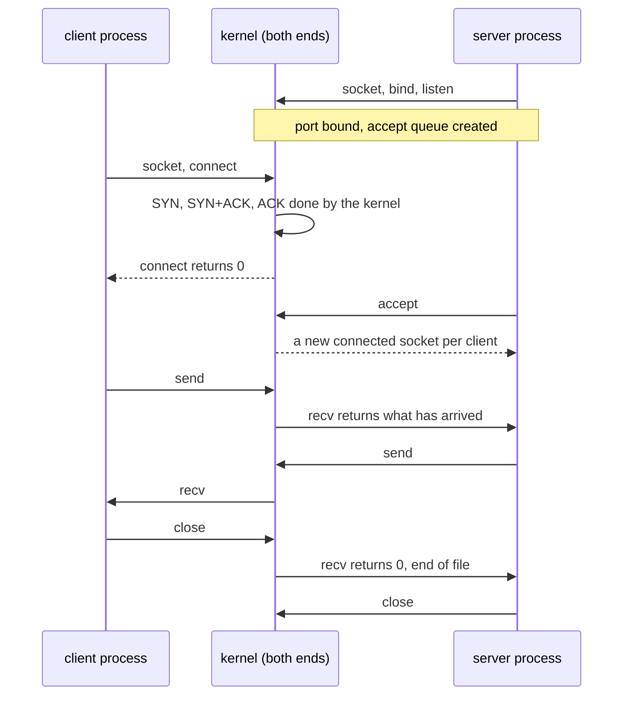

# NET 04: Socket programming in C: the API, partial reads and writes, framing, closing, timeouts and servers

*Part of the [networking plan](00_plan.md) · You need: [NET 03](03_tcp_udp_and_transport.md) (what TCP and UDP do on the wire), [C 02 to C 04](../02_c_language/00_plan.md) (pointers, structs, byte order), [OS 17](../05_operating_systems/00_plan.md) (file descriptors, system calls), [LX 08](../06_linux/08_linux_networking_toolbox.md) (`ss`, `tcpdump`, `strace`)*

NET 03 described what the transport layer does. This tutorial is the other side of the same line: the program you write against it. A socket program is short to write and quick to get subtly wrong, and the wrong versions all work on a developer's laptop. `recv` returns a whole message because loopback delivered it in one piece, `send` takes everything because the buffer was empty, `close` loses nothing because nothing was in flight. They fail in production, under load, on a slow link, with a peer that misbehaves.

A senior interview in this area is a hunt for exactly those failures: "the server reads 100 bytes but the client sent 300", "what happens when the client disconnects while you are writing", "how do you stop one slow client blocking everyone", "write the read loop". The strong answer shows the failure, names the rule it breaks, and writes the loop that does not have it. Every code block here compiles with `-Wall -Wextra`, and the ones that run were run under AddressSanitizer and UBSan.

By the end you can:

- name the system calls of a TCP server and client in order and say what each does on the wire;
- build a server and client with `getaddrinfo` so the code works for IPv4 and IPv6;
- explain byte order and serialize a header field by field instead of writing a struct;
- explain why `recv` returns less than you asked for and write `read_full` and `write_full`;
- frame a byte stream with a length prefix and survive every arrival pattern, including a hostile length;
- close a connection without losing the last response, and handle `SIGPIPE`;
- use UDP correctly, including `MSG_TRUNC` and connected UDP sockets;
- write a non-blocking server on `poll` that a slow client cannot stall, with a per-client cap;
- survive running out of file descriptors in the accept loop;
- bound every wait with a timeout and a deadline, and explain `EINTR`;
- choose socket options and know which ones do harm when set casually;
- debug a socket program with `strace`, `ss` and `tcpdump`.

All code below assumes this header block, compiled once at the top of one file:

```c
#define _GNU_SOURCE
#include <arpa/inet.h>
#include <errno.h>
#include <fcntl.h>
#include <netdb.h>
#include <netinet/in.h>
#include <poll.h>
#include <signal.h>
#include <stdint.h>
#include <stdio.h>
#include <stdlib.h>
#include <string.h>
#include <sys/socket.h>
#include <sys/time.h>
#include <sys/wait.h>
#include <time.h>
#include <unistd.h>
```

---

## 1. The socket API in one picture

A socket is a **file descriptor** (a small per-process integer) naming one endpoint of communication. For TCP the descriptors come in two kinds: a **listening socket**, which only accepts connections, and a **connected socket**, which carries one connection's bytes. A server holds one listening socket and one connected socket per client.



| Call | What it does | On the wire |
|---|---|---|
| `socket(domain, type, 0)` | creates an endpoint, returns a descriptor | nothing |
| `bind` | gives it a local address and port | nothing |
| `listen(fd, backlog)` | marks it a listener, creates the accept queue (NET 03 section 3.2) | nothing |
| `connect` | starts the handshake, blocks until done or failed | SYN out, SYN-ACK in, ACK out |
| `accept` | takes one **already completed** connection from the queue, returns a **new** descriptor | nothing: the kernel finished the handshake before `accept` ran |
| `send` / `recv` | copy bytes into or out of the socket buffers | data segments and ACKs |
| `shutdown(fd, how)` | closes one direction, keeps the descriptor | FIN for `SHUT_WR` |
| `close` | releases the descriptor, closes the connection if it was the last reference | FIN, or RST (section 6) |

Two facts that interviewers probe. `accept` does not perform the handshake: a client's `connect` can succeed while the server application is still busy, because the connection sits completed in the accept queue; that is why a slow server shows up as a full queue, not a refused connection. And `write`/`read` work on sockets too, but `send`/`recv` add a **flags** argument (`MSG_NOSIGNAL`, `MSG_DONTWAIT`, `MSG_PEEK`, `MSG_MORE`, `MSG_TRUNC`) that this tutorial uses.

## 2. A server and a client that work for IPv4 and IPv6

Do not hand-fill a `sockaddr_in`. **`getaddrinfo`** turns a host name and service into a list of addresses of any family, and the code tries each. This is the form to write in an interview.

```c
int listen_tcp(const char *port) {
    struct addrinfo hints = { .ai_family = AF_UNSPEC, .ai_socktype = SOCK_STREAM, .ai_flags = AI_PASSIVE };
    struct addrinfo *res, *p;
    if (getaddrinfo(NULL, port, &hints, &res) != 0) return -1;
    int fd = -1;
    for (p = res; p; p = p->ai_next) {
        fd = socket(p->ai_family, p->ai_socktype | SOCK_CLOEXEC, p->ai_protocol);
        if (fd < 0) continue;
        int on = 1;
        setsockopt(fd, SOL_SOCKET, SO_REUSEADDR, &on, sizeof on);   /* before bind */
        if (bind(fd, p->ai_addr, p->ai_addrlen) == 0 && listen(fd, 128) == 0) break;
        close(fd); fd = -1;
    }
    freeaddrinfo(res);
    return fd;
}

int dial_tcp(const char *host, const char *port) {
    struct addrinfo hints = { .ai_family = AF_UNSPEC, .ai_socktype = SOCK_STREAM };
    struct addrinfo *res, *p;
    if (getaddrinfo(host, port, &hints, &res) != 0) return -1;
    int fd = -1;
    for (p = res; p; p = p->ai_next) {                 /* try every address the name gives */
        fd = socket(p->ai_family, p->ai_socktype | SOCK_CLOEXEC, p->ai_protocol);
        if (fd < 0) continue;
        if (connect(fd, p->ai_addr, p->ai_addrlen) == 0) break;
        close(fd); fd = -1;
    }
    freeaddrinfo(res);
    return fd;
}
```

Points worth saying aloud:

- **`SO_REUSEADDR` before `bind`** lets a restarted server bind while old connections to the port sit in TIME_WAIT (NET 03 section 4). Without it a quick restart fails with `Address already in use`.
- **`listen`'s backlog** bounds the accept queue (the kernel also caps it at `net.core.somaxconn`). A full queue makes the kernel drop the final ACK or the SYN, so clients see timeouts.
- **`SOCK_CLOEXEC`** keeps the descriptor from leaking into a child created by `exec`.
- **Name resolution can block** for seconds (DNS). Do not call `getaddrinfo` inside an event loop.
- **Dual stack.** Binding an `AF_INET6` socket to `::` usually accepts IPv4 too (as mapped addresses), controlled by `IPV6_V6ONLY`. Clients should try every returned address, because a name often has an IPv6 and an IPv4 address and one may be unreachable; "Happy Eyeballs" (RFC 8305) races them.

A server then loops `accept` and handles each connection; a client writes and reads on the descriptor `dial_tcp` returned. Under `strace` the server shows `socket, setsockopt, bind, listen, accept, recvfrom, sendto, recvfrom` returning 0, `close`; a packet capture shows SYN, SYN-ACK and ACK **before** `accept` returns.

## 3. Addresses and byte order

Network protocols are **big-endian** ("network byte order"); x86 and most ARM Linux are little-endian. The value `0x11223344` sits in memory on a little-endian host as `44 33 22 11` and must go on the wire as `11 22 33 44`. Convert at every boundary: **`htons`/`htonl`** going out, **`ntohs`/`ntohl`** coming in. Forgetting `htons` on a port number binds the wrong port, and the symptom (connection refused on a number that looks transposed) is a classic.

**Never write a struct to the wire.** A struct has compiler padding, a host byte order and a host-specific layout. A struct with a 1, 4 and 2 byte field occupies 12 bytes in memory and should be 7 on the wire. Serialize field by field, and use `memcpy` rather than casting a byte buffer to a struct pointer (a cast is misaligned access, which is undefined behaviour in C).

```c
struct hdr { uint8_t type; uint32_t id; uint16_t len; };       /* 12 bytes in memory, with padding */

size_t hdr_put(uint8_t *out, const struct hdr *h) {            /* 7 bytes on the wire */
    uint32_t id = htonl(h->id); uint16_t len = htons(h->len);
    out[0] = h->type;
    memcpy(out + 1, &id, 4);
    memcpy(out + 5, &len, 2);
    return 7;
}

void hdr_get(const uint8_t *in, struct hdr *h) {
    uint32_t id; uint16_t len;
    h->type = in[0];
    memcpy(&id, in + 1, 4); memcpy(&len, in + 5, 2);
    h->id = ntohl(id); h->len = ntohs(len);
}
```

Run: `sizeof(struct hdr)` is 12, `hdr_put` writes 7 bytes, and `0x11223344` appears as `11 22 33 44` at offset 1. The same discipline applies to `sockaddr`: `struct sockaddr` is a type-erased header, and the real types are `sockaddr_in` (IPv4), `sockaddr_in6` and `sockaddr_un`; `sockaddr_storage` is big enough for any of them, and you pass the real length alongside.

## 4. A stream has no message boundaries

TCP is a byte stream (NET 03 section 3.4). `recv(fd, buf, 300, 0)` returns **whatever has arrived, up to 300 bytes**, which may be 1. Three `send` calls of 100 bytes can arrive as three `recv`s, as one, or split anywhere, and loopback hides this by delivering `send`-sized pieces.

What `recv` returns:

| Return | Meaning | What to do |
|---|---|---|
| `n > 0` | n bytes arrived, possibly fewer than asked | keep looping until you have what the protocol needs |
| **`0`** | the peer sent FIN: **end of file**, not an error and not "nothing yet" | stop reading, close; if mid-message it is a truncated message |
| `-1`, `EINTR` | a signal interrupted the call | retry |
| `-1`, `EAGAIN` / `EWOULDBLOCK` | non-blocking socket has nothing now, **or** a `SO_RCVTIMEO` timeout expired | wait for readiness, or treat as a timeout |
| `-1`, `ECONNRESET` | the peer sent RST | the connection is gone; close |
| `-1`, `ETIMEDOUT` | the kernel gave up retransmitting or keepalive failed (NET 03 section 10) | close, reconnect |

`send` has the mirror problem: it **may accept fewer bytes than you gave it**, always on a non-blocking socket whose send buffer is full, and on a blocking socket after a signal. Ignoring the return value silently loses data. The two loops every network programmer must be able to write:

```c
/* 1 = got n bytes, 0 = clean EOF before the first byte, -1 = error, or EOF mid-message */
int read_full(int fd, void *buf, size_t n) {
    char *p = buf; size_t got = 0;
    while (got < n) {
        ssize_t k = recv(fd, p + got, n - got, 0);
        if (k > 0) { got += (size_t)k; continue; }
        if (k == 0) return got == 0 ? 0 : -1;          /* EOF */
        if (errno == EINTR) continue;                  /* a signal, not a failure */
        return -1;
    }
    return 1;
}

int write_full(int fd, const void *buf, size_t n) {
    const char *p = buf; size_t sent = 0;
    while (sent < n) {
        ssize_t k = send(fd, p + sent, n - sent, MSG_NOSIGNAL);
        if (k >= 0) { sent += (size_t)k; continue; }
        if (errno == EINTR) continue;
        return -1;                                     /* EPIPE, ECONNRESET, ... */
    }
    return 0;
}
```

The three return values of `read_full` matter: **a clean EOF between messages is normal** (the peer finished), **an EOF in the middle of a message is an error** (truncation). `MSG_WAITALL` asks the kernel to loop for you, but it can still return short on a signal, a timeout or EOF, so portable code keeps the loop. On a **non-blocking** socket the loop becomes a state machine: a buffer and an offset per connection, resumed whenever `poll` reports readiness (section 8).

## 5. Framing: turning a stream into messages

Because TCP keeps no boundaries, **the protocol must supply them**. Three ways:

| Method | Example | Trade-off |
|---|---|---|
| Fixed size | a 64-byte record | fast and rigid |
| Delimiter | HTTP/1 headers end at a blank line, Redis inline commands end at a newline | human readable, but the payload must be escaped or its length known |
| **Length prefix** | TLS records, HTTP/2 frames, most binary RPC | cheap to parse, binary safe; **the length is untrusted input** |

```c
#define MAXFRAME (1u << 20)

int send_frame(int fd, const void *payload, uint32_t len) {
    uint32_t be = htonl(len);                          /* a 4 byte length in network order */
    if (send(fd, &be, 4, MSG_NOSIGNAL | MSG_MORE) != 4) return -1;   /* MSG_MORE: more follows, do not send a tiny segment */
    return write_full(fd, payload, len);
}

/* returns the length, or -1 on error, EOF or an oversized claim. The caller frees *out. */
ssize_t recv_frame(int fd, uint8_t **out) {
    uint32_t be;
    if (read_full(fd, &be, 4) != 1) return -1;
    uint32_t len = ntohl(be);
    if (len > MAXFRAME) return -1;                     /* never trust a length from the wire */
    uint8_t *buf = malloc(len ? len : 1);
    if (!buf) return -1;
    if (len && read_full(fd, buf, len) != 1) { free(buf); return -1; }
    *out = buf;
    return (ssize_t)len;
}
```

**The cap is the security feature.** Without it a peer sends the length `0xFFFFFFFF` and the server allocates 4 GB, or waits for it while holding the connection. With it the server refuses at once. The same reasoning applies to delimiters: bound the length of a line, or a peer that never sends a newline grows your buffer without limit.

A hostile test set for any framing code: **one byte per write** (a 300-byte frame sent as 300 `send`s), **three frames in one write**, an **empty frame** (length 0 is legal), a frame claiming **2 GB** (must be refused), and a **connection closed mid-frame**. Run against the code above: the dribbled frame returned 300, the empty frame 0, "hello" 5, and the 2 GB claim `-1`, with AddressSanitizer clean. Also note `send_frame` sends the header with `MSG_MORE` so header and payload leave as one segment, avoiding the Nagle and delayed-ACK stall of NET 03 section 8; building one buffer and sending once is better when the payload is small.

## 6. Closing a connection correctly

### 6.1 close, shutdown, half-close

`close(fd)` drops your reference; if it was the last, the kernel sends FIN after any queued data. After `close` you cannot read what the peer is still sending. **`shutdown(fd, SHUT_WR)`** is "I am done sending": it sends FIN but keeps the descriptor, so you can **keep reading until the peer is done too**. That is the half-close.

It solves the protocol where a request has no length: a client sends everything, calls `shutdown(SHUT_WR)`, and the server's read-until-EOF loop finishes and replies. Without the shutdown, both sides wait forever: the server for more input, the client for a reply (the program hangs with an idle CPU).

### 6.2 close with unread data sends RST

If you `close` a socket whose **receive queue still holds unread data**, Linux sends **RST**, not FIN, because the data you never read cannot be delivered anywhere. The RST also makes the peer discard what it had not yet read, so **a response still in flight is lost**, and the peer's next read fails with `ECONNRESET` instead of a clean EOF. This is the classic "the last response sometimes vanishes" bug: a server replies with an error and closes, but the client's request was still arriving.

The polite close:

```c
/* Finish a conversation without losing the last response. */
void close_politely(int fd) {
    shutdown(fd, SHUT_WR);                             /* FIN, after the queued data */
    char junk[4096];
    struct pollfd p = { .fd = fd, .events = POLLIN };
    while (poll(&p, 1, 1000) > 0) {                    /* drain whatever the peer still sends */
        ssize_t k = recv(fd, junk, sizeof junk, 0);
        if (k <= 0) break;                             /* EOF or error: the peer is done */
    }
    close(fd);                                         /* nothing unread, so a FIN and not a RST */
}
```

Web servers call this "lingering close" (nginx `lingering_close`). `SO_LINGER` with a zero timeout is the deliberate opposite: `close` sends RST at once and discards unsent data, which is occasionally right for an abusive client and wrong almost everywhere else.

### 6.3 Writing to a closed connection: SIGPIPE

When the peer has gone, the **first write after its FIN succeeds** (the kernel cannot know yet), the peer's kernel answers with RST, and the **next write fails with `EPIPE` and raises `SIGPIPE`**, whose default action **kills the process**. One client disconnecting must not kill a server. Either pass **`MSG_NOSIGNAL`** to every `send` (as `write_full` does) or `signal(SIGPIPE, SIG_IGN)` at start-up; macOS has no `MSG_NOSIGNAL` (use `SO_NOSIGPIPE`). Run: with `MSG_NOSIGNAL`, a write to a closed peer returned `-1` with `Broken pipe`, and after a real peer close the first write returned success and the second `EPIPE`. Treat `EPIPE` and `ECONNRESET` as "close this connection", never as a fatal error.

## 7. UDP in C

UDP has no connection: `sendto` names the destination every call, `recvfrom` reports who sent it, and **each call moves exactly one datagram** with boundaries kept.

```c
void udp_demo(void) {
    int rx = socket(AF_INET, SOCK_DGRAM, 0), tx = socket(AF_INET, SOCK_DGRAM, 0);
    struct sockaddr_in a = { .sin_family = AF_INET, .sin_addr.s_addr = htonl(INADDR_LOOPBACK) };
    bind(rx, (struct sockaddr *)&a, sizeof a);                       /* port 0: the kernel picks */
    socklen_t l = sizeof a; getsockname(rx, (struct sockaddr *)&a, &l);
    sendto(tx, "0123456789", 10, 0, (struct sockaddr *)&a, sizeof a);
    sendto(tx, "", 0, 0, (struct sockaddr *)&a, sizeof a);           /* an empty datagram is a message */
    char buf[8];
    ssize_t n = recvfrom(rx, buf, sizeof buf, MSG_TRUNC, NULL, NULL);
    printf("1st datagram: buffer 8, MSG_TRUNC reports %zd (the rest was discarded)\n", n);
    n = recvfrom(rx, buf, sizeof buf, 0, NULL, NULL);
    printf("2nd datagram: %zd bytes, and it is still a separate message\n", n);
    close(rx); close(tx);
}
```

This printed `10` for the first datagram into an 8-byte buffer and `0` for the second. The rules:

- **A buffer smaller than the datagram truncates silently**: the extra bytes are discarded, and `MSG_TRUNC` makes `recvfrom` return the true size so you can detect it. Size receive buffers for the largest datagram you accept.
- **Zero-length datagrams are valid**; a `recv` of 0 on UDP is not EOF.
- **`connect` on a UDP socket** only fixes the default peer: it lets you use `send`, makes the kernel **drop datagrams from other sources**, and makes ICMP errors (port unreachable) show up as `ECONNREFUSED` on the next call. An unconnected socket ignores them.
- **You own reliability**: numbering, timeouts, retries with backoff (NET 03 section 11), and congestion behaviour. Keep datagrams under about 1,200 bytes to avoid fragmentation. Receive and send buffers are per socket, so a burst larger than `SO_RCVBUF` is dropped silently; `nstat` shows `UdpRcvbufErrors`.

## 8. Serving many clients

| Model | Idea | Fits |
|---|---|---|
| **Process or thread per connection** | blocking code, one flow per thread | hundreds of connections, simplest to write and debug |
| **Thread pool, blocking** | a bounded set of threads takes connections | moderate load; a slow client still pins a thread |
| **Event loop (`poll`, `epoll`)** | non-blocking sockets, one thread watches many | tens of thousands of mostly idle connections; needs explicit state machines |
| **One accept loop per core with `SO_REUSEPORT`** | several listeners on one port, the kernel hashes connections among them | multi-core scaling without a shared accept lock |

`select` is limited to descriptors below 1024 (a larger one corrupts memory); `poll` has no such limit but costs **O(n) per call** because the kernel scans every descriptor; **`epoll`** costs about O(ready) and is the Linux answer ([NET 05](05_epoll_and_io_uring.md)). The rest of this section builds the safe version on `poll`.

### 8.1 The rules of a non-blocking server

1. **Every client socket is non-blocking**, so no call can stall the loop.
2. **Each connection has an input buffer and an output buffer.** Bytes you cannot send now go in the output buffer.
3. **Ask for `POLLOUT` only while that buffer is non-empty**; otherwise `poll` returns at once, because a socket with room is always writable (a busy loop).
4. **Cap the output buffer.** A client that never reads would otherwise grow your memory without bound; when it passes the cap, drop it.
5. **Never remove a client inside the loop that iterates the clients.** Mark it dead and sweep after the loop.
6. **Bound the work per client per round**, so one busy client cannot starve the rest.

```c
#define MAXCLI  64
#define MAXOUT  (64 * 1024)                    /* per-client output cap: the slow-consumer policy */

struct cli { int fd; size_t outlen; char out[MAXOUT]; };

/* Queue bytes for a client; 0 means it fell too far behind and must be dropped. */
static int queue_out(struct cli *c, const char *d, size_t n) {
    if (c->outlen + n > MAXOUT) return 0;
    memcpy(c->out + c->outlen, d, n); c->outlen += n;
    return 1;
}

/* Echo server on poll: non-blocking sockets, write only when POLLOUT says there is room. */
void serve(int lfd, int rounds) {
    static struct cli cl[MAXCLI];
    int n = 0;
    while (rounds--) {
        struct pollfd pf[MAXCLI + 1];
        pf[0] = (struct pollfd){ .fd = lfd, .events = POLLIN };
        for (int i = 0; i < n; i++)            /* ask for POLLOUT only while a backlog exists */
            pf[i + 1] = (struct pollfd){ .fd = cl[i].fd, .events = POLLIN | (cl[i].outlen ? POLLOUT : 0) };
        if (poll(pf, (nfds_t)n + 1, 1000) <= 0) continue;
        if ((pf[0].revents & POLLIN) && n < MAXCLI) {
            int fd = accept4(lfd, NULL, NULL, SOCK_NONBLOCK | SOCK_CLOEXEC);
            if (fd >= 0) { cl[n].fd = fd; cl[n].outlen = 0; n++; }
        }
        for (int i = 0; i < n; i++) {
            short re = pf[i + 1].revents; int dead = 0;
            if (re & POLLIN) {
                char buf[4096]; ssize_t k = recv(cl[i].fd, buf, sizeof buf, 0);
                if (k > 0) dead = !queue_out(&cl[i], buf, (size_t)k);
                else if (k == 0 || (errno != EAGAIN && errno != EINTR)) dead = 1;
            }
            if (!dead && (re & POLLOUT) && cl[i].outlen) {
                ssize_t k = send(cl[i].fd, cl[i].out, cl[i].outlen, MSG_NOSIGNAL);
                if (k > 0) { memmove(cl[i].out, cl[i].out + k, cl[i].outlen - (size_t)k); cl[i].outlen -= (size_t)k; }
                else if (errno != EAGAIN && errno != EINTR) dead = 1;
            }
            if (re & (POLLERR | POLLHUP | POLLNVAL)) dead = 1;
            if (dead) { close(cl[i].fd); cl[i].fd = -1; }
        }
        int w = 0;                             /* sweep after the loop, never inside it */
        for (int i = 0; i < n; i++) if (cl[i].fd >= 0) cl[w++] = cl[i];
        n = w;
    }
}
```

The test that matters is a **slow client**. Run: one client pushed about 6 MB at the server and **never read**; a second client then ran 20,000 request-and-echo exchanges and **all 20,000 came back correct** in about 0.6 s, while the server stayed responsive. The slow client's backlog passed the 64 KB cap, the server **closed it**, and when that client finally read, it got the 85 KB that had been queued and then EOF. That is the policy in action: no stall for the fast client, bounded memory, and the offender removed. (`recv` returning 0 on a half-closed client is treated as dead here; a protocol that allows half-close keeps the connection until the output drains.)

### 8.2 The accept loop, and running out of descriptors

`accept` can fail in ways that matter:

- **`EINTR`**: retry. **`ECONNABORTED`**: the client gave up before you accepted; ignore and continue.
- **`EAGAIN`** on a non-blocking listener: the queue is empty.
- **`EMFILE` / `ENFILE`**: the process (or system) is out of descriptors. **The connection stays in the accept queue**, so the listener stays readable, and a loop that just retries **spins at 100 percent CPU** making millions of failing calls.

The standard cure is a **spare descriptor**: keep one open (`/dev/null`), and on `EMFILE` close it, `accept` the waiting client, hang up on it, then take the spare back. The client gets a clean close instead of a hang, and the loop stays calm.

```c
/* One accept that survives EMFILE. Returns a client fd, or -1 (nothing to do now: back to poll). */
int accept_one(int lfd, int *spare) {
    for (;;) {
        int c = accept4(lfd, NULL, NULL, SOCK_NONBLOCK | SOCK_CLOEXEC);
        if (c >= 0) return c;
        if (errno == EINTR || errno == ECONNABORTED) continue;   /* a signal, or the client gave up first */
        if (errno == EMFILE || errno == ENFILE) {
            close(*spare);                                       /* free one slot ... */
            c = accept(lfd, NULL, NULL);                         /* ... take the waiting client ... */
            if (c >= 0) close(c);                                /* ... hang up on it ... */
            *spare = open("/dev/null", O_RDONLY | O_CLOEXEC);    /* ... and take the slot back */
        }
        return -1;                                               /* EAGAIN, or one client turned away */
    }
}
```

Run with 12 clients queued and the process at its descriptor limit: 12 calls turned away 12 clients, with no spin. Other cures: pause accepting (remove the listener from `poll`) until a slot frees, or raise `RLIMIT_NOFILE`. Use **`accept4` with `SOCK_NONBLOCK | SOCK_CLOEXEC`** (one call instead of three, and race free in multi-threaded programs). Several processes or threads can each hold a listener with **`SO_REUSEPORT`** and the kernel spreads connections by a hash of the 4-tuple; this balances by hash, not by load, and a restart of one listener can briefly reset connections that hashed to it.

## 9. Timeouts and deadlines

Every call that waits on the network can wait **forever**: `connect` to a silent host, `recv` from a quiet peer, `send` to a receiver with a zero window, `accept` when nobody comes. A production program gives each wait a limit.

| Tool | Bounds | Notes |
|---|---|---|
| **Non-blocking `connect`, then `poll`** | `connect` | the portable way; read the result with `getsockopt(SO_ERROR)` |
| **`SO_RCVTIMEO`, `SO_SNDTIMEO`** | **one** `recv` or `send` call | fails with `EAGAIN`, not `ETIMEDOUT` (a classic confusion) |
| **`poll` with a timeout** | any wait you can express as readiness | pass the **remaining** time each round |
| **`TCP_USER_TIMEOUT`, keepalive** | unacknowledged data, idle connections | kernel level; finds a peer that vanished (NET 03 section 10) |

```c
static long now_ms(void) {
    struct timespec t; clock_gettime(CLOCK_MONOTONIC, &t);
    return t.tv_sec * 1000 + t.tv_nsec / 1000000;
}

int connect_timeout(const struct sockaddr *a, socklen_t alen, int ms) {
    int fd = socket(a->sa_family, SOCK_STREAM | SOCK_NONBLOCK | SOCK_CLOEXEC, 0);
    if (fd < 0) return -1;
    if (connect(fd, a, alen) == 0) goto ok;
    if (errno != EINPROGRESS) goto fail;
    struct pollfd p = { .fd = fd, .events = POLLOUT };
    int r;
    do { r = poll(&p, 1, ms); } while (r < 0 && errno == EINTR);
    if (r == 0) { errno = ETIMEDOUT; goto fail; }
    int err = 0; socklen_t l = sizeof err;
    getsockopt(fd, SOL_SOCKET, SO_ERROR, &err, &l);    /* writable also means "refused": ask */
    if (err) { errno = err; goto fail; }
ok:
    fcntl(fd, F_SETFL, fcntl(fd, F_GETFL) & ~O_NONBLOCK);
    return fd;
fail:
    close(fd);
    return -1;
}

/* Read exactly n bytes within ONE deadline for the whole read, not per call. */
int read_deadline(int fd, char *buf, size_t n, int ms) {
    long end = now_ms() + ms; size_t got = 0;
    while (got < n) {
        long left = end - now_ms();
        if (left <= 0) { errno = ETIMEDOUT; return -1; }
        struct pollfd p = { .fd = fd, .events = POLLIN };
        int r = poll(&p, 1, (int)left);                /* the REMAINING time, every round */
        if (r < 0 && errno == EINTR) continue;
        if (r <= 0) { if (r == 0) errno = ETIMEDOUT; return -1; }
        ssize_t k = recv(fd, buf + got, n - got, 0);
        if (k <= 0) return -1;
        got += (size_t)k;
    }
    return 0;
}
```

Three points the code encodes. **Writable does not mean connected**: a refused connection also makes the socket writable, so `connect_timeout` reads `SO_ERROR` for the truth. **Refused versus filtered**: a closed port answers the SYN with RST and `connect` fails in about a millisecond; a firewall that drops the SYN gives silence, and only your own timeout ends it (otherwise the kernel retries for about two minutes, `tcp_syn_retries`). Run against a closed local port: `Connection refused` in 0 ms. **A per-call timeout is not a deadline**: a peer sending one byte every few hundred milliseconds satisfies a 500 ms `SO_RCVTIMEO` on every call and can hold a 10-byte read open for 3 seconds, or forever for a longer message (**slowloris**). `read_deadline` fixes it by computing the time left before each wait; run against a peer sending one byte every 300 ms, it stopped at about 1000 ms for a 1000 ms deadline. The same logic applies a level up: a request that calls three backends needs one **budget** divided among them, not three independent timeouts that add up to more than the caller allowed.

### 9.1 EINTR

A signal handler that runs while a thread is blocked in `recv` can make the call return `-1` with **`EINTR`**. The loops above retry. Whether a signal interrupts depends on how the handler was installed, and one case surprises almost everyone:

```c
static void on_alarm(int sig) { (void)sig; }

void install_handler(int restart) {
    struct sigaction sa;
    memset(&sa, 0, sizeof sa);
    sa.sa_handler = on_alarm;
    sa.sa_flags = restart ? SA_RESTART : 0;
    sigaction(SIGALRM, &sa, NULL);
}
```

Run with a 200 ms alarm and a byte arriving at 600 ms:

| Setup | Result |
|---|---|
| no flags | `recv` returned `-1` `EINTR` at 200 ms |
| `SA_RESTART` | the kernel restarted `recv`, which returned the byte at 600 ms |
| `SA_RESTART` **and** `SO_RCVTIMEO` | `recv` failed with `EINTR` at 200 ms anyway |

A call that has a timeout is **not restarted** (documented in `signal(7)`), because the remaining time would be unclear. So **always loop on `EINTR`**, whatever flags you think you set, and when you use `poll` with a timeout, recompute the remaining time after an `EINTR`, or the total wait grows with every signal.

## 10. Socket options

`setsockopt` and `getsockopt` take a **level** (`SOL_SOCKET`, `IPPROTO_TCP`, `IPPROTO_IP`) and an option.

| Option | Does | Notes |
|---|---|---|
| `SO_REUSEADDR` | `bind` succeeds while old connections sit in TIME_WAIT | set on **every** server listener before `bind` |
| `SO_REUSEPORT` | several sockets bind one port, the kernel spreads connections | per-core accept loops |
| `SO_RCVBUF`, `SO_SNDBUF` | socket buffer sizes | Linux **doubles** the value and caps it at `rmem_max` / `wmem_max`; an explicit setting **turns off auto-tuning** |
| `TCP_NODELAY` | turns off Nagle | for request and response protocols with small writes (NET 03 section 8) |
| `SO_KEEPALIVE`, `TCP_KEEPIDLE`, `TCP_KEEPINTVL`, `TCP_KEEPCNT` | probe an idle connection | defaults detect a dead peer after about 2 hours |
| `TCP_USER_TIMEOUT` | how long sent data may stay unacknowledged | bounds the 15-minute give-up |
| `SO_LINGER` | what `close` does with unsent data | zero timeout sends RST (section 6.2) |
| `SO_RCVTIMEO`, `SO_SNDTIMEO` | per call timeout | does not bound a whole message |
| `TCP_QUICKACK` | acknowledge at once | not permanent, do not rely on it |
| `TCP_CORK`, `MSG_MORE` | hold partial frames until full or uncorked | assemble header plus body |
| `TCP_CONGESTION` | congestion control per socket (`cubic`, `bbr`) | NET 03 section 7 |
| `SO_BINDTODEVICE`, `IP_TOS`, `SO_PRIORITY`, `SO_BUSY_POLL` | pin to an interface, mark traffic, spin-poll | QoS and low latency work |

**Buffers deserve care.** On a typical Linux the default receive buffer is the middle value of `tcp_rmem` (131,072 bytes) and the send buffer 16,384, and both **auto-tune upward** during a connection. Setting `SO_RCVBUF` to 4096 reads back **8192** (doubled), and asking for 64 MB reads back **twice `rmem_max`**, clamped silently with no error. Two consequences: do not set `SO_RCVBUF` or `SO_SNDBUF` casually, because on Linux it **disables auto-tuning** for that buffer and a fixed small buffer caps a long path at window over RTT (NET 03 section 6); and a program cannot exceed the sysctl limit without the privileged `SO_RCVBUFFORCE`, so a "high-throughput client" asking for 64 MB on a default system quietly gets far less.

## 11. Packet and raw sockets

When you need to see or build packets rather than streams: **`AF_PACKET` with `SOCK_RAW`** delivers whole Ethernet frames (a sniffer, the basis of `tcpdump`), and a **raw socket** (`SOCK_RAW` with `IPPROTO_ICMP`) lets a program build ICMP itself (`ping`). Both need `CAP_NET_RAW`. The practice that keeps such code correct:

- parse with **explicit offsets and `memcpy`** into an aligned header, never a cast of the receive buffer, and convert with `ntohs`/`ntohl`;
- compute the **Internet checksum** for ICMP (a ones-complement sum of 16-bit words) and match replies by identifier and sequence number;
- attach a **BPF filter** so the kernel copies only the packets you want instead of everything;
- remember that the kernel's own TCP stack also sees the traffic: a raw socket does not stop it replying.

Packet sockets and raw ICMP are described here from the man pages (`packet(7)`, `raw(7)`) and were not run for this tutorial.

## 12. Debugging a socket program

| Tool | What it tells you |
|---|---|
| `strace -f -e trace=network,poll,read,write` | the exact calls and return values, including `EINTR`, `EAGAIN`, short writes |
| `ss -tanp`, `ss -ltn` | connection states, `Recv-Q` and `Send-Q`; for a LISTEN socket the accept queue and its limit |
| `ss -ti` | `rtt`, `cwnd`, `retrans`, `rwnd_limited`, `app_limited` (NET 03 section 12) |
| `tcpdump -nn -i any port N` | what really crossed the wire: RST, zero window, retransmissions |
| `lsof -p PID`, `ls /proc/PID/fd` | descriptor leaks |
| `nstat -az` | `ListenOverflows`, `TcpExtTCPAbortOnClose`, `UdpRcvbufErrors` |

| Symptom | First suspicion |
|---|---|
| server hangs, idle CPU, client waiting for a reply | request with no length and no `shutdown(SHUT_WR)`, or a deadlock between two blocking writers |
| works with small data, hangs with large | both sides write before reading; buffers fill; or a partial `send`/`recv` bug |
| server dies when a client disconnects | `SIGPIPE` |
| client sometimes loses the last response | close with unread data (RST), section 6.2 |
| 100 percent CPU at high connection counts | `EMFILE` accept spin, or a missing `POLLOUT` discipline |
| `Address already in use` on restart | no `SO_REUSEADDR`, or another process on the port |
| descriptor count grows | a path that returns without `close`, or many CLOSE_WAIT sockets (NET 03 section 4) |

## 13. Common mistakes

1. **Assuming one `recv` returns one message.**
2. **Ignoring the return value of `send`.**
3. **Treating `recv` returning 0 as an error, or as "nothing yet".**
4. **Forgetting `htons`/`htonl`, or writing a struct to the wire.**
5. **Trusting a length field from the wire.**
6. **No `MSG_NOSIGNAL` or `SIG_IGN`, so one disconnect kills the server.**
7. **`close` with unread data, losing the last response.**
8. **No half-close for a request without a length.**
9. **A blocking call with no timeout, or a per-call timeout where a deadline is needed.**
10. **Not looping on `EINTR`.**
11. **Blocking inside an event loop, or no cap on a slow client's backlog.**
12. **A busy loop on a failing `accept`.**
13. **Removing a client inside the loop that iterates the clients.**
14. **`select` with descriptors above 1023.**
15. **Setting `SO_RCVBUF` casually.**
16. **Casting a packet buffer to a header struct.**

## 14. Interview questions

1. **Your server reads 100 bytes but the client sent 300. What happened?** TCP is a stream; `recv` returns what has arrived. Loop until you have the bytes the protocol needs, which means the protocol must say how many.
2. **Write `read_full` and `write_full`.** Section 4: retry on `EINTR`, treat 0 as EOF, loop on short counts, `MSG_NOSIGNAL` on send.
3. **What does `accept` do, and does it perform the handshake?** It dequeues a connection the kernel already completed and returns a new descriptor.
4. **What happens when a client disconnects while the server is writing?** First write succeeds, peer answers RST, next write is `EPIPE` plus `SIGPIPE`; use `MSG_NOSIGNAL`.
5. **A client sends a request and closes, but the response never arrives. Why?** Close with unread data sent RST, or the server wrote after the close; use `shutdown(SHUT_WR)`, drain, then `close`.
6. **How do you frame messages?** Fixed size, delimiter or length prefix; cap the length; handle partial arrival.
7. **How do you stop one slow client stalling a server for thousands?** Non-blocking sockets, per-client output buffer, `POLLOUT` only with a backlog, a cap and drop policy, bounded work per round.
8. **Blocking, non-blocking, multiplexed: when each?** Thread per connection for hundreds; event loop for many idle connections; `select` is capped at 1024, `poll` is O(n), `epoll` is O(ready).
9. **What is `EAGAIN` on a blocking socket?** A `SO_RCVTIMEO` or `SO_SNDTIMEO` timeout expired; it is not `ETIMEDOUT`.
10. **A per-call timeout of 5 s is set. Can a peer still hold the connection a minute?** Yes, by dribbling one byte every 4 s; use a deadline for the whole message.
11. **How do you connect with a timeout?** Non-blocking `connect`, `poll` for writability, then `SO_ERROR`.
12. **Why does `accept` fail with `EMFILE` and why does the server then burn CPU?** The connection stays queued, the listener stays readable, the loop retries instantly; spare descriptor, pause, or raise the limit.
13. **What do `SO_REUSEADDR` and `SO_REUSEPORT` do?** TIME_WAIT bind, and several listeners on one port with hash spreading.
14. **Why is `SO_RCVBUF` read back as double what you set?** Linux doubles it for bookkeeping, caps it at `rmem_max`, and disables auto-tuning.
15. **How would you write `ping` or a sniffer?** Raw or `AF_PACKET` socket, `CAP_NET_RAW`, `memcpy` parsing, checksum, BPF filter.

## 15. Scenarios and design questions

**S1. Write a line reader for a socket.** *Where to practise:* a C file with a forked peer writing hostile patterns. *Approach:* keep a buffer and length per connection; search it with `memchr` for `\n` first and `recv` only when none; `memmove` the rest down after returning a line; report a clean EOF, an over-long line and an EOF mid-line differently; test one byte per write, three lines in one write, a 200-byte line into a 64-byte buffer.

**S2. Find the bugs in a 20-line echo server.** *Where to practise:* write one deliberately with a single `recv` and a `send`, run under `-fsanitize=address`. *Approach:* check every return value and every use as an index; for each `continue` and `break` ask what happens to the descriptor; for `send` ask about the partial write and a vanished peer; count descriptors with `ls /proc/PID/fd`.

**S3. Connect to the first of several addresses that answers.** *Where to practise:* a lab with one dropped address, one non-existent, one live. *Approach:* non-blocking `connect` plus `poll` per address, a cap per address and one deadline for the whole attempt; the per-address timeout is the smaller of the cap and the time left; check that the total stops on time even if the working address is never reached.

**S4. A netcat clone that cannot deadlock.** *Where to practise:* copy a large random file through an echo server and compare hashes. *Approach:* the naive design (write all of stdin, then read) hangs because the echo server blocks writing to a client that is not reading; use one `poll` over stdin and the socket, read stdin only when the previous chunk is fully sent, and pass stdin EOF on as `shutdown(SHUT_WR)`.

**S5. Design the I/O model for a gateway holding 50,000 mostly idle connections.** *Where to practise:* sketch it, then NET 05. *Approach:* event loop on `epoll`, a thread per core with `SO_REUSEPORT`, state machine per connection, per-connection caps and deadlines, descriptor limits and the `EMFILE` plan, and a drain on shutdown.

**S6. Clients intermittently report "connection reset" on the last response.** *Where to practise:* a server that closes with unread request bytes. *Approach:* reproduce with a capture showing RST instead of FIN; fix with `shutdown(SHUT_WR)`, drain, `close`.

## 16. Strong answers (outlines)

**S1.** One buffer and a fill count per connection. Each call: `memchr` for the newline; if found, copy the line out and `memmove` the remainder; if not, `recv` more; stop with an error if the buffer is full with no newline; return a distinct code for EOF at a line boundary and EOF mid-line.

**S2.** Typical bugs: one `recv` assumed to be a message, `send` return ignored, 0 treated as data, a descriptor not closed on an error path, no `SIGPIPE` handling, a size from the peer used as an index. Prove one with ASan, one by watching `/proc/PID/fd` grow, and explain the third (the partial write) by noting it only appears with a full send buffer.

**S3.** A loop over addresses; each iteration computes `left = deadline - now` and uses `min(cap, left)` as the `poll` timeout; refused addresses fail in about a round trip, filtered ones only at the cap; the first success wins; the last error is returned if all fail. Happy Eyeballs races them instead of trying one after another.

**S4.** Two directions must progress independently: `poll` on stdin and the socket with a non-blocking socket, a send buffer that holds the pending chunk, `POLLOUT` only when something is pending, and `shutdown(SHUT_WR)` on stdin EOF so the peer knows the request ended, then keep reading until the peer's EOF.

**S5.** `epoll` edge or level triggered per worker, one listener per core, a small fixed struct per connection with input and output buffers and a deadline, a timer wheel for idle timeouts, a cap on the output buffer, `RLIMIT_NOFILE` raised and the spare descriptor trick, connection draining on deploy, and metrics for the accept queue (`ss -ltn`) and `ListenOverflows`.

**S6.** The capture shows RST where FIN was expected. The server closed while its receive queue held unread data. Read and discard (drain) until the peer's FIN, after `shutdown(SHUT_WR)`, with a timeout so a hostile client cannot hold the connection open.

## 17. Cheat sheet

| Topic | Rule |
|---|---|
| Server | `socket`, `SO_REUSEADDR`, `bind`, `listen`, loop `accept`; client `socket`, `connect` (or `getaddrinfo` and loop) |
| `recv` | `n>0` bytes, **0 is EOF**, `EINTR` retry, `EAGAIN` not ready or timeout |
| `send` | may take fewer bytes; `EPIPE` plus `SIGPIPE`; the first write after the peer's FIN succeeds |
| Stream | loop for n bytes; delimiter, length prefix or fixed size; **cap the length** |
| Byte order | `htons`/`htonl`/`ntohs`/`ntohl`; serialize field by field; `memcpy`, never cast |
| Closing | `shutdown(SHUT_WR)` is "done sending"; `close` with unread data sends **RST**; shutdown, drain, close |
| UDP | one datagram per call; `MSG_TRUNC` reports the real size; `connect` filters by peer; you own retries |
| Servers | thread per connection for hundreds; event loop for many; buffer in and out; `POLLOUT` only with a backlog; cap; mark then sweep |
| Accept | handle `EINTR`, `ECONNABORTED`, `EMFILE` (spare fd); `accept4` with `SOCK_NONBLOCK | SOCK_CLOEXEC` |
| Timeouts | `connect`: non-blocking, `poll`, `SO_ERROR`; per-call timeout bounds silence, a **deadline** bounds a message; pass the remaining time |
| `EINTR` | `SA_RESTART` does not restart a call with a timeout; always loop |
| Options | `SO_RCVBUF` is doubled, capped, and disables auto-tuning; `TCP_NODELAY` for small writes; keepalive and `TCP_USER_TIMEOUT` for dead peers |
| Raw | `AF_PACKET`, raw ICMP, `CAP_NET_RAW`, `memcpy` parse, BPF filter |

## 18. Sources and caveats

Sources used for interview framing and cross-checking: [Beej's Guide to Network Programming](https://beej.us/guide/bgnet/), [Build Your Own Redis: TCP server and client](https://build-your-own.org/redis/03_hello_cs), [socket interview Q&A collection](https://robinali34.github.io/blog_cpp/2025/11/16/cpp-computer-network-interview-qa) and [socket programming tips and pitfalls](https://packtpub.com/en-ca/product/hands-on-network-programming-with-c-9781789349863/chapter/answers-to-questions-19/section/chapter-13-socket-programming-tips-and-pitfalls-ch19lvl1sec61). Reference material: the Linux manual pages ([man7.org](https://man7.org/linux/man-pages/): `socket(7)`, `tcp(7)`, `udp(7)`, `packet(7)`, `raw(7)`, `signal(7)`, `accept4(2)`, `poll(2)`, `getaddrinfo(3)`), the kernel's `ip-sysctl` documentation, Stevens, Fenner and Rudoff, *Unix Network Programming Volume 1*, Kerrisk, *The Linux Programming Interface*, and RFC 9293 and RFC 8305 (Happy Eyeballs).

Caveats. Every C block compiles with `-Wall -Wextra`. The `read_full`/`write_full`, framing, header serialization, polite close, `connect_timeout`, `read_deadline`, `accept_one`, `poll` server and UDP code were run on one Linux VM under AddressSanitizer and UBSan, on loopback, so round trips are tiny and no packet is lost; bugs that need a slow or lossy path were produced with a receiver that never reads. Timing-dependent figures (the RST case, the poll server's 0.6 s) vary run to run: read their structure, not the last digit. The `SO_RCVBUF` doubling and the `poll` per-call cost figures, the `SO_REUSEPORT` spread, and the packet and raw socket material come from earlier runs of the previous version of this tutorial or from the man pages, and were not re-run. Everything is IPv4 and Linux; `getaddrinfo` dual-stack behaviour is described from the documentation (the VM has no IPv6), and macOS and BSD differ in `MSG_NOSIGNAL`, `accept4` and some option behaviours.
