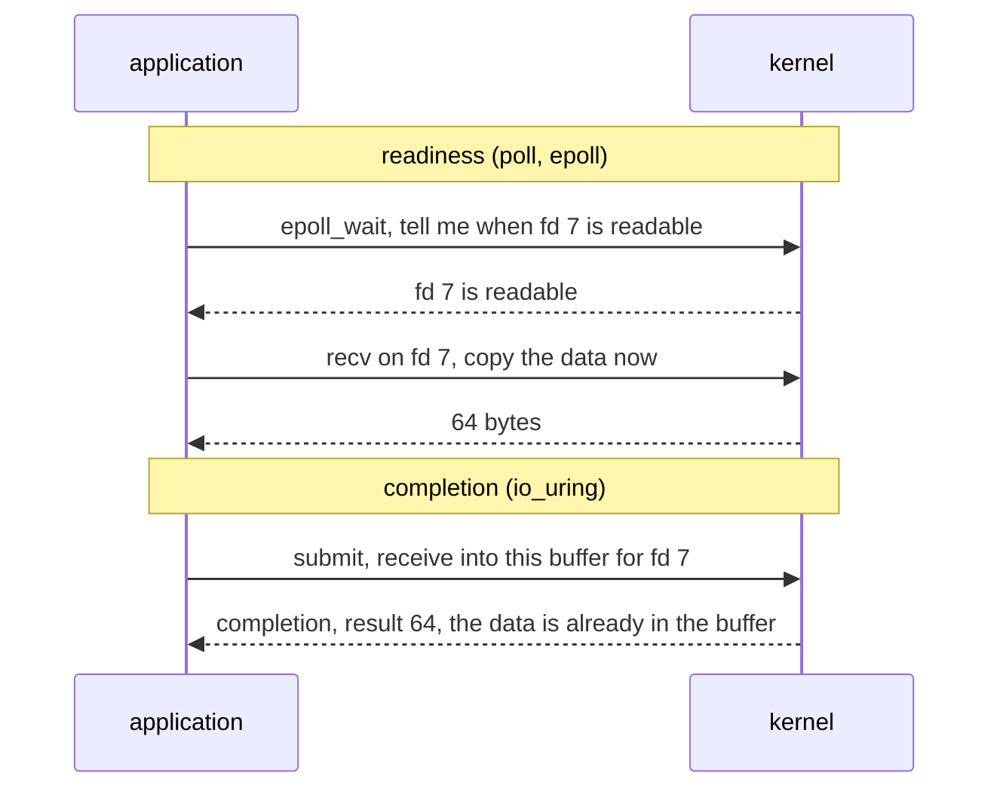
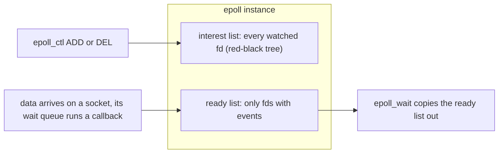
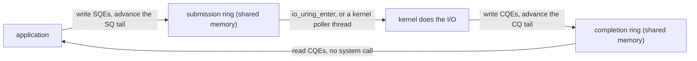

# NET 05: epoll and io_uring: readiness, completion, event loops and scaling a server

*Part of the [networking plan](00_plan.md) · You need: [NET 04](04_socket_programming_in_c.md) (sockets, non-blocking I/O, the `poll` server), [OS 17](../05_operating_systems/00_plan.md) (descriptors, system calls), [LX 08](../06_linux/08_linux_networking_toolbox.md) (`strace`, `ss`)*

NET 04 ended with a `poll` server and the observation that `poll` scans every descriptor on every call. This tutorial is what a server does about it. **`epoll`** is the Linux readiness API that scales to tens of thousands of connections, and **`io_uring`** is the completion API that goes further by batching the I/O calls themselves. Both are asked about constantly, in the same shapes: "how does epoll work inside", "level versus edge triggered", "why can't epoll do file I/O", "what is the thundering herd", "when is io_uring worth it, and why do some companies disable it".

The weak answer lists the three `epoll` calls. The strong answer explains the interest list and ready list, the one-line rule that makes edge-triggered servers safe, what breaks when several threads share an instance, and the difference between a readiness and a completion model, then says what you would measure before choosing.

By the end you can:

- explain readiness versus completion and name which API is which;
- explain `epoll` internally (interest list, ready list, wait-queue callback) and why its cost follows ready descriptors, not watched ones;
- predict what `epoll_wait` returns in level-triggered and edge-triggered modes, and write an edge-triggered read loop that cannot strand data;
- write an `epoll` server with per-connection buffers, a bounded drain and `EPOLLOUT` only while output is pending;
- explain `EPOLLONESHOT`, `EPOLLEXCLUSIVE`, `SO_REUSEPORT` and the thundering herd, and pick a threading model;
- explain what `epoll` cannot watch and what to use instead;
- explain `io_uring`: the two rings, submission and completion entries, buffer lifetime and the memory-ordering rules;
- write an `io_uring` echo server with `liburing`, and say which features (multishot, provided buffers, linked requests, `SQPOLL`) remove which cost;
- choose between `epoll` and `io_uring`, and explain the security caveat.

All code assumes this header block at the top of one file; the `io_uring` code links with `-luring`:

```c
#define _GNU_SOURCE
#include <arpa/inet.h>
#include <errno.h>
#include <fcntl.h>
#include <netinet/in.h>
#include <poll.h>
#include <stdint.h>
#include <stdio.h>
#include <stdlib.h>
#include <string.h>
#include <sys/epoll.h>
#include <sys/socket.h>
#include <sys/wait.h>
#include <unistd.h>
#include <liburing.h>
```

---

## 1. Readiness against completion

`select`, `poll` and `epoll` answer one question: **which descriptors can I read or write without blocking?** They are **readiness** APIs. The kernel says "this socket has data", then the program makes the `recv` call itself, copies the bytes and handles a short read. The kernel did no I/O for you.

A **completion** API asks a different question: "**do this operation and tell me when it is finished**". The program hands the kernel an operation and a buffer; the kernel does the work, possibly later and on another thread; the program is told the **result**. Windows IOCP works this way, POSIX AIO tried (on Linux it became a thread pool inside glibc), and `io_uring` is Linux's real implementation.



| | Readiness (`epoll`) | Completion (`io_uring`) |
|---|---|---|
| Kernel reports | "you may now make the call" | "the call is done, here is its result" |
| System calls per message | wait, then `recv`, then `send` | one `io_uring_enter` can carry many operations |
| Regular files | **not supported** (`EPERM`), so disk reads need threads | file reads and writes are ordinary operations |
| Who copies the data | your thread, inside your `recv` | the kernel, before the completion appears |
| Errors | from the call you make | in the completion's `res` field (negative errno) |
| Buffers | you pass one at the call | must **stay valid** until the completion arrives |
| Portability | Linux (kqueue is the BSD and macOS equivalent) | Linux only, kernel 5.1 and later, features arrive by version |

One consequence to keep: **a readiness API cannot make a file read asynchronous**, because a regular file is always "ready" and the read still blocks on the disk. That is the original reason `io_uring` exists.

## 2. epoll from the inside

### 2.1 Three calls, two lists

| Call | What it does |
|---|---|
| `epoll_create1(flags)` | creates an epoll instance, itself a descriptor |
| `epoll_ctl(ep, op, fd, &event)` | adds, modifies (`MOD`) or removes (`DEL`) one descriptor, with the events you want and a 64-bit **user data** word handed back later |
| `epoll_wait(ep, events, max, timeout)` | blocks until at least one watched descriptor is ready, fills `events` with **only the ready ones** |

Inside the kernel an instance holds two structures, and the whole performance story is the difference between them:



`epoll_ctl` puts the descriptor in the interest list and hangs a **callback** on the socket's wait queue. When the network stack gives the socket data, it runs the callback, which moves the entry onto the ready list and wakes any `epoll_wait`. A wait therefore costs in proportion to the **number of ready descriptors**, not the number watched. `poll` has no persistent state: every call passes the whole array, and the kernel walks it, queues itself on every socket and removes itself again. That is why `poll` degrades with idle connections and `epoll` stays flat, and why the answer to "select versus poll versus epoll" is: `select` takes bitmaps and is limited to 1024 descriptors; `poll` takes an array with no limit but is O(n) per call; `epoll` is O(ready).

### 2.2 Level-triggered and edge-triggered

- **Level-triggered (the default).** `epoll_wait` reports a descriptor **for as long as it is ready**. Read half the data and wait again: it is reported again. This is how `poll` behaves, and it forgives sloppy reads.
- **Edge-triggered (`EPOLLET`).** `epoll_wait` reports a descriptor **when its state changes** (new data arrived). Read half and wait again: **nothing is reported**, because nothing new happened.

```c
static void trigger_demo(const char *name, unsigned extra) {
    int sv[2];
    socketpair(AF_UNIX, SOCK_STREAM, 0, sv);
    fcntl(sv[0], F_SETFL, O_NONBLOCK);
    int ep = epoll_create1(EPOLL_CLOEXEC);
    struct epoll_event ev = { .events = EPOLLIN | extra, .data.fd = sv[0] }, out;
    epoll_ctl(ep, EPOLL_CTL_ADD, sv[0], &ev);

    char buf[4096], big[8192];
    memset(big, 'x', sizeof big);
    if (write(sv[1], big, sizeof big) != (ssize_t)sizeof big) return;
    printf("%s: 8192 bytes waiting\n", name);
    printf("  wait #1 returned %d\n", epoll_wait(ep, &out, 1, 100));
    if (read(sv[0], buf, sizeof buf) < 0) return;                /* read only half */
    printf("  wait #2 returned %d (4096 bytes are still unread)\n", epoll_wait(ep, &out, 1, 100));
    close(ep); close(sv[0]); close(sv[1]);
}
```

Run with `trigger_demo("level-triggered", 0)` and `trigger_demo("edge-triggered", EPOLLET)`: the level-triggered second wait returned **1** (still readable), the edge-triggered one returned **0**. A server that read half a request in edge-triggered mode would sit with 4096 bytes unread **until the client happened to send more**. In production that is "a few connections hang under load".

The non-negotiable rules for edge-triggered:

1. The descriptor must be **non-blocking**, because the drain ends with a read that returns `EAGAIN`, and on a blocking descriptor that read would block.
2. On every event, **read until `EAGAIN`**; for a listener, `accept` until `EAGAIN` (several connections can arrive as one edge).
3. After a partial write, wait for `EPOLLOUT`, and write again on the next edge until done.
4. **Bound the drain.** A peer sending faster than you read keeps the loop going and starves every other connection: read a fixed number of chunks per event, then move on (and, in edge-triggered mode, remember to come back, for example with a work queue).

Edge-triggered saves wake-ups when each wake-up drains everything, at the price of correctness risk. **Level-triggered with a bounded amount of work per event is what most production code uses**; both work, and a senior answer says which risks you accept.

### 2.3 The events you will meet

| Event | Meaning |
|---|---|
| `EPOLLIN` | data to read, or a connection to accept, or EOF |
| `EPOLLOUT` | room in the send buffer; **a socket with an empty buffer is writable always**, so a level-triggered `EPOLLOUT` makes `epoll_wait` return at once, in a loop. Ask for it **only while output is pending**, and drop it when the buffer empties |
| `EPOLLRDHUP` | the peer closed its write side (FIN): lets you detect a half-close without a read |
| `EPOLLHUP`, `EPOLLERR` | always reported, need not be requested; the connection is gone or failed |
| `EPOLLET` | edge-triggered mode |
| `EPOLLONESHOT` | after one event is delivered the descriptor is **disarmed** until you re-arm it with `EPOLL_CTL_MOD` |
| `EPOLLEXCLUSIVE` | wake only one of the epoll instances watching this descriptor (for a shared listener) |

### 2.4 What epoll cannot watch

`epoll_ctl(EPOLL_CTL_ADD)` on a **regular file** fails with `EPERM`: a file has no readiness, because reads never wait for data to arrive, they block in the filesystem. So an `epoll` server that must read from disk either uses a **thread pool** for file I/O or switches to `io_uring`. Things `epoll` can watch beyond sockets: pipes, `eventfd` (cross-thread wake-up), `timerfd` (timers as descriptors), `signalfd` (signals as descriptors) and `inotify`. Putting timers and signals on descriptors is how a single-threaded loop handles them without surprises.

## 3. An epoll server

The design follows the `poll` server of NET 04, with the costs of `poll` removed: one `data.ptr` per connection, an output buffer with a cap, `EPOLLOUT` only while output is pending, a bounded read per event, and `DEL` before `close`.

```c
struct conn { int fd; int want_out; size_t outlen; char out[16384]; };

static void rearm(int ep, struct conn *c, int want_out) {       /* EPOLLOUT only while output is pending */
    if (c->want_out == want_out) return;                         /* no change, no system call */
    c->want_out = want_out;
    struct epoll_event ev = { .events = EPOLLIN | (want_out ? EPOLLOUT : 0), .data.ptr = c };
    epoll_ctl(ep, EPOLL_CTL_MOD, c->fd, &ev);
}

static void drop(int ep, struct conn *c) {
    epoll_ctl(ep, EPOLL_CTL_DEL, c->fd, NULL);                   /* DEL before close */
    close(c->fd);
    free(c);                                                     /* see the batch rule in the text */
}

void epoll_echo(int lfd, int rounds) {
    int ep = epoll_create1(EPOLL_CLOEXEC);
    struct epoll_event ev = { .events = EPOLLIN, .data.ptr = NULL };   /* NULL data marks the listener */
    epoll_ctl(ep, EPOLL_CTL_ADD, lfd, &ev);
    struct epoll_event evs[64];
    while (rounds--) {
        int n = epoll_wait(ep, evs, 64, 1000);
        for (int i = 0; i < n; i++) {
            struct conn *c = evs[i].data.ptr;
            if (!c) {                                            /* the listener: drain the accept queue */
                for (;;) {
                    int fd = accept4(lfd, NULL, NULL, SOCK_NONBLOCK | SOCK_CLOEXEC);
                    if (fd < 0) break;
                    c = calloc(1, sizeof *c); c->fd = fd;
                    struct epoll_event cev = { .events = EPOLLIN, .data.ptr = c };
                    epoll_ctl(ep, EPOLL_CTL_ADD, fd, &cev);
                }
                continue;
            }
            int dead = 0;
            if (evs[i].events & EPOLLIN) {
                for (int k = 0; k < 16 && !dead; k++) {          /* bounded: at most 16 reads per event */
                    char buf[4096];
                    ssize_t r = recv(c->fd, buf, sizeof buf, 0);
                    if (r > 0) {
                        if (c->outlen + (size_t)r > sizeof c->out) dead = 1;   /* slow consumer: cap and drop */
                        else { memcpy(c->out + c->outlen, buf, (size_t)r); c->outlen += (size_t)r; }
                        if (r < (ssize_t)sizeof buf) break;       /* short read: drained, skip the EAGAIN probe */
                    } else if (r == 0) dead = 1;
                    else if (errno == EAGAIN) break;
                    else if (errno != EINTR) dead = 1;
                }
            }
            if (!dead && c->outlen) {                            /* try the write now, not on the next round */
                ssize_t w = send(c->fd, c->out, c->outlen, MSG_NOSIGNAL);
                if (w > 0) { memmove(c->out, c->out + w, c->outlen - (size_t)w); c->outlen -= (size_t)w; }
                else if (errno != EAGAIN && errno != EINTR) dead = 1;
                if (!dead) rearm(ep, c, c->outlen > 0);
            }
            if (dead) drop(ep, c);
        }
    }
}
```

Run with 50 clients each echoing 100 messages, all 5,000 came back correct. Points that interviewers press on:

- **The batch rule.** `epoll_wait` returns up to 64 events at once. If handling event 3 frees a connection that event 7 also refers to, event 7 is a **use-after-free**. Safe designs mark a connection dead and free it after the batch, or look the connection up by an id (not a raw pointer) on each event.
- **`close` and `DEL`.** Closing a descriptor removes it from the epoll set only if no **duplicate** descriptor (from `dup` or `fork`) shares the same open file; otherwise events keep arriving for a descriptor you think is gone. Call `EPOLL_CTL_DEL` before `close`.
- **`data` is a union**: a pointer **or** a descriptor, not both. Use the pointer for state.
- **Timers.** Idle timeouts and deadlines (NET 04 section 9) need a timer structure; a timer wheel or heap plus one `timerfd` (or the `epoll_wait` timeout set to the next deadline) keeps the loop single-threaded.
- **Cross-thread wake-up** uses an `eventfd` added to the epoll set.

### 3.1 Several threads: the models

| Model | How | Problem or benefit |
|---|---|---|
| **One loop, one thread** | everything in one `epoll_wait` loop | simplest, no locks, limited to one core |
| **One epoll instance per thread, one listener per thread with `SO_REUSEPORT`** | the kernel spreads new connections by hash; each thread owns its connections end to end | **scales best, no sharing**; balance is by hash, not load |
| **One shared listener in every thread's epoll, `EPOLLEXCLUSIVE`** | the kernel wakes only one waiter per connection | fixes the herd without per-thread listeners |
| **One shared epoll instance, several threads call `epoll_wait`, `EPOLLONESHOT`** | an event disarms its descriptor until the worker re-arms it | correct, but a re-arm `epoll_ctl` per event and shared-instance contention |
| **One acceptor thread hands connections to workers** | simple, common in older designs | the acceptor can bottleneck; hand-off cost |

Two failure modes to be able to describe. **Two threads on one socket:** with a shared instance and a level-triggered descriptor, two threads can be woken for the same readable socket and both read, interleaving one connection's bytes (an earlier run saw overlapping handling in nearly every one of 3,000 events). The fix is `EPOLLONESHOT` with a re-arm, or an instance per thread:

```c
/* One epoll instance shared by several worker threads: ONESHOT means one worker owns a socket at a time. */
void add_shared(int ep, int fd, void *conn) {
    struct epoll_event ev = { .events = EPOLLIN | EPOLLONESHOT, .data.ptr = conn };
    epoll_ctl(ep, EPOLL_CTL_ADD, fd, &ev);
}
void done_with(int ep, int fd, void *conn) {                      /* the worker re-arms when it has finished */
    struct epoll_event ev = { .events = EPOLLIN | EPOLLONESHOT, .data.ptr = conn };
    epoll_ctl(ep, EPOLL_CTL_MOD, fd, &ev);
}
```

**The thundering herd:** several threads wait on one listener, a connection arrives, **all of them wake**, one wins `accept`, the rest go back to sleep: wasted context switches that grow with the thread count. `EPOLLEXCLUSIVE` wakes one; `SO_REUSEPORT` removes the shared listener altogether (an earlier run measured about 2 context switches per connection exclusive against 3 to 9 when every thread woke, growing with threads). A final, well-known critique: `epoll` has awkward semantics around **closing descriptors that are registered, fork and dup** (the popcount "epoll is fundamentally broken" articles), which is part of why newer designs look at `io_uring`.

## 4. io_uring

### 4.1 The rings

`io_uring` gives the application and kernel two ring buffers in **shared memory**:

- the **submission queue (SQ)**: the application writes **submission queue entries (SQEs)**, each saying "do this operation": accept, receive, send, read a file, a timer, and dozens more;
- the **completion queue (CQ)**: the kernel writes **completion queue entries (CQEs)**, each carrying your `user_data` (to match it to the request) and `res`, the result (bytes transferred or a negative errno).



There are three system calls (`io_uring_setup`, `io_uring_enter`, `io_uring_register`) and, in practice, one: **`io_uring_enter` submits everything queued and optionally waits for completions**, and reaping completions needs **no system call at all**. That is the source of the saving: many operations per system call.

The memory-ordering rule (a favourite question): the producer writes the entry, then publishes the new tail with a **release** store; the consumer reads the tail with an **acquire** load, then the entry, then advances its own head with a release store. Without them, a weakly ordered CPU (ARM) can show the new tail before the entry's contents. x86 hides the bug, which is why code that works there corrupts on ARM. `liburing` does this for you, which is the reason to use it rather than the raw calls.

### 4.2 An echo server with liburing

```c
struct req { int type; int fd; char *buf; };                      /* type: 0 accept, 1 recv, 2 send */

static void queue_recv(struct io_uring *r, int fd) {
    struct req *q = malloc(sizeof *q);
    q->type = 1; q->fd = fd; q->buf = malloc(4096);              /* the buffer must outlive the operation */
    struct io_uring_sqe *s = io_uring_get_sqe(r);
    io_uring_prep_recv(s, fd, q->buf, 4096, 0);
    io_uring_sqe_set_data(s, q);
}

void uring_echo(int lfd, int rounds) {
    struct io_uring r;
    io_uring_queue_init(256, &r, 0);
    struct req *a = malloc(sizeof *a); a->type = 0; a->fd = lfd; a->buf = NULL;
    struct io_uring_sqe *s = io_uring_get_sqe(&r);
    io_uring_prep_accept(s, lfd, NULL, NULL, 0);
    io_uring_sqe_set_data(s, a);
    while (rounds--) {
        io_uring_submit_and_wait(&r, 1);                         /* ONE call: submit everything queued, wait */
        struct io_uring_cqe *cqe;
        unsigned head, seen = 0;
        io_uring_for_each_cqe(&r, head, cqe) {                   /* reaping needs no system call */
            seen++;
            struct req *q = io_uring_cqe_get_data(cqe);
            int res = cqe->res;
            if (q->type == 0) {                                  /* a client arrived: re-arm accept, start its recv */
                if (res >= 0) queue_recv(&r, res);
                s = io_uring_get_sqe(&r);
                io_uring_prep_accept(s, lfd, NULL, NULL, 0);
                io_uring_sqe_set_data(s, q);
            } else if (q->type == 1) {                           /* data arrived: echo it */
                if (res <= 0) { close(q->fd); free(q->buf); free(q); continue; }
                q->type = 2;                                     /* reuse the request, same buffer */
                s = io_uring_get_sqe(&r);
                io_uring_prep_send(s, q->fd, q->buf, (size_t)res, MSG_NOSIGNAL);
                io_uring_sqe_set_data(s, q);
            } else {                                             /* the send finished: listen again */
                if (res < 0) { close(q->fd); free(q->buf); free(q); continue; }
                q->type = 1;                                     /* (a short send would need the rest sent) */
                s = io_uring_get_sqe(&r);
                io_uring_prep_recv(s, q->fd, q->buf, 4096, 0);
                io_uring_sqe_set_data(s, q);
            }
        }
        io_uring_cq_advance(&r, seen);
    }
    io_uring_queue_exit(&r);
}
```

Compare with the `epoll` loop. There is **no `EAGAIN` and no readiness step**: the receive is issued once, and the completion arrives with the data already in the buffer. Run with the same 50 clients and 5,000 messages, all were correct. The rules that become your bugs:

1. **Buffer lifetime.** The kernel writes into your buffer after the submit call has returned. Freeing or reusing it before the completion is a bug that nothing in your process can see.
2. **A short send is still a completion.** `res` is the bytes sent; the rest must be sent again (the same rule as NET 04, in a new place; the code marks where).
3. **Completions come in any order** unless requests are linked. `user_data` is how you match them.
4. **Do not let the CQ overflow.** If you submit faster than you reap, the completion ring fills; modern kernels keep the overflowed entries (`IORING_FEAT_NODROP`) but submission then returns `EBUSY` until you reap.
5. **Errors arrive in `res`**: `-9` (`-EBADF`) for a bad descriptor, `-ECANCELED` for a cancelled request.

### 4.3 What the options are for

| Feature | What it is | Cost it removes |
|---|---|---|
| **Linked SQEs** (`IOSQE_IO_LINK`) | the next SQE starts only after this one succeeds, a failure cancels the chain | returning to user space between "send then receive" |
| **Registered files and buffers** | register once, refer by index | per-operation descriptor lookup and page pinning |
| **Provided buffers** (buffer rings) | a pool the kernel picks from when data arrives | an **idle connection holds no buffer**: 4,000 idle connections at 4 KB each hold about 16 MB that a pool would not need |
| **Multishot accept and receive** | one SQE keeps producing completions | re-arming a request per accept or per receive |
| **Timeouts** (`IORING_OP_TIMEOUT`, `LINK_TIMEOUT`) | a timer or a deadline as an operation | the deadline of NET 04 section 9 as one linked request |
| **`SEND_ZC`** | zero-copy send, reports when the pages are free | copies on large sends (see [NET 07](07_zero_copy_networking.md)) |
| **`SQPOLL`** | a kernel thread polls the SQ ring | the submit system call, **at the price of a busy kernel thread**; measured earlier to help one latency test and badly hurt another, so measure |
| **`IOPOLL`** | poll the device for completion | interrupt latency, on fast NVMe with `O_DIRECT` |
| **`SINGLE_ISSUER`, `DEFER_TASKRUN`** | one submitting thread, completion work runs when you ask | interruptions of the application thread |

The shape of a modern `io_uring` network server: **registered files, a provided-buffer ring, one multishot accept and one multishot receive per connection, batched or linked sends, one ring per thread**. The plain echo above is the same loop without those optimisations; each one removes a cost the measurements below show.

## 5. What it saves: system calls per message

Both servers above ran under `strace -f -c` with the same client, which sent 6,400 echo messages, once over **1 connection** and once over **64 connections with a message in flight on each** (so there is something to batch). One run per cell, so read the structure.

| Server | Connections | Total system calls for 6,400 messages | Per message | Where they go |
|---|---|---|---|---|
| `epoll` | 1 | 19,256 | **3.0** | `epoll_wait`, `recv`, `send`, one each |
| `epoll` | 64 | 13,286 | **2.1** | `epoll_wait` falls to 110 total (many ready per wait), but `recv` and `send` stay one each |
| `io_uring` | 1 | 12,852 | **2.0** | two `io_uring_enter` per message: nothing to batch |
| `io_uring` | 64 | 379 | **0.06** | about 265 enters, each carrying many receives and sends |

Read it as three lessons. **`epoll` already batches the wait**, so its floor is two calls per message (the receive and the send), because those are separate calls. **`io_uring` batches the I/O itself**, so with enough concurrent work its system calls nearly vanish (here 35 times fewer than `epoll` at 64 connections). And **with one connection nothing batches**, so `io_uring` is no better than 2 calls against 3: the gain is a property of the load, not the API.

That does not make `io_uring` always faster. System calls are a few hundred nanoseconds each, so they matter when the message rate is very high and the per-message work is small; when the application's own processing, the network or the client is the limit, the saving is invisible (an earlier run measured `io_uring` 24 times fewer calls and no faster overall, because the client was the bottleneck). Where it wins clearly: **mixed disk and network I/O in one loop** (`epoll` cannot do file reads asynchronously), **storage engines at high queue depth** (an earlier `fio` run measured about 13 percent more IOPS than `libaio` at depth 32 and no difference at depth 1), and very high message rates.

## 6. Choosing, and the security caveat

| Situation | Pick | Why |
|---|---|---|
| Tens of thousands of mostly idle connections, modest message rate | **`epoll`** | cost follows ready descriptors; twenty years of maturity in every runtime |
| A portable event loop (Linux, macOS, BSD) | **`epoll` behind an abstraction** (libuv, libevent, Boost.Asio) | `io_uring` is Linux only; the libraries choose the backend |
| High message rate, many busy connections, syscall cost matters | **`io_uring`** | 35 times fewer system calls at 64 busy connections |
| Disk I/O mixed with network I/O | **`io_uring`** | `epoll` cannot watch regular files |
| High-IOPS storage engine | **`io_uring`** (or `libaio` with `O_DIRECT`) | fewer system calls at depth |
| Few connections, latency over CPU | **`io_uring` with `SQPOLL`** on a dedicated core, after measuring | one fewer system call per request, one core spent |
| Untrusted multi-tenant host, containers, sandboxes | **think twice about enabling `io_uring`** | see below |

**The security caveat.** `io_uring` exposes a large part of the kernel (dozens of operations, each with its own code path, plus the registration calls) to every process that can call `io_uring_setup`, and it has had a steady stream of local privilege-escalation bugs since it was merged in kernel 5.1. Google reported in 2023 that most of the Linux kernel exploits submitted to its kernel security reward programme targeted `io_uring`, and it disabled it on ChromeOS and Android and restricted it on its servers. Kernel 6.6 added the **`kernel.io_uring_disabled`** sysctl (0 allows everyone, 1 only a privileged group, 2 nobody), and many container runtimes block the `io_uring` system calls in their default seccomp profile. For a design review: an `io_uring` service must **run where `io_uring` is allowed**, and an infrastructure interviewer may ask what you do when it is not. The answer is the `epoll` path, which you now have.

## 7. Common mistakes

1. **Edge-triggered without draining to `EAGAIN`**, so the rest of a request waits forever.
2. **An unbounded drain**, so a fast peer starves every other connection.
3. **Watching `EPOLLOUT` all the time**, a busy loop on a writable socket.
4. **Several threads on one shared instance without `EPOLLONESHOT`**, two threads on one socket.
5. **Adding a regular file to `epoll`** and being surprised by `EPERM`.
6. **A shared listener in every thread's epoll without `EPOLLEXCLUSIVE` or `SO_REUSEPORT`**, the herd.
7. **Closing a registered descriptor without `EPOLL_CTL_DEL`**, which misbehaves with `dup` and `fork`.
8. **Freeing a connection mid-batch while later events in the same batch point at it.**
9. **Reusing an `io_uring` buffer before its completion.**
10. **Treating a short `send` completion as complete.**
11. **Assuming completions arrive in submission order.**
12. **Letting the CQ ring overflow.**
13. **Hand-written ring code without acquire and release ordering**, working on x86 and corrupting on ARM.
14. **Enabling `SQPOLL` by default**, pinning a kernel thread's worth of CPU.

## 8. Interview questions

1. **What is the difference between `select`, `poll` and `epoll`?** Bitmap with a 1024 limit; array scanned in full every call; a kernel-side interest list returning only ready descriptors.
2. **How does `epoll` work inside?** Interest list (red-black tree), ready list, a callback on the file's wait queue; `epoll_wait` returns the ready list.
3. **Level-triggered versus edge-triggered, and which do you use?** Level reports while ready, edge on a change; edge needs non-blocking and a drain to `EAGAIN`; level with bounded work is the safer default.
4. **Why can't `epoll` watch a regular file?** No readiness for files; `EPERM`; use a thread pool or `io_uring`.
5. **Several threads call `epoll_wait` on one instance. What goes wrong?** Two threads on one socket; `EPOLLONESHOT` and re-arm, or an instance per thread.
6. **What is the thundering herd in `accept`?** All waiters wake, one wins; `EPOLLEXCLUSIVE` or `SO_REUSEPORT`.
7. **Why ask for `EPOLLOUT` only sometimes?** An idle socket is always writable, so level-triggered `EPOLLOUT` spins.
8. **What is `io_uring`?** Two shared-memory rings and a submit call; operations go in, results come out; batching and no syscall to reap.
9. **Readiness versus completion?** Kernel says when you may call versus kernel does the call and reports the result.
10. **How many system calls per message do the two servers make?** `epoll`: wait, receive, send (3 on one connection, about 2 under load); `io_uring`: 2 on one connection, a small fraction under load.
11. **Is `io_uring` always faster?** No; it wins when syscalls are a large share of the cost, when work batches, and for file I/O.
12. **What are the memory-ordering rules of the rings?** Release store of the tail after writing the entry, acquire load on the consumer side.
13. **Why would a company disable `io_uring`?** Attack surface and a history of local privilege escalations; the sysctl and seccomp options.
14. **What must you remember about buffers in `io_uring`?** They must outlive the operation, and a short send is not the end.

## 9. Scenarios and design questions

**S1. Predict the wake-ups.** Five cases to reason through: 8192 bytes waiting, you read 4096. Level-triggered: wait, read half, wait. Edge-triggered: the same. Edge-triggered, then the peer sends one more byte, wait. Edge-triggered with `EPOLLONESHOT`: drain, peer sends a byte, wait, then `MOD`, wait. Level-triggered `EPOLLOUT` with nothing to send, three waits. *Where to practise:* a socket pair and `trigger_demo`. *Approach:* for each case ask whether the descriptor is **ready now** (level) and whether its state **changed** since the last report (edge); `ONESHOT` disarms on delivery.

**S2. A server hangs a few connections under load, only in edge-triggered mode.** *Where to practise:* the demo above, then a stress client. *Approach:* a read that did not drain to `EAGAIN`, or a partial write with no `EPOLLOUT`; make the sockets non-blocking, drain with a bound, and re-queue connections that hit the bound.

**S3. Design the threading model for a 100,000-connection gateway.** *Approach:* one loop per core, `SO_REUSEPORT` listeners, per-connection state owned by one thread, `eventfd` for cross-thread messages, a timer wheel, caps and deadlines, `EMFILE` plan (NET 04), and an accept-queue and `ListenOverflows` dashboard.

**S4. A service mixes network I/O and disk reads and its latency is spiky.** *Approach:* a blocking file read stalls the whole event loop; move file I/O to a thread pool or to `io_uring`, and prove it with a trace showing the loop blocked in `read` on a file.

**S5. Should we move our `epoll` proxy to `io_uring`?** *Approach:* profile first: what fraction of CPU is system-call entry and exit; estimate batching from the connection and message rate; try the multishot and provided-buffer path on a staging box; check the kernel version, the container seccomp profile and the security policy; keep the `epoll` path as the fallback.

**S6. The memory of an idle-connection server is too high.** *Approach:* per-connection buffers dominate; allocate buffers only while data is in flight, or use `io_uring` provided buffers; shrink the socket buffers and the `struct conn`.

## 10. Strong answers (outlines)

**S1.** Level: 1 then 1 (still readable). Edge: 1 then 0 (no new edge). Edge plus one more byte: 1 (a new edge). `ONESHOT`: after delivery the descriptor is disarmed, so the next wait sees nothing until `MOD`; after `MOD` with data pending, 1. Level `EPOLLOUT`: returns 1 every time, a busy loop.

**S2.** The signature is a connection stuck with unread bytes while `ss` shows data in its `Recv-Q`. Fix the read loop to drain to `EAGAIN`, bound it, and put connections that hit the bound on a ready queue processed next round, so neither a stuck connection nor a starved neighbour appears.

**S3.** Hash spreading by `SO_REUSEPORT` is not load-aware, so add periodic rebalancing or accept the imbalance; keep per-core memory local; never block in the loop; measure per-core CPU and accept-queue depth.

**S4.** `strace -T` or `perf trace` shows the long `read` on a file descriptor in the loop thread; the fix is to hand the read to a worker and come back through an `eventfd`, or submit it to `io_uring`.

**S5.** Show the numbers: system-call share of CPU, batching potential, a staging comparison under the real message mix, plus the operational constraints (kernel version, seccomp, multi-tenancy). A strong answer is willing to say no.

**S6.** Buffer on demand rather than per connection, size the structure to what an idle connection needs, and measure memory per idle connection before and after.

## 11. Cheat sheet

| Topic | Rule |
|---|---|
| Readiness vs completion | `epoll` says when you may call; `io_uring` does the call and reports `res` |
| `epoll` | `create1`, `ctl` (ADD, MOD, DEL), `wait`; interest list and ready list; cost follows ready descriptors |
| Level vs edge | level reports while ready; edge on change, needs non-blocking and a drain to `EAGAIN`, bounded |
| `EPOLLOUT` | only while output is pending |
| Not watchable | regular files (`EPERM`) |
| Threads | one instance per thread plus `SO_REUSEPORT`; or `EPOLLONESHOT`; `EPOLLEXCLUSIVE` for a shared listener |
| Safety | `DEL` before `close`; free after the batch; `data.ptr` or fd, not both |
| `io_uring` | SQ and CQ rings in shared memory; submit with `io_uring_enter`; reap with no syscall |
| Rules | buffer outlives the operation; short send is not done; completions are unordered; do not overflow the CQ; release and acquire ordering |
| Features | linked, registered, provided buffers, multishot, timeouts, `SEND_ZC`, `SQPOLL` |
| Choose | `epoll` for many idle and portability; `io_uring` for busy, batched, mixed disk and network; check security policy |

## 12. Sources and caveats

Sources used: the [epoll(7) manual page](https://man7.org/linux/man-pages/man7/epoll.7.html), the LWN article [epoll and io_uring changes](https://lwn.net/Articles/865400/), [Epoll is fundamentally broken](https://idea.popcount.org/2017-02-20-epoll-is-fundamentally-broken-12/) (the critique of `EPOLLEXCLUSIVE`, `dup` and `fork` semantics), the Linux Foundation talk [Linux Kernel Epoll (dbueso)](https://events19.linuxfoundation.org/wp-content/uploads/2018/07/dbueso-oss-japan19.pdf), and two 2026 deep dives on [epoll to io_uring](https://martinuke0.github.io/posts/2026-05-30-deep-dive-into-linux-io-evolution-from-epoll-to-io_uring-architecture-and-performance-patterns/) and [io_uring versus epoll trade-offs](https://martinuke0.github.io/posts/2026-05-29-deep-dive-into-io_uring-and-epoll-architecture-performance-trade-offs-and-production-implementation-patterns/). Reference: the `liburing` manual pages and Jens Axboe's *Efficient IO with io_uring* paper, Kerrisk's *The Linux Programming Interface* chapter on `epoll`, and Cloudflare's write-ups on accept-queue and `SO_REUSEPORT` behaviour.

Caveats. Every C block compiles with `-Wall -Wextra`, and the trigger demo, the `epoll` echo server and the `io_uring` echo server (liburing 2.5) were run on one Linux 6.18 VM, as root, over loopback, under AddressSanitizer and UBSan. The system-call table is one `strace -f -c` run per cell, with the client on the same two-vCPU VM, so read the structure and not the last digit; `strace` itself slows the server and can change how much batches. The `EPOLLONESHOT` overlap, the herd context-switch counts, the `fio` result, the `SQPOLL` timings and the poll-versus-epoll scaling figures come from earlier runs of the previous version of this tutorial and were not re-run. The feature table, kernel version notes, the Google statement and the `kernel.io_uring_disabled` sysctl are from documentation and memory, and features arrive by kernel version, so check the kernel you run.
