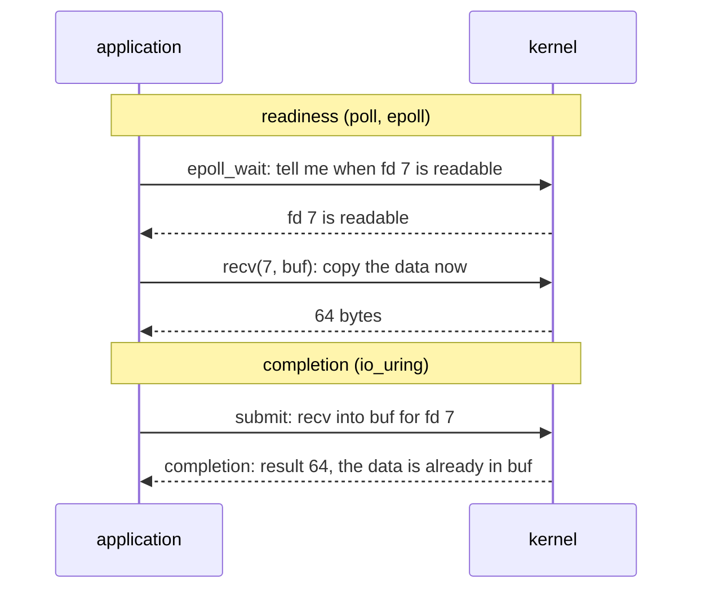
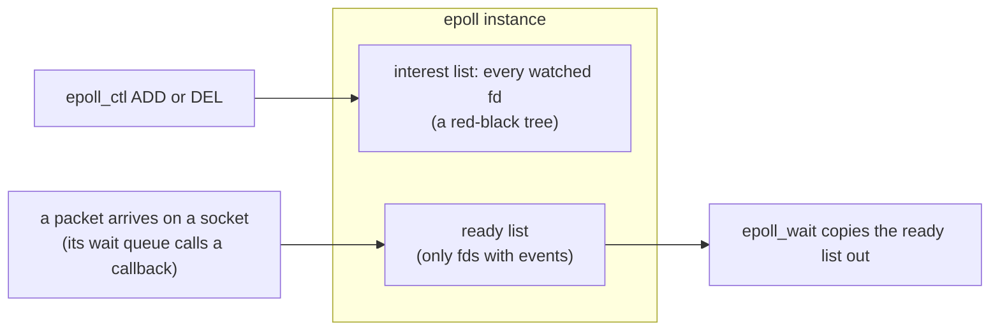
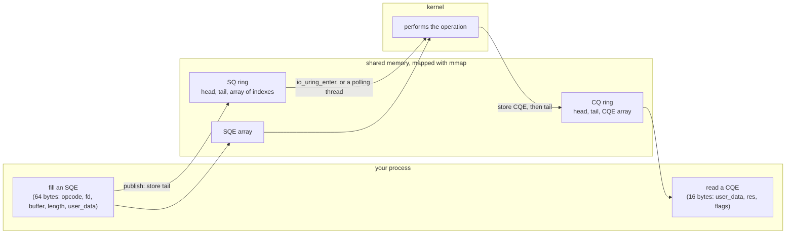

# NET 05: epoll and io_uring

*Part of the [networking plan](00_plan.md) · Time: about 7 hours · You need: [NET 04](04_socket_programming_in_c.md) (sockets, non-blocking I/O, the `poll` server and its measured cost), [OS 17](../05_operating_systems/00_plan.md) (file descriptors and system calls), [C 02 to C 04](../02_c_language/00_plan.md) (pointers, structs, memory ordering basics). NET 04 ended with a `poll` server that costs time in proportion to the number of descriptors it watches. This tutorial is the cure and its successor: **`epoll`**, which returns only the descriptors that are ready, and **`io_uring`**, which changes the question from "tell me when I can do I/O" to "do this I/O and tell me when it is done". It covers readiness against completion, level and edge triggering, the `EPOLLONESHOT` and `EPOLLEXCLUSIVE` flags, `epoll` against `poll` with idle connections, and a raw `io_uring` ring built from the system calls up, with an echo server on top. Everything is small, compiled with `-Wall -Wextra` and AddressSanitizer and UBSan, and run here; the outputs are pasted from those runs.*

Event loops are where networking interviews for senior roles go deep. The questions sound simple: "how does `epoll` work", "level or edge", "why would you use `io_uring`". The answers that get an offer are the ones with consequences attached: what hangs if you forget to drain an edge-triggered socket, what two threads in one `epoll_wait` do to each other, why `io_uring` makes a server issue **24 times fewer system calls** and still not run faster on this machine. Those consequences are measured below.

**Eight honest limits, stated first.**

1. Everything is measured on **one Linux 6.18 VM** (Firecracker, 2 vCPUs, gcc 13.3) as **root**, on the **loopback interface**. The server and the load generator are pinned to different CPUs with `taskset`. There is no real network card, no interrupt moderation, and no second machine.
2. **There is no `liburing`.** The library could not be installed in this session (the download was refused). Every `io_uring` program here talks to the kernel through the **raw system calls** and a 110 line wrapper, `ur.h`, listed in section 6. That is not a loss for learning: `liburing` is a thin layer over exactly this, and seeing the rings is the point. What `liburing` offers beyond the wrapper (helpers such as `io_uring_prep_recv`, registered buffer pools, the multishot helpers) is **from memory** and marked. If you want the library, install it on your Mac or a Linux box and port the programs; the shapes are the same.
3. **Syscalls are cheap in this VM.** A `read` of `/dev/zero` costs about **120 ns** (section 8). On a host with heavier mitigations or a real network card the saving from avoiding syscalls is larger. The measured "`io_uring` is not faster here" result is about **this machine**, not about the design.
4. **The load generator is single threaded and is itself the bottleneck** in the many-connection test (section 8.3): both servers finish at 4 to 6 µs per message, which is close to what one client thread can drive. The syscall counts are exact; the per-message times are a ceiling set by the client, and differences of 1 µs there are not a verdict.
5. **Timing results vary from run to run.** The herd counts of section 4 changed between 6.0 and 9.0 context switches per connection across three runs of the same program; the overlap count of section 3 was 2965 in one run and 2970 in another. Read the structure, not the last digit. Where a count is exact (syscall totals, the bytes of a drain), the text says so.
6. **IPv4 and loopback only**, as in NET 04. TLS, `splice`, `sendfile` and zero-copy receive are not covered; `io_uring`'s network zero-copy features are **from memory**.
7. **Linux only.** `epoll` and `io_uring` do not exist on macOS (its counterpart is `kqueue`, and Windows has IOCP, which is a completion model like `io_uring`; both are **from memory**). You can read and reason about these programs on a Mac, but you run them on Linux.
8. **A few statements are from memory** (the manual pages, the kernel documentation, the `io_uring` design papers) and are marked "from memory". Everything else was run.

By the end you can:

- state the difference between a **readiness** API and a **completion** API and say which one `poll`, `epoll`, POSIX AIO, IOCP and `io_uring` are (measured consequence: an `epoll` server makes **3 system calls per echoed message**, `epoll_wait`, `recvfrom`, `sendto`; the `io_uring` server makes **2**, both `io_uring_enter`, and with 64 busy connections it made **1091 system calls for 12,800 messages against 26,632 for `epoll`**);
- explain **level-triggered and edge-triggered** `epoll` with a result, and write the drain loop that makes edge-triggered correct (measured: after reading half of 8192 bytes, level-triggered `epoll_wait` returned **1** again and edge-triggered returned **0**, the connection that would **hang**);
- know that `epoll` **cannot watch a regular file** (measured: `epoll_ctl` ADD gave **`EPERM`**) and what to use instead;
- use **`EPOLLONESHOT`** to stop two threads handling one socket at once (measured: without it the handler was entered while another thread was inside it **2965 times of 3000**; with it **0**);
- use **`EPOLLEXCLUSIVE`** and **`SO_REUSEPORT`** against the thundering herd (measured: 8 threads and 200 connections cost **6.0 to 9.0 context switches per connection** without the flag and a steady **2.0** with it);
- say why `epoll` beats `poll` and by how much (measured: with 4000 idle connections one round trip took **1193 µs** on `poll` and **35 µs** on `epoll`, **34 times** more; `epoll` stayed at **30 to 35 µs** from 0 to 4000 idle connections);
- explain the **`io_uring` submission and completion rings** well enough to write the code (measured: after one NOP the indexes read **sq head 1 tail 1, cq head 0 tail 1**; **eight NOPs went in with one `io_uring_enter` and eight completions came out with no syscall**; a bad file descriptor was reported in the **completion, `res -9`**, not by the syscall);
- say what batching buys (measured: a 64 byte read cost **122 ns** as a plain `read`, **235 ns** through `io_uring` one per enter, **108 ns** at 8 per enter and **85 ns** at 64 per enter);
- build an **`io_uring` echo server** with accept, receive and send operations re-armed from the completion handler, tagged with `user_data`, and handling a **partial send**;
- say when `io_uring` pays off and when it does not, and the **security** reasons some systems turn it off (the `io_uring_disabled` sysctl, **from memory** for the history).

**Where the numbers come from.** Eight experiment scripts and one answer script were run in this session: `e0_ring`, `e1_epoll_basics`, `e2_idle`, `e3_uring`, `e4_syscalls`, `e5_fio`, `e6_many`, `e7_cost` and `ans_e`. The programs are in this tutorial's `prog/` folder; the shared header `nl.h` is the one from NET 04 and `ur.h` is listed in section 6. Transcripts print `$ command` before a command's output. Numbers not from these runs are marked "from memory", or are computed, or come from a source at the end.

**Data and timing.** No data sets. Each program is compiled twice: `gcc -std=gnu11 -O1 -g -Wall -Wextra -fsanitize=address,undefined -pthread -Iprog -o bin/NAME prog/NAME.c` for correctness runs, and `-O2` without sanitizers (`bin/plain_NAME`) for every timing. The experiments take 5 to 40 seconds each. Timings are single runs unless the text says otherwise.

---

## 1. Readiness against completion

NET 04's server was written around one question: **which descriptors can I read or write without blocking?** `select`, `poll` and `epoll` all answer it. They are **readiness** APIs: the kernel says "this socket has data", and the program then makes the `recv` call itself, copies the bytes, and handles a short read. The kernel did no I/O for you; it only told you when your own I/O would not block.

A **completion** API asks a different question: "**do this operation, and tell me when it is finished**". The program hands the kernel a buffer and an operation (receive into this buffer, send from that one, read 4096 bytes at this file offset); the kernel does the work, possibly later and possibly on another thread; and the program is told the **result**. Windows IOCP works this way, POSIX AIO tried to (and on Linux ended up as a thread pool in glibc, **from memory**), and `io_uring` is Linux's real implementation.



The practical differences:

| | Readiness (`epoll`) | Completion (`io_uring`) |
|---|---|---|
| What the kernel reports | "you may now do the call" | "the call is done, here is its result" |
| System calls per message | wait, then `recv`, then `send` (measured: 3) | one `io_uring_enter` can carry many operations (measured: 2 at one connection, 0.085 at 64 connections) |
| Regular files | **not supported** (measured: `EPERM`), so disk reads need threads | read and write on files are ordinary operations |
| Who does the copy | your thread, in your `recv` | the kernel, before the completion appears (or its worker threads) |
| Error reporting | from the call you make | in the completion's `res` field (measured: `-9` for a bad descriptor) |
| Memory | you pass a buffer at the call | the buffer must **stay valid** until the completion arrives |
| Portability | Linux only (kqueue on BSD and macOS) | Linux only, kernel 5.1 and later, features arrive by version |

Keep one consequence in mind for the rest of the tutorial: **a readiness API cannot make a file read asynchronous**, because a regular file is always "ready", and the read still blocks on the disk. That is the original reason `io_uring` exists. It is shown in section 2.3.

---

## 2. epoll from the inside

### 2.1 Three system calls and two lists

`epoll` is three calls:

| Call | What it does |
|---|---|
| `epoll_create1(flags)` | Creates an epoll instance, which is a descriptor |
| `epoll_ctl(ep, op, fd, &event)` | Adds (`EPOLL_CTL_ADD`), changes (`MOD`) or removes (`DEL`) one descriptor, with the events you care about and a 64 bit **user data** word that is handed back |
| `epoll_wait(ep, events, max, timeout)` | Blocks until at least one watched descriptor is ready; fills `events` with **only the ready ones** |

Inside the kernel an epoll instance holds two structures, and the whole performance story is the difference between them (from memory of `fs/eventpoll.c`, consistent with the measurements of section 5):



`epoll_ctl` puts the descriptor in the interest list and hangs a **callback** on the socket's wait queue. When the network stack gives the socket data, it runs the callback, which moves that entry onto the ready list and wakes any `epoll_wait`. `epoll_wait` then looks only at the ready list. The cost of a wait is therefore proportional to the **number of ready descriptors**, not the number watched. `poll` has no persistent state: every call hands the kernel the whole array, and the kernel walks all of it, queues itself on every socket, and removes itself again. That is the 34 µs and 249 µs of NET 04, and the 1193 µs of section 5.

### 2.2 Level-triggered and edge-triggered

The same `epoll` offers two **triggering modes**, chosen per descriptor:

- **Level-triggered (the default).** `epoll_wait` reports a descriptor **as long as it is ready**. If you read half the data and call `epoll_wait` again, it reports the descriptor again. This is how `poll` behaves, and it forgives sloppy reads.
- **Edge-triggered (`EPOLLET`).** `epoll_wait` reports a descriptor **when its state changes**, from not ready to ready (new data arrived). If you read half of it and call `epoll_wait` again, **nothing is reported**, because nothing new happened. You must read until `EAGAIN` or the data waits for ever.

`p01_lt_et.c` shows both on a socket pair holding 8192 bytes, reading 4096 and waiting again. It also tries to add a regular file.

```c
/* p01_lt_et.c: level-triggered against edge-triggered, and what epoll cannot watch */
#include "nl.h"
#include <fcntl.h>
#include <sys/epoll.h>

static void run(const char *name, unsigned extra) {
    int sv[2];
    socketpair(AF_UNIX, SOCK_STREAM, 0, sv);
    fcntl(sv[0], F_SETFL, O_NONBLOCK);
    int ep = epoll_create1(EPOLL_CLOEXEC);
    struct epoll_event ev = { .events = EPOLLIN | extra, .data.fd = sv[0] }, out;
    epoll_ctl(ep, EPOLL_CTL_ADD, sv[0], &ev);

    char buf[4096], big[8192];
    memset(big, 'x', sizeof big);
    if (write(sv[1], big, sizeof big) != (ssize_t)sizeof big) die("write");
    printf("%s: 8192 bytes are waiting\n", name);
    printf("  epoll_wait #1 returned %d\n", epoll_wait(ep, &out, 1, 100));
    ssize_t n = read(sv[0], buf, sizeof buf);
    printf("  read %zd bytes, 4096 are still unread\n", n);
    printf("  epoll_wait #2 returned %d  (%s)\n", epoll_wait(ep, &out, 1, 100),
           extra & EPOLLET ? "no new edge: this connection would now hang" : "still readable: the level is still high");
    n = read(sv[0], buf, sizeof buf);
    ssize_t again = read(sv[0], buf, sizeof buf);
    printf("  drained %zd more, the next read gave %zd (%s)\n", n, again, again < 0 ? strerror(errno) : "?");
    close(ep); close(sv[0]); close(sv[1]);
}

int main(void) {
    run("level-triggered", 0);
    run("edge-triggered ", EPOLLET);

    int ep = epoll_create1(0);
    int f = open("/etc/passwd", O_RDONLY);
    struct epoll_event ev = { .events = EPOLLIN, .data.fd = f };
    int r = epoll_ctl(ep, EPOLL_CTL_ADD, f, &ev);
    printf("epoll_ctl ADD of a regular file: %s\n", r < 0 ? strerror(errno) : "accepted");
    return 0;
}
```

```text
--- 1. level-triggered against edge-triggered, and a regular file
level-triggered: 8192 bytes are waiting
  epoll_wait #1 returned 1
  read 4096 bytes, 4096 are still unread
  epoll_wait #2 returned 1  (still readable: the level is still high)
  drained 4096 more, the next read gave -1 (Resource temporarily unavailable)
edge-triggered : 8192 bytes are waiting
  epoll_wait #1 returned 1
  read 4096 bytes, 4096 are still unread
  epoll_wait #2 returned 0  (no new edge: this connection would now hang)
  drained 4096 more, the next read gave -1 (Resource temporarily unavailable)
epoll_ctl ADD of a regular file: Operation not permitted
```

Look at the second `epoll_wait` in each mode. Level-triggered returned **1**: 4096 bytes are still unread, so the descriptor is still ready. Edge-triggered returned **0**: the 8192 bytes arrived as one event, which was already reported, and the program consumed only half of it. A server that did this would sit there with 4096 bytes of a request unread and **never be woken again for it**, until the client happened to send more. That is the characteristic edge-triggered bug, and in production it looks like "a few connections hang under load".

The rule for edge-triggered, which is non-negotiable:

1. The descriptor must be **non-blocking**, because the drain ends with a read that returns `EAGAIN`, and on a blocking descriptor that read would block.
2. On every event, **read until `EAGAIN`** (and for a listener, `accept` until `EAGAIN`; several connections can arrive as one edge).
3. After a partial write, wait for `EPOLLOUT`, and on the next edge write again until `EAGAIN` or done.

Edge-triggered saves wake-ups when each wake-up drains everything; it costs correctness risk. **Level-triggered with a bounded amount of work per event is what most production code uses** (from memory: `libuv` is level-triggered; `nginx` uses edge-triggered; both work). The drain also needs a **bound**: a peer that sends faster than you read keeps the read loop going and starves every other connection. The server in section 2.4 reads at most 16 chunks per event and then re-arms.

### 2.3 What epoll cannot watch

The last line of the first section above: `epoll_ctl` ADD of a regular file gave **`Operation not permitted`** (`EPERM`). A regular file has no wait queue to hang a callback on, because it is "always ready": a read never waits for readiness, it just blocks inside the filesystem until the disk answers. `epoll` therefore cannot make file reads asynchronous. The same holds for a directory. An event loop that must read files either does the read on a **thread pool** and posts the result back (the `libuv` approach, from memory), or uses `io_uring` (section 6), where a file read is an ordinary operation. Pipes, sockets, `eventfd`, `timerfd`, `signalfd` and terminals do work with `epoll`.

### 2.4 An echo server on epoll

`p02_epoll_echo.c` is the NET 04 echo server rebuilt on `epoll`. It takes `lt` or `et` on the command line, so the same code runs in both modes. Three things in it are the lessons of this section:

- the **listener is non-blocking and `accept4` loops until `EAGAIN`**, so it is correct in both modes;
- the **per-connection output buffer applies back pressure**: while there is unsent echo data the connection is watched for `EPOLLOUT` only, and nothing is read from it, so a client that never reads cannot make the server buffer without limit;
- the **drain is bounded**: at most 16 reads per event, and in edge-triggered mode the descriptor is **re-armed** with `EPOLL_CTL_MOD` when the bound is hit, which makes the kernel report it again.

```c
/* p02_epoll_echo.c: an echo server on epoll that handles partial writes.
   usage: p02_epoll_echo IP PORT lt|et
   While a connection has unsent echo data it stops reading from it (back pressure). */
#include "nl.h"
#include <fcntl.h>
#include <sys/epoll.h>

#define OUTMAX 65536
struct conn { int fd; size_t outlen, outoff; char out[OUTMAX]; };

static int ep, edge;

static void set_events(struct conn *c) {            /* read when empty, write when not */
    struct epoll_event ev = { .events = (c->outlen ? EPOLLOUT : EPOLLIN) | (edge ? EPOLLET : 0), .data.ptr = c };
    epoll_ctl(ep, EPOLL_CTL_MOD, c->fd, &ev);
}

static void drop(struct conn *c) { epoll_ctl(ep, EPOLL_CTL_DEL, c->fd, NULL); close(c->fd); free(c); }

static int flush(struct conn *c) {                  /* returns 0 when everything is sent, 1 if blocked, -1 on error */
    while (c->outoff < c->outlen) {
        ssize_t w = send(c->fd, c->out + c->outoff, c->outlen - c->outoff, MSG_NOSIGNAL);
        if (w < 0) return errno == EAGAIN ? 1 : -1;
        c->outoff += (size_t)w;
    }
    c->outoff = c->outlen = 0;
    return 0;
}

static void on_readable(struct conn *c) {
    for (int rounds = 0; rounds < 16; rounds++) {   /* a bounded drain: do not let one connection hog the loop */
        ssize_t n = recv(c->fd, c->out, OUTMAX, 0);
        if (n == 0 || (n < 0 && errno != EAGAIN && errno != EINTR)) { drop(c); return; }
        if (n < 0) return;                          /* EAGAIN: drained */
        c->outlen = (size_t)n;
        int f = flush(c);
        if (f < 0) { drop(c); return; }
        if (f > 0) { set_events(c); return; }       /* blocked: wait for EPOLLOUT, read nothing meanwhile */
        if (!edge) return;                          /* level-triggered: epoll will tell us if more is left */
    }
    if (edge) set_events(c);                        /* hit the bound with data left: re-arm so the edge fires again */
}

int main(int argc, char **argv) {
    if (argc < 4) return 2;
    edge = strcmp(argv[3], "et") == 0;
    int lfd = listen_tcp(argv[1], atoi(argv[2]), 1024);
    fcntl(lfd, F_SETFL, O_NONBLOCK);
    ep = epoll_create1(EPOLL_CLOEXEC);
    struct epoll_event ev = { .events = EPOLLIN, .data.ptr = NULL };
    epoll_ctl(ep, EPOLL_CTL_ADD, lfd, &ev);
    struct epoll_event evs[256];
    for (;;) {
        int n = epoll_wait(ep, evs, 256, -1);
        for (int i = 0; i < n; i++) {
            struct conn *c = evs[i].data.ptr;
            if (!c) {                               /* the listener: accept until EAGAIN */
                int fd;
                while ((fd = accept4(lfd, NULL, NULL, SOCK_NONBLOCK | SOCK_CLOEXEC)) >= 0) {
                    struct conn *nc = calloc(1, sizeof *nc);
                    nc->fd = fd;
                    struct epoll_event e = { .events = EPOLLIN | (edge ? EPOLLET : 0), .data.ptr = nc };
                    epoll_ctl(ep, EPOLL_CTL_ADD, fd, &e);
                }
                continue;
            }
            if (evs[i].events & EPOLLOUT) {
                int f = flush(c);
                if (f < 0) { drop(c); continue; }
                if (f == 0) { set_events(c); if (edge) on_readable(c); }
            } else if (evs[i].events & (EPOLLIN | EPOLLHUP | EPOLLERR)) on_readable(c);
        }
    }
}
```

Notice `data.ptr`: `epoll` hands back whatever 64 bit word you stored, and storing the **pointer to the connection's state** is what removes the lookup table that a `poll` server needs. A null pointer is the convention for "the listener".

---

## 3. Two threads, one socket: EPOLLONESHOT

A common design runs several threads, each in `epoll_wait` on the **same epoll instance**, to use several cores. The hazard: a socket becomes readable, **one thread** is woken and starts handling it, and before it has finished, **more data arrives** and a second thread is woken for the same socket. Now two threads read the same connection at once, and a protocol state machine has two writers.

`p05_oneshot.c` makes it visible. Two threads share one epoll instance and one socket; the main thread writes 3000 single bytes; each handler checks whether the other thread is inside it already.

```c
/* p05_oneshot.c: two threads in one epoll_wait on one socket. Without EPOLLONESHOT both can be
   handed the same descriptor at once. usage: p05_oneshot lt|oneshot */
#include "nl.h"
#include <pthread.h>
#include <stdatomic.h>
#include <sys/epoll.h>

static int ep, sv[2], oneshot;
static atomic_int inflight, overlap, handled;

static void *worker(void *arg) {
    (void)arg;
    for (;;) {
        struct epoll_event ev;
        if (epoll_wait(ep, &ev, 1, 300) <= 0) break;                 /* quiet for 300 ms: finish */
        if (atomic_fetch_add(&inflight, 1) + 1 > 1) atomic_fetch_add(&overlap, 1);
        char b[64];
        ssize_t n;
        while ((n = read(sv[0], b, sizeof b)) > 0) atomic_fetch_add(&handled, (int)n);
        usleep(100);                                                 /* the "work" */
        atomic_fetch_sub(&inflight, 1);
        if (oneshot) {                                               /* hand the descriptor back */
            struct epoll_event re = { .events = EPOLLIN | EPOLLONESHOT, .data.fd = sv[0] };
            epoll_ctl(ep, EPOLL_CTL_MOD, sv[0], &re);
        }
    }
    return NULL;
}

int main(int argc, char **argv) {
    oneshot = argc > 1 && strcmp(argv[1], "oneshot") == 0;
    socketpair(AF_UNIX, SOCK_STREAM | SOCK_NONBLOCK, 0, sv);
    ep = epoll_create1(0);
    struct epoll_event ev = { .events = EPOLLIN | (oneshot ? EPOLLONESHOT : 0), .data.fd = sv[0] };
    epoll_ctl(ep, EPOLL_CTL_ADD, sv[0], &ev);
    pthread_t t[2];
    for (int i = 0; i < 2; i++) pthread_create(&t[i], NULL, worker, NULL);
    for (int i = 0; i < 3000; i++) { if (write(sv[1], "x", 1) != 1) die("write"); usleep(30); }
    for (int i = 0; i < 2; i++) pthread_join(t[i], NULL);
    printf("%-8s: %d of 3000 bytes handled, handler entered while the other thread was inside it %d times\n",
           oneshot ? "ONESHOT" : "level", (int)handled, (int)overlap);
    return 0;
}
```

```text
--- 2. two threads in one epoll_wait, one socket, 3000 one byte messages
level   : 3000 of 3000 bytes handled, handler entered while the other thread was inside it 2965 times
ONESHOT : 3000 of 3000 bytes handled, handler entered while the other thread was inside it 0 times
```

Without `EPOLLONESHOT`, the handler was entered while another thread was inside it **2965 times out of 3000**. Every byte was handled (the count is 3000 of 3000), so nothing was lost, but nothing guaranteed **ordering or exclusive access** either, and a real handler with per-connection state would have corrupted it. With `EPOLLONESHOT` the count is **0**: after one event is delivered the descriptor is **disarmed**, and no other thread hears about it until the handler calls `EPOLL_CTL_MOD` to re-arm it, which it does when it has finished. That re-arm is one extra system call per event, and it is the price of a correct multi-threaded loop on one instance.

The alternative designs avoid the problem by construction: **one epoll instance per thread** with connections assigned to a thread for life (no sharing; this is what `SO_REUSEPORT` listeners in section 4 give you), or one thread doing all the `epoll_wait` and handing work to a pool. Interviewers like the answer "I would not share a descriptor between threads at all".


---

## 4. The thundering herd: EPOLLEXCLUSIVE and SO_REUSEPORT

Another multi-threaded design: **one listening socket, eight threads, each with its own epoll instance** watching it. A connection arrives, and the kernel wakes **every** thread waiting on the listener; all eight race to `accept`, one wins, and seven go back to sleep having done nothing. That is the **thundering herd**. The cost is not the failed `accept` (the numbers below show that only a handful of accepts found nothing, because `epoll` re-checks readiness before returning); it is the **context switches**: eight wake-ups and eight sleeps for one connection.

`p06_herd.c` measures it. Eight threads, each with its own epoll instance, share a listening socket; a client opens 200 connections 2 ms apart; the program counts `epoll_wait` returns, accepts, accepts that found nothing, and the **voluntary context switches** of all threads, summed from `/proc/self/task/*/status`. In `exclusive` mode each epoll registration adds `EPOLLEXCLUSIVE`.

```c
/* p06_herd.c: 8 threads, each with its own epoll instance, all watching one listening socket.
   Counts wake-ups against connections. usage: p06_herd plain|exclusive */
#include "nl.h"
#include <fcntl.h>
#include <pthread.h>
#include <stdatomic.h>
#include <dirent.h>
#include <sys/epoll.h>

#ifndef THREADS
#define THREADS 8
#endif
#define CONNS 200
static int lfd, exclusive;
static atomic_int wakeups, accepted, wasted;

static long switches(void) {                                  /* voluntary context switches, all threads */
    long total = 0;
    DIR *d = opendir("/proc/self/task");
    struct dirent *e;
    while ((e = readdir(d))) {
        if (e->d_name[0] == '.') continue;
        char path[96], line[128];
        snprintf(path, sizeof path, "/proc/self/task/%s/status", e->d_name);
        FILE *f = fopen(path, "r");
        while (f && fgets(line, sizeof line, f)) {
            long v;
            if (sscanf(line, "voluntary_ctxt_switches: %ld", &v) == 1) total += v;
        }
        if (f) fclose(f);
    }
    closedir(d);
    return total;
}

static void *worker(void *arg) {
    (void)arg;
    int ep = epoll_create1(0);
    struct epoll_event ev = { .events = EPOLLIN | (exclusive ? EPOLLEXCLUSIVE : 0), .data.fd = lfd };
    epoll_ctl(ep, EPOLL_CTL_ADD, lfd, &ev);
    for (;;) {
        if (epoll_wait(ep, &ev, 1, 400) <= 0) break;
        atomic_fetch_add(&wakeups, 1);
        int fd = accept4(lfd, NULL, NULL, SOCK_NONBLOCK);
        if (fd >= 0) { atomic_fetch_add(&accepted, 1); close(fd); }
        else atomic_fetch_add(&wasted, 1);                   /* woken, but another thread took it */
    }
    return NULL;
}

int main(int argc, char **argv) {
    exclusive = argc > 1 && strcmp(argv[1], "exclusive") == 0;
    lfd = listen_tcp("127.0.0.1", 0, 512);
    fcntl(lfd, F_SETFL, O_NONBLOCK);
    int port = port_of(lfd);
    pthread_t t[THREADS];
    for (int i = 0; i < THREADS; i++) pthread_create(&t[i], NULL, worker, NULL);
    usleep(100000);
    long before = switches();
    for (int i = 0; i < CONNS; i++) { close(dial_tcp("127.0.0.1", port)); usleep(2000); }
    long after = switches();
    for (int i = 0; i < THREADS; i++) pthread_join(t[i], NULL);
    printf("%-9s: %d connections, %d epoll_wait returns, %d accepted, %d with nothing to accept, %ld context switches (%.1f per connection)\n",
           exclusive ? "EXCLUSIVE" : "plain", CONNS, (int)wakeups, (int)accepted, (int)wasted, after - before, (double)(after - before) / CONNS);
    return 0;
}
```

```text
--- 3. eight threads on one listening socket, 200 connections
plain    : 200 connections, 202 epoll_wait returns, 200 accepted, 2 with nothing to accept, 1398 context switches (7.0 per connection)
EXCLUSIVE: 200 connections, 200 epoll_wait returns, 200 accepted, 0 with nothing to accept, 393 context switches (2.0 per connection)
```

The flag changed what the kernel does: with `EPOLLEXCLUSIVE` there are **exactly 200 wake-ups for 200 connections**, one thread each, none wasted, and **2.0 context switches per connection** (the thread sleeping, then sleeping again after its `accept`). Without it, **202 returns** (a few spurious wake-ups when two threads were handed the same connection) and **7.0 context switches per connection** in this run. Four runs of the plain mode gave **6.0, 7.0, 8.0 and 9.0**; the exclusive mode gave 2.0 every time. The herd was therefore **three to four and a half times more context switches** here, with 8 threads; it grows with the thread count, since each connection wakes all of them.

Two cautions. `EPOLLEXCLUSIVE` has rules (from memory of `epoll_ctl(2)`): it can be set only at `EPOLL_CTL_ADD`, not changed with `MOD`, and the kernel is allowed to wake **more than one** waiter in some cases, so the program must still tolerate an `accept` that finds nothing. And it fixes the **wake-up**, not the **balance**: the thread that wakes is not chosen by load, so one thread can end up with most of the work.

The second cure is **`SO_REUSEPORT`**, which NET 04 measured at 494 and 506 connections of 1000 on two listeners. Give **each thread its own listening socket** on the same port, each with its own epoll instance, and the kernel assigns each incoming connection to **one** listener by hash of the four-tuple. There is no shared listener, so there is no herd, and a connection stays in one thread for life, so there is no shared state either. This is the design of most modern high-connection servers (from memory: `nginx` with `reuseport`, Envoy and HAProxy offer it). The cost is the hash: balance is statistical, and a few long-lived heavy connections can land on one thread and stay there.

Both cures answer the interview question "how do you scale an accept loop across cores": **a listener per thread** (`SO_REUSEPORT`) or **one listener with `EPOLLEXCLUSIVE`**; avoid a single listener in a plain shared epoll, and avoid sharing connection descriptors between threads (`EPOLLONESHOT` if you must).

---

## 5. epoll against poll with idle connections

The reason `epoll` exists is the **idle connection**: a chat or push server holds tens of thousands of connections that are silent almost all of the time. With `poll`, every wake-up pays for all of them. `p03_poll_echo.c` and `p02_epoll_echo.c` are the same echo server on the two APIs, and `p04_load.c` opens `IDLE` silent connections plus one connection doing 20,000 round trips of 64 bytes, then prints the mean round trip.

```c
/* p04_load.c: IDLE silent connections plus one connection doing ROUNDS 64 byte round trips.
   Prints the mean time of a round trip. usage: p04_load IP PORT IDLE ROUNDS */
#include "nl.h"
#include <time.h>

int main(int argc, char **argv) {
    if (argc < 5) return 2;
    int port = atoi(argv[2]), idle = atoi(argv[3]), rounds = atoi(argv[4]);
    for (int i = 0; i < idle; i++) dial_tcp(argv[1], port);       /* held open until we exit */
    int fd = dial_tcp(argv[1], port);
    int one = 1;
    setsockopt(fd, IPPROTO_TCP, TCP_NODELAY, &one, sizeof one);
    char msg[64], back[64];
    memset(msg, 'm', sizeof msg);
    struct timespec t0, t1;
    clock_gettime(CLOCK_MONOTONIC, &t0);
    for (int i = 0; i < rounds; i++) {
        if (write_full(fd, msg, sizeof msg) < 0 || read_full(fd, back, sizeof back) != (ssize_t)sizeof back) die("round trip");
    }
    clock_gettime(CLOCK_MONOTONIC, &t1);
    double us = ((t1.tv_sec - t0.tv_sec) * 1e9 + (double)(t1.tv_nsec - t0.tv_nsec)) / 1e3 / rounds;
    printf("%5d idle connections: %7.2f us per round trip\n", idle, us);
    return 0;
}
```

```c
/* p03_poll_echo.c: the same echo on poll(), for the comparison. Benchmark only: it assumes the
   echo of a small message fits in the send buffer, which p02_epoll_echo.c does not assume.
   usage: p03_poll_echo IP PORT */
#include "nl.h"
#include <fcntl.h>

#define MAXC 20000

int main(int argc, char **argv) {
    if (argc < 3) return 2;
    int lfd = listen_tcp(argv[1], atoi(argv[2]), 1024);
    static struct pollfd p[MAXC + 1];
    int n = 1;
    p[0] = (struct pollfd){ .fd = lfd, .events = POLLIN };
    for (;;) {
        if (poll(p, (nfds_t)n, -1) < 0) { if (errno == EINTR) continue; die("poll"); }
        for (int i = n - 1; i >= 1; i--) {
            if (!(p[i].revents & (POLLIN | POLLHUP | POLLERR))) continue;
            char buf[4096];
            ssize_t r = recv(p[i].fd, buf, sizeof buf, 0);
            if (r > 0) { if (send(p[i].fd, buf, (size_t)r, MSG_NOSIGNAL) < 0) r = 0; }
            if (r <= 0) { close(p[i].fd); p[i] = p[--n]; }
        }
        if (p[0].revents & POLLIN && n < MAXC) {
            int fd = accept(lfd, NULL, NULL);
            if (fd >= 0) p[n++] = (struct pollfd){ .fd = fd, .events = POLLIN };
        }
    }
}
```

The server runs on CPU 0 and the load on CPU 1. The only variable is the number of idle connections:

```text
--- p03_poll_echo
    0 idle connections:   30.98 us per round trip
  100 idle connections:   32.82 us per round trip
 1000 idle connections:  212.41 us per round trip
 4000 idle connections: 1192.96 us per round trip
--- p02_epoll_echo
    0 idle connections:   32.99 us per round trip
  100 idle connections:   32.46 us per round trip
 1000 idle connections:   29.92 us per round trip
 4000 idle connections:   34.84 us per round trip
```

With no idle connections the two are the same, about **31 µs** a round trip (two loopback traversals, two syscall pairs, and a scheduler wake-up on each side). With **100 idle** connections still no real difference (**32.8 and 32.5 µs**). At **1000 idle** `poll` has already slowed to **212 µs**, seven times the base. At **4000 idle** it takes **1193 µs**, **34 times slower than `epoll`'s 35 µs**. `epoll` stays **flat**: 33.0, 32.5, 29.9 and 34.8 µs from zero to 4000 idle connections, because its cost depends on ready descriptors and there is one.

`ans_e.py` turns these measurements into a per-connection cost and an extrapolation (Problem E asks for the same):

```text
poll : cost per idle connection per round trip
      0 to   100 idle:     18 ns each
    100 to  1000 idle:    200 ns each
   1000 to  4000 idle:    327 ns each
poll  at 10000 idle, using the last slope:    3299 us per round trip,      303 round trips per second on one core
epoll at 10000 idle, using the 4000 point:      35 us per round trip,    28703 round trips per second on one core
ratio at 4000 idle: poll 34 times slower than epoll
```

The cost of an idle connection to the `poll` server is **200 ns per round trip** between 100 and 1000 idle and **327 ns** between 1000 and 4000. That is more than the 62 ns per descriptor that NET 04 measured for an empty `poll` call. The difference is plausibly this: a `poll` call that **sleeps** scans every descriptor twice (once to register on the wait queues, once on wake-up to check and unregister), the server's user-space loop then scans the whole array again looking at `revents`, and a larger working set stops fitting in the CPU caches. I did not separate these three, so treat the explanation as likely, not measured. What is measured: **the cost per idle connection grows with the number of connections**, and at 10,000 idle connections the extrapolation gives **3.3 ms per round trip, 303 round trips per second per core**, against about **28,700 for `epoll`**.

Two things `epoll` does **not** change. The ready connection's own work (the `recv`, the `send`, the loopback traversal) costs the same, so on a server with all connections busy the gap shrinks (the many-connection test in section 8.3 has 64 active connections and does not separate them). And `epoll_ctl` is a system call: each connection costs one at accept (`ADD`) and one at close (`DEL`, which `close` does implicitly in the common case, from memory), so a workload of very short connections pays for it. The measured server above shows the shape: **3 `epoll_ctl` and 2 `accept4` calls for 5000 messages on one connection** (section 8.2).


---

## 6. io_uring from the raw system calls

`io_uring` is two **ring buffers shared between your process and the kernel**, plus two system calls. Nothing is copied through a system call's arguments: you write requests into memory the kernel can see, and you read results from memory the kernel wrote.

### 6.1 The rings



Four names to fix in your head:

- **SQE**, a submission queue entry: one request. 64 bytes: an `opcode` (`IORING_OP_RECV`, `SEND`, `ACCEPT`, `READ`, `NOP`, and dozens more), a file descriptor, a buffer address and length, and a 64 bit **`user_data`** that the kernel copies untouched into the answer.
- **CQE**, a completion queue entry: 16 bytes, the `user_data` you supplied, **`res`** (what the system call would have returned: a byte count, a new descriptor, or a negative errno) and `flags`.
- **SQ ring**: a head and tail index and an `array` of slots, each holding the index of an SQE. **You own the tail** (you advance it after filling SQEs) and **the kernel owns the head** (it advances it as it consumes). Empty is `head == tail`; full is `tail - head == entries`.
- **CQ ring**: the same, reversed: **the kernel owns the tail**, **you own the head**.

The indexes are free-running 32 bit counters; the slot is `index & mask`. The **memory ordering** is the one rule worth memorizing: when you publish new SQEs, write the SQE contents first, then **store the tail with release semantics**; when you read completions, **load the tail with acquire semantics**, read the CQE, then store the head with release. The kernel does the mirror image. Without those, the other side can see the new tail before the entry it points to (on x86 the hardware order hides this bug; on ARM it does not, which is the kind of thing a Staff interview asks).

### 6.2 Setting it up

Setup is `io_uring_setup(entries, &params)`, which returns a descriptor and fills `params` with the **offsets** of every field inside three mappable regions; then three `mmap` calls on that descriptor, one per region (`IORING_OFF_SQ_RING`, `IORING_OFF_CQ_RING`, `IORING_OFF_SQES`). On modern kernels the first two are one mapping (`IORING_FEAT_SINGLE_MMAP`). `ur.h` is the whole wrapper this tutorial uses: setup and mapping, `ur_get_sqe`, `ur_submit`, `ur_peek`. It is short because the interface is.

```c
/* ur.h: a minimal io_uring wrapper over the raw syscalls (no liburing) */
#define _GNU_SOURCE
#include <linux/io_uring.h>
#include <stdatomic.h>
#include <stdint.h>
#include <string.h>
#include <sys/mman.h>
#include <sys/syscall.h>
#include <unistd.h>

#pragma GCC diagnostic ignored "-Wunused-function"

struct ur {
    int fd;
    unsigned *sq_head, *sq_tail, *sq_flags, *sq_array;
    unsigned sq_mask, sq_entries, cq_mask;
    unsigned *cq_head, *cq_tail;
    struct io_uring_sqe *sqes;
    struct io_uring_cqe *cqes;
    unsigned local_tail;   /* SQEs filled but not yet published */
    unsigned features;
    int sqpoll;
};

static int ur_setup_syscall(unsigned entries, struct io_uring_params *p) {
    return (int)syscall(__NR_io_uring_setup, entries, p);
}

static int ur_enter(int fd, unsigned to_submit, unsigned min_complete, unsigned flags) {
    return (int)syscall(__NR_io_uring_enter, fd, to_submit, min_complete, flags, NULL, 0);
}

/* Returns 0 on success, -1 on failure (errno set by the kernel). */
static int ur_init(struct ur *r, unsigned entries, unsigned flags) {
    struct io_uring_params p;
    memset(&p, 0, sizeof p);
    p.flags = flags;
    if (flags & IORING_SETUP_SQPOLL) p.sq_thread_idle = 2000;
    int fd = ur_setup_syscall(entries, &p);
    if (fd < 0) return -1;
    memset(r, 0, sizeof *r);
    r->fd = fd;
    r->features = p.features;
    r->sqpoll = (flags & IORING_SETUP_SQPOLL) != 0;
    size_t sq_sz = p.sq_off.array + p.sq_entries * sizeof(unsigned);
    size_t cq_sz = p.cq_off.cqes + p.cq_entries * sizeof(struct io_uring_cqe);
    int single = (p.features & IORING_FEAT_SINGLE_MMAP) != 0;
    if (single && cq_sz > sq_sz) sq_sz = cq_sz;
    char *sq = mmap(NULL, sq_sz, PROT_READ | PROT_WRITE, MAP_SHARED | MAP_POPULATE, fd, IORING_OFF_SQ_RING);
    if (sq == MAP_FAILED) return -1;
    char *cq = sq;
    if (!single) {
        cq = mmap(NULL, cq_sz, PROT_READ | PROT_WRITE, MAP_SHARED | MAP_POPULATE, fd, IORING_OFF_CQ_RING);
        if (cq == MAP_FAILED) return -1;
    }
    r->sqes = mmap(NULL, p.sq_entries * sizeof(struct io_uring_sqe), PROT_READ | PROT_WRITE,
                   MAP_SHARED | MAP_POPULATE, fd, IORING_OFF_SQES);
    if (r->sqes == MAP_FAILED) return -1;
    r->sq_head = (unsigned *)(sq + p.sq_off.head);
    r->sq_tail = (unsigned *)(sq + p.sq_off.tail);
    r->sq_flags = (unsigned *)(sq + p.sq_off.flags);
    r->sq_array = (unsigned *)(sq + p.sq_off.array);
    r->sq_mask = *(unsigned *)(sq + p.sq_off.ring_mask);
    r->sq_entries = p.sq_entries;
    r->cq_head = (unsigned *)(cq + p.cq_off.head);
    r->cq_tail = (unsigned *)(cq + p.cq_off.tail);
    r->cq_mask = *(unsigned *)(cq + p.cq_off.ring_mask);
    r->cqes = (struct io_uring_cqe *)(cq + p.cq_off.cqes);
    r->local_tail = *r->sq_tail;
    return 0;
}

/* Next free SQE, zeroed, or NULL when the submission ring is full. */
static struct io_uring_sqe *ur_get_sqe(struct ur *r) {
    unsigned head = atomic_load_explicit((_Atomic unsigned *)r->sq_head, memory_order_acquire);
    if (r->local_tail - head >= r->sq_entries) return NULL;
    unsigned idx = r->local_tail & r->sq_mask;
    r->sq_array[idx] = idx;
    r->local_tail++;
    struct io_uring_sqe *sqe = &r->sqes[idx];
    memset(sqe, 0, sizeof *sqe);
    return sqe;
}

/* Publish every filled SQE with one release store, then enter the kernel once.
   wait_nr > 0 also waits for that many completions in the same syscall. */
static int ur_submit(struct ur *r, unsigned wait_nr) {
    unsigned tail = *r->sq_tail;
    unsigned n = r->local_tail - tail;
    atomic_store_explicit((_Atomic unsigned *)r->sq_tail, r->local_tail, memory_order_release);
    if (r->sqpoll) {
        atomic_thread_fence(memory_order_seq_cst);
        unsigned fl = atomic_load_explicit((_Atomic unsigned *)r->sq_flags, memory_order_relaxed);
        if (fl & IORING_SQ_NEED_WAKEUP) return ur_enter(r->fd, 0, 0, IORING_ENTER_SQ_WAKEUP);
        if (wait_nr) return ur_enter(r->fd, 0, wait_nr, IORING_ENTER_GETEVENTS);
        return (int)n;
    }
    if (n == 0 && wait_nr == 0) return 0;
    return ur_enter(r->fd, n, wait_nr, wait_nr ? IORING_ENTER_GETEVENTS : 0);
}

/* Copy out the next completion without a syscall; 1 if there was one, 0 if not. */
static int ur_peek(struct ur *r, struct io_uring_cqe *out) {
    unsigned head = *r->cq_head;
    unsigned tail = atomic_load_explicit((_Atomic unsigned *)r->cq_tail, memory_order_acquire);
    if (head == tail) return 0;
    *out = r->cqes[head & r->cq_mask];
    atomic_store_explicit((_Atomic unsigned *)r->cq_head, head + 1, memory_order_release);
    return 1;
}
```

Read three functions closely:

- **`ur_get_sqe`** returns the next free SQE **without making it visible**: it advances a local tail only. The kernel sees nothing yet, so you can fill many.
- **`ur_submit`** does the **one release store** of the tail that publishes all of them, then calls `io_uring_enter(fd, to_submit, min_complete, flags)`. With `wait_nr` above zero the same call **also waits** for that many completions (`IORING_ENTER_GETEVENTS`). Submit and wait in one syscall is the first saving.
- **`ur_peek`** reads a completion **with no syscall at all**: an acquire load of the CQ tail, a copy of the entry, a release store of the head.

The SQPOLL branch handles the optional kernel polling thread (section 8.5): if the kernel thread has gone to sleep it sets `IORING_SQ_NEED_WAKEUP` in the ring's flags and the application must call `io_uring_enter` to wake it; otherwise the thread picks up the new tail by itself and **no system call is needed to submit**.

### 6.3 A ring, watched

`u01_ring.c` sets up a ring of 8 entries and prints the four indexes after each step. It runs a NOP, a file read, a read of a bad descriptor, and eight NOPs at once.

```c
/* u01_ring.c: set up a ring, look at it, run a NOP and a file read, watch the indexes */
#include "ur.h"
#include <fcntl.h>
#include <stdio.h>
#include <stdlib.h>

static void idx(const char *when, struct ur *r) {
    printf("  %-22s sq head %u tail %u | cq head %u tail %u\n", when,
           *r->sq_head, *r->sq_tail, *r->cq_head, *r->cq_tail);
}

int main(void) {
    struct ur r;
    if (ur_init(&r, 8, 0) < 0) { perror("ur_init"); return 1; }
    printf("ring fd %d, %u SQ entries, CQ mask %u, single mmap %s, nodrop %s\n", r.fd, r.sq_entries,
           r.cq_mask, (r.features & IORING_FEAT_SINGLE_MMAP) ? "yes" : "no",
           (r.features & IORING_FEAT_NODROP) ? "yes" : "no");
    idx("fresh ring", &r);

    struct io_uring_sqe *s = ur_get_sqe(&r);
    s->opcode = IORING_OP_NOP;
    s->user_data = 111;
    idx("NOP filled, not shown", &r);
    int n = ur_submit(&r, 1);
    printf("  io_uring_enter(submit 1, wait 1) returned %d\n", n);
    idx("after enter", &r);
    struct io_uring_cqe c;
    if (ur_peek(&r, &c)) printf("  completion: user_data %llu res %d\n", (unsigned long long)c.user_data, c.res);
    idx("after reading the CQE", &r);

    int fd = open("/etc/hostname", O_RDONLY);
    char buf[64];
    memset(buf, 0, sizeof buf);
    s = ur_get_sqe(&r);
    s->opcode = IORING_OP_READ;
    s->fd = fd;
    s->addr = (unsigned long)buf;
    s->len = sizeof buf - 1;
    s->off = 0;
    s->user_data = 222;
    ur_submit(&r, 1);
    if (ur_peek(&r, &c)) printf("  read: user_data %llu res %d bytes: %s", (unsigned long long)c.user_data, c.res, buf);
    idx("after the read", &r);

    /* a bad request: the error comes back in the CQE, not from the syscall */
    s = ur_get_sqe(&r);
    s->opcode = IORING_OP_READ;
    s->fd = 999;
    s->addr = (unsigned long)buf;
    s->len = 8;
    s->user_data = 333;
    n = ur_submit(&r, 1);
    ur_peek(&r, &c);
    printf("  bad fd: enter returned %d, CQE res %d (%s)\n", n, c.res, strerror(-c.res));

    /* eight NOPs, one syscall */
    for (int i = 0; i < 8; i++) { s = ur_get_sqe(&r); s->opcode = IORING_OP_NOP; s->user_data = 1000 + i; }
    idx("8 NOPs filled", &r);
    n = ur_submit(&r, 8);
    printf("  one enter submitted %d\n", n);
    int got = 0;
    while (ur_peek(&r, &c)) got++;
    printf("  completions collected: %d with no further syscall\n", got);
    idx("end", &r);
    return 0;
}
```

```text
ring fd 3, 8 SQ entries, CQ mask 15, single mmap yes, nodrop yes
  fresh ring             sq head 0 tail 0 | cq head 0 tail 0
  NOP filled, not shown  sq head 0 tail 0 | cq head 0 tail 0
  io_uring_enter(submit 1, wait 1) returned 1
  after enter            sq head 1 tail 1 | cq head 0 tail 1
  completion: user_data 111 res 0
  after reading the CQE  sq head 1 tail 1 | cq head 1 tail 1
  read: user_data 222 res 3 bytes: vm
  after the read         sq head 2 tail 2 | cq head 2 tail 2
  bad fd: enter returned 1, CQE res -9 (Bad file descriptor)
  8 NOPs filled          sq head 3 tail 3 | cq head 3 tail 3
  one enter submitted 8
  completions collected: 8 with no further syscall
  end                    sq head 11 tail 11 | cq head 11 tail 11
```

Follow the indexes. A fresh ring is all zeros. After the NOP is **filled**, nothing changed (`tail` is still 0): the request is only in the SQE array. After `io_uring_enter(submit 1, wait 1)` returned 1, **`sq head` and `sq tail` are both 1** (the kernel consumed the entry) and **`cq tail` is 1** (a completion is waiting) while `cq head` is still 0 (we have not read it). Reading the CQE moves `cq head` to 1: the ring is empty again. The file read returned **3 bytes**, the contents of `/etc/hostname`, and its `res` field is the byte count, as `read` would return it.

The **bad file descriptor** shows the error model: `io_uring_enter` returned **1**, meaning one request was accepted, and the failure came back in the completion as **`res -9`**, which is `-EBADF`. A negative `res` is `-errno`; there is no separate errno. The last block is the point of the design: **eight NOPs were queued and one `io_uring_enter` submitted all eight**, and **all eight completions were collected with no further system call**. The indexes end at 11 because 1 + 1 + 1 + 8 operations went through.

---

## 7. An echo server on io_uring

On `epoll` the loop was "wait, find ready descriptors, do I/O on each". On `io_uring` the loop is "**queue operations, submit, reap completions, and for each completion queue the next operation**". A connection is a small state machine whose states are the **operations in flight**: it is always either waiting for a receive to finish, or waiting for a send to finish.

`u03_echo.c` is the same echo server. The pieces:

- **`user_data` carries `(descriptor, operation)`**: `(fd << 8) | op`. When a completion arrives the program knows which connection and which operation finished without a lookup structure beyond an array indexed by descriptor.
- **Accept is re-armed after every completion**: one `IORING_OP_ACCEPT` is always in flight; when it completes with a new descriptor, the server registers the connection and queues the next accept. (`liburing` and kernel 5.19 and later add a **multishot accept** that stays armed by itself, from memory; this program does not use it.)
- **Each connection has one operation in flight at a time**: receive, then send, then receive again. A receive's buffer is the connection's own 4 KB buffer, which must stay valid until the completion; that is why the buffers live in a `calloc`ed structure and not on the stack.
- **A partial send is handled**: a send completion with `res` less than the length queues another send for the **rest**. A short send is normal on a full socket buffer, as in NET 04.
- A receive of 0 or an error closes the connection; closing frees the buffer.

```c
/* u03_echo.c: echo server on io_uring. usage: u03_echo IP PORT [sqpoll] */
#include "nl.h"
#include "ur.h"

#define MAXFD 16384
#define BUFSZ 4096
enum { OP_ACCEPT = 1, OP_RECV, OP_SEND };

struct conn { char buf[BUFSZ]; int len, sent; };
static struct conn *conns[MAXFD];
static volatile sig_atomic_t stop;
static void on_term(int s) { (void)s; stop = 1; }

static uint64_t tag(int fd, int op) { return ((uint64_t)fd << 8) | (uint64_t)op; }

static struct io_uring_sqe *sqe(struct ur *r) {
    struct io_uring_sqe *s;
    while (!(s = ur_get_sqe(r))) ur_submit(r, 0);   /* ring full: flush, then retry */
    return s;
}

static void arm_accept(struct ur *r, int lfd) {
    struct io_uring_sqe *s = sqe(r);
    s->opcode = IORING_OP_ACCEPT;
    s->fd = lfd;
    s->accept_flags = SOCK_CLOEXEC;
    s->user_data = tag(lfd, OP_ACCEPT);
}

static void arm_recv(struct ur *r, int fd) {
    struct io_uring_sqe *s = sqe(r);
    s->opcode = IORING_OP_RECV;
    s->fd = fd;
    s->addr = (unsigned long)conns[fd]->buf;
    s->len = BUFSZ;
    s->user_data = tag(fd, OP_RECV);
}

static void arm_send(struct ur *r, int fd) {
    struct conn *c = conns[fd];
    struct io_uring_sqe *s = sqe(r);
    s->opcode = IORING_OP_SEND;
    s->fd = fd;
    s->addr = (unsigned long)(c->buf + c->sent);
    s->len = c->len - c->sent;
    s->user_data = tag(fd, OP_SEND);
}

static void drop(int fd) { close(fd); free(conns[fd]); conns[fd] = NULL; }

int main(int argc, char **argv) {
    if (argc < 3) { fprintf(stderr, "usage: %s IP PORT [sqpoll]\n", argv[0]); return 2; }
    signal(SIGTERM, on_term);
    signal(SIGINT, on_term);
    int lfd = listen_tcp(argv[1], atoi(argv[2]), 1024);
    struct ur r;
    unsigned flags = (argc > 3 && !strcmp(argv[3], "sqpoll")) ? IORING_SETUP_SQPOLL : 0;
    if (ur_init(&r, 1024, flags) < 0) die("ur_init");
    arm_accept(&r, lfd);
    unsigned long enters = 0, cqes = 0;
    while (!stop) {
        ur_submit(&r, 1);   /* flush everything queued, wait for at least one completion */
        enters++;
        struct io_uring_cqe c;
        while (ur_peek(&r, &c)) {
            cqes++;
            int fd = (int)(c.user_data >> 8), op = (int)(c.user_data & 0xff);
            if (op == OP_ACCEPT) {
                if (c.res >= 0 && c.res < MAXFD) {
                    int one = 1;
                    setsockopt(c.res, IPPROTO_TCP, TCP_NODELAY, &one, sizeof one);
                    conns[c.res] = calloc(1, sizeof(struct conn));
                    arm_recv(&r, c.res);
                } else if (c.res >= MAXFD) close(c.res);
                arm_accept(&r, lfd);
            } else if (op == OP_RECV) {
                if (c.res <= 0) { drop(fd); continue; }
                conns[fd]->len = c.res;
                conns[fd]->sent = 0;
                arm_send(&r, fd);
            } else if (op == OP_SEND) {
                if (c.res < 0) { drop(fd); continue; }
                conns[fd]->sent += c.res;
                if (conns[fd]->sent < conns[fd]->len) arm_send(&r, fd);   /* partial send */
                else arm_recv(&r, fd);
            }
        }
    }
    fprintf(stderr, "io_uring_enter calls %lu, completions %lu, %.2f completions per call\n", enters, cqes,
            enters ? (double)cqes / enters : 0.0);
    return 0;
}
```

The server takes `IP PORT` and an optional `sqpoll`. It prints at exit how many times it called `io_uring_enter` and how many completions it handled, which is the ratio the next section is about. Three things differ from the `epoll` server in ways that matter for correctness:

1. **The kernel writes into your buffers after the call returns.** On the `epoll` server a `recv` is over when it returns. Here a receive is outstanding until its completion; freeing or reusing that buffer earlier is a use-after-free that no sanitizer in your process sees, because the kernel does the write. `drop` frees the buffer only after the completion for the connection's last operation.
2. **There is no `EAGAIN` and no `EPOLLOUT` dance.** A send that cannot finish yet just stays in flight until it can. The back pressure of the `epoll` server (stop reading while output is pending) falls out of the structure: this server does not queue a receive until the send has completed.
3. **Errors arrive late.** A connection reset shows up as a negative `res` on whichever operation was outstanding, and the handler must tolerate completions for descriptors it has already given up on (the linked variant of Problem B has `-ECANCELED` completions for exactly this reason).

---

## 8. What io_uring costs and saves, measured

### 8.1 One operation, four ways

`u02_cost.c` reads 64 bytes from `/dev/zero` 200,000 times, so the operation itself is almost free and what remains is the cost of **getting the request to the kernel and the answer back**. Four ways: a plain `read`; `io_uring` with one read per `io_uring_enter`; with 8 per enter; with 64 per enter.

```c
/* u02_cost.c: cost of one 64 byte read of /dev/zero, four ways */
#include "ur.h"
#include <fcntl.h>
#include <stdio.h>
#include <stdlib.h>
#include <time.h>

#define TOTAL 200000

static double now_ns(void) {
    struct timespec t;
    clock_gettime(CLOCK_MONOTONIC, &t);
    return t.tv_sec * 1e9 + t.tv_nsec;
}

static void queue_read(struct ur *r, int fd, char *buf, int i) {
    struct io_uring_sqe *s = ur_get_sqe(r);
    s->opcode = IORING_OP_READ;
    s->fd = fd;
    s->addr = (unsigned long)buf;
    s->len = 64;
    s->user_data = i;
}

static double run_ring(unsigned flags, int batch, int fd) {
    struct ur r;
    if (ur_init(&r, 256, flags) < 0) { perror("ur_init"); exit(1); }
    char buf[64];
    struct io_uring_cqe c;
    double t0 = now_ns();
    for (int done = 0; done < TOTAL; done += batch) {
        for (int i = 0; i < batch; i++) queue_read(&r, fd, buf, i);
        ur_submit(&r, batch);
        int got = 0;
        while (got < batch) { if (ur_peek(&r, &c)) got++; }
    }
    double t = (now_ns() - t0) / TOTAL;
    close(r.fd);
    return t;
}

int main(void) {
    int fd = open("/dev/zero", O_RDONLY);
    char buf[64];
    double t0 = now_ns();
    for (int i = 0; i < TOTAL; i++) if (read(fd, buf, 64) != 64) return 1;
    printf("read() syscall, one per call      : %7.0f ns per read\n", (now_ns() - t0) / TOTAL);
    printf("io_uring, 1 read per enter        : %7.0f ns per read\n", run_ring(0, 1, fd));
    printf("io_uring, 8 reads per enter       : %7.0f ns per read\n", run_ring(0, 8, fd));
    printf("io_uring, 64 reads per enter      : %7.0f ns per read\n", run_ring(0, 64, fd));
    printf("io_uring SQPOLL, 8 reads per batch: %7.0f ns per read\n", run_ring(IORING_SETUP_SQPOLL, 8, fd));
    return 0;
}
```

```text
--- run 1
read() syscall, one per call      :     122 ns per read
io_uring, 1 read per enter        :     235 ns per read
io_uring, 8 reads per enter       :     110 ns per read
io_uring, 64 reads per enter      :      87 ns per read
io_uring SQPOLL, 8 reads per batch:    1699 ns per read
--- run 2
read() syscall, one per call      :     123 ns per read
io_uring, 1 read per enter        :     241 ns per read
io_uring, 8 reads per enter       :     107 ns per read
io_uring, 64 reads per enter      :      87 ns per read
io_uring SQPOLL, 8 reads per batch:    1813 ns per read
--- run 3
read() syscall, one per call      :     120 ns per read
io_uring, 1 read per enter        :     226 ns per read
io_uring, 8 reads per enter       :     101 ns per read
io_uring, 64 reads per enter      :      82 ns per read
io_uring SQPOLL, 8 reads per batch:    1686 ns per read
```

Three runs, steady to within about 10 percent. A plain `read` is **120 to 123 ns**: that is one system call here. The ring used **one operation at a time costs about double, 226 to 241 ns**: the extra is filling an SQE, publishing it, the `io_uring_enter` that does submit-and-wait, and reading the CQE. Batching is where the ring recovers: **101 to 110 ns at 8 per enter** (already below the plain `read`) and **82 to 87 ns at 64 per enter**. Fitting a line through the 8 and 64 rows gives roughly **80 ns per operation** (the SQE, the CQE and the kernel's dispatch) plus **200 ns per enter**, against 120 ns for a system call per operation; the one-per-enter row (about 235 ns) is lower than that fit predicts, so treat the fit as rough. **The win is real only when there is more than one operation to submit at a time.** One operation per enter is a loss.

The last row is the **`SQPOLL`** ring: 1.7 to 1.8 µs per read, **15 times worse**. The kernel polling thread has to be scheduled and has to notice the new tail, and in this test the application then waits through `io_uring_enter`, so every batch pays a thread hand-off on a 2 vCPU machine whose second CPU is shared. That is a worst case for `SQPOLL`; section 8.4 shows a case where it helped. The lesson stands either way: **`SQPOLL` needs a core of its own and a measurement**.

### 8.2 One connection: system calls per message

Now the echo server. `strace -c -f` counts the server's system calls while one client does 5000 round trips of 64 bytes (so 5000 messages in and 5000 out):

```text
--- epoll, level-triggered
15048   total
5003    epoll_wait
5001    recvfrom
5000    sendto
3       epoll_ctl
2       accept4
1       read
```

```text
--- io_uring, plain
10048   total
10003   io_uring_enter
1       write
1       read
```

The `epoll` server made **15,048 system calls in total: 5003 `epoll_wait`, 5001 `recvfrom`, 5000 `sendto`**, plus a handful of setup calls. That is **3 per message**, which is the readiness model's price: one call to learn the socket is ready, one to receive, one to send. The `io_uring` server made **10,048: 10,003 `io_uring_enter`**, **2 per message**: one enter submits the send and waits for its completion, the next submits the receive and waits for the message. The data movement did not vanish; it moved inside the enters. Notice what **did** vanish: `epoll_ctl` and `accept4` (the accept is an operation in the ring), and every `recvfrom` and `sendto` as a separate call.

A single connection has **one operation in flight at a time**, so there is nothing to batch. The obvious idea is to **link** the send and the next receive so that one enter carries both. The Problem B program does exactly that, and the measurement is instructive:

```text
--- io_uring, send and recv linked
9959    total
9914    io_uring_enter
1       write
1       read
```

**9,914 enters for 5000 messages: still about 2 per message**, 89 fewer than before and no better in any way that matters. The reason: after submitting the linked pair, the application waits for **at least one** completion; the send's completion arrives first and the call returns; the receive is still pending, so the loop needs a second enter to wait for it. Waiting for **two** completions would fix it on a single connection and **deadlock a server** whenever only one event is coming (a lone accept, for example). The kernel cannot batch what the application has not produced. Batching comes from **concurrency**, which is the next measurement.

### 8.3 Many connections: where batching appears

`p07_many.c` opens 64 connections, sends 64 bytes on each, then reads the 64 echoes, 1000 rounds. All 64 requests arrive together, so each server loop iteration finds many events.

```c
/* p07_many.c: ACTIVE connections, each round sends 64 bytes on all of them, then reads all the echoes.
   Prints the mean cost per message. usage: p07_many IP PORT ACTIVE ROUNDS */
#include "nl.h"
#include <time.h>

int main(int argc, char **argv) {
    if (argc < 5) return 2;
    int port = atoi(argv[2]), n = atoi(argv[3]), rounds = atoi(argv[4]);
    int *fd = malloc(n * sizeof *fd);
    for (int i = 0; i < n; i++) {
        fd[i] = dial_tcp(argv[1], port);
        int one = 1;
        setsockopt(fd[i], IPPROTO_TCP, TCP_NODELAY, &one, sizeof one);
    }
    char msg[64], back[64];
    memset(msg, 'm', sizeof msg);
    struct timespec t0, t1;
    clock_gettime(CLOCK_MONOTONIC, &t0);
    for (int r = 0; r < rounds; r++) {
        for (int i = 0; i < n; i++) if (write_full(fd[i], msg, sizeof msg) < 0) die("write");
        for (int i = 0; i < n; i++) if (read_full(fd[i], back, sizeof back) != (ssize_t)sizeof back) die("read");
    }
    clock_gettime(CLOCK_MONOTONIC, &t1);
    double us = ((t1.tv_sec - t0.tv_sec) * 1e9 + (double)(t1.tv_nsec - t0.tv_nsec)) / 1e3 / ((double)rounds * n);
    printf("%4d active connections: %6.2f us per message\n", n, us);
    return 0;
}
```

```text
epoll                       64 active connections:   4.35 us per message
io_uring                    64 active connections:   6.07 us per message
    server says: io_uring_enter calls 6079, completions 128128, 21.08 completions per call
io_uring, send+recv linked  64 active connections:   5.78 us per message
    server says: io_uring_enter calls 7169, completions 128128, 17.87 completions per call
io_uring, SQPOLL            64 active connections:   5.28 us per message
    server says: io_uring_enter calls 16936, completions 128128, 7.57 completions per call
--- syscalls for 64 connections x 200 rounds = 12800 messages
epoll                      26632 syscalls in total,   651 of them epoll_wait or io_uring_enter
io_uring                    1091 syscalls in total,   919 of them epoll_wait or io_uring_enter
io_uring, send+recv linked  1049 syscalls in total,   877 of them epoll_wait or io_uring_enter
```

Read the second half first, the system calls, which are exact. For **12,800 messages** (64 connections, 200 rounds) the `epoll` server made **26,632 system calls, 2.08 per message**. The `io_uring` server made **1,091, 0.085 per message, 24 times fewer**. The linked variant made 1,049. Of the `io_uring` server's calls, 919 are `io_uring_enter`; the server's own report in the first half says why: **21.08 completions per enter** (17.87 for the linked variant). Each enter submits all the sends and receives that the previous batch of completions queued, and collects the next batch. This is the shape an `io_uring` server is built for: many connections, each with small operations, and syscall count falling to a fraction of one per message.

Now the first half, the speed: `epoll` took **4.35 µs per message** and `io_uring` **6.07**, the linked variant 5.78 and `SQPOLL` 5.28. **`io_uring` was not faster here, with 24 times fewer system calls.** Three reasons, in order of confidence. (1) The **single-threaded client is the bottleneck**: it does a `write` and a `read` per message itself, so both servers sit near the client's ceiling, and the per-message difference of about 1.7 µs is within what the client's interference could cause (limit 4). (2) On **loopback**, the TCP work (building the segment, running the receive path, waking the other side) happens **inline** in whichever syscall sends; `io_uring` moves that work from the `sendto` into the enter but does not remove it. (3) **System calls cost 120 ns here** (section 8.1), so 2 per message is about 0.25 µs of a 4 µs message. Saving 0.25 µs of 4 is a 6 percent ceiling before the ring's own overhead, which the 8.1 numbers put at about 80 ns per operation. I did not run a test that separates these; treat them as likely. What the measurement does establish is the thing to say in an interview: **`io_uring` removes system calls, and removing system calls only pays when syscalls are a large share of the cost.** On a machine with expensive syscalls (heavy mitigations), at very high message rates, or with small messages over a fast NIC, the share is larger.

### 8.4 Latency, and the SQPOLL case

The same single-connection ping-pong as section 5, against three servers (server on CPU 0, load on CPU 1), with 0 and 4000 idle connections:

```text
--- epoll, level-triggered
    0 idle connections:   30.80 us per round trip
 4000 idle connections:   33.17 us per round trip
--- io_uring, plain
    0 idle connections:   31.17 us per round trip
 4000 idle connections:   28.70 us per round trip
io_uring_enter calls 84005, completions 88004, 1.05 completions per call
--- io_uring, SQPOLL
    0 idle connections:   21.94 us per round trip
 4000 idle connections:   24.66 us per round trip
io_uring_enter calls 84030, completions 88004, 1.05 completions per call
```

At 0 and 4000 idle connections the `epoll` server took **30.8 and 33.2 µs**; the `io_uring` server **31.2 and 28.7 µs**. Same cost, and **neither depends on the idle connections**: `io_uring` has no per-descriptor scan either (an outstanding receive on an idle connection costs the kernel nothing until data arrives). The `SQPOLL` server was the faster of the three, **21.9 and 24.7 µs**, about **9 µs per round trip better**: the polling thread takes the new tail without a submit syscall and the completion is there when the application looks. It paid for that by **keeping a kernel thread spinning** on a machine that has only two CPUs. In section 8.1 the same flag cost 15 times more. It is a latency tool for a dedicated core, not a default.

### 8.5 Files: fio on the same ring

The reason `io_uring` was built was disk I/O, so one more measurement, with `fio` (4 KiB random reads, `O_DIRECT`, a 512 MiB file on this VM's ext4 virtual disk, 4 seconds per row):

```text
psync, depth 1           26645 IOPS, mean latency    37.1 us
libaio, depth 1          26093 IOPS, mean latency    37.8 us
io_uring, depth 1        26721 IOPS, mean latency    36.9 us
libaio, depth 32        168134 IOPS, mean latency   190.0 us
io_uring, depth 32      189929 IOPS, mean latency   168.2 us
```

At **queue depth 1** the three engines are the same, **26,100 to 26,700 IOPS, 37 µs a read**: with one operation in flight the time is the device's, and the submission interface does not matter. At **depth 32** both asynchronous engines scale to a high rate, **168,000 for `libaio` and 190,000 for `io_uring`**, about **13 percent more** for `io_uring` from spending less CPU per operation. `psync` cannot take part in the depth-32 comparison at all: a synchronous call has depth 1 by definition, so reaching the device's parallelism with it needs a **thread per outstanding request**. That is the case for asynchronous file I/O, and it is where `epoll` could never help. This is a virtual disk with an unknown host cache behind it: the shape (depth matters, the interface matters less) transfers to real NVMe devices, the figures do not.


---

## 9. What else io_uring can do

Everything in this section is **from memory** (the kernel's `io_uring` documentation, `liburing`'s manual pages and Jens Axboe's design paper) and was not run here, except where a measurement is cited. It is a map of the options, so that an interview question about them has a shape to hang on. Features arrive by kernel version, and a production decision needs the version table of the kernel you run.

| Feature | What it is | Why it exists |
|---|---|---|
| **Linked SQEs** (`IOSQE_IO_LINK`) | The next SQE starts only after this one succeeds; a failure cancels the rest of the chain with `-ECANCELED` | Express "send, then receive" or "read, then write" without returning to user space between them. Measured in section 8.2: it does not reduce enters for one connection, and a short send cancels the chain |
| **Registered files and buffers** | Register descriptors and buffers once; refer to them by index | Skips the per-operation descriptor lookup and the page pinning of the buffer |
| **Provided buffers** (buffer rings) | A pool of buffers given to the kernel; the **kernel picks one when data arrives** and reports which in the CQE | An idle connection holds **no buffer**. `u03_echo.c` gives every connection 4 KB: 4000 idle connections hold **16.4 MB** (computed: 4000 times 4,112 bytes with the allocator's overhead) that a pool would not need |
| **Multishot** accept and receive | One SQE that **keeps producing completions** until cancelled | No re-arming syscall or SQE per accept or per receive; the completion flags say whether the request is still armed |
| **Timeouts** (`IORING_OP_TIMEOUT`, `LINK_TIMEOUT`) | A timer as an operation, or a deadline linked to another operation | The deadline of NET 04 section 8 as one linked SQE instead of a `poll` timeout |
| **`SEND_ZC`** | Zero-copy send: the kernel sends from your pages and reports when it is done with them | Large sends over fast links, at the price of the buffer-lifetime rule |
| **Cancellation** | Cancel in-flight operations by `user_data` or descriptor | Closing a connection that has a receive outstanding |
| **`IORING_SETUP_SQPOLL`** | A kernel thread polls the SQ ring | No submit syscall. Measured here: **helped the echo latency by 9 µs and hurt the micro benchmark 15 times** (sections 8.1 and 8.4) |
| **`IORING_SETUP_IOPOLL`** | The kernel polls the device for completion instead of waiting for interrupts | Lowest latency on fast NVMe devices, with `O_DIRECT` files only |
| **`SINGLE_ISSUER`, `COOP_TASKRUN`, `DEFER_TASKRUN`** | Tell the kernel only one thread submits, and run completion work when the application asks for it | Fewer interruptions of the application thread by completion work |
| **`IORING_SETUP_NO_SQARRAY`** | Drop the SQ index array of section 6: SQE *i* is slot *i* | Less bookkeeping (kernel 6.6 and later) |

The pattern that a modern `io_uring` network server uses (from memory, as `liburing`'s own examples and several open-source servers do): **registered files, a provided-buffer ring, one multishot accept and one multishot receive per connection, linked or batched sends, and one ring per thread**, with `SINGLE_ISSUER` and `DEFER_TASKRUN`. `u03_echo.c` is the plain version of the same loop; each of those features removes a cost that section 8 shows is there.

---

## 10. Choosing, and the security caveat

| Situation | Pick | Why |
|---|---|---|
| Tens of thousands of mostly idle connections, modest message rate | **`epoll`** | Cost depends on ready descriptors (measured: 30 to 35 µs from 0 to 4000 idle connections). `io_uring` has the same property here, but `epoll` has been in every kernel for two decades and in every language runtime |
| A portable event loop (Linux, macOS, BSD) | **`epoll` behind an abstraction** (`libuv`, `libevent`, `Boost.Asio`) | `io_uring` is Linux only, and the abstractions already choose the best backend |
| High message rate, many busy connections, syscall cost matters | **`io_uring`** | Measured: **24 times fewer system calls** at 64 busy connections |
| Disk I/O mixed with network I/O in one loop | **`io_uring`** | `epoll` cannot do file reads asynchronously (measured: `EPERM`) and `io_uring` does both |
| High-IOPS storage engine (database, object store) | **`io_uring`** (or `libaio` with `O_DIRECT`) | Measured: **13 percent more IOPS than `libaio`** at depth 32; no difference at depth 1 |
| Few connections, low latency matters more than CPU | **`io_uring` with `SQPOLL`**, on a dedicated core, after measuring | Measured: 9 µs lower round trip; 15 times worse in the other test |
| Untrusted multi-tenant host, containers, a browser or phone sandbox | **Think twice about enabling `io_uring` at all** | See below |

**The security caveat.** `io_uring` exposes a large part of the kernel (dozens of operations, each with its own code path, plus the rings and the registration calls) to every process that can call `io_uring_setup`, and it has had a **steady stream of privilege escalation bugs** since it was merged in kernel 5.1 (from memory). Google reported in 2023 that most of the Linux kernel exploits submitted to its kernel security reward program targeted `io_uring`, and it **turned it off** for ChromeOS and Android and restricted it on its servers (from memory; read their write-up, it is cited below). Kernel 6.6 added the **`kernel.io_uring_disabled`** sysctl (from memory): `0` allows everyone, `1` only a privileged group, `2` nobody. On this VM it is **0**, which is why the programs of this tutorial run as they are. Many container runtimes block the `io_uring` system calls in their **default seccomp profile** (from memory; check yours). The practical lesson for a design review: an `io_uring` service must **run where `io_uring` is allowed**, and an interviewer who works on infrastructure may ask what you would do when it is not. The answer is the `epoll` path, which you now have.

---

## 11. Common mistakes

1. **Edge-triggered without draining.** Read once and return, and the rest waits for ever (measured: second `epoll_wait` returned 0 with 4096 bytes unread). Read until `EAGAIN`, on a **non-blocking** descriptor.
2. **An unbounded drain.** A fast peer then starves every other connection. Bound the reads per event and re-arm (section 2.4 reads at most 16).
3. **Watching `EPOLLOUT` all the time.** A socket with an empty send buffer is writable always, so a level-triggered `EPOLLOUT` makes `epoll_wait` return at once, in a loop (measured: three waits, three returns). Ask for `EPOLLOUT` **only while there is output pending**, and drop it when the buffer empties.
4. **Sharing one epoll instance between threads without `EPOLLONESHOT`.** Two threads handle one socket (measured: 2965 of 3000). One instance per thread, or `ONESHOT` with a re-arm.
5. **Adding a regular file to `epoll`.** It fails with `EPERM` (measured). Use a thread pool or `io_uring` for file I/O.
6. **A single listener in a plain shared epoll.** The herd (measured: 6 to 9 context switches per connection against 2). `EPOLLEXCLUSIVE` or `SO_REUSEPORT`.
7. **Ignoring `epoll_ctl` errors, and closing a descriptor that is still registered.** `close` removes it from the epoll set **only if no duplicate descriptor shares the open file** (from memory of `epoll(7)`); with `dup` or `fork` the event can arrive for a descriptor you think is gone. Call `EPOLL_CTL_DEL` before `close`.
8. **Using the wrong `data` member.** `data` is a union: store a pointer **or** a descriptor, and when you store a pointer, make sure the object outlives every event already in the `events` array of the current batch (an event for a connection freed earlier in the same batch is a use-after-free).
9. **Reusing an `io_uring` buffer before its completion.** The kernel writes into it after the call returns (section 7). Nothing in your process can see this bug.
10. **Treating a short `send` completion as an error or as complete.** `res` is the bytes sent; the rest must be sent again (section 7). The same rule as NET 04, in a new place.
11. **Assuming completions come in submission order.** They do not, unless the operations are linked. `user_data` is how you match them.
12. **Letting the CQ ring overflow.** If you submit faster than you reap, the completion ring fills. Modern kernels keep the overflowed entries (`IORING_FEAT_NODROP`, measured to be present here) but the submit call then returns `EBUSY` until you reap. Reap before you submit more.
13. **Ordering bugs in your own ring code.** A store of the SQ tail without release semantics, or a read of the CQ tail without acquire, works on x86 and corrupts on ARM. Use the atomics of `ur.h` or `liburing`.
14. **Enabling `SQPOLL` as a default.** It pins a kernel thread's worth of CPU; on a 2 vCPU machine it made a micro benchmark 15 times slower (section 8.1).

---

## 12. Twelve interview questions

1. **What is the difference between `select`, `poll` and `epoll`?** `select` takes bitmaps and is limited to 1024 descriptors; `poll` takes an array with no limit; both are stateless and the kernel scans **every** descriptor on every call. `epoll` keeps an interest list in the kernel and returns **only the ready** ones, so the cost depends on ready descriptors. Measured: 1193 µs against 35 µs at 4000 idle connections.
2. **Level-triggered or edge-triggered: what is the difference and which would you use?** Level reports while the condition holds; edge reports on a change. Edge needs a non-blocking descriptor and a drain to `EAGAIN` or data is stranded (measured). Level with a bounded amount of work per event is the safer default; edge saves wake-ups when each wake-up drains everything.
3. **How does `epoll` work inside?** An interest list (a red-black tree) and a ready list; `epoll_ctl` hangs a callback on the file's wait queue; the network stack's wake-up runs the callback, which adds the entry to the ready list; `epoll_wait` returns the ready list.
4. **Why can't `epoll` watch a regular file?** A file has no readiness: reads never wait for data to arrive, they block in the filesystem. `epoll_ctl` returns `EPERM` (measured). Use `io_uring` or a thread pool.
5. **Several threads call `epoll_wait` on one instance. What can go wrong and what is the fix?** Two threads can be woken for the same descriptor (measured: 2965 of 3000 overlaps). Use `EPOLLONESHOT` and re-arm, or an instance per thread.
6. **What is the thundering herd in `accept`, and what do you do about it?** Every thread waiting on the listener wakes for each connection; one wins. `EPOLLEXCLUSIVE` wakes one (measured: 2.0 context switches per connection against 3.0 to 9.0, growing with threads); `SO_REUSEPORT` gives each thread its own listener.
7. **What is `io_uring`?** A pair of ring buffers shared with the kernel (a submission queue and a completion queue) and two system calls. The application queues operations, the kernel performs them and posts results. One enter can submit many operations and wait for many completions, and completions can be read with no syscall.
8. **Readiness against completion.** In a readiness API the kernel says when you may do the call; in a completion API it does the call and reports the result. `epoll` is the first, `io_uring` and IOCP the second. A completion API can make file I/O asynchronous and batch work; its cost is that buffers must outlive the operation.
9. **How many system calls does an `epoll` echo server make per message, and an `io_uring` one?** Three for `epoll`: wait, receive, send (measured 15,048 for 5000). Two for `io_uring` at one connection (10,048), and **0.085 per message at 64 busy connections** (1,091 for 12,800 messages against 26,632 for `epoll`).
10. **Is `io_uring` always faster than `epoll`?** No. Measured here: 6.07 µs per message against 4.35 with 24 times fewer system calls, because the client was the limit and syscalls were 120 ns. It wins when syscalls are a large share of the cost, when many operations can be batched, and for file I/O. Be ready to say what you would measure.
11. **What are the memory-ordering rules of the rings?** The producer writes the entry, then publishes the index with a **release** store; the consumer reads the index with an **acquire** load, then the entry, then advances its own index with a release store. Without them, ARM can show a new tail before the entry. x86 hides the bug.
12. **Why would a company disable `io_uring`?** Attack surface: the interface exposes a large amount of kernel code to unprivileged processes and has produced many local privilege escalations. Google restricted it; the `kernel.io_uring_disabled` sysctl exists (6.6 and later) and container runtimes often block the syscalls. The fallback is `epoll`.

---

## 13. Problems

Each problem says where to solve it and how to approach it. Problems A to D use the programs of this tutorial on any Linux machine (they need `epoll`; `io_uring` for B and D needs kernel 5.6 or later); Problem E needs only Python. Allow about 30 minutes each. Solve before reading section 14.

**Problem A. Predict the wake-ups.** A socket pair has 8192 bytes waiting and you read 4096. Predict what `epoll_wait` returns, for each case: (1) level-triggered, wait, read half, wait; (2) edge-triggered, the same; (3) edge-triggered, wait, read half, the peer sends **one more byte**, wait; (4) edge-triggered with `EPOLLONESHOT`, drain everything, the peer sends one byte, wait, then `EPOLL_CTL_MOD`, wait; (5) level-triggered `EPOLLOUT` on a socket with nothing to send, three waits in a row. Write down all five predictions, **then** write the program that checks them. *Where:* a C file; start from `p01_lt_et.c` (a socket pair, an epoll instance, a 50 ms `epoll_wait`). *Approach:* for each case ask two questions: is the descriptor **ready now** (level), and did its state **change** since the last report (edge)? For ONESHOT remember that delivering an event **disarms** the descriptor.

**Problem B. Link the send and the receive.** Take `u03_echo.c` and make each echoed message cost **one** `io_uring_enter` instead of two, by queueing the send **and** the next receive together with `IOSQE_IO_LINK`. Handle the partial send, where the linked receive is cancelled. Count the system calls with `strace -c -f` and say what you found, then say what would change the result. *Where:* a C file that includes `ur.h` and `nl.h`; `strace -c -f`; `p04_load` for one connection and `p07_many` for 64. *Approach:* the link flag goes on the **first** SQE of the pair; the second completes only after the first succeeds in full; a short send makes the second complete with `-ECANCELED`, which you must recognise and ignore, queueing a fresh pair for the unsent rest.

**Problem C. The herd against the thread count.** Run `p06_herd` with 2, 4, 8 and 16 threads, plain and exclusive, and report context switches per connection. Predict first: does the herd cost grow with the number of threads, linearly or less? *Where:* `p06_herd.c`, which takes `-DTHREADS=n`; compile without sanitizers and with `-O2`. *Approach:* a script with a loop over the thread counts; run each case once and, for any result that looks odd, three times. Think about how many threads are asleep when a connection arrives.

**Problem D. fio: why does io_uring beat libaio by 13 percent at depth 32 and by nothing at depth 1?** Use the `fio` rows of section 8.5 and your own run to explain both, then say which row would change on a real NVMe drive and in which direction. *Where:* `fio` on any Linux machine with a file on a real filesystem; compare `--ioengine=libaio` and `--ioengine=io_uring` at `--iodepth=1`, `8` and `32`, with `--direct=1`. *Approach:* the latency of one read at depth 1 is dominated by the device; the number of reads per second at depth 32 is limited by the device and by the **CPU cost per read**. Which of the two engines costs less CPU per read, and when does that show?

**Problem E. How many idle connections can a `poll` server hold?** Using the measured round trips of section 5, estimate the cost of one round trip with 10,000 idle connections, the number of round trips per second one core can serve, and the same for `epoll`. State which assumption makes your estimate optimistic or pessimistic. *Where:* Python; no root. *Approach:* the cost per idle connection per round trip is the **slope** between measured points; the last slope is the best guess for the next ten thousand; one round trip per wake-up means the rate is one second divided by the cost. Compare the slope between 100 and 1000 idle with the slope between 1000 and 4000 and say what the difference suggests.

---

## 14. Answers

### Problem A

```c
/* ans_a.c: five epoll wake-up predictions, checked. Each case starts with 8192 bytes waiting. */
#include "nl.h"
#include <fcntl.h>
#include <sys/epoll.h>

static int sv[2], ep;

static void start(unsigned events) {
    char junk[8192];
    memset(junk, 'x', sizeof junk);
    if (socketpair(AF_UNIX, SOCK_STREAM, 0, sv) < 0) die("socketpair");
    fcntl(sv[0], F_SETFL, O_NONBLOCK);
    if (write(sv[1], junk, sizeof junk) != (ssize_t)sizeof junk) die("write");
    ep = epoll_create1(0);
    struct epoll_event ev = { .events = events, .data.fd = sv[0] };
    epoll_ctl(ep, EPOLL_CTL_ADD, sv[0], &ev);
}

static int wait_once(void) {                    /* how many events epoll_wait reports, 50 ms patience */
    struct epoll_event e;
    return epoll_wait(ep, &e, 1, 50);
}

static void eat(int n) { char b[8192]; if (read(sv[0], b, (size_t)n) < 0) perror("read"); }

static void finish(void) { close(sv[0]); close(sv[1]); close(ep); }

int main(void) {
    start(EPOLLIN);
    int a = wait_once(); eat(4096); int b = wait_once();
    printf("1. level-triggered, read half            : waits %d then %d\n", a, b);
    finish();

    start(EPOLLIN | EPOLLET);
    a = wait_once(); eat(4096); b = wait_once();
    printf("2. edge-triggered, read half             : waits %d then %d\n", a, b);
    finish();

    start(EPOLLIN | EPOLLET);
    a = wait_once(); eat(4096);
    if (write(sv[1], "y", 1) != 1) die("write");
    b = wait_once();
    printf("3. edge-triggered, read half, 1 new byte : waits %d then %d\n", a, b);
    finish();

    start(EPOLLIN | EPOLLET | EPOLLONESHOT);
    a = wait_once(); eat(8192);
    if (write(sv[1], "y", 1) != 1) die("write");
    b = wait_once();
    struct epoll_event ev = { .events = EPOLLIN | EPOLLET | EPOLLONESHOT, .data.fd = sv[0] };
    epoll_ctl(ep, EPOLL_CTL_MOD, sv[0], &ev);
    int c = wait_once();
    printf("4. ET+ONESHOT, drained, 1 new byte       : waits %d then %d, after EPOLL_CTL_MOD %d\n", a, b, c);
    finish();

    start(EPOLLOUT);
    a = wait_once(); b = wait_once(); c = wait_once();
    printf("5. level-triggered EPOLLOUT, nothing sent: waits %d, %d, %d (no data written by us, buffer empty)\n", a, b, c);
    finish();
    return 0;
}
```

```text
1. level-triggered, read half            : waits 1 then 1
2. edge-triggered, read half             : waits 1 then 0
3. edge-triggered, read half, 1 new byte : waits 1 then 1
4. ET+ONESHOT, drained, 1 new byte       : waits 1 then 0, after EPOLL_CTL_MOD 1
5. level-triggered EPOLLOUT, nothing sent: waits 1, 1, 1 (no data written by us, buffer empty)
```

**(1)** Level-triggered returned **1 and 1**: 4096 bytes are still unread, so the descriptor is still ready. **(2)** Edge-triggered returned **1 and 0**: the 8192 bytes were one edge, reported once, and the program ignored half of it. **(3)** With **one more byte** the second wait returned **1**: new data arriving is a new edge even though the descriptor was already readable, so edge-triggered mode is not "only on empty to non-empty" for sockets; every arrival of data wakes the waiter (from the behaviour measured here; do not rely on exact coalescing rules in a design). **(4)** With `EPOLLONESHOT` the first wait returned 1, and then **0 even though a byte had arrived**: the descriptor was disarmed by the first delivery. After **`EPOLL_CTL_MOD`** the next wait returned **1**, because the re-arm checks readiness and found the byte. This is the re-arm that costs one syscall per event. **(5)** A level-triggered `EPOLLOUT` on an idle socket returned **1, 1, 1**: the descriptor is always writable, so a loop that leaves `EPOLLOUT` set **spins at 100 percent CPU**, which is mistake 3. The fix is to ask for `EPOLLOUT` only while output is pending (`p02_epoll_echo.c` does this in `set_events`).

### Problem B

The change to `u03_echo.c` (full program: `ans_b_linked.c`) is that every send is **linked** and the receive that follows is queued in the same batch. The send function:

```c
static void arm_send(struct ur *r, int fd) {
    struct conn *c = conns[fd];
    struct io_uring_sqe *s = sqe(r);
    s->flags = IOSQE_IO_LINK;   /* the next SQE starts only after this one completes in full */
    s->opcode = IORING_OP_SEND;
    s->fd = fd;
    s->addr = (unsigned long)(c->buf + c->sent);
    s->len = c->len - c->sent;
    s->user_data = tag(fd, OP_SEND);
}
```

The completion handler queues `arm_send` and then `arm_recv` when a receive completes, and ignores a receive completion whose `res` is `-ECANCELED` (the pair's receive was cancelled because the send came up short, and the send's own completion queues a new pair for the rest). Measured with `strace -c -f`, 5000 messages on one connection:

```text
--- io_uring, plain
10048   total
10003   io_uring_enter
1       write
1       read
```

```text
--- io_uring, send and recv linked
9959    total
9914    io_uring_enter
1       write
1       read
```

**No gain: 9,914 enters against 10,003.** The prediction "one enter per message" is wrong, for the reason in section 8.2: after the pair is submitted the call returns when the **first** completion (the send's) is ready, and a second enter is needed to wait for the receive. The only way to make it one is to **wait for two completions** per enter, which blocks a server whenever only one event is on its way. With 64 busy connections (section 8.3) the linked variant made 1,049 calls against 1,091 and its enters per completion were 17.87 against 21.08 in the timed run: **no consistent difference**, because there the batching comes from the **many connections**, not from the link. What links are for: expressing a **dependency** (read, then write; send, then close; an operation and its timeout) so that the kernel enforces it, not saving enters for one connection.

### Problem C

```text
--- 2 threads
plain    : 200 connections, 216 epoll_wait returns, 200 accepted, 16 with nothing to accept, 599 context switches (3.0 per connection)
EXCLUSIVE: 200 connections, 200 epoll_wait returns, 200 accepted, 0 with nothing to accept, 399 context switches (2.0 per connection)
--- 4 threads
plain    : 200 connections, 201 epoll_wait returns, 200 accepted, 1 with nothing to accept, 1000 context switches (5.0 per connection)
EXCLUSIVE: 200 connections, 200 epoll_wait returns, 200 accepted, 0 with nothing to accept, 397 context switches (2.0 per connection)
--- 8 threads
plain    : 200 connections, 206 epoll_wait returns, 200 accepted, 6 with nothing to accept, 1599 context switches (8.0 per connection)
EXCLUSIVE: 200 connections, 200 epoll_wait returns, 200 accepted, 0 with nothing to accept, 393 context switches (2.0 per connection)
--- 16 threads
plain    : 200 connections, 206 epoll_wait returns, 200 accepted, 6 with nothing to accept, 1792 context switches (9.0 per connection)
EXCLUSIVE: 200 connections, 200 epoll_wait returns, 200 accepted, 0 with nothing to accept, 385 context switches (1.9 per connection)
```

Plain: **3.0, 5.0, 8.0 and 9.0** context switches per connection at 2, 4, 8 and 16 threads; exclusive: **2.0, 2.0, 2.0 and 1.9**. The herd cost grows with the threads but **less than linearly**: from 2 to 16 threads (8 times) the cost went up 3 times. By 16 threads it levels out because **not every thread is asleep** when a connection arrives: the connections come 2 ms apart, and threads still handling the previous wake-up are not woken again. The baseline of 2.0 is the thread that handles the connection, sleeping before and after. With `EPOLLEXCLUSIVE` the cost does not move with the thread count, which is the argument for it. A caution: each point is a single run, and the 8 thread plain row gave 6.0 to 9.0 in earlier runs of section 4.

### Problem D

At **depth 1** each read is submitted, waits for the device, and completes: **37 µs for all three engines** (psync 37.1, `libaio` 37.8, `io_uring` 36.9). The device's latency is almost all of it, and what the application does to submit the request is a few hundred nanoseconds of 37,000. At **depth 32** the device is kept busy and the limit moves to the **CPU cost per read**: `libaio` needs a system call (`io_submit`, `io_getevents`) with a copy of the request structures per operation, `io_uring` reads and writes shared memory and enters the kernel less often, so each read costs the host less CPU and a CPU-bound submitter delivers more (**190,000 against 168,000 IOPS, 13 percent**). On a **real NVMe drive** the device is far faster than this virtual disk (a few tens of µs becomes about ten), so the CPU cost per read becomes a **larger share** and the gap between the engines is expected to **grow** (from memory: published results show `io_uring` ahead by tens of percent, and with `IOPOLL` or `SQPOLL` by more). The depth-1 row changes less: only if the device gets so fast that the submission path matters.

### Problem E

```python
# ans_e.py: from the measured round trip times of e2_idle, estimate 10,000 idle connections
import re
rows = {}
name = None
for line in open("v/e2_idle.out"):
    if line.startswith("--- "):
        name = line[4:].strip()
        rows[name] = {}
    m = re.match(r"\s*(\d+) idle connections:\s+([\d.]+) us", line)
    if m:
        rows[name][int(m.group(1))] = float(m.group(2))
p, e = rows["p03_poll_echo"], rows["p02_epoll_echo"]
print("poll : cost per idle connection per round trip")
for a, b in [(0, 100), (100, 1000), (1000, 4000)]:
    print(f"  {a:5d} to {b:5d} idle: {(p[b] - p[a]) / (b - a) * 1000:6.0f} ns each")
slope = (p[4000] - p[1000]) / 3000
at10k = p[0] + slope * 10000
print(f"poll  at 10000 idle, using the last slope: {at10k:7.0f} us per round trip, {1e6 / at10k:8.0f} round trips per second on one core")
print(f"epoll at 10000 idle, using the 4000 point: {e[4000]:7.0f} us per round trip, {1e6 / e[4000]:8.0f} round trips per second on one core")
print(f"ratio at 4000 idle: poll {p[4000] / e[4000]:.0f} times slower than epoll")
```

```text
poll : cost per idle connection per round trip
      0 to   100 idle:     18 ns each
    100 to  1000 idle:    200 ns each
   1000 to  4000 idle:    327 ns each
poll  at 10000 idle, using the last slope:    3299 us per round trip,      303 round trips per second on one core
epoll at 10000 idle, using the 4000 point:      35 us per round trip,    28703 round trips per second on one core
ratio at 4000 idle: poll 34 times slower than epoll
```

The slope between 1000 and 4000 idle connections is **327 ns per idle connection per round trip**; extrapolated, **10,000 idle connections cost 3.3 ms per round trip, 303 round trips per second per core**, against 35 µs and about 28,700 per second for `epoll`. The estimate has two biases. It is **pessimistic** if the cost per connection stops growing (the slope **grew** from 200 to 327 ns, which I read as cache effects, so it may keep growing, which would make the estimate **optimistic** instead). And it is **pessimistic** for a real workload because real connections are not all idle: when many connections are ready in the same `poll` call the cost is **shared between them**. The slope between 0 and 100 idle (18 ns) is tiny and between 100 and 1000 is 200 ns, which says the cost is **not linear from zero**: the first hundred descriptors fit in cache and stay cheap.

---

## 15. Cheat sheet

**Readiness against completion.** `poll` and `epoll` say "you may do the call now"; `io_uring` and IOCP do the call and report the result. Readiness cannot do regular files (**`EPERM`**).

**epoll calls.** `epoll_create1`, `epoll_ctl(ADD, MOD, DEL)`, `epoll_wait`. Interest list in the kernel; **only ready** descriptors returned; `data.ptr` is the connection. Cost depends on ready descriptors (**30 to 35 µs from 0 to 4000 idle connections, against 1193 µs for `poll`**).

**Triggering.** Level: reported while ready. **Edge: reported on change; non-blocking and drain to `EAGAIN`** or data is stranded. Bound the drain; re-arm if the bound is hit. `EPOLLOUT` only while output is pending.

**Threads.** One epoll per thread, or `EPOLLONESHOT` plus re-arm (without it **2965 of 3000** overlaps). Listener: **`EPOLLEXCLUSIVE`** (2.0 context switches per connection) or **`SO_REUSEPORT`** with a listener per thread; a plain shared listener costs 3.0 to 9.0.

**io_uring.** Two rings in shared memory: SQ (you own the tail, the kernel the head) and CQ (the reverse). SQE 64 bytes, CQE 16 (`user_data`, `res`, `flags`). `io_uring_setup`, three `mmap`s, `io_uring_enter(to_submit, min_complete, flags)`. **Publish with a release store, read with an acquire load.** Errors come back as **`-errno` in `res`**, not from the syscall. Buffers must outlive the operation. Completions are not ordered unless linked.

**Costs measured here.** A `read` **120 ns**; ring, one per enter **235 ns**; 8 per enter **105 ns**; 64 per enter **85 ns**. Echo: **3 syscalls per message on `epoll`, 2 on `io_uring`, 0.085 at 64 busy connections (24 times fewer than `epoll`)**. Not faster in time on loopback (6.07 µs against 4.35).

**Features (from memory).** Linked SQEs, registered files and buffers, **provided buffer rings**, **multishot** accept and receive, timeouts, `SEND_ZC`, cancel, `SQPOLL` (a dedicated core, measure first), `IOPOLL`, `SINGLE_ISSUER`, `DEFER_TASKRUN`.

**Choosing.** `epoll` for portable or mostly idle servers; `io_uring` for high message rates, mixed file and network work, and storage; measure before and after. **Security:** large attack surface, `kernel.io_uring_disabled`, blocked in many container profiles and some vendors' kernels.

---

## 16. Sources

- Linux manual pages: `epoll(7)`, `epoll_create(2)`, `epoll_ctl(2)` (the descriptions of `EPOLLET`, `EPOLLONESHOT` and `EPOLLEXCLUSIVE` and the list of ways edge-triggered mode can starve), `epoll_wait(2)`, `io_uring_setup(2)`, `io_uring_enter(2)`, `io_uring_register(2)`, `io_uring(7)`, `poll(2)`, `socket(7)`, <https://man7.org/linux/man-pages/>.
- The kernel's `Documentation/` and its source: `fs/eventpoll.c` for `epoll`, `io_uring/` for the ring implementation, and `include/uapi/linux/io_uring.h` (the header these programs use), <https://docs.kernel.org/>.
- Jens Axboe, *Efficient IO with io_uring* (the design paper, <https://kernel.dk/io_uring.pdf>), the primary source for the ring layout and memory-ordering rules of section 6.
- The `liburing` repository and its manual pages (`io_uring_prep_recv(3)`, `io_uring_register_buf_ring(3)`, `io_uring_prep_multishot_accept(3)`), <https://github.com/axboe/liburing>; not used here, and the source of the "from memory" feature list of section 9.
- Lord of the io_uring, an unofficial guide, <https://unixism.net/loti/>, a good tutorial that walks the same setup as section 6.
- Google Security Blog, *Learnings from kCTF VRP's 42 Linux kernel exploits submissions* (2023), for the security caveat of section 10 (from memory; read it for the exact figures).
- Kerrisk, *The Linux Programming Interface*, chapter 63 (alternative I/O models: `select`, `poll`, `epoll`, signal-driven I/O); Stevens, Fenner and Rudoff, *Unix Network Programming, Volume 1*, the I/O multiplexing chapters; Cloudflare's blog posts on `EPOLLEXCLUSIVE`, `SO_REUSEPORT` and the accept queue (from memory as the source of the herd practice).
- `fio` documentation, <https://fio.readthedocs.io/>, for the `ioengine` and `iodepth` options of section 8.5.
- The experiments of this tutorial: scripts `e0_ring`, `e1_epoll_basics`, `e2_idle`, `e3_uring`, `e4_syscalls`, `e5_fio`, `e6_many`, `e7_cost`, `e8_threads`, `ans_e`, and the programs `p01_lt_et` to `p07_many`, `u01_ring` to `u03_echo`, `ans_a`, `ans_b_linked` and the headers `nl.h` and `ur.h`, run in this session.
- Earlier tutorials: [NET 01](01_network_models_and_layer2.md), [NET 02](02_ip_routing_and_layer3.md), [NET 03](03_tcp_udp_and_transport.md), [NET 04](04_socket_programming_in_c.md), [the networking plan](00_plan.md).
