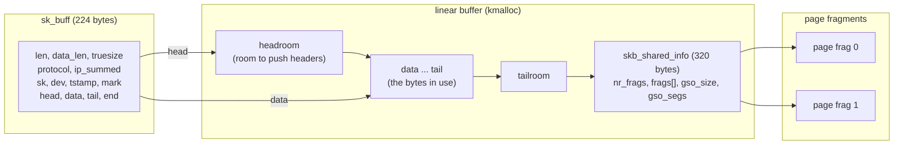
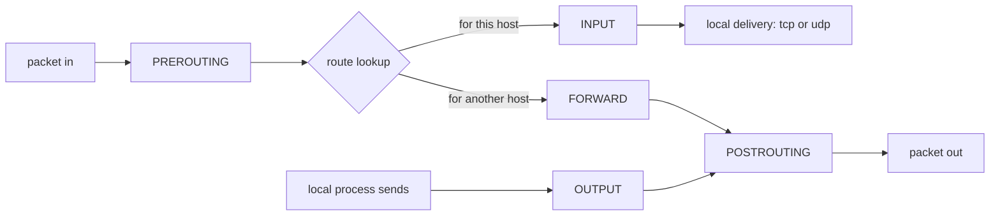
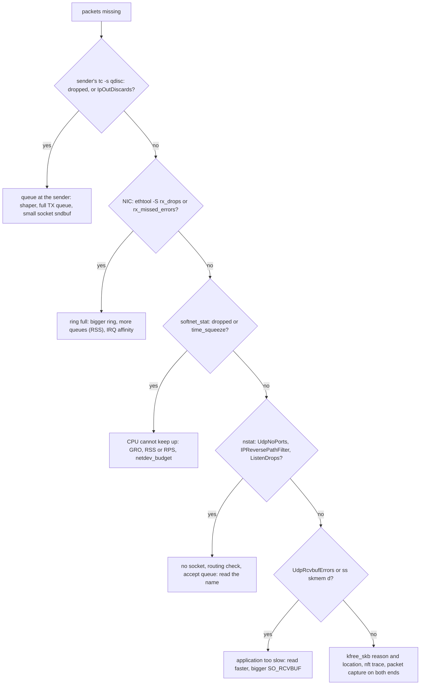

# NET 06: The Linux network stack

*Part of the [networking plan](00_plan.md) · Time: about 8 hours · You need: [NET 03](03_tcp_udp_and_transport.md) (what TCP does on the wire), [NET 04](04_socket_programming_in_c.md) and [NET 05](05_epoll_and_io_uring.md) (the socket API and event loops, the other end of this tutorial), [LX 08](../06_linux/08_linux_networking_toolbox.md) (network namespaces, `ss`, `nft`), [OS 17](../05_operating_systems/00_plan.md) (system calls). NET 04 and 05 stopped at the line where `recv` and `send` enter the kernel. This tutorial is what is behind that line: how a packet gets from the wire to a socket and from a socket to the wire, in Linux 6.18, with every stage observed on a running kernel. It covers the `sk_buff`, the receive path (DMA ring, interrupt, NAPI, GRO), offloads (TSO, GSO, GRO, checksum) and receive steering (RSS, RPS), the IP layer and the netfilter hooks, the socket and its buffers, the transmit path and the queueing discipline, and the places packets are dropped, with the counter that moves at each one. Every program and script is small, and every output below is pasted from a run.*

"Walk a packet from the wire to `recv()`. Where can it be dropped and how would you know?" is the standard Staff question for network-equipment, security-appliance and infrastructure roles. A weak answer lists layers. A strong answer names the **data structure** that carries the packet (`sk_buff`), the **context** each stage runs in (hard interrupt, softirq, your own process), the **queue** between stages and its size, and for each place a packet can die, the **counter** or **tracepoint** that shows it. This tutorial gives you the second kind of answer, with measurements you can reproduce.

**Eight honest limits, stated first.**

1. Everything is measured on **one Linux 6.18 VM** (Firecracker, 2 vCPUs) as **root**. The only real device is a **`virtio_net`** interface (`eth0`, one queue pair, MTU 1400); everything else is a **`veth` pair between network namespaces** or loopback. There is **no physical NIC**, so no hardware interrupt moderation, no multi-queue RSS (`ethtool -l eth0` shows 1 combined channel), no hardware checksum or TSO engine doing real work, and no PCIe. Where a physical NIC behaves differently the text says so and marks it **from memory**.
2. **This kernel has no kprobes, no `function_graph` tracer and no BPF `fentry` probes.** What works is **tracepoints** (`net:*`, `napi:*`, `skb:*`, `tcp:*`, `qdisc:*`, `fib:*`), `bpftrace`, kernel stack traces taken at a tracepoint, the netfilter trace of `nft`, and the usual counters. Statements about functions that no stack or tracepoint here showed are **from memory** of the source and marked.
3. **Tracing costs time.** The packet timeline of section 7.1 was taken with `bpftrace` probes attached on a cold path (first packet after a connect). Read it for **order**, not for absolute cost.
4. **A veth pair is not a wire.** The measurements show that on a veth pair the **receive processing runs in the sender's own call stack** (section 3.3), which is not true of a physical NIC, where it runs on the CPU that took the interrupt. That difference is used, not hidden.
5. **No `netem`, no `fq_codel`, no `cake`, no `mq`.** The queueing experiments use `pfifo_fast` (the default here) and `tbf`. Queueing theory and the modern qdiscs are [NET 14](00_plan.md).
6. **Throughput figures are single runs of 2 to 3 seconds on 2 vCPUs** and move by 30 percent or more between runs (the offload-off stream gave **5.2, 7.4 and 7.7 Gbit/s** in three runs). The structure of each result, not its last digit, is the point. Counts of packets and skbs are exact for the run they come from.
7. **IPv4 only** (the VM has no IPv6). The IPv6 path differs in names (`ip6_rcv`, `ip6_xmit`) and in neighbour discovery; that is **from memory**.
8. **A few statements are from memory** (the kernel source, the documentation, the papers) and are marked "from memory". Everything else was run here.

By the end you can:

- **draw the receive and transmit paths** with the data structure, the execution context and the queue at every step (measured: the kernel's own stack for a received packet on `eth0` reads **`virtnet_poll`, `napi_complete_done`, `netif_receive_skb_list_internal`, `__netif_receive_skb_core`**, called from **`net_rx_action` in a softirq** that ran on top of the **idle loop**; the transmit stack of a one-byte TCP send reads **`tcp_sendmsg`, `tcp_write_xmit`, `__tcp_transmit_skb`, `__ip_queue_xmit`, `ip_output`, `__dev_queue_xmit`, `dev_hard_start_xmit`**);
- explain the **`sk_buff`**: its sizes, its head, data, tail and end pointers, its shared info and page fragments, and **clone** against copy (measured: `struct sk_buff` is **224 bytes**, `struct skb_shared_info` **320**, a 64 kB TSO packet is **one skb of 65,226 bytes** carrying **45 segments** in **2 page fragments**, and a one-byte TCP packet has `truesize` **833**);
- explain **NAPI** and say when it batches (measured: with a ping flood of 30,000 packets on `eth0`, **30,002 of 45,248 NAPI polls handled exactly one packet**, and the virtio device raised **57,687 interrupts**; with a bulk TCP stream on the veth backlog queue, **75,771 polls handled 1,369,566 packets, 18 per poll** on average);
- explain **offloads** with numbers (measured on one TCP stream over a veth pair: with TSO and GSO the stack handled **49,775 bytes per skb and 15.0 Gbit/s**; with both off it handled **1,493 bytes per skb and 5.24 Gbit/s**, **12 times more skbs**; turning GRO on at the receiver cut **1,497,524 sent skbs to 47,266 received skbs**);
- say what **RSS, RPS, RFS and XPS** steer and when they help (measured: **RPS did not help** here, **10.3 against 9.3 Gbit/s**, and it **dropped 101 packets** at the per-CPU backlog queue);
- trace a packet through the **five netfilter hooks** and say where **routing** and **connection tracking** happen (measured: `nft monitor trace` printed **pre, in, out0, out, post**, in that order, for one ping and its reply, and `conntrack -L` showed the entry created by the request);
- read **`ss -tmi`** and explain the socket buffers (measured: a receiver that never reads took **0.23, 0.84 and 3.74 MB** from the sender with `SO_RCVBUF` of **16 kB, the default and 1 MB**, and the skmem fields showed where each byte sat);
- explain the **transmit path and the qdisc**, and why a long queue does not always mean a long delay (measured: a 20 Mbit/s token bucket allowed to queue 400 ms gave a ping RTT of **6.1 ms** with a TCP stream behind it and **41 ms** with a UDP flood, because **TCP small queues** and the **socket send buffer** bound what a socket can park in the qdisc);
- **find where a packet was lost** in six different places, each with its **drop reason, location and counter** (measured: `NETFILTER_DROP` at `nft_do_chain`, `NO_SOCKET` at `__udp4_lib_rcv`, `SOCKET_RCVBUFF` at `udp_queue_rcv_one_skb`, `IP_RPFILTER` at `ip_rcv_finish_core`, `QDISC_DROP` at `__dev_queue_xmit`, and a listen-queue overflow that has **no reason at all**, only `ListenOverflows`);
- size socket buffers from the bandwidth delay product and see which sysctl limits the result.

**Where the numbers come from.** Eleven experiment scripts and five answer scripts were run in this session: `e1_path`, `e2_skb`, `e3_offloads`, `e4_napi`, `e5_hooks`, `e6_drops`, `e7_skmem`, `e8_rps`, `e9_qdisc`, `e10_counters`, and `ans_a` to `ans_e`. The programs, the `bpftrace` scripts (`.bt`) and the helper scripts are in this tutorial's `prog/` folder. The namespace lab (`lab.sh`) is two namespaces, `cl` (10.6.0.1) and `sv` (10.6.0.2), joined by a veth pair `cle` and `sve`; `nse NS cmd` means `ip netns exec NS cmd`. Transcripts print `$ command` before a command's output. Numbers not from these runs are marked "from memory", or are computed, or come from a source at the end.

**Data and timing.** No data sets. The experiments take 5 to 40 seconds each. `bpftrace` needs root and BTF; the drop experiments read `/sys/kernel/tracing` directly (`mount -t tracefs nodev /sys/kernel/tracing` if it is not mounted). Nothing here changes the host network: every experiment runs in its own namespaces and removes them at exit.

---

## 1. The whole path in one picture

Two trips, one packet structure. On the way **in** the NIC writes the frame into memory by DMA, raises an interrupt, and the kernel turns the frame into an `sk_buff` and pushes it up through the layers until a socket queue holds it. On the way **out** the socket layer builds `sk_buff`s from your data and pushes them down through the layers until a driver hands them to the NIC.


Four ideas carry the rest of the tutorial:

1. **The `sk_buff` is the packet.** Every layer gets a pointer to it and moves its `data` pointer to peel or add a header; the bytes are not copied between layers (section 2).
2. **Context matters.** The receive work runs in a **softirq**, not in your process and not in the hard interrupt. It steals time from whatever was running. The transmit work runs **in your own system call**. That is why a busy receive path shows up as `ksoftirqd` or as time in `si` in `top`, and a busy transmit path shows up as `sys` time in your own process.
3. **There is a queue between stages, and each queue has a size and a drop counter**: the NIC rings, the per-CPU backlog, the socket receive queue, the listen queue, the qdisc, the TX ring. Where a packet can be lost is the list of those queues (section 8).
4. **Batching is the performance story.** One interrupt per batch, not per packet (NAPI); one skb per 45 segments (TSO, GRO); one `sendmmsg`, one syscall for many operations (NET 05). Each section below measures what the batch saves.

---

## 2. The sk_buff

Every packet in the stack is a `struct sk_buff`, an skb. It is **not** the packet bytes. It is a small **descriptor** (224 bytes) that points at a separately allocated **buffer** holding the bytes.



- **`head`, `data`, `tail`, `end`** are four pointers into the linear buffer. `head` to `data` is **headroom**: when TCP has built the payload and IP wants to add its header, it does `skb_push` (moves `data` down, no copy). `data` to `tail` is the bytes in use. `tail` to `end` is **tailroom**. Receive does the reverse: `skb_pull` moves `data` up past each header as the packet climbs (this is why the same packet has `len` 67 leaving the sender, with the 14 byte Ethernet header, and `len` 53 arriving at the receiver's IP layer, after `eth_type_trans` pulled it, in section 7.1).
- **`skb_shared_info`** sits at the end of the buffer. It holds the **page fragment** array: large payloads live in separate pages, referenced from here, not in the linear part. `data_len` is the number of bytes held in fragments; `len` is linear plus fragments. It also holds the **GSO** fields: `gso_size` (the segment size) and `gso_segs` (how many segments the skb stands for).
- **`truesize`** is the memory the skb really costs (descriptor, buffer, fragments), larger than `len`. **Socket buffer limits are counted in `truesize`, not in payload bytes**, which is why a socket "holds less than its buffer size" (measured in section 6 and Problem A).
- **Clone and copy.** `skb_clone` makes a **new descriptor that shares the same buffer** (a reference count in the shared info); `skb_copy` duplicates the data. TCP needs this: the original skb stays in the **retransmit queue** until acknowledged, and a **clone** is what goes to the driver. The `cloned` field is 1 on a transmitted data skb (measured below).

`skb.bt` reads these fields from the kernel at the moment a packet is handed to the driver, for one tiny packet and one big one. `e2_skb.sh` prints the allocator's view first.

```text
BEGIN { printf("sizeof(struct sk_buff) %d, sizeof(struct skb_shared_info) %d, sizeof(struct tcp_sock) %d, sizeof(struct udp_sock) %d\n", sizeof(struct sk_buff), sizeof(struct skb_shared_info), sizeof(struct tcp_sock), sizeof(struct udp_sock)); }
tracepoint:net:net_dev_start_xmit /str(args.name) == "cle" && (args.len == 67 || args.len > 60000) && @shown[args.len > 60000] == 0/ {
  @shown[args.len > 60000] = 1;
  $skb = (struct sk_buff *)args.skbaddr;
  $shi = (struct skb_shared_info *)($skb->head + $skb->end);
  printf("%s skb: len %d  data_len %d  truesize %d  headroom %d  tailroom %d  nr_frags %d  gso_size %d  gso_segs %d  cloned %d  ip_summed %d\n",
         args.len > 60000 ? "bulk " : "1 byte", $skb->len, $skb->data_len, $skb->truesize, (uint64)$skb->data - (uint64)$skb->head, $skb->end - $skb->tail,
         $shi->nr_frags, $shi->gso_size, $shi->gso_segs, $skb->cloned, $skb->ip_summed);
}
interval:s:5 { exit(); }
END { clear(@shown); }
```

```text
$ grep -E '^(skbuff_head_cache|skbuff_small_head|TCP |UDP )' /proc/slabinfo | awk '{print $1, $4}'
UDP 1344
TCP 2368
skbuff_small_head 576
skbuff_head_cache 256
sizeof(struct sk_buff) 224, sizeof(struct skb_shared_info) 320, sizeof(struct tcp_sock) 2304, sizeof(struct udp_sock) 1344
bulk  skb: len 65226  data_len 65160  truesize 65992  headroom 126  tailroom 64  nr_frags 2  gso_size 1448  gso_segs 45  cloned 1  ip_summed 3
1 byte skb: len 67  data_len 1  truesize 833  headroom 126  tailroom 64  nr_frags 1  gso_size 0  gso_segs 1  cloned 1  ip_summed 3
```

Read the two `skb:` lines against the diagram.

- **The one-byte send** is a 67 byte skb: 14 Ethernet, 20 IP, 32 TCP (with the timestamp option), 1 byte of data. The 1 byte is in **a page fragment** (`data_len 1`, `nr_frags 1`), not in the linear area: `tcp_sendmsg` copies user data into page fragments, so the same skb can later be sent by TSO or `sendfile` without a second copy. `truesize` is **833** bytes for 1 byte of payload: the descriptor, a linear buffer with 126 bytes of headroom and 64 of tailroom, and the shared info. `gso_segs` is 1.
- **The 64 kB send** is **one skb**: `len 65226`, **`data_len 65160`** (all but 66 bytes are in fragments, in **2 fragments** because each can be a multi-page chunk), `gso_size 1448` and **`gso_segs 45`**. The stack treats 45 TCP segments as one packet all the way down, and only the NIC (or `dev_hard_start_xmit` in software, section 4) cuts it into 1448 byte pieces. **`ip_summed 3` is `CHECKSUM_PARTIAL`**: the TCP checksum has not been computed; the device or the GSO code will finish it.
- **Both are `cloned 1`**: what reached the driver is a clone, and the original waits in the retransmit queue.

The allocator lines give the sizes of the objects: the **descriptor comes from the `skbuff_head_cache` slab, 256 bytes per object** (224 rounded up), small packets use **`skbuff_small_head` objects of 576 bytes** (descriptor and a small buffer together), and a **TCP socket is 2,368 bytes** (`struct tcp_sock` is 2,304 plus the socket's slab overhead) and a UDP socket 1,344. A server with 100,000 connections has about 237 MB in TCP socket structures **before any buffer**, which is the number to quote when asked what a connection costs (from these measured sizes, computed).

---

## 3. The receive path

### 3.1 From the wire to the ring

A NIC receives a frame into a **RX ring**: a circular array of **descriptors**, each pointing at a pre-allocated memory buffer (from memory of how every modern driver works; the driver fills the ring at start-up and refills it as it consumes). The NIC writes the frame into the next free buffer by **DMA**, with no CPU involved, then marks the descriptor done. The ring has a fixed size, and `ethtool -g` shows it:

```text
--- 3. the limits on this kernel
$ cat /proc/sys/net/core/netdev_budget /proc/sys/net/core/netdev_budget_usecs /proc/sys/net/core/dev_weight
300
8000
64
$ ethtool -g eth0
Ring parameters for eth0:
Pre-set maximums:
RX:                     256
RX Mini:                n/a
RX Jumbo:               n/a
TX:                     256
TX push buff len:       n/a
Current hardware settings:
RX:                     256
RX Mini:                n/a
RX Jumbo:               n/a
TX:                     256
RX Buf Len:             n/a
CQE Size:               n/a
TX Push:                off
RX Push:                off
TX push buff len:       n/a
TCP data split:         n/a
$ ethtool -l eth0
Channel parameters for eth0:
Pre-set maximums:
RX:             n/a
TX:             n/a
Other:          n/a
Combined:       1
Current hardware settings:
RX:             n/a
TX:             n/a
Other:          n/a
Combined:       1
```

The virtio interface here has **256 RX and 256 TX descriptors** and **one combined channel** (one queue pair). A physical 10 or 100 Gbit/s NIC typically has 4096 descriptors per ring and 8 to 64 queues (from memory), one per CPU core, which is what **RSS** steers into (section 4.3). **If the ring is full when a frame arrives, the NIC drops it.** The counter is the driver's: `rx_drops` or `rx_missed_errors` in `ethtool -S` (section 8.4); it is the one drop the kernel's own software never sees.

### 3.2 Interrupt, then NAPI

When the NIC has written frames it raises an **interrupt**. One interrupt per packet would be fatal at 10 Gbit/s and above (14.8 million packets a second of minimum size is 14.8 million interrupts a second). **NAPI** (the "new API", in the kernel since 2.6) turns that into **polling under load**:

1. The first frame raises an interrupt. The driver's interrupt handler does almost nothing: it **disables that queue's interrupt** and calls `napi_schedule`, which raises the **`NET_RX` softirq**. The hard interrupt ends in microseconds.
2. The softirq runs `net_rx_action`, which calls the driver's **poll function** (here `virtnet_poll`) with a **budget** (64 packets for one poll; 300 packets or 8 ms across polls, `netdev_budget` and `netdev_budget_usecs`, both shown above and below). The poll function takes frames off the ring, builds an skb for each and hands them up.
3. If the poll processed **fewer packets than the budget**, the ring is empty: the driver calls `napi_complete_done` and **re-enables the interrupt**. If it used the whole budget there may be more, so the softirq polls again without any interrupt.

So under light load it is interrupt-driven and under heavy load it is polling, and the switch is automatic. `napi.bt` records the work done by every NAPI poll on `eth0`, and `e4_napi.sh` also counts interrupts and softirq runs around a ping flood of 30,000 packets in two seconds:

```text
tracepoint:napi:napi_poll /str(args.dev_name) == "eth0"/ { @eth0_work = hist(args.work); @eth0_polls += 1; }
interval:s:4 { exit(); }
END { printf("napi_poll calls on eth0: %d\n", @eth0_polls); clear(@eth0_polls); }
```

```text
# ctr: print the interrupt count of virtio7 (eth0) summed over CPUs and the NET_RX softirq count summed over CPUs
irq=$(awk '/virtio7/ {s += $2 + $3} END {print s}' /proc/interrupts)
rx=$(awk '/NET_RX/ {print $2 + $3}' /proc/softirqs)
echo "$irq $rx"
```

```text
--- 1. eth0, a ping flood: one packet at a time
30000 packets transmitted, 30000 received, 0% packet loss, time 2245ms
napi_poll calls on eth0: 45248
@eth0_work:
[0]                15300 |##########################                          |
[1]                30002 |####################################################|
[2, 4)                 5 |                                                    |
virtio interrupts during the run: 57687, NET_RX softirq runs: 45008
```

At about 13,000 packets a second **NAPI does not batch**: **30,002 of the 45,248 polls processed exactly one packet** (the histogram bar `[1]`), and **15,300 processed none** (a poll that only cleaned up transmit completions; `[0]`). The virtio device raised **57,687 interrupts** for 30,000 echo requests sent and 30,000 replies received: roughly one per event. This is the regime where interrupt rate is high and each interrupt moves one packet, the worst case for CPU cost per packet and the reason **interrupt coalescing** (`ethtool -C`, from memory; not offered by this virtual device) exists on physical NICs: wait a few microseconds so that one interrupt covers several frames, at the price of latency.

The other regime needs a load that outruns the poller. A bulk TCP stream over a veth pair with segmentation offload off produces over a million small skbs in a few seconds. The veth receive side is also a NAPI queue (the per-CPU **backlog**, which has no device name; the tracepoint prints `(no_device)`). `napi2.bt` records its work per poll:

```text
tracepoint:napi:napi_poll /str(args.dev_name) == "(no_device)"/ { @backlog_work = lhist(args.work, 0, 72, 8); @polls += 1; @pk += (uint64)args.work; }
interval:s:4 { exit(); }
END { printf("napi_poll calls on the backlog queue: %d, packets processed: %d\n", @polls, @pk); clear(@polls); clear(@pk); }
```

```text
--- 2. veth, the per-CPU backlog queue (it has no device name), bulk TCP
throughput 7.64 Gbits/sec
napi_poll calls on the backlog queue: 75771, packets processed: 1369566
@backlog_work:
[0, 8)             46462 |####################################################|
[8, 16)               86 |                                                    |
[16, 24)              45 |                                                    |
[24, 32)              46 |                                                    |
[32, 40)              35 |                                                    |
[40, 48)           28962 |################################                    |
[48, 56)              64 |                                                    |
[56, 64)              17 |                                                    |
[64, 72)             125 |                                                    |
```

**75,771 polls processed 1,369,566 packets, 18 per poll on average**, in two modes: **46,462 polls found 0 to 7 packets** (the queue was nearly empty when the softirq ran) and **28,962 polls found 40 to 47** (the sender had queued a burst). The **budget of 64** is rarely reached (125 polls at 64 or more), so on this machine the poller keeps up; **`time_squeeze`** (the third column of `/proc/net/softnet_stat`, the count of times a softirq stopped because it ran out of budget or time while packets were still waiting) read 1 in the RPS-off run of section 4.3. If you see it climbing on a real machine, the receive path is saturated and the cure is more queues (RSS), a larger `netdev_budget`, or fewer packets (GRO).

### 3.3 GRO, then up the stack

Before the skb leaves the NAPI poll the driver calls `napi_gro_receive`. **GRO (generic receive offload)** looks for consecutive segments of the **same TCP flow** (same four-tuple, consecutive sequence numbers, compatible flags) and **merges them into one big skb** with the segments as fragments, so the layers above run **once per merged packet instead of once per segment**. It is the receive-side mirror of TSO, in software, and it is why the stack above NAPI sees 45 KB skbs rather than 1.5 KB ones (measured in section 4.1).

Then `netif_receive_skb` delivers the skb up. This is where **packet taps** (the `AF_PACKET` sockets of `tcpdump`, NET 04 section 10), the **ingress `tc` hook** (`clsact`, from memory), VLAN and bridge handling see it, and then the protocol handler for its EtherType: `ip_rcv`.

`e1_path.sh` shows what this looks like from the inside. The first part waits for a packet to arrive on `eth0` and prints the kernel's call stack at the moment it enters `netif_receive_skb`. The probe is one line:

```text
tracepoint:net:netif_receive_skb /str(args.name) == "eth0"/ { print(kstack); exit(); }
```

```text
--- 1. eth0: kernel stack where a received packet enters the IP stack
__netif_receive_skb_core.constprop.0+819
__netif_receive_skb_list_core+307
netif_receive_skb_list_internal+452
napi_complete_done+126
virtnet_poll+1801
__napi_poll+49
net_rx_action+315
handle_softirqs+205
__irq_exit_rcu+142
common_interrupt+121
asm_common_interrupt+34
pv_native_safe_halt+11
```

Read it from the bottom up: the CPU was in **`default_idle`** (the idle loop, `pv_native_safe_halt`, a halted virtual CPU). The **`common_interrupt`** woke it; on the way out of the interrupt (`__irq_exit_rcu`) the kernel ran **`handle_softirqs`**, which ran **`net_rx_action`**, which called **`__napi_poll`**, which called the driver's **`virtnet_poll`**. The driver finished its work and called **`napi_complete_done`**, which flushed the GRO list into **`netif_receive_skb_list_internal`** (the **list** variant: modern kernels hand up a batch of skbs at once, not one by one), then `__netif_receive_skb_list_core` and `__netif_receive_skb_core`. **No process was involved.** The receive path ran in a softirq on the idle CPU, which is exactly why `top` shows it under `si` and why it is invisible to a profile of your application.

The same experiment on the veth pair shows something a physical NIC would not. The second probe filters for the one-byte data packet arriving at `sve`:

```text
tracepoint:net:netif_receive_skb /str(args.name) == "sve" && args.len == 53/ { print(kstack); exit(); }
```

```text
--- 3. veth: receive stack of the byte on the other end
__netif_receive_skb_core.constprop.0+819
__netif_receive_skb_one_core+57
process_backlog+131
__napi_poll+49
net_rx_action+315
handle_softirqs+205
do_softirq.part.0+59
__local_bh_enable_ip+100
__dev_queue_xmit+844
ip_finish_output2+705
ip_output+95
__ip_queue_xmit+363
__tcp_transmit_skb+2576
tcp_write_xmit+845
__tcp_push_pending_frames+53
tcp_sendmsg_locked+2015
tcp_sendmsg+43
__sys_sendto+450
__x64_sys_sendto+32
do_syscall_64+113
entry_SYSCALL_64_after_hwframe+118
```

Read this stack from the **bottom**: it starts in **`do_syscall_64`, `__sys_sendto`, `tcp_sendmsg`**: it is the **sender's own system call**. TCP transmits (`tcp_write_xmit`, `__tcp_transmit_skb`), IP outputs (`ip_output`, `ip_finish_output2`), `__dev_queue_xmit` queues the packet on the veth, the veth's transmit function **queues it to the peer's per-CPU backlog**, and when `__dev_queue_xmit` ends, **`__local_bh_enable_ip` notices a pending softirq and runs it right there**, inside the sender's call: `do_softirq`, `handle_softirqs`, `net_rx_action`, `__napi_poll`, **`process_backlog`**, `__netif_receive_skb_one_core`. **On a veth pair and on loopback, the receiver's stack runs on the sender's CPU, inside the sender's `send` call.** That has three consequences, all used later: the CPU time of receive processing is charged to the **sender**; a veth pair is **faster** than a real link per packet (no interrupt, no DMA, no wire); and **RPS** (section 4.3), which moves receive work to other CPUs, is a real change here, not a no-op.


---

## 4. Offloads and receive steering

Per-packet work in the stack is roughly constant (a socket lookup, a route lookup, a few dozen cache lines touched), so the cheapest way to go faster is to make **fewer, bigger packets** inside the kernel. Three offloads do this, and one more removes the checksum work.

### 4.1 TSO, GSO and GRO measured

- **TSO (TCP segmentation offload)**: TCP hands the driver **one skb of up to 64 kB** and the **NIC cuts it into MSS-sized frames** and writes each header (from memory of how every TSO-capable NIC works).
- **GSO (generic segmentation offload)**: the same idea in software, for devices without TSO. The skb travels down the stack as one packet and is cut **late**, in `dev_hard_start_xmit` just before the driver (from memory). The saving is that IP, netfilter, routing and the qdisc all run once per 45 segments.
- **GRO (generic receive offload)**: the receive mirror of the two above (section 3.3). Consecutive segments of one flow are merged before the stack above NAPI sees them.

The measurement uses one TCP stream over the veth pair for 2 seconds in four settings. `xmit.bt` counts how many skbs reach the sender's driver (`net_dev_start_xmit` on `cle`) and how many reach the receiver's IP stack (`netif_receive_skb` on `sve`) and their average length:

```text
tracepoint:net:net_dev_start_xmit /str(args.name) == "cle"/ { @xs += 1; @xb += args.len; }
tracepoint:net:netif_receive_skb /str(args.name) == "sve"/ { @rs += 1; @rb += args.len; }
interval:s:4 { exit(); }
END {
  printf("  sender   : %8d skbs handed to the driver, %6d bytes each on average\n", @xs, @xb / (@xs + 1));
  printf("  receiver : %8d skbs seen by the IP stack, %6d bytes each on average\n", @rs, @rb / (@rs + 1));
  clear(@xs); clear(@xb); clear(@rs); clear(@rb);
}
```

```bash
# one veth pair, one TCP stream for 2 seconds, four offload settings; the receiver's skb counts come from tracepoints
. prog/lab.sh
run() {
  local label=$1; shift
  nse sv ethtool -K sve "$@" >/dev/null 2>&1; nse cl ethtool -K cle "$@" >/dev/null 2>&1
  echo "--- $label"
  nse sv iperf3 -s -1 -D >/dev/null 2>&1; sleep 0.5
  bpftrace prog/xmit.bt 2>&1 | grep -E "sender|receiver" > /tmp/xm.out &
  sleep 1.5
  nse cl iperf3 -c 10.6.0.2 -t 2 -f g 2>&1 | grep sender | awk '{printf "  throughput: %s %s\n", $7, $8}'
  wait
  cat /tmp/xm.out
}
run "tso gso on, gro off (the default)" tso on gso on gro off
run "tso gso off, gro off" tso off gso off gro off
run "tso gso off, gro on" tso off gso off gro on
run "tso gso on, gro on" tso on gso on gro on
```

```text
--- tso gso on, gro off (the default)
  throughput: 15.0 Gbits/sec
  sender   :    75819 skbs handed to the driver,  49777 bytes each on average
  receiver :    75798 skbs seen by the IP stack,  49775 bytes each on average
--- tso gso off, gro off
  throughput: 5.24 Gbits/sec
  sender   :   911681 skbs handed to the driver,   1507 bytes each on average
  receiver :   911341 skbs seen by the IP stack,   1493 bytes each on average
--- tso gso off, gro on
  throughput: 8.62 Gbits/sec
  sender   :  1497524 skbs handed to the driver,   1506 bytes each on average
  receiver :    47266 skbs seen by the IP stack,  45704 bytes each on average
--- tso gso on, gro on
  throughput: 15.8 Gbits/sec
  sender   :    81061 skbs handed to the driver,  49214 bytes each on average
  receiver :    81041 skbs seen by the IP stack,  49210 bytes each on average
```

| Setting | Throughput | Sender skbs | Bytes per sender skb | Receiver skbs | Bytes per receiver skb |
|---|---|---|---|---|---|
| TSO and GSO on, GRO off (default) | 15.0 Gbit/s | 75,819 | 49,777 | 75,798 | 49,775 |
| TSO and GSO off, GRO off | 5.24 Gbit/s | 911,681 | 1,507 | 911,341 | 1,493 |
| TSO and GSO off, GRO on | 8.62 Gbit/s | 1,497,524 | 1,506 | 47,266 | 45,704 |
| TSO and GSO on, GRO on | 15.8 Gbit/s | 81,061 | 49,214 | 81,041 | 49,210 |

Four readings:

1. **TSO and GSO make the stack touch 12 times fewer skbs** (911,681 divided by 75,819 is 12.0), and every layer from TCP to the driver runs once per skb. The sender skb averages **49,777 bytes**, which is 34 segments of 1448 bytes. The throughput difference (**15.0 against 5.24 Gbit/s**) is mostly this, but it is **not a clean 12 times**: the other costs (the copy from user space, the checksum, the receive side) are per byte, not per skb. The tso-off line was **5.2, 7.4 and 7.7 Gbit/s** in three runs on this VM, so quote it as "5 to 8".
2. **The veth device advertises TSO, so the big skb crosses the link whole.** The receiver sees 75,798 skbs of 49,775 bytes: the same packets. On a physical NIC with TSO the wire carries 1448 byte frames and the receiver sees small packets unless GRO merges them.
3. **GRO turns 1,497,524 small sent skbs into 47,266 received skbs** (32 times fewer, 45,704 bytes each), with TSO off. The receive-side layers (IP, netfilter, TCP, the socket queue) ran 32 times less often. Throughput rose from 5.24 to 8.62 Gbit/s in these runs, but the noise in point 1 is as large as that gap; **the skb counts are the result, the throughput is a hint.**
4. **With TSO on, GRO has nothing left to merge** on this link (the packets are already 49 kB), so the last row is the same as the first within noise.

The same arithmetic is why modern kernels are fast at 100 Gbit/s at all (Problem C): at 100 Gbit/s with **1,493 byte skbs** the stack would have to process **8.37 million skbs a second, 119 ns each on one core**; with **49,775 byte skbs** it processes **0.25 million a second, 3,982 ns each**. The second is a budget a core can meet; the first is not.

### 4.2 Checksum offload

`ip_summed` tells the stack what to do about the TCP and UDP checksum. The values below are **from memory** of `skbuff.h`: **`CHECKSUM_NONE` (0)**, software must verify or compute; **`CHECKSUM_UNNECESSARY` (1)**, the device verified it on receive; **`CHECKSUM_COMPLETE` (2)**, the device handed the stack the sum of the whole packet and the stack finishes the pseudo-header check; **`CHECKSUM_PARTIAL` (3)**, on transmit, the stack filled in only the pseudo-header and the device (or GSO code) adds the rest. The one value measured here is on transmit: **both skbs in section 2 had `ip_summed 3`, `CHECKSUM_PARTIAL`**, so TCP never summed the payload bytes itself. On a veth pair no real device ever finishes the sum; the kernel knows the packet never left memory (from memory).

### 4.3 RSS, RPS, RFS and XPS

One CPU running `net_rx_action` is a ceiling: a single flow is one CPU's work anyway (packets of one flow must stay in order), but many flows should use many CPUs. Four mechanisms spread the work.

| Name | Where | What it steers | Setting |
|---|---|---|---|
| **RSS** (receive side scaling) | the NIC, in hardware | hashes the flow tuple (Toeplitz hash, from memory) and picks one of many **RX queues**, each with its own ring and its own interrupt, each interrupt pinned to a CPU | `ethtool -l` (channels), `ethtool -x` and `-X` (hash key and indirection table) |
| **RPS** (receive packet steering) | the kernel, software | the same hash, but done after the interrupt: the CPU that took it **enqueues the skb on another CPU's backlog** and sends it an inter-processor interrupt | `/sys/class/net/DEV/queues/rx-N/rps_cpus` (a CPU mask) |
| **RFS** (receive flow steering) | the kernel, software | RPS, but the target is **the CPU where the application last ran `recv`** for that flow, so the data is already in that CPU's cache | `rps_sock_flow_entries`, `rps_flow_cnt` |
| **XPS** (transmit packet steering) | the kernel | picks the **TX queue** from the sending CPU, so that each CPU uses its own queue and its own lock | `/sys/class/net/DEV/queues/tx-N/xps_cpus` |

RSS is the first choice and RPS exists for NICs that have fewer queues than the machine has CPUs (from memory). This VM's `eth0` has **one combined channel**, so RSS cannot be shown here, and its description above is **from memory**. RPS **can** be shown: `e8_rps.sh` sends **eight TCP streams** over the veth pair (offloads off, so there are many small skbs) and reads the per-CPU counters from `/proc/net/softnet_stat` with `soft.sh`, first with RPS off and then with the mask set to both CPUs.

```bash
# soft: print "cpu processed dropped squeezed received_rps" per CPU from /proc/net/softnet_stat (hex columns 1, 2, 3, 10)
awk '{ printf "%d %d %d %d %d\n", NR - 1, strtonum("0x" $1), strtonum("0x" $2), strtonum("0x" $3), strtonum("0x" $10) }' /proc/net/softnet_stat
```

```bash
# eight TCP streams over a veth pair, receive processing without and with RPS; per-CPU softnet counters before and after
. prog/lab.sh
nse sv ethtool -K sve tso off gso off gro off > /dev/null 2>&1; nse cl ethtool -K cle tso off gso off gro off > /dev/null 2>&1
run() {   # label mask
  echo "--- $1"
  echo $2 | nse sv tee /sys/class/net/sve/queues/rx-0/rps_cpus > /dev/null
  show "nse sv cat /sys/class/net/sve/queues/rx-0/rps_cpus"
  bash prog/soft.sh > /tmp/s0
  nse sv iperf3 -s -1 -D > /dev/null 2>&1; sleep 0.5
  nse cl iperf3 -c 10.6.0.2 -P 8 -t 3 -f g 2>&1 | grep SUM | grep sender | awk '{printf "throughput %s %s\n", $6, $7}'
  bash prog/soft.sh > /tmp/s1
  paste /tmp/s0 /tmp/s1 | awk '{printf "  cpu%d: processed %8d  dropped %d  squeezed %d  received_rps %d\n", $1, $7 - $2, $8 - $3, $9 - $4, $10 - $5}'
}
run "RPS off (mask 0)" 0
run "RPS on, both CPUs (mask 3)" 3
```

```text
--- RPS off (mask 0)
$ nse sv cat /sys/class/net/sve/queues/rx-0/rps_cpus
0
throughput 10.3 Gbits/sec
  cpu0: processed  1361079  dropped 0  squeezed 1  received_rps 0
  cpu1: processed  1335570  dropped 0  squeezed 0  received_rps 0
--- RPS on, both CPUs (mask 3)
$ nse sv cat /sys/class/net/sve/queues/rx-0/rps_cpus
3
throughput 9.32 Gbits/sec
  cpu0: processed  1844656  dropped 101  squeezed 0  received_rps 7781
  cpu1: processed   594568  dropped 0  squeezed 0  received_rps 561
```

The columns of `softnet_stat` are hexadecimal and per CPU: **processed** (column 1), **dropped** (2, the per-CPU backlog was full), **time_squeeze** (3), and **received_rps** (10, how many times this CPU was woken by an RPS inter-processor interrupt).

- **RPS off: 10.3 Gbit/s and an even split**: cpu0 processed 1,361,079 and cpu1 1,335,570, **no drops**. Receive was already spread across both CPUs, because (section 3.3) on a veth pair the receive runs **on whichever CPU the sender's thread is on**, and the eight `iperf3` streams ran on both.
- **RPS on: 9.32 Gbit/s, a worse split and a drop**: cpu0 processed 1,844,656 against 594,568 on cpu1, **101 packets were dropped** at the backlog, and `received_rps` went from 0 to 7,781 and 561. RPS picks the CPU by flow hash, so eight flows can land unevenly (an explanation, not measured); every hand-off costs an inter-processor interrupt; and the per-CPU queue has a limit (`netdev_max_backlog`, **1000** here), which is where the `dropped` counter counts (from memory).

**On 2 CPUs and veth, RPS did not help.** It helps where one CPU is the bottleneck for receive while others idle: one RSS queue, a physical NIC, a many-core machine. Measure before enabling it: look at `softnet_stat` per CPU first, and if the load is already even, the mask only adds cost.

---

## 5. The IP layer: routing, netfilter and conntrack

When `__netif_receive_skb_core` has finished with taps and ingress hooks, the skb enters `ip_rcv`. That is the stack of section 1's third box, and it has three things in it: a **hook** where a firewall can look at the packet before routing, a **route lookup** that decides what the packet is for, and a second **hook** before delivery.

### 5.1 The five hooks

Netfilter is a set of **five points** in the IP layer where registered callbacks (the `nft` or `iptables` rules, connection tracking, NAT) see the skb and return accept, drop, steal or queue.



| Hook | When | Typical use |
|---|---|---|
| `PREROUTING` | every packet in, before the routing decision | DNAT, `raw` table (skip conntrack), early drops |
| `INPUT` | packet for this host, after routing | the host firewall |
| `FORWARD` | packet routed through this host | the router firewall |
| `OUTPUT` | packet created by a local process | host egress rules |
| `POSTROUTING` | every packet out, after routing | SNAT and masquerade |

The hooks can be **seen** with the `nft` trace facility. `hooks.nft` puts one counter or one `nftrace` setting at every hook of the server namespace, and `e5_hooks.sh` sends **one ping** from the client, prints the trace, then the connection-tracking table, then the counters. (The `.nft` file is not part of the verified program set, so it is shown as text.)

```text
table ip trace_demo {
    chain pre  { type filter hook prerouting priority -300; policy accept; meta nftrace set 1; }
    chain in   { type filter hook input priority 0; policy accept; ct state new counter; }
    chain out0 { type filter hook output priority -300; policy accept; meta nftrace set 1; }
    chain out  { type filter hook output priority 0; policy accept; counter; }
    chain post { type filter hook postrouting priority 100; policy accept; counter; }
}
```

```bash
# one ping request and its reply, traced through every netfilter hook of the server, then its conntrack entry
. prog/lab.sh
nse sv nft -f prog/hooks.nft
(nse sv timeout 3 nft monitor trace > /tmp/e5_tr.out 2>&1 &)
sleep 0.8
nse cl ping -c 1 -W 1 10.6.0.2 > /dev/null
sleep 1.5
echo "--- 1. nft monitor trace (the long address part of each packet line is cut)"
sed -E 's/ ether saddr.*ip saddr/ ... ip saddr/; s/ ip dscp.* icmp type/ ... icmp type/; s/ icmp code.*//; s/^trace id [0-9a-f]+ ip trace_demo //' /tmp/e5_tr.out
echo "--- 2. the connection tracking entry the request created"
show "nse sv conntrack -L"
echo "--- 3. the same counters after the exchange"
show "nse sv nft list table ip trace_demo"
```

```text
--- 1. nft monitor trace (the long address part of each packet line is cut)
pre packet: iif "sve" ... ip saddr 10.6.0.1 ip daddr 10.6.0.2 ... icmp type echo-request
pre rule meta nftrace set 1 (verdict continue)
pre policy accept
in packet: iif "sve" ... ip saddr 10.6.0.1 ip daddr 10.6.0.2 ... icmp type echo-request
in rule ct state new counter packets 0 bytes 0 (verdict continue)
in policy accept
out0 packet: oif "sve" ip saddr 10.6.0.2 ip daddr 10.6.0.1 ... icmp type echo-reply
out0 rule meta nftrace set 1 (verdict continue)
out0 policy accept
out packet: oif "sve" ip saddr 10.6.0.2 ip daddr 10.6.0.1 ... icmp type echo-reply
out rule counter packets 0 bytes 0 (verdict continue)
out policy accept
post packet: oif "sve" ip saddr 10.6.0.2 ip daddr 10.6.0.1 ... icmp type echo-reply
post rule counter packets 0 bytes 0 (verdict continue)
post policy accept
--- 2. the connection tracking entry the request created
$ nse sv conntrack -L
conntrack v1.4.8 (conntrack-tools): 1 flow entries have been shown.
icmp     1 28 src=10.6.0.1 dst=10.6.0.2 type=8 code=0 id=1371 src=10.6.0.2 dst=10.6.0.1 type=0 code=0 id=1371 mark=0 use=1
--- 3. the same counters after the exchange
$ nse sv nft list table ip trace_demo
table ip trace_demo {
        chain pre {
                type filter hook prerouting priority raw; policy accept;
                meta nftrace set 1
        }

        chain in {
                type filter hook input priority filter; policy accept;
                ct state new counter packets 1 bytes 84
        }

        chain out0 {
                type filter hook output priority raw; policy accept;
                meta nftrace set 1
        }

        chain out {
                type filter hook output priority filter; policy accept;
                counter packets 1 bytes 84
        }

        chain post {
                type filter hook postrouting priority srcnat; policy accept;
                counter packets 1 bytes 84
        }
}
```

Read the trace as the packet's own diary. The **echo request** appears at **`pre`** (priority -300, the earliest) and then at **`in`**: it passed PREROUTING, was routed to this host, and passed INPUT. The kernel then replied, and the **echo reply** appears at **`out0`**, **`out`** and **`post`**: it was created locally (OUTPUT, early and normal priority) and left through POSTROUTING. It never appears at `FORWARD` because it was never routed through. The counters at the end agree: `in` 1 packet 84 bytes (the 84 byte request: 20 IP, 8 ICMP, 56 data), `out` 1 packet 84 bytes, `post` 1 packet 84 bytes.

Within one hook several callbacks run in **priority order** (the numbers in the file: -300 is `raw`, 0 is the normal `filter` chains, 100 is `srcnat`; the labels `raw`, `filter` and `srcnat` in the `nft list` output are the names of those numbers). That ordering is why `raw` rules run before connection tracking and `filter` rules run after it.

### 5.2 Connection tracking

**conntrack** keeps one entry per flow so that rules can say `ct state established` and so that NAT can translate both directions of a flow consistently. The entry the ping created is in the output above:

`icmp 1 28 src=10.6.0.1 dst=10.6.0.2 type=8 code=0 id=1371 src=10.6.0.2 dst=10.6.0.1 type=0 code=0 id=1371 ... use=1`

It lists the flow **twice**, once as seen (`src=10.6.0.1 dst=10.6.0.2`, an echo request) and once as the reply is expected (`src=10.6.0.2 dst=10.6.0.1`, an echo reply with the same id). `28` is the number of seconds until the entry expires. Three facts for interviews:

- **Conntrack is registered only when a rule needs it.** The `ct state new` rule in `hooks.nft` is what brought the hooks and the table to life in this namespace; without it `conntrack -L` stays empty (observed while building this experiment). On a busy NAT box or a Kubernetes node, the table is a **shared, finite resource** (`nf_conntrack_max`), and the classic outage is "table full, dropping packets" in `dmesg`.
- It makes a stateful firewall possible (`ct state established,related accept`), at a **per-packet cost** (a hash lookup) and a **per-flow memory cost** (a few hundred bytes, from memory).
- **UDP and ICMP have timeouts, TCP has a state machine** (established lasts 5 days by default, from memory), so long-lived idle TCP connections are a source of surprises.

### 5.3 The routing decision

`ip_rcv_finish` calls a **route lookup** on the destination address: is it one of mine (local delivery), reachable through some interface (forward), or unroutable (drop with `ICMP unreachable`)? The result is cached on the skb as `skb_dst`, and the next hop is a **neighbour table** entry (ARP) that supplies the link-layer address on transmit. Two measured facts bear on it:

- The default route on this VM is via **192.0.2.1 on `eth0`**: that gateway is the next hop for every packet that is not for a directly attached subnet (`ip route`, LX 08).
- **Reverse path filtering** (`rp_filter`) is part of the same lookup: the kernel asks which interface it would use to reach the packet's **source** address, and if it is not the interface the packet came in on, it drops the packet. Section 8.2 shows it firing: **`IP_RPFILTER` at `ip_rcv_finish_core`, `TcpExtIPReversePathFilter` 3**.

The lookup itself (the FIB, forwarding information base) is a **longest-prefix match** on a trie (from memory); policy routing (`ip rule`), several routing tables and VRFs add steps in front of the same lookup. `ip route get ADDR` asks the kernel which route and source address it would pick. The tooling for all of this is LX 08; what matters for this tutorial is **where in the path it sits**: after PREROUTING and before INPUT or FORWARD, so a PREROUTING rule can change a destination address and thereby change the routing decision, and an INPUT rule never sees a packet the routing decision sent elsewhere.

---

## 6. TCP, UDP and the socket buffers

The last stage of the receive path is `tcp_v4_rcv` or `udp_rcv` (the IP layer picks by the protocol number). Each does a **socket lookup** on the four-tuple (a hash table, from memory), checks the sequence and the checksum, and either queues the skb on the socket's **receive queue** or, if the socket is locked by a process in the middle of `recv`, on the **backlog** of the socket to be processed when the process releases the lock. From there `recv` copies the bytes out. The sender's side mirrors it: `send` copies the bytes into the socket's **send queue** and TCP transmits from there.

Every socket has two byte budgets, **`sk_rcvbuf`** and **`sk_sndbuf`**, and **memory is charged in `truesize`**, not in payload bytes (section 2). The experiments in this section watch those budgets fill.

### 6.1 What `ss -m` shows

```text
skmem:(r129144,rb131072,t0,tb69120,f1928,w0,o0,bl0,d4)
```

| Field | Meaning |
|---|---|
| `r` | bytes of **receive** memory in use (skb `truesize` queued for the application) |
| `rb` | the receive buffer limit (`sk_rcvbuf`) |
| `t` | bytes in the transmit queue of the **device** layer (`wmem_alloc`) |
| `tb` | the send buffer limit (`sk_sndbuf`) |
| `f` | forward-allocated memory (a small cache) |
| `w` | bytes of **send** queue memory (`wmem_queued`): data written by the application and not yet acknowledged |
| `o` | option memory |
| `bl` | the socket **backlog** length |
| `d` | packets **dropped** by this socket |

(Meanings from memory of `ss(8)` and `sock.h`, matched against the measured lines below.)

### 6.2 A receiver that never reads

`stall_srv.py` accepts one connection and sleeps without ever calling `recv`. `stall_cli.py` writes 64 kB pieces without blocking until the kernel answers `EAGAIN`, then reports how many bytes the kernel took in 2 seconds. `e7_skmem.sh` runs it three times: with autotuning (the default), with `SO_RCVBUF` 16 kB, and with `SO_RCVBUF` 1 MB, and then prints `ss -tmi` for both ends.

```python
# stall_srv.py PORT RCVBUF SECONDS: accept one connection and never read it (RCVBUF 0 keeps autotuning)
import socket, sys, time
s = socket.socket()
s.setsockopt(socket.SOL_SOCKET, socket.SO_REUSEADDR, 1)
if int(sys.argv[2]):
    s.setsockopt(socket.SOL_SOCKET, socket.SO_RCVBUF, int(sys.argv[2]))
s.bind(("10.6.0.2", int(sys.argv[1])))
s.listen(1)
c, _ = s.accept()
time.sleep(float(sys.argv[3]))
```

```python
# stall_cli.py PORT: write 64 kB pieces without blocking until the kernel says EAGAIN, report how much it took
import socket, sys, time
s = socket.create_connection(("10.6.0.2", int(sys.argv[1])))
s.setblocking(False)
sent, stalls = 0, 0
t0 = time.time()
while time.time() - t0 < 2.0:
    try:
        sent += s.send(b"x" * 65536)
    except BlockingIOError:
        stalls += 1
        time.sleep(0.05)
print("the kernel accepted %d bytes (%.2f MB), %d EAGAIN stalls in 2 s" % (sent, sent / 1e6, stalls))
```

```bash
# a receiver that never reads: how much data do the two socket buffers absorb, and what does ss -m show?
. prog/lab.sh
show "sysctl net.ipv4.tcp_rmem net.ipv4.tcp_wmem net.core.rmem_max net.core.wmem_max"
one() {   # label rcvbuf
  echo "--- $1"
  nse sv python3 prog/stall_srv.py 9300 $2 4 &
  sleep 0.5
  nse cl python3 prog/stall_cli.py 9300
  echo "sender  :"; nse cl ss -tmiH dport = :9300 | tr -s ' ' | sed 's/^ //' | tr ' ' '\n' | grep -E "^(skmem|ESTAB|rcv_space|snd_wnd|wscale|rcv_ssthresh|cwnd|notsent)" | tr '\n' ' '; echo
  echo "receiver:"; nse sv ss -tmiH sport = :9300 | tr -s ' ' | sed 's/^ //' | tr ' ' '\n' | grep -E "^(skmem|ESTAB|rcv_space|snd_wnd|wscale|rcv_ssthresh|cwnd|notsent)" | tr '\n' ' '; echo
  wait
}
one "receiver with autotuning (the default)" 0
one "receiver with SO_RCVBUF 16384" 16384
one "receiver with SO_RCVBUF 1048576" 1048576
```

```text
$ sysctl net.ipv4.tcp_rmem net.ipv4.tcp_wmem net.core.rmem_max net.core.wmem_max
net.ipv4.tcp_rmem = 4096        131072  33554432
net.ipv4.tcp_wmem = 4096        16384   4194304
net.core.rmem_max = 4194304
net.core.wmem_max = 4194304
--- receiver with autotuning (the default)
the kernel accepted 841344 bytes (0.84 MB), 40 EAGAIN stalls in 2 s
sender  :
skmem:(r0,rb131072,t0,tb691200,f2744,w726344,o0,bl0,d0) wscale:10,10 cwnd:100 rcv_space:14480 rcv_ssthresh:64088 notsent:713865
receiver:
ESTAB skmem:(r129144,rb131072,t0,tb69120,f1928,w0,o0,bl0,d4) wscale:10,10 cwnd:10 rcv_space:14480 rcv_ssthresh:94120 snd_wnd:64512
--- receiver with SO_RCVBUF 16384
the kernel accepted 231680 bytes (0.23 MB), 40 EAGAIN stalls in 2 s
sender  :
skmem:(r0,rb131072,t0,tb221184,f2376,w222904,o0,bl0,d0) wscale:0,10 cwnd:32 rcv_space:14480 rcv_ssthresh:64088 notsent:201273
receiver:
ESTAB skmem:(r32072,rb32768,t0,tb69120,f4792,w0,o0,bl0,d4) wscale:10,0 cwnd:10 rcv_space:14480 rcv_ssthresh:22091 snd_wnd:64512
--- receiver with SO_RCVBUF 1048576
the kernel accepted 3739656 bytes (3.74 MB), 40 EAGAIN stalls in 2 s
sender  :
skmem:(r0,rb131072,t0,tb1658880,f848,w1719472,o0,bl0,d0) wscale:5,10 cwnd:240 rcv_space:14480 rcv_ssthresh:64088 notsent:1697009
receiver:
ESTAB skmem:(r2055128,rb2097152,t0,tb69120,f1064,w0,o0,bl0,d5) wscale:10,5 cwnd:10 rcv_space:14480 rcv_ssthresh:1581695 snd_wnd:64512
```

| Receiver | Bytes the sender could write | Receiver `r` / `rb` | Sender `w` / `tb` | Window scale the receiver announced |
|---|---|---|---|---|
| autotune (default) | 0.84 MB | 129,144 / 131,072 | 726,344 / 691,200 | 10 |
| `SO_RCVBUF` 16 kB | 0.23 MB | 32,072 / 32,768 | 222,904 / 221,184 | 0 |
| `SO_RCVBUF` 1 MB | 3.74 MB | 2,055,128 / 2,097,152 | 1,719,472 / 1,658,880 | 5 |

(`ss` prints `wscale:A,B`: A is the scale the peer announced, B the scale this socket announced. The column above is A read from the sender's line.)

What this shows:

1. **The receiver's buffer is full** in all three runs (`r` is within 1 to 2 percent of `rb`), and that is why the sender could write no more: TCP flow control (NET 03) closed the advertised window. **Nobody read, so the receive queue held everything the window allowed.**
2. **The kernel doubles the value you pass to `SO_RCVBUF`** (`setsockopt` 16,384 gives `rb 32768`; 1,048,576 gives `rb 2097152`), to leave room for the skb overhead (`socket(7)`, from memory; both lines confirm it). Passing a number and reading it back with `getsockopt` surprises everyone once.
3. **The bytes the sender could write add up** as the receiver's queue plus the sender's unsent data: **129,144 + 713,865 = 842,997** (measured 841,344 accepted), **32,072 + 201,273 = 233,345** (231,680), **2,055,128 + 1,697,009 = 3,752,137** (3,739,656). The `notsent` field is data the application wrote that TCP has not yet put on the wire, held in the sender's send queue (`w`, limited by `tb`). So **a blocked sender holds a full receive buffer at the far end and a full send buffer at its own end**, and both count.
4. **The sender's `tb` grew with the connection**: 691,200, 221,184 and 1,658,880, all far above the 16,384 default of `tcp_wmem`. The send buffer autotunes with the congestion window (`cwnd` 100, 32 and 240 in the sender lines), so a connection that the peer allows to send more gets a bigger send buffer. The receiver's announced **window scale** (`wscale` 10, 0 and 5) follows the receive buffer limit set at connect time: a 16 kB buffer cannot use a scale, a 2 MB buffer needs 5.
5. **A socket that is not read is a memory leak in disguise.** Every byte the peer sends sits in kernel memory until the application reads it or closes. This is why a slow consumer on a fast producer shows as `Recv-Q` growing in `ss -tn`.

### 6.3 `rcv_space` and why autotuning did not move

`rcv_space` read **14,480** in all three runs. TCP receive autotuning (DRS, dynamic right-sizing, from memory) measures how much data the **application consumes per round trip** and grows the receive buffer to about twice that. Here the application consumed **nothing**, so the estimate never moved. The receive buffer in the autotune run (131,072) is therefore the initial value from `tcp_rmem`'s second field, not a tuned value. This is the experimental proof of a rule worth stating: **autotuning grows the buffer in response to a reader, not to a sender.**

### 6.4 The sysctls

The values on this VM are printed at the top of the e7 output:

```text
net.ipv4.tcp_rmem = 4096        131072  33554432
net.ipv4.tcp_wmem = 4096        16384   4194304
net.core.rmem_max = 4194304
net.core.wmem_max = 4194304
```

- **`tcp_rmem` and `tcp_wmem`** are **minimum, default and maximum** in bytes for the autotuner. The receive buffer starts at `131072` and may grow to **32 MB**; the send buffer starts at **16 kB** and may grow to **4 MB**. These are the limits for **autotuned** TCP sockets.
- **`rmem_max` and `wmem_max`** cap what an application may ask for with **`SO_RCVBUF` and `SO_SNDBUF`** (4 MB here). **Setting `SO_RCVBUF` switches autotuning off for that socket**, which is why an application that sets it to 64 kB for "safety" can hold itself to a few hundred Mbit/s on a long path.
- **`tcp_mem`** (from memory) is the **global** limit across all TCP sockets, in pages: the three numbers are no pressure, pressure, and hard limit.
- **`udp_mem`, `rmem_default`** play the same roles for UDP, whose receive buffer is **fixed** (there is no autotuning for UDP, from memory) at `rmem_default` unless the application sets `SO_RCVBUF`.

The sizing rule is the **bandwidth delay product**: a connection needs a window of `bandwidth * round-trip time` bytes in flight to fill its path, and **both buffers must be at least that big**. Problem E works it out for two paths with this VM's limits: **1 Gbit/s at 20 ms needs 2.5 MB** (fits), **10 Gbit/s at 80 ms needs 100 MB** (the `tcp_wmem` maximum of 4 MB allows only **419 Mbit/s** and the `tcp_rmem` maximum of 32 MB only **3,355 Mbit/s**).


---

## 7. The transmit path and the queueing discipline

### 7.1 From `send` to the driver

The transmit path is shorter to describe because **it runs in your own process**: there is no softirq in between, until the very end. `txs.bt` prints the kernel stack at the moment the one-byte packet is handed to the driver (`net_dev_start_xmit` on the client's veth, length 67):

```text
tracepoint:net:net_dev_start_xmit /comm == "cl_send" && str(args.name) == "cle" && args.len == 67/ { print(kstack); exit(); }
```

```text
--- 2. veth: transmit stack of the byte, from sendto to the driver
dev_hard_start_xmit+283
__dev_queue_xmit+2340
ip_finish_output2+705
ip_output+95
__ip_queue_xmit+363
__tcp_transmit_skb+2576
tcp_write_xmit+845
__tcp_push_pending_frames+53
tcp_sendmsg_locked+2015
tcp_sendmsg+43
__sys_sendto+450
__x64_sys_sendto+32
do_syscall_64+113
entry_SYSCALL_64_after_hwframe+118
```

Read from the bottom: the **system call** (`do_syscall_64`, `__x64_sys_sendto`, `__sys_sendto`), **`tcp_sendmsg`**, which copies the byte into an skb on the socket's send queue (`tcp_sendmsg_locked`), then pushes: **`__tcp_push_pending_frames`**, **`tcp_write_xmit`** (the congestion window and the Nagle logic decide whether to send now; here yes), **`__tcp_transmit_skb`** (which **clones** the skb, builds the TCP header and calls IP), **`__ip_queue_xmit`** (route lookup, section 5.3, and the OUTPUT hook), **`ip_output`** and **`ip_finish_output2`** (POSTROUTING hook, neighbour lookup, Ethernet header), **`__dev_queue_xmit`** (the **qdisc**, section 7.2) and finally **`dev_hard_start_xmit`**, which calls the driver's `ndo_start_xmit`. On a real NIC the driver then writes the skb's address into a **TX ring** descriptor and rings a doorbell (an MMIO write; `tx_kicks` in `ethtool -S eth0` counts them); the NIC reads the frame by DMA and later raises a **TX-completion** interrupt so the driver can free the skb. The `NET_TX` softirq mostly runs those completions and, when the qdisc could not drain in one go, continues the dequeue (from memory).

`t1.bt` times the same one-byte send against the clock with the tracepoints along the way. The server's `recv` is the last line:

```text
tracepoint:syscalls:sys_enter_sendto /comm == "cl_send"/ { @t0 = nsecs; printf("%6d ns  sendto() enters\n", 0); }
tracepoint:net:net_dev_queue /@t0 && str(args.name) == "cle"/ { printf("%6d ns  net_dev_queue (dev_queue_xmit, qdisc layer) len %d\n", nsecs - @t0, args.len); }
tracepoint:net:net_dev_start_xmit /@t0 && str(args.name) == "cle"/ { printf("%6d ns  net_dev_start_xmit (driver ndo_start_xmit) len %d\n", nsecs - @t0, args.len); }
tracepoint:net:netif_rx /@t0/ { printf("%6d ns  netif_rx (veth queues it on the per-CPU backlog)\n", nsecs - @t0); }
tracepoint:net:netif_receive_skb /@t0 && str(args.name) == "sve"/ { printf("%6d ns  netif_receive_skb on sve, len %d\n", nsecs - @t0, args.len); }
tracepoint:skb:skb_copy_datagram_iovec /@t0/ { printf("%6d ns  skb_copy_datagram_iovec (recv copies to user)\n", nsecs - @t0); }
tracepoint:syscalls:sys_exit_sendto /@t0 && comm == "cl_send"/ { printf("%6d ns  sendto() returns\n", nsecs - @t0); }
tracepoint:syscalls:sys_exit_recvfrom /@t0 && comm == "sv_recv"/ { printf("%6d ns  recvfrom() returns in the server\n", nsecs - @t0); exit(); }
END { clear(@t0); }
```

```text
--- 4. the same byte against the clock
     0 ns  sendto() enters
 64377 ns  net_dev_queue (dev_queue_xmit, qdisc layer) len 67
 67371 ns  net_dev_start_xmit (driver ndo_start_xmit) len 67
 71125 ns  netif_rx (veth queues it on the per-CPU backlog)
 75626 ns  netif_receive_skb on sve, len 53
100456 ns  netif_rx (veth queues it on the per-CPU backlog)
117491 ns  sendto() returns
137140 ns  skb_copy_datagram_iovec (recv copies to user)
141144 ns  recvfrom() returns in the server
```

(One run, with the `bpftrace` probes attached, so read the order and the rough proportions, not the digits; other runs gave 55 to 110 µs for the first line.) The send enters the kernel at 0. The packet reaches the qdisc layer at **64 µs**: this is the system call, TCP, the copy and IP, with cold caches and probe overhead. The qdisc layer to the driver took **3 µs** (67 minus 64). `netif_rx` at **71 µs** is the veth driver queueing the skb on the peer's per-CPU backlog; `netif_receive_skb` on `sve` at **76 µs** is the receive side, **still inside the sender's `sendto`** (section 3.3); the second `netif_rx` at **100 µs** is the ACK going back the other way; `sendto` returns at **117 µs**, and the server's copy to user space, **137 µs**, and its `recvfrom` return at **141 µs**, come last because waking a sleeping process through the scheduler is the slowest step of all. The receive-path layers cost a few microseconds each; **the wake-up of the reader is a larger share of the delay than any layer of the stack**, which is the same lesson NET 05 measured from the user side.

### 7.2 Qdiscs

Between IP and the driver sits the **queueing discipline** (qdisc, `tc`): a policy object with an **enqueue**, a **dequeue**, a **length limit** and a **drop counter**. `__dev_queue_xmit` enqueues the skb, then runs the dequeue loop, which hands packets to the driver while the TX ring has room. Which qdisc a device has:

```text
$ tc qdisc show dev eth0
qdisc pfifo_fast 0: root refcnt 2 bands 3 priomap 1 2 2 2 1 2 0 0 1 1 1 1 1 1 1 1
$ nse cl tc qdisc show dev cle
qdisc noqueue 0: root refcnt 2
$ sysctl net.core.default_qdisc
net.core.default_qdisc = pfifo_fast
```

- **`eth0` has `pfifo_fast`** (3 priority bands, a 1000 packet `tx_queue_len`, from memory), the system default (`net.core.default_qdisc`). Traffic goes to a band by its TOS bits (the `priomap`).
- **The veth device has `noqueue`**: no queue at all. The skb goes straight to the driver. This is the default for virtual devices (veth, loopback, bridges) and one more reason the veth path is fast and unlike a wire.
- Modern distributions default to **`fq_codel`** or **`fq`** (from memory); neither is built into this kernel, so they cannot be run here. They are the subject of [NET 14](00_plan.md).

The qdiscs that are present include **`tbf`** (a token bucket filter that shapes to a rate), which turns a veth into a slow link on demand. Section 8 uses it as a drop source, and section 7.3 uses it as a bottleneck.

### 7.3 Does a long queue mean a long delay?

The textbook says a big queue in front of a slow link adds delay (bufferbloat, from memory). `e9_qdisc.sh` puts a **20 Mbit/s token bucket** on the client's veth, loads it, and measures the **round-trip time of a ping** through the same queue. The idle RTT is **0.04 ms**. Three loads: TCP into a queue allowed to hold **10 ms** of data, TCP into a queue allowed to hold **400 ms**, and a **40 Mbit/s UDP** flood into the 400 ms queue.

```bash
# which qdiscs this kernel has and where it queues; then queueing delay on a 20 Mbit/s token bucket with a short and a long queue
. prog/lab.sh
show "tc qdisc show dev eth0"
show "nse cl tc qdisc show dev cle"
show "sysctl net.core.default_qdisc"
lat() {   # label tbf-latency iperf-arguments
  echo "--- $1"
  nse cl tc qdisc del dev cle root 2> /dev/null
  nse cl tc qdisc add dev cle root tbf rate 20mbit burst 10kb latency $2
  show "nse cl tc qdisc show dev cle"
  nse sv iperf3 -s -1 -D > /dev/null 2>&1; sleep 0.5
  (nse cl iperf3 -c 10.6.0.2 -t 5 -f m $3 2>&1 | grep -E "sender" | awk '{printf "iperf3 sender: %s %s %s %s\n", $5, $6, $7, $8}') &
  sleep 2
  nse cl ping -c 10 -i 0.2 -W 2 10.6.0.2 | grep rtt
  wait
  nse cl tc -s qdisc show dev cle | grep -E "Sent" | tr -s ' '
}
echo "--- 0. idle"
nse cl ping -c 5 -i 0.2 10.6.0.2 | grep rtt
lat "TCP into a 20 Mbit/s token bucket, queue sized for 10 ms" 10ms ""
lat "TCP into a 20 Mbit/s token bucket, queue sized for 400 ms" 400ms ""
lat "UDP at 40 Mbit/s into the same bucket, queue sized for 400 ms" 400ms "-u -b 40m"
```

```text
--- 0. idle
rtt min/avg/max/mdev = 0.038/0.042/0.048/0.003 ms
--- TCP into a 20 Mbit/s token bucket, queue sized for 10 ms
$ nse cl tc qdisc show dev cle
qdisc tbf 800b: root refcnt 3 rate 20Mbit burst 10Kb lat 10ms
rtt min/avg/max/mdev = 4.286/5.366/6.988/0.985 ms
iperf3 sender: 11.6 MBytes 19.5 Mbits/sec
 Sent 12544628 bytes 8311 pkt (dropped 411, overlimits 16628 requeues 0)
--- TCP into a 20 Mbit/s token bucket, queue sized for 400 ms
$ nse cl tc qdisc show dev cle
qdisc tbf 800c: root refcnt 3 rate 20Mbit burst 10Kb lat 400ms
rtt min/avg/max/mdev = 4.761/6.093/7.616/1.141 ms
iperf3 sender: 12.0 MBytes 20.1 Mbits/sec
 Sent 12526592 bytes 8301 pkt (dropped 0, overlimits 15103 requeues 0)
--- UDP at 40 Mbit/s into the same bucket, queue sized for 400 ms
$ nse cl tc qdisc show dev cle
qdisc tbf 800d: root refcnt 3 rate 20Mbit burst 10Kb lat 400ms
rtt min/avg/max/mdev = 30.859/41.404/54.843/7.399 ms
iperf3 sender: 11.7 MBytes 19.6 Mbits/sec
 Sent 12618408 bytes 8494 pkt (dropped 0, overlimits 25322 requeues 0)
```

| Load | Queue limit | Ping RTT, average | Goodput | Qdisc `dropped` |
|---|---|---|---|---|
| TCP | 10 ms | **5.4 ms** | 19.5 Mbit/s | 411 |
| TCP | 400 ms | **6.1 ms** | 20.1 Mbit/s | 0 |
| UDP 40 Mbit/s offered | 400 ms | **41.4 ms** | 19.6 Mbit/s | 0 |

The answer is not the textbook's. **Making the TCP queue 40 times longer changed the delay from 5.4 to 6.1 ms**, not from 10 to 400 ms. Two mechanisms stop a socket from filling the qdisc:

- **TCP small queues (TSQ, from memory)**: TCP limits how many bytes of one socket may sit in the qdisc and driver at once (`net.ipv4.tcp_limit_output_bytes`); it will not hand the next skb to IP until earlier ones have left the device. The queue stays a few packets long (about 15 kB, which at 20 Mbit/s is the measured 6 ms, computed).
- **The socket send buffer**: a UDP sender that goes faster than the link fills the qdisc until the **socket's own send buffer** (`sk_sndbuf`, charged by `truesize` while the skb is queued) is full, and then `sendto` **blocks**. The iperf3 sender reported **19.6 Mbit/s although it was told to offer 40**: the application was throttled by the kernel, not the packets dropped. The loaded RTT of **41 ms** is **about 100 kB of queue at 20 Mbit/s** (computed); the socket buffer shown in section 8.2 is 212,992 bytes (`tb212992`), which would be 85 ms, so the bound is of that order but this experiment did not isolate which accounting set 41 ms exactly.

So a long qdisc queue **can** hold a lot of delay, but only if something fills it, and the socket layer limits **local** sockets. The queues that cause real bufferbloat are the ones fed by **many other hosts** (a router, a modem), where nothing upstream is throttled by the queue's length. Dropping early (CoDel) and fair queueing (FQ) are the cures, and NET 14 builds them.

---

## 8. Where packets are dropped, and how to see it

Every queue has an end, and the end is a drop. The path of section 1 has at least a dozen places, and the interview question is **"how do you find which one"**. The method has three steps: **the symptom counter**, **the drop tracepoint**, **the queue state**.

### 8.1 The method: `kfree_skb` and its reason

When the kernel frees an skb because it is **discarding** a packet (not because it delivered it), it calls `kfree_skb`, and since Linux 5.17 (from memory) it passes a **drop reason**. The `skb:kfree_skb` tracepoint prints that reason and the **address of the caller**. `dropwatch()` turns the tracepoint on, runs a command, and prints `count  reason  location`:

```bash
# dropwatch CMD...: run CMD while the kfree_skb tracepoint is on, then print "count reason location" lines
dropwatch() {
  local T=/sys/kernel/tracing
  echo > $T/trace; echo 1 > $T/events/skb/kfree_skb/enable; echo 1 > $T/tracing_on
  "$@" > /tmp/dw_cmd.out 2>&1
  sleep 0.3
  echo 0 > $T/events/skb/kfree_skb/enable
  grep kfree_skb $T/trace | sed -E 's/.*location=([a-z_0-9]+)\+[^ ]* reason: ([A-Z_0-9]+).*/\2 \1/' | sort | uniq -c | sort -rn | head -6 | awk '{printf "  %6d  %-22s %s\n", $1, $2, $3}'
  cat /tmp/dw_cmd.out | sed 's/^/  > /'
}
```

Two limits in this environment: `bpftrace` cannot decode the reason enum (so the tracefs text is used), and the `dropwatch` tool is not installed (this does the same job). **From memory:** the reason names come from `include/net/dropreason-core.h`, and `NOT_SPECIFIED` means the call site passes no reason yet, which is why some drops have no name and the counters are the fallback.

### 8.2 Six drops, measured

`e6_drops.sh` makes six different packets die, each in a different layer, and for each prints the **reason and location** from `dropwatch` and **the counter** that moved:

```bash
# six ways to lose a packet, each shown by its kfree_skb reason, its location and the counter that moves
. prog/lab.sh
. prog/dropwatch.sh
snap() { nse sv nstat -az "$@" | awk 'NR>1 {printf "  %s %s\n", $1, $2}'; }
case1() { nse sv nft add table ip f; nse sv nft add chain ip f i '{ type filter hook input priority 0; policy accept; }'; nse sv nft add rule ip f i ip protocol icmp counter drop; nse cl ping -c 5 -W 1 10.6.0.2 | grep transmitted; nse sv nft list chain ip f i | grep counter; nse sv nft flush table ip f; }
echo "--- 1. nftables: drop all ICMP, 5 pings"
dropwatch case1
case2() { nse cl python3 prog/udpsend.py 9 50 100; }
echo "--- 2. UDP to a port nobody listens on, 50 datagrams"
dropwatch case2
snap UdpNoPorts
case3() { nse sv python3 prog/udpsink.py 9200 4096 3 & sleep 0.5; nse cl python3 prog/udpsend.py 9200 2000 1000; nse sv ss -uamH sport = :9200 | tr -s ' ' | sed 's/^ //'; wait; }
echo "--- 3. UDP receive buffer of 4096 bytes, never read, 2000 datagrams of 1000 bytes"
dropwatch case3
snap UdpRcvbufErrors UdpInErrors
case4() { nse sv python3 prog/listener.py 3 & sleep 0.5; nse cl python3 prog/dial20.py; nse sv ss -ltnH sport = :9100 | tr -s ' '; wait; }
echo "--- 4. listen backlog of 1, nobody calls accept, 20 clients"
dropwatch case4
snap TcpExtListenOverflows TcpExtListenDrops
case5() { nse sv sysctl -qw net.ipv4.conf.all.rp_filter=1 net.ipv4.conf.sve.rp_filter=1; nse cl ip addr add 10.9.0.1/32 dev cle; nse cl ping -c 3 -W 1 -I 10.9.0.1 10.6.0.2 | grep transmitted; }
echo "--- 5. reverse path filter: a source address the server has no route back to"
dropwatch case5
snap IpExtInNoRoutes TcpExtIPReversePathFilter
case6() { nse cl tc qdisc add dev cle root tbf rate 10mbit burst 10kb limit 20kb; nse sv iperf3 -s -1 -D; sleep 0.5; nse cl iperf3 -c 10.6.0.2 -u -b 50m -t 2 2>&1 | grep -E "sender"; nse cl tc -s qdisc show dev cle | grep -E "Sent|backlog" | tr -s ' '; }
echo "--- 6. a token bucket filter at 10 Mbit/s with a 20 kB queue, offered 50 Mbit/s of UDP"
dropwatch case6
```

```text
--- 1. nftables: drop all ICMP, 5 pings
       5  NETFILTER_DROP         nft_do_chain
  > 5 packets transmitted, 0 received, 100% packet loss, time 4091ms
  >             ip protocol icmp counter packets 5 bytes 420 drop
--- 2. UDP to a port nobody listens on, 50 datagrams
      50  NO_SOCKET              __udp4_lib_rcv
  UdpNoPorts 50
--- 3. UDP receive buffer of 4096 bytes, never read, 2000 datagrams of 1000 bytes
    1997  SOCKET_RCVBUFF         udp_queue_rcv_one_skb
  > UNCONN 6912 0 10.6.0.2:9200 0.0.0.0:*
  >      skmem:(r6912,rb8192,t0,tb212992,f1280,w0,o0,bl0,d1997)
  > the application finally read 3 datagrams
  UdpInErrors 1997
  UdpRcvbufErrors 1997
--- 4. listen backlog of 1, nobody calls accept, 20 clients
       2  QUEUE_PURGE            tcp_disconnect
       2  NOT_SPECIFIED          tcp_v4_rcv
  > listening, backlog 1, nobody calls accept
  > clients whose connect finished: 2 of 20
  > LISTEN 2 1 10.6.0.2:9100 0.0.0.0:*
  TcpExtListenOverflows 36
  TcpExtListenDrops 36
--- 5. reverse path filter: a source address the server has no route back to
       3  IP_RPFILTER            ip_rcv_finish_core
  > 3 packets transmitted, 0 received, 100% packet loss, time 2035ms
  TcpExtIPReversePathFilter 3
  IpExtInNoRoutes 0
--- 6. a token bucket filter at 10 Mbit/s with a 20 kB queue, offered 50 Mbit/s of UDP
    6919  QDISC_DROP             __dev_queue_xmit
       3  NOT_SPECIFIED          udp_destruct_common
       1  QUEUE_PURGE            sk_stream_kill_queues
  > [  5]   0.00-2.00   sec  11.9 MBytes  49.9 Mbits/sec  0.000 ms  0/8613 (0%)  sender
  >  Sent 2525523 bytes 1709 pkt (dropped 6919, overlimits 11950 requeues 0)
  >  backlog 0b 0p requeues 0
```

| # | How it was made | Drop reason | Where (function) | Counter and what else showed it |
|---|---|---|---|---|
| 1 | `nft` rule: drop ICMP; 5 pings | `NETFILTER_DROP` | `nft_do_chain` | the rule's own counter, **5 packets 420 bytes** |
| 2 | UDP to a port nobody listens on; 50 datagrams | `NO_SOCKET` | `__udp4_lib_rcv` | **`UdpNoPorts` 50** |
| 3 | UDP socket with `SO_RCVBUF` 4096 (the kernel shows `rb8192`), never read; 2000 datagrams of 1000 bytes | `SOCKET_RCVBUFF` | `udp_queue_rcv_one_skb` | **`UdpRcvbufErrors` and `UdpInErrors` 1997**; `ss -uam` `d1997`; the app finally read **3** |
| 4 | listen backlog 1, nobody calls `accept`; 20 clients connect | **none** (only `NOT_SPECIFIED` twice) | `tcp_v4_rcv` | **`TcpExtListenOverflows` 36, `TcpExtListenDrops` 36**; `ss -ltn` `Recv-Q 2 Send-Q 1`; **2 of 20** connects finished |
| 5 | `rp_filter` on, ping with a source address the server cannot route back to | `IP_RPFILTER` | `ip_rcv_finish_core` | **`TcpExtIPReversePathFilter` 3** (the counter is named TCPExt but counts any protocol) |
| 6 | `tbf` at 10 Mbit/s with a 20 kB queue, 50 Mbit/s of UDP offered | `QDISC_DROP` | `__dev_queue_xmit` | **`tc -s`: dropped 6,919**, and **the iperf3 sender saw 0 of 8,613 datagrams lost** |

Seven lessons are in that table.

1. **The location is as informative as the reason.** `nft_do_chain` is a firewall rule, `__udp4_lib_rcv` is the protocol layer, `udp_queue_rcv_one_skb` is the socket, `__dev_queue_xmit` is the qdisc, `ip_rcv_finish_core` is the routing check: each names the **layer** that decided.
2. **Case 3 explains Problem A.** 2000 datagrams of 1000 bytes is 2 MB of payload, and the 8,192 byte buffer held **3**, about **2.7 KB of buffer per 1000 byte datagram** here and **2.3 KB** in the larger buffers of Problem A, because the limit is charged by `truesize` (section 2) and a small datagram costs more than its payload. The first things to check on a UDP receiver that loses packets: `UdpRcvbufErrors` rising, the `d` field in `ss -uam`, and the `SO_RCVBUF` in use.
3. **Case 4 is silent.** A full accept queue drops the incoming SYN (or the final ACK) and **the client retries**; no reason is reported and the only evidence is **two counters and `ss -ltn`**: for a listening socket, **`Recv-Q` is the current accept queue length** (2) and **`Send-Q` is its limit** (1; the kernel allows one more than the backlog, from memory, which matches 2 connects finishing). `ListenOverflows` 36 is **2 per refused client** (18 clients, 18 times 2): each one's first SYN and its retransmission one second later both fell inside the 1.2 s window (an explanation that fits the numbers, not separately measured). The fix is a faster `accept` loop and a larger `listen` backlog, capped by `net.core.somaxconn` (**4096** here).
4. **Case 6 is invisible to the sender.** `sendto` returned success for every datagram: the packets were dropped **below** the socket, in the qdisc, and `iperf3` reported zero loss. The evidence is `tc -s qdisc` (`dropped 6919`), and the `IpOutDiscards` and `UdpSndbufErrors` counters, which Problem D shows move together. **A sender can lose packets it was told were sent.**
5. **Case 5 is a routing check** that looks like a network fault: a ping from an address the server has no return route for dies at the IP layer. `rp_filter` is on by default on many distributions (here set explicitly). The counter is `TcpExtIPReversePathFilter`; `IpExtInNoRoutes` stayed 0, which tells the two apart.
6. **Case 1 and case 2** are the textbook ones: a **firewall rule**, which the rule's own counter proves, and a **port with no socket**, where UDP drops silently and TCP would have answered with a RST.
7. **Not demonstrated, from memory:** a full **NIC ring** (`rx_drops`, `rx_missed_errors` in `ethtool -S`; the one drop the kernel's own software never sees), a full **per-CPU backlog** (`softnet_stat` column 2, which read **0x65, 101**, the packets of section 4.3's RPS run), a full **conntrack table** (`nf_conntrack: table full, dropping packet` in `dmesg`), TCP's own checks (bad checksum, bad sequence, out-of-window, `TCPBacklogDrop`).

### 8.3 Triage: which counter first

A flowchart of the questions, from the outside in:



Problem D builds this as a function: it snapshots `nstat` and the qdisc statistics before and after a command and prints only what moved, so that a loss is attributed in one run. The two lines it printed for two different losses are in the Answers.

### 8.4 Where the counters live

`e10_counters.sh` sends 100 UDP datagrams to a closed port and then prints every counter place at once. Run it first when you are handed an unknown machine:

```bash
# where the kernel keeps its packet counters: the driver, the per-CPU softnet queue, the protocol statistics and the socket tables
. prog/h.sh
. prog/lab.sh
nse cl python3 prog/udpsend.py 9 100 100
show "ethtool -S eth0 | head -8"
show "nse sv ethtool -S sve"
show "head -2 /proc/net/softnet_stat"
show "nse sv nstat -az IpInReceives IpInDelivers UdpInDatagrams UdpNoPorts UdpInErrors TcpExtListenDrops"
show "nse sv cat /proc/net/sockstat"
show "nse sv ss -s"
```

```text
$ ethtool -S eth0 | head -8
NIC statistics:
     rx_drops: 0
     rx_xdp_packets: 0
     rx_xdp_tx: 0
     rx_xdp_redirects: 0
     rx_xdp_drops: 0
     rx_kicks: 2955
     tx_xdp_tx: 0
$ nse sv ethtool -S sve
NIC statistics:
     peer_ifindex: 2
     rx_queue_0_xdp_packets: 0
     rx_queue_0_xdp_bytes: 0
     rx_queue_0_drops: 0
     rx_queue_0_xdp_redirect: 0
     rx_queue_0_xdp_drops: 0
     rx_queue_0_xdp_tx: 0
     rx_queue_0_xdp_tx_errors: 0
     tx_queue_0_xdp_xmit: 0
     tx_queue_0_xdp_xmit_errors: 0
$ head -2 /proc/net/softnet_stat
0073dff7 00000065 0000000a 00000000 00000000 00000000 00000000 00000000 00000000 00001e65 00000000 00000000 00000000 00000000 00000000
00665b27 00000000 0000000d 00000000 00000000 00000000 00000000 00000000 00000000 00000231 00000000 00000000 00000001 00000000 00000000
$ nse sv nstat -az IpInReceives IpInDelivers UdpInDatagrams UdpNoPorts UdpInErrors TcpExtListenDrops
#kernel
IpInReceives                    100                0.0
IpInDelivers                    100                0.0
UdpInDatagrams                  0                  0.0
UdpNoPorts                      100                0.0
UdpInErrors                     0                  0.0
TcpExtListenDrops               0                  0.0
$ nse sv cat /proc/net/sockstat
sockets: used 0
TCP: inuse 0 orphan 0 tw 0 alloc 13 mem 34
UDP: inuse 0 mem 0
UDPLITE: inuse 0
RAW: inuse 0
FRAG: inuse 0 memory 0
$ nse sv ss -s
Total: 0
TCP:   13 (estab 0, closed 13, orphaned 0, timewait 0)

Transport Total     IP        IPv6
RAW       0         0         0
UDP       0         0         0
TCP       0         0         0
INET      0         0         0
FRAG      0         0         0
```

| Where | Command | What it counts |
|---|---|---|
| the driver | `ethtool -S eth0` | ring drops (`rx_drops`), doorbells (`rx_kicks` **2,955** here, and `tx_kicks`), TX timeouts, XDP counters |
| the per-CPU queues | `/proc/net/softnet_stat` (hex) | processed, **dropped**, **time_squeeze**, `received_rps`, per CPU; the first line shows `00000065`: **101 dropped** left from the RPS run |
| the protocols | `nstat -az`, `/proc/net/snmp`, `/proc/net/netstat` | `IpInReceives` **100**, `IpInDelivers` **100**, `UdpNoPorts` **100**, `UdpInDatagrams` **0** after the 100 closed-port datagrams |
| the sockets | `ss -s`, `ss -tmi`, `/proc/net/sockstat` | counts by state, per-socket memory and drops; `sockstat` also shows the kernel's total socket memory in pages |
| the qdisc | `tc -s qdisc show dev X` | sent, **dropped**, **overlimits**, backlog |

The 100 datagrams show up as `IpInReceives 100`, `IpInDelivers 100` and `UdpNoPorts 100` together: they arrived, passed IP, were handed to UDP, and found no socket. **The counters are cumulative since boot**, so the useful number is always a **difference** between two readings, which is what `nstat` does between runs and what the triage function does explicitly.


---

## 9. Common mistakes

1. **Believing `sendto` success means the packet left.** The qdisc dropped **6,919** packets in section 8.2 case 6 and the application saw **0 of 8,613 lost**. Check `tc -s qdisc`, `IpOutDiscards` and `UdpSndbufErrors` on the sender.
2. **Looking only at `ip -s link` for drops.** Interface counters see the device. The six drops of section 8.2 happened in the firewall, the protocol layer, the socket, the accept queue, the routing check and the qdisc. Start from `nstat` and `ss -m`, then the tracepoint.
3. **Setting `SO_RCVBUF` and computing capacity in payload bytes.** The kernel **doubles** the value (16,384 became `rb32768`) and charges **`truesize`**, which for 1000 byte datagrams meant **2.3 KB each**: a 524,288 byte effective buffer held **227** datagrams, not 524. Size by `truesize`, and read the result back from `ss -m`.
4. **Setting `SO_RCVBUF` on a TCP socket "to be safe".** It **turns receive autotuning off** for that socket and caps it at `rmem_max` (section 6.4). On a long path that alone limits throughput (Problem E).
5. **Raising `somaxconn` and not the `listen` backlog**, or the reverse. The accept queue is the **smaller of the two** (from memory); `ss -ltn` shows its limit in `Send-Q` and its length in `Recv-Q`.
6. **Making a queue longer to stop drops.** A longer qdisc or socket buffer turns **loss into delay** (Problem B: datagrams waited **0.25 to 4 seconds** in a 2 MB socket buffer; section 7.3: 41 ms in a UDP-fed queue). Choose the delay you can tolerate, then size the buffer.
7. **Enabling RPS, or `ethtool -K` offload changes, without measuring.** RPS lowered throughput from **10.3 to 9.3 Gbit/s** and dropped 101 packets on this VM (section 4.3). Offload off made the stack touch **12 times more skbs** (section 4.1).
8. **Reading a single throughput run as a result.** The offload-off stream gave **5.2, 7.4 and 7.7 Gbit/s** in three runs. Repeat, and prefer counts (skbs, polls, drops), which are exact.
9. **Trusting a capture on the sending host for checksums.** A transmitted TCP skb has `CHECKSUM_PARTIAL` (`ip_summed 3`, section 2): the checksum is **not yet computed** when a tap sees it, so `tcpdump` on the sender reports "bad cksum" for good packets (from memory of the usual symptom; the `ip_summed` value is measured). The wire carries the right sum.
10. **Assuming NAPI always batches.** At about 13,000 packets a second, **30,002 of 45,248 polls handled one packet** and the device raised **57,687 interrupts** (section 3.2). Batching is a property of load, not of NAPI.
11. **Treating a veth or loopback benchmark as a NIC benchmark.** There the receive runs **inside the sender's `send`** (section 3.3), with no interrupt, no DMA and no wire. Good for testing logic; never quote its numbers as network performance.
12. **Forgetting that conntrack is a finite table and a per-packet cost.** A NAT box or a node with many short connections fills `nf_conntrack_max` and drops new flows (`nf_conntrack: table full, dropping packet`, from memory). Look at `conntrack -C` against the limit before blaming the network.

---

## 10. Twelve interview questions

1. **Walk a received packet from the wire to `recv()`.** The NIC DMAs the frame into an RX ring buffer and raises an interrupt; the handler masks the queue and schedules NAPI; in the `NET_RX` softirq `net_rx_action` calls the driver's poll function (here `virtnet_poll`), which builds an `sk_buff` per frame; GRO may merge segments; `netif_receive_skb` runs taps and ingress hooks, then `ip_rcv`: PREROUTING hook, route lookup, INPUT hook; then `tcp_v4_rcv` or `udp_rcv` finds the socket and queues the skb; `recv` copies it out. Context: hard interrupt, then softirq, then your process (section 3; the measured stack of section 3.3).
2. **What is an `sk_buff` and what does `clone` do?** A 224 byte descriptor pointing at a buffer (headroom, data, tailroom) plus a shared info block with page fragments and the GSO fields. Headers are added or removed by moving pointers, not by copying. A clone is a new descriptor sharing the buffer, which is how TCP keeps the original on the retransmit queue while the driver gets a clone (`cloned 1`, section 2).
3. **What is NAPI and why does it exist?** Interrupt-driven at low load, polling at high load: the first packet interrupts, the driver then polls with a budget (64 per poll) and re-enables the interrupt only when the ring is empty. It avoids one interrupt per packet at high rates. Measured: **one packet per poll at about 13,000 pps, 18 to 47 per poll under a bulk stream** (section 3.2).
4. **What do TSO, GSO and GRO do and what does each buy?** TSO and GSO let TCP send a 64 kB skb and have the NIC or the late software path cut it into segments; GRO merges received segments into one big skb. All three mean the layers run **once per 45 segments**. Measured: **12 times fewer sent skbs** with TSO and GSO, **32 times fewer received skbs** with GRO (section 4.1).
5. **What are RSS, RPS, RFS and XPS?** RSS: the NIC hashes flows into multiple RX queues, one interrupt and CPU each. RPS: the same in software. RFS: steer to the CPU where the application runs. XPS: pick the TX queue by CPU. RPS did not help on 2 CPUs and veth (10.3 against 9.3 Gbit/s, 101 drops, section 4.3).
6. **Where are the netfilter hooks and where does routing sit?** PREROUTING, INPUT, FORWARD, OUTPUT, POSTROUTING; the routing decision is between PREROUTING and INPUT or FORWARD, and again on the output side before POSTROUTING. Measured with an `nft` trace: **pre, in** for a request, **out0, out, post** for the reply (section 5.1).
7. **What does conntrack do and what can go wrong?** One entry per flow (both directions) so rules can say `ct state` and NAT is consistent. It exists only when a rule or NAT needs it. The table is finite (`nf_conntrack_max`); when full, new flows are dropped. UDP and ICMP time out in seconds, established TCP in days (from memory).
8. **A UDP receiver loses packets. How do you find out why?** `nstat` for `UdpRcvbufErrors` and `UdpInErrors`, `ss -uam` for the `d` field and `rb`, then the `kfree_skb` tracepoint, which names `SOCKET_RCVBUFF` at `udp_queue_rcv_one_skb`. The fix is to read faster or enlarge `SO_RCVBUF`, sized by `truesize` (**about 2.3 KB per 1000 byte datagram**, section 8.2 and Problem A).
9. **What do `rmem_max`, `tcp_rmem` and `SO_RCVBUF` each control?** `tcp_rmem` is the min, default and max the autotuner uses (here 4 kB, 128 kB, 32 MB); `rmem_max` caps what `setsockopt(SO_RCVBUF)` may request (4 MB here); setting `SO_RCVBUF` disables autotuning for that socket. The kernel doubles what you set.
10. **How do you size socket buffers for a 10 Gbit/s link with 80 ms RTT?** Bandwidth delay product: **100 MB** in flight, so both buffers must hold about that. With `tcp_wmem` max 4 MB the sender can fill only **419 Mbit/s**; with `tcp_rmem` max 32 MB the receiver **3,355 Mbit/s** (Problem E). Raise both maxima; memory is charged per connection.
11. **Does a bigger qdisc queue add delay?** Only if something fills it. TCP small queues and the socket send buffer bound what a local sender can park: a TCP stream into a 400 ms queue saw **6.1 ms**, against 5.4 ms for a 10 ms queue; a UDP flood saw **41 ms**. Real bufferbloat is a queue fed by many hosts (section 7.3, NET 14).
12. **A packet disappears between two hosts. List the places it can be lost and the counter for each.** NIC ring (`ethtool -S rx_drops`), per-CPU backlog (`softnet_stat` column 2), firewall (rule counter, `NETFILTER_DROP`), routing check (`IPReversePathFilter`), no socket (`UdpNoPorts`), accept queue (`ListenOverflows`, `ListenDrops`), socket buffer (`UdpRcvbufErrors`, `ss` `d`), the sender's qdisc (`tc -s` dropped, `IpOutDiscards`), the TX ring. The `kfree_skb` reason and location tell which layer (section 8).

---

## 11. Problems

Each problem says where to solve it and how to approach it. All five run on any Linux machine with root, `bpftrace`, `iperf3`, `tc` and Python 3; the **drop counters** of A and D are the same on any kernel since about 5.17, and the `kfree_skb` reason text needs that version or later. The lab is `lab.sh` (two namespaces joined by a veth pair). Predict before you run.

**Problem A. Size a UDP receive buffer.** One sender sends **1000 datagrams of 1000 bytes** as fast as it can to a receiver that **does not read for two seconds**, then drains. For `SO_RCVBUF` of 4096, 262144, 1048576 and 2097152, predict how many datagrams the application gets and how many the kernel drops, then measure. **Where:** `prog/udpsink.py` and `udpsend.py` in the `sv` and `cl` namespaces of `lab.sh`; the drops are in `nstat -az UdpRcvbufErrors`. **Approach:** from section 8.2 case 3, one datagram costs about 2.3 KB of `truesize`; the kernel doubles the request; divide.

**Problem B. How long does a datagram wait in the socket?** A reader takes one datagram per millisecond; 1000 arrive at once. Measure the wait of each between the IP layer handing it over and the application's `recv` taking it. **Where:** a `bpftrace` script on `netif_receive_skb` (length 1028 at the IP layer) and `skb:consume_skb`, both keyed by `skbaddr`. **Approach:** record a time at the first probe, subtract at the second, put it in a histogram; predict the shape from "one datagram per millisecond".

**Problem C. The offload arithmetic at 100 Gbit/s.** From the bytes per skb that section 4.1 measured, compute how many skbs per second the receive stack must process at 100 Gbit/s, and how many nanoseconds one core has per skb. **Where:** Python on the `e3_offloads` output, no kernel needed. **Approach:** bytes per second divided by bytes per skb; one second divided by that.

**Problem D. A triage function.** Write `triage NS DEV CMD...` that runs a command and then prints **only the drop and error counters that moved**: protocol counters from `nstat`, the softnet `dropped` total, and the qdisc `dropped` of one device. Run it against two losses: a slow UDP receiver, and a shaper on the sender's own interface. **Where:** a shell function in the `lab.sh` environment. **Approach:** snapshot `nstat -az` and the other two counters before and after, `join` the snapshots, keep counters whose names look like loss (`Err`, `Drop`, `Discard`, `NoPorts`, `Overflow`, `Filter`).

**Problem E. Buffers for a long fat path.** For 1 Gbit/s at 20 ms, 10 Gbit/s at 1 ms, 10 Gbit/s at 80 ms and 100 Gbit/s at 80 ms, compute the bandwidth delay product, and say which of this machine's `tcp_rmem` and `tcp_wmem` maxima limit the rate and to what. **Where:** Python reading the sysctl values from the `e7_skmem` output. **Approach:** BDP is rate times RTT; a window can be at most one buffer, so rate is at most buffer divided by RTT.

---

## 12. Answers

### Problem A

```bash
# Problem A: the same 1000 datagrams of 1000 bytes into a receiver that is slow to read, with four receive buffer sizes
. prog/lab.sh
errs() { nse sv nstat -az UdpRcvbufErrors | awk 'NR > 1 {print $2}'; }
for rb in 4096 262144 1048576 2097152; do
  before=$(errs)
  nse sv python3 prog/udpsink.py 9201 $rb 2 > /tmp/a_read.out &
  sleep 0.5
  nse cl python3 prog/udpsend.py 9201 1000 1000
  wait
  printf 'SO_RCVBUF %8d: %s, dropped by the kernel %d\n' $rb "$(sed 's/the application finally read/application read/' /tmp/a_read.out)" $(( $(errs) - before ))
done
```

```text
SO_RCVBUF     4096: application read 3 datagrams, dropped by the kernel 997
SO_RCVBUF   262144: application read 227 datagrams, dropped by the kernel 773
SO_RCVBUF  1048576: application read 910 datagrams, dropped by the kernel 90
SO_RCVBUF  2097152: application read 1000 datagrams, dropped by the kernel 0
```

**The kernel takes about 2.3 KB of buffer per 1000 byte datagram**: 524,288 bytes (the doubled 262,144) held **227**, 2,097,152 held **910**, so 2.31 and 2.30 KB each; and 4096 (shown as 8192 in `ss`) held 3. The datagram needs 1000 bytes of payload and 28 of headers, but the skb behind it is a buffer, a descriptor and a shared info block (section 2), all charged. To hold all 1000 you need about **2.3 MB effective**, so a request of at least **1.2 MB** (the kernel doubles it); the run with 2,097,152 got all 1000. Under `rmem_max` (4 MB) so the request was honoured; a request above `rmem_max` is **silently capped** and a loss would look the same as an undersized buffer.

### Problem B

```text
tracepoint:net:netif_receive_skb /str(args.name) == "sve" && args.len == 1028/ { @in[args.skbaddr] = nsecs; }
tracepoint:skb:consume_skb /@in[args.skbaddr]/ { @queued_us = hist((nsecs - @in[args.skbaddr]) / 1000); @n += 1; delete(@in[args.skbaddr]); }
interval:s:6 { exit(); }
END { printf("datagrams measured: %d\n", @n); clear(@in); clear(@n); }
```

```bash
# Problem B: how long a received UDP datagram waits between the IP stack handing it over and the application's recv copying it out
. prog/lab.sh
(bpftrace prog/ans_b.bt 2>&1 | grep -v -E "MEMLOCK|Attaching|^$") &
sleep 2.5
nse sv timeout 8 python3 prog/udpslow.py 9400 1000 &
sleep 0.3
nse cl python3 prog/udpsend.py 9400 1000 1000
wait
```

```text
datagrams measured: 861
@queued_us:
[64, 128)              1 |                                                    |
[128, 256)             0 |                                                    |
[256, 512)             0 |                                                    |
[512, 1K)              0 |                                                    |
[1K, 2K)               1 |                                                    |
[2K, 4K)               2 |                                                    |
[4K, 8K)               1 |                                                    |
[8K, 16K)              0 |                                                    |
[16K, 32K)             0 |                                                    |
[32K, 64K)             0 |                                                    |
[64K, 128K)            6 |                                                    |
[128K, 256K)          66 |#######                                             |
[256K, 512K)         231 |##########################                          |
[512K, 1M)           462 |####################################################|
[1M, 2M)              66 |#######                                             |
[2M, 4M)              25 |##                                                  |
```

The `[512K, 1M)` row is microseconds: **0.5 to 1 second**. The reader sleeps 1 ms per datagram (about 1.2 ms with the Python overhead), so the datagram at position *n* in the queue waits about *n* times 1.2 ms: the first few wait microseconds, the 500th waits **0.6 seconds**, the 1000th **1.2 seconds or more** (the tail to 2 to 4 seconds is the reader being slower than 1.2 ms per loop on this VM). The probe stopped at 6 s with **861 of the 1000 datagrams consumed**. The point: **the path through all the layers of this tutorial takes about 80 microseconds, and the socket queue added up to four seconds.** A large receive buffer turned loss into delay, and from the network's side the datagrams were fine. When a service is slow and the counters show no drops, read `Recv-Q` in `ss`.

### Problem C

```python
# ans_c.py: packets per second a stack must handle, from the skb sizes measured in e3_offloads and from line rate arithmetic
import re
rows, label = {}, None
for line in open("v/e3_offloads.out"):
    if line.startswith("--- "):
        label = line[4:].strip()
        rows[label] = {}
    m = re.search(r"throughput: ([\d.]+) Gbits", line)
    if m:
        rows[label]["gbit"] = float(m.group(1))
    m = re.search(r"(sender|receiver)\s*:\s*(\d+) skbs.*?\s(\d+) bytes each", line)
    if m:
        rows[label][m.group(1)] = (int(m.group(2)), int(m.group(3)))
print("skbs the receiving IP stack must process per second at 100 Gbit/s, from the bytes per skb measured here")
for name, r in rows.items():
    per_skb = r["receiver"][1]
    pps = 100e9 / 8 / per_skb
    print(f"  {name:36s} {per_skb:6d} bytes per skb -> {pps / 1e6:6.2f} million skbs/s, {1e9 / pps:7.0f} ns per skb on one core")
print("at 100 Gbit/s with plain 1500 byte frames and no offload: %.2f million packets/s" % (100e9 / 8 / 1500 / 1e6))
```

```text
skbs the receiving IP stack must process per second at 100 Gbit/s, from the bytes per skb measured here
  tso gso on, gro off (the default)     49775 bytes per skb ->   0.25 million skbs/s,    3982 ns per skb on one core
  tso gso off, gro off                   1493 bytes per skb ->   8.37 million skbs/s,     119 ns per skb on one core
  tso gso off, gro on                   45704 bytes per skb ->   0.27 million skbs/s,    3656 ns per skb on one core
  tso gso on, gro on                    49210 bytes per skb ->   0.25 million skbs/s,    3937 ns per skb on one core
at 100 Gbit/s with plain 1500 byte frames and no offload: 8.33 million packets/s
```

At 100 Gbit/s the receive stack must process **0.25 million skbs per second at 49,775 bytes** (3,982 ns each on one core) and **8.37 million at 1,493 bytes** (**119 ns each**). 119 ns is a few cache misses; the full path of this tutorial (socket lookup, route lookup, netfilter, TCP) does not fit in it. This is the whole argument for TSO, GSO and GRO, and for multi-queue NICs (RSS) when even 0.25 million is too much for one core. With GRO on and TSO off, the receiver saw **45,704 byte skbs**, **0.27 million a second**: GRO alone recovers the budget on the receive side.

### Problem D

```bash
# triage NS DEV CMD...: run CMD, then print the drop and error counters that moved
sdrop() { awk '{ s += strtonum("0x" $2) } END { print s }' /proc/net/softnet_stat; }
qdrop() { nse $1 tc -s qdisc show dev $2 | awk '/dropped/ { gsub(",", ""); for (i = 1; i <= NF; i++) if ($i == "(dropped") { print $(i + 1); exit } } END { if (NR == 0) print 0 }'; }
triage() {
  local ns=$1 dev=$2; shift 2
  nse $ns nstat -az > /tmp/tr_a 2> /dev/null
  local s0=$(sdrop) q0=$(qdrop $ns $dev)
  "$@" > /dev/null 2>&1
  nse $ns nstat -az > /tmp/tr_b 2> /dev/null
  join <(awk 'NR > 1 {print $1, $2}' /tmp/tr_a | sort) <(awk 'NR > 1 {print $1, $2}' /tmp/tr_b | sort) |
    awk '$3 - $2 > 0 && $1 ~ /Err|Drop|Discard|NoPorts|Overflow|Filter|Reverse/ {printf "  protocol counter %-24s +%d\n", $1, $3 - $2}'
  echo "  softnet dropped, all CPUs                  +$(( $(sdrop) - s0 ))"
  echo "  qdisc dropped on $dev                       +$(( $(qdrop $ns $dev) - q0 ))"
}
```

```bash
# Problem D: the triage function against two different losses; it names the counter that moved
. prog/lab.sh
. prog/triage.sh
udp_loss() { nse sv python3 prog/udpsink.py 9201 8192 1 > /dev/null & sleep 0.4; nse cl python3 prog/udpsend.py 9201 500 1000; wait; }
echo "--- loss 1: a slow UDP receiver"
triage sv sve udp_loss
shape_loss() { nse cl tc qdisc add dev cle root tbf rate 10mbit burst 10kb limit 20kb; nse sv iperf3 -s -1 -D; sleep 0.4; nse cl iperf3 -c 10.6.0.2 -u -b 50m -t 1 > /dev/null 2>&1; }
echo "--- loss 2: a shaper on the sender's own interface"
triage cl cle shape_loss
```

```text
--- loss 1: a slow UDP receiver
  protocol counter UdpInErrors              +493
  protocol counter UdpRcvbufErrors          +493
  softnet dropped, all CPUs                  +0
  qdisc dropped on sve                       +0
--- loss 2: a shaper on the sender's own interface
  protocol counter IpOutDiscards            +3456
  protocol counter UdpSndbufErrors          +3456
  softnet dropped, all CPUs                  +0
  qdisc dropped on cle                       +3456
```

Loss 1 (a slow receiver) moves **`UdpInErrors` and `UdpRcvbufErrors` by 493** together: the socket buffer, not the qdisc (`qdisc dropped on sve` +0) and not the CPU (`softnet dropped` +0). Loss 2 (a shaper on the sender) moves **`IpOutDiscards` and `UdpSndbufErrors` by 3,456** together with **`qdisc dropped on cle` +3,456**: the loss is on the **sender**, on the way out, in the qdisc. The pairs move together and differ by cause, so **which counters moved is the diagnosis**. In the same way the function covers the sixth drop of section 8.2 (`QDISC_DROP`), where the application saw no loss at all.

### Problem E

```python
# ans_e.py: how much socket buffer a long fat path needs, against the limits measured in e7_skmem
import re
sysctl = open("v/e7_skmem.out").read()
rmem_max = int(re.search(r"tcp_rmem = \d+\s+\d+\s+(\d+)", sysctl).group(1))
wmem_max = int(re.search(r"tcp_wmem = \d+\s+\d+\s+(\d+)", sysctl).group(1))
print("limits on this machine: tcp_rmem max %d bytes, tcp_wmem max %d bytes" % (rmem_max, wmem_max))
for gbit, rtt_ms in [(1, 20), (10, 1), (10, 80), (100, 80)]:
    bdp = gbit * 1e9 / 8 * rtt_ms / 1e3
    cap_w = wmem_max / (rtt_ms / 1e3) * 8 / 1e6
    cap_r = rmem_max / (rtt_ms / 1e3) * 8 / 1e6
    print("%3d Gbit/s at %2d ms: bandwidth delay product %9.2f MB; send buffer limit allows at most %8.0f Mbit/s, receive buffer %8.0f Mbit/s"
          % (gbit, rtt_ms, bdp / 1e6, cap_w, cap_r))
```

```text
limits on this machine: tcp_rmem max 33554432 bytes, tcp_wmem max 4194304 bytes
  1 Gbit/s at 20 ms: bandwidth delay product      2.50 MB; send buffer limit allows at most     1678 Mbit/s, receive buffer    13422 Mbit/s
 10 Gbit/s at  1 ms: bandwidth delay product      1.25 MB; send buffer limit allows at most    33554 Mbit/s, receive buffer   268435 Mbit/s
 10 Gbit/s at 80 ms: bandwidth delay product    100.00 MB; send buffer limit allows at most      419 Mbit/s, receive buffer     3355 Mbit/s
100 Gbit/s at 80 ms: bandwidth delay product   1000.00 MB; send buffer limit allows at most      419 Mbit/s, receive buffer     3355 Mbit/s
```

**1 Gbit/s at 20 ms needs 2.5 MB**: both buffers are enough (the send buffer allows 1,678 Mbit/s, the receive buffer 13,422 Mbit/s). **10 Gbit/s at 80 ms needs 100 MB** in flight; the `tcp_wmem` maximum of **4 MB lets the sender fill only 419 Mbit/s**, the `tcp_rmem` maximum of 32 MB only **3,355 Mbit/s**. So the send side is the first limit, and **the connection is stuck at 4 percent of the link until `tcp_wmem` is raised**, even though the receiver would allow 8 times more. At 100 Gbit/s and 80 ms the product is 1 GB, which neither limit approaches; such links need both maxima raised by an order of magnitude and a thought for memory per connection. (The rule from section 6.4: the window cannot exceed the smaller buffer divided by the RTT.)

---

## 13. Cheat sheet

**Path in.** NIC DMA into the RX ring, interrupt, `napi_schedule`, `NET_RX` softirq, `net_rx_action`, driver poll (budget 64 per poll, `netdev_budget` 300 or 8 ms per softirq), GRO, `netif_receive_skb` (taps, ingress), `ip_rcv` (PREROUTING, route, INPUT), `tcp_v4_rcv` or `udp_rcv`, socket queue, `recv`. **Hard interrupt, then softirq, then your process.**

**Path out.** `send`, `tcp_sendmsg` (copy into an skb on the send queue), `tcp_write_xmit` (cwnd, Nagle), `__tcp_transmit_skb` (clone), `__ip_queue_xmit` (route, OUTPUT), `ip_output` (POSTROUTING), `__dev_queue_xmit` (qdisc), `dev_hard_start_xmit`, driver, TX ring, doorbell. **Runs in your own system call.** On veth and loopback the receive runs **inside the sender's `send`**.

**sk_buff.** 224 byte descriptor, `head data tail end`, 320 byte `skb_shared_info` with page fragments and `gso_size` and `gso_segs`; `truesize` is the real cost (833 for 1 byte, 65,992 for a 64 kB send); `skb_clone` shares the buffer; TX skbs are `CHECKSUM_PARTIAL`.

**Offloads.** TSO and GSO: **12 times fewer skbs** sent. GRO: **32 times fewer** received. 100 Gbit/s needs 0.25 million 49 kB skbs a second or 8.37 million small ones (119 ns each).

**NAPI.** One packet per poll at low rate (30,002 of 45,248 polls), 18 to 47 per poll under load. `softnet_stat` columns: processed, **dropped**, **time_squeeze**, `received_rps`.

**Steering.** RSS in hardware (queues, `ethtool -l -x`), RPS in software (`rps_cpus`), RFS to the application's CPU, XPS for TX queues. Measure first: RPS lost 10 percent here.

**Hooks.** PREROUTING, INPUT, FORWARD, OUTPUT, POSTROUTING, with the route lookup between PREROUTING and INPUT or FORWARD. Conntrack exists only when a rule needs it; the table is finite.

**Socket memory.** `ss -tmi`: `r rb t tb f w o bl d`. Charged by `truesize` (**2.3 KB per 1000 byte datagram**). `SO_RCVBUF` is doubled, capped by `rmem_max`, and disables autotuning. `tcp_rmem` 4 kB, 128 kB, 32 MB; `tcp_wmem` 4 kB, 16 kB, 4 MB here. Window needs `rate * RTT`.

**Qdisc.** `pfifo_fast` on `eth0`, `noqueue` on veth. TCP small queues and the send buffer keep a local queue short (6.1 ms behind a 400 ms limit); a UDP flood reached 41 ms. Dropped packets show in `tc -s` and `IpOutDiscards`, and the application sees success.

**Drops: reason, location, counter.** `NETFILTER_DROP` `nft_do_chain` (rule counter); `NO_SOCKET` `__udp4_lib_rcv` (`UdpNoPorts`); `SOCKET_RCVBUFF` `udp_queue_rcv_one_skb` (`UdpRcvbufErrors`, `ss` `d`); no reason for the accept queue (`ListenOverflows`, `ListenDrops`, `ss -ltn`); `IP_RPFILTER` `ip_rcv_finish_core` (`IPReversePathFilter`); `QDISC_DROP` `__dev_queue_xmit` (`tc -s`). Ring: `ethtool -S rx_drops`; backlog: `softnet_stat`.

**Method.** Symptom counter (`nstat`, `ss -m`, `tc -s`), then the `kfree_skb` tracepoint for reason and location, then the queue state. Counters are cumulative: use differences.

---

## 14. Sources

- Linux manual pages: `socket(7)` (`SO_RCVBUF`, `SO_SNDBUF` and the doubling), `tcp(7)`, `udp(7)`, `ip(7)`, `ss(8)` (the `skmem` fields), `nstat(8)`, `ethtool(8)`, `tc(8)` and `tc-tbf(8)`, `nft(8)` (the trace facility), `proc(5)` (`/proc/net/softnet_stat`, `/proc/net/snmp`).
- The kernel's `Documentation/networking/`, <https://docs.kernel.org/networking/>: `scaling` (RSS, RPS, RFS, XPS), `napi` (the NAPI contract), `ip-sysctl` (every `net.ipv4.*` and `net.core.*` setting used here), and `kfree_skb` drop reasons in `include/net/dropreason-core.h` in the source.
- The kernel source, <https://elixir.bootlin.com/linux/v6.18/source>: `net/core/dev.c` (`__netif_receive_skb_core`, `net_rx_action`, `__dev_queue_xmit`), `net/ipv4/ip_input.c`, `ip_output.c`, `tcp_input.c`, `tcp_output.c`, `udp.c`, `include/linux/skbuff.h`. The stacks printed in sections 3.3 and 7.1 name functions in these files.
- Rami Rosen, *Linux Kernel Networking: Implementation and Theory*; Christian Benvenuti, *Understanding Linux Network Internals*: the book-length versions of sections 2 to 7 (written for older kernels; names have moved, the structure has not).
- Joe Damato (Packagecloud), *Monitoring and Tuning the Linux Networking Stack: Receiving Data* and its companion on sending data, the long walk through the same path with code, <https://blog.packagecloud.io/>.
- LWN.net, "TCP small queues" (Eric Dumazet's design of the mechanism measured in section 7.3), and the networking articles of the weekly edition, <https://lwn.net/>.
- Brendan Gregg, *BPF Performance Tools* and the `bpftrace` reference guide, <https://github.com/bpftrace/bpftrace/blob/master/docs/reference_guide.md>, for the tracepoint scripts.
- The experiments of this tutorial: scripts `e1_path`, `e2_skb`, `e3_offloads`, `e4_napi`, `e5_hooks`, `e6_drops`, `e7_skmem`, `e8_rps`, `e9_qdisc`, `e10_counters`, `ans_a` to `ans_e`; the `bpftrace` scripts `rx.bt`, `rxs.bt`, `txs.bt`, `t1.bt`, `skb.bt`, `napi.bt`, `napi2.bt`, `xmit.bt`, `ans_b.bt`; and the helpers `lab.sh`, `dropwatch.sh`, `triage.sh`, `soft.sh`, `ctr.sh`, `hooks.nft`.
- Earlier tutorials: [NET 01](01_network_models_and_layer2.md), [NET 02](02_ip_routing_and_layer3.md), [NET 03](03_tcp_udp_and_transport.md), [NET 04](04_socket_programming_in_c.md), [NET 05](05_epoll_and_io_uring.md), [the networking plan](00_plan.md).
