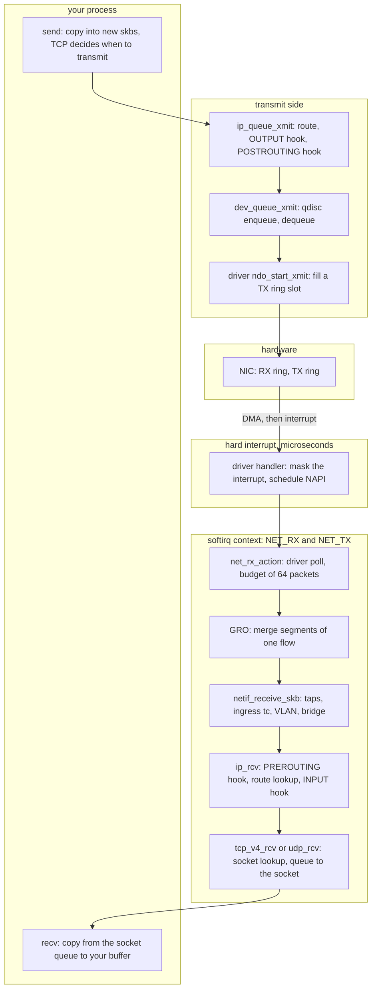
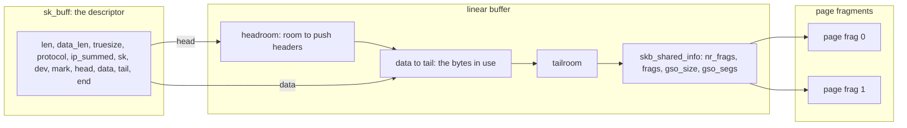
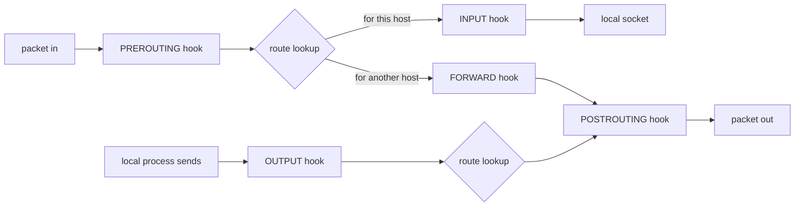
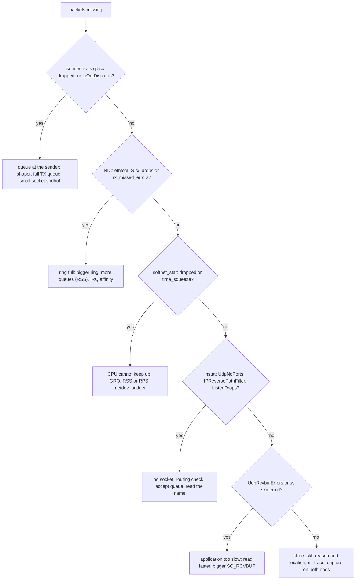

# NET 06: The Linux network stack: sk_buff, NAPI, offloads, netfilter, socket buffers, qdisc and where packets die

*Part of the [networking plan](00_plan.md) · You need: [NET 03](03_tcp_udp_and_transport.md) (what TCP does on the wire), [NET 04](04_socket_programming_in_c.md) and [NET 05](05_epoll_and_io_uring.md) (the socket API and event loops, the other side of this line), [LX 08](../06_linux/08_linux_networking_toolbox.md) (`ss`, `nft`, `tc`), [OS 17](../05_operating_systems/00_plan.md) (system calls, interrupts)*

NET 04 and NET 05 stopped where `recv` and `send` enter the kernel. This tutorial is what is behind that line: how a packet gets from the wire to a socket and from a socket to the wire, and where it can die on the way. "Walk a packet from the wire to `recv()`. Where can it be dropped and how would you know?" is the standard Staff question for network-equipment, security-appliance and infrastructure roles.

A weak answer lists layers. A strong answer names the **data structure** that carries the packet (`sk_buff`), the **context** each stage runs in (hard interrupt, softirq, your own process), the **queue** between stages and its size, and, for each place a packet can die, the **counter or tracepoint** that shows it. That is the structure of this tutorial.

By the end you can:

- draw the receive and transmit paths with the data structure, the execution context and the queue at every step;
- explain the `sk_buff`: head, data, tail, end, shared info, page fragments, `truesize`, clone against copy;
- explain interrupts, NAPI and softirqs, and say when NAPI batches and when it does not;
- explain TSO, GSO, GRO and checksum offload, and RSS, RPS, RFS, XPS, with what each buys;
- trace a packet through the five netfilter hooks and say where routing and connection tracking sit;
- explain socket buffers, `truesize` accounting, autotuning, the accept queue, and the sysctls that bound them;
- explain the transmit path, the qdisc and why a long queue does not always mean a long delay;
- find where a packet was lost, with the drop reason, the location and the counter, and triage from the outside in.

---

## 1. The whole path in one picture

Two trips, one packet structure. On the way **in**, the NIC writes the frame into memory by DMA, raises an interrupt, and the kernel turns the frame into an `sk_buff` and pushes it up through the layers until a socket queue holds it. On the way **out**, the socket layer builds `sk_buff`s from your data and pushes them down until a driver hands them to the NIC.



Four ideas carry the rest:

1. **The `sk_buff` is the packet.** Every layer gets a pointer to it and moves its `data` pointer to peel or add a header; bytes are not copied between layers.
2. **Context matters.** Receive work runs in a **softirq**, not in your process and not in the hard interrupt, and it steals time from whatever was running: it shows up as `si` in `top` or as `ksoftirqd`, and is invisible to a profile of your application. Transmit work runs **in your own system call**, so it shows up as `sys` time in your process.
3. **There is a queue between stages, and each queue has a size and a drop counter**: the NIC rings, the per-CPU backlog, the socket receive queue, the accept queue, the qdisc, the TX ring. Where a packet can be lost is the list of those queues (section 8).
4. **Batching is the performance story.** One interrupt per batch (NAPI), one skb per 45 segments (TSO and GRO), one system call for many operations (NET 05).

## 2. The sk_buff

Every packet in the stack is a `struct sk_buff` (skb). It is **not** the packet bytes. It is a small **descriptor** (224 bytes in the kernel measured earlier) pointing at a separately allocated **buffer** holding the bytes.



- **`head`, `data`, `tail`, `end`** are four pointers into the linear buffer. `head` to `data` is **headroom**: when TCP has built the payload and IP wants its header, `skb_push` moves `data` down with no copy. On receive the reverse happens: `skb_pull` moves `data` up past each header as the packet climbs.
- **`skb_shared_info`** sits at the end of the buffer. It holds the **page fragment** array (large payloads live in separate pages, not the linear part) and the **GSO** fields: `gso_size` (segment size) and `gso_segs` (how many segments the skb stands for). `data_len` is the bytes held in fragments; `len` is linear plus fragments.
- **`truesize`** is the memory the skb really costs (descriptor, buffer, fragments), larger than `len`. **Socket buffer limits are counted in `truesize`, not payload bytes**, which is why a socket holds less than its nominal buffer size (section 6).
- **Clone and copy.** `skb_clone` makes a **new descriptor sharing the same buffer** (a reference count in the shared info); `skb_copy` duplicates the data. TCP needs this: the original stays in the **retransmit queue** until acknowledged, and a **clone** goes to the driver.

Two measured facts from an earlier run (a `bpftrace` probe on the transmit tracepoint) worth remembering as shapes: a **one-byte TCP send** was a 67-byte skb with the byte in a **page fragment** and a `truesize` of **833**, and a **64 kB send** was **one skb carrying 45 segments** (`gso_size 1448`, `gso_segs 45`) with `ip_summed` equal to `CHECKSUM_PARTIAL`. The stack treats 45 segments as one packet all the way down; only the NIC, or `dev_hard_start_xmit` in software, cuts it into 1448-byte pieces. A TCP socket is about 2.3 KB before any buffer, so a server with 100,000 connections has hundreds of megabytes in socket structures alone, the number to quote when asked what a connection costs.

## 3. The receive path

### 3.1 From the wire to the ring

A NIC receives a frame into a **RX ring**: a circular array of **descriptors**, each pointing at a pre-allocated buffer. The NIC writes the frame into the next free buffer by **DMA**, with no CPU involved, then marks the descriptor done. The ring has a fixed size (`ethtool -g`; the virtio device here has 256 receive and 256 transmit descriptors, a physical 10 to 100 Gbit/s NIC typically 4096) and a number of queues (`ethtool -l`; one here, 8 to 64 on a physical NIC). **If the ring is full when a frame arrives, the NIC drops it**: the counter is the driver's (`rx_drops`, `rx_missed_errors` in `ethtool -S`), and it is the one drop the kernel's own software never sees.

### 3.2 Interrupt, then NAPI

One interrupt per packet would be fatal at high rates (14.8 million interrupts a second for minimum-size frames at 10 Gbit/s). **NAPI** turns that into **polling under load**:

1. The first frame raises an interrupt. The driver's handler does almost nothing: it **disables that queue's interrupt** and calls `napi_schedule`, which raises the **`NET_RX` softirq**. The hard interrupt ends in microseconds.
2. The softirq runs `net_rx_action`, which calls the driver's **poll function** with a **budget** (64 packets per poll; `netdev_budget`, 300 packets, and `netdev_budget_usecs`, 8 ms, bound the whole softirq run). The poll takes frames off the ring, builds an skb for each, and hands them up.
3. If the poll processed **fewer packets than the budget**, the ring is empty: the driver calls `napi_complete_done` and **re-enables the interrupt**. If it used the whole budget there may be more, so the softirq polls again with no interrupt.

So under light load it is interrupt-driven and under heavy load it is polling, switching automatically. **Batching is a property of load, not of NAPI**: in an earlier run a 13,000 packet-per-second ping flood had 30,002 of 45,248 polls handle exactly one packet and about one interrupt per event, whereas a bulk TCP stream over a veth pair averaged 18 packets per poll. Interrupt-heavy, one-packet-per-poll traffic is the worst case for CPU per packet, and the reason physical NICs offer **interrupt coalescing** (`ethtool -C`): wait a few microseconds so one interrupt covers several frames, at the price of latency.

If the softirq runs out of budget while packets still wait, it stops and the **`time_squeeze`** counter (third column of `/proc/net/softnet_stat`) increments; the rest continues in `ksoftirqd`, a per-CPU kernel thread, which competes with ordinary processes. A climbing `time_squeeze` means the receive path is saturated: add queues (RSS), raise `netdev_budget`, or send fewer packets (GRO).

### 3.3 GRO, then up the stack

Before the skb leaves the poll the driver calls `napi_gro_receive`. **GRO** looks for consecutive segments of the **same TCP flow** (same four-tuple, consecutive sequence numbers, compatible flags) and **merges them into one big skb** with the segments as fragments, so the layers above run **once per merged packet**. It is the receive-side mirror of TSO, in software.

Then `netif_receive_skb` delivers the skb up. This is where **packet taps** (the `AF_PACKET` sockets behind `tcpdump`), the **ingress `tc` hook** (`clsact`), VLAN and bridge handling see it, and then the protocol handler for its EtherType: `ip_rcv`.

The kernel stack of a received packet on the virtio NIC, read from the bottom up, shows the contexts: the CPU was in the **idle loop** (a halted virtual CPU); an **interrupt** woke it; on the way out of the interrupt the kernel ran **`handle_softirqs`**, then **`net_rx_action`**, then **`__napi_poll`**, then the driver's **`virtnet_poll`**, whose **`napi_complete_done`** flushed the GRO list into **`netif_receive_skb_list_internal`** (the **list** variant: modern kernels hand up a batch at once). **No process was involved.** That is why the receive path appears as `si` and not in your application's profile.

A second stack shows a trap for benchmarks. On a **veth pair or loopback**, the receiver's stack ran **inside the sender's own `send` call**: `tcp_sendmsg`, `tcp_write_xmit`, `ip_output`, `__dev_queue_xmit`, and then, as `__local_bh_enable_ip` noticed a pending softirq, `net_rx_action`, `process_backlog` and `__netif_receive_skb_core` all on the sender's stack. So receive CPU time is charged to the **sender**, there is no interrupt, no DMA and no wire, and a veth benchmark is **never a NIC benchmark**: good for testing logic, wrong for quoting performance.

## 4. Offloads and receive steering

Per-packet work in the stack is roughly constant (a socket lookup, a route lookup, a few dozen cache lines), so the cheapest way to go faster is **fewer, bigger packets** inside the kernel.

| Offload | What | Effect |
|---|---|---|
| **TSO** (TCP segmentation offload) | TCP hands the driver one skb of up to 64 kB, the **NIC cuts it into MSS-sized frames** and writes each header | IP, netfilter, routing and the qdisc run once per 45 segments |
| **GSO** (generic segmentation) | the same in software, **late** in `dev_hard_start_xmit`, for devices without TSO | same saving, no hardware needed |
| **GRO** (generic receive) | merge received segments of one flow before the stack sees them | the receive-side mirror |
| **Checksum offload** | the device computes or verifies the TCP and UDP checksum | the CPU never sums the payload |

An earlier run on one TCP stream over a veth pair showed the shape: with TSO and GSO the stack handled about 50 KB per skb; with both off about 1.5 KB per skb, **12 times more skbs** and about a third of the throughput; and GRO at the receiver cut 1.5 million sent skbs to 47,000 received ones. Single throughput runs varied by 30 percent or more, so prefer counts of skbs to throughput figures.

`ip_summed` tells the stack what to do about checksums: **`CHECKSUM_NONE`**, software must verify or compute; **`CHECKSUM_UNNECESSARY`**, the device verified it; **`CHECKSUM_COMPLETE`**, the device gave the sum of the whole packet; **`CHECKSUM_PARTIAL`**, on transmit only the pseudo-header is filled and the device (or the GSO code) adds the rest. One consequence worth knowing for debugging: a **capture on the sending host sees `CHECKSUM_PARTIAL` skbs, so `tcpdump` reports "bad cksum" for packets that are fine**; the wire carries the right sum.

### 4.1 Spreading the work across CPUs

One CPU running `net_rx_action` is a ceiling. A single flow is one CPU's work (its packets must stay in order), but many flows should use many CPUs.

| Name | Where | What it steers | Setting |
|---|---|---|---|
| **RSS** | the NIC, hardware | hashes the flow tuple (Toeplitz) to one of many **RX queues**, each with its own ring and interrupt, each interrupt pinned to a CPU | `ethtool -l`, `-x`, `-X` |
| **RPS** | the kernel, software | the same hash, after the interrupt: enqueue the skb on **another CPU's backlog** and send an IPI | `/sys/class/net/DEV/queues/rx-N/rps_cpus` |
| **RFS** | the kernel | RPS, but aimed at **the CPU where the application last ran `recv`** for that flow, so the data is cache-warm | `rps_sock_flow_entries`, `rps_flow_cnt` |
| **XPS** | the kernel | picks the **TX queue** from the sending CPU, so each CPU uses its own queue and lock | `/sys/class/net/DEV/queues/tx-N/xps_cpus` |

RSS is the first choice; RPS exists for NICs with fewer queues than CPUs. They are not free: an earlier run with eight streams on two CPUs saw RPS **lower** throughput (10.3 to 9.3 Gbit/s) and drop 101 packets at the per-CPU backlog (`netdev_max_backlog`, 1000), because the load was already even and every hand-off costs an inter-processor interrupt. **Measure per-CPU `softnet_stat` first; if the load is even, the mask only adds cost.** Related knobs worth naming: **IRQ affinity** (pin queue interrupts to the right NUMA node), and **XDP**, an eBPF program running in the driver before the skb exists, used for fast drops, load balancing and DDoS filtering ([NET 07](07_zero_copy_networking.md)).

## 5. The IP layer: routing, netfilter and conntrack

When `__netif_receive_skb_core` has finished with taps and ingress hooks, the skb enters `ip_rcv`. Three things happen there: a **hook** where a firewall can look at the packet before routing, a **route lookup** that decides what the packet is for, and a second **hook** before delivery.



- **The five hooks** are PREROUTING, INPUT, FORWARD, OUTPUT, POSTROUTING. Firewall rules (`nftables`, `iptables`) attach to them with a priority; NAT happens at PREROUTING (destination) and POSTROUTING (source). A traced ping showed `pre, in` for the request and `out, post` for the reply.
- **Routing** sits between PREROUTING and INPUT or FORWARD, and again on the output side. **Reverse path filtering** (`rp_filter`) drops a packet whose source address the host has no route back to, which looks like a network fault but is a routing check (`IP_RPFILTER`).
- **Connection tracking** (`nf_conntrack`) keeps one entry per flow, both directions, so rules can say `ct state established` and NAT stays consistent. It exists only when a rule or NAT needs it. The table is **finite** (`nf_conntrack_max`); when full, new flows are dropped (`nf_conntrack: table full, dropping packet` in `dmesg`), and every packet pays a lookup. UDP and ICMP entries expire in seconds, established TCP in days by default.
- **Earlier hooks exist.** `tc` ingress (`clsact`) and XDP see the packet before `ip_rcv`; nftables can also hook at ingress.

Then `tcp_v4_rcv` or `udp_rcv` does the **socket lookup** (established connections by 4-tuple, listeners by port) and queues the skb on the socket. A SYN with no listener gets a RST; a UDP datagram with no socket is dropped and answered with ICMP port unreachable.

## 6. Sockets and their buffers

A socket has a **receive queue** and a **send queue**, each bounded in bytes, **counted in `truesize`**. The kernel doubles the value you set with `SO_RCVBUF` to cover overhead, caps it at `rmem_max`, and **an explicit setting turns off autotuning** for that buffer (NET 04 section 10).

`ss -tmi` shows the fields: `skmem:(r, rb, t, tb, f, w, o, bl, d)` where `r` is receive memory in use, `rb` the receive buffer limit, `t` and `tb` the same for the send side, `f` forward-allocated memory, `bl` the backlog, and **`d` the drop count**. For a **LISTEN** socket `Recv-Q` is the **accept queue length** and `Send-Q` its limit.

The UDP case is the clearest demonstration, because nothing slows the sender: a receiver with a tiny buffer that never reads.

```python
import socket, subprocess, time

def nstat(*names):
    out = subprocess.run(['nstat', '-az', *names], capture_output=True, text=True).stdout.split('\n')[1:]
    return {l.split()[0]: int(l.split()[1]) for l in out if l.strip()}

rx = socket.socket(socket.AF_INET, socket.SOCK_DGRAM)
rx.setsockopt(socket.SOL_SOCKET, socket.SO_RCVBUF, 4096)          # the kernel doubles it
rx.bind(('127.0.0.1', 0)); port = rx.getsockname()[1]
before = nstat('UdpRcvbufErrors', 'UdpInErrors')
tx = socket.socket(socket.AF_INET, socket.SOCK_DGRAM)
for i in range(2000): tx.sendto(b'x' * 1000, ('127.0.0.1', port))   # the receiver never reads
time.sleep(0.2)
after = nstat('UdpRcvbufErrors', 'UdpInErrors')
rx.setblocking(False); got = 0
try:
    while True: rx.recv(2048); got += 1
except BlockingIOError: pass
print('SO_RCVBUF reads back', rx.getsockopt(socket.SOL_SOCKET, socket.SO_RCVBUF))
print('2000 datagrams sent, the application could read', got)
print({k: after[k] - before[k] for k in after})
```

Run: `SO_RCVBUF` reads back **8192** (doubled), the application could read **3** of 2,000 datagrams, and both `UdpRcvbufErrors` and `UdpInErrors` rose by **1,997**. Three lessons: 2,000 datagrams of 1,000 bytes is 2 MB of payload but the buffer held 3, because the limit is charged by **`truesize`**, and a small datagram costs far more than its payload (about 2.3 KB each in larger buffers); the sender saw **no error at all**; and the counter and `ss -uam`'s `d` field name the problem.

The sysctls that bound the pipes:

| Sysctl | Meaning |
|---|---|
| `net.core.rmem_max`, `wmem_max` | the ceiling for `setsockopt(SO_RCVBUF / SO_SNDBUF)` |
| `net.ipv4.tcp_rmem`, `tcp_wmem` | min, default, max the TCP autotuner uses (here 4 KB, 128 KB, 32 MB receive) |
| `net.core.somaxconn` | the ceiling for a `listen` backlog |
| `net.core.netdev_max_backlog` | per-CPU input queue before the stack (drops counted in `softnet_stat`) |
| `net.core.netdev_budget`, `netdev_budget_usecs` | softirq work limits |

**Sizing for a long fat path** follows the bandwidth-delay product (NET 03 section 6): 10 Gbit/s at 80 ms needs about **100 MB** in flight, so both buffers must be able to hold that; with a 4 MB send maximum the sender can fill only about 420 Mbit/s. Raise both maxima; memory is charged per connection.

## 7. The transmit path and the qdisc

`send` runs **in your process**: `tcp_sendmsg` copies user data into skbs (into page fragments, so they can later be sent by TSO or `sendfile` with no second copy) and `tcp_write_xmit` decides what the congestion and flow windows allow. Then `__tcp_transmit_skb` builds the header, `ip_queue_xmit` does the route and OUTPUT and POSTROUTING hooks, and `__dev_queue_xmit` hands the skb to the **queueing discipline (qdisc)** of the device. The qdisc decides **when** and **in what order** packets reach the driver's `ndo_start_xmit`, which fills a TX ring slot and rings a doorbell.

| Qdisc | Behaviour |
|---|---|
| `pfifo_fast` | the old default: three priority FIFOs |
| **`fq_codel`** | per-flow queues plus CoDel delay control; the usual good default, fights bufferbloat |
| **`fq`** | per-flow fair queueing with pacing; used with BBR |
| `tbf`, `htb` | token bucket and hierarchical shaping to a rate |
| `mq` | one qdisc per hardware TX queue (multi-queue NICs) |
| `noqueue` | no queue (virtual devices) |

Two mechanisms keep a sender from burying its own qdisc: **TCP small queues** (limits how many bytes of one flow sit below TCP in qdisc and driver) and **BQL** (byte queue limits, sizing the driver's queue to what the device drains). So **a long qdisc does not always mean a long delay**: an earlier run of a 20 Mbit/s shaper allowed to queue 400 ms gave a ping of **6.1 ms** with a TCP stream behind it but **41 ms** with a UDP flood, because UDP has no small-queue limit and fills the queue. Real bufferbloat is a queue fed by many hosts, or by an uncontrolled sender; the cure is a queue that controls delay, not one that merely exists ([NET 14](14_queueing_qos_and_traffic_management.md)).

A sender can lose packets it was told were sent: `sendto` returns success once the skb is accepted, but a full qdisc then drops it. An earlier run offered 50 Mbit/s of UDP to a 10 Mbit/s shaper with a small queue: the `iperf3` sender reported **zero loss** while `tc -s qdisc` showed **6,919 dropped**. The evidence is on the sender: `tc -s qdisc`, `IpOutDiscards`, `UdpSndbufErrors`.

## 8. Where packets are dropped, and how to see it

Every queue has an end, and the end is a drop. The method has three steps: **the symptom counter**, **the drop tracepoint**, **the queue state**.

### 8.1 The kfree_skb tracepoint

When the kernel frees an skb because it is **discarding** a packet, it calls `kfree_skb`, and since Linux 5.17 it passes a **drop reason**. The `skb:kfree_skb` tracepoint prints the reason and the **caller's location**. This function turns it on around a command and summarises:

```bash
# dropwatch CMD...: run CMD while the kfree_skb tracepoint is on, then print "count reason location"
dropwatch() {
  local T=/sys/kernel/tracing
  echo > $T/trace; echo 1 > $T/events/skb/kfree_skb/enable; echo 1 > $T/tracing_on
  "$@" > /dev/null 2>&1
  sleep 0.3
  echo 0 > $T/events/skb/kfree_skb/enable
  grep kfree_skb $T/trace | sed -E 's/.*location=([a-z_0-9]+)\+[^ ]* reason: ([A-Z_0-9]+).*/\2 \1/' | sort | uniq -c | sort -rn | head -6
}
```

Run on 50 UDP datagrams to a port nobody listens on: `50  NO_SOCKET  __udp4_lib_rcv`, and `UdpNoPorts` rose by 50. Run on the small-buffer receiver of section 6: `1997  SOCKET_RCVBUFF  udp_queue_rcv_one_skb`. The **location is as informative as the reason**: it names the layer that decided. Where a call site passes no reason yet the line says `NOT_SPECIFIED`, and the counters are the fallback. The `dropwatch` tool and `perf trace -e skb:kfree_skb` do the same.

### 8.2 The drops, with reason, location and counter

| How it happens | Drop reason | Where | Counter and other evidence |
|---|---|---|---|
| NIC ring full | none (hardware) | the driver | `ethtool -S` `rx_drops`, `rx_missed_errors` |
| per-CPU backlog full | none | `enqueue_to_backlog` | `/proc/net/softnet_stat` column 2 |
| firewall rule drops it | `NETFILTER_DROP` | `nft_do_chain` | the rule's own counter, `nft monitor trace` |
| reverse path filter | `IP_RPFILTER` | `ip_rcv_finish_core` | `TcpExtIPReversePathFilter` |
| UDP to a port with no socket | `NO_SOCKET` | `__udp4_lib_rcv` | `UdpNoPorts` |
| socket receive buffer full | `SOCKET_RCVBUFF` | `udp_queue_rcv_one_skb` | `UdpRcvbufErrors`, `ss` `d` field |
| accept queue full | none | `tcp_v4_rcv` | `TcpExtListenOverflows`, `ListenDrops`; `ss -ltn` `Recv-Q` against `Send-Q` |
| conntrack table full | none | netfilter | `dmesg` "table full", `conntrack -C` against the limit |
| TCP checks (bad checksum, out of window) | various | `tcp_v4_rcv` | `TcpInCsumErrors`, `TCPBacklogDrop` |
| qdisc full | `QDISC_DROP` | `__dev_queue_xmit` | `tc -s qdisc` dropped, `IpOutDiscards` |

The accept-queue case is **silent**: a full queue drops the SYN or the final ACK and the **client retries**, with no reason reported. Run: a listener with backlog 1 and nobody calling `accept`:

```python
import socket, subprocess

def nstat(*names):
    out = subprocess.run(['nstat', '-az', *names], capture_output=True, text=True).stdout.split('\n')[1:]
    return {l.split()[0]: int(l.split()[1]) for l in out if l.strip()}

l = socket.socket(); l.bind(('127.0.0.1', 0)); l.listen(1); port = l.getsockname()[1]   # backlog 1, never accept
before = nstat('TcpExtListenOverflows', 'TcpExtListenDrops')
done = 0; cs = []
for i in range(20):
    c = socket.socket(); c.settimeout(0.2)
    try: c.connect(('127.0.0.1', port)); done += 1
    except OSError: pass
    cs.append(c)
after = nstat('TcpExtListenOverflows', 'TcpExtListenDrops')
print('connects that finished:', done, 'of 20')
print({k: after[k] - before[k] for k in after})
print(subprocess.run(['ss', '-ltnH', 'sport', '=', f':{port}'], capture_output=True, text=True).stdout.split())
```

Run: **2 of 20** connects finished, `ListenOverflows` and `ListenDrops` both rose together (42 in this run, because each refused client's SYN and its retransmission both landed in the window), and `ss -ltn` showed `Recv-Q 2`, `Send-Q 1` (the kernel allows one more than the backlog). The fix is a faster `accept` loop and a larger `listen` backlog, capped by `somaxconn`.

### 8.3 Triage: which counter first



Where the counters live, so you can run them first on an unknown machine:

| Where | Command | Counts |
|---|---|---|
| the driver | `ethtool -S eth0` | ring drops, doorbells, TX timeouts, XDP counters |
| per-CPU queues | `/proc/net/softnet_stat` (hex) | processed, **dropped**, **time_squeeze**, `received_rps`, per CPU |
| protocols | `nstat -az`, `/proc/net/snmp`, `/proc/net/netstat` | `IpInReceives`, `IpInDelivers`, `UdpNoPorts`, `ListenDrops` |
| sockets | `ss -s`, `ss -tmi`, `/proc/net/sockstat` | counts by state, per-socket memory and drops |
| the qdisc | `tc -s qdisc show dev X` | sent, **dropped**, **overlimits**, backlog |

**The counters are cumulative since boot, so the useful number is always a difference** between two readings, which is what `nstat` shows between runs.

## 9. Common mistakes

1. **Believing `sendto` success means the packet left.** A full qdisc drops it below the socket.
2. **Looking only at `ip -s link` for drops.** Interface counters see the device; most drops happen higher up. Start from `nstat` and `ss -m`, then the tracepoint.
3. **Computing socket capacity in payload bytes.** The kernel doubles the value and charges `truesize`.
4. **Setting `SO_RCVBUF` on a TCP socket "to be safe",** which turns off autotuning and can cap a long path.
5. **Raising `somaxconn` but not the `listen` backlog, or the reverse.** The accept queue is the smaller of the two.
6. **Making a queue longer to stop drops,** turning loss into delay.
7. **Enabling RPS or changing offloads without measuring.**
8. **Reading a single throughput run as a result.** Prefer counts.
9. **Trusting a capture on the sending host for checksums.**
10. **Assuming NAPI always batches.**
11. **Treating a veth or loopback benchmark as a NIC benchmark.**
12. **Forgetting that conntrack is a finite table and a per-packet cost.**

## 10. Interview questions

1. **Walk a received packet from the wire to `recv()`.** DMA into the RX ring, interrupt, handler masks the queue and schedules NAPI, `NET_RX` softirq calls the driver's poll, an `sk_buff` per frame, GRO, `netif_receive_skb` (taps, ingress), `ip_rcv` (PREROUTING, route, INPUT), `tcp_v4_rcv` or `udp_rcv` finds the socket and queues it, `recv` copies it out. Contexts: hard interrupt, softirq, your process.
2. **What is an `sk_buff` and what does clone do?** A descriptor pointing at a buffer plus shared info; headers added by moving pointers; a clone shares the buffer, which is how TCP keeps the original for retransmission while the driver gets a clone.
3. **What is NAPI and why does it exist?** Interrupt at low load, polling at high load, to avoid an interrupt per packet; batching depends on load.
4. **What do TSO, GSO and GRO buy?** The layers run once per many segments.
5. **What are RSS, RPS, RFS and XPS?** Hardware queues, software steering by hash, steering to the application's CPU, TX queue by CPU.
6. **Where are the netfilter hooks and where does routing sit?** Five hooks; routing between PREROUTING and INPUT or FORWARD, and again on output.
7. **What does conntrack do and what can go wrong?** One entry per flow; finite table; drops new flows when full.
8. **A UDP receiver loses packets. How do you find out why?** `UdpRcvbufErrors`, `ss -uam` `d`, then `kfree_skb` showing `SOCKET_RCVBUFF`; read faster or enlarge the buffer by `truesize`.
9. **`rmem_max`, `tcp_rmem` and `SO_RCVBUF`?** The cap for `setsockopt`, the autotuner's range, and a setting that disables autotuning; the kernel doubles it.
10. **How do you size buffers for 10 Gbit/s at 80 ms?** The BDP, about 100 MB; raise both maxima.
11. **Does a bigger qdisc add delay?** Only if something fills it; TCP small queues bound a local TCP sender, a UDP flood fills it.
12. **Why does a request time out on a busy server although the network is fine?** Softirq saturation (`time_squeeze`), a full accept queue, or a full socket buffer; read the counters.
13. **Why can `tcpdump` on the sender show bad checksums?** Checksum offload: the skb is `CHECKSUM_PARTIAL` when the tap sees it.
14. **A packet disappears between two hosts. List the places and the counter for each.** Section 8.2.

## 11. Scenarios and design questions

**S1. UDP telemetry loses 5 percent of datagrams under load, no errors anywhere in the application.** *Where to practise:* the section 6 script. *Approach:* `UdpRcvbufErrors` and `ss` `d` tell you it is the socket; enlarge `SO_RCVBUF` (sized by `truesize`), read in a tight loop, use `recvmmsg`, spread across sockets with `SO_REUSEPORT`; check `softnet_stat` to rule out the CPU.

**S2. A server has rising connect timeouts but low CPU.** *Where to practise:* the accept-queue script. *Approach:* `ss -ltn` `Recv-Q` near `Send-Q`, `ListenOverflows` rising; the accept loop is too slow or the backlog too small; check `somaxconn`, then the accept loop (NET 04, NET 05).

**S3. One core is at 100 percent `si` on a 25 Gbit/s NIC, others idle.** *Approach:* one RX queue is taking all the flows; check `ethtool -l` and the interrupt distribution in `/proc/interrupts`, enable RSS or add queues, set IRQ affinity, enable GRO, and only then RPS; confirm with per-CPU `softnet_stat`.

**S4. Pings are fine but TCP is slow only through one firewall box.** *Approach:* conntrack table pressure, offload settings on the box (GRO off on a forwarding path is correct and costs CPU), MTU and MSS clamping (NET 02), and a drop reason trace at the box.

**S5. A shaped link shows zero loss to the sender but receivers see gaps.** *Approach:* the drop is in the sender's qdisc; `tc -s qdisc`, `IpOutDiscards`; size the queue to the delay you accept, use `fq_codel`, and have the application pace.

**S6. Design the observability for a fleet of packet-processing nodes.** *Approach:* export per-interval deltas of the counters in section 8.3 (ring drops, `softnet_stat`, `nstat` drop counters, `tc -s`, socket-memory), alert on rates not totals, and keep a `kfree_skb` reason histogram available on demand.

## 12. Strong answers (outlines)

**S1.** Prove it with `UdpRcvbufErrors` rising and `d` in `ss -uam`; explain that the buffer holds far fewer datagrams than its byte size suggests; then fix in order: faster reader, larger buffer within `rmem_max`, batch reads, more sockets.

**S2.** A full accept queue is silent and client-visible only as retries and timeouts; `ListenOverflows` and `ss -ltn` give the proof; the cure is a faster `accept` and a larger backlog, and the connect timeouts disappear.

**S3.** The signature is one CPU in softirq with the rest idle. RSS spreads flows by hash in hardware; IRQ affinity places queue interrupts; GRO reduces packet count; RPS is the software fallback and must be measured because it can hurt.

**S4.** Separate the path: with a capture on both sides of the box and the `kfree_skb` reasons, show whether packets are dropped, delayed, or fragmented; then check conntrack count against its limit and the MSS clamp.

**S5.** The sender is told success because the skb was accepted; the loss is below the socket. Evidence on the sender's qdisc; the fix is a delay-controlling qdisc and pacing, not a longer queue.

**S6.** Per-node deltas, rates not totals, labelled by layer, so an alert says which queue is dropping; keep tracepoint-based tools ready for the deep dive.

## 13. Cheat sheet

| Topic | Rule |
|---|---|
| Receive path | DMA to ring, interrupt, NAPI poll in softirq, GRO, `netif_receive_skb`, `ip_rcv`, `tcp_v4_rcv` / `udp_rcv`, socket queue, `recv` |
| Contexts | hard interrupt (microseconds), softirq (receive, `si`), your process (send, and `recv` copy) |
| `sk_buff` | 224-byte descriptor, headroom for `skb_push`, shared info with frags and GSO fields, `truesize` bills the socket |
| NAPI | interrupt then poll with budget 64; batches only under load; `time_squeeze` means saturated |
| Offloads | TSO/GSO/GRO make fewer, bigger skbs; `CHECKSUM_PARTIAL` makes sender captures show bad checksums |
| Steering | RSS (NIC), RPS (software), RFS (app's CPU), XPS (TX queue); measure before enabling RPS |
| Hooks | PREROUTING, INPUT, FORWARD, OUTPUT, POSTROUTING; conntrack finite |
| Socket buffers | doubled, capped by `rmem_max`, charged by `truesize`, `SO_RCVBUF` disables autotuning |
| Listen | `Recv-Q` is accept queue length, `Send-Q` its limit; overflow is silent |
| Qdisc | `fq_codel` default; TSQ and BQL; UDP can fill a long queue; sender can lose "sent" packets |
| Drops | `kfree_skb` reason and location; counters are cumulative, use differences |

## 14. Sources and caveats

Sources used: the Red Hat guide [Overview of packet reception](https://docs.redhat.com/en/documentation/Red_Hat_Enterprise_Linux/6/html/performance_tuning_guide/s-network-packet-reception), the Private Internet Access series [Linux networking stack from the ground up](https://www.privateinternetaccess.com/blog/linux-networking-stack-from-the-ground-up-part-4/), the SCALE talk [A deep dive into Linux networking](https://www.socallinuxexpo.org/sites/default/files/presentations/A%20deep%20dive%20into%20Linux%20Networking%20%282%29_0.pdf), the [Linux Kernel Networking Walkthrough](https://www.slideshare.net/slideshow/linuxcon-2015-linux-kernel-networking-walkthrough/51743609), and the [packet flow deep dive](https://grokdatum.github.io/grokdevops-wiki/library/deep-dives/linux.network.packet.flow). Reference: the kernel's `Documentation/networking` (scaling, `ip-sysctl`, drop reasons in `include/net/dropreason-core.h`), the `tc`, `ethtool` and `nstat` manual pages, and *Understanding Linux Network Internals* (Benvenuti).

Caveats. The two Python programs and the `dropwatch` function were run for this tutorial on one Linux 6.18 VM (as root), over loopback, with a virtio NIC that has one queue pair: the closed-port run printed `50 NO_SOCKET __udp4_lib_rcv`, and the small-buffer run printed `1997 SOCKET_RCVBUFF udp_queue_rcv_one_skb`, 3 of 2,000 datagrams read and 1,997 counted drops; the listen test finished 2 of 20 connects. The `nft` hook trace, the kernel stacks, the `sk_buff` sizes and fragment layout, the NAPI polls-per-packet histograms, the offload comparison, the RPS result, the qdisc delay and drop figures and the 100 MB buffer arithmetic come from earlier runs of the previous version of this tutorial (which used `bpftrace` and network namespaces) and were not re-run. The VM has no physical NIC, so RSS, interrupt coalescing and hardware offload are described from documentation; IPv6 differs in function names. Throughput figures varied by 30 percent between runs, so prefer the counts. Kernel details (budgets, drop reasons from 5.17, the sysctl defaults) vary by version.
