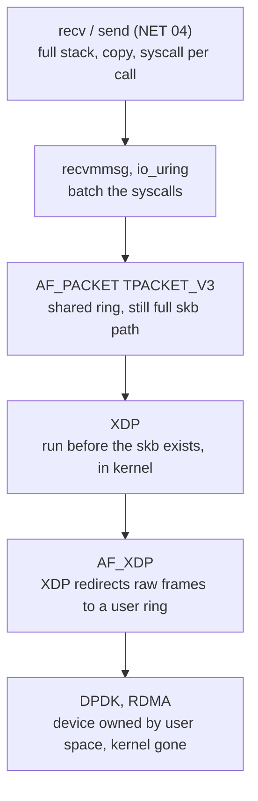
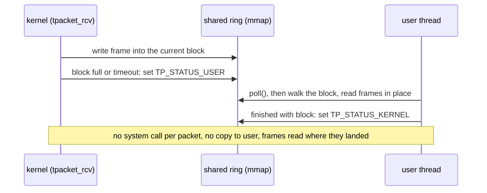
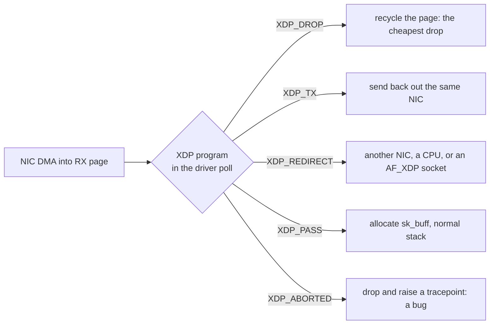
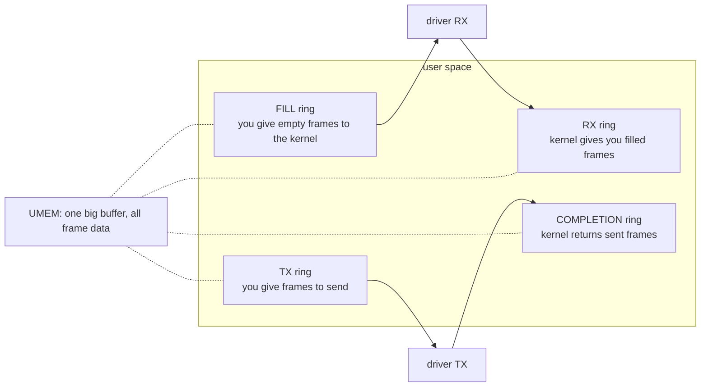

# NET 07: Zero-copy and kernel-bypass networking: batching, AF_PACKET rings, XDP, AF_XDP, sendfile, MSG_ZEROCOPY and DPDK

*Part of the [networking plan](00_plan.md) · You need: [NET 04](04_socket_programming_in_c.md) (the socket calls), [NET 05](05_epoll_and_io_uring.md) (event loops and io_uring), [NET 06](06_linux_network_stack.md) (the `sk_buff`, NAPI, the path a packet takes), [OS 17](../05_operating_systems/00_plan.md) (system calls, copies between user and kernel)*

NET 06 showed what the kernel does for every packet: allocate an `sk_buff`, run NAPI, walk the IP and TCP or UDP code, queue to a socket, wake a process, copy the payload out. That work is the right default, and at a few hundred thousand packets per second it costs nothing you notice. At ten million packets per second, or when you push a file at line rate, it is the whole problem. "How would you make a packet processor fast on Linux?" and "when would you bypass the kernel, and what do you give up?" are standard questions for network-equipment, security-appliance, load-balancer and SmartNIC roles.

A weak answer says "use DPDK". A strong answer names the **cost being removed** (system call, copy, `sk_buff` allocation, protocol stack, wake-up), picks the **lowest rung of the ladder that removes it**, and states what is lost on the way up: the kernel's stack, its tools and its safety net. That is the structure here.

By the end you can:

- split the per-packet cost into five parts and say which technique removes which;
- explain `recvmmsg` batching and the AF_PACKET `TPACKET_V3` ring, and why a ring helps a sniffer but not a server;
- explain XDP: where it runs, the five verdicts, what the verifier demands, and the three attach modes;
- explain AF_XDP: the UMEM and its four rings, copy mode against zero-copy mode, and the silent ways it falls back or stalls;
- explain `sendfile`, `splice`, `MSG_ZEROCOPY` and io_uring `SEND_ZC`, including the completion protocol and the break-even size;
- explain DPDK and RDMA, what they remove, what they cost, and choose between the options for a given workload.

---

## 1. What a packet costs, and what you can remove

Take the NET 06 path and ask what each stage costs in terms you can attack. There are five costs, and each technique in this tutorial removes one or more of them.

| Cost per packet | Why it exists | What removes it |
|---|---|---|
| **System call** | Each `recv` crosses into the kernel and back | Batching (`recvmmsg`, io_uring), shared-memory rings |
| **Copy** | Payload moves kernel buffer to user buffer (and back on send) | `sendfile`, `splice`, `MSG_ZEROCOPY`, mapped rings, AF_XDP zero-copy |
| **`sk_buff` allocation** | Every packet gets metadata, a head, and later a free | XDP (runs before the `sk_buff` exists), AF_XDP, DPDK |
| **Protocol stack** | IP, netfilter, conntrack, TCP or UDP, socket lookup | XDP, AF_XDP, DPDK (you get raw frames and do the protocol yourself) |
| **Wake-up** | An interrupt, a softirq, a context switch to your thread | Busy polling, poll-mode drivers (DPDK), NAPI busy-poll |

### 1.1 The per-packet time budget

The reason this matters is arithmetic you should be able to do on a whiteboard. A minimum Ethernet frame is 64 bytes, but on the wire it also carries a preamble and an inter-frame gap, 84 bytes in all. So the worst case packet rate is the link rate divided by 84 bytes:

| Link | Packets per second | Time per packet |
|---|---|---|
| 10 Gb/s | 14.88 million | 67 ns |
| 25 Gb/s | 37.2 million | 27 ns |
| 100 Gb/s | 148.8 million | 6.7 ns |

A system call alone costs on the order of 100 ns. One cache miss to DRAM is similar. So at 10 Gb/s with small packets, one core cannot afford even a single system call per packet, never mind a full stack traversal. At 1500-byte frames the same link carries about 0.8 million packets per second and the budget relaxes by roughly 18 times, which is why ordinary servers never feel this and packet processors always do.

The rule of thumb: **above a few million packets per second per core, you must batch and you must skip the stack. Below that, use the normal socket API.** Most "make it faster" answers in interviews are really about where on this scale the workload sits.

### 1.2 The ladder



Each step down the picture removes more cost and gives up more of the kernel. The art is stopping at the first rung that meets the target.

---

## 2. Rung one: batch the system calls

If the per-call crossing is the cost, make fewer crossings. `recvmmsg` receives up to a vector of datagrams in one call; `sendmmsg` sends a vector. io_uring (NET 05) batches submissions and completions the same way for any operation.

```c
#define _GNU_SOURCE
#include <stddef.h>
#include <sys/socket.h>
#include <sys/uio.h>

#define BATCH 64
#define MTU   2048

/* Receive up to 64 datagrams with one system call. Returns how many arrived. */
int recv_batch(int fd, char bufs[BATCH][MTU], int lens[BATCH])
{
    struct mmsghdr msgs[BATCH];
    struct iovec   iov[BATCH];

    for (int i = 0; i < BATCH; i++) {
        iov[i].iov_base = bufs[i];
        iov[i].iov_len  = MTU;
        msgs[i].msg_hdr = (struct msghdr){ .msg_iov = &iov[i], .msg_iovlen = 1 };
    }
    int n = recvmmsg(fd, msgs, BATCH, MSG_WAITFORONE, NULL);
    for (int i = 0; i < n; i++)
        lens[i] = msgs[i].msg_len;
    return n;
}
```

`MSG_WAITFORONE` makes the call return as soon as one datagram is there instead of waiting to fill the vector, so a quiet socket does not stall.

What this buys is real but bounded. It removes the system call cost for all but one packet in the batch, and nothing else: each datagram still went through the whole stack, still got an `sk_buff`, and was still copied. On an earlier measured run, `recvmmsg` cut per-packet thread cost by about 15 percent and total machine cost by about 11 percent. That is the honest summary: batching is the cheapest first step and it is worth a double-digit percentage, not an order of magnitude.

**Interview point.** When a candidate says "use `recvmmsg`", the follow-up is "what does it not fix?" The answer: everything except the crossing. If the profile is dominated by the stack or by allocation, batching the call will not move it.

---

## 3. Rung two: a shared ring with AF_PACKET

A packet socket (`AF_PACKET`) delivers raw frames, the mechanism under `tcpdump`. The plain form copies each frame to user space with a system call. The **ring** form (`PACKET_RX_RING`, `TPACKET_V3`) asks the kernel to allocate a block of memory that both sides map, and the kernel writes frames straight into it.



Setting it up is a handful of calls: choose the version, describe the ring, map it.

```c
#include <stddef.h>
#include <sys/mman.h>
#include <sys/socket.h>
#include <linux/if_packet.h>
#include <linux/if_ether.h>
#include <arpa/inet.h>

void *open_rx_ring(int *fd_out, struct tpacket_req3 *req)
{
    int fd = socket(AF_PACKET, SOCK_RAW, htons(ETH_P_ALL));
    int ver = TPACKET_V3;
    setsockopt(fd, SOL_PACKET, PACKET_VERSION, &ver, sizeof ver);

    *req = (struct tpacket_req3){
        .tp_block_size     = 1 << 22,          /* 4 MiB blocks */
        .tp_block_nr       = 4,
        .tp_frame_size     = 1 << 11,          /* 2 KiB frames */
        .tp_frame_nr       = (1 << 22) / (1 << 11) * 4,
        .tp_retire_blk_tov = 60,               /* ms: hand over a partly full block */
    };
    setsockopt(fd, SOL_PACKET, PACKET_RX_RING, req, sizeof *req);

    void *ring = mmap(NULL, (size_t)req->tp_block_size * req->tp_block_nr,
                      PROT_READ | PROT_WRITE, MAP_SHARED, fd, 0);
    *fd_out = fd;
    return ring;      /* then: poll(fd), walk blocks whose status has TP_STATUS_USER */
}
```

`TPACKET_V3` works in **blocks**, not single frames: the kernel fills a block with many frames and hands the whole block over, which is why one wake-up can carry thousands of packets. The timeout `tp_retire_blk_tov` bounds how long a half-full block waits.

An earlier run on this tutorial's lab showed the pattern: the user thread's own cost fell to a few nanoseconds per packet and one wake-up delivered thousands of frames, but the **machine** cost per packet was still the same order as plain sockets, because the kernel still ran the whole receive path to feed the ring.

That is the lesson, and it is the standard trap in this topic: **a ring removes the syscall and the copy on your side only.** `tpacket_rcv` is a tap on the normal path, after the stack has done its work and the `sk_buff` exists. So AF_PACKET rings are excellent for capture and monitoring (you want every frame, and you do not need to beat the stack), and a poor tool for raising a server's packet rate. If someone proposes one to speed up a service, ask what removed the stack cost.

---

## 4. Rung three: XDP, run the program before the `sk_buff` exists

XDP (eXpress Data Path) attaches a small program, checked and compiled by the in-kernel eBPF machinery, at the earliest point in the driver's receive path. The program sees the raw frame in the driver's receive buffer **before** an `sk_buff` is allocated, and returns a verdict.



The five verdicts, which you should be able to recite:

- **`XDP_PASS`** hand the frame to the normal stack. The program may have edited the packet first.
- **`XDP_DROP`** drop it at once and recycle the buffer. No `sk_buff`, no stack, no softirq work for that packet. This is why XDP is the tool for DDoS filtering.
- **`XDP_TX`** bounce it out of the interface it arrived on, typically after rewriting headers (a load balancer's forwarding path).
- **`XDP_REDIRECT`** send it elsewhere: another interface, another CPU's queue, or an **AF_XDP socket**.
- **`XDP_ABORTED`** an error path. It drops, and a tracepoint fires so you can find the bug.

### 4.1 A real program

This drops UDP packets to port 9 and counts them; everything else passes. It was built with `clang -O2 -target bpf`, loaded on a veth interface, and 5 packets sent to port 9 and 2 to port 7777 gave a counter of 5 and exactly 2 packets reaching the stack.

```c
/* bpf program: build with: clang -O2 -g -target bpf -c xdp.c -o xdp.o */
#include <linux/bpf.h>
#include <linux/if_ether.h>
#include <linux/in.h>
#include <linux/ip.h>
#include <linux/udp.h>
#include <bpf/bpf_helpers.h>
#include <bpf/bpf_endian.h>

struct { __uint(type, BPF_MAP_TYPE_PERCPU_ARRAY); __uint(max_entries, 1);
         __type(key, __u32); __type(value, __u64); } dropped SEC(".maps");

SEC("xdp")
int drop_udp9(struct xdp_md *ctx) {
    void *data = (void *)(long)ctx->data, *end = (void *)(long)ctx->data_end;
    struct ethhdr *eth = data;
    if ((void *)(eth + 1) > end) return XDP_PASS;      /* prove each header fits, in order */
    if (eth->h_proto != bpf_htons(ETH_P_IP)) return XDP_PASS;
    struct iphdr *ip = (void *)(eth + 1);
    if ((void *)(ip + 1) > end) return XDP_PASS;
    if (ip->protocol != IPPROTO_UDP) return XDP_PASS;
    struct udphdr *udp = (void *)ip + ip->ihl * 4;
    if ((void *)(udp + 1) > end) return XDP_PASS;      /* delete this line: the verifier refuses to load */
    if (udp->dest == bpf_htons(9)) {
        __u32 k = 0; __u64 *v = bpf_map_lookup_elem(&dropped, &k);
        if (v) (*v)++;
        return XDP_DROP;
    }
    return XDP_PASS;
}
char _license[] SEC("license") = "GPL";
```

Attach it with `ip link set dev eth0 xdp obj xdp.o sec xdp` (and `xdp off` to remove it), read the counter with `bpftool map dump name dropped`.

### 4.2 The verifier, and why it shapes the code

The kernel will not run arbitrary code in the driver. The **verifier** statically checks every path through the program before it loads and refuses anything it cannot prove safe. The rules that matter in practice:

- **Every packet access needs a bounds check against `data_end`**, as above, checked at the point of use and tracked per pointer. Remove the `udp + 1 > end` line and loading fails with a message of the form "invalid access to packet ... outside of the packet". The check is not style; it is the proof the verifier needs.
- **Loops must be bounded** (the verifier must be able to see they end), and the program has a size and complexity limit.
- **No arbitrary calls**: only whitelisted helper functions (`bpf_map_lookup_elem`, `bpf_redirect_map`, `bpf_xdp_adjust_head`, and so on).
- State lives in **maps** (hash, array, per-CPU array, LPM trie, XSKMAP). A per-CPU map avoids cross-core contention for counters, the usual choice for the hot path.

### 4.3 Attach modes

| Mode | Where it runs | Notes |
|---|---|---|
| **Native** (`xdpdrv`) | In the driver's poll, before the `sk_buff` | The fast one. Needs driver support. veth and most 10/25/100G NIC drivers have it |
| **Generic** (`xdpgeneric`) | In `netif_receive_skb`, after the `sk_buff` exists | Works on any device, but the allocation already happened, so it saves far less. Good for development |
| **Offload** (`xdpoffload`) | On the NIC itself | Only a few SmartNICs. Restricted program features |

### 4.4 What XDP does and does not save

An earlier lab run compared dropping a UDP flood three ways. Replying to closed-port traffic with ICMP errors cost the host the most (a large share of the time was in `__icmp_send`). An XDP drop and an `nft` drop in the prerouting hook came out at about the same cost on that **virtual** NIC, because in the veth driver the XDP path first converts the `sk_buff` to an XDP frame, which ate the saving.

Read that carefully, because it is a good interview detail. XDP's advantage is skipping the allocation and the stack; on a **real** NIC with native XDP the frame never becomes an `sk_buff` and the gap is large and well documented (public benchmarks from the XDP paper and from Cloudflare and Facebook report XDP dropping many times more packets per core than iptables or `nft`). On a virtual driver that converts first, you do not see it. The lesson is not "XDP is slow on veth", it is "measure on the NIC you will run on, and know what the driver does".

**Where it is used in production.** DDoS scrubbing (drop at the edge before anything else is spent), L4 load balancers (Facebook's Katran, Cilium's datapath), and as the front half of AF_XDP.

---

## 5. Rung four: AF_XDP, raw frames in user space with the kernel still in charge

XDP programs are tiny and live in the kernel. If you want to process the packet in a normal user-space program (your own parser, your own TCP, a DPI engine), the XDP program does `XDP_REDIRECT` into an **AF_XDP socket**, and the frame lands in memory your process owns. The kernel keeps the device, the driver and the safety checks; you get a fast path to user space without taking the NIC away.

### 5.1 The UMEM and the four rings

An AF_XDP socket is built on a **UMEM**: one large, page-aligned region of your memory divided into equal frames (2 KiB or 4 KiB). All packet data lives in the UMEM. What moves around are **descriptors**: small records naming a frame by its offset.



Receive: you **put empty frames on the FILL ring**, the driver receives into them, and the filled ones appear on the **RX ring**. You process them, then return the frames to FILL. Transmit is the mirror: you put frames on the **TX ring**, the kernel sends them, and sent frames come back on the **COMPLETION ring** to be reused. Each ring is single-producer, single-consumer, so no locks.

The XDP side is small: a program that looks up the receive queue in an **XSKMAP** and redirects:

```c
/* inside an XDP program: send queue N's frames to the AF_XDP socket registered for that queue */
return bpf_redirect_map(&xsks_map, ctx->rx_queue_index, XDP_PASS);   /* XDP_PASS if no socket is bound */
```

### 5.2 Copy mode and zero-copy mode

This is the part people get wrong.

- **Zero-copy mode.** The NIC DMAs straight into your UMEM. There is no copy anywhere. This needs **driver support** (the driver must be able to place receive buffers from the UMEM), which exists in the major high-speed NIC drivers.
- **Copy mode.** If the driver does not support it, the kernel falls back: it receives normally and copies each frame into the UMEM. You still avoid the socket machinery, but you pay a copy and, in the generic path, the `sk_buff` allocation.

The silent trap: binding with no explicit flag asks the kernel to pick, and **it quietly picks copy mode if zero-copy is unavailable**. Your code runs and passes tests and is no faster than ordinary sockets. An earlier lab run on a virtual NIC measured about 3.7 packets per wake-up and no throughput gain over plain sockets in copy mode, and on veth an explicit zero-copy bind was refused with `Operation not supported`.

So always check what you got:

```c
#include <linux/if_xdp.h>
#include <sys/socket.h>
#include <stdbool.h>

/* Returns true only if the socket really is in zero-copy mode. */
bool xsk_is_zerocopy(int xsk_fd)
{
    struct xdp_options opts = {0};
    socklen_t len = sizeof opts;
    if (getsockopt(xsk_fd, SOL_XDP, XDP_OPTIONS, &opts, &len) < 0)
        return false;
    return opts.flags & XDP_OPTIONS_ZEROCOPY;
}
```

Better still, bind with `XDP_ZEROCOPY` set, so asking for zero-copy on a driver without it fails loudly instead of degrading.

### 5.3 The other classic AF_XDP failures

- **An empty FILL ring.** If you forget to refill, the driver has nowhere to put arriving frames and receive stops, with no error. Symptom: it works for a moment, then the RX ring is silent while the NIC counters (`ethtool -S`, rx dropped or no-buffer) climb. Keep FILL topped up, and refill in batches before the ring drains.
- **One socket per queue.** An AF_XDP socket binds to one (interface, queue). To use several cores you need several queues and several sockets, and RSS must steer your flows to the queues you bound. Binding queue 0 while traffic arrives on queue 3 gives you nothing.
- **Frame ownership bugs.** A frame is owned by exactly one of: you, FILL, RX, TX, COMPLETION. Reusing a frame while it sits on TX corrupts the packet being sent.
- **Not a stack.** You receive raw Ethernet frames. ARP, ICMP, TCP and routing are all your job (or, with a pass-through design, you `XDP_PASS` the traffic you do not want to handle).

AF_XDP is the pragmatic bypass: most of DPDK's speed, kept inside the kernel's ownership model.

---

## 6. The transmit side: not copying what you send

Receive gets the attention, but "send a large file or a large buffer efficiently" is a more common real task.

### 6.1 `sendfile` and `splice`: remove the user round trip

The naive file send reads the file into a user buffer (copy 1: page cache to user) and then writes it to the socket (copy 2: user to kernel socket buffer), with two system calls per chunk.

`sendfile(out_fd, in_fd, &offset, count)` moves data from a file to a socket **inside the kernel**: the data goes from the page cache to the socket without visiting user space, and one call can cover the whole transfer. `splice` does the same through a pipe and works between any two descriptors where one is a pipe.

A quick check with `strace -c` while sending a 64 MiB file over loopback: the read-then-send loop made **1,024 `read` and 1,024 `send` calls** (64 KiB chunks), while `sendfile` made **one call**. An earlier timing run showed the loop taking about twice as long as `sendfile` and `splice` for the same file (0.66 against 0.33 and 0.31 s per GB), the saving being the removed copy plus the removed crossings.

```python
# the whole file in one system call (Linux caps one call near 2 GiB, so loop in real code)
off = 0
while off < size:
    off += os.sendfile(sock.fileno(), file_fd, off, size - off)
```

Two caveats that interviewers like:

- **`sendfile` sends the page cache as it is when the data is transmitted**, not as it was when you called. If another process modifies the file mid-send, a reader can receive a mix. For static files this does not matter; for a file being written, it does.
- **TLS breaks it.** If the bytes must be encrypted in user space, they have to pass through user space, so `sendfile` cannot be used. This is why kernel TLS (`kTLS`) exists: the kernel encrypts, so `sendfile` still works on an HTTPS connection (NET 08 covers TLS).

`vmsplice` (user pages into a pipe) has a worse trap: the pages are not copied, so if you reuse the buffer before the data left, you corrupt what is sent. Treat it as an expert tool.

### 6.2 `MSG_ZEROCOPY`: send from your own buffer without the copy

For data that is **not** in a file (a generated buffer, a big message), `send` with the `MSG_ZEROCOPY` flag lets the kernel send straight from your pages instead of copying them into socket buffers. To make that safe the kernel **pins your pages** and keeps them until the network stack is finished, which is after `send` returns. So you must not modify or free the buffer until the kernel says it is done, and that is reported on the **socket error queue**.

The protocol:

1. Enable it once: `setsockopt(fd, SOL_SOCKET, SO_ZEROCOPY, &one, sizeof one)`.
2. Send with `MSG_ZEROCOPY`. Each such `send` gets a sequence number, counting from zero per socket.
3. **Reap completions** with `recvmsg(fd, ..., MSG_ERRQUEUE)`. One notification can cover a **range** of sends, `[ee_info, ee_data]`, so count the range, not one per notification.
4. The notification says whether the kernel really avoided the copy: if `ee_code` has `SO_EE_CODE_ZEROCOPY_COPIED`, the kernel gave up and copied anyway, so the extra bookkeeping bought nothing.

```c
#define _GNU_SOURCE
#include <errno.h>
#include <time.h>
#include <linux/errqueue.h>
#include <sys/socket.h>

#ifndef SO_ZEROCOPY
#define SO_ZEROCOPY 60
#endif
#ifndef MSG_ZEROCOPY
#define MSG_ZEROCOPY 0x4000000
#endif

/* Collect completions. One notification covers sends [ee_info .. ee_data]. */
int reap(int fd, unsigned *copied, unsigned *zc)
{
    char ctl[128];
    struct msghdr m = { .msg_control = ctl, .msg_controllen = sizeof ctl };
    if (recvmsg(fd, &m, MSG_ERRQUEUE) < 0)
        return errno == EAGAIN ? 0 : -1;               /* 0: nothing yet */
    for (struct cmsghdr *c = CMSG_FIRSTHDR(&m); c; c = CMSG_NXTHDR(&m, c)) {
        struct sock_extended_err *e = (void *)CMSG_DATA(c);
        if (e->ee_origin != SO_EE_ORIGIN_ZEROCOPY)
            continue;
        unsigned n = e->ee_data - e->ee_info + 1;
        if (e->ee_code & SO_EE_CODE_ZEROCOPY_COPIED) *copied += n; else *zc += n;
    }
    return 1;
}
```

The result on this lab: 64 sends of 256 KiB over loopback TCP all completed, and **all 64 reported "copied"**. That is not a bug in the code. Over loopback (and over veth) the data has to be delivered to a local socket, so the kernel must copy it and says so. A real NIC is where it avoids the copy. The tutorial lesson is the one a Staff candidate should know:

- **Check the completion code.** If it says "copied", you are paying the pinning and the error-queue handling for nothing.
- **It is not worth it for small sends.** Pinning pages and reaping completions have a fixed cost; the kernel's own documentation puts the break-even at roughly **10 KiB** per send, and an earlier run here cost about 2.4 times the CPU at 1 KiB. Use it for large sends only.
- **Do not reuse the buffer before its completion.** Treat the buffer as owned by the kernel until reaped. A common design is a pool of buffers returned to the free list from the completion handler.

### 6.3 io_uring `SEND_ZC`

io_uring (NET 05) has the same idea built in: `io_uring_prep_send_zc`. The difference is how completion arrives. A zero-copy send produces **two** completion queue entries: the first is the normal result (bytes sent, flagged `IORING_CQE_F_MORE` to say another is coming), and the second, flagged `IORING_CQE_F_NOTIF`, arrives when the buffer is safe to reuse.

```c
#include <liburing.h>

void send_zc_once(struct io_uring *ring, int fd, void *buf, size_t len)
{
    struct io_uring_sqe *sqe = io_uring_get_sqe(ring);
    io_uring_prep_send_zc(sqe, fd, buf, len, 0, 0);
    io_uring_submit(ring);

    struct io_uring_cqe *cqe;
    io_uring_wait_cqe(ring, &cqe);        /* first CQE: how many bytes were queued */
    int more = cqe->flags & IORING_CQE_F_MORE;
    io_uring_cqe_seen(ring, cqe);
    if (more) {
        io_uring_wait_cqe(ring, &cqe);    /* second CQE (F_NOTIF): the buffer is free again */
        io_uring_cqe_seen(ring, cqe);
    }
}
```

Same rule: do not touch `buf` until the second CQE. It also avoids the error-queue `recvmsg` dance, which is why it is the nicer interface.

### 6.4 What the receive side can do

The receive copy is harder to remove because data arrives in kernel memory and must reach your memory. Modern kernels add **io_uring zero-copy receive** (`zcrx`) and **device-memory TCP**, where the NIC's header/data split and flow steering place payload directly into user (or accelerator) memory. These need specific NICs and recent kernels, and they are the direction for GPU and storage networking; know that they exist and what they are for, not the details.

---

## 7. Kernel bypass: taking the device away from the kernel

Everything so far kept the kernel in charge. **Kernel bypass** gives a user-space program direct ownership of the NIC.

### 7.1 DPDK

The Data Plane Development Kit is the standard. The pieces:

- **Poll-mode driver (PMD).** The driver runs in user space and **polls** the NIC's RX ring in a tight loop. No interrupts, no wake-ups, no softirq.
- **VFIO / UIO.** The kernel hands the device to the process through a safe mapping (VFIO uses the IOMMU so the NIC can only DMA into memory the process owns). The kernel driver is unbound from that NIC.
- **Hugepages.** Packet buffers sit in large pages to cut TLB misses, in pools (`mbuf` pools) allocated once.
- **Burst API.** You receive and send in bursts: `rte_eth_rx_burst` returns up to a vector of packets per call, so costs amortise across the batch.
- **Core pinning and run-to-completion.** One thread per core, each polling its own queue, so there is no locking and no migration.

What it buys: the highest per-core packet rates available in software, with no stack, no `sk_buff`, no interrupts, and full control.

What it costs, which is the half interviewers want:

- **The NIC disappears from Linux.** `ip`, `tcpdump`, `nft`, `ss` do not see it. Your tooling, routing and observability stop working for that port.
- **You write the stack.** ARP, ICMP, IP, TCP or whatever you need is yours, or a user-space stack you bring.
- **Polling cores run at 100 percent** all the time, loaded or idle. That is a power and cost line item.
- **No kernel safety net.** A bug corrupts memory in a process that owns a DMA-capable device. Deployment is also heavier: hugepages, core isolation, IOMMU setup, special NIC firmware.

### 7.2 RDMA and RoCE, in one paragraph

RDMA goes further than bypassing the stack: the NIC itself executes the transfer between two machines' registered memory, with no CPU involvement on the data path (zero-copy, kernel-bypass and CPU-bypass at once). It needs RDMA-capable NICs and, for RoCE over Ethernet, a lossless fabric (priority flow control, ECN). It is the standard in storage and AI training networks. [NET 12](12_rdma_roce_and_lossless_fabrics.md) covers it in full.

### 7.3 Choosing

| Situation | Reasonable choice | Why |
|---|---|---|
| Ordinary server, up to hundreds of Kpps | Normal sockets with epoll or io_uring | The stack is not the bottleneck, and you keep every tool |
| Many small UDP datagrams, one process | `recvmmsg` / io_uring | Cheapest win, nothing else changes |
| Packet capture, IDS tap | AF_PACKET `TPACKET_V3`, or AF_XDP | You need every frame, not to beat the stack |
| DDoS filter, L4 load balancer, firewall fast path | XDP (native) | Drop or forward before any allocation |
| Custom user-space packet processing (DPI, own TCP) at 10-100G, kernel still wanted | AF_XDP zero-copy | Bypass speed, kernel keeps ownership and tools |
| Dedicated appliance, absolute max pps, you own the whole box | DPDK | The last factor of two to five, at the price of everything above |
| Big file or static content to many clients | `sendfile` (kTLS for HTTPS) | Removes both copies and the crossings |
| Large buffers, high rate, on a real NIC | `MSG_ZEROCOPY` or `SEND_ZC` | Only if sends are 10 KiB or more, and you reap completions |
| Storage and AI cluster traffic | RDMA / RoCE | The CPU leaves the data path entirely |

The decision rule that wins interviews: **start at the top of the table, and move down only when a measurement says the current rung cannot meet the target.** Each move down costs tooling, portability and safety.

---

## 8. Common mistakes

1. **Believing a ring or batching fixes the stack cost.** Both remove only the crossing (and the copy for rings). The `sk_buff` and stack work remain.
2. **Using AF_PACKET to speed up a server.** It is a tap after the stack has run.
3. **Not checking the AF_XDP mode.** Silent fallback to copy mode. Check `XDP_OPTIONS_ZEROCOPY`, or bind with `XDP_ZEROCOPY`.
4. **Letting the FILL ring run dry.** Receive stops with no error.
5. **Binding the wrong queue.** The socket is per queue and RSS decides where flows land.
6. **Testing XDP or `MSG_ZEROCOPY` on veth or loopback and concluding it does not help.** Virtual devices convert or copy; the gain shows on real hardware.
7. **Using `MSG_ZEROCOPY` for small sends** or ignoring the "copied" completion code.
8. **Reusing a buffer before its completion** (error-queue or the second CQE).
9. **Using `sendfile` for HTTPS without kTLS**, or with a file that changes underneath.
10. **Choosing DPDK first.** It removes the kernel's tooling and safety for a gain the workload may not need.
11. **Dropping the XDP bounds check** to "make it shorter". The verifier will refuse the program.
12. **Measuring with big packets.** The ladder matters at small packets; at 1500 bytes the budget is 18 times looser.

---

## 9. Interview questions

1. What are the five per-packet costs in the Linux receive path, and which technique removes each?
2. At 10 Gb/s with 64-byte packets, how many packets per second, and what does that imply about per-packet work?
3. What does `recvmmsg` fix and what does it leave untouched?
4. Why does an AF_PACKET `TPACKET_V3` ring help a sniffer but not a server?
5. Where does an XDP program run relative to the `sk_buff`, and what are the five verdicts?
6. What does the eBPF verifier require of an XDP program, and why?
7. Compare native, generic and offload XDP.
8. Describe AF_XDP: UMEM, the four rings, and how a received frame travels.
9. What is the difference between AF_XDP copy mode and zero-copy mode, and how do you know which you have?
10. How does `sendfile` reduce cost, and when can you not use it?
11. Explain the `MSG_ZEROCOPY` completion protocol. Why can all completions say "copied"?
12. How does io_uring `SEND_ZC` report completion differently from `MSG_ZEROCOPY`?
13. What does DPDK remove, and what do you give up by using it?
14. When would you choose AF_XDP over DPDK?
15. What does RDMA remove that DPDK does not?

---

## 10. Scenarios and design questions

**S1. Your UDP receiver tops out at 1.5 Mpps per core and `perf` shows 40 percent of time in system call entry and exit. What do you do first, and what do you expect?** Where do you stop?

**S2. A DDoS filter must drop a flood of 20 Mpps of UDP to a known port while the box keeps serving normal traffic.** Design it. Where does the filter run, what are the failure modes, how do you update the rules without dropping legitimate traffic?

**S3. You moved a packet-processing service to AF_XDP and throughput did not change from the socket version.** List what you check and in what order.

**S4. Your AF_XDP receiver works for a few seconds, then receives nothing while the NIC shows no errors.** What happened?

**S5. A static-file server must saturate 100 Gb/s across thousands of HTTPS clients.** Which kernel features do you use, and what stops `sendfile` from working?

**S6. A team enabled `MSG_ZEROCOPY` on a service sending 600-byte messages and CPU rose.** Explain, and say how you would confirm.

**S7. Design a high-performance network monitoring probe that must see every packet on a 40G link, parse headers, and export flow records.** Which receive path, how many threads and queues, and what do you drop on overload?

**S8. A vendor proposes DPDK for a new firewall appliance. What questions do you ask, and when is the answer yes?**

---

## 11. Strong answers (outlines)

**Q1.** System call (batching, shared rings); copy (`sendfile`/`splice`, `MSG_ZEROCOPY`, mapped rings, AF_XDP zero-copy); `sk_buff` allocation (XDP, AF_XDP, DPDK); protocol stack (XDP, AF_XDP, DPDK); wake-up (busy poll, poll-mode drivers).

**Q2.** 84 bytes on the wire per 64-byte frame, so 14.88 Mpps, 67 ns per packet. One system call or one cache miss uses a large fraction of that, so you must batch and cannot traverse the whole stack per packet.

**Q3.** Fixes the crossing for all but one packet per batch (low double-digit percent measured). Leaves the stack, the allocation and the copy.

**Q4.** The ring is fed by `tpacket_rcv`, a tap after the stack already ran. It removes the syscall and copy on the reader's side, which is what a sniffer wants. A server needs the stack's work gone, and the ring does not remove it.

**Q5.** In the driver poll, before the `sk_buff` exists. PASS, DROP, TX, REDIRECT, ABORTED.

**Q6.** Every packet pointer access proven in bounds against `data_end`, bounded loops, only whitelisted helpers, size limits. The kernel must be able to prove the program cannot crash or read outside the packet.

**Q7.** Native: in the driver, fastest, needs support. Generic: after the `sk_buff`, works anywhere, saves little. Offload: on the NIC, few devices, restricted.

**Q8.** UMEM region plus FILL, RX, TX, COMPLETION rings of descriptors. FILL gives empty frames, driver writes into them, they appear on RX, you process and recycle. TX and COMPLETION mirror that.

**Q9.** Zero-copy: NIC DMA into UMEM, needs driver support. Copy: kernel receives then copies. Bind without flags falls back silently. Check `XDP_OPTIONS_ZEROCOPY` via `getsockopt`, or bind with `XDP_ZEROCOPY` so failure is loud.

**Q10.** Removes the user buffer round trip and the per-chunk calls. Cannot be used when user space must transform bytes (user-space TLS), and has consistency caveats for changing files. kTLS restores it for HTTPS.

**Q11.** `SO_ZEROCOPY`, send with the flag, pages pinned, reap on the error queue, one notification covers a range of sends, check `SO_EE_CODE_ZEROCOPY_COPIED`. Over loopback or veth the kernel must copy to deliver locally, so it reports copied every time.

**Q12.** Two CQEs: first with the result and `IORING_CQE_F_MORE`, second with `IORING_CQE_F_NOTIF` when the buffer can be reused. No error-queue reads.

**Q13.** Removes interrupts, the stack, the `sk_buff` and the syscall boundary. Gives up kernel tools and visibility of that NIC, the kernel stack, the safety net; burns polling cores; needs hugepages and IOMMU setup.

**Q14.** AF_XDP when you want near-DPDK rates but need the kernel to keep the NIC (mixed traffic, ordinary tooling, `XDP_PASS` for what you do not handle, easier deployment). DPDK when you own the box and need the last increment.

**Q15.** The CPU on the data path. DPDK still has a core polling and processing each packet; RDMA transfers memory to memory with the NICs doing the work.

**S1.** First `recvmmsg` or io_uring batching, expect the syscall share to shrink and a modest gain (about 10 to 15 percent in an earlier measurement, more if the call share is as high as stated). Re-profile. If the stack and allocation now dominate and you need more, move to XDP/AF_XDP. Stop at the first rung that meets the target.

**S2.** XDP native on the edge NIC: parse to UDP and destination port, `XDP_DROP` on match with a per-CPU counter, `XDP_PASS` otherwise. Rules in BPF maps updated from user space without reloading. Failure modes: verifier-rejected program, driver without native support (falling back to generic loses the benefit), spoofed source making per-source rate limits wrong, and the rest of the stack still being a bottleneck. Test on the real NIC.

**S3.** Is it zero-copy or silently copy mode? Is the NIC driver capable? Are queues and RSS aligned with the bound sockets? Is the FILL ring kept full? Is the program still doing per-packet system calls or locks? Is the profile dominated by your own processing?

**S4.** FILL ring ran empty, so the driver has no buffers: receive stalls. The NIC counters for no-buffer drops climb. Refill continuously in batches.

**S5.** `sendfile` for file bytes, kTLS so the kernel encrypts and `sendfile` still works, NIC TLS offload if available, multiple queues and RSS, many connections spread over cores. User-space TLS stops `sendfile` because the bytes must pass through user space to be encrypted.

**S6.** 600-byte sends are far below the roughly 10 KiB break-even, and each send pays page pinning and a completion on the error queue. Confirm by reading completions (copied or not), comparing CPU with the flag off, and profiling.

**S7.** AF_XDP zero-copy or AF_PACKET `TPACKET_V3` depending on rate, one queue and one thread per core with RSS steering by flow so records stay per-thread, ring or batched export, and on overload drop at the cheapest point (XDP, before parsing) while counting what you dropped.

**S8.** Rate target and packet size, which tools and visibility are needed, how much of a stack must be written, ops and cost of dedicated cores, the NIC and firmware, alternatives (XDP, AF_XDP). Yes when it is a dedicated appliance, the rate demands it, and you accept owning the stack.

---

## 12. Cheat sheet

- Five costs: syscall, copy, `sk_buff`, stack, wake-up. Budget: 84 B on the wire; 14.88 Mpps at 10G (67 ns), 148.8 Mpps at 100G (6.7 ns).
- `recvmmsg`/io_uring: batch the crossing only. AF_PACKET ring: removes syscall and copy on your side, still after the stack.
- XDP: before `sk_buff`. Verdicts PASS, DROP, TX, REDIRECT, ABORTED. Verifier needs bounds checks against `data_end`. Native fast, generic slow, offload rare.
- AF_XDP: UMEM + FILL, RX, TX, COMPLETION. One socket per queue. Verify zero-copy with `XDP_OPTIONS_ZEROCOPY`. Empty FILL ring stops receive silently.
- `sendfile`/`splice`: file to socket, no user round trip. kTLS keeps it working for HTTPS.
- `MSG_ZEROCOPY`: `SO_ZEROCOPY`, pin pages, reap on `MSG_ERRQUEUE`, range notifications, check COPIED, worthwhile from about 10 KiB, never reuse the buffer early. `SEND_ZC`: two CQEs (`F_MORE`, then `F_NOTIF`).
- DPDK: PMD, VFIO, hugepages, bursts, pinned cores. Loses kernel tools, stack, safety; burns cores.
- RDMA: the NIC moves memory directly, CPU off the data path.
- Choose the highest rung that meets the target; measure on the real NIC.

---

## 13. Sources and caveats

Sources used: the kernel's `Documentation/networking` (`af_xdp`, `msg_zerocopy`, `packet_mmap`), <https://docs.kernel.org/networking/>, and the BPF documentation on the verifier, <https://docs.kernel.org/bpf/>; the `xdp-tutorial` repository, <https://github.com/xdp-project/xdp-tutorial>; the DPDK documentation, <https://doc.dpdk.org/>; the netdev 0x19 talk "The Battle of the ZCs"; Willem de Bruijn and Eric Dumazet, "sendmsg copy avoidance with MSG_ZEROCOPY" (netdev 2.1); Toke Hoiland-Jorgensen and others, "The eXpress Data Path" (CoNEXT 2018); and the manual pages `packet(7)`, `sendfile(2)`, `splice(2)`, `recvmmsg(2)`, `bpf(2)`, `ip-link(8)` and `bpftool(8)`.

Caveats. The XDP program (loaded on a veth pair: 5 drops counted, 2 packets passed, the verifier refusal when the bounds check is removed), the `sendfile` against read-and-send system call counts (1,024 each against one) and the `MSG_ZEROCOPY` program (64 of 64 completions reported "copied" over loopback) were run for this tutorial on one Linux 6.18 VM as root. The `recvmmsg` and AF_PACKET ring figures, the closed-port flood and XDP-against-`nft` comparison, the `sendfile` timings, the 1 KiB `MSG_ZEROCOPY` cost and the refused veth zero-copy bind come from earlier runs of the previous version of this tutorial and were not re-run. The VM has no physical NIC, so native XDP and AF_XDP zero-copy on real hardware, DPDK, RDMA, `zcrx` and device-memory TCP are described from documentation, not measured here. The `io_uring` `SEND_ZC` snippet and the AF_PACKET and AF_XDP snippets were compiled but not run. Throughput varied by about 30 percent between runs, so prefer the counts. Behaviour and driver support vary by kernel version and NIC.

Earlier and later: [NET 05](05_epoll_and_io_uring.md), [NET 06](06_linux_network_stack.md), [NET 12](12_rdma_roce_and_lossless_fabrics.md), [the networking plan](00_plan.md).
