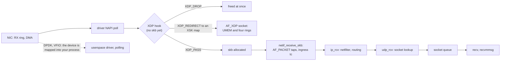
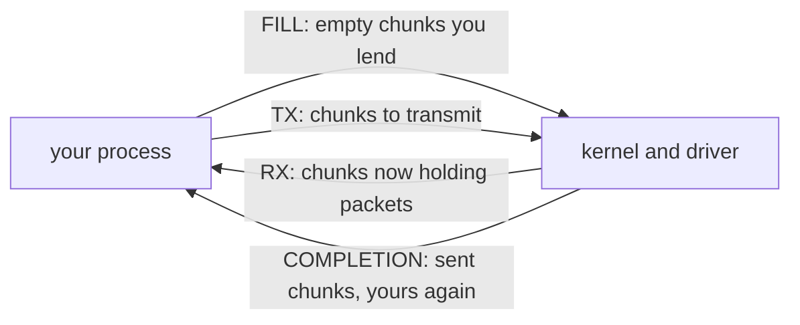

# NET 07: Zero-copy and kernel-bypass networking

*Part of the [networking plan](00_plan.md) · Time: about 7 hours · You need: [NET 05](05_epoll_and_io_uring.md) (system calls, `io_uring`, the cost of a call), [NET 06](06_linux_network_stack.md) (the path a packet takes, `sk_buff`, NAPI, where the receive work runs), [LX 08](../06_linux/08_linux_networking_toolbox.md) (network namespaces, `nft`). NET 06 ended with a packet delivered to a socket. This tutorial asks which parts of that path you can **remove**: the system call, the copy, the skb, the stack, the wake-up, and what each removal costs you. It walks the ladder from `recvmmsg` through the AF_PACKET ring, XDP and AF_XDP, then the transmit side (`sendfile`, `splice`, `MSG_ZEROCOPY`), then DPDK and the rest from memory. Every program and script is small, and every output below is pasted from a run.*

"How would you build something that handles 10 million packets a second?" is the standard Staff question for network-equipment, security-appliance and cloud-networking roles. A weak answer names DPDK. A strong answer starts from the **per-packet budget** (100 ns), names the **costs** a packet pays on the conventional path, says which technique removes which cost, and says what each one **takes away** from you (the stack, the tools, the cores). This tutorial gives you the second kind of answer, with measurements, including the ones that did **not** show the expected win.

**Eight honest limits, stated first.**

1. Everything is measured on **one Linux 6.18 VM** (Firecracker, 2 vCPUs) as **root**. The only real device is a `virtio_net` interface with one queue; every experiment uses a **`veth` pair between network namespaces**. There is **no physical NIC** and no multi-queue hardware.
2. **A veth pair is not a wire.** The receive processing runs **inside the sender's `send` call** (NET 06 section 3.3) and the skb already exists when XDP sees it. So the **thread** cost of a receiver understates the system cost, and XDP loses its main advantage. Every rung is therefore measured **two ways**, thread and machine, and the text says what each shows.
3. **AF_XDP zero-copy mode cannot be run**: the veth driver refuses it (`Operation not supported`, section 5.3). Every AF_XDP number here is **copy mode**.
4. **DPDK, VFIO, hugepages, RDMA, `pktgen`, `libxdp` and `netem` are not available.** Section 8 is **from memory** and says so. `XDP_TX`, device `XDP_REDIRECT`, XDP offload, `io_uring` `SEND_ZC`, `zcrx` and devmem TCP are also from memory.
5. **`MSG_ZEROCOPY` over a local veth always falls back to a copy** (100 percent of completions say "copied"), so only its **overhead** is measured, never its benefit.
6. **Single-machine noise is 5 to 10 percent per run**, and more for throughput. Each table is the **median of three flat-out runs**; the ordering and the order of magnitude are the result, not the last digit. Where two rows tie within noise the text says so.
7. **XDP was not attached to `eth0`**, the only route into the VM, in case it cut the session. All XDP and AF_XDP runs use the veth pair.
8. **Statements about kernel source** (`tpacket_rcv`, `xsk_rcv`, the driver zero-copy hooks) are **from memory** and marked. Everything else was run here.

By the end you can:

- **list the five costs of a packet** on the conventional path (system call, copy, skb allocation, protocol stack, wake-up) and name the technique that removes each (measured: a **10 Mpps** target leaves **100 ns per packet per core**, a 64 byte frame at 10 Gbit/s is **14.88 Mpps, 67 ns**, at 100 Gbit/s **148.8 Mpps, 6.7 ns**, and a system call alone is about **120 ns**);
- **batch the receive** and say what it buys (measured: `recvmmsg` with 64 messages cut the thread's cost from **1,069 to 915 ns** and the machine's from **4,021 to 3,581 ns**, only **11 percent** off the machine, because the call was never most of the cost);
- **use the AF_PACKET ring** and say what it does not skip (measured: **5,215 packets per wake-up** and **5 ns** of thread CPU per packet, but the machine still paid **1,773 ns**, because the stack still runs and the kernel still copies the frame into the ring);
- **write an XDP program** and explain what the verifier demands (measured: with one bounds check removed, the load failed with **`invalid access to packet, off=26 size=4`**; the checked program counted **404,096 of 404,096** packets exactly, with per-CPU counters of **276,088 and 128,008**);
- **say where a drop is cheapest and why XDP is not always the answer** (measured on veth: a closed port cost **1,840 ns** per packet, **29 percent of all CPU in `__icmp_send`**; the drops in `nft` prerouting, XDP generic and XDP native **tied at 1,024 to 1,098 ns**; the BPF program was **0.05 percent** of CPU and the skb-to-frame conversion **21 percent**);
- **build an AF_XDP receiver**, explain its UMEM and four rings, and check which mode you got (measured: native and generic attach both ran in **copy mode**; asking for zero-copy returned **`Operation not supported`**; the copy-mode receiver took **3.7 packets per wake-up** and was **not faster than sockets**, 322,356 against 333,864 pps);
- **send a file without copying it into user space** and quantify the saving (measured: **0.66 s per GB** of sender CPU for `read`+`write`, **0.33** for `sendfile`, **0.31** for `splice`, with the syscalls exactly **4,096, 2,048 and 4,096**);
- **use `MSG_ZEROCOPY` correctly** and say when it loses (measured: **2.4 times the CPU of a plain send at 1 KiB**, and **262,144 of 262,144** completions flagged "copied" on a local delivery);
- **say what DPDK takes from you** and when AF_XDP is the better compromise (section 8, from memory).

## Where the numbers come from

`flood.c` sends 64 byte UDP frames flat out (`sendmmsg`, 32 per call) from a namespace `cl` to a namespace `sv`, joined by a veth pair (`lab.sh`, with static neighbour entries so no ARP interferes). The sender is pinned to CPU 0 and the receiver to CPU 1. Two cost columns appear throughout:

- **thread ns**: `CLOCK_THREAD_CPUTIME_ID` of the receiving thread divided by packets, which is what the application pays;
- **machine ns**: the **non-idle CPU time of both CPUs** (`/proc/stat`, via `cpu.sh`) divided by packets received, which is what the system pays.

Shares of CPU time come from `perf record -a -F 4999 -e cpu-clock -g` over a separate 5 second flood, read with `perf report --children`. They are from a **different run** than the median pps next to them, so they are read as proportions, not as exact parts of the same second. The real `bpftool` is `/usr/lib/linux-tools-6.8.0-149/bpftool`, because the wrapper in `/usr/sbin` fails on this VM. BPF objects are built with `clang -O2 -g -target bpf -I/usr/include/x86_64-linux-gnu`.

## Data and timing

| What | Size or time |
|---|---|
| Frames | 64 byte Ethernet frames (18 byte UDP payload), 84 bytes on the wire with preamble and gap |
| Ladder run (`e1_ladder.sh`) | 6 receivers, 3 flat-out runs each |
| Drop run (`e2_drop.sh`) | 5 drop points, 3 runs of 4 s plus one 5 s `perf` profile each |
| File transmit (`e4_tx.sh`) | one 512 MB file, 256 KB chunks, 3 runs per method |
| `MSG_ZEROCOPY` (`e5_zerocopy.sh`) | 256 MB per send size, 6 sizes, 3 runs per cell |
| AF_XDP mode matrix (`ans_c.sh`) | 2 attach modes by 3 bind requests |
| Whole experiment batch | about 15 minutes |


---

## 1. The copies you remove, and what a packet is allowed to cost

NET 06 followed one packet through the stack and named every stage. This tutorial asks the next question, the one that decides whether a design reaches 10 million packets a second per machine: **which of those stages can you take away**, and what do you give up when you do.

### 1.1 What a conventional receive and transmit cost

Receive, per packet (the stages are NET 06 section 3; the costs are measured there and below):

1. The NIC **DMAs** the frame into a ring buffer. No CPU copy.
2. The driver wraps the buffer in an **`sk_buff`** (a 224 byte descriptor from a slab cache, NET 06 section 2) and the stack runs: netfilter, route lookup, protocol, socket lookup.
3. The skb is queued on the socket and the reader is **woken** (a scheduler operation, the largest single delay in NET 06 section 7.1).
4. The reader calls `recv`: a **system call** (about 120 ns, NET 05 section 8), a **`copy_to_user`** of the payload (the one CPU copy of the receive path), and a **free** of the skb.

Transmit is the mirror: `send` is a system call, **`copy_from_user`** puts the payload into new skb page fragments (NET 06 section 2: the one-byte send lived in a fragment), TCP clones the skb for the retransmit queue, the stack builds headers, and the NIC DMAs the frame out of memory.

So "zero-copy" is a loose word for a bundle of savings, and each technique in this tutorial removes a different subset of them:

| Cost | Where it is | Removed by |
|---|---|---|
| The system call | every `recv` and `send` | batching (`recvmmsg`, `sendmmsg`), rings in shared memory (AF_PACKET, AF_XDP, `io_uring`) |
| `copy_to_user` or `copy_from_user` | between kernel buffer and your buffer | mapped rings; `sendfile` and `splice` on transmit; `MSG_ZEROCOPY`; AF_XDP zero-copy mode on receive |
| skb allocation and free | per packet, in the driver | XDP (before the skb exists), AF_XDP, DPDK |
| The protocol stack | netfilter, routing, TCP or UDP | XDP, AF_XDP, DPDK (the packet never enters it) |
| The wake-up of a sleeping reader | scheduler, per wake | polling (busy-poll, DPDK, AF_XDP with a spinning thread) |

An important consequence: **removing only one of these rarely matters.** The measurements in sections 2 to 6 show it: batching the system call alone (`recvmmsg`) saved about a tenth of the per-packet cost, because the rest of the cost was not the call.

### 1.2 The budget

A 10 Gbit/s link carries at most one 64 byte frame every 67 ns, because each frame occupies 84 bytes on the wire (64 byte frame, 8 byte preamble, 12 byte gap). The arithmetic is exact and worth knowing by heart (computed; `ans_a.py` in the Answers prints it):

| Link | Minimum-size frames per second | Time per packet | With 1500 byte frames |
|---|---|---|---|
| 10 Gbit/s | 14.88 million | 67 ns | 0.81 million, 1,230 ns |
| 25 Gbit/s | 37.2 million | 27 ns | 2.03 million, 492 ns |
| 100 Gbit/s | 148.8 million | 6.7 ns | 8.13 million, 123 ns |

The budget for **10 million packets a second on one core is 100 ns per packet**, which is about 300 cycles: a handful of cache misses. A system call alone is 120 ns here. The stack of NET 06 costs on the order of a microsecond per packet in this VM (section 2). Every technique below exists to make the number a core spends per packet fit the budget, and it is worth saying that **at 1500 byte frames the budget is relaxed by a factor of 18, and the ordinary kernel stack with GRO is usually enough** (NET 06 section 4.1).

### 1.3 Where each technique takes the packet out



Read the picture as a ladder from the right: `recv` takes the packet at the very end, after everything; the AF_PACKET ring takes a **copy** at the tap, and the packet still goes on to the stack; XDP and AF_XDP take it **before an skb exists**; DPDK takes the **device**. The further left, the less of the kernel you keep (`tcpdump`, `nft`, routing, TCP) and the more you must build yourself, which is the trade section 8 spells out.


---

## 2. The first rungs: one packet per call, then 64

All measurements in sections 2 to 6 use the same traffic: **64 byte UDP frames** (18 byte payload) sent flat out by `flood.c` (`sendmmsg`, 32 datagrams per call, pinned to CPU 0) over a veth pair in two namespaces, into a receiver pinned to CPU 1. Because the receive processing on a veth pair runs **inside the sender's `send` call** (NET 06 section 3.3), the receiver thread's own CPU time is only part of the cost. So every rung is measured two ways:

- **thread ns**: the CPU time of the receiving thread per packet (`CLOCK_THREAD_CPUTIME_ID`), which is what the application pays;
- **machine ns**: the **non-idle CPU time of the whole machine** (`/proc/stat`, all CPUs, user, system, interrupt and softirq) divided by packets received, which is what the system pays, including the stack that ran in the sender's context.

```c
#define _GNU_SOURCE
/* flood IP PORT SECONDS RATE SIZE: UDP datagrams with sendmmsg, 32 per call; RATE 0 sends as fast as possible */
#include <arpa/inet.h>
#include <stdio.h>
#include <stdlib.h>
#include <string.h>
#include <sys/socket.h>
#include <time.h>

#define BATCH 32

static double now(void)
{
    struct timespec t;
    clock_gettime(CLOCK_MONOTONIC, &t);
    return t.tv_sec + t.tv_nsec * 1e-9;
}

int main(int argc, char **argv)
{
    if (argc != 6) return 1;
    double secs = atof(argv[3]), rate = atof(argv[4]);
    static char payload[2048];
    struct sockaddr_in to = { .sin_family = AF_INET, .sin_port = htons(atoi(argv[2])) };
    inet_pton(AF_INET, argv[1], &to.sin_addr);
    int fd = socket(AF_INET, SOCK_DGRAM, 0);
    struct iovec iov = { payload, atoi(argv[5]) };
    struct mmsghdr m[BATCH];
    for (int i = 0; i < BATCH; i++)
        m[i] = (struct mmsghdr){ .msg_hdr = { .msg_name = &to, .msg_namelen = sizeof to, .msg_iov = &iov, .msg_iovlen = 1 } };
    double t0 = now(), next = t0;
    long sent = 0, calls = 0;
    while (now() - t0 < secs) {
        int n = sendmmsg(fd, m, BATCH, 0);
        calls++;
        if (n > 0) sent += n;
        if (rate > 0) {
            next += BATCH / rate;
            struct timespec ts = { (time_t)next, (long)((next - (time_t)next) * 1e9) };
            clock_nanosleep(CLOCK_MONOTONIC, TIMER_ABSTIME, &ts, NULL);
        }
    }
    printf("sender: %ld datagrams in %.2f s = %.0f pps, %ld sendmmsg calls\n", sent, now() - t0, sent / (now() - t0), calls);
    return 0;
}
```

The lab is two namespaces and a veth pair, as in NET 06, with static neighbour entries so no ARP traffic disturbs a run:

```bash
. prog/h.sh
cleanup() { for n in cl sv; do ip netns del $n 2>/dev/null; done; }
trap cleanup EXIT; cleanup
for n in cl sv; do ip netns add $n; done
ip link add cle netns cl type veth peer name sve netns sv
nse cl sh -c 'ip addr add 10.7.0.1/24 dev cle; ip link set cle up; ip link set lo up'
nse sv sh -c 'ip addr add 10.7.0.2/24 dev sve; ip link set sve up; ip link set lo up'
nse cl ip neigh replace 10.7.0.2 lladdr $(nse sv cat /sys/class/net/sve/address) dev cle nud permanent
nse sv ip neigh replace 10.7.0.1 lladdr $(nse cl cat /sys/class/net/cle/address) dev sve nud permanent
```

```bash
# busy: total non-idle CPU time of the machine in jiffies (user, nice, system, irq, softirq, steal), 100 per second per CPU
busy() { awk '/^cpu /{print $2+$3+$4+$7+$8+$9}' /proc/stat; }
```

### 2.1 `recvfrom` and `recvmmsg`

The first two rungs are the ordinary socket API. `rx_sock.c` runs either one `recv` per packet or one `recvmmsg` that fills up to 64 messages per call:

```c
    static char buf[VLEN][2048];
    struct iovec iov[VLEN];
    struct mmsghdr m[VLEN];
    for (int i = 0; i < VLEN; i++) {
        iov[i] = (struct iovec){ buf[i], 2048 };
        m[i].msg_hdr = (struct msghdr){ .msg_iov = &iov[i], .msg_iovlen = 1 };
    }
    long pkts = 0, calls = 0;
    double t0 = 0, t1 = 0, cpu0 = now(CLOCK_THREAD_CPUTIME_ID), end = now(CLOCK_MONOTONIC) + atof(argv[3]);
    while (now(CLOCK_MONOTONIC) < end) {
        int n = batch ? recvmmsg(fd, m, VLEN, 0, NULL) : (int)recv(fd, buf[0], 2048, 0) > 0;
        calls++;
        if (n > 0) {
            if (!t0) t0 = now(CLOCK_MONOTONIC);
            pkts += n;
            t1 = now(CLOCK_MONOTONIC);
        }
    }
```

`recvmmsg` is the cheapest change you can make: no new socket type, no privileges, the full kernel stack stays. The ladder's table (section 6) has the numbers, and the two rows read:

| Receiver | Packets per second | Packets per syscall | Thread CPU per packet | Machine CPU per packet |
|---|---|---|---|---|
| `recvfrom` | 333,864 | 1.0 | 1,069 ns | 4,021 ns |
| `recvmmsg` (64) | 337,288 | 64.0 | 915 ns | 3,581 ns |

**Batching the call cut the thread's cost by 14 percent and the machine's by 11 percent.** Sixty-four times fewer system calls bought that little because the system call was never the main cost. A `recv` of a small datagram still does, per packet, the socket-queue dequeue, the `copy_to_user`, the **free of the skb**, and the socket memory accounting of NET 06 section 6, all of which `recvmmsg` repeats 64 times in one call. And on this VM the other half of the cost sits upstream: the sender's context ran the stack for every packet (the **machine** column, 3,581 ns, is 2.2 times the 1,655 ns the sender burns when nobody listens at all, shown as the first row of the table in section 6).

A better reading of the rung is its **latency cost**: `recvmmsg` without a timeout blocks until the batch is full, so a lightly loaded receiver sees packets late. The usual compromise is `MSG_WAITFORONE` (return when at least one message has arrived) and a bounded vector.

---

## 3. The ring in shared memory: AF_PACKET with TPACKET_V3

`AF_PACKET` is the oldest zero-syscall receive path in Linux. A **packet socket** gets a **copy of every packet** the stack sees on an interface (this is how `tcpdump` works, NET 04 section 10), and `PACKET_RX_RING` lets the kernel write those copies straight into a block of memory that is **mapped into your process**, so reading them needs no system call.

### 3.1 The ring and its handshake

`TPACKET_V3` organises the ring as **blocks**, each a batch of packets. The kernel fills a block, then marks it `TP_STATUS_USER`; you walk the packets in it, then give the block back with `TP_STATUS_KERNEL`. That one word, `block_status`, is the whole protocol, and it is the **descriptor ownership bit** of a DMA ring (DRV 07, CO 26) in software: whoever the bit says owns the block may touch it, and the hand-over is a release store paired with an acquire load.

```c
    struct tpacket_req3 req = { .tp_block_size = 1 << 20, .tp_block_nr = 8, .tp_frame_size = 2048,
                                .tp_frame_nr = (1 << 20) * 8 / 2048, .tp_retire_blk_tov = 10 };
    int fd = socket(AF_PACKET, SOCK_RAW, htons(ETH_P_IP)), ver = TPACKET_V3;
    setsockopt(fd, SOL_PACKET, PACKET_VERSION, &ver, sizeof ver);
    if (setsockopt(fd, SOL_PACKET, PACKET_RX_RING, &req, sizeof req)) { perror("PACKET_RX_RING"); return 1; }
    unsigned char *ring = mmap(NULL, (size_t)req.tp_block_size * req.tp_block_nr, PROT_READ | PROT_WRITE, MAP_SHARED, fd, 0);
    struct sockaddr_ll sll = { .sll_family = AF_PACKET, .sll_protocol = htons(ETH_P_IP), .sll_ifindex = if_nametoindex(argv[1]) };
    bind(fd, (struct sockaddr *)&sll, sizeof sll);
    long pkts = 0, polls = 0;
    unsigned blk = 0;
    double t0 = 0, t1 = 0, cpu0 = now(CLOCK_THREAD_CPUTIME_ID), end = now(CLOCK_MONOTONIC) + atof(argv[2]);
    while (now(CLOCK_MONOTONIC) < end) {
        struct tpacket_block_desc *bd = (void *)(ring + (size_t)blk * req.tp_block_size);
        if (!(__atomic_load_n(&bd->hdr.bh1.block_status, __ATOMIC_ACQUIRE) & TP_STATUS_USER)) {
            struct pollfd p = { fd, POLLIN, 0 };
            poll(&p, 1, 50);
            polls++;
            continue;
        }
        if (!t0) t0 = now(CLOCK_MONOTONIC);
        pkts += bd->hdr.bh1.num_pkts;
        t1 = now(CLOCK_MONOTONIC);
        __atomic_store_n(&bd->hdr.bh1.block_status, TP_STATUS_KERNEL, __ATOMIC_RELEASE);
        blk = (blk + 1) % req.tp_block_nr;
    }
```

The ring here is 8 blocks of 1 MiB with 2 KiB frames. The kernel retires a partly filled block after `tp_retire_blk_tov` milliseconds (10 here), so a quiet link still delivers promptly and a busy one delivers whole blocks. The program only counts packets (`num_pkts`); a real one walks the frames inside the block, each at `tp_next_offset` from the previous. The bounds of the walk are in the block header.

### 3.2 What it saves, and what it does not

| | |
|---|---|
| System calls | **5,215 packets per `poll`** (measured), against 1 per packet for `recvfrom` |
| Thread CPU per packet | **5 ns**, against 1,069 ns |
| Machine CPU per packet | **1,773 ns**, against 4,021 ns |
| Packets per second | **574,921**, against 333,864 |
| The stack | **not skipped**: the packet still goes up to `udp_rcv` and dies there with `NO_SOCKET` (and generates an ICMP port-unreachable for it, which section 4.3 prices at 29 percent of the CPU) |
| The copy | **not skipped**: the kernel **copies** the frame into the ring (`tpacket_rcv`, from memory of the source), once, in the softirq that delivered the packet |

Two corrections to the usual claim that the packet-mmap ring is "zero-copy". First, it removes the **user copy and the syscall**, not the copy: the kernel `memcpy`s each frame into the ring (from memory). Second, **the packet is not taken from the stack, only copied from it**: the AF_PACKET tap sees a clone of the skb and the normal path continues. That is why a packet socket is a monitor and not a way to bypass the kernel, and why the rows above still carry about 1.7 microseconds per packet on the machine. The thread's cost is almost nothing, **5 ns**, and the thread is what an application with real work to do would be glad to have back.

`PACKET_FANOUT` (from memory) spreads one interface's packets over several packet sockets by flow hash, one ring per thread, the software analogue of RSS (NET 06 section 4.3). A classic BPF filter attached to the socket (`SO_ATTACH_FILTER`) discards uninteresting packets **before** they are copied into the ring, which is how capture tools keep the ring from filling with traffic they do not want.

There is also a **transmit ring** (`PACKET_TX_RING`, from memory): you fill frames in a mapped ring and one `send` tells the kernel to transmit all of them. On the transmit side the frames are then read by the driver from the ring's pages without another copy, so it is closer to true zero-copy than the receive ring.


---

## 4. XDP: a program in the driver's receive path

**XDP** (eXpress Data Path) runs a small **BPF program** on each frame **as the driver hands it up**, before the stack. The program returns one verdict, and the kernel acts on it. It is the first rung of the ladder that changes *what the kernel does* with the packet rather than how you read it.

### 4.1 The hook and the five verdicts

The program receives a `struct xdp_md` with two pointers into the packet, `data` and `data_end`, plus the interface and queue. It reads and may rewrite the bytes, and returns:

| Verdict | Effect |
|---|---|
| `XDP_DROP` | free the buffer at once. The cheapest drop the kernel offers. |
| `XDP_PASS` | continue to the normal stack (an skb is built now, on a real NIC) |
| `XDP_TX` | send the frame back out of the **same** interface (a load balancer or reflector). From memory, not run here. |
| `XDP_REDIRECT` | send it to another interface, another CPU, or an **AF_XDP socket** (section 5). Only the socket case is run here. |
| `XDP_ABORTED` | drop and raise a tracepoint; what a program returns on its own error |

The program is **not** kernel code you can write freely. It is checked at load time by the **verifier**, which proves, for every path, that the program terminates and that **every memory access is inside the packet or a map**. That second rule is why the code below looks fussy.

### 4.2 A first program, and the verifier saying no

This program counts packets per source address in a per-CPU hash map and passes everything. Each header is checked against `data_end` **before** it is read:

```c
#include <linux/bpf.h>
#include <linux/if_ether.h>
#include <linux/ip.h>
#include <bpf/bpf_endian.h>
#include <bpf/bpf_helpers.h>

struct {
    __uint(type, BPF_MAP_TYPE_PERCPU_HASH);
    __uint(max_entries, 1024);
    __type(key, __u32);
    __type(value, __u64);
} per_source SEC(".maps");

SEC("xdp")
int x1_count(struct xdp_md *ctx)
{
    void *data = (void *)(long)ctx->data;
    void *data_end = (void *)(long)ctx->data_end;
    struct ethhdr *eth = data;
    if ((void *)(eth + 1) > data_end)
        return XDP_PASS;
    if (eth->h_proto != bpf_htons(ETH_P_IP))
        return XDP_PASS;
    struct iphdr *ip = (void *)(eth + 1);
    if ((void *)(ip + 1) > data_end)
        return XDP_PASS;
    __u32 key = ip->saddr;
    __u64 *count = bpf_map_lookup_elem(&per_source, &key);
    if (count) {
        *count += 1;
    } else {
        __u64 one = 1;
        bpf_map_update_elem(&per_source, &key, &one, BPF_ANY);
    }
    return XDP_PASS;
}

char _license[] SEC("license") = "GPL";
```

Take away the second bounds check (the one that proves the IP header fits) and the verifier refuses to load the program. `x1_bad.bpf.c` is exactly that, made with `sed`:

```text
--- 1. the verifier rejects the program without the second bounds check
    25,26d24
    <     if ((void *)(ip + 1) > data_end)
    <         return XDP_PASS;
invalid access to packet, off=26 size=4, R1(id=0,off=26,r=14)
R1 offset is outside of the packet
processed 11 insns (limit 1000000) max_states_per_insn 0 total_states 0 peak_states 0 mark_read 0
```

Read the message: register `R1` holds a pointer into the packet, the verifier knows only `r=14` bytes of it are proven to exist (the Ethernet header), and the program read 4 bytes at offset 26 (`ip->saddr`). **The kernel did not run a test packet; it proved the access unsafe from the program text.** This is also why XDP programs cannot loop on packet contents without a bound.

The checked program then counts a flood, with an exact result:

```text
--- 2. the checked program counts a flood
xdp qdisc noqueue state UP mode DEFAULT group default qlen 1000
xdp id 520 name x1_count tag 4173b73e9c2d63d4 jited
520: xdp  name x1_count  tag 4173b73e9c2d63d4  gpl
sender: 404096 datagrams in 1.00 s = 404091 pps, 12628 sendmmsg calls
"key":16779018 "cpu":0 "value":276088 "cpu":1 "value":128008
key 16779018 is the source address 10.7.0.1 (stored in network byte order, read as a little-endian number)
```

The flood sent **404,096** datagrams, and the two CPUs' counters hold **276,088 + 128,008 = 404,096**. A per-CPU map is used so that two CPUs never write the same cache line, and the sum is taken when you read it (`bpftool map dump`). Key `16779018` is the address `10.7.0.1` as a little-endian number of the network-order bytes, decoded by the last line.

### 4.3 Where a drop is cheapest: the measurement

The claim usually made for XDP is that it drops a packet **cheaper than the stack can**, because it runs before the skb is allocated. `e2_drop.sh` tests that: the same flood of 64 byte UDP to port 9000 dies at five different places, three runs each (the median is printed), then one `perf` profile of a separate 5 second flood gives the share of CPU in the receive side.

```bash
# where to drop 64 byte UDP: median of three flat-out runs per case, then one perf profile for the share of CPU time in the receive side
. prog/lab.sh
. prog/cpu.sh
incl() { perf report -i /tmp/perf.data --children --sort symbol --stdio -g none 2> /dev/null | awk -v s="$1" '$4 ~ s { print $1; exit }'; }
run() {   # label symbol...
  local label=$1; shift
  for i in 1 2 3; do
    local b0=$(busy)
    nse cl taskset -c 0 bin/flood 10.7.0.2 9000 4 0 18 > /tmp/tx.out
    local b1=$(busy)
    awk -v busy=$(( b1 - b0 )) '{ printf "%d %d\n", $8, busy * 10000000 / $2 }' /tmp/tx.out
    sleep 1
  done > /tmp/runs
  nse cl taskset -c 0 bin/flood 10.7.0.2 9000 5 0 18 > /dev/null &
  sleep 1
  perf record -a -F 4999 -e cpu-clock -g -o /tmp/perf.data -- sleep 3 > /dev/null 2>&1
  wait
  printf '%-30s %8s %6s  softirq %6s' "$label" "$(awk '{print $1}' /tmp/runs | sort -n | sed -n 2p)" "$(awk '{print $2}' /tmp/runs | sort -n | sed -n 2p)" "$(incl '^handle_softirqs$')"
  for s in "$@"; do printf '  %s %s' "$s" "$(incl "^$s")"; done
  echo
}
printf '%-30s %8s %6s\n' "where the packet dies" "pps sent" "ns/pkt"
run "UDP layer, no socket" __udp4_lib_rcv __icmp_send
nse sv nft add table ip f
nse sv nft add chain ip f input '{ type filter hook input priority 0; }'
nse sv nft add rule ip f input udp dport 9000 counter drop
run "nft input (after routing)" nft_do_chain
nse sv nft flush chain ip f input
nse sv nft add chain ip f pre '{ type filter hook prerouting priority -300; }'
nse sv nft add rule ip f pre udp dport 9000 counter drop
run "nft prerouting (before routing)" nft_do_chain
nse sv nft delete table ip f
nse sv ip link set dev sve xdpgeneric obj bin/x0.bpf.o sec xdp
run "XDP generic" do_xdp_generic bpf_prog
nse sv ip link set dev sve xdpgeneric off
nse sv ip link set dev sve xdp obj bin/x0.bpf.o sec xdp
run "XDP native" veth_xdp_rcv_skb bpf_prog
```

```text
where the packet dies          pps sent ns/pkt
UDP layer, no socket             555523   1840  softirq 49.14%  __udp4_lib_rcv 33.02%  __icmp_send 28.61%
nft input (after routing)        829837   1208  softirq 29.61%  nft_do_chain 7.16%
nft prerouting (before routing)   988724   1024  softirq 23.23%  nft_do_chain 8.03%
XDP generic                      919503   1098  softirq 23.42%  do_xdp_generic 12.02%  bpf_prog 1.23%
XDP native                       931571   1084  softirq 29.01%  veth_xdp_rcv_skb 20.64%  bpf_prog 0.05%
```

Reading it, in the order that matters:

1. **Letting the stack deal with it is the slow case: 1,840 ns and 555,523 pps**, and `__icmp_send` alone is **29 percent of all CPU**. A packet to a closed port is not just dropped: the kernel builds and sends an **ICMP port-unreachable** back. Any drop placed before the socket lookup (a firewall rule, XDP) avoids it, and that is the real saving: **a flood to a closed port costs the victim twice**.
2. **The four early drops are all about 1,000 to 1,200 ns and indistinguishable at this noise level** (the same case moved between 856,846 and 944,723 pps in two runs of this script). `nft` at prerouting (1,024 ns), XDP generic (1,098) and XDP native (1,084) tie.
3. **XDP native is not cheaper than `nft` here, and the profile says why.** The BPF program itself is **0.05 percent** of the CPU; the function that **converts the veth skb into an XDP frame, `veth_xdp_rcv_skb`, is 21 percent**. On a veth pair the **skb already exists**, because the sending side built it; XDP cannot save an allocation that already happened, and it adds a conversion. Generic XDP (`do_xdp_generic`, 12 percent) pays the same kind of cost at a different place.
4. **What the numbers do not show, and I did not measure**: on a real NIC driver the frame is still a raw DMA buffer when the program runs, so `XDP_DROP` skips the skb allocation, the stack and the free. That is the source of the published tens of millions of drops per second per core (from memory of the Linux and Cloudflare reports). **This VM cannot reproduce it**, and the table above should be read as "what XDP costs when the skb is already there", not as a refutation.

### 4.4 Attach modes

The same program can attach in three modes, and they differ in **where it runs**:

| Mode | `ip link` word | Runs | Needs |
|---|---|---|---|
| **native** (driver) | `xdp` or `xdpdrv` | in the driver's receive routine, before the skb | driver support (veth and virtio_net have it) |
| **generic** (skb) | `xdpgeneric` | in `netif_receive_skb`, **after** the skb exists | nothing: works on any device, but gives no skb saving |
| **offload** | `xdpoffload` | **on the NIC itself** | a SmartNIC with a BPF engine (from memory, not run) |

Native and generic both loaded on the veth pair here (the lines in the run above come from `ip link set dev sve xdp ...` and `xdpgeneric`). Choose generic only to **test a program on a device with no native support**; its performance is the stack's, not XDP's. On `eth0` the session itself rides one queue, so no XDP program was attached to it in these runs.


---

## 5. AF_XDP: XDP's redirect into a ring in your process

`XDP_REDIRECT` can send a packet to another device, to another CPU, or to an **AF_XDP socket**. Redirected to a socket, the packet goes **straight from the driver into memory you own**, with no skb, no netfilter, no socket lookup, and no system call per packet. The rest of the machine's networking is untouched: only the queues you bind are diverted, so `tcpdump`, `nft` and the management network keep working on the others.

### 5.1 The pieces

- **UMEM**: one region of your memory, split into fixed-size **chunks** (here 4096 chunks of 2 KiB), registered with the kernel. Every packet buffer is a chunk, named by its **offset** in the region.
- **Four rings**, each single-producer and single-consumer, in shared memory:



  Each ring is two indexes (producer, consumer) and an array of descriptors, the same discipline as the TPACKET block status and as a DMA descriptor ring. The producer writes the entries and then publishes its index with a **release** store; the consumer reads the index with an **acquire** load. NET 05 section 6 explains the same rules for `io_uring`.
- **An XSKMAP**: a BPF map from RX queue number to socket. The XDP program decides which packets go to the socket; everything else is returned as `XDP_PASS` and takes the normal path.

The whole XDP program is the redirect:

```c
#include <linux/bpf.h>
#include <bpf/bpf_helpers.h>

struct {
    __uint(type, BPF_MAP_TYPE_XSKMAP);
    __uint(max_entries, 4);
    __uint(key_size, sizeof(int));
    __uint(value_size, sizeof(int));
} xsks SEC(".maps");

SEC("xdp")
int xsk_redirect(struct xdp_md *ctx)
{
    return bpf_redirect_map(&xsks, ctx->rx_queue_index, XDP_PASS);
}

char _license[] SEC("license") = "GPL";
```

`bpf_redirect_map` returns the action. Its last argument, `XDP_PASS`, is the **fallback** when the map has no socket for that queue, so loading the program before the socket exists does not black-hole the interface.

### 5.2 The receiver

The setup registers the UMEM, sizes the rings, maps them using the offsets the kernel reports, lends the kernel every chunk through the FILL ring, binds to one (interface, queue) pair, and puts the socket in the map:

```c
    void *umem = mmap(NULL, (size_t)FRAMES * FSIZE, PROT_READ | PROT_WRITE, MAP_PRIVATE | MAP_ANONYMOUS, -1, 0);
    int fd = socket(AF_XDP, SOCK_RAW, 0);
    struct xdp_umem_reg reg = { .addr = (__u64)umem, .len = (__u64)FRAMES * FSIZE, .chunk_size = FSIZE };
    int n = RING;
    setsockopt(fd, SOL_XDP, XDP_UMEM_REG, &reg, sizeof reg);
    setsockopt(fd, SOL_XDP, XDP_UMEM_FILL_RING, &n, sizeof n);
    setsockopt(fd, SOL_XDP, XDP_UMEM_COMPLETION_RING, &n, sizeof n);
    setsockopt(fd, SOL_XDP, XDP_RX_RING, &n, sizeof n);
    struct xdp_mmap_offsets off;
    socklen_t len = sizeof off;
    getsockopt(fd, SOL_XDP, XDP_MMAP_OFFSETS, &off, &len);
    char *fill = mmap(NULL, off.fr.desc + RING * sizeof(__u64), PROT_READ | PROT_WRITE, MAP_SHARED | MAP_POPULATE, fd, XDP_UMEM_PGOFF_FILL_RING);
    char *rx = mmap(NULL, off.rx.desc + RING * sizeof(struct xdp_desc), PROT_READ | PROT_WRITE, MAP_SHARED | MAP_POPULATE, fd, XDP_PGOFF_RX_RING);
    __u32 *fprod = (void *)(fill + off.fr.producer), *rcons = (void *)(rx + off.rx.consumer), *rprod = (void *)(rx + off.rx.producer);
    __u64 *faddr = (void *)(fill + off.fr.desc);
    struct xdp_desc *rdesc = (void *)(rx + off.rx.desc);
    for (int i = 0; i < RING; i++) faddr[i] = (__u64)i * FSIZE;
    __atomic_store_n(fprod, RING, __ATOMIC_RELEASE);
```

```c
    struct sockaddr_xdp sx = { .sxdp_family = AF_XDP, .sxdp_ifindex = ifindex, .sxdp_queue_id = 0 };
    if (strcmp(argv[4], "copy") == 0) sx.sxdp_flags = XDP_COPY;
    if (strcmp(argv[4], "zerocopy") == 0) sx.sxdp_flags = XDP_ZEROCOPY;
    err = bind(fd, (struct sockaddr *)&sx, sizeof sx);
    printf("bind (%s): %s\n", argv[4], err ? strerror(errno) : "ok");
    if (err) { bpf_xdp_detach(ifindex, flags, NULL); return 1; }
    struct xdp_options opt;
    len = sizeof opt;
    getsockopt(fd, SOL_XDP, XDP_OPTIONS, &opt, &len);
    printf("zero-copy active: %s\n", (opt.flags & XDP_OPTIONS_ZEROCOPY) ? "yes" : "no (copy mode)");
    int key = 0;
    bpf_map_update_elem(map, &key, &fd, 0);
```

The receive loop is the ring protocol and nothing else. It takes descriptors from RX until the indexes meet, hands each chunk **back** through FILL (without that, the kernel runs out of buffers and the interface stops delivering), and publishes both indexes. When the ring is empty it sleeps in `poll`:

```c
    while (now(CLOCK_MONOTONIC) < end) {
        __u32 c = *rcons, p = __atomic_load_n(rprod, __ATOMIC_ACQUIRE);
        if (c == p) {
            struct pollfd pf = { fd, POLLIN, 0 };
            poll(&pf, 1, 50);
            polls++;
            continue;
        }
        if (!t0) t0 = now(CLOCK_MONOTONIC);
        for (; c != p; c++) {
            faddr[fp++ & (RING - 1)] = rdesc[c & (RING - 1)].addr & ~(__u64)(FSIZE - 1);
            pkts++;
        }
        t1 = now(CLOCK_MONOTONIC);
        __atomic_store_n(rcons, c, __ATOMIC_RELEASE);
        __atomic_store_n(fprod, fp, __ATOMIC_RELEASE);
    }
```

### 5.3 Copy mode and zero-copy mode

There are two ways the packet gets into a UMEM chunk, and they are the difference between a convenient socket and a fast one:

- **Zero-copy mode**: the driver's receive buffers **are** UMEM chunks. The NIC DMAs the frame directly into your memory, and the XDP program sees it there. Nothing is copied. This needs **driver support** (an XSK buffer pool and a wake-up hook, from memory of the driver interface) and is what the published AF_XDP numbers use.
- **Copy mode**: the kernel copies the frame from where it arrived into a UMEM chunk (from memory: `xsk_rcv`). It works on any device that can run XDP, even in the generic skb mode, and it still removes the per-packet system call and the stack, but not the copy.

The bind flags select the mode, and **the kernel is willing to fall back**: with no flag it tries zero-copy and quietly settles for copy. The only reliable test is to **ask the socket** (`getsockopt(SOL_XDP, XDP_OPTIONS)`, flag `XDP_OPTIONS_ZEROCOPY`), which `rx_xsk.c` prints. `ans_c.sh` tries both attach modes and all three bind requests on the veth device:

```bash
# Problem C: which AF_XDP modes does this device support, and how do you know which one you got?
. prog/lab.sh
for mode in drv skb; do
  for bind in auto copy zerocopy; do
    echo "--- attach $mode, bind $bind"
    nse sv bin/rx_xsk sve 1 $mode $bind 2>&1 | grep -v -E "^AF_XDP"
    sleep 1
  done
done
```

```text
--- attach drv, bind auto
xdp attach (drv): ok
bind (auto): ok
zero-copy active: no (copy mode)
--- attach drv, bind copy
xdp attach (drv): ok
bind (copy): ok
zero-copy active: no (copy mode)
--- attach drv, bind zerocopy
xdp attach (drv): ok
bind (zerocopy): Operation not supported
--- attach skb, bind auto
xdp attach (skb): ok
bind (auto): ok
zero-copy active: no (copy mode)
--- attach skb, bind copy
xdp attach (skb): ok
bind (copy): ok
zero-copy active: no (copy mode)
--- attach skb, bind zerocopy
xdp attach (skb): ok
bind (zerocopy): Operation not supported
```

| XDP attach mode | Bind request | Result |
|---|---|---|
| native (`drv`) | auto | works, **copy mode** (`zero-copy active: no`) |
| native | `XDP_COPY` | works, copy mode |
| native | `XDP_ZEROCOPY` | **refused**, `Operation not supported` |
| generic (`skb`) | auto | works, copy mode |
| generic | `XDP_COPY` | works, copy mode |
| generic | `XDP_ZEROCOPY` | **refused**, `Operation not supported` |

The veth driver has no zero-copy support, so on this VM **AF_XDP can run only in copy mode**, and the auto request is the dangerous one: it succeeds and a programmer who never printed `XDP_OPTIONS` believes they have zero-copy. A gotcha seen while building this table: binding to a queue **immediately after a previous AF_XDP process exited** returned `Device or resource busy` (the kernel releases the old socket asynchronously); a pause of a second removed it.

---

## 6. The ladder, compared

Five rungs, the same traffic, three runs each, the median printed. `e1_ladder.sh` is the experiment; the first row is a sender with **nobody listening** (the packets die at the UDP layer, with an ICMP error generated for each, which section 4.3 prices at 29 percent of the CPU):

```bash
# the receive ladder on one veth pair: 64 byte UDP frames flat out into four receivers, three runs each, medians printed
. prog/lab.sh
. prog/cpu.sh
one() {   # receiver-command...: prints "received_pps thread_ns machine_ns packets_per_syscall"
  nse sv taskset -c 1 "$@" > /tmp/rx.out 2>&1 &
  sleep 1
  local b0=$(busy)
  nse cl taskset -c 0 bin/flood 10.7.0.2 9000 4 0 18 > /tmp/tx.out
  local b1=$(busy)
  wait
  awk -v busy=$(( b1 - b0 )) '/packets/ { match($0, /: [0-9]+ packets/); n = substr($0, RSTART + 2, RLENGTH - 10); match($0, /[0-9]+ pps/); pps = substr($0, RSTART, RLENGTH - 4); match($0, /\([0-9.]+ packets each/); per = substr($0, RSTART + 1, RLENGTH - 14); match($0, /[0-9]+ ns of/); ns = substr($0, RSTART, RLENGTH - 6) } END { if (n > 0) printf "%d %d %d %s\n", pps, ns, busy * 10000000 / n, per }' /tmp/rx.out
}
rung() {   # label receiver-command...
  local label=$1; shift
  for i in 1 2 3; do one "$@"; sleep 1; done > /tmp/runs
  printf '%-20s' "$label"
  for col in 1 2 3 4; do printf ' %9s' "$(awk -v c=$col '{print $c}' /tmp/runs | sort -n | sed -n 2p)"; done
  echo
}
printf '%-20s %9s %9s %9s %9s\n' "receiver" "pps" "thread ns" "machine ns" "pkts/call"
for i in 1 2 3; do
  b0=$(busy); nse cl taskset -c 0 bin/flood 10.7.0.2 9000 4 0 18 > /tmp/tx.out; b1=$(busy); sleep 1
  awk -v busy=$(( b1 - b0 )) '{ printf "%d 0 %d 0\n", $8, busy * 10000000 / $2 }' /tmp/tx.out
done > /tmp/runs
printf '%-20s' "no receiver (sender)"
for col in 1 2 3 4; do printf ' %9s' "$(awk -v c=$col '{print $c}' /tmp/runs | sort -n | sed -n 2p)"; done
echo
rung "recvfrom" bin/rx_sock recvfrom 9000 6
rung "recvmmsg 64" bin/rx_sock recvmmsg 9000 6
rung "AF_PACKET ring" bin/rx_pkt sve 6
rung "AF_XDP native copy" bin/rx_xsk sve 6 drv copy
rung "AF_XDP generic copy" bin/rx_xsk sve 6 skb copy
```

```text
receiver                   pps thread ns machine ns pkts/call
no receiver (sender)    613226         0      1655         0
recvfrom                333864      1069      4021       1.0
recvmmsg 64             337288       915      3581      64.0
AF_PACKET ring          574921         5      1773    5214.7
AF_XDP native copy      322356       714      3668       3.7
AF_XDP generic copy     297536       765      3915       3.2
```

How to read the columns: **pps** is the packets per second the receiver took (the sender was flat out; the receiver kept up with it in every row, so the figure mostly measures how fast the sender could push); **thread ns** is what the receiving thread paid per packet; **machine ns** is what the whole machine paid per received packet; **pkts/call** is how many packets each syscall (or `poll`) covered.

1. **The application's cost falls the way the ladder promises**: **1,069 ns** (`recvfrom`), **915** (`recvmmsg`), **714** (AF_XDP, copy mode), **5** (AF_PACKET ring). The ring is the only rung that gets the thread out of the per-packet business, because it delivers **5,215 packets per wake-up**: the kernel does the copy in the softirq and your thread reads whole blocks.
2. **The machine's cost falls much less**: 4,021, 3,581, 3,668 and 1,773 ns. The stack still ran for every packet on the rungs that kept it, and for the AF_PACKET ring row as well (the tap sees a copy). The two numbers differ because on a veth pair the **stack runs in the sender's context**: the thread column shows who pays in the application, the machine column who pays overall. An application engineer who only looks at their own process sees a 200 times improvement from the ring; the capacity planner sees 2.3 times.
3. **AF_XDP in copy mode did not beat the sockets** on this device: 322,356 pps against 333,864, and 3,668 ns machine against 4,021 (a 9 percent saving), with generic mode slightly worse (297,536 pps, 3,915 ns). Two reasons, both instructive. First, on veth **the skb already exists** (the sender built it), so XDP cannot save the allocation that is its main advantage on a NIC (section 4.3 shows the veth conversion costing 21 percent of the CPU). Second, the receiver thread outruns the sender and sleeps in `poll`, waking for **3.7 packets at a time** (714 ns per packet of mostly wake-up cost). A deployed AF_XDP receiver **busy-polls** instead, spending a whole core to avoid exactly that, which is the trade the technique makes.
4. **None of the rows reaches the 100 ns budget** of section 1.2: the best is the ring, at 1,773 ns on the machine and about 5 ns in the thread. **10 million packets per second needs the packet out of the stack entirely, in a driver that fills UMEM directly**, and this device cannot show it (Problem A computes how many cores each row would need).
5. **Noise**: single rows moved by 5 to 10 percent between runs; the medians keep the ordering but not the last digit. The thread column for the ring (5 ns) and the pkts/call column are the robust results.


---

## 7. The transmit side: files and large buffers

Everything so far was the receive side. On transmit the dominant copy is `copy_from_user` of your buffer into skb fragments, and for a **file** server there is a second one before it: `read` copies the file's **page cache** pages into your buffer first. Two data movements for bytes that never needed to be in your process.

### 7.1 `sendfile` and `splice`

`sendfile(socket, file, ...)` tells the kernel to move the file's pages to the socket **itself**: the page-cache pages are attached to the skb as fragments, with no copy into user space and no `read`, and the call count halves. `splice` does the same through a **pipe** as the intermediary (file to pipe, pipe to socket), the general form: any fd to any fd, at the price of two calls. The pipe is just a ring of references to pages.

`tx_file.c` sends one 512 MB file from tmpfs to a TCP sink over the veth pair, in 256 KB chunks, three runs per method, and reports the **sender process's own** system time per gigabyte:

```c
    while (left > 0) {
        long want = left < CHUNK ? left : CHUNK;
        if (strcmp(argv[1], "readwrite") == 0) {
            long n = read(in, buf, want);
            for (long off = 0; off < n;) { long w = write(s, buf + off, n - off); off += w; calls++; }
            calls++;
            left -= n;
        } else if (strcmp(argv[1], "sendfile") == 0) {
            long n = sendfile(s, in, NULL, want);
            calls++;
            left -= n;
        } else {
            long n = splice(in, NULL, p[1], NULL, want, SPLICE_F_MOVE);
            calls++;
            for (long off = 0; off < n;) { long w = splice(p[0], NULL, s, NULL, n - off, SPLICE_F_MOVE); off += w; calls++; }
            left -= n;
        }
    }
```

```text
readwrite: 11.00 Gbit/s, 4096 syscalls, CPU of this process: user 0.01 s, sys 0.72 s per GB
readwrite: 11.98 Gbit/s, 4096 syscalls, CPU of this process: user 0.01 s, sys 0.66 s per GB
readwrite: 12.02 Gbit/s, 4096 syscalls, CPU of this process: user 0.01 s, sys 0.65 s per GB
sendfile : 16.37 Gbit/s, 2048 syscalls, CPU of this process: user 0.01 s, sys 0.33 s per GB
sendfile : 15.26 Gbit/s, 2048 syscalls, CPU of this process: user 0.00 s, sys 0.32 s per GB
sendfile : 13.69 Gbit/s, 2048 syscalls, CPU of this process: user 0.01 s, sys 0.38 s per GB
splice   : 17.67 Gbit/s, 4096 syscalls, CPU of this process: user 0.01 s, sys 0.31 s per GB
splice   : 17.12 Gbit/s, 4096 syscalls, CPU of this process: user 0.00 s, sys 0.37 s per GB
splice   : 17.82 Gbit/s, 4096 syscalls, CPU of this process: user 0.01 s, sys 0.30 s per GB
```

`ans_d.py` turns the nine lines into the comparison:

```text
2048 chunks of 256 KB
  readwrite predicted  4096 syscalls, measured  4096; median sender sys time 0.66 s per GB (  0 percent less than read+write)
  sendfile  predicted  2048 syscalls, measured  2048; median sender sys time 0.33 s per GB ( 50 percent less than read+write)
  splice    predicted  4096 syscalls, measured  4096; median sender sys time 0.31 s per GB ( 53 percent less than read+write)
```

1. **The syscall counts are exactly the prediction**: 2,048 chunks, so 4,096 calls for `read`+`write`, 2,048 for `sendfile`, 4,096 for `splice`. The three outputs are a check of what each call does.
2. **The sender's CPU time falls by half** (0.66 to 0.33 and 0.31 seconds per GB), which is the removed `copy_from_user` plus the removed `read` copy. That is the measured saving of avoiding **two copies per byte**.
3. **Throughput rose less than the CPU fell**: about 12, 15 and 17 Gbit/s, with a spread of about 2 Gbit/s between runs of the same method. On this VM the receiver (a `sink` on the other CPU) and the veth hand-off set a ceiling, so a saving in the sender turns into **headroom** (CPU left for other work) more than into speed. A sender that was CPU-bound would turn it into throughput.
4. **A cost the table hides**: `sendfile` sends what is in the page cache **now**. If another process truncates or rewrites the file mid-send, the receiver gets a mix, or a short count, and a file on a **real** disk adds the read I/O. Neither is a copy, but both are a correctness boundary the plain `read` did not have.

`vmsplice` (user memory into a pipe by reference) and `splice` from a socket give the matching **receive**-side tricks and have a well known trap: a page you gave to a pipe must not be rewritten until the other side has consumed it, and the kernel cannot tell you when. From memory, not run.

### 7.2 `MSG_ZEROCOPY`: the buffer you own

For data that is **not** in a file (an encoded frame, a serialised message), `send(..., MSG_ZEROCOPY)` (after `SO_ZEROCOPY` on the socket) makes the kernel **pin your pages and DMA from them**, with no copy. The price is a **contract**: you must not touch the buffer until the kernel says it is done, and the "done" arrives later as a **notification on the socket's error queue** (`MSG_ERRQUEUE`), one per range of sends. Pinning and the notification are bookkeeping that costs about as much as a copy of a small buffer, which is why the kernel documentation (from memory) says to expect a win only above about **10 KiB** per send.

`tx_zc.c` sends 256 MB in sends of a fixed size, plain or with the flag, and reaps the notifications every 16 calls. The reaping code is the whole contract; the flag `SO_EE_CODE_ZEROCOPY_COPIED` is set by the kernel when it **gave up and copied anyway**:

```c
static void reap(int s)
{
    char control[256];
    for (;;) {
        struct msghdr m = { .msg_control = control, .msg_controllen = sizeof control };
        if (recvmsg(s, &m, MSG_ERRQUEUE | MSG_DONTWAIT) < 0) return;
        for (struct cmsghdr *c = CMSG_FIRSTHDR(&m); c; c = CMSG_NXTHDR(&m, c)) {
            struct sock_extended_err *e = (void *)CMSG_DATA(c);
            if (e->ee_origin != SO_EE_ORIGIN_ZEROCOPY) continue;
            long n = (long)(e->ee_data - e->ee_info) + 1;
            completions += n;
            if (e->ee_code & SO_EE_CODE_ZEROCOPY_COPIED) copied += n;
            calls_reaped++;
        }
    }
}
```

```text
copy          1024 bytes:  2.54 Gbit/s, 3.12 CPU s per GB
zerocopy      1024 bytes:  1.04 Gbit/s, 7.55 CPU s per GB, 262144 of 262144 completions say copied
copy          4096 bytes:  1.75 Gbit/s, 4.50 CPU s per GB
zerocopy      4096 bytes:  1.50 Gbit/s, 4.85 CPU s per GB, 65536 of 65536 completions say copied
copy         16384 bytes:  4.28 Gbit/s, 1.84 CPU s per GB
zerocopy     16384 bytes:  5.97 Gbit/s, 1.10 CPU s per GB, 16384 of 16384 completions say copied
copy         65536 bytes: 16.75 Gbit/s, 0.26 CPU s per GB
zerocopy     65536 bytes: 13.12 Gbit/s, 0.45 CPU s per GB, 4096 of 4096 completions say copied
copy        262144 bytes: 12.43 Gbit/s, 0.64 CPU s per GB
zerocopy    262144 bytes:  9.24 Gbit/s, 0.86 CPU s per GB, 1024 of 1024 completions say copied
copy       1048576 bytes: 12.38 Gbit/s, 0.59 CPU s per GB
zerocopy   1048576 bytes: 11.67 Gbit/s, 0.65 CPU s per GB, 256 of 256 completions say copied
```

```text
send size   copy CPU s/GB   zerocopy CPU s/GB   ratio   completions that say copied
     1024            3.12                7.55    2.42   262144 of 262144
     4096            4.50                4.85    1.08   65536 of 65536
    16384            1.84                1.10    0.60   16384 of 16384
    65536            0.26                0.45    1.73   4096 of 4096
   262144            0.64                0.86    1.34   1024 of 1024
  1048576            0.59                0.65    1.10   256 of 256
```

1. **At 1 KiB the flag costs 2.4 times the CPU** (7.55 against 3.12 seconds per GB), and throughput falls from 2.54 to 1.04 Gbit/s. A small send pays for the pinning, the completion object and the reap, and gets back almost nothing. This is the measured version of the 10 KiB rule.
2. **Every single completion says "copied"**, at every size (262,144 of 262,144, and so on). On a veth pair, the packet is delivered **locally** to another socket in the same machine; the kernel cannot hand your page to a reader and must copy it. **This VM therefore measures only the bookkeeping cost of `MSG_ZEROCOPY`, not its benefit.** The savings need a real NIC that can DMA from your pages (from memory: the published results show lower CPU per byte from about 10 KiB and a clear gain at 64 KiB and up).
3. **Do not read the 16 KiB row (ratio 0.60) as a win.** The copy row for the same size moved from 4.92 to 4.28 Gbit/s between two runs of this script, and 100 percent of the sends there were copied anyway. The honest conclusion is that the ratios between 4 KiB and 1 MiB are **inside the noise of this VM**, and only the small-send penalty is large enough to trust.
4. **The contract is a source of real bugs.** Reusing the buffer before its completion arrives corrupts data **on the wire**, silently. `tx_zc.c` reuses its buffer immediately, which is harmless only because every byte is the same letter. A real program keeps a pool and recycles a buffer when its notification arrives.

### 7.3 `io_uring` and the other zero-copy transmit routes

`io_uring` has its own zero-copy send (`IORING_OP_SEND_ZC`), whose completion is a **second CQE** for the same request, the same "done later" contract delivered through the ring of NET 05 instead of the error queue. From memory, not run. The pattern is general: **zero-copy always moves the completion of a send from "the call returned" to "the kernel signalled"**, and the program must track ownership.

---

## 8. Kernel bypass, and what you give up

Every technique so far kept the kernel's stack for **something**. At the top of the ladder the packet, and often the **device**, leave the kernel altogether. None of this section was run: there is no hugepage memory, no VFIO and no physical NIC on this VM. It is stated from memory of the DPDK documentation and kernel docs, and it is marked so.

### 8.1 DPDK

**DPDK** is a userspace driver framework. A **poll-mode driver** (PMD) runs in your process, the NIC is mapped into it through **VFIO** (an IOMMU-protected device passthrough), and packet buffers are **hugepages** the NIC DMAs into directly. A core loops forever on `rte_eth_rx_burst`, which returns up to 32 packets, with **no interrupt, no system call and no copy**. Typical results reach line rate on 64 byte frames per core on a modern NIC, the 148.8 Mpps of section 1.2 being a 100 Gbit/s link's worth, spread over several cores.

What you give up, which is the interview-worthy half:

- **The device**: bound to VFIO, the NIC disappears from `ip link`. `tcpdump`, `ping`, routing, `nft`, `ss` do not see it. Management traffic needs a second NIC or a **KNI/virtio-user** bridge.
- **The whole stack**: no TCP, no ARP, no IP routing. You bring your own (VPP, F-Stack, mTCP) or write it.
- **The cores**: each polling core is **100 percent busy** even when idle (power, and the cores are removed from the scheduler with `isolcpus`).
- **The kernel's safety net**: a bug in your driver loop is a bug on bare metal, not a signal to one process.

### 8.2 Where AF_XDP sits between

AF_XDP (section 5) is the **compromise**: the kernel still owns the driver and the device, the interface stays visible, only chosen packets are diverted to your rings, and everything else, ARP and SSH included, keeps going up the normal stack. In zero-copy mode the performance is in the same class as DPDK for many workloads (from memory of the kernel's own benchmarks), with the kernel left in charge of the hardware.

### 8.3 Others, in one line each (from memory)

- **RDMA / RoCE (verbs)**: the NIC does the transport itself and writes into registered memory with no CPU involvement on either side; used in storage and HPC. Your application speaks to the NIC with **queue pairs** and **completion queues**, the same ring-and-doorbell shape as everything above.
- **io_uring zero-copy receive (`zcrx`)** and **devmem TCP**: receive directly into user (or device) memory after the NIC **splits headers from payload**, so TCP keeps working while the payload skips the copy. Newer kernel features; not tested here.
- **XDP offload**: the program runs on the NIC.

### 8.4 Choosing

| You need | Reach for | Cost |
|---|---|---|
| fewer system calls, same sockets | `recvmmsg`, `sendmmsg`, `io_uring` | almost none |
| a capture or monitor | AF_PACKET TPACKET_V3 | the stack still runs |
| drop or steer early, keep the stack | XDP | verifier-constrained programs; real gain needs driver support |
| user-space processing of selected traffic | AF_XDP | you own the rings, buffers and (in copy mode) a copy |
| a software router, firewall or load balancer at line rate | DPDK or AF_XDP zero-copy | your own stack and dedicated cores |
| a file server | `sendfile` | page-cache consistency |
| large sends from your own buffers | `MSG_ZEROCOPY`, `SEND_ZC` | the ownership contract |

One rule runs through the table: **change the cheapest thing first and measure.** Section 6 showed that batching alone saved a tenth, and that the stack, not the syscall, was most of the cost; that is why the answer to "how do I reach 10 Mpps" is a design decision (which packets leave the stack) and not a tuning knob.


---

## 9. Common mistakes

1. **Calling any of these "zero-copy" without saying which copy.** `recvmmsg` removes system calls, not copies; the AF_PACKET ring removes the system call and the wake-up but the kernel still **copies** the frame into the ring; AF_XDP in copy mode removes the stack but still copies. Say which of the five costs in section 1.1 a technique removes.
2. **Batching the system call and expecting a large gain.** `recvmmsg` with 64 messages cut the machine cost per packet by **11 percent** (4,021 to 3,581 ns). The call was never most of the cost.
3. **Asking for AF_XDP zero-copy and trusting the result.** With no flag the kernel falls back to copy mode **silently**. Here `XDP_ZEROCOPY` was refused on veth with `Operation not supported`, and the default bind succeeded in copy mode. Read `XDP_OPTIONS` after `bind` (section 5.3).
4. **Expecting XDP to be cheaper everywhere.** On a veth pair `XDP_DROP` cost the same as an `nft` drop in prerouting (about 1,050 ns against 1,024), because the skb already existed and the conversion to an XDP frame was **21 percent** of the CPU. The saving belongs to drivers that run XDP on the raw DMA buffer.
5. **Forgetting a bounds check.** The verifier rejects a program that reads past the last proven byte (`invalid access to packet, off=26 size=4`). Check every header against `data_end` before you read it, and re-check after any change to a pointer.
6. **Letting a closed-port flood reach the stack.** The kernel answers each datagram with an **ICMP port-unreachable**, which was **29 percent of all CPU** in section 4.3. Drop it early (firewall or XDP) or rate limit the ICMP.
7. **Leaving AF_XDP's FILL ring empty.** The kernel only delivers into chunks you lent it. A receive loop that consumes RX descriptors and does not return the chunks through FILL stops receiving after one ring of packets, with no error.
8. **Binding an AF_XDP socket right after the previous one exited.** It returned `Device or resource busy` here until a second had passed. Retry with a short delay.
9. **Reusing a `MSG_ZEROCOPY` buffer before its completion arrives.** The data on the wire changes. Recycle a buffer only when its notification comes back through the error queue.
10. **Using `MSG_ZEROCOPY` for small sends.** At 1 KiB it cost **2.4 times the CPU** of a plain send (7.55 against 3.12 seconds per GB). Use it from about 10 KiB (from memory of the kernel documentation), and measure on the real NIC.
11. **Reading CPU per packet from one process on a loopback or veth setup.** The receive work ran **inside the sender's `send`**. The receiver thread showed 5 ns per packet with the AF_PACKET ring while the machine paid 1,773. Measure the whole machine as well as the thread.
12. **Choosing DPDK when AF_XDP or plain sockets would do.** DPDK takes the NIC away from the kernel, dedicates polling cores and needs your own network stack. Reach for it when the rate demands it, not before (section 8.4).

---

## 10. Twelve interview questions

1. **A UDP service must handle 10 million packets per second per machine. How do you start?** Compute the budget first: 10 Mpps is **100 ns per packet** per core, and a system call alone is about 120 ns (section 1.2). So the design must take packets **out of the per-packet path**: batch, then bypass the stack for the hot flow (XDP, AF_XDP, DPDK) and spread over cores by RSS. Measure each step.
2. **Name the costs in a conventional receive.** DMA into the ring; skb allocation; the stack (netfilter, routing, protocol, socket lookup); the wake-up; the system call; `copy_to_user`; the skb free (section 1.1).
3. **What does `recvmmsg` buy?** Fewer system calls, nothing else: measured **14 percent** off the thread's cost and **11 percent** off the machine's at 64 packets per call. It adds latency when the batch is not full (use `MSG_WAITFORONE`).
4. **How does an AF_PACKET `PACKET_RX_RING` work, and does it skip the stack?** Shared blocks of frames, ownership passed with `block_status` (release and acquire). It does **not** skip the stack: the tap takes a **copy** and the packet continues. Measured: **5 ns of thread CPU** and **5,215 packets per wake-up**, but the machine still paid 1,773 ns per packet.
5. **What is XDP?** A BPF program run at the driver's receive point, returning `XDP_PASS`, `XDP_DROP`, `XDP_TX`, `XDP_REDIRECT` or `XDP_ABORTED`. Checked by the verifier. Native mode needs driver support; generic mode runs after the skb exists and is for testing.
6. **Why does the verifier ask for the bounds checks?** It proves every packet access lies inside `[data, data_end)`. Without the second check the program was rejected (`R1 offset is outside of the packet`), without ever running (section 4.2).
7. **Is XDP always the cheapest place to drop?** No. On veth it equalled an `nft` prerouting drop (about 1,050 against 1,024 ns), because the skb existed and the XDP conversion cost 21 percent. On a real NIC driver it skips the skb allocation (from memory). It always beats letting a closed port answer with ICMP (**1,840 ns**, 29 percent of it `__icmp_send`).
8. **Describe AF_XDP.** A socket whose **UMEM** is a region of your memory cut into chunks, with four rings: FILL (empty chunks to the kernel), RX (filled chunks to you), TX, COMPLETION. An XDP program redirects chosen packets into it through an XSKMAP; the rest goes up the stack. Zero-copy needs driver support; otherwise copy mode.
9. **How do you know whether you really got AF_XDP zero-copy?** `getsockopt(SOL_XDP, XDP_OPTIONS)` and the `XDP_OPTIONS_ZEROCOPY` flag. Binding with `XDP_ZEROCOPY` fails if unsupported (`Operation not supported` here); binding with no flag falls back silently.
10. **What does `sendfile` save for a file server?** The `read` into a user buffer and the `copy_from_user` of it: half the system calls and half the sender CPU (**0.33 against 0.66 seconds per GB**, measured), with the cost that the file's contents are read at send time.
11. **When is `MSG_ZEROCOPY` worth it?** Large sends (about 10 KiB and up, from memory) to a real NIC, where the notification handling is cheaper than the copy. Below that it **costs more** (2.4 times at 1 KiB here). It needs a buffer ownership protocol, and over loopback the kernel copies anyway (100 percent "copied" completions here).
12. **When would you choose DPDK over AF_XDP?** When you need the last factor of performance and can give up the kernel stack, the interface's visibility in normal tools and the cores that poll. AF_XDP keeps the kernel in charge of the device and lets you divert only selected traffic.

---

## 11. Problems

Each problem says where to solve it and how to approach it. A, D and E are arithmetic on the measured files and run anywhere with Python 3. B and C need root, `clang` with the BPF target, `libbpf` and `bpftool`, and the lab of `lab.sh`. Predict before you run.

**Problem A. The packet budget.** For 10, 25 and 100 Gbit/s, compute how many 64 byte frames per second the link carries (each frame occupies 84 bytes on the wire, with the preamble and inter-frame gap) and how many nanoseconds one core has for each. Then use the **machine** column of `e1_ladder` to say how many cores each rung would need for 10 Mpps. **Where:** Python, reading `v/e1_ladder.out`. **Approach:** pps is bits per second divided by (frame plus 20 bytes) times 8; cores are 10 million times the cost per packet in seconds.

**Problem B. An XDP port filter with a counter.** Write an XDP program that drops UDP datagrams to port 9000 and counts the drops in a per-CPU array; everything else (ping, UDP to another port) must still arrive. **Where:** `x2_port.bpf.c` in the `sv` namespace of `lab.sh`; send with `flood`. **Approach:** the bounds checks of section 4.2, then compare `dest` with `bpf_htons(9000)`. Read the counter with `bpftool map dump`, and check that `UdpNoPorts` stays at 0 (the dropped packets never reached the UDP layer).

**Problem C. Which AF_XDP modes work?** On your interface, try the two attach modes (native and generic) with the three bind requests (auto, copy, zero-copy), and print whether the socket really ended up in zero-copy mode. **Where:** `rx_xsk.c` with `ans_c.sh`. **Approach:** `XDP_OPTIONS` after `bind`; leave a second between runs, because a rebind can return `EBUSY`.

**Problem D. Predict the system calls of three file senders.** For a 512 MB file in 256 KB chunks, predict the number of system calls for read+write, `sendfile` and `splice`, and the order of their sender CPU time, then compare with the measurement. **Where:** `ans_d.py` on `v/e4_tx.out`. **Approach:** one `read` and one `write` per chunk; one `sendfile` per chunk; one `splice` into the pipe and one out per chunk.

**Problem E. The cost of `MSG_ZEROCOPY`.** From the table of section 7.2, compute for each send size the ratio of CPU per gigabyte between zero-copy and plain send, and state from the "copied" counts why the result is not the benefit the feature promises. **Where:** `ans_e.py` on `v/e5_zerocopy.out`. **Approach:** divide the two columns; count the completions flagged `SO_EE_CODE_ZEROCOPY_COPIED`.

---

## 12. Answers

### Problem A

```python
# ans_a.py: the per-packet time budget at line rate, against the per-packet cost measured in e1_ladder
import re
for gbit in (10, 25, 100):
    pps = gbit * 1e9 / ((64 + 20) * 8)
    print(f"{gbit:3d} Gbit/s of 64 byte frames (84 bytes on the wire): {pps / 1e6:6.2f} Mpps, {1e9 / pps:6.1f} ns per packet")
print("measured machine cost per packet (sender and receiver together) against 10 Mpps, which leaves 100 ns per packet per core")
for line in open("v/e1_ladder.out"):
    m = re.match(r"(.+?)\s+(\d+)\s+(\d+)\s+(\d+)\s+([\d.]+)$", line.rstrip())
    if not m or m.group(1) == "receiver":
        continue
    ns = int(m.group(4))
    print(f"  {m.group(1):22s} {ns:5d} ns -> {1e9 / ns / 1e6:5.2f} Mpps per core, {10e6 * ns / 1e9:5.1f} cores for 10 Mpps")
```

```text
 10 Gbit/s of 64 byte frames (84 bytes on the wire):  14.88 Mpps,   67.2 ns per packet
 25 Gbit/s of 64 byte frames (84 bytes on the wire):  37.20 Mpps,   26.9 ns per packet
100 Gbit/s of 64 byte frames (84 bytes on the wire): 148.81 Mpps,    6.7 ns per packet
measured machine cost per packet (sender and receiver together) against 10 Mpps, which leaves 100 ns per packet per core
  no receiver (sender)    1655 ns ->  0.60 Mpps per core,  16.6 cores for 10 Mpps
  recvfrom                4021 ns ->  0.25 Mpps per core,  40.2 cores for 10 Mpps
  recvmmsg 64             3581 ns ->  0.28 Mpps per core,  35.8 cores for 10 Mpps
  AF_PACKET ring          1773 ns ->  0.56 Mpps per core,  17.7 cores for 10 Mpps
  AF_XDP native copy      3668 ns ->  0.27 Mpps per core,  36.7 cores for 10 Mpps
  AF_XDP generic copy     3915 ns ->  0.26 Mpps per core,  39.1 cores for 10 Mpps
```

The budget falls from **67 ns per packet at 10 Gbit/s to 6.7 ns at 100 Gbit/s**, for 64 byte frames. With bigger frames it relaxes (1,500 bytes at 100 Gbit/s is 123 ns). On the measured rungs, **no row is near 100 ns**: the best, the AF_PACKET ring at 1,773 ns, would need about **18 cores** for 10 Mpps, and `recvfrom` about **40**. Two cautions. The **machine** figure includes the **sender's** work (the sender alone costs 1,655 ns per packet with nobody listening), so it overstates the receive side, and the right reading is the ordering and the order of magnitude, not the last digit. And these are copying, stack-running paths on a virtual device; a real NIC with XDP or DPDK is what the 100 ns budget is about.

### Problem B

```c
#include <linux/bpf.h>
#include <linux/if_ether.h>
#include <linux/in.h>
#include <linux/ip.h>
#include <linux/udp.h>
#include <bpf/bpf_endian.h>
#include <bpf/bpf_helpers.h>

struct {
    __uint(type, BPF_MAP_TYPE_PERCPU_ARRAY);
    __uint(max_entries, 1);
    __type(key, __u32);
    __type(value, __u64);
} dropped SEC(".maps");

SEC("xdp")
int x2_port(struct xdp_md *ctx)
{
    void *data = (void *)(long)ctx->data;
    void *data_end = (void *)(long)ctx->data_end;
    struct ethhdr *eth = data;
    if ((void *)(eth + 1) > data_end || eth->h_proto != bpf_htons(ETH_P_IP))
        return XDP_PASS;
    struct iphdr *ip = (void *)(eth + 1);
    if ((void *)(ip + 1) > data_end || ip->protocol != IPPROTO_UDP || ip->ihl != 5)
        return XDP_PASS;
    struct udphdr *udp = (void *)(ip + 1);
    if ((void *)(udp + 1) > data_end || udp->dest != bpf_htons(9000))
        return XDP_PASS;
    __u32 zero = 0;
    __u64 *n = bpf_map_lookup_elem(&dropped, &zero);
    if (n)
        *n += 1;
    return XDP_DROP;
}

char _license[] SEC("license") = "GPL";
```

```bash
# Problem B: an XDP program that drops only UDP to port 9000 and counts the drops; everything else must still work
. prog/lab.sh
nse sv ip link set dev sve xdp obj bin/x2_port.bpf.o sec xdp
echo "--- 1. ping and UDP to port 9001 still work"
nse cl ping -c 3 -W 1 10.7.0.2 | grep transmitted
nse sv bin/rx_sock recvfrom 9001 3 &
sleep 0.5
nse cl bin/flood 10.7.0.2 9001 1 50000 18
wait
echo "--- 2. UDP to port 9000 is dropped and counted"
nse cl bin/flood 10.7.0.2 9000 1 50000 18
nse sv /usr/lib/linux-tools-6.8.0-149/bpftool map dump name dropped | grep '"value"' | tr -d ' ,"' | paste -sd' '
nse sv nstat -az UdpNoPorts | tail -1
```

```text
--- 1. ping and UDP to port 9001 still work
3 packets transmitted, 3 received, 0% packet loss, time 2028ms
sender: 50016 datagrams in 1.00 s = 49996 pps, 1563 sendmmsg calls
recvfrom : 50016 packets, 50028 pps, 50022 syscalls (1.0 packets each), 1041 ns of this thread's CPU per packet
--- 2. UDP to port 9000 is dropped and counted
sender: 50016 datagrams in 1.00 s = 49996 pps, 1563 sendmmsg calls
value:35808 value:14208
UdpNoPorts                      0                  0.0
```

Ping and UDP to port 9001 still work (3 of 3 and 50,016 of 50,016). The 50,016 datagrams to port 9000 are all dropped: the per-CPU counters hold 35,808 and 14,208, which sum to **50,016**, and `UdpNoPorts` stays at **0**, proving the packets died in XDP before the UDP layer, so **no ICMP replies were generated**. The checks `ip->ihl != 5` (options would move the UDP header) and `ip->protocol != IPPROTO_UDP` are needed for correctness: without them the program would read the wrong bytes as a port.

### Problem C

The attach and bind modes are the table in section 5.3, from `ans_c.sh`:

```text
--- attach drv, bind auto
xdp attach (drv): ok
bind (auto): ok
zero-copy active: no (copy mode)
--- attach drv, bind copy
xdp attach (drv): ok
bind (copy): ok
zero-copy active: no (copy mode)
--- attach drv, bind zerocopy
xdp attach (drv): ok
bind (zerocopy): Operation not supported
--- attach skb, bind auto
xdp attach (skb): ok
bind (auto): ok
zero-copy active: no (copy mode)
--- attach skb, bind copy
xdp attach (skb): ok
bind (copy): ok
zero-copy active: no (copy mode)
--- attach skb, bind zerocopy
xdp attach (skb): ok
bind (zerocopy): Operation not supported
```

Both attach modes work on veth and **both end in copy mode**; asking for zero-copy is refused with `Operation not supported`, in either attach mode, because the veth driver has no zero-copy support. A deployment script should request `XDP_ZEROCOPY` first, fall back to `XDP_COPY` on failure **and log which one it got**, so a silent performance difference does not go unnoticed.

### Problem D

```python
# ans_d.py: predict the system calls of three ways to send a file, then compare with e4_tx
import re
size, chunk = 512 << 20, 256 << 10
chunks = size // chunk
predicted = {"readwrite": 2 * chunks, "sendfile": chunks, "splice": 2 * chunks}
runs = {}
for line in open("v/e4_tx.out"):
    m = re.match(r"(\w+)\s*: ([\d.]+) Gbit/s, (\d+) syscalls, CPU of this process: user ([\d.]+) s, sys ([\d.]+) s per GB", line)
    if m:
        runs.setdefault(m.group(1), []).append((float(m.group(2)), int(m.group(3)), float(m.group(5))))
print(f"{chunks} chunks of {chunk >> 10} KB")
base = None
for mode, p in predicted.items():
    sys_s = sorted(r[2] for r in runs[mode])[1]
    base = base or sys_s
    print(f"  {mode:9s} predicted {p:5d} syscalls, measured {runs[mode][0][1]:5d}; median sender sys time {sys_s:.2f} s per GB ({100 * (1 - sys_s / base):3.0f} percent less than read+write)")
```

```text
2048 chunks of 256 KB
  readwrite predicted  4096 syscalls, measured  4096; median sender sys time 0.66 s per GB (  0 percent less than read+write)
  sendfile  predicted  2048 syscalls, measured  2048; median sender sys time 0.33 s per GB ( 50 percent less than read+write)
  splice    predicted  4096 syscalls, measured  4096; median sender sys time 0.31 s per GB ( 53 percent less than read+write)
```

The predictions were exact: **4,096, 2,048 and 4,096** calls. The sender's CPU fell **50 percent** with `sendfile` and **53 percent** with `splice`. `splice` uses as many calls as read+write and still wins, which shows that **the cost removed was the copies, not the calls**: this is the opposite of the `recvmmsg` result in section 2.1, where removing calls alone barely helped.

### Problem E

```python
# ans_e.py: the cost of MSG_ZEROCOPY against plain send over a veth pair, from e5_zerocopy
import re
rows = {}
for line in open("v/e5_zerocopy.out"):
    m = re.match(r"(copy|zerocopy)\s+(\d+) bytes:\s+([\d.]+) Gbit/s, ([\d.]+) CPU s per GB(?:, (\d+) of (\d+) completions say copied)?", line)
    if m:
        rows[(m.group(1), int(m.group(2)))] = (float(m.group(3)), float(m.group(4)), m.group(5), m.group(6))
print("send size   copy CPU s/GB   zerocopy CPU s/GB   ratio   completions that say copied")
for size in sorted({k[1] for k in rows}):
    c, z = rows[("copy", size)], rows[("zerocopy", size)]
    print(f"{size:9d}   {c[1]:13.2f}   {z[1]:17.2f}   {z[1] / c[1]:5.2f}   {z[2]} of {z[3]}")
```

```text
send size   copy CPU s/GB   zerocopy CPU s/GB   ratio   completions that say copied
     1024            3.12                7.55    2.42   262144 of 262144
     4096            4.50                4.85    1.08   65536 of 65536
    16384            1.84                1.10    0.60   16384 of 16384
    65536            0.26                0.45    1.73   4096 of 4096
   262144            0.64                0.86    1.34   1024 of 1024
  1048576            0.59                0.65    1.10   256 of 256
```

The only large and credible effect is at **1 KiB: 2.42 times the CPU**. Between 4 KiB and 1 MiB the ratios (1.08, 0.60, 1.73, 1.34, 1.10) are scattered on both sides of 1 and inside this VM's run-to-run spread, so they are not evidence of either a gain or a loss. The reason there is no benefit to find is in the last column: **every completion says "copied"**. On a local delivery the kernel cannot give your page to the receiving socket, so it copies and reports it; what remains is the pinning and notification overhead. A real measurement needs a real NIC.

---

## 13. Cheat sheet

**The five costs of a packet.** System call, copy, skb allocation, the stack, the wake-up. Each technique removes some, never all but DPDK.

**The ladder, measured on veth (machine ns per packet, thread ns).** `recvfrom` 4,021, 1,069. `recvmmsg 64` 3,581, 915. AF_PACKET ring 1,773, **5**. AF_XDP copy 3,668, 714. A sender with no receiver costs 1,655. The ring is the only rung that frees the thread; none reaches 100 ns.

**Budget.** 64 byte frames: 14.88 Mpps (67 ns) at 10 Gbit/s, 37.2 Mpps (27 ns) at 25, 148.8 Mpps (6.7 ns) at 100. A system call is about 120 ns.

**XDP.** Verdicts `PASS DROP TX REDIRECT ABORTED`. Modes: native (driver), generic (after skb), offload (NIC). Check every header against `data_end`. Per-CPU maps for counters. On veth the BPF program was **0.05 percent** of CPU and the skb-to-frame conversion **21 percent**; native, generic and `nft` prerouting drops tied at about 1,000 to 1,100 ns; a closed port cost **1,840 ns**, **29 percent** in `__icmp_send`.

**AF_XDP.** UMEM (chunks) plus FILL, RX, TX, COMPLETION rings. Return every chunk through FILL. Zero-copy needs driver support; check `XDP_OPTIONS_ZEROCOPY`; the default bind falls back to copy. veth: copy only.

**Transmit.** `sendfile`: **0.33 against 0.66 s per GB** of sender CPU (read+write), `splice` 0.31; syscalls 2,048, 4,096, 4,096. `MSG_ZEROCOPY`: **2.4 times the CPU at 1 KiB**, a completion on the error queue per range, buffer must not be reused until it arrives, 100 percent "copied" on local delivery; worth it from about 10 KiB on a real NIC.

**Bypass (from memory).** DPDK: VFIO, hugepages, polling cores, no kernel stack, device invisible to `ip`. AF_XDP: kernel keeps the device. RDMA: NIC does the transport. `zcrx` and devmem TCP: payload straight to user or device memory.

**Method.** Compute the budget. Change one thing, measure the machine and the thread. Check the mode you got.

---

## 14. Sources

- Linux manual pages: `packet(7)` (`PACKET_RX_RING`, `TPACKET_V3`), `socket(7)`, `sendfile(2)`, `splice(2)`, `vmsplice(2)`, `recvmmsg(2)`, `bpf(2)`, `ip-link(8)` (the `xdp`, `xdpgeneric`, `xdpoffload` keywords), `bpftool(8)`.
- The kernel's `Documentation/networking/`, <https://docs.kernel.org/networking/>: `af_xdp` (UMEM, the four rings, the bind flags and `XDP_OPTIONS`), `msg_zerocopy` (the error-queue protocol and the 10 KiB guidance), `packet_mmap` (the TPACKET versions), `xdp-rx-metadata`, and the BPF documentation on the verifier, <https://docs.kernel.org/bpf/>.
- The kernel source, <https://elixir.bootlin.com/linux/v6.18/source>: `net/xdp/xsk.c`, `net/packet/af_packet.c` (`tpacket_rcv`), `drivers/net/veth.c` (`veth_xdp_rcv_skb`), `net/core/dev.c` (`do_xdp_generic`), `net/ipv4/icmp.c` (`__icmp_send`).
- Brendan Gregg, *BPF Performance Tools*; the `libbpf` documentation and the `xdp-tutorial` repository, <https://github.com/xdp-project/xdp-tutorial>, for the longer walk through programs, maps and AF_XDP.
- Toke Hoiland-Jorgensen and others, "The eXpress Data Path: Fast Programmable Packet Processing in the Operating System Kernel" (CoNEXT 2018), the XDP paper; and the DPDK documentation, <https://doc.dpdk.org/>, for poll-mode drivers and VFIO (the DPDK material here is from memory).
- Willem de Bruijn and Eric Dumazet, "sendmsg copy avoidance with MSG_ZEROCOPY" (netdev 2.1, 2017), the design of the mechanism measured in section 7.2.
- The experiments of this tutorial: scripts `e1_ladder`, `e2_drop`, `e3_xdp`, `e4_tx`, `e5_zerocopy`, `ans_a` to `ans_e`; the programs `flood.c`, `rx_sock.c`, `rx_pkt.c`, `rx_xsk.c`, `tx_file.c`, `tx_zc.c`, `sink.c`, `xsk_redirect.bpf.c`, `x0.bpf.c`, `x1_count.bpf.c`, `x1_bad.bpf.c`, `x2_port.bpf.c`; and the helpers `lab.sh`, `h.sh`, `cpu.sh`.
- Earlier tutorials: [NET 05](05_epoll_and_io_uring.md), [NET 06](06_linux_network_stack.md), [the networking plan](00_plan.md).
