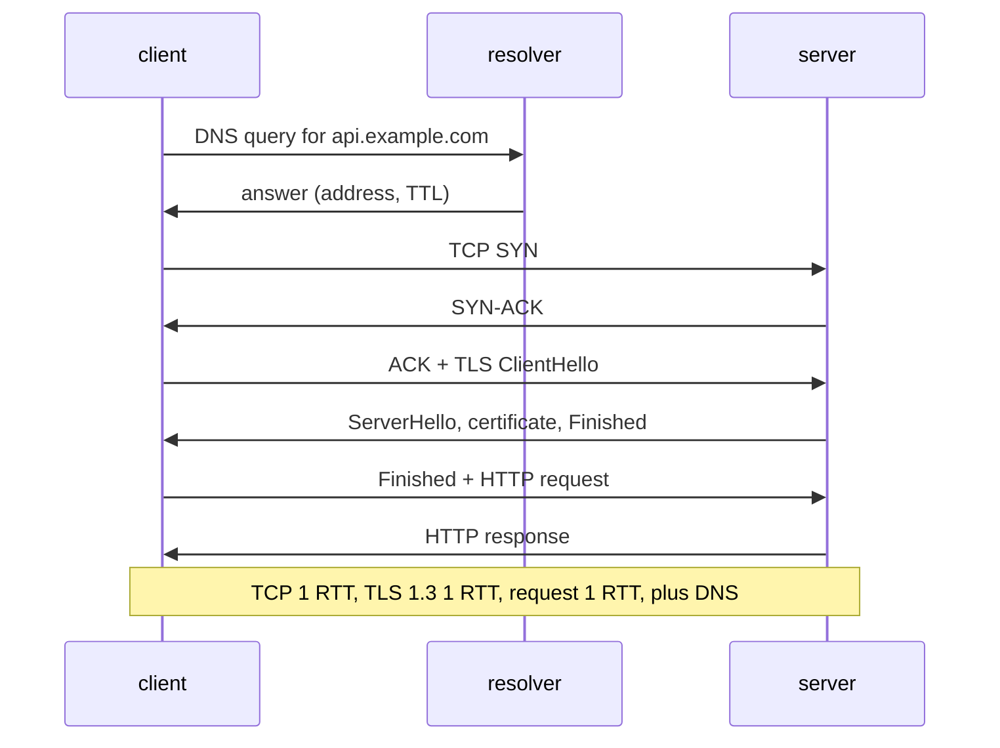
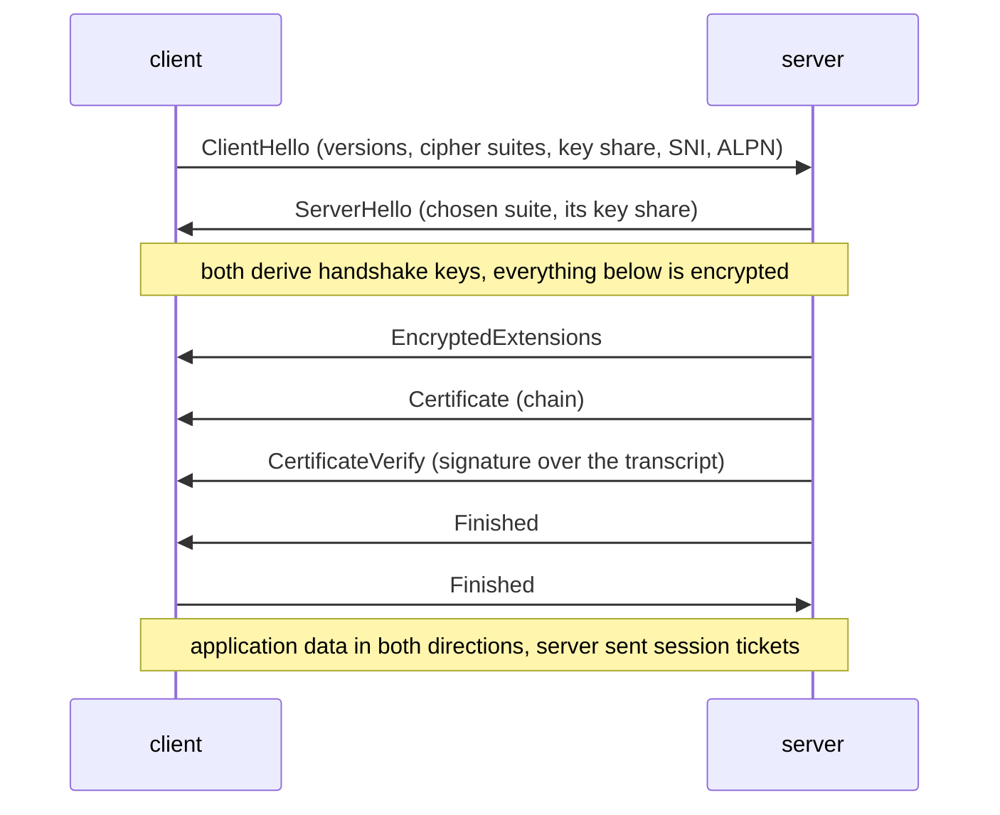

# NET 08: Application protocols: DNS, HTTP/1.1, HTTP/2, HTTP/3, TLS 1.3, and the services every network depends on

*Part of the [networking plan](00_plan.md) · You need: [NET 03](03_tcp_udp_and_transport.md) (the TCP handshake, loss recovery, timeouts), [NET 04](04_socket_programming_in_c.md) (sockets, byte order, message boundaries), [NET 06](06_linux_network_stack.md) (what a packet costs on the host)*

NET 01 to NET 07 moved bytes between machines. This tutorial is about what the bytes **say**: how a name becomes an address (DNS), how a client asks for a page (HTTP/1.1, HTTP/2, HTTP/3 over QUIC), how the conversation is protected (TLS 1.3 and certificates), the message protocols built on top (gRPC, WebSocket, MQTT), and the small services every device depends on (DHCP, NTP and PTP, SNMP and gNMI).

"What happens when you type a URL and press Enter?" is the oldest networking interview question. At Staff level it is not a list of protocol names. It is a **budget**: how many round trips before the first byte arrives, which ones each protocol generation removed, what each removal cost (CPU, state, a new failure mode), and which of those you can **show** in a packet capture. A weak answer recites the layers. A strong answer keeps one cold request on the table and says at each step what is on the wire, what is cached, and how it fails.

By the end you can:

- write the round-trip budget of a cold first request and say what each protocol generation removes;
- decode a DNS message by hand, explain name compression, and walk a recursive resolution including caching, negative caching, truncation and QNAME minimisation;
- frame an HTTP/1.1 message and explain keep-alive, chunking and head-of-line blocking;
- explain HTTP/2 streams, multiplexing, HPACK and flow control, and say why TCP still limits it;
- explain QUIC and HTTP/3: what moved into user space, what independent streams fix, and what it costs;
- walk a TLS 1.3 handshake, read a certificate chain, name the ways verification fails, and explain resumption, 0-RTT and mutual TLS;
- choose between gRPC, WebSocket and MQTT, and explain DHCP, NTP and SNMP well enough to debug them.

---

## 1. The first request: a budget in round trips

Type `https://api.example.com/items` into a client with nothing cached. In order:

1. **DNS.** Turn `api.example.com` into an address. One round trip to the local resolver if it has the answer cached, several if it must walk the hierarchy.
2. **TCP.** Three-way handshake: one round trip before data can flow.
3. **TLS.** In TLS 1.3, one round trip (in TLS 1.2, two).
4. **HTTP.** The request goes out, the first byte of the response comes back: one more round trip.

So a cold HTTPS request over TCP and TLS 1.3 costs about **DNS + 1 (TCP) + 1 (TLS) + 1 (HTTP) = 3 round trips plus the DNS time** before the page starts to arrive. That is arithmetic on counted flights, not a measurement; the real time is those flights multiplied by your round-trip time.



### 1.1 What each generation removes

| Stack | Round trips before the first response byte (excluding DNS) | What changed |
|---|---|---|
| HTTP/1.1 over TCP + TLS 1.2 | 4 (TCP 1, TLS 2, request 1) | The baseline |
| HTTP/1.1 or HTTP/2 over TCP + TLS 1.3 | 3 | TLS 1.3 halved the TLS handshake |
| Same, resumed (session ticket) | 3, with less CPU | Saves the certificate and signature work, not a round trip |
| TLS 1.3 with 0-RTT on resumed connection | 2 (request rides the first flight after TCP) | Data sent before the handshake finishes; replayable |
| HTTP/3 over QUIC, first visit | 2 (transport and TLS combined, then request) | QUIC folds the TCP and TLS handshakes into one |
| HTTP/3, resumed with 0-RTT | 1 (request in the first flight) | Same replay caveat |
| Any, over an already open connection | 1 | Connection reuse is the biggest single saving |

The two biggest levers are not new protocols but **reuse** (keep the connection, so most requests pay 1 round trip) and **a nearby server** (a CDN shrinks the round-trip time itself). Protocol generations shave a round trip or two off the first request of a cold connection.

---

## 2. DNS: names, messages and caches

DNS is a distributed, hierarchical, cached database. The root servers know who runs each top-level domain (`com`, `org`, ...), a top-level server knows who runs each domain under it, and that domain's **authoritative** servers hold the actual records. A client does not walk that tree itself; it asks a **recursive resolver** (at your ISP, your company, or `8.8.8.8`) that walks it and caches the results.

### 2.1 The message

Every DNS message, query or reply, has the same shape: a 12-byte header, then four sections.

| Part | Contents |
|---|---|
| Header | 16-bit ID; flags (QR response bit, opcode, AA authoritative answer, TC truncated, RD recursion desired, RA recursion available, rcode); counts for each section |
| Question | The name, the type (A, AAAA, MX, ...), the class (almost always IN) |
| Answer | The records that answer it |
| Authority | Which servers are authoritative, or the SOA for a negative answer |
| Additional | Helpful extras (glue addresses, the EDNS OPT record) |

Names are written as **length-prefixed labels**: `www.example.lab` is `3 www 7 example 3 lab 0`. To save space a name can end with a **pointer**: two bytes starting with the bits `11`, followed by an offset from the start of the message. The first answer almost always names the same domain as the question, so its name is the two bytes `0xc00c`, "the name at offset 12", right after the header.

Building and decoding a query by hand shows all of that. This runs a tiny authoritative server (with the `dnslib` library) and a hand-built client:

```python
import socket, struct
from dnslib import DNSRecord, RR, QTYPE, A, SOA, RCODE
from dnslib.server import DNSServer, BaseResolver

class Zone(BaseResolver):
    def resolve(self, req, handler):
        r = req.reply()
        q = str(req.q.qname).lower()
        soa = RR("example.lab.", QTYPE.SOA, ttl=60,
                 rdata=SOA("ns.example.lab.", "h.example.lab.", (1, 3600, 600, 86400, 60)))
        if q == "www.example.lab.":
            r.add_answer(RR(q, QTYPE.A, rdata=A("192.0.2.10"), ttl=300))
            r.header.aa = 1
        else:
            r.header.rcode = RCODE.NXDOMAIN
            r.add_auth(soa)                       # a negative answer carries the SOA
        return r

srv = DNSServer(Zone(), port=5353, address="127.0.0.1", logger=None)
srv.start_thread()

def build_query(name, qtype=1, ident=0x1234):
    hdr = struct.pack("!HHHHHH", ident, 0x0100, 1, 0, 0, 0)         # RD set, one question
    qname = b"".join(bytes([len(p)]) + p.encode() for p in name.split(".")) + b"\x00"
    return hdr + qname + struct.pack("!HH", qtype, 1)               # type A, class IN

def ask(name):
    q = build_query(name)
    s = socket.socket(socket.AF_INET, socket.SOCK_DGRAM)
    s.settimeout(2)
    s.sendto(q, ("127.0.0.1", 5353))
    data, _ = s.recvfrom(4096)
    ident, flags, qd, an, ns, ar = struct.unpack("!HHHHHH", data[:12])
    print(f"{name}: query {len(q)} B, reply {len(data)} B, flags {flags:#06x}, "
          f"rcode {flags & 0xf}, answers {an}, authority {ns}")
    if an:
        print("  first answer name field:", data[len(q):len(q) + 2].hex(), "(pointer to offset 12)")
    return data

ask("www.example.lab")
ask("nope.example.lab")
print(DNSRecord.parse(ask("www.example.lab")).a)
```

What it printed: the 33-byte query for an existing name returned a 49-byte reply with flags `0x8580` (response, authoritative, recursion desired) and the answer name as `c00c`. The name that does not exist returned flags ending in `3`, **rcode 3 (NXDOMAIN)**, with **no answer and one authority record**, the zone's SOA.

That last point is a classic interview detail: **a "no such name" and a "no such record type" answer both carry the zone's SOA**, and the SOA's last field is the **negative-caching TTL**. That is how a resolver knows how long to remember "this does not exist" (RFC 2308).

### 2.2 Record types worth knowing cold

| Type | Meaning |
|---|---|
| A, AAAA | IPv4, IPv6 address |
| CNAME | Alias to another name (cannot coexist with other records at the same name, and not allowed at a zone apex) |
| NS | Delegation: these servers are authoritative for this zone |
| SOA | Zone metadata: serial, refresh, retry, expire, and the negative-caching TTL |
| MX | Mail exchangers, with a preference |
| TXT | Free text: SPF, DKIM, domain verification |
| PTR | Reverse lookup, address to name (under `in-addr.arpa`) |
| SRV | Service location: host, port, priority, weight |
| HTTPS / SVCB | Service binding: ALPN protocols, ports, ECH keys, address hints, so the client learns "this supports HTTP/3" before connecting |
| CAA | Which certificate authorities may issue for this domain |
| DS, DNSKEY, RRSIG | DNSSEC |

### 2.3 What a recursive resolver does

For a cold lookup of `www.example.lab`, the resolver does this, in order:

1. Check its **cache** for the name. Hit: answer immediately, with the TTL counted down.
2. Otherwise ask a **root server**. The root does not know the answer; it replies with a **referral**: NS records for `lab.` and, as **glue**, the addresses of those servers.
3. Ask a `lab.` server. It refers the resolver to the servers for `example.lab.`.
4. Ask an `example.lab.` server. It is authoritative and returns the answer.
5. **Cache** every useful record, each for its own TTL, including the delegations, and return the answer to the client.

So a fully cold lookup costs one round trip **per level** (root, top-level, authoritative). On a toy lab with three servers each answering after 20 ms, a cold lookup cost about 64 ms, the same lookup again about 0 ms with the TTL visibly counting down, a second name in the same zone about 20 ms (the delegations were already cached, so only the last server is asked), and a missing name 24 ms the first time and 0 ms after (from the **negative cache**). Those figures are from an earlier run; the pattern is the answer: **the cache is why DNS works at all, and the TTL is the contract on how stale it may be.**

Two refinements that appear in interviews:

- **QNAME minimisation (RFC 9156).** The classic resolver sends the *full* name to every server on the way, so the root learns that someone asked for `www.example.lab`. A minimising resolver asks the root only for `lab.`, the top-level server only for `example.lab.`, and so on, revealing only what each server needs. Privacy gain; slightly more queries.
- **Delegation and glue.** If the name servers for `example.lab.` are themselves under `example.lab.`, the parent must supply their addresses (glue), or you would need the answer to find the server that gives the answer.

### 2.4 Big answers, EDNS and the move to TCP

DNS started with UDP and a 512-byte limit. If the answer is bigger, the server sets the **TC (truncated)** bit and the client retries over **TCP**. **EDNS(0)** (an OPT record in the Additional section) lets a client advertise a larger UDP payload size, commonly around 1200 to 1232 bytes today, chosen to avoid IP fragmentation, which is unreliable through firewalls and a known source of mysterious DNS failures. DNSSEC and large TXT records make big answers common, so TCP fallback must work. **A firewall that blocks DNS over TCP port 53 is a classic cause of "it works for small names and fails for some"**.

An earlier run showed it: a 1,050-byte TXT answer to a 33-byte query arrived truncated over UDP and complete over TCP.

### 2.5 The cache arithmetic that drives operations

- **TTL is a trade.** A long TTL cuts load and speeds lookups; a short one lets you change things quickly and costs more queries. For a **planned migration**, lower the TTL well before the change (at least one old TTL in advance), make the change, then raise it again. TTL cannot be shortened after the fact for resolvers that already cached the old value.
- **Negative answers are cached too**, for the SOA's last field (bounded by the resolver). A name created right after a lookup for it failed may stay "missing" for that long.
- **Resolvers may cap TTLs** (some ignore very low values, some cap high ones), and **clients cache as well** (the OS, the browser, the language runtime). "I changed the record and some people still see the old one" is cache layers, not a DNS bug.
- **CNAME chains** cost extra lookups and each link has its own TTL; the effective lifetime is bounded by the shortest.

### 2.6 The client side, and what goes wrong

- **The stub resolver** (`getaddrinfo`, `systemd-resolved`) asks the configured recursive resolver. It follows the **search list** and the **`ndots`** rule: in a Kubernetes pod, `ndots:5` means a name with fewer than 5 dots (like `api.svc`) is tried with each search domain appended first, so one lookup becomes several queries, most of which return NXDOMAIN. That is a well-known source of DNS load and latency in clusters.
- **Happy Eyeballs** asks for both A and AAAA and races the connections, so a broken IPv6 path costs milliseconds and not a long timeout.
- **Timeouts and retries** are slow and silent: a lost UDP query waits a second or more for a retry. "Intermittent slowness exactly 5 seconds" is often a DNS timeout and a retry to a second resolver.
- **DNS as a load balancer** is coarse: caches and clients that hold addresses make failover as slow as the TTL, and clients that pick the first address defeat round-robin evenness.

### 2.7 Security and privacy (concepts)

- **Cache poisoning** (Kaminsky, 2008): forge a reply that matches the 16-bit ID and the source port before the real one. Defences: random source ports and IDs, 0x20 case randomisation, and **DNSSEC**.
- **DNSSEC** adds signatures (RRSIG), keys (DNSKEY) and a chain of delegation signers (DS) from the root down, so a validating resolver can prove an answer is authentic, and NSEC or NSEC3 records prove a name does not exist. It gives **authenticity, not confidentiality**.
- **DNS over TLS (DoT, port 853) and DNS over HTTPS (DoH)** encrypt the client-to-resolver leg. They hide queries from the local network and also let applications bypass the enterprise resolver, which is why they are contentious in managed networks.
- **Amplification**: a small spoofed query that gets a large reply makes open resolvers a DDoS tool, which is why resolvers should not answer the whole internet and why response rate limiting exists.

---

## 3. HTTP/1.1: text, one request at a time

HTTP/1.1 is a text protocol over a TCP byte stream. A request is a request line, headers, a blank line, and an optional body. A response is a status line, headers, a blank line, and a body. Because TCP is a stream (NET 03), HTTP must say where the body ends: either **`Content-Length: n`**, or **chunked transfer encoding**, where the body is a series of chunks, each prefixed by its size in hex, ended by a zero-size chunk.

This sends two requests on **one** connection and prints the raw responses, including a chunked one:

```python
import socket, threading, time, http.server

class H(http.server.BaseHTTPRequestHandler):
    protocol_version = "HTTP/1.1"
    def do_GET(self):
        if self.path == "/chunked":
            self.send_response(200)
            self.send_header("Transfer-Encoding", "chunked")
            self.end_headers()
            for part in (b"hello ", b"world"):
                self.wfile.write(b"%x\r\n%s\r\n" % (len(part), part))
            self.wfile.write(b"0\r\n\r\n")
        else:
            body = b"ok"
            self.send_response(200)
            self.send_header("Content-Length", str(len(body)))
            self.end_headers()
            self.wfile.write(body)
    def log_message(self, *a):
        pass

srv = http.server.ThreadingHTTPServer(("127.0.0.1", 8081), H)
threading.Thread(target=srv.serve_forever, daemon=True).start()

s = socket.create_connection(("127.0.0.1", 8081))
for path in ("/a", "/chunked"):
    s.sendall(f"GET {path} HTTP/1.1\r\nHost: lab\r\n\r\n".encode())
    time.sleep(0.2)
    print(repr(s.recv(4096)))
```

The second response body arrived as `6\r\nhello \r\n5\r\nworld\r\n0\r\n\r\n`: chunk of 6 bytes, chunk of 5, then the zero chunk that ends the message. Chunking is how a server streams a response whose length it does not know yet.

### 3.1 Keep-alive: the biggest single win

HTTP/1.0 closed the connection after each response. In HTTP/1.1 **persistent connections are the default**, so the cost of the TCP (and TLS) handshake is paid once and amortised over many requests, as the snippet above did. Even with no network delay, a new connection cost roughly twice a request on a reused one in an earlier measurement, and with real round-trip time the gap is the handshake round trips. Connection reuse is why reverse proxies and load balancers keep pools of **upstream connections**, and why a client that opens a fresh connection per request is a common performance bug.

### 3.2 Head-of-line blocking and the workaround

On one HTTP/1.1 connection, requests and responses are strictly **in order**: a slow response blocks every response queued behind it. (Pipelining, sending several requests without waiting, never worked in practice because of buggy intermediaries and the same ordering rule.) Browsers worked around it by opening **about six connections per host**, and sites by **sharding** across hostnames. In an earlier run, 20 requests of 100 ms each took about 2 seconds on one HTTP/1.1 connection and about 0.4 s on six.

### 3.3 What else belongs to HTTP, in brief

- **Methods and idempotence.** GET, HEAD, PUT and DELETE are idempotent (repeating has the same effect as once); POST generally is not. This decides what a client may safely retry, and it is exactly the rule for what may go in TLS 0-RTT early data.
- **Status codes worth separating.** 301/302 against 307/308 (the latter keep the method), 401 (not authenticated) against 403 (not allowed), 429 (rate limited), 502/503/504 (bad gateway, unavailable, gateway timeout: a proxy's view of an upstream problem).
- **Caching.** `Cache-Control` (`max-age`, `no-store`, `immutable`), validators (`ETag` with `If-None-Match`, answered by `304 Not Modified`), and `Vary`, which says which request headers the cached response depends on.
- **`Host` header.** Required in 1.1; it lets one IP serve many sites. TLS has the same problem and solves it with SNI (section 6).
- **Connection upgrade.** `Upgrade: websocket` turns the connection into a different protocol (section 7).

---

## 4. HTTP/2: frames, streams and compressed headers

HTTP/2 keeps the semantics (methods, headers, status codes) and replaces the text format with **binary frames**, carrying many independent exchanges, called **streams**, over **one** TCP connection.

- Every frame has a small header with a **length, a type, flags and a stream ID**. Types include HEADERS, DATA, SETTINGS, WINDOW_UPDATE, RST_STREAM, PING and GOAWAY.
- A request and its response are one stream. Frames from different streams are **interleaved** on the connection, so a slow response no longer blocks the others at the HTTP layer. Two requests on one connection can complete **out of order**, and in an earlier run a 50 ms request finished first even though it was sent second.
- Clients **negotiate** HTTP/2 during the TLS handshake using **ALPN** (the client lists `h2` and `http/1.1`, the server picks one).

### 4.1 HPACK: header compression with shared state

HTTP headers are repetitive (the same `user-agent`, `accept`, `cookie` on every request), and on small requests they dominate the bytes. HPACK compresses them with three tools: a **static table** of common header fields, a **dynamic table** both ends build up as the connection runs, and **Huffman coding** for literal strings. After the first request, a header that has been seen becomes an index into the table.

```python
import hpack

enc = hpack.Encoder()
headers = [(":method", "GET"), (":scheme", "https"), (":authority", "api.example.lab"),
           (":path", "/v1/items"), ("user-agent", "lab-client/1.0"),
           ("accept", "application/json"), ("cookie", "session=" + "a" * 40)]

as_text = sum(len(k) + len(v) + 4 for k, v in headers)
sizes = [len(enc.encode(headers)) for _ in range(3)]
changed = headers[:-1] + [("cookie", "session=" + "b" * 40)]
print("as text ~", as_text, "bytes; HPACK request 1, 2, 3:", sizes,
      "; only the cookie changed:", len(enc.encode(changed)))
```

Output: about 189 bytes of text became **82 bytes** the first time and **7 bytes** on each repeat, and when only the cookie changed it was **44 bytes**, because only the new cookie had to be sent as a literal. The design point worth remembering: **HPACK keeps state shared between the two ends**, so a connection is no longer stateless, and the table is bounded (a setting) so a malicious peer cannot make the other end hold unbounded memory.

### 4.2 Flow control and settings

HTTP/2 has its **own flow control**, per stream and per connection, with a window the receiver advances using WINDOW_UPDATE frames. This stops one fast stream from filling the receiver's memory and starving others. A well-known operational bug: the default stream window (64 KiB) is small, so a large download over a long-delay link is limited by window updates, not by TCP; implementations raise it with SETTINGS. `SETTINGS_MAX_CONCURRENT_STREAMS` caps parallel streams per connection.

### 4.3 What multiplexing does not fix

HTTP/2 removed head-of-line blocking at the **HTTP** layer, but all the streams share **one TCP connection**, and TCP delivers bytes in order. If one packet is lost, TCP holds back **every byte after it** until the retransmission arrives, even bytes that belong to other streams and were received fine. That is **TCP head-of-line blocking**, and it is why HTTP/2 can behave *worse* than six HTTP/1.1 connections on a lossy path: one loss stalls all streams, and a retransmission **timeout** (rather than a quick fast retransmit) stalls them for a long time.

An earlier run with 2 percent packet loss showed the shape: a single HTTP/2 connection had a good median, but its tail was far worse because every loss that turned into a timeout froze all 20 streams at once. That tail, not the median, is what motivated QUIC.

### 4.4 Other HTTP/2 changes, in brief

- **Server push** was supposed to send resources before the client asked, but it was hard to use correctly and has been removed from major browsers.
- **Prioritisation** was complex; HTTP/2's dependency trees were replaced in HTTP/3 by a simpler scheme.
- **Connection coalescing** lets one connection serve several hostnames with the same certificate and address.
- **GOAWAY** lets a server drain a connection gracefully, which load balancers rely on.

---

## 5. HTTP/3 and QUIC: streams without TCP

QUIC (RFC 9000) is a transport protocol built **on UDP**, in user space. HTTP/3 is HTTP mapped onto it. The key properties:

- **Independent streams.** Each stream has its own ordering. A lost packet only delays the streams whose data it carried; other streams keep delivering. That removes TCP head-of-line blocking.
- **Transport and TLS in one handshake.** QUIC integrates TLS 1.3. A first connection takes **one round trip**, where TCP plus TLS takes two. With a resumed session, **0-RTT** data can ride in the first packet.
- **Encrypted transport headers.** Almost everything, including packet numbers and ACKs, is encrypted. Middleboxes cannot inspect or tamper with it, which lets the protocol evolve; it also means operators lose the visibility they had into TCP.
- **Connection IDs and migration.** A QUIC connection is identified by a connection ID, not the four-tuple, so a client that changes network (Wi-Fi to cellular) can **keep the connection**, which TCP cannot do.
- **QPACK** replaces HPACK. HPACK relied on in-order delivery to keep its table consistent; with independent streams, QPACK uses separate encoder and decoder streams so a header block can wait for the table update it needs without blocking everything.
- **Discovery.** A client does not know a site speaks HTTP/3 until told, through an **`Alt-Svc`** header from a previous HTTP/2 response or an **HTTPS DNS record**, and it falls back to TCP if UDP is blocked. That fallback is why a UDP block does not break the web, and why HTTP/3 is typically used on the second visit.

What it costs: user-space implementations use more CPU per byte than kernel TCP (encryption of every packet, no offloads like TSO and GRO for years), some networks rate-limit or drop UDP, and troubleshooting is harder without plaintext headers. Congestion control is still there (it is pluggable per connection, often Cubic or BBR), so QUIC is not a way around fairness.

An earlier run with a tiny `aioquic` client and server (not reproduced here) showed the handshake riding a single flight pair and streams carrying independent numbers (0, 4, 8, ... for client-initiated bidirectional streams, the low two bits encoding the initiator and direction).

---

## 6. TLS 1.3 and certificates

TLS gives a connection three things: **confidentiality** (encryption), **integrity** (tampering is detected) and **authentication** (you are talking to the holder of the certificate for that name). TLS 1.3 (RFC 8446) simplified and hardened the protocol.

### 6.1 The handshake, message by message



The client **guesses** which key exchange the server will accept and sends its key share in the first message, so the server can answer with its own and the keys exist after **one round trip**. After ServerHello everything is encrypted, including the certificate, which TLS 1.2 sent in the clear.

Running a real handshake and watching the messages:

```bash
# server and client on loopback, show the message sequence the client saw
openssl s_server -accept 8443 -cert srv.crt -key srv.key -tls1_3 -www -quiet &
echo | openssl s_client -connect 127.0.0.1:8443 -servername api.example.lab \
    -CAfile ca.crt -verify_hostname api.example.lab -tls1_3 -msg 2>&1 | grep -E '^(>>>|<<<)'
```

The sequence observed was ClientHello, ServerHello, then EncryptedExtensions, Certificate, CertificateVerify and Finished from the server, then ChangeCipherSpec (a compatibility leftover) and Finished from the client. In an earlier run the sizes were about 321 bytes for the ClientHello and 122 for the ServerHello, with a certificate message that grew with the chain.

What the pieces do:

- **Key exchange**: ephemeral (EC)DH on every connection, so a later theft of the server's key cannot decrypt recorded traffic: **forward secrecy**, mandatory in 1.3.
- **CertificateVerify**: the server signs the handshake transcript with the certificate's private key, proving it holds the key.
- **Finished**: a MAC over the whole handshake in each direction, so a tampered or downgraded handshake is detected.
- **SNI** in the ClientHello names the host, so a server with many sites picks the right certificate. It is visible to the network, which **Encrypted Client Hello (ECH)** fixes by encrypting it, with the key published in the HTTPS DNS record.
- **ALPN** picks the application protocol (`h2`, `http/1.1`, `h3`).

What TLS 1.3 **removed** (a favourite question): RSA key exchange, static DH, CBC and RC4 ciphers, SHA-1, compression (the CRIME attack), renegotiation, and the extra round trip.

### 6.2 Certificates and the chain of trust

A certificate binds a **name (in the Subject Alternative Name field)** to a public key and is **signed by an issuer**. A client trusts a small set of **root CAs** (in its trust store). The server sends its **leaf** certificate and usually the **intermediate** that signed it, and the client builds a path up to a root it trusts, checking at each link: signature valid, within validity dates, issuer allowed to issue (`CA:TRUE`), not revoked, and finally that the leaf's SAN matches the name the client meant to reach.

Let a lab show the failures. Create a private CA and a server certificate:

```bash
openssl req -x509 -newkey ec -pkeyopt ec_paramgen_curve:prime256v1 -nodes \
    -keyout ca.key -out ca.crt -subj "/CN=Lab Root CA" -days 30 \
    -addext "basicConstraints=critical,CA:TRUE"
openssl req -newkey ec -pkeyopt ec_paramgen_curve:prime256v1 -nodes \
    -keyout srv.key -out srv.csr -subj "/CN=api.example.lab"
printf "subjectAltName=DNS:api.example.lab\nbasicConstraints=CA:FALSE\n" > ext.cnf
openssl x509 -req -in srv.csr -CA ca.crt -CAkey ca.key -CAcreateserial \
    -out srv.crt -days 10 -extfile ext.cnf
```

Then connect three ways and read the verdict:

| Client check | Result observed |
|---|---|
| Trust the lab CA, expect `api.example.lab` | `Verification: OK`, return code 0 |
| Trust the lab CA, expect `other.example.lab` | `hostname mismatch`, return code 62 |
| No CA given | `unable to get local issuer certificate`, return code 21 |

That is the triage list for "the certificate error": **untrusted issuer or missing intermediate** (the server forgot to send the chain), **name mismatch** (SAN does not cover the name, an old `CN`-only certificate, or a wildcard that does not cover a second level), **expired or not yet valid** (clock skew on the client is a real cause), **revoked**, and **wrong key usage**. A senior answer also names the operational causes: expired certificates are the most common outage, so monitor expiry and automate renewal (ACME).

**Revocation** is weak in practice: CRLs are big, OCSP leaks which site you visit and fails open in most browsers. **OCSP stapling** has the server fetch and attach a fresh signed status, and short-lived certificates reduce the need for revocation. **Certificate Transparency** logs make mis-issuance visible. **HSTS** tells the browser to use HTTPS only, defeating downgrade to HTTP.

### 6.3 Mutual TLS

In **mutual TLS (mTLS)** the server also requests a certificate and verifies the client's, so both ends authenticate. It is the standard for service-to-service traffic in a mesh and for device identity (a managed Wi-Fi AP or a router authenticating to its controller). Run it against a server that requires a client certificate:

```bash
openssl s_server -accept 8444 -cert srv.crt -key srv.key -tls1_3 \
    -CAfile ca.crt -Verify 1 -www -quiet &
# a client without a certificate: the handshake looks fine from its side, then the server alerts
(echo "GET / HTTP/1.0"; sleep 1) | openssl s_client -connect 127.0.0.1:8444 -CAfile ca.crt -tls1_3
```

The client printed `Verification: OK` (it trusted the server) and **afterwards** `tlsv13 alert certificate required`. In TLS 1.3 the client's own authentication happens at the end, so a client can believe the handshake succeeded and only learn of the rejection on its first read. That ordering confuses people debugging mTLS. With a certificate signed by the lab CA (`-cert cli.crt -key cli.key`) the connection completes.

### 6.4 Resumption and 0-RTT

After the handshake the server sends **session tickets**: encrypted blobs holding the session state, which the client presents later to **resume** with an abbreviated handshake (no certificate or signature work). A resumed connection reports `Reused` in `s_client`:

```bash
openssl s_server -accept 8443 -cert srv.crt -key srv.key -tls1_3 -www -quiet &
(sleep 1; echo "GET / HTTP/1.0"; sleep 0.5) | \
    openssl s_client -connect 127.0.0.1:8443 -CAfile ca.crt -tls1_3 -sess_out s.pem | grep -E '^(New|Reused),'
(sleep 1; echo "GET / HTTP/1.0"; sleep 0.5) | \
    openssl s_client -connect 127.0.0.1:8443 -CAfile ca.crt -tls1_3 -sess_in s.pem  | grep -E '^(New|Reused),'
```

The first printed `New`, the second `Reused`. Resumption saves CPU and the certificate bytes, not a round trip.

**0-RTT (early data)** goes further: the client sends application data in the very first flight, encrypted under a key derived from the old session. The price is that **early data can be replayed**: an attacker who recorded it can resend it, and the server may process it twice. So it is only safe for **idempotent** requests (a GET), and servers need an anti-replay mechanism. Using a saved session twice against a server with early data enabled, the server **accepted the early data the first time and rejected it on the replay**, and saw the request once. That is the property to describe: the server must be able to refuse early data, and the client must be ready to resend it in the normal flow.

### 6.5 What a handshake costs in CPU

The expensive step is the server's **signature** (and, for RSA, the large private-key operation). In an earlier run, one RSA-2048 signature took about 319 microseconds against 19 for ECDSA P-256, and an ECDSA full handshake cost the server noticeably less CPU than an RSA one, with a resumed handshake cheaper than either. Consequences you can state: terminate TLS on hardware or proxies sized for connection rate, prefer ECDSA (or both, with RSA as fallback), enable resumption, keep connections open, and remember that a flood of new connections is also a CPU attack.

---

## 7. Protocols built on top

- **gRPC** is RPC over **HTTP/2** with Protocol Buffers: typed contracts from `.proto` files, generated clients and servers, unary and streaming calls (server, client, bidirectional), deadlines and cancellation propagated across calls. Strengths: efficient binary encoding, streaming, multiplexing. Costs: browsers need a proxy (gRPC-Web), debugging binary payloads needs tooling, and load balancing must be **per call**, not per connection (a long-lived HTTP/2 connection pins all calls to one backend unless the balancer is aware of streams).
- **WebSocket** starts as an HTTP/1.1 request with `Upgrade: websocket`, then the same TCP connection carries **bidirectional message frames** with no per-message HTTP overhead. It suits chat, live dashboards and push notifications. Costs: long-lived connections hold server state, and intermediaries and idle timeouts need ping and pong keepalives and reconnect logic.
- **MQTT** is a lightweight **publish-subscribe** protocol over TCP for constrained devices and unreliable links. Clients publish to **topics** and subscribe with wildcards through a **broker**. It has three delivery levels (QoS 0 at most once, 1 at least once, 2 exactly once), **retained** messages (the last value on a topic), and a **last will** message published if a client disappears. Fits IoT telemetry; not a request-response protocol.

| Need | Choice |
|---|---|
| Service-to-service calls with a typed contract, streaming | gRPC |
| Browser-facing real-time, bidirectional | WebSocket |
| Large number of small devices, flaky links, fan-out | MQTT |
| Public API for any client | HTTP and JSON |

---

## 8. The services every device depends on

### 8.1 DHCP: four packets for an address

A client with no address broadcasts **Discover**; a server replies with **Offer** (an address and options); the client broadcasts **Request** for the chosen offer (broadcast so other servers see it was declined); the server sends **Ack**. This is the **DORA** exchange. The lease carries the subnet mask, default gateway, DNS servers and lease time, plus **options** (NTP servers, TFTP and boot file names, vendor-specific data, which is how APs find their controller).

Behaviours that matter: the client renews at half the lease (T1) and rebinds to any server at 87.5 percent (T2); a **relay agent** forwards broadcasts across routers (adding option 82 with circuit information); **rogue DHCP servers** hand out wrong gateways, mitigated by **DHCP snooping** on switches (only trusted ports may send Offers). If a client self-assigns `169.254.x.x`, no server answered: check the VLAN, the relay and snooping.

### 8.2 NTP and PTP: time

NTP estimates the clock offset from four timestamps (client send, server receive, server send, client receive): the **offset** is half the difference of the two one-way differences, and the **delay** is the round trip minus server processing. It assumes the path is **symmetric**; asymmetric delay becomes error that cannot be seen. Clients use several servers and a selection algorithm that discards outliers, and slew the clock gently instead of stepping it, since time jumping backwards breaks software (logs, certificate validity, leases, distributed locks). **PTP (IEEE 1588)** reaches sub-microsecond accuracy by using **hardware timestamps** at the NIC and **boundary or transparent clocks** in switches that account for their own residence time, which is what telecom, trading and test equipment need. Certificate validation, Kerberos, log correlation and distributed systems all quietly depend on time, so "everything started failing" can be a bad clock.

### 8.3 SNMP and streaming telemetry

**SNMP** polls devices for values in a tree of **OIDs** defined by **MIBs** (interface counters, CPU, temperature), with `GET`, `GETNEXT`/`GETBULK` for walking, `SET` for configuration, and **traps** for asynchronous events. Version 3 adds authentication and encryption; v1 and v2c use a plaintext community string and should not be exposed. Polling does not scale to high-rate counters, and the data is flat. **Streaming telemetry** (gNMI with gRPC and YANG models, or NETCONF) has the device **push** structured data on a schedule or on change, which is what modern network automation and observability use.

---

## 9. Common mistakes

1. **Counting DNS as free.** A cold lookup is the first cost of the request and a frequent cause of intermittent slowness.
2. **Forgetting TTL and negative caching** when planning a change, then blaming "propagation".
3. **Blocking DNS over TCP**, which breaks only the large answers.
4. **Treating "HTTP/2 has multiplexing" as "no head-of-line blocking."** It moved from HTTP to TCP.
5. **Opening a new connection per request**, paying the handshake every time.
6. **Missing intermediate certificates** on the server. Works in a browser that fetches them, fails in a client that does not.
7. **Ignoring SAN**: matching only the common name, or a wildcard that does not cover the name.
8. **Using 0-RTT for non-idempotent requests.** Replay risk.
9. **Load balancing gRPC per connection**, so one backend takes everything.
10. **Assuming symmetric paths for NTP**, or stepping clocks on production systems.
11. **Exposing SNMP v2c** with a default community string.
12. **Assuming HTTP/3 works everywhere**: UDP may be blocked, so plan the fallback.

---

## 10. Interview questions

1. Walk through what happens when you type a URL and press Enter, with the round trips counted.
2. What does a recursive resolver do, in order, for a cold lookup? What is cached?
3. What is in a negative DNS answer and how long is it cached?
4. Why do DNS names in answers often look like the two bytes `c0 0c`?
5. What is the TC bit, what is EDNS, and what breaks if TCP port 53 is blocked?
6. What is QNAME minimisation and what does it protect?
7. How do you migrate a service to a new IP with minimal impact, from the DNS point of view?
8. How does an HTTP/1.1 message say where its body ends?
9. What does HTTP/2 multiplexing fix, and what does it not?
10. How does HPACK work, and why is state shared between the two ends a concern?
11. What does QUIC change compared with TCP plus TLS, and what does it cost?
12. Walk through a TLS 1.3 handshake. What does the server prove and how?
13. What did TLS 1.3 remove and why?
14. A client says "certificate error". How do you triage?
15. What is mutual TLS, and why can a client think the handshake succeeded when it was rejected?
16. What is 0-RTT, and when is it safe?
17. How does NTP compute offset, and what assumption can break it?

---

## 11. Scenarios and design questions

**S1. Users in one region report that a website is sometimes slow by exactly 5 seconds.** How do you find it?

**S2. After a certificate renewal, mobile apps fail to connect, but desktop browsers work.** What happened?

**S3. You are moving an API to a new data centre.** Plan the DNS and TLS side so clients do not notice.

**S4. A fleet of Wi-Fi access points must authenticate to a controller and receive their configuration.** Which protocols, and how do you make the identity secure?

**S5. A gRPC service behind a Layer 4 load balancer shows one backend at 95 percent and the others idle.** Explain.

**S6. Your mTLS service mesh starts failing at 02:00 every night.** What do you check?

**S7. Design the client behaviour for a mobile app that must work on flaky networks and across Wi-Fi to cellular handover.**

**S8. Large DNS responses fail intermittently in one office but not elsewhere.** Diagnose.

---

## 12. Strong answers (outlines)

**Q1.** Cache checks (browser, OS), DNS (resolver, possibly root, TLD, authoritative), TCP handshake 1 RTT, TLS 1.3 1 RTT, HTTP request and first byte 1 RTT. State what is cached and how reuse, resumption and HTTP/3 reduce it. Mention SNI, ALPN, HSTS.

**Q2.** Cache; if miss, root referral with NS and glue; top-level referral; authoritative answer; cache each record per TTL, including delegations; answer the client. Mention negative caching and QNAME minimisation.

**Q3.** Rcode NXDOMAIN (or NOERROR with no data) plus the zone's SOA in the authority section. Cached for the lesser of the SOA TTL and its minimum field (RFC 2308).

**Q4.** Name compression: a two-byte pointer (top bits 11) to an earlier name in the message, so the answer's name points at the question's, saving space.

**Q5.** TC means the answer did not fit; the client retries over TCP. EDNS advertises a bigger UDP size and carries DNSSEC flags. Blocking TCP 53 breaks large answers (DNSSEC, TXT) while small ones work.

**Q6.** Send each server only the labels it needs. Protects privacy from the root and top-level servers.

**Q7.** Lower the TTL at least one old TTL ahead, switch, watch both addresses (keep the old one serving), then raise the TTL. Account for resolvers that ignore low TTLs, client caches and long-lived connections.

**Q8.** `Content-Length`, or chunked encoding with a terminating zero chunk, or the connection closing (response only).

**Q9.** Removes HTTP-level head-of-line blocking and per-request connection cost. Does not fix TCP head-of-line blocking: a loss stalls all streams; tail latency on lossy paths can be worse. QUIC fixes that.

**Q10.** Static table, dynamic table built per connection, Huffman strings. Both ends must keep tables in sync, so the dynamic table size is bounded, and state is per connection (QPACK adapts this for out-of-order delivery).

**Q11.** UDP, user-space, integrated TLS 1.3 (1 RTT, 0-RTT), independent streams, connection IDs for migration, encrypted headers, QPACK. Costs: CPU, UDP blocking and fallback, less visibility.

**Q12.** ClientHello with key share, ServerHello, derive keys, encrypted certificate, CertificateVerify signature over the transcript (proves possession of the key), Finished MACs (integrity and downgrade protection), then data. 1 RTT, forward secrecy.

**Q13.** RSA key exchange, static DH, CBC, RC4, SHA-1, compression, renegotiation, and one round trip; added mandatory forward secrecy and an encrypted certificate.

**Q14.** Which check failed: trust (chain, missing intermediate), name (SAN), validity (clock, expiry), revocation, key usage. Use `openssl s_client` to see the chain and the verify code, check the client's clock and trust store.

**Q15.** Both sides authenticate with certificates. In 1.3 the client's authentication completes after the server's Finished, so the client may start sending before the server rejects it with a certificate-required alert.

**Q16.** Data sent in the first flight on a resumed session, replayable, so only for idempotent requests, with server anti-replay and fallback to a normal send.

**Q17.** Offset from four timestamps, assuming symmetric delay. Asymmetric paths put an undetectable error of half the asymmetry into the offset.

**S1.** A 5 second stall is a DNS timeout and retry: check resolvers, search domains and `ndots`, an unresponsive first resolver, blocked TCP or large answers, IPv6 AAAA queries timing out. Capture on port 53 and look for unanswered queries.

**S2.** Likely an incomplete chain (missing intermediate) or a CA not in the mobile trust store, or a pinned certificate or key that changed. Desktop browsers fetch missing intermediates; mobile clients often do not. Verify the served chain.

**S3.** Lower TTLs early, issue certificates valid for the new endpoint ahead of time (same names), bring up the new site and test with the name resolved by hand, switch DNS, keep the old site draining, raise TTLs. For no-DNS-dependence, use anycast or a load balancer that moves traffic without a name change.

**S4.** DHCP options to find the controller, TLS (preferably mutual) with device certificates provisioned at manufacture or enrollment, certificate rotation, NTP for valid time, and a bootstrap path that works when time and certificates are not yet right.

**S5.** An L4 balancer balances connections, and gRPC multiplexes all calls over one long-lived HTTP/2 connection, so a client sticks to one backend. Use an L7 balancer aware of streams, client-side balancing, or periodic connection recycling.

**S6.** Certificate or key rotation on a schedule, short-lived certificates not renewed in time, a clock step, a trust-bundle update propagating unevenly, or a CA outage. Check expiry timestamps and the rotation job logs.

**S7.** Prefer HTTP/3 with fallback, reuse connections, retries only for idempotent requests, timeouts and backoff, resumption, handle migration (QUIC) or fast reconnect, and cache what you can.

**S8.** Likely a firewall or middlebox dropping fragments or DNS over TCP, or an MTU issue on a path. Compare small and large responses, test with `dig +tcp`, and check the EDNS buffer size.

---

## 13. Cheat sheet

- Cold HTTPS request: DNS, 1 RTT TCP, 1 RTT TLS 1.3, 1 RTT HTTP. Reuse, resumption, 0-RTT, HTTP/3 each remove some.
- DNS: header 12 bytes, label-length names, pointers `c0 0c`. Resolver: cache, root, top-level, authoritative, cache by TTL. Negative answers carry the SOA. TC bit, EDNS, TCP fallback. QNAME minimisation.
- HTTP/1.1: persistent connections, Content-Length or chunked, ordered, six connections. HTTP/2: binary frames, streams, HPACK, flow control, TCP head-of-line blocking remains. HTTP/3: QUIC over UDP, independent streams, 1-RTT handshake, migration, QPACK.
- TLS 1.3: key shares in the first flight, encrypted certificate, CertificateVerify, Finished, forward secrecy. Triage: chain, SAN, dates, revocation. mTLS ends with the client's proof. 0-RTT is replayable: idempotent only.
- gRPC (HTTP/2, per-call balancing), WebSocket (upgrade, bidirectional), MQTT (pub-sub, QoS 0/1/2). DHCP DORA. NTP four timestamps, symmetric assumption. SNMP polling against gNMI streaming.

---

## 14. Sources and caveats

Sources used: the RFCs: [1035](https://www.rfc-editor.org/rfc/rfc1035) (DNS), [2308](https://www.rfc-editor.org/rfc/rfc2308) (negative caching), [9156](https://www.rfc-editor.org/rfc/rfc9156) (QNAME minimisation), [9110](https://www.rfc-editor.org/rfc/rfc9110) (HTTP semantics), [9113](https://www.rfc-editor.org/rfc/rfc9113) (HTTP/2), [7541](https://www.rfc-editor.org/rfc/rfc7541) (HPACK), [9114](https://www.rfc-editor.org/rfc/rfc9114) (HTTP/3), [9000](https://www.rfc-editor.org/rfc/rfc9000) (QUIC), and [8446](https://www.rfc-editor.org/rfc/rfc8446) (TLS 1.3); the interview-oriented articles [Networking interview questions: HTTP, TCP, DNS, TLS explained](https://www.techinterview.org/post/3233460383/networking-interview-questions/) and [Low level design: DNS resolution internals](https://www.techinterview.org/post/3233473038/lld-dns-resolution/); and the `openssl s_client` and `s_server` manual pages.

Caveats. The DNS message and the negative answer (33 byte query, 49 byte reply, flags `0x8580`, `c00c`, rcode 3 with an SOA), the HTTP/1.1 keep-alive and chunked responses, the HPACK sizes (82, 7, 7 and 44 bytes), the TLS 1.3 message sequence, the three certificate verdicts (return codes 0, 62 and 21), the mutual TLS alert, session reuse and the accepted-then-rejected early data were run for this tutorial on one Linux 6.18 VM as root, over loopback, with `dnslib`, `hpack` and `openssl` 3.0. The recursive-resolver timings, the truncation example, the HTTP/1.1 and HTTP/2 download timings, the loss experiment, the TLS message sizes and the handshake CPU costs come from earlier runs of the previous version of this tutorial and were not re-run. There is no `netem`, so every round-trip statement is arithmetic on counted flights, not a measured delay. QUIC loss recovery and migration, HTTP/3, DNSSEC, DoH and DoT, ECH, OCSP and Certificate Transparency, gRPC, PTP and gNMI are described from the specifications and not measured. Defaults (EDNS sizes, browser behaviour, `ndots`) vary by implementation and version.

Earlier and later: [NET 03](03_tcp_udp_and_transport.md), [NET 06](06_linux_network_stack.md), [NET 09](09_network_security_firewalls_ips_dpi.md), [the networking plan](00_plan.md).
