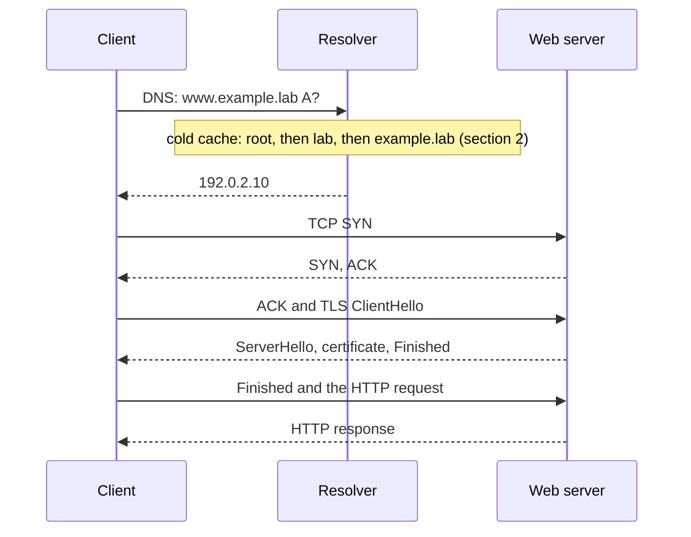
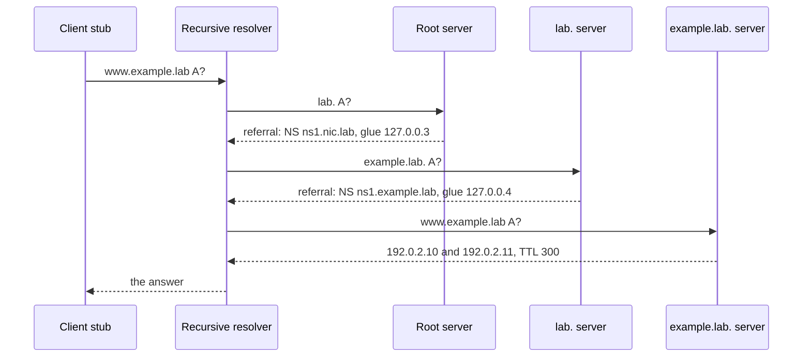
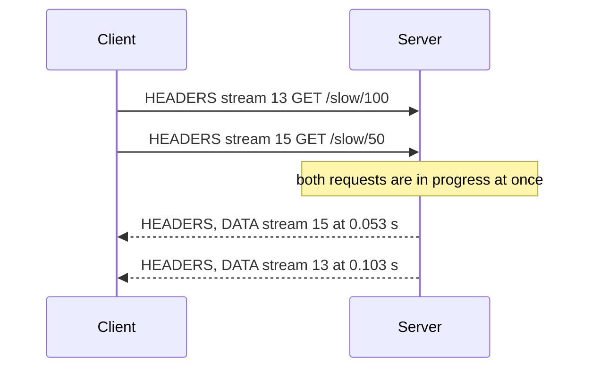
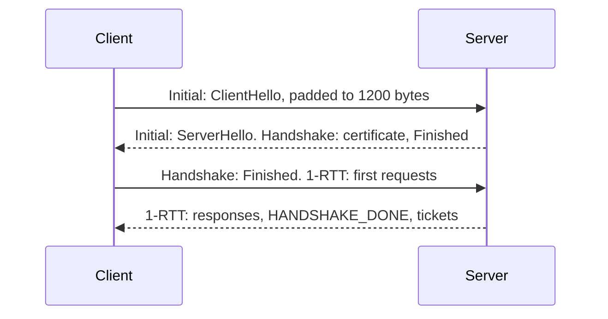
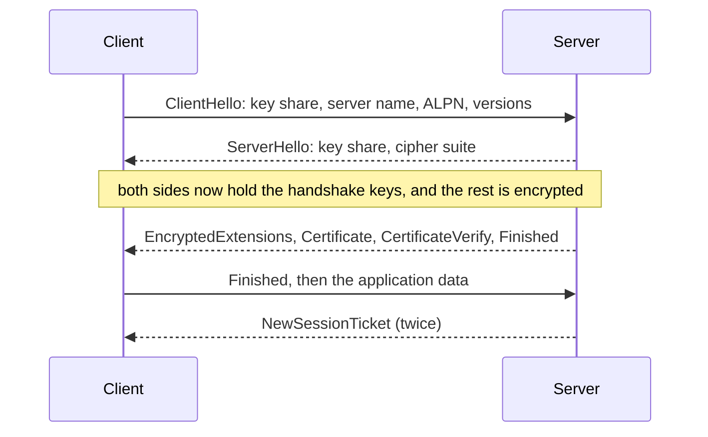
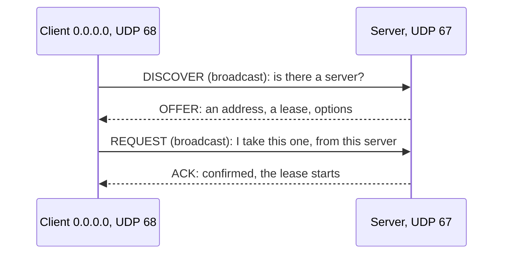

# NET 08: Application protocols: DNS, HTTP, TLS and the rest

*Part of the [networking plan](00_plan.md) · Time: about 8 hours · You need: [NET 03](03_tcp_udp_and_transport.md) (the TCP handshake, loss recovery, retransmission timeouts), [NET 04](04_socket_programming_in_c.md) (sockets, byte order, message boundaries), [NET 06](06_linux_network_stack.md) (what a packet costs on the host). NET 01 to NET 07 moved bytes between machines. This tutorial is about what the bytes **say**: how a name becomes an address (DNS), how a client asks for a page (HTTP/1.1, HTTP/2, HTTP/3 over QUIC), how the conversation is protected (TLS 1.3 and certificates), the message protocols built on top (gRPC, WebSocket, MQTT), and the small services that every device on a network depends on (DHCP, NTP and PTP, SNMP and gNMI). Every program and script is small, and every output below is pasted from a run.*

"What happens when you type a URL and press Enter?" is the oldest networking interview question, and the version asked at Staff level is not a list of protocol names. It is a **budget**: how many round trips before the first byte of the page arrives, which of them each protocol generation removed, what each removal costs (CPU, state, a new failure mode), and which of those you can **show** with a packet capture. This tutorial answers that with measurements where the VM allows it, and says plainly where it does not.

**Eight honest limits, stated first.**

1. Everything is measured on **one Linux 6.18 VM** (Firecracker, 2 vCPUs) as **root**, over **loopback** and **veth pairs**. There is **no `netem`**, so **no round-trip time can be added**. Every statement about handshake delay in round trips (TCP plus TLS, QUIC, 0-RTT) is **arithmetic on counted flights**, not a measured time, and is labelled so.
2. The **DNS hierarchy is a toy**: three tiny Python authoritative servers (`dnslib`) on `127.0.0.2` to `127.0.0.4` for a root, a `lab.` zone and an `example.lab.` zone, each answering after an injected **20 ms**, with **unbound** as the resolver. It shows the mechanism exactly (delegation, caching, negative caching, truncation) and nothing about real-world scale, anycast, or DNSSEC.
3. **The loss experiment does not isolate HTTP/2's head-of-line blocking** (section 4.5). It runs on loopback, where a round trip is almost zero, so a segment repaired by fast retransmit costs almost nothing, and it times a whole **batch** of 20 downloads, not one small stream stuck behind another's loss. What it does show is how often each mode hits a **retransmission timeout**, and the cost when one connection does. The effect of a long round trip on HTTP/2 is from the protocol, not measured.
4. **HTTP/3 is shown only through a 46 line QUIC client and server** (`aioquic`): handshake size, datagram counts and stream numbers are measured. `curl` here has no HTTP/3. QUIC loss recovery, connection migration, QPACK and 0-RTT are **from memory** and marked so.
5. **gRPC, PTP, gNMI, DNSSEC, DNS over HTTPS and DNS over TLS are from memory**. So are certificate revocation (CRL, OCSP), Certificate Transparency and the web PKI as a whole: the PKI here is a **private three-certificate lab chain**.
6. **TLS CPU costs are one core, `openssl s_server` and `s_time`**, a few thousand connections per case. Per-run noise is 10 to 20 percent; the **ordering** (RSA costs more than ECDSA at the server, resumption costs less than a full handshake) is the result, not the last digit.
7. **MQTT and WebSocket use real servers** (`mosquitto`, the `websockets` library) but one client at a time on loopback, so nothing is said about scale, fan-out or broker clustering.
8. The DHCP, NTP and SNMP runs use **real servers** (`dnsmasq`, `snmpd`) but **my own SNTP client and relay** for the NTP arithmetic, so that the path delay in each direction could be **set**. The accuracy of production `chronyd` or `ntpd` is not measured.

By the end you can:

- **write the time budget of a cold first request** in round trips (DNS, TCP, TLS, HTTP) and say what each protocol generation removes (arithmetic, section 1; the table of the paths is in Problem D);
- **decode a DNS message by hand** and say why names point backwards (measured: a **33 byte** query for `www.example.lab` A got a **65 byte** reply with flags `0x8500`, and each answer name was the **2 byte pointer `0xc00c`**; a name that does not exist (`rcode 3`) and a name with no such type (`rcode 0`) **both** came back with an SOA record, at **88** and **85 bytes**);
- **say what a recursive resolver does, in order** (measured: a cold lookup cost **64 ms** for three servers at 20 ms each; the same lookup again **0 ms** with the TTL counted down from **300 to 298**; a second name in the same zone **20 ms** and one query; a missing name **24 ms** the first time and **0 ms** after, from the negative cache);
- **explain QNAME minimisation and truncation** (measured: the root saw only `lab. A`, the `lab.` server saw `example.lab. A`; a **1,050 byte** TXT answer to a **33 byte** query arrived truncated over UDP and complete over TCP);
- **frame an HTTP/1.1 message and say what keep-alive and chunking do** (measured: curl used **1 connection** for three URLs; a new connection cost **600 to 750 microseconds** against **271 to 356** on a reused one, even with no network delay);
- **say what HTTP/2 multiplexing buys** (measured: 20 requests of 100 ms took **2.04 s** on one HTTP/1.1 connection, **0.42 s** on six, and **0.11 to 0.12 s** on one HTTP/2 connection; two requests on one connection came back **out of order**, the 50 ms one first at **0.053 s**);
- **explain HPACK with numbers** (measured: a request of **263 bytes** of text became **152 bytes** the first time and **18 bytes** every time after, which I decode byte by byte; when only the cookie changed it was **54 bytes**);
- **say what multiplexing does not fix** (measured with 2 percent of packets dropped in transit: one HTTP/2 connection kept its median at **0.035 s** against **0.218 s** for six HTTP/1.1 connections, but still hit **17 timeouts in 40 runs**, each stalling all 20 streams, and its 90th percentile was **0.437 s**);
- **walk a TLS 1.3 handshake record by record** (measured: ClientHello **321 bytes**, ServerHello **122**, a certificate message of **984 bytes** carrying two certificates of **489 and 460 bytes**, Finished **69**, two session tickets of **250**) and **read the four ways a certificate check fails**;
- **say what resumption, mutual TLS and 0-RTT do and risk** (measured: a resumed session reported `Reused`; early data was **accepted once and rejected on replay**; a client without a certificate saw `Verification: OK` and **then** the alert `certificate required`);
- **price a handshake in CPU** (measured: an ECDSA full handshake **879 microseconds** at the client and **597** at the server, RSA **976** at the server, resumed **406 to 470**; a single RSA-2048 signature is **319 microseconds**, an ECDSA one **19**);
- **describe a QUIC handshake from the wire** (measured: the client's first datagram was **1,200 bytes**, the server's reply **1,200** then about **290**, and two requests used stream ids **0 and 4**);
- **frame a WebSocket message and count MQTT packets** (measured: client frames carry **6 bytes** of overhead for 5 bytes, **8** for 200, **14** for 70,000, and a server frame **2, 4 and 10**; one MQTT message costs **1, 2 and 4** control packets at QoS 0, 1 and 2);
- **follow a DHCP lease on the wire** (measured: DISCOVER, OFFER, REQUEST and ACK in **1 ms** with `dnsmasq --no-ping`, and the same exchange **3.006 s** later in the OFFER with the default, because the server first probes the address it is about to offer);
- **compute NTP offset and delay** and bound the error (measured: with the path delays set to 40 ms and 10 ms the offset was wrong by **15.1 ms**, exactly half the asymmetry);
- **say why a bulk SNMP walk is cheaper than a plain walk** (measured: **90 requests** and 7,698 bytes against **2 requests** and 1,904 bytes for the same 89 rows) and what streaming telemetry replaces.

## Where the numbers come from

Each experiment is a script `eN_*.sh` in `prog/` with its output frozen in `v/`; the answers to the problems are `ans_a` to `ans_e`. The name servers are `authns.py` (a `dnslib` authoritative server that reads a zone file, answers after a set delay, and logs every question it receives), the resolver is `unbound` on port 5300 with `qname-minimisation: yes`, and the web server is `hypercorn` serving `app.py` (an ASGI app with `/slow/MS`, `/big/KB` and `/stream`). HTTP/1.1 is driven by hand-written socket code and `curl`, HTTP/2 by `curl --http2-prior-knowledge` and `nghttp -nv` (which prints every frame), TLS by `openssl s_server`, `s_client` and `s_time` against a private chain built by `pki.sh` in `/tmp/pki8`. Wire captures use `tcpdump` and `tshark`. Loss is injected with an `nft` rule that drops **2 percent** of packets at random in each direction on port 8080.

## Data and timing

| What | Size or time |
|---|---|
| DNS wire demo (`e1_dns_wire.sh`) | 4 queries by hand against `authns.py` |
| DNS resolution (`e2_dns_resolve.sh`) | 3 name servers, 1 resolver, 8 cases, about 25 s |
| HTTP/1.1 (`e3_http1.sh`) | 3 requests by hand, 3 runs of 2,000 requests |
| Multiplexing (`e4_mux.sh`) | 20 requests of 100 ms, 3 runs per mode |
| Loss (`e5_loss.sh`) | 20 downloads of 512 KB, 40 runs per case, 2 loss rates, 2 modes |
| TLS records and failures (`e6_tls.sh`) | 1 private chain (EC root, EC intermediate with `pathlen:0`, EC and RSA-2048 leaves) |
| TLS cost (`e7_tls_cost.sh`) | `openssl speed`, then 2,000 to 7,000 handshakes per case, 4 cases |
| HTTP/2 frames and HPACK (`e8_h2.sh`) | 2 requests, one 512 KB download, 11 header blocks |
| WebSocket and MQTT (`e9_ws_mqtt.sh`) | 4 frame sizes, QoS 0, 1 and 2, one retained message |
| DHCP (`e10_dhcp.sh`) | 2 leases, 2 veth namespaces |
| NTP (`e11_ntp.sh`) | 4 delay combinations |
| SNMP (`e12_snmp.sh`) | 6 walks against one `snmpd` |
| QUIC (`e13_quic.sh`) | 1 connection, 2 streams |
| Whole experiment batch | about 12 minutes |

---


## 1. The first request: a budget in round trips

Every later section is one line of this budget, so it comes first. A browser that has never seen `www.example.lab` and has no connection to it must do four things in order before the first byte of the page can arrive.



Count the arrows that cross the network and wait for an answer; each such wait is one **round trip time (RTT)**. With a **warm** resolver cache the budget is the line `DNS: one RTT to the resolver` (or **zero** if the stub or browser has the answer), then **1 RTT** for TCP, **1 RTT** for the TLS 1.3 handshake, and **1 RTT** for the request. The server's reply to the request is the fourth. With a **cold** resolver the first line grows by one RTT **per server walked**, which section 2 measures.

### 1.1 What each generation removes

The unit below is the number of RTTs **before the client may send its request** (the "handshake RTTs"). The first byte of the response arrives **one RTT after the request is sent**, so add 1 for time to first byte. These are counts of flights from the protocol specifications and the captures in sections 5 and 6, not measured times (limit 1).

| Path | Handshake RTTs | First byte after | What was removed |
|---|---|---|---|
| TCP, then TLS 1.2 | 3 | 4 | baseline: 1 for TCP, 2 for TLS 1.2 |
| TCP, then TLS 1.3 | 2 | 3 | one TLS round trip: key agreement rides in the first flight (section 6.1) |
| TCP, then TLS 1.3 resumed with 0-RTT | 1 | 2 | the TLS round trip: the request rides in the first TLS flight, at the cost of replay risk (section 6.4) |
| QUIC (HTTP/3), new connection | 1 | 2 | the TCP handshake: transport and TLS share the same flights (section 5) |
| QUIC resumed with 0-RTT | 0 | 1 | everything: the request is in the very first datagram |

Problem D turns this table into milliseconds for three round-trip times, and adds the measured CPU of a handshake from section 6.5.

### 1.2 What each protocol in this tutorial rides on

| Protocol | Carried by | Port | Who marks where a message ends |
|---|---|---|---|
| DNS | UDP (TCP when the answer is truncated or large) | 53 | the datagram (UDP) or a 2 byte length prefix (TCP) |
| HTTP/1.1 | TCP, usually inside TLS | 80, 443 | `Content-Length`, or chunk sizes (section 3.1) |
| HTTP/2 | TCP inside TLS (ALPN `h2`) | 443 | frames with a 24 bit length (section 4.1) |
| HTTP/3 | QUIC, which is UDP | 443 | QUIC stream data, then HTTP/3 frames |
| gRPC | HTTP/2 | any | a 5 byte prefix per message (from memory, section 7.1) |
| WebSocket | an HTTP/1.1 `Upgrade` on TCP | 80, 443 | the frame header (section 7.2) |
| MQTT | TCP (inside TLS on 8883) | 1883, 8883 | the fixed header's length field (section 7.3) |
| DHCP | UDP | 67 server, 68 client | the datagram |
| NTP | UDP | 123 | the datagram, always 48 bytes here |
| SNMP | UDP | 161 queries, 162 traps | the datagram |
| gNMI | gRPC over TLS (from memory) | 9339 registered, vendors vary | gRPC |

The pattern to remember is the one NET 04 stated for sockets: **TCP has no message boundaries, so every protocol on it must invent one**, and the invention is what sections 3, 4 and 7 are about. UDP protocols get the boundary for free and pay for it in size limits (a DNS answer over 512 bytes without EDNS, one datagram per NTP exchange) and in having to repeat lost requests themselves.

---


## 2. DNS: names, messages and caches

**DNS** maps names to data. The data is a set of **resource records** (RRs): `A` (IPv4 address), `AAAA` (IPv6), `CNAME` (an alias), `NS` (which servers answer for a zone), `MX` (mail host), `SOA` (the zone's start of authority and timers), `TXT` (free text), `PTR` (address to name), `SRV` (host and port of a service). The namespace is a tree, and the tree is split into **zones**, each served by **authoritative** servers. A **recursive resolver** (your ISP's, or `1.1.1.1`, or the `unbound` of this section) does the walking for clients and **caches** what it learns. The client side, the **stub resolver** in libc or `systemd-resolved`, only asks the recursive resolver one question and takes the answer.

### 2.1 The message

A DNS message is one header and four lists, and it fits in one UDP datagram when it is small. The header is 12 bytes: a 16 bit **ID** the client chooses, 16 bits of **flags**, and four 16 bit **counts** (questions, answers, authority records, additional records).

| Flag bits | Name | Meaning |
|---|---|---|
| 15 | QR | 0 query, 1 response |
| 14 to 11 | Opcode | 0 for a normal query |
| 10 | AA | the answer comes from an authoritative server |
| 9 | TC | truncated: the answer did not fit, ask again over TCP |
| 8 | RD | recursion desired (set by the client) |
| 7 | RA | recursion available (set by a resolver) |
| 3 to 0 | RCODE | 0 no error, 2 server failure, 3 **NXDOMAIN** (the name does not exist), 5 refused |

A **name** is written as a sequence of **labels**, each one a length byte followed by that many bytes, ended by a zero byte: `www.example.lab` is `3 www 7 example 3 lab 0`, which is 17 bytes. A question is a name, a 16 bit type and a 16 bit class (1 for the Internet). A resource record is a name, a type, a class, a 32 bit **TTL** in seconds, a 16 bit length and the data.

To keep messages small, a name may be **compressed**: if the top two bits of a length byte are `11`, the next 14 bits are an **offset** from the start of the message where the rest of the name can be found. So the name of every answer in a reply to a question about `www.example.lab` can be the two bytes `0xc00c`, which means "the name at offset 12", where the question's name starts. Pointers only point **backwards**, which is what lets a reader decode a message in one pass.

Two sizes follow from the layout, and Problem A asks for them again. A query is `12 + name + 4` bytes, so for `www.example.lab` it is 12 + 17 + 4 = **33**. Each answer RR with a pointer name is `2 + 2 + 2 + 4 + 2 + 4` for an A record, **16** bytes.

### 2.2 A query built by hand, and decoded

`dns_wire.py` builds a query with `struct`, sends it over UDP to the authoritative server, and decodes the reply byte by byte, following pointers.

```python
# dns_wire.py SERVER NAME TYPE: build a DNS query by hand, send it over UDP, and decode the reply byte by byte
import socket, struct, sys
server, name, kind = sys.argv[1], sys.argv[2], sys.argv[3]
codes = {"A": 1, "NS": 2, "CNAME": 5, "SOA": 6, "MX": 15, "TXT": 16}
names = {v: k for k, v in codes.items()}

def encode(name):
    return b"".join(bytes([len(label)]) + label.encode() for label in name.rstrip(".").split(".")) + b"\0"

def read_name(msg, off):
    labels, end = [], None
    while True:
        n = msg[off]
        if n >= 0xC0:
            end = end or off + 2
            off = ((n & 0x3F) << 8) | msg[off + 1]
        elif n == 0:
            return ".".join(labels) + ".", end or off + 1
        else:
            labels.append(msg[off + 1:off + 1 + n].decode())
            off += 1 + n

query = struct.pack("!HHHHHH", 0xBEEF, 0x0100, 1, 0, 0, 0) + encode(name) + struct.pack("!HH", codes[kind], 1)
print(f"query, {len(query)} bytes: {query.hex(' ')}")
s = socket.socket(socket.AF_INET, socket.SOCK_DGRAM)
s.settimeout(2)
s.sendto(query, (server, 53))
msg, _ = s.recvfrom(4096)
ident, flags, qd, an, ns, ar = struct.unpack("!HHHHHH", msg[:12])
print(f"reply, {len(msg)} bytes: id {ident:#x} flags {flags:#06x} = qr {flags >> 15} opcode {flags >> 11 & 15} aa {flags >> 10 & 1} tc {flags >> 9 & 1} rd {flags >> 8 & 1} ra {flags >> 7 & 1} rcode {flags & 15}")
print(f"counts: question {qd}, answer {an}, authority {ns}, additional {ar}")
off = 12
for _ in range(qd):
    qname, off = read_name(msg, off)
    qtype, qclass = struct.unpack("!HH", msg[off:off + 4])
    print(f"  offset {off - len(qname) - 1:3d}: question {qname} {names.get(qtype, qtype)} class {qclass}")
    off += 4
for section, count in (("answer", an), ("authority", ns), ("additional", ar)):
    for _ in range(count):
        start = off
        rname, off = read_name(msg, off)
        rtype, rclass, ttl, rdlen = struct.unpack("!HHIH", msg[off:off + 10])
        off += 10
        data = msg[off:off + rdlen]
        if rtype == 1:
            shown = ".".join(str(b) for b in data)
        elif rtype in (2, 5):
            shown = read_name(msg, off)[0]
        elif rtype == 15:
            shown = f"{struct.unpack('!H', data[:2])[0]} {read_name(msg, off + 2)[0]}"
        else:
            shown = f"{rdlen} bytes"
        print(f"  offset {start:3d}: {section:10s} {rname} ttl {ttl} {names.get(rtype, rtype)} {shown} (name field {'pointer ' + format(msg[start], '#04x') + format(msg[start + 1], '02x') if msg[start] >= 0xC0 else 'inline'})")
        off += rdlen
```

The server is `authns.py`, a small authoritative server built on `dnslib`. It reads a zone file, answers questions it is authoritative for, answers a question about a name below a delegation with a **referral** (the NS records of the child zone and their addresses, called **glue**), and answers a missing name with an SOA record in the authority section. It logs every question it receives, which section 2.3 uses.

```python
# authns.py ADDR ZONEFILE DELAY_MS: a tiny authoritative DNS server (answers, referrals, NXDOMAIN, NODATA) that logs every query
import sys, time
from dnslib import QTYPE, RCODE, RR
from dnslib.server import BaseResolver, DNSLogger, DNSServer
addr, path, delay = sys.argv[1], sys.argv[2], int(sys.argv[3]) / 1000
rrs = [r for line in open(path) if line.strip() and not line.startswith(";") for r in RR.fromZone(line)]
apex = next(r.rname for r in rrs if QTYPE[r.rtype] == "SOA")
def under(name, zone):
    return str(name).lower().endswith(str(zone).lower())
class Zone(BaseResolver):
    def resolve(self, request, handler):
        return self.finish(self.answer(request), request, handler)
    def answer(self, request):
        q = request.q
        print(q.qname, QTYPE[q.qtype], flush=True)
        time.sleep(delay)
        reply = request.reply()
        reply.header.ra = reply.header.ad = 0
        if not under(q.qname, apex):
            reply.header.rcode = RCODE.REFUSED
            return reply
        cuts = [r for r in rrs if QTYPE[r.rtype] == "NS" and r.rname != apex and under(q.qname, r.rname)]
        if cuts:
            cut = max(cuts, key=lambda r: len(str(r.rname))).rname
            for ns in [r for r in cuts if r.rname == cut]:
                reply.add_auth(ns)
                reply.add_ar(*[g for g in rrs if QTYPE[g.rtype] == "A" and g.rname == ns.rdata.label])
            return reply
        reply.header.aa = 1
        here = [r for r in rrs if r.rname == q.qname]
        want = [r for r in here if QTYPE[r.rtype] in (QTYPE[q.qtype], "CNAME")] or ([] if q.qtype != QTYPE.ANY else here)
        for r in want:
            reply.add_answer(r)
            if QTYPE[r.rtype] == "MX":
                reply.add_ar(*[g for g in rrs if QTYPE[g.rtype] == "A" and g.rname == r.rdata.label])
            if QTYPE[r.rtype] == "CNAME":
                reply.add_answer(*[t for t in rrs if t.rname == r.rdata.label and QTYPE[t.rtype] == QTYPE[q.qtype]])
        if not want:
            reply.header.rcode = RCODE.NOERROR if here else RCODE.NXDOMAIN
            reply.add_auth(next(r for r in rrs if QTYPE[r.rtype] == "SOA"))
        return reply
    def finish(self, reply, request, handler):
        size = max([r.rclass for r in request.ar if r.rtype == 41] or [512])
        return reply.truncate() if handler.protocol == "udp" and len(reply.pack()) > size else reply
for proto in ("udp", "tcp"):
    DNSServer(Zone(), port=53, address=addr, tcp=(proto == "tcp"), logger=DNSLogger(log="-recv,-send,-request,-reply,-truncated,-error,-data", prefix=False)).start_thread()
while True:
    time.sleep(3600)
```

The zone of `example.lab.` has these records (the long TXT record, used in section 2.4, is left out):

```text
example.lab. 3600 IN SOA ns1.example.lab. hostmaster.example.lab. 1 3600 600 86400 60
example.lab. 3600 IN NS ns1.example.lab.
ns1.example.lab. 3600 IN A 127.0.0.4
www.example.lab. 300 IN A 192.0.2.10
www.example.lab. 300 IN A 192.0.2.11
web.example.lab. 300 IN CNAME www.example.lab.
example.lab. 3600 IN MX 10 mail.example.lab.
mail.example.lab. 3600 IN A 192.0.2.25
short.example.lab. 5 IN A 192.0.2.99
```

The script asks four questions of that server.

```bash
# a DNS query built by hand with struct, against a local authoritative server, and the same query seen by dig and tcpdump
python3 prog/authns.py 127.0.0.4 prog/example.zone 0 > /tmp/auth4.log 2>/dev/null &
sleep 1
echo "--- 1. the query and reply decoded by dns_wire.py"
python3 prog/dns_wire.py 127.0.0.4 www.example.lab A
echo "--- 2. an MX query, where the answer carries a name and the additional section carries its address"
python3 prog/dns_wire.py 127.0.0.4 example.lab MX
echo "--- 3. a name that does not exist, and a name that exists with another type"
python3 prog/dns_wire.py 127.0.0.4 nothere.example.lab A | grep -E '^(reply|counts|  offset +[0-9]+: authority)'
python3 prog/dns_wire.py 127.0.0.4 mail.example.lab MX | grep -E '^(reply|counts|  offset +[0-9]+: authority)'
echo "--- 4. the same query on the wire, captured by tcpdump"
tcpdump -i lo -n -c 2 -tt -l udp port 53 and host 127.0.0.4 > /tmp/dump.txt 2>&1 &
sleep 1
dig @127.0.0.4 +norecurse +noedns +time=1 www.example.lab A > /dev/null
wait %2
sed -E 's/^[0-9.]+ //' /tmp/dump.txt | grep '^IP'
kill %1
```

```text
--- 1. the query and reply decoded by dns_wire.py
query, 33 bytes: be ef 01 00 00 01 00 00 00 00 00 00 03 77 77 77 07 65 78 61 6d 70 6c 65 03 6c 61 62 00 00 01 00 01
reply, 65 bytes: id 0xbeef flags 0x8500 = qr 1 opcode 0 aa 1 tc 0 rd 1 ra 0 rcode 0
counts: question 1, answer 2, authority 0, additional 0
  offset  12: question www.example.lab. A class 1
  offset  33: answer     www.example.lab. ttl 300 A 192.0.2.10 (name field pointer 0xc00c)
  offset  49: answer     www.example.lab. ttl 300 A 192.0.2.11 (name field pointer 0xc00c)
--- 2. an MX query, where the answer carries a name and the additional section carries its address
query, 29 bytes: be ef 01 00 00 01 00 00 00 00 00 00 07 65 78 61 6d 70 6c 65 03 6c 61 62 00 00 0f 00 01
reply, 66 bytes: id 0xbeef flags 0x8500 = qr 1 opcode 0 aa 1 tc 0 rd 1 ra 0 rcode 0
counts: question 1, answer 1, authority 0, additional 1
  offset  12: question example.lab. MX class 1
  offset  29: answer     example.lab. ttl 3600 MX 10 mail.example.lab. (name field pointer 0xc00c)
  offset  50: additional mail.example.lab. ttl 3600 A 192.0.2.25 (name field pointer 0xc02b)
--- 3. a name that does not exist, and a name that exists with another type
reply, 88 bytes: id 0xbeef flags 0x8503 = qr 1 opcode 0 aa 1 tc 0 rd 1 ra 0 rcode 3
counts: question 1, answer 0, authority 1, additional 0
  offset  37: authority  example.lab. ttl 3600 SOA 39 bytes (name field pointer 0xc014)
reply, 85 bytes: id 0xbeef flags 0x8500 = qr 1 opcode 0 aa 1 tc 0 rd 1 ra 0 rcode 0
counts: question 1, answer 0, authority 1, additional 0
  offset  34: authority  example.lab. ttl 3600 SOA 39 bytes (name field pointer 0xc011)
--- 4. the same query on the wire, captured by tcpdump
IP 127.0.0.1.36512 > 127.0.0.4.53: 63704 A? www.example.lab. (33)
IP 127.0.0.4.53 > 127.0.0.1.36512: 63704*- 2/0/0 A 192.0.2.10, A 192.0.2.11 (65)
```

What the run shows:

- **The query is 33 bytes** and the reply **65 bytes**, as the layout predicts: 33 + 2 x 16 = 65. The flags `0x8500` are QR 1, AA 1, RD 1, RA 0: an authoritative answer to a recursive question, from a server that does not offer recursion. Both answers carry the name as the pointer `0xc00c`, and `tcpdump` sees the same lengths, 33 and 65 (the last two lines).
- **The MX answer has an additional section.** The MX record's data is a name, `mail.example.lab`, and a client will need its address next, so the server adds that A record as an **additional** record, 66 bytes in all. Its name field is `0xc02b`, a pointer to offset 43, which is the name **inside the MX record's data** (2 bytes of preference, then the name). Pointers can point into earlier records, not only to the question.
- **A name that does not exist and a name that has no record of that type look different only in the RCODE.** `nothere.example.lab` returned `rcode 3` (NXDOMAIN), 88 bytes. `mail.example.lab` asked for type MX returned `rcode 0` with no answer, 85 bytes. Both carry the zone's **SOA** record in the authority section. That is deliberate: the SOA's last field is the **negative caching time**, and it tells resolvers how long to remember "no such thing" (section 2.3, case 6). The difference between the two replies matters to clients: NXDOMAIN means no record of any type exists, so trying AAAA as well is pointless; NODATA means the name exists, so other types may.

### 2.3 What a recursive resolver does

The resolver is given a question and an empty cache, and it starts from the **root hints**, the addresses of the root servers. It asks the root, which does not know the answer and returns a **referral** to the servers of the top-level domain; it asks those, and gets a referral to the servers of the zone; it asks those, and gets the answer. Each step is one round trip, and the resolver keeps everything it learned, with the TTLs.



The question each server received in the diagram is shorter than the client's, on purpose, and that is measured below. The test setup is three `authns.py` processes on `127.0.0.2` (root, serving `.`), `127.0.0.3` (`lab.`) and `127.0.0.4` (`example.lab.`), each told to wait 20 ms before answering, and one `unbound` on port 5300 whose root hints point at `127.0.0.2`.

```text
. 86400 IN SOA a.rootns. hostmaster.rootns. 1 3600 600 86400 300
. 518400 IN NS a.rootns.
a.rootns. 518400 IN A 127.0.0.2
lab. 172800 IN NS ns1.nic.lab.
ns1.nic.lab. 172800 IN A 127.0.0.3
```

```text
server:
    interface: 127.0.0.1
    port: 5300
    do-not-query-localhost: no
    root-hints: "prog/root.hints"
    access-control: 127.0.0.0/8 allow
    verbosity: 0
    use-syslog: no
    do-ip6: no
    qname-minimisation: yes
    cache-min-ttl: 0
    prefetch: no
    username: ""
    directory: ""
    chroot: ""
    pidfile: "/tmp/unbound8.pid"
```

The script runs eight cases through that resolver with `dig`, and counts what each name server was asked by reading the lines each `authns.py` logged.

```bash
# a recursive resolver (unbound) walking a three-level hierarchy of tiny authoritative servers, each answering after 20 ms
rm -f /tmp/ns_*.log
for z in "2 root" "3 lab" "4 example"; do set -- $z; python3 prog/authns.py 127.0.0.$1 prog/$2.zone 20 >> /tmp/ns_$2.log 2>/dev/null & done
unbound -d -c prog/unbound.conf > /tmp/unbound.log 2>&1 &
sleep 2
dig @127.0.0.1 -p 5300 . NS > /dev/null
sleep 1
: > /tmp/ns_root.log; : > /tmp/ns_lab.log; : > /tmp/ns_example.log
q() { dig @127.0.0.1 -p 5300 "$@" +noall +answer +authority +stats | grep -v -E '^;; (SERVER|WHEN|MSG)' | sed 's/^;; Query time/query time/'; }
seen() { printf '  queries seen: root %d, lab %d, example %d\n' $(wc -l < /tmp/ns_root.log) $(wc -l < /tmp/ns_lab.log) $(wc -l < /tmp/ns_example.log); }
echo "--- 1. a cold lookup walks the tree"
q www.example.lab A
seen
echo "--- 2. what each server was asked (QNAME minimisation: no server sees more of the name than it needs)"
for s in root lab example; do printf '  %-8s' $s; paste -sd';' /tmp/ns_$s.log; done
echo "--- 3. the same lookup again: answered from the cache, and the TTL has counted down"
sleep 2
q www.example.lab A
seen
echo "--- 4. a new name in the same zone: only the last server is asked"
q mail.example.lab A
seen
echo "--- 5. a CNAME is followed inside one answer"
q web.example.lab A
seen
echo "--- 6. a name that does not exist, then the same again (negative caching)"
q nothere.example.lab A
seen
q nothere.example.lab A
seen
echo "--- 7. a record with a 5 second TTL is asked for again after it expires"
q short.example.lab A
sleep 6
q short.example.lab A
seen
echo "--- 8. a big answer: UDP is truncated and the client retries over TCP"
dig @127.0.0.4 +noedns big.example.lab TXT +ignore | grep -E 'flags:|SERVER'
dig @127.0.0.4 +noedns big.example.lab TXT | grep -E 'flags:|SERVER|MSG SIZE'
pkill unbound; pkill -f authns.py
```

```text
--- 1. a cold lookup walks the tree
www.example.lab.        300     IN      A       192.0.2.10
www.example.lab.        300     IN      A       192.0.2.11
query time: 64 msec

  queries seen: root 1, lab 1, example 1
--- 2. what each server was asked (QNAME minimisation: no server sees more of the name than it needs)
  root    lab. A
  lab     example.lab. A
  example www.example.lab. A
--- 3. the same lookup again: answered from the cache, and the TTL has counted down
www.example.lab.        298     IN      A       192.0.2.10
www.example.lab.        298     IN      A       192.0.2.11
query time: 0 msec

  queries seen: root 1, lab 1, example 1
--- 4. a new name in the same zone: only the last server is asked
mail.example.lab.       3600    IN      A       192.0.2.25
query time: 20 msec

  queries seen: root 1, lab 1, example 2
--- 5. a CNAME is followed inside one answer
web.example.lab.        300     IN      CNAME   www.example.lab.
www.example.lab.        297     IN      A       192.0.2.11
www.example.lab.        297     IN      A       192.0.2.10
query time: 20 msec

  queries seen: root 1, lab 1, example 3
--- 6. a name that does not exist, then the same again (negative caching)
example.lab.            60      IN      SOA     ns1.example.lab. hostmaster.example.lab. 1 3600 600 86400 60
query time: 24 msec

  queries seen: root 1, lab 1, example 4
example.lab.            60      IN      SOA     ns1.example.lab. hostmaster.example.lab. 1 3600 600 86400 60
query time: 0 msec

  queries seen: root 1, lab 1, example 4
--- 7. a record with a 5 second TTL is asked for again after it expires
short.example.lab.      5       IN      A       192.0.2.99
query time: 20 msec

short.example.lab.      5       IN      A       192.0.2.99
query time: 24 msec

  queries seen: root 1, lab 1, example 6
--- 8. a big answer: UDP is truncated and the client retries over TCP
;; flags: qr aa tc rd; QUERY: 0, ANSWER: 0, AUTHORITY: 0, ADDITIONAL: 0
;; SERVER: 127.0.0.4#53(127.0.0.4) (UDP)
;; flags: qr aa rd; QUERY: 1, ANSWER: 1, AUTHORITY: 0, ADDITIONAL: 0
;; SERVER: 127.0.0.4#53(127.0.0.4) (TCP)
;; MSG SIZE  rcvd: 1050
```

Read the cases in order.

| Case | What `dig` reported | Servers asked | What it shows |
|---|---|---|---|
| 1. cold lookup of `www.example.lab` | **64 ms** | 1 query each to root, `lab.`, `example.lab.` | three round trips of 20 ms plus about 4 ms of our own processing |
| 3. the same name again | **0 ms**, TTL **298** | none new | the answer came from the cache; the TTL kept counting down from the 300 the server set |
| 4. `mail.example.lab` | **20 ms** | 1 new query, to the last server only | the delegations (root to `lab.`, `lab.` to `example.lab.`) were **cached**, so only the final step was repeated |
| 5. `web.example.lab` (a CNAME) | **20 ms**, answer holds the CNAME and the A record | 1 new query | the server returned the alias and its target in **one** reply; the target's TTL had counted down to 297 |
| 6. `nothere.example.lab` | **24 ms**, then **0 ms** | 1 new query, then none | the resolver cached the **negative** answer for the SOA's value, **60 s** |
| 7. `short.example.lab`, TTL 5 | **20 ms**, then after 6 s **24 ms** | 2 queries in all | when the TTL ran out the cache entry was gone and the server was asked again |
| 8. a 1,050 byte TXT record | UDP reply flagged `tc`, TCP reply complete | | see section 2.4 |

Two details of case 2 deserve a name. The root server was asked only `lab. A`, the `lab.` server only `example.lab. A`, and only the last server saw the whole name `www.example.lab. A`. That is **QNAME minimisation** (RFC 9156): the resolver reveals to each server only as many labels as that server needs to decide the next step. It is a privacy feature, because the root does not learn which sites you visit, and it costs nothing here because the next server is found by the same referral. (A resolver that does not minimise sends the full name to the root.)

And the **"queries seen"** lines are the proof of the cache: `root 1, lab 1` never changes after case 1, through seven more lookups, because the NS records and their glue came with TTLs of days (172,800 s and 518,400 s in the zone files) and are not asked for again.

### 2.4 Big answers and the move to TCP

A UDP message has no framing problem, but it has a size problem. The original limit is **512 bytes**; with the **EDNS(0)** extension (RFC 6891) the client announces a larger buffer in an OPT record, 1,232 bytes being the commonly recommended value to avoid IP fragmentation (from memory, the "DNS flag day 2020" figure). A server that cannot fit the answer sets **TC** and sends what fits; the client then repeats the question over **TCP**, where a 2 byte length precedes each message.

Case 8 shows the whole sequence. `big.example.lab` holds a TXT record of five strings of 200 bytes each. `dig +noedns` first sent it over UDP, and the server answered with the flags `qr aa tc rd` and an empty answer section; `dig` then retried, and the second reply came from the same server on `(TCP)`, a complete answer of `MSG SIZE rcvd: 1050`. The query was 33 bytes (the same length as the `www.example.lab` one, because `big` and `www` both have three letters), so a 33 byte question yielded a **1,050 byte** answer, a factor of **32**. That ratio is the reason for **DNS amplification attacks**: with a spoofed source address, a small UDP query makes a resolver send a large reply to the victim. The mitigations are to refuse recursion to outsiders, rate limit responses, and not reply to UDP with more than the client's announced buffer (from memory).

### 2.5 The cache arithmetic

For one name asked at an average rate `r` per second through one cache, with TTL `T` seconds, each cache fill is followed by about `r x T` hits before the entry expires, and then one miss. So the **hit rate** is

```text
hit rate = (r x T) / (1 + r x T)
```

Worked by hand, for a name asked twice a second: with `T = 30` the hit rate is 60 / 61, **98.4 percent**; with `T = 5` it is 10 / 11, **90.9 percent**, so a 6 times shorter TTL makes upstream traffic **5.5 times** higher (9.1 against 1.6 percent misses). The numbers for five combinations, with a simulation that confirms the formula, are in the answer to Problem B. Three consequences follow:

1. **A short TTL is a traffic multiplier, not a latency one.** A lookup that hits the cache costs 0 ms (case 3); a miss costs the walk. Operators lower a TTL **before** a planned change, because a record cannot be recalled from caches that already hold it: the old answer lives for up to its TTL.
2. **A cache entry is per resolver.** The clients behind one big resolver share hits; a name asked once an hour by each of many small resolvers misses nearly every time.
3. **Negative answers are cached too** (case 6), for the SOA's value, so a service that is brought up right after a client's failed lookup can stay "missing" for a minute.

### 2.6 The client side, and what goes wrong

On Linux, `getaddrinfo` reads `/etc/nsswitch.conf` to decide the order of sources (files, then DNS), then `/etc/resolv.conf` for the nameserver addresses and the **search list**. A name with fewer dots than the `ndots` option (default 1, and **5 in Kubernetes pods**, from memory) is tried with every search suffix **before** it is tried as written, so one lookup of `api.example.com` from a pod may cost several failed queries, each doubled for A and AAAA. The first thing to check on a slow connect is therefore `dig` against the real resolver with `+norecurse` and `+short`, and `getent hosts name` for what the libc path does.

`getaddrinfo` is a **blocking call** that can wait for a resolver timeout (5 s per try by default, from memory) inside code that otherwise never blocks; async frameworks run it in a thread pool for that reason.

### 2.7 Security and privacy, from memory

- **Spoofing.** A forged UDP reply is accepted if it matches the 16 bit ID and the source port. Resolvers therefore randomise the source port (the 2008 Kaminsky attack made that mandatory), and **DNSSEC** adds signatures: a zone signs its records (`RRSIG`), publishes its keys (`DNSKEY`), and the parent publishes a hash of the child's key (`DS`), forming a chain from the root. DNSSEC protects **integrity**, not secrecy.
- **Privacy.** **DNS over TLS** (port 853) and **DNS over HTTPS** (port 443, inside HTTP/2 or HTTP/3) hide queries from the network between the client and the resolver. They do not hide them from the resolver itself.
- **Scale.** The 13 root server **names** are served by over a thousand **anycast** instances; the same address is announced from many places and the nearest answers.

---


## 3. HTTP/1.1: text, one request at a time

HTTP is a request and response protocol. The client sends a **request** (a method, a target, headers, an optional body); the server sends a **response** (a status, headers, an optional body). HTTP/1.1 (RFC 9112) writes both as **text lines ended by CRLF**, and runs them over one TCP stream. That simplicity has one structural consequence, which is the subject of this section: on one connection the responses must come back **in the order of the requests**.

The test server is `app.py`, a 21 line ASGI app run by `hypercorn`: `/slow/MS` answers after MS milliseconds, `/big/KB` sends KB kilobytes, `/stream` sends two chunks with no length, anything else returns `hello`.

```python
# app.py: a tiny ASGI app for the HTTP experiments: /slow/MS answers after MS milliseconds, /big/KB sends KB kilobytes, /stream sends two chunks with no length
import asyncio
async def app(scope, receive, send):
    if scope["type"] != "http":
        return
    part = scope["path"].split("/")
    if part[1] == "slow":
        await asyncio.sleep(int(part[2]) / 1000)
        body = b"x" * 100
    elif part[1] == "big":
        body = b"x" * (int(part[2]) * 1024)
    elif part[1] == "stream":
        await send({"type": "http.response.start", "status": 200, "headers": [(b"content-type", b"text/plain")]})
        await send({"type": "http.response.body", "body": b"first part\n", "more_body": True})
        await asyncio.sleep(0.1)
        await send({"type": "http.response.body", "body": b"second part\n"})
        return
    else:
        body = b"hello\n"
    await send({"type": "http.response.start", "status": 200, "headers": [(b"content-type", b"text/plain"), (b"content-length", str(len(body)).encode())]})
    await send({"type": "http.response.body", "body": body})
```

### 3.1 The message, written by hand

`http1_wire.py` opens one TCP connection and writes three requests as raw bytes, printing every line that comes back.

```python
# http1_wire.py PORT: send hand-written HTTP/1.1 requests over one TCP connection and print the raw bytes that come back
import socket, sys
s = socket.create_connection(("127.0.0.1", int(sys.argv[1])))
s.settimeout(0.5)

def exchange(request):
    print(f"--> {request!r}")
    s.sendall(request)
    data = b""
    try:
        while chunk := s.recv(4096):
            data += chunk
    except socket.timeout:
        pass
    for line in data.split(b"\r\n"):
        print(f"<-- {line!r}")

exchange(b"GET / HTTP/1.1\r\nHost: x\r\n\r\n")
exchange(b"GET /stream HTTP/1.1\r\nHost: x\r\n\r\n")
exchange(b"GET /nothing HTTP/1.1\r\nHost: x\r\nConnection: close\r\n\r\n")
print("connection closed by server:", s.recv(1) == b"")
```

```bash
# HTTP/1.1 on the wire: a request and response, keep-alive, chunked encoding, and what a new connection costs
(cd prog && hypercorn -b 127.0.0.1:8080 app:app > /dev/null 2>&1 &)
sleep 2
echo "--- 1. three requests on one connection, written by hand"
python3 prog/http1_wire.py 8080
echo "--- 2. connections used by curl: three URLs in one command"
curl -s -o /dev/null -o /dev/null -o /dev/null -w 'connections so far: %{num_connects}\n' http://127.0.0.1:8080/ http://127.0.0.1:8080/ http://127.0.0.1:8080/
echo "--- 3. the cost of a new connection, with no network delay (loopback)"
for i in 1 2 3; do python3 prog/http1_bench.py 8080 2000; done
pkill -f 'hypercorn -b 127.0.0.1:8080'
```

```text
--- 1. three requests on one connection, written by hand
--> b'GET / HTTP/1.1\r\nHost: x\r\n\r\n'
<-- b'HTTP/1.1 200 '
<-- b'content-type: text/plain'
<-- b'content-length: 6'
<-- b'date: Fri, 20 Nov 2026 17:51:10 GMT'
<-- b'server: hypercorn-h11'
<-- b''
<-- b'hello\n'
--> b'GET /stream HTTP/1.1\r\nHost: x\r\n\r\n'
<-- b'HTTP/1.1 200 '
<-- b'content-type: text/plain'
<-- b'date: Fri, 20 Nov 2026 17:51:10 GMT'
<-- b'server: hypercorn-h11'
<-- b'Transfer-Encoding: chunked'
<-- b''
<-- b'b'
<-- b'first part\n'
<-- b'c'
<-- b'second part\n'
<-- b'0'
<-- b''
<-- b''
--> b'GET /nothing HTTP/1.1\r\nHost: x\r\nConnection: close\r\n\r\n'
<-- b'HTTP/1.1 200 '
<-- b'content-type: text/plain'
<-- b'content-length: 6'
<-- b'date: Fri, 20 Nov 2026 17:51:11 GMT'
<-- b'server: hypercorn-h11'
<-- b'Connection: close'
<-- b''
<-- b'hello\n'
connection closed by server: True
```

Reading it line by line:

- A request is `GET / HTTP/1.1`, then header lines, then an empty line. `Host` is the only header HTTP/1.1 **requires**, because one IP address and port serve many names and the server needs to know which one the client meant.
- A response starts with `HTTP/1.1 200` (the status line; the reason phrase is optional text), then headers, then an empty line, then the body. The first response says `content-length: 6` and the body `hello\n` is exactly 6 bytes. **The length is how the client knows where the body ends**, and so where the next response begins on the same connection. With no framing, the only other signal available is closing the connection.
- The second response has **no length**. It has `Transfer-Encoding: chunked`: the body is a series of chunks, each a size in hexadecimal on its own line, then that many bytes. `b` is 11 (`first part\n`), `c` is 12 (`second part\n`), and a chunk of size `0` ends the body. Chunking is what lets a server start sending before it knows the total size: a generated page, a log tail, a stream of events.
- In the third request the client sends `Connection: close`. The server answers with the same header, and `connection closed by server: True` shows it then closed the TCP connection. Without that header HTTP/1.1 assumes the connection stays **open** for the next request.

Other framing rules to know, from memory: a response to `HEAD` or with status 204 or 304 has no body whatever the headers say; a request with a body needs `Content-Length` or chunking; a response with neither length nor chunking ends when the server closes, which makes a truncated download **indistinguishable** from a complete one. That is why servers prefer one of the two.

### 3.2 Keep-alive: what a new connection costs

HTTP/1.0 closed the connection after each response. HTTP/1.1 made **persistent connections** the default, so the TCP handshake (and with TLS, the TLS handshake) is paid once for many requests. `curl` shows it: three URLs in one command used **one** connection, the numbers `1, 0, 0` being the count of new connections made for each transfer.

`http1_bench.py` measures what the saving is on this machine, where the network delay is zero and only the cost of the connection **setup and teardown** is left.

```python
# http1_bench.py PORT N: N small requests, each on a new TCP connection, then all on one kept-alive connection
import http.client, sys, time
port, n = int(sys.argv[1]), int(sys.argv[2])
t = time.perf_counter()
for _ in range(n):
    c = http.client.HTTPConnection("127.0.0.1", port)
    c.request("GET", "/")
    c.getresponse().read()
    c.close()
new = (time.perf_counter() - t) / n
c = http.client.HTTPConnection("127.0.0.1", port)
t = time.perf_counter()
for _ in range(n):
    c.request("GET", "/")
    c.getresponse().read()
kept = (time.perf_counter() - t) / n
print(f"{n} requests: {new * 1e6:.0f} us each on a new connection, {kept * 1e6:.0f} us each on one kept-alive connection")
```

Three runs of 2,000 requests: **601, 750 and 600 microseconds** per request on a new connection against **282, 271 and 356** on one connection that is reused. So even with **no** network delay a new connection costs about **2 to 2.5 times** a reused one, because of the three-way handshake, the `accept`, the new socket and its buffers, and the close. On a real path each new connection also costs **at least one RTT** for TCP, plus the TLS handshake over it, and starts TCP over in **slow start** (NET 03), with a small congestion window. Reuse is not a micro-optimisation.

### 3.3 Head-of-line blocking, and the workaround of six connections

On one connection the server must send responses in request order, so a slow response **holds up every response behind it**: this is **head-of-line (HOL) blocking** at the HTTP layer. HTTP/1.1 allowed **pipelining**, sending the next request before the previous answer, but the responses still come back in order, proxies and servers handled it badly, and browsers turned it off (from memory). The practical answer was to open **several connections** to the same server, and browsers settled on **six per host**.

`e4_mux.sh` measures the effect. Twenty requests, each one taking **100 ms** at the server, are made three ways: `curl` with HTTP/1.1 on one connection, HTTP/1.1 with up to six parallel connections, and (for section 4) HTTP/2 on one connection.

```bash
# 20 requests that each take 100 ms on the server: HTTP/1.1 on one connection, HTTP/1.1 on six, HTTP/2 on one
(cd prog && hypercorn -b 127.0.0.1:8080 app:app > /dev/null 2>&1 &)
sleep 2
U='http://127.0.0.1:8080/slow/100?[1-20]'
run() {   # label curl-options...
  local label=$1; shift
  for i in 1 2 3; do
    local t0=$(date +%s.%N)
    local conns=$(curl -s -o /dev/null -w '%{num_connects}\n' "$@" "$U" | paste -sd+ | bc)
    printf '%-34s %5.2f s, %2d connections\n' "$label" $(echo "$(date +%s.%N) - $t0" | bc) $conns
  done
}
run "HTTP/1.1, one connection"         --http1.1
run "HTTP/1.1, six connections"        --http1.1 --parallel --parallel-max 6 --parallel-immediate
run "HTTP/2, one connection"           --http2-prior-knowledge --parallel --parallel-max 20
pkill -f 'hypercorn -b 127.0.0.1:8080'
```

```text
HTTP/1.1, one connection            2.04 s,  1 connections
HTTP/1.1, one connection            2.04 s,  1 connections
HTTP/1.1, one connection            2.04 s,  1 connections
HTTP/1.1, six connections           0.42 s,  6 connections
HTTP/1.1, six connections           0.42 s,  6 connections
HTTP/1.1, six connections           0.42 s,  6 connections
HTTP/2, one connection              0.12 s,  1 connections
HTTP/2, one connection              0.12 s,  1 connections
HTTP/2, one connection              0.11 s,  1 connections
```

The first two rows follow a simple model: 20 requests in series on one connection is 20 x 100 ms = **2.0 s** (measured **2.04 s**), and six connections handle `ceil(20 / 6) = 4` rounds of 100 ms = **0.4 s** (measured **0.42 s**). The runs repeat to within 10 ms, because there is no loss and no contention in the test.

The six-connection workaround has costs that the table does not show:

- **Six TCP and TLS handshakes** instead of one (the CPU is measured in section 6.5: 879 microseconds at the client and 597 at the server for each full ECDSA handshake, plus a round trip or two of waiting each).
- **Six congestion windows**, each starting small, which together are more aggressive than one TCP flow and compete with each other when a link is the bottleneck.
- **Six sets of server state**: a busy server holds `connections x clients` sockets, which is why the **limit of open file descriptors** and the `accept` queue of NET 04 matter for web servers.
- **A cap**: the 6 is a browser convention. Sites worked around it with several host names (**domain sharding**), which cost DNS lookups and more connections, and became an anti-pattern as soon as HTTP/2 arrived.

### 3.4 What else belongs to HTTP/1.1, from memory

HTTP/1.1 also defines **caching** (`Cache-Control`, `ETag` and `If-None-Match` for a validation request that answers `304 Not Modified` with no body), **range requests** (`Range`, status 206) for resuming a download, **content negotiation** (`Accept`, `Accept-Encoding: gzip`), **cookies** (`Set-Cookie` and `Cookie`, sent back on every request to the site, which section 4.4 shows is a large part of a request's size), and the **`Upgrade`** mechanism used by WebSocket (section 7.2). Methods are `GET`, `HEAD`, `POST`, `PUT`, `DELETE`, `PATCH`; `GET`, `HEAD`, `PUT` and `DELETE` are **idempotent**, which matters for retries and for TLS 0-RTT (section 6.4). Status classes are 2xx success, 3xx redirect, 4xx the client's fault, 5xx the server's.

---


## 4. HTTP/2: frames, streams and compressed headers

HTTP/2 (RFC 9113) keeps the **meaning** of HTTP (methods, status codes, headers) and changes the **framing**: instead of text lines, the connection carries **binary frames**, each tagged with a **stream** number, so that many requests and responses can be **interleaved on one TCP connection**. Browsers use it only inside TLS, negotiated by the **ALPN** extension (`h2` in the ClientHello of section 6.1); the lab here speaks the cleartext variant, `h2c`, with the client told in advance ("prior knowledge"), so that `tcpdump` and `nghttp` can show the frames.

### 4.1 Frames and streams

Every frame starts with a **9 byte header**: a 24 bit **length**, an 8 bit **type**, 8 bits of **flags**, and one reserved bit plus a 31 bit **stream identifier**. A **stream** is one request and its response. Streams opened by the client have **odd** numbers; stream **0** carries messages about the whole connection.

| Type | Number | Use |
|---|---|---|
| DATA | 0 | body bytes of one stream |
| HEADERS | 1 | the header block of a request or response (HPACK, section 4.3) |
| PRIORITY | 2 | advice on stream order (superseded; section 4.6) |
| RST_STREAM | 3 | cancel one stream, leaving the connection open |
| SETTINGS | 4 | parameters of the connection, acknowledged by the peer |
| PUSH_PROMISE | 5 | the server announces a response nobody asked for (rarely used now) |
| PING | 6 | liveness and round trip measurement |
| GOAWAY | 7 | no new streams, and the last stream the sender processed |
| WINDOW_UPDATE | 8 | flow control credit (section 4.4) |
| CONTINUATION | 9 | more of a header block that did not fit one frame |

The flags that appear below are `END_STREAM` (0x01: this is the last frame the sender will send on the stream), `END_HEADERS` (0x04: the header block is complete) and, on SETTINGS, `ACK` (0x01).

### 4.2 Two requests on one connection

`nghttp -nv` prints every frame it sends and receives, with a timestamp. The two requests below are asked **in this order**: first `/slow/100` (the server waits 100 ms), then `/slow/50` (50 ms).

```bash
# HTTP/2 on the wire (nghttp -v against hypercorn), and header compression with HPACK
(cd prog && hypercorn -b 127.0.0.1:8080 app:app > /dev/null 2>&1 &)
sleep 2
echo "--- 1. two requests on one connection: the slower one is asked for first and answered last"
nghttp -nv http://127.0.0.1:8080/slow/100 http://127.0.0.1:8080/slow/50 2>&1 | grep -E '^\[ +[0-9.]+\] (send|recv) [A-Z_]+ frame' | sed -E 's/ <length=([0-9]+), flags=(0x[0-9a-f]+), stream_id=([0-9]+)>/  length \1 flags \2 stream \3/; s/^\[ +/[/'
echo "--- 2. frames used to download 512 KB"
nghttp -nv http://127.0.0.1:8080/big/512 2>&1 | grep -oE '(send|recv) [A-Z_]+ frame' | sort | uniq -c | sed 's/^ */  /'
echo "--- 3. sizes of those DATA frames, and the SETTINGS values exchanged (both sides)"
nghttp -nv http://127.0.0.1:8080/big/512 2>&1 | grep -E 'recv DATA frame' | sed -E 's/.*length=([0-9]+), flags=(0x[0-9a-f]+).*/\1 \2/' | sort -rn | uniq -c | sed 's/^ */  /;s/ 0x00/ bytes/;s/ 0x01/ bytes, END_STREAM/'
nghttp -nv http://127.0.0.1:8080/big/512 2>&1 | grep -E '^ +\[SETTINGS_' | sort -u | sed -E 's/^ +\[//;s/\(0x[0-9a-f]+\):/ = /;s/\]//' | sed 's/^/  /'
echo "--- 4. HPACK"
python3 prog/hpack_demo.py
pkill -f 'hypercorn -b 127.0.0.1:8080'
```

```text
--- 1. two requests on one connection: the slower one is asked for first and answered last
[0.000] send SETTINGS frame  length 12 flags 0x00 stream 0
[0.000] send PRIORITY frame  length 5 flags 0x00 stream 3
[0.000] send PRIORITY frame  length 5 flags 0x00 stream 5
[0.000] send PRIORITY frame  length 5 flags 0x00 stream 7
[0.000] send PRIORITY frame  length 5 flags 0x00 stream 9
[0.000] send PRIORITY frame  length 5 flags 0x00 stream 11
[0.000] send HEADERS frame  length 46 flags 0x25 stream 13
[0.000] send HEADERS frame  length 19 flags 0x25 stream 15
[0.001] recv SETTINGS frame  length 42 flags 0x00 stream 0
[0.001] send SETTINGS frame  length 0 flags 0x01 stream 0
[0.002] recv SETTINGS frame  length 0 flags 0x01 stream 0
[0.053] recv HEADERS frame  length 49 flags 0x04 stream 15
[0.053] recv DATA frame  length 100 flags 0x00 stream 15
[0.053] recv DATA frame  length 0 flags 0x01 stream 15
[0.103] recv HEADERS frame  length 5 flags 0x04 stream 13
[0.103] recv DATA frame  length 100 flags 0x00 stream 13
[0.103] recv DATA frame  length 0 flags 0x01 stream 13
[0.103] send GOAWAY frame  length 8 flags 0x00 stream 0
```

Read the stream numbers first. The client's requests are on streams **13** and **15**; streams 3, 5, 7, 9 and 11 appear only as five `PRIORITY` frames of 5 bytes, which `nghttp` sends to set up its own priority tree (a tool detail, from memory), and the request frames are the two `HEADERS` with flags `0x25`, which is `END_STREAM` (a GET has no body) plus `END_HEADERS` plus the `PRIORITY` flag. Both requests were written at time 0.000, one after the other, without waiting.

Then the order of the answers. The server's `SETTINGS` frame (**42 bytes**, which is **seven** settings of 6 bytes each) arrives at 0.001, and the response for stream **15** arrives at **0.053 s**: a `HEADERS` frame, a `DATA` frame of 100 bytes and an empty `DATA` frame with `END_STREAM`. The response for stream **13** comes at **0.103 s**. The 50 ms request, asked second, was **answered first**. That is what HTTP/1.1 cannot do on one connection, and it is the whole point of the stream number.



The effect on a batch is the second measurement of section 3.3. Twenty requests of 100 ms each took **2.04 s** on one HTTP/1.1 connection, **0.42 s** on six, and **0.11 to 0.12 s** on **one** HTTP/2 connection: the twenty streams ran concurrently on the server (it announced a limit of **100** concurrent streams, section 4.4), so the batch took the time of one request plus about 10 to 20 ms for twenty requests' framing and handling. That is about **17 times** faster than the single HTTP/1.1 connection and **3.5 times** faster than six connections, from **one** handshake instead of six.

### 4.3 HPACK: header compression with a shared table

Headers are the part of HTTP that repeats the most: every request to a site carries the same `user-agent`, `accept`, `accept-encoding`, host and cookies. HTTP/2 compresses them with **HPACK** (RFC 7541), which has three parts:

- a **static table** of 61 common header fields (`:method GET` is entry 2, `:scheme https` is entry 7, `:path /` is entry 4 as a name);
- a **dynamic table**, a list of the header fields recently sent on this connection, kept **identically by both ends**; new entries are added at the front, so index 62 is always the newest, and the table has a size limit (4,096 bytes by default, the `HEADER_TABLE_SIZE` setting);
- a **Huffman code** for string literals.

A header can then be sent as a **reference** to a table entry (one byte for an index below 127), or as a **literal** that is added to the dynamic table (`01` in the top bits of the byte), or as a literal that is not (`0000`) or must never be indexed (`0001`, for secrets that an intermediary must not compress). The table is **state shared across all streams of the connection**, which is why HTTP/2 headers must be decoded in order and why a proxy cannot skip one.

`hpack_demo.py` sends ten requests of the same shape with the `hpack` library and prints the size of each header block, next to the size of the same headers written as HTTP/1.1 text. Request 11 changes the cookie.

```python
# hpack_demo.py: the same kind of request sent ten times, as HTTP/1.1 header text and as HPACK blocks on one connection
from hpack import Decoder, Encoder
enc, dec = Encoder(), Decoder()
cookie = "session=3f9a1c7e5b2d4a60; theme=dark; lang=en-IN"

def request(n):
    return [(":method", "GET"), (":scheme", "https"), (":authority", "www.example.lab"), (":path", f"/api/items/{n}"),
            ("user-agent", "Mozilla/5.0 (X11; Linux x86_64) AppleWebKit/537.36 Chrome/130.0 Safari/537.36"),
            ("accept", "application/json"), ("accept-encoding", "gzip, deflate, br"), ("cookie", cookie)]

def http11_size(headers):
    h = dict(headers)
    line = f"GET {h[':path']} HTTP/1.1\r\nHost: {h[':authority']}\r\n"
    return len(line) + sum(len(f"{k}: {v}\r\n") for k, v in headers if not k.startswith(":")) + 2

print("request   HTTP/1.1 text   HPACK block")
for n in range(1, 11):
    headers = request(n)
    block = enc.encode(headers)
    assert dec.decode(block) == headers
    if n in (1, 2, 3, 10):
        print(f"{n:5d} {http11_size(headers):13d} bytes {len(block):8d} bytes")
        if n == 2:
            print("      block 2 in hex:", block.hex(" "))
cookie = "session=77b0d2c91e4f8a35; theme=dark; lang=en-IN"
block = enc.encode(request(11))
print(f"{11:5d} {http11_size(request(11)):13d} bytes {len(block):8d} bytes   (the cookie changed)")
```

```text
--- 4. HPACK
request   HTTP/1.1 text   HPACK block
    1           263 bytes      152 bytes
    2           263 bytes       18 bytes
      block 2 in hex: 82 87 c3 44 89 60 75 99 83 24 b4 a1 81 7f c2 c1 c0 bf
    3           263 bytes       18 bytes
   10           264 bytes       18 bytes
   11           264 bytes       54 bytes   (the cookie changed)
```

The first request costs **152 bytes** against **263** as text, which is the static table and Huffman coding. From the second request on the block is **18 bytes**, **7 percent** of the text, because nearly every field is now a one byte reference. When only the cookie changed (request 11), the block was **54 bytes**: the new cookie is a literal and everything else is still a reference.

The 18 bytes of request 2 can be decoded by hand, and it is worth doing once:

| Bytes | Meaning |
|---|---|
| `82` | `1000 0010`: an indexed field, index 2 in the static table, `:method GET` |
| `87` | indexed, index 7, `:scheme https` |
| `c3` | indexed, index 67, which is above the static table's 61, so entry 6 of the dynamic table: `:authority www.example.lab`, added by request 1 |
| `44 89` | `01 000100`: a literal that is added to the table, with the **name** taken from static entry 4 (`:path`); then `89`: a Huffman-coded string of 9 bytes |
| `60 75 99 83 24 b4 a1 81 7f` | the 9 Huffman bytes for `/api/items/2` (12 characters, so 9 bytes) |
| `c2 c1 c0 bf` | indexed, entries 66, 65, 64 and 63: `user-agent`, `accept`, `accept-encoding` and `cookie`, in the order they were added by request 1 |

The indexes are consistent: after request 1 the cookie was entry 62; adding the new `:path` in request 2 pushed everything back by one, so the cookie is 63 (`0xbf`) and the user agent 66 (`0xc2`).

HPACK was designed after the **CRIME** attack (2012) on TLS compression. Compressing headers with a general-purpose algorithm across secret and attacker-chosen data leaks the secret through the compressed length; HPACK's table of exact field matches does not (from memory).

### 4.4 Flow control and settings

One connection carries many streams, so a receiver needs a way to say "stop" to **one** stream without closing the connection. HTTP/2 has its own **flow control**: each stream and the connection as a whole have a **window**, initially **65,535 bytes**, that shrinks as `DATA` frames are sent and grows when the receiver sends `WINDOW_UPDATE`. Only `DATA` frames count.

`e8_h2.sh` downloads a 512 KB response and counts the frames, then shows the settings.

```text
--- 2. frames used to download 512 KB
  34 recv DATA frame
  1 recv HEADERS frame
  2 recv SETTINGS frame
  1 send GOAWAY frame
  1 send HEADERS frame
  5 send PRIORITY frame
  2 send SETTINGS frame
  32 send WINDOW_UPDATE frame
```

```text
--- 3. sizes of those DATA frames, and the SETTINGS values exchanged (both sides)
  24 16384 bytes
  8 16383 bytes
  1 8 bytes
  1 0 bytes, END_STREAM
  SETTINGS_ENABLE_CONNECT_PROTOCOL = 1
  SETTINGS_ENABLE_PUSH = 0
  SETTINGS_HEADER_TABLE_SIZE = 4096
  SETTINGS_INITIAL_WINDOW_SIZE = 65535
  SETTINGS_MAX_CONCURRENT_STREAMS = 100
  SETTINGS_MAX_FRAME_SIZE = 16384
  SETTINGS_MAX_HEADER_LIST_SIZE = 65536
```

The server sent **34 `DATA` frames**: 24 of 16,384 bytes (the default `MAX_FRAME_SIZE`), 8 of 16,383 bytes, one of 8 bytes, and an empty one carrying `END_STREAM`. They add up to 524,288 bytes. The client sent **32 `WINDOW_UPDATE`** frames, about one for every `DATA` frame, so the window stayed open; if it had not, the server would have stopped after 65,535 bytes. (Why one of the sizes is 16,383 is a detail of this server and was not examined.) The settings list shows `MAX_CONCURRENT_STREAMS = 100`, which is the cap behind the 20 concurrent requests of section 4.2, and `ENABLE_PUSH = 0`, the client saying it will not accept pushed responses.

Flow control is a protection against one stream hoarding the receiver's memory, and it is also a place where throughput can be lost: with a round trip of 100 ms and the default 65,535 byte window, one stream can move at most 65,535 / 0.1 = **655 KB per second** until the window is raised. Servers and browsers raise the window in `SETTINGS` and in `WINDOW_UPDATE` for that reason (the arithmetic is the bandwidth-delay product of NET 03).

### 4.5 What multiplexing does not fix: TCP

HTTP/2 removes head-of-line blocking at the **HTTP** layer. It leaves it at the **TCP** layer, because all the streams share one byte stream, and TCP delivers bytes **in order**: one lost segment holds back every byte after it, for every stream, until the retransmission arrives. HTTP/1.1 with six connections is, by accident, more resilient to this, because a loss stalls one of six connections. This is the main reason HTTP/3 exists (section 5).

`e5_loss.sh` tries to measure it. It downloads 20 files of 512 KB, 40 times, either with six HTTP/1.1 connections or with one HTTP/2 connection, once with no loss and once with an `nft` rule that drops **2 percent** of the TCP packets of port 8080 **in transit** (in `prerouting`, after the packet has left the sender). The rule has a counter, so the number of drops is known. The script reads the kernel's retransmission counters **by name** (a first draft read them by position and labelled them wrongly; section 9 lists it as a mistake).

```bash
# 20 downloads of 512 KB: six HTTP/1.1 connections against one HTTP/2 connection, with no loss and with 2 percent random loss on packets in transit
(cd prog && hypercorn -b 127.0.0.1:8080 app:app > /dev/null 2>&1 &)
sleep 2
U='http://127.0.0.1:8080/big/512?[1-20]'
ctr() { nstat -asz TcpExtTCPSynRetrans TcpExtTCPTimeouts TcpExtTCPFastRetrans | awk 'NR > 1 { v[$1] = $2 } END { print v["TcpExtTCPSynRetrans"], v["TcpExtTCPTimeouts"], v["TcpExtTCPFastRetrans"] }'; }
run() {   # label curl-options...
  local label=$1; shift
  local c0=($(ctr))
  for i in $(seq 40); do
    local t0=$(date +%s.%N)
    curl -s -o /dev/null "$@" "$U"
    echo "$(date +%s.%N) - $t0" | bc
  done | sort -n | awk -v l="$label" '{ t[NR] = $1 } END { n = 0; for (i = 1; i <= NR; i++) if (t[i] > 0.15) n++; printf "%-30s median %.3f s, 90th percentile %.3f s, worst %.3f s, runs over 150 ms: %d of %d\n", l, t[int(NR / 2)], t[int(NR * 0.9)], t[NR], n, NR }'
  local c1=($(ctr))
  printf '    retransmissions in these 40 runs: SYN %d, timeouts %d, fast retransmits %d\n' $((c1[0] - c0[0])) $((c1[1] - c0[1])) $((c1[2] - c0[2]))
}
lossy() {   # percent: drop that share of packets in transit (prerouting, after the packet has left the sender), counting the drops
  nft delete table inet lossy 2> /dev/null
  nft add table inet lossy
  nft add chain inet lossy pre '{ type filter hook prerouting priority -300; }'
  nft add rule inet lossy pre tcp dport 8080 numgen random mod 100 \< $1 counter drop
  nft add rule inet lossy pre tcp sport 8080 numgen random mod 100 \< $1 counter drop
}
dropped() { nft list chain inet lossy pre | awk '/counter packets/ { for (i = 1; i <= NF; i++) if ($i == "packets") n += $(i + 1) } END { printf "    packets dropped by the rule in these 40 runs: %d\n", n }'; }
for loss in 0 2; do
  echo "loss $loss percent"
  [ $loss -gt 0 ] && lossy $loss
  run "  HTTP/1.1, six connections" --http1.1 --parallel --parallel-max 6 --parallel-immediate
  [ $loss -gt 0 ] && dropped && lossy $loss
  run "  HTTP/2, one connection" --http2-prior-knowledge --parallel --parallel-max 20
  [ $loss -gt 0 ] && dropped
  nft delete table inet lossy 2> /dev/null
done
pkill -f 'hypercorn -b 127.0.0.1:8080'
```

```text
loss 0 percent
  HTTP/1.1, six connections    median 0.015 s, 90th percentile 0.019 s, worst 0.025 s, runs over 150 ms: 0 of 40
    retransmissions in these 40 runs: SYN 0, timeouts 0, fast retransmits 0
  HTTP/2, one connection       median 0.032 s, 90th percentile 0.044 s, worst 0.050 s, runs over 150 ms: 0 of 40
    retransmissions in these 40 runs: SYN 0, timeouts 0, fast retransmits 0
loss 2 percent
  HTTP/1.1, six connections    median 0.218 s, 90th percentile 1.017 s, worst 1.027 s, runs over 150 ms: 23 of 40
    retransmissions in these 40 runs: SYN 13, timeouts 24, fast retransmits 145
    packets dropped by the rule in these 40 runs: 335
  HTTP/2, one connection       median 0.035 s, 90th percentile 0.437 s, worst 1.264 s, runs over 150 ms: 13 of 40
    retransmissions in these 40 runs: SYN 5, timeouts 17, fast retransmits 550
    packets dropped by the rule in these 40 runs: 825
```

| | Six HTTP/1.1 connections | One HTTP/2 connection |
|---|---|---|
| no loss: median, worst | 0.015 s, 0.025 s | 0.032 s, 0.050 s |
| 2 percent loss: median | **0.218 s** | **0.035 s** |
| 2 percent loss: 90th percentile, worst | 1.017 s, 1.027 s | 0.437 s, 1.264 s |
| runs over 150 ms | **23** of 40 | **13** of 40 |
| packets dropped by the rule | 335 | 825 |
| retransmissions: SYN, timeouts, fast | 13, 24, 145 | 5, 17, 550 |

What this says, and what it does not:

1. **With no loss, six connections are faster** (0.015 s against 0.032 s per batch). One connection with a 65,535 byte window and one congestion window moves 10 MB a little slower than six; on this zero-delay path the difference is small, and the cause was not investigated.
2. **With loss, one connection kept the median** (0.035 s, almost the 0.032 s of the lossless case) **and six connections did not** (0.218 s). The reason is the **retransmission timeout**. A segment lost in the middle of a transfer is repaired by **fast retransmit** after three duplicate ACKs, which on a zero-delay path costs almost nothing: the single HTTP/2 connection did **550** of them. A loss at the **tail**, with too little data behind it to produce duplicate ACKs, or a lost SYN, waits for a **timer**: at least 200 ms for data on Linux (the default floor of the retransmission timer), and **1 s** for a SYN (the initial timeout, NET 03). Six connections mean **240 handshakes** in 40 runs and six chances per run to hit one; the worst times, **1.017 and 1.027 s**, match the 1 s initial SYN timeout.
3. **The tail is bad for one connection too.** Its 90th percentile was **0.437 s** and the worst run **1.264 s**, and its 17 timeouts hit **every stream at once**. This is the head-of-line blocking of this section made visible: when a timeout happens on the one connection, **all twenty downloads wait together**. It is less frequent here (13 runs over 150 ms against 23) because there is only one connection to fail, but it is not smaller when it happens.
4. **What the test does not isolate** is HOL blocking by itself. The path has almost no delay, so a fast retransmit costs nothing; and the test measures the time of the **whole batch**, not of one small stream stuck behind another stream's loss. With a 50 ms round trip, every fast retransmit would stall all streams for about that long. I could not add delay here (limit 1), so that case is from the protocol, not measured.

### 4.6 What else HTTP/2 changed, and what it left, from memory

- **Server push** (`PUSH_PROMISE`) let a server send a resource before it was requested. It was hard to get right (the browser may already have the resource cached) and has been removed from major browsers.
- **Prioritisation.** The original tree of weights and dependencies was complex and inconsistently implemented. It was replaced by a simple "urgency and incremental" scheme (RFC 9218), which HTTP/3 also uses.
- **Cancellation.** `RST_STREAM` cancels one request cheaply. On HTTP/1.1 the only way to abandon a slow response is to close the connection, and with it all the state that was paid for.
- **Connection coalescing.** A browser may reuse one HTTP/2 connection for several host names if the certificate covers them and they resolve to the same address, so one handshake serves a whole site.
- **Cost.** A proxy or load balancer that speaks HTTP/2 holds **per-connection state** for the HPACK tables and every stream, and a server must defend against a client that opens streams and resets them as fast as it can, which was the "rapid reset" attack of 2023 (from memory).

---


## 5. HTTP/3 and QUIC: streams without TCP

**QUIC** (RFC 9000) is a transport protocol that runs over **UDP** and does what TCP, TLS and HTTP/2's stream layer did together: reliable delivery, congestion control, **independent streams**, and **encryption built in** (TLS 1.3 supplies the keys, RFC 9001). **HTTP/3** (RFC 9114) is HTTP carried on QUIC streams, with a header compression called QPACK (RFC 9204) that adapts HPACK to streams that can arrive out of order. The three changes that matter, in the order of this tutorial's budget:

1. **The handshake is one round trip, not two.** QUIC sends the TLS ClientHello in the **first** packet, with no TCP handshake before it (section 1.1, row 4).
2. **A lost packet blocks only the streams whose data it carried.** QUIC keeps its own byte offsets **per stream**, so the in-order delivery that stalled all of HTTP/2's streams (section 4.5) applies to each stream alone.
3. **The connection is not tied to the address.** A QUIC connection is named by a **connection ID** in the packet, not by the four-tuple, so a client that changes address keeps its connection (from memory, section 5.4).

### 5.1 A QUIC connection, run

`aioquic` is a Python implementation of QUIC. `quic_demo.py` is a 46 line server that echoes every stream, and a client that opens a connection, opens two streams, sends one short message on each, and reads the answers. (The library's own `connect` helper opens an IPv6 socket, and this VM has no IPv6, so the client opens the IPv4 socket itself.)

```python
# A QUIC server and client in about 40 lines (aioquic): two streams on one connection, then the UDP datagrams are counted
import asyncio, ssl, sys
from aioquic.asyncio import connect, serve, QuicConnectionProtocol
from aioquic.quic.configuration import QuicConfiguration
from aioquic.quic.connection import QuicConnection
from aioquic.quic.events import StreamDataReceived

class Echo(QuicConnectionProtocol):
    def quic_event_received(self, event):
        if isinstance(event, StreamDataReceived):
            self._quic.send_stream_data(event.stream_id, b"echo:" + event.data, end_stream=event.end_stream)
            self.transmit()

async def server(port):
    cfg = QuicConfiguration(is_client=False, alpn_protocols=["demo"])
    cfg.load_cert_chain("/tmp/pki8/leaf_ec.chain.pem", "/tmp/pki8/leaf_ec.key")
    await serve("127.0.0.1", port, configuration=cfg, create_protocol=Echo)
    await asyncio.sleep(30)

async def client(port):
    cfg = QuicConfiguration(is_client=True, alpn_protocols=["demo"])
    cfg.load_verify_locations("/tmp/pki8/root.crt")
    cfg.server_name = "www.example.lab"
    loop = asyncio.get_running_loop()
    t0 = loop.time()
    # the library's connect() opens an IPv6 socket, which this VM lacks, so the IPv4 socket is opened by hand
    c = QuicConnection(configuration=cfg)
    transport, p = await loop.create_datagram_endpoint(lambda: QuicConnectionProtocol(c), local_addr=("127.0.0.1", 0))
    p.connect(("127.0.0.1", port))
    await p.wait_connected()
    t1 = loop.time()
    r1, w1 = await p.create_stream()
    w1.write(b"hello one"); w1.write_eof()  # a stream id is only taken once data is sent on it
    r2, w2 = await p.create_stream()
    w2.write(b"hello two"); w2.write_eof()
    a = await r1.read(); b = await r2.read()
    t2 = loop.time()
    print(f"handshake {1000*(t1-t0):.1f} ms, two streams answered {1000*(t2-t1):.1f} ms later: {a!r} {b!r}")
    print("stream ids used:", w1.get_extra_info("stream_id"), w2.get_extra_info("stream_id"))
    p.close(); await p.wait_closed(); transport.close()

if __name__ == "__main__":
    if sys.argv[1] == "server":
        asyncio.run(server(int(sys.argv[2])))
    else:
        asyncio.run(client(int(sys.argv[2])))
```

`e13_quic.sh` runs a server and a client on loopback while `tcpdump` records the UDP datagrams. `tshark` can read the **long header** packets (`Initial`, `Handshake`), which are protected only with keys derived from public values, and shows which QUIC packets each datagram carries; the 1-RTT packets that follow are encrypted and appear only by size.

```bash
# QUIC with aioquic: handshake time, two streams on one connection, and the UDP datagrams counted on the wire
python3 prog/quic_demo.py server 4433 > /dev/null 2>&1 &
sv=$!
sleep 2
tcpdump -i lo -w /tmp/quic.pcap --immediate-mode -U udp port 4433 > /dev/null 2>&1 &
td=$!
sleep 1.5
python3 prog/quic_demo.py client 4433
sleep 1
kill $td; sleep 1
echo "--- UDP datagrams in order: direction, payload bytes, and the QUIC packets coalesced in each (the 1-RTT payload is encrypted)"
tcpdump -nr /tmp/quic.pcap 2> /dev/null | awk '{d=($3 ~ /4433$/)?"server->client":"client->server"; print NR, d, $NF}' > /tmp/quic_dg.txt
tshark -r /tmp/quic.pcap -d udp.port==4433,quic -T fields -e frame.number -e quic.header_form -e quic.long.packet_type 2> /dev/null | awk -F'\t' '
  BEGIN { split("Initial,0-RTT,Handshake,Retry", nm, ",") }
  { nf = split($2, hf, ","); split($3, lt, ","); k = 1; out = ""
    for (i = 1; i <= nf; i++) { if (hf[i] == 1) { t = nm[lt[k] + 1]; k++ } else t = "1-RTT"; out = out (out == "" ? "" : "+") t }
    print $1, out }' > /tmp/quic_types.txt
join /tmp/quic_dg.txt /tmp/quic_types.txt | awk '{printf "%2d  %-15s %5d bytes  %s\n", $1, $2, $3, $4}'
kill $sv
```

```text
handshake 11.0 ms, two streams answered 1.7 ms later: b'echo:hello one' b'echo:hello two'
stream ids used: 0 4
--- UDP datagrams in order: direction, payload bytes, and the QUIC packets coalesced in each (the 1-RTT payload is encrypted)
 1  client->server   1200 bytes  Initial
 2  server->client   1200 bytes  Initial+Handshake
 3  client->server   1200 bytes  Initial+Handshake
 4  server->client    291 bytes  Handshake
 5  client->server    328 bytes  Handshake+1-RTT
 6  client->server     53 bytes  1-RTT
 7  server->client    224 bytes  1-RTT
 8  server->client     45 bytes  1-RTT
 9  server->client     45 bytes  1-RTT
10  client->server     30 bytes  1-RTT
```

What the capture shows:

- **The first datagram is 1,200 bytes** and holds only an `Initial` packet, which carries the ClientHello. A real ClientHello is about 300 bytes (section 6.1); the client **pads** the datagram to at least 1,200 bytes on purpose. The server has not yet verified that the client's address is real, and QUIC limits what it may send to an unvalidated address to **three times what it received**. Padding the client's first datagram raises that allowance to 3,600 bytes, and keeps a spoofed `Initial` from being an amplifier. It also checks that the path carries 1,200 byte datagrams.
- **The server answers with 1,200 bytes** in one datagram that holds an `Initial` (the ServerHello) **and** a `Handshake` packet (the start of the encrypted flight: EncryptedExtensions, the certificate chain). Several QUIC packets in one UDP datagram is called **coalescing**.
- **The client's third datagram is also 1,200 bytes** and holds an `Initial` and a `Handshake` packet: the acknowledgements, with an `Initial` in it, so again padded.
- **The server's fourth datagram, 291 bytes, finishes the handshake flight** (the rest of the certificate, the CertificateVerify and the Finished of section 6.1).
- **The client's fifth datagram carries a `Handshake` packet and a 1-RTT packet** together: the client's own Finished and the first packet protected with the application keys, in the very datagram that completes the handshake. I cannot see what the 1-RTT packet holds (it may carry connection management frames as well as requests), but this is the **earliest point at which requests may be sent**, after one round trip. With TCP and TLS 1.3 the first request cannot leave until after **two** round trips (TCP's, then TLS's).
- **Datagrams 6 to 10 are all 1-RTT**, 30 to 224 bytes: the requests, the echoes, acknowledgements, and what servers send after the handshake (`HANDSHAKE_DONE`, session tickets, from memory). Their contents are encrypted, so I can say only what they weigh.

On the client's clock, the handshake took **11.0 ms** and the two streams were answered **1.7 ms** later. With no network delay, that is CPU: the interpreter, the key agreement, the certificate check. It is **not** an estimate of any real handshake, and the datagram order and count (10 here, 11 or 12 in earlier runs) varied from run to run with the timing of acknowledgements.

The two streams used the ids **0** and **4**. The low two bits of a QUIC stream id say who opened it and in which direction: bit 0 is 0 for the client and 1 for the server, bit 1 is 0 for a stream that carries data both ways and 1 for one that carries data one way. So the client's bidirectional streams are 0, 4, 8 and so on, the server's 1, 5, 9, and the client's one-way streams 2, 6, 10. HTTP/3 uses one client bidirectional stream **per request** and a few one-way streams for control and header-compression state.



### 5.2 Why the certificate's size matters

Because of the three-times limit, the server's first flight must fit in what the client's first datagram allows, or the server must stop and wait for the client to prove its address, which **costs a round trip**. The certificate message in section 6.1 was **984 bytes** for two small elliptic-curve certificates. A chain of RSA certificates with embedded extensions is often 3 to 5 KB. This is why QUIC operators care about **certificate chain size** and use ECDSA, short chains and certificate compression (RFC 8879, from memory).

### 5.3 Streams and loss recovery, from memory

- **One lost packet, one stream stalled.** QUIC packets carry **stream frames**, each with a stream id and an offset in that stream. A lost packet leaves a gap in the streams whose frames it carried; the other streams are delivered to the application at once. This is the property TCP cannot give and that HTTP/2 over TCP lacked (section 4.5).
- **Packet numbers are never reused.** TCP's retransmission has the same sequence number as the original, so an acknowledgement is ambiguous (which transmission is it for?), and round trip estimates suffer. QUIC retransmits the **data** in a **new packet** with a new number, so every acknowledgement is unambiguous.
- **Congestion control and loss detection** follow the same ideas as TCP (RFC 9002 describes a NewReno-like default, and CUBIC and BBR are used in practice) and are implemented **in the application**, so they can be changed without a kernel update. That is an advantage for a large operator and a risk for a careless implementer.

### 5.4 Migration, middleboxes and cost, from memory

- **Connection migration.** The destination connection ID in the packet identifies the connection, so a phone that moves from Wi-Fi to the mobile network can continue the same connection from a new address after a **path validation**. It matters on the access network side: a client that roams between access points keeps its transfers if the address stays, and it keeps its connection even if it does not. (Roaming itself, at layer 2, is a different topic.)
- **Encryption of the transport.** QUIC encrypts the packet **headers** as well (packet numbers, most flags), so a network device cannot track a flow's sequence numbers, read acknowledgements, or modify them, unlike a TCP middlebox. This was deliberate, to avoid **ossification**: the TCP header has been hard to extend because devices assume its shape. It also means that a firewall can see only addresses, ports, the connection ID and the sizes (and the `Initial` packet's SNI, which is protected with keys anyone can derive).
- **Blocked or throttled UDP.** Some networks drop or rate limit UDP 443. A client therefore learns about HTTP/3 from an `Alt-Svc` header or a DNS record on an HTTP/2 connection and **races** a QUIC attempt against TCP, falling back when QUIC fails.
- **CPU.** QUIC runs in user space, encrypts every packet, and cannot use TCP's segmentation offload; it relies on UDP segmentation offload (`UDP_SEGMENT`, `GSO`) and receive offload to batch packets. Early deployments measured noticeably more CPU per byte than TCP with TLS, and the gap has narrowed. The packet-per-second techniques of NET 07 (`recvmmsg`, AF_XDP) are what a high-rate QUIC server uses.
- **Debugging.** `tcpdump` shows only encrypted datagrams. Clients can write their TLS secrets to a file named by `SSLKEYLOGFILE`, which lets Wireshark decrypt them, and QUIC implementations write structured `qlog` event logs.

---


## 6. TLS 1.3 and certificates

**TLS** (RFC 8446 for version 1.3) gives a TCP connection three things: **confidentiality** (an eavesdropper sees ciphertext), **integrity** (a changed byte is detected) and **authentication** of the server, and optionally of the client. It does it with a **handshake** that agrees on keys and checks identities, followed by a stream of encrypted **records**. QUIC (section 5) uses the same handshake messages inside its own packets.

### 6.1 The handshake, record by record

The experiment runs `openssl s_server` and `s_client` with `-trace`, which prints every record, and reduces the output to one line per record. The lengths are the sizes of the record bodies in bytes.

```bash
# a TLS 1.3 handshake with openssl: the certificate chain, every record in order, failures, mutual authentication, resumption and 0-RTT
. prog/pki.sh
cd /tmp/pki8
S="-cert leaf_ec.crt -key leaf_ec.key -cert_chain inter.crt -tls1_3"
(sleep 900 2>/dev/null | openssl s_server -accept 8443 $S -www -alpn h2,http/1.1 > /dev/null 2>&1 &)
(sleep 900 2>/dev/null | openssl s_server -accept 8444 $S -early_data -max_early_data 16384 > /tmp/s_early.log 2>&1 &)
(sleep 900 2>/dev/null | openssl s_server -accept 8445 $S -www -Verify 1 -CAfile root.crt > /dev/null 2>&1 &)
sleep 1
C="openssl s_client -connect 127.0.0.1:8443 -servername www.example.lab"
echo "--- 1. the chain: leaf, issuing CA, root"
for c in leaf_ec inter root; do
  printf '%s\n' "$(openssl x509 -in $c.crt -noout -subject -issuer | sed 's/^/  /')" "$(openssl x509 -in $c.crt -noout -ext basicConstraints,subjectAltName 2> /dev/null | grep -v '^X509v3' | sed 's/^ */    /')"
```

```text
--- 2. the handshake, one line per TLS record (-trace, filtered)
  client to server   321 bytes  ClientHello
                                    extension_type=server_name(0)
                                    extension_type=application_layer_protocol_negotiation(16)
                                    extension_type=supported_versions(43)
  server to client   122 bytes  ServerHello
                                    chosen: TLS_AES_256_GCM_SHA384
                                    extension_type=supported_versions(43)
                                    server key share group: ecdh_x25519
  server to client     1 bytes  ChangeCipherSpec (a compatibility record, no content)
  server to client    32 bytes  EncryptedExtensions
                                    extension_type=application_layer_protocol_negotiation(16)
  server to client   984 bytes  Certificate
                                    certificate of 489 bytes
                                    certificate of 460 bytes
  server to client    95 bytes  CertificateVerify
  server to client    69 bytes  Finished
  client to server     1 bytes  ChangeCipherSpec (a compatibility record, no content)
  client to server    69 bytes  Finished
  server to client   250 bytes  NewSessionTicket
  server to client   250 bytes  NewSessionTicket
```



The records, in order:

1. **ClientHello, 321 bytes.** It offers the cipher suites and, in the same message, the client's **key share**: a public value for an ephemeral key agreement (here **x25519**, a 32 byte point). The trace was filtered to three extensions: `server_name` (**SNI**, the name the client wants, sent in the clear, which lets one address serve many names), `application_layer_protocol_negotiation` (**ALPN**, the list of application protocols, here `h2` and `http/1.1`) and `supported_versions` (which is how a 1.3 client says so without confusing old servers).
2. **ServerHello, 122 bytes.** It chooses the suite (`TLS_AES_256_GCM_SHA384`: AES-256 in GCM mode for the records, SHA-384 for the key derivation) and carries the server's own x25519 key share. **At this point both sides can compute the same shared secret** and derive the handshake keys with HKDF. **Everything after the ServerHello is encrypted.** This is the step that saves a round trip against TLS 1.2, where the client had to wait for the server's choice before it could send a key share.
3. **ChangeCipherSpec, 1 byte,** each way. A fake: TLS 1.3 does not use it, and sends it only so that middleboxes that expect the old handshake do not break (a **compatibility** record, from memory).
4. **EncryptedExtensions, 32 bytes.** The parameters that need no secrecy from the client but are no business of the network, here the chosen ALPN.
5. **Certificate, 984 bytes.** The server's chain: two certificates, of **489** and **460** bytes. The body is 984 = 4 bytes of message header, 4 of list lengths, 2 x 3 + 2 x 2 bytes of per-certificate framing, the two certificates, and 17 bytes of record trailer (the inner content type and the 16 byte authentication tag). The chain holds the leaf and the issuing CA; the root is **not** sent, because the client must already have it.
6. **CertificateVerify, 95 bytes.** A **signature** over a hash of the whole handshake so far, made with the private key of the certificate. This is what proves the server **holds the key**, not just a copy of a public certificate. For ECDSA P-256 the signature is about 70 bytes; the rest is framing.
7. **Finished, 69 bytes,** each way. A MAC (HMAC-SHA384, 48 bytes) over the handshake so far, under a key only the two ends hold. A man in the middle who changed any earlier message, for instance to remove a stronger cipher suite from the offer (a **downgrade**), would make the MACs differ. 69 = 4 + 48 + 17.
8. **NewSessionTicket, 250 bytes, twice,** sent by the server after the handshake. Section 6.4.

The client may send its first application bytes **together with its Finished**, so the first request leaves after **one** round trip of TLS (the budget of section 1.1). Three more properties of 1.3, from memory:

- **Forward secrecy is not optional.** The only key exchange is an ephemeral Diffie-Hellman. A server's long-term key signs the handshake but never encrypts a secret, so stealing it later does not decrypt recorded traffic. TLS 1.2 allowed an RSA key exchange where it did.
- **Old features are gone:** compression (the CRIME attack), renegotiation, static key exchange, RC4, CBC cipher suites, SHA-1 signatures.
- **The cipher suites are few:** `TLS_AES_128_GCM_SHA256`, `TLS_AES_256_GCM_SHA384` and `TLS_CHACHA20_POLY1305_SHA256`, the last preferred on machines without AES hardware.

### 6.2 Certificates and the chain of trust

A **certificate** is a signed statement: "this public key belongs to this name", signed by an **issuer**. The client does not know the server, but it knows a short list of **trust anchors** (the root CAs in its trust store), and it accepts a certificate if there is a **chain** of signatures from it to an anchor.

`pki.sh` builds a small private PKI in `/tmp/pki8` so the whole thing can be run and broken on purpose: a **root** CA, an **issuing** CA signed by the root, two **leaf** certificates for `www.example.lab` (one ECDSA P-256, one RSA-2048) signed by the issuing CA, and a **client** certificate.

```bash
# pki.sh: a root CA, an intermediate CA, an ECDSA and an RSA server certificate for www.example.lab, and a client certificate, all in /tmp/pki8
P=/tmp/pki8
if [ ! -f $P/leaf_ec.crt ]; then
  mkdir -p $P && cd $P
  ec() { openssl ecparam -name prime256v1 -genkey -noout -out $1.key; }
  ec root; ec inter; ec leaf_ec; ec client
  openssl genrsa -out leaf_rsa.key 2048 2> /dev/null
  openssl req -x509 -new -key root.key -subj "/O=Study Lab/CN=Study Lab Root" -days 3650 -addext "basicConstraints=critical,CA:TRUE,pathlen:1" -addext "keyUsage=critical,keyCertSign,cRLSign" -out root.crt
  openssl req -new -key inter.key -subj "/O=Study Lab/CN=Study Lab Issuing CA" -out inter.csr
  printf 'basicConstraints=critical,CA:TRUE,pathlen:0\nkeyUsage=critical,keyCertSign,cRLSign\n' > inter.ext
  openssl x509 -req -in inter.csr -CA root.crt -CAkey root.key -CAcreateserial -days 1825 -extfile inter.ext -out inter.crt 2> /dev/null
  printf 'basicConstraints=CA:FALSE\nkeyUsage=critical,digitalSignature\nextendedKeyUsage=serverAuth\nsubjectAltName=DNS:www.example.lab,IP:127.0.0.1\n' > leaf.ext
  for k in leaf_ec leaf_rsa; do
    openssl req -new -key $k.key -subj "/CN=www.example.lab" -out $k.csr
    openssl x509 -req -in $k.csr -CA inter.crt -CAkey inter.key -CAcreateserial -days 90 -extfile leaf.ext -out $k.crt 2> /dev/null
    cat $k.crt inter.crt > $k.chain.pem
  done
  openssl req -new -key client.key -subj "/CN=client-7" -out client.csr
  printf 'basicConstraints=CA:FALSE\nextendedKeyUsage=clientAuth\n' > client.ext
  openssl x509 -req -in client.csr -CA inter.crt -CAkey inter.key -CAcreateserial -days 90 -extfile client.ext -out client.crt 2> /dev/null
fi
```

```text
--- 1. the chain: leaf, issuing CA, root
  subject=CN = www.example.lab
  issuer=O = Study Lab, CN = Study Lab Issuing CA
    CA:FALSE
    DNS:www.example.lab, IP Address:127.0.0.1
  subject=O = Study Lab, CN = Study Lab Issuing CA
  issuer=O = Study Lab, CN = Study Lab Root
    CA:TRUE, pathlen:0
  subject=O = Study Lab, CN = Study Lab Root
  issuer=O = Study Lab, CN = Study Lab Root
    CA:TRUE, pathlen:1
  leaf_ec.crt: OK
  Chain:
  depth=0: CN = www.example.lab (untrusted)
  depth=1: O = Study Lab, CN = Study Lab Issuing CA (untrusted)
  depth=2: O = Study Lab, CN = Study Lab Root
```

Read the extensions, because they are where the rules live. The leaf has `CA:FALSE`, so it cannot sign other certificates, and a **subject alternative name** list with `DNS:www.example.lab` and an IP. The issuing CA has `CA:TRUE, pathlen:0`: it may sign leaves but **not** further CAs. The root has `pathlen:1`, so one CA may sit below it. `openssl verify -show_chain` prints the path it built: depth 0 is the leaf, depth 1 the issuing CA, and depth 2 the root, which is the only entry **not** marked `untrusted`, because it was named as the trust anchor with `-CAfile`.

What a client checks, in the order of the failures below:

1. **Chain and signatures.** Each certificate's signature verifies under its issuer's key, up to a trust anchor. (Also `basicConstraints`, `keyUsage` and `extendedKeyUsage`: the leaf must be allowed for `serverAuth`.)
2. **Validity period.** `notBefore` and `notAfter` bracket the current time. Short lifetimes (90 days here) limit the damage of a stolen key.
3. **Name.** The host name the client **intended** to reach must match a name in the certificate's subject alternative names. The old `CN` field is ignored by modern clients.
4. **Possession.** The `CertificateVerify` signature checks under the leaf's public key.
5. **Revocation** (from memory): a CRL, an OCSP query, or an OCSP response the server staples into the handshake. In practice browsers rely on short lifetimes and on small pushed revocation lists, and **Certificate Transparency** logs make a mis-issued certificate public.

```text
--- 3. the checks that fail
  wrong host name:      Verification error: hostname mismatch
  no trust anchor:      Verification error: unable to get local issuer certificate
  checked in year 2030: Verification error: certificate has expired
  correct:              Verification: OK
```

Each failure is a different line of the chain. A **wrong host name** gives `hostname mismatch` and the chain itself is fine; a client with **no trust anchor** gives `unable to get local issuer certificate`; a check made at a time after the certificate's end (here `-attime` in 2030) gives `certificate has expired`; the correct arguments give `Verification: OK`. When a production client says "certificate verify failed", the message names which of these it was, and it is nearly always one of three things: **the server did not send the intermediate** (the chain does not build; `-cert_chain` was needed in this lab for the same reason), **the client's trust store lacks the root** (common in containers and embedded devices), or **the clock is wrong** (common on devices that have not yet used NTP, which is why section 8.2 sits in this tutorial).

### 6.3 Mutual TLS

In ordinary TLS only the server is authenticated. In **mutual TLS (mTLS)** the server sends a `CertificateRequest` and the client answers with its own certificate and a `CertificateVerify`. It is how a service mesh, a device fleet or a VPN gateway tells clients apart without passwords. (The same idea underlies **802.1X with EAP-TLS** on Wi-Fi and wired networks, from memory: the RADIUS server and the device present certificates inside an EAP exchange.)

```text
--- 4. mutual TLS: the server demands a client certificate
  no client certificate:   Verification: OK
  no client certificate:   server alert: tlsv13 alert certificate required (number 116)
  with client certificate: HTTP/1.0 200 ok
```

The server on port 8445 was started with `-Verify 1`, which demands a client certificate. The client without one printed **`Verification: OK`**, and only **afterwards** received the alert `tlsv13 alert certificate required` (number 116). That order is real, and it surprises people: in TLS 1.3 the **client sends its Finished first** and considers the handshake done, while the server's verdict on the client's certificate arrives **after** that point. A client library that stops at "handshake complete" may report success for a connection the server is about to close. The first read or write on the connection is where the error shows up. With a certificate signed by the same issuing CA (`client.crt`), the server returned its `HTTP/1.0 200 ok` page.

### 6.4 Resumption and 0-RTT

After the handshake the server sends **session tickets** (the two `NewSessionTicket` records of 250 bytes). A ticket is a blob, encrypted by the server under a key only it holds, containing what it needs to resume: the resumption secret and the session's parameters. A client that holds a ticket can start a later connection with it as a **pre-shared key**: the full authentication (certificate, `CertificateVerify`) is skipped, and what is left is a key agreement and a Finished each way. It saves the CPU of the certificate work (section 6.5) and the bytes of the chain, but **not a round trip**: a resumed handshake still takes one round trip in TLS 1.3, which is why Problem D lists a resumed TLS 1.3 handshake with the same number of round trips as a full one.

**0-RTT** goes further. The client, in its very first flight, encrypts **early data** (an HTTP request) under a key derived from the ticket, and the server can act on it before the handshake finishes. That removes the last round trip, at a price.

```text
--- 5. resumption and 0-RTT early data
  ticket a, resumed:                Reused, TLSv1.3, Cipher is TLS_AES_256_GCM_SHA384
  ticket b with early data, first use: Early data was accepted
  ticket b with early data, replayed:  Early data was rejected
  server log: GET /
  server log: Early data received:
```

Ticket `a`, used for an ordinary resumption, reports **`Reused, TLSv1.3`**. Ticket `b` carried the request `GET /` as early data: the first time, **`Early data was accepted`** and the server's log shows the request and `Early data received:`. When exactly the same early data was presented again, with the same ticket, it was **rejected**. The price of 0-RTT is that early data is **replayable**: an attacker who recorded the first flight can send it again, and nothing in the protocol alone stops the server from processing it twice. This `s_server` kept a note that the ticket was used (single-use tickets are one defence; a short acceptance window and a shared anti-replay store across servers are the others, from memory). The rule that follows is operational: **send only idempotent requests as early data** (a GET that does not change state, never a payment), and let a server answer `425 Too Early` to make the client retry after the handshake.

### 6.5 What a handshake costs in CPU

`e7_tls_cost.sh` first measures the primitives with `openssl speed`, then runs full and resumed handshakes against a single-threaded `s_server` with an ECDSA and an RSA certificate.

```bash
# what a TLS 1.3 handshake costs in CPU: the primitives, then full and resumed handshakes against an ECDSA and an RSA server
. prog/pki.sh
cd /tmp/pki8
echo "--- 1. the primitives (openssl speed, one core)"
openssl speed -seconds 1 rsa2048 ecdsap256 ecdhx25519 2> /dev/null | awk '
  /^rsa 2048/ { printf "  RSA 2048:        sign %6.0f per second, verify %6.0f per second\n", $6, $7 }
  /^ 256 bits ecdsa/ { printf "  ECDSA P-256:     sign %6.0f per second, verify %6.0f per second\n", $7, $8 }
  /^ 253 bits ecdh/ { printf "  X25519 key agreement: %6.0f per second\n", $6 }'
openssl speed -seconds 1 -bytes 16384 -evp aes-128-gcm 2> /dev/null | awk '/^AES-128-GCM/ { printf "  AES-128-GCM:     %.1f GB per second\n", $2 / 1e6 }'
echo "--- 2. handshakes against a single-threaded s_server (CPU time per connection, microseconds)"
ticks() { awk '{ print $14 + $15 }' /proc/$1/stat; }
for kind in ec rsa; do
  port=$([ $kind = ec ] && echo 8446 || echo 8447)
  (sleep 300 2> /dev/null | openssl s_server -accept $port -cert leaf_$kind.crt -key leaf_$kind.key -cert_chain inter.crt -tls1_3 -www > /dev/null 2>&1 &)
  sleep 1
  pid=$(pgrep -f "openssl s_server -accept $port" | head -1)
  for mode in new reuse; do
    t0=$(ticks $pid)
    openssl s_time -connect 127.0.0.1:$port -$mode -time 4 -tls1_3 -www / > /tmp/st.out 2> /dev/null
    t1=$(ticks $pid)
    grep -oE '[0-9]+ connections in [0-9.]+s;' /tmp/st.out | awk -v kind=$kind -v mode=$mode -v ticks=$((t1 - t0)) '{ n = $1; sub("s;", "", $4); printf "  %-5s certificate, %-5s handshakes: %5d connections, client %4.0f us each, server %4.0f us each\n", (kind == "ec" ? "ECDSA" : "RSA"), mode, n, $4 * 1e6 / n, ticks * 1e4 / n }'
  done
done
pkill -f "openssl s_server"; pkill -f "sleep 300"
```

```text
--- 1. the primitives (openssl speed, one core)
  RSA 2048:        sign   3131 per second, verify  68796 per second
  ECDSA P-256:     sign  52341 per second, verify  14297 per second
  X25519 key agreement:  35695 per second
  AES-128-GCM:     13.3 GB per second
--- 2. handshakes against a single-threaded s_server (CPU time per connection, microseconds)
  ECDSA certificate, new   handshakes:  2730 connections, client  879 us each, server  597 us each
  ECDSA certificate, reuse handshakes:  6989 connections, client  263 us each, server  406 us each
  RSA   certificate, new   handshakes:  2378 connections, client  917 us each, server  976 us each
  RSA   certificate, reuse handshakes:  5937 connections, client  325 us each, server  470 us each
```

How to read the second block: the **client** figure is the user CPU time that `s_time` reports per connection (it excludes the kernel's share). The **server** figure is user **plus** system time read from `/proc/PID/stat` (ticks of 10 ms over 4 s, so about 1 percent resolution), divided by connections, so it **includes** the kernel's work for the TCP connection. The two are therefore not a pair to add exactly; they are two lines of the same budget.

| What | Measured | Per operation |
|---|---|---|
| RSA-2048 signature | 3,131 per second | **319 microseconds** |
| ECDSA P-256 signature | 52,341 per second | **19 microseconds** |
| RSA-2048 verification | 68,796 per second | 15 microseconds |
| ECDSA P-256 verification | 14,297 per second | 70 microseconds |
| x25519 key agreement | 35,695 per second | 28 microseconds |
| AES-128-GCM | 13.3 GB per second | **75 ms of CPU per gigabyte** |

1. **The server signs, and signing is where RSA hurts.** RSA signs about **17 times slower** than ECDSA (319 against 19 microseconds), and the server signs once per full handshake. The measured gap between a full RSA and a full ECDSA handshake at the server is **976 against 597 microseconds**, 379 microseconds, close to the 300 microseconds of signing plus the larger certificate. At the **client** the RSA certificate is cheaper to verify (15 against 70 microseconds per signature), but the ECDSA client still lands at 879 against 917 microseconds, because verification is a small part of its handshake. A busy server pays far more than a client, so servers prefer ECDSA (or both, selected by what the client offers).
2. **Resumption cuts the server's cost by a third (ECDSA) to a half (RSA) and the client's by about two thirds.** ECDSA: server 597 to **406** microseconds, client 879 to **263**. RSA: server 976 to **470**, client 917 to **325**. After resumption the certificate type no longer matters (406 against 470).
3. **A full handshake costs as much as encrypting megabytes.** At 13.3 GB per second a server could encrypt about 8 MB of data in the 597 microseconds one full ECDSA handshake takes. So for a small response the handshake **dominates** the CPU, and for a large download the cipher does; the work of the first is saved by keep-alive (section 3.2) and resumption, the second only by hardware.
4. **The ceiling, for this machine, one core:** about **1,675** full ECDSA handshakes per second at the server (1,000,000 / 597), about **1,025** with RSA, and about **2,460** and **2,130** resumed. Each figure includes the kernel's cost of a short TCP connection, and uses a single-threaded server over loopback, so it is a comparison between kinds of handshake, not a capacity figure for a production server.

---


## 7. Protocols built on top: gRPC, WebSocket and MQTT

Section 4 showed that HTTP is a good carrier for requests and responses. Three families of applications need something more: **typed calls between services** (gRPC), **messages that flow both ways at any time** (WebSocket) and **publish and subscribe to a topic through a broker, from small devices** (MQTT). Each one chooses a different answer to the question of the TCP stream: where does a message end, and who is allowed to speak next.

### 7.1 gRPC, from memory

`gRPC` is a call protocol: a client calls `Service.Method(request)` and gets a response, with the request and response types declared in a **protobuf** schema (`.proto`) from which stubs are generated in many languages. It is carried on **HTTP/2**, so everything in section 4 applies: one connection, many concurrent streams, HPACK headers, flow control. None of this section was run here; the HTTP/2 frames it uses were shown in section 4.

- **The call.** A client sends a `POST` to `/package.Service/Method` with `content-type: application/grpc`. The request is the stream's `DATA`; each **message** is prefixed with **5 bytes**: one byte saying whether it is compressed and a 4 byte big-endian length. That prefix is gRPC's answer to "where does a message end", on top of HTTP/2's frames.
- **Trailers.** The result of the call, `grpc-status` (0 is OK; 4 is `DEADLINE_EXCEEDED`; 14 is `UNAVAILABLE`) and `grpc-message`, arrives in a **trailing `HEADERS` frame** after the last `DATA`. A call that fails after the server has sent bytes can still report an error, which a plain HTTP status line (sent first) cannot.
- **Four shapes:** unary (one request, one response), server streaming, client streaming and bidirectional streaming. The last three are possible because a stream can carry `DATA` in both directions, for as long as it stays open.
- **Deadlines** travel with the call (the `grpc-timeout` header) and are propagated down a chain of services, so a slow dependency cannot hold a request forever.
- **Protobuf encoding.** A message is a sequence of fields, each a **tag** `(field number << 3) | wire type` and a value, with integers as **varints** (7 bits per byte, the top bit says "more follows"). The field `1 = 150` is the three bytes `08 96 01`. The format is compact and has no field names on the wire, so both sides need the schema, and adding a new field with a new number does not break old readers.
- **The operational catch: load balancing.** A gRPC client keeps **one long-lived HTTP/2 connection** and sends all its calls on it. A layer 4 load balancer chooses a backend **per connection**, so one client will send **everything to one server**, and a new server sits idle. The fixes are **client-side balancing** (the client holds several connections) or a **layer 7 proxy** that understands HTTP/2 and balances **per request**.

### 7.2 WebSocket

A **WebSocket** (RFC 6455) is a TCP connection that **starts as an HTTP/1.1 request** and then stops being HTTP: after the upgrade, either side may send a **message** at any time. It exists because a browser could not otherwise hold a two-way channel to a server without polling.

`ws_wire.py` talks to a WebSocket echo server by hand: it writes the upgrade request, checks the answer, then builds frames with `struct`-level code and prints their sizes.

```python
# ws_wire.py PORT: a WebSocket handshake and frames written by hand, with every byte shown
import base64, hashlib, os, socket, sys
s = socket.create_connection(("127.0.0.1", int(sys.argv[1])))
key = base64.b64encode(os.urandom(16)).decode()
request = f"GET /chat HTTP/1.1\r\nHost: x\r\nUpgrade: websocket\r\nConnection: Upgrade\r\nSec-WebSocket-Key: {key}\r\nSec-WebSocket-Version: 13\r\n\r\n"
s.sendall(request.encode())
reply = b""
while b"\r\n\r\n" not in reply:
    reply += s.recv(4096)
print(f"upgrade request: {len(request)} bytes; reply:")
for line in reply.decode().split("\r\n")[:-2]:
    print("  ", line)
accept = base64.b64encode(hashlib.sha1((key + "258EAFA5-E914-47DA-95CA-C5AB0DC85B11").encode()).digest()).decode()
print("  Sec-WebSocket-Accept recomputed from the key and the fixed GUID:", "matches" if accept in reply.decode() else "DIFFERS")

def frame(opcode, payload):
    mask = os.urandom(4)
    n = len(payload)
    head = bytes([0x80 | opcode]) + (bytes([0x80 | n]) if n < 126 else bytes([0x80 | 126]) + n.to_bytes(2, "big") if n < 65536 else bytes([0x80 | 127]) + n.to_bytes(8, "big"))
    return head + mask + bytes(b ^ mask[i % 4] for i, b in enumerate(payload))

def read_exact(n):
    data = b""
    while len(data) < n:
        data += s.recv(n - len(data))
    return data

def read_frame():
    head = read_exact(2)
    n = head[1] & 0x7F
    extra = read_exact(2) if n == 126 else read_exact(8) if n == 127 else b""
    n = int.from_bytes(extra, "big") if extra else n
    return head + extra + read_exact(n), 2 + len(extra)

for label, opcode, payload in (("text, 5 bytes", 1, b"hello"), ("text, 200 bytes", 1, b"x" * 200), ("text, 70,000 bytes", 1, b"x" * 70000), ("ping", 9, b"hi")):
    out = frame(opcode, payload)
    s.sendall(out)
    back, header = read_frame()
    print(f"{label:20s} client frame {len(out):6d} bytes ({len(out) - len(payload)} of overhead, first bytes {out[:6].hex(' ')}); server frame {len(back):6d} bytes ({header} of overhead, first bytes {back[:4].hex(' ')})")
s.sendall(frame(8, (1000).to_bytes(2, "big")))
back, _ = read_frame()
print(f"close: client sends opcode 8 with status 1000; server answers {back.hex(' ')} (opcode {back[0] & 15}, status {int.from_bytes(back[2:4], 'big')})")
```

```bash
# WebSocket framing by hand against a Python echo server, and MQTT delivery guarantees counted on the wire with a real broker
python3 prog/ws_echo.py 8765 &
echo_pid=$!
mosquitto -c prog/mosq.conf > /dev/null 2>&1 &
sleep 2
echo "--- 1. a WebSocket handshake and four frames"
python3 prog/ws_wire.py 8765
```

```text
--- 1. a WebSocket handshake and four frames
upgrade request: 144 bytes; reply:
   HTTP/1.1 101 Switching Protocols
   Date: Fri, 20 Nov 2026 18:01:26 GMT
   Upgrade: websocket
   Connection: Upgrade
   Sec-WebSocket-Accept: PootLbWkXAzChIUASpDZ/8OGdtY=
   Server: Python/3.13 websockets/17.4
  Sec-WebSocket-Accept recomputed from the key and the fixed GUID: matches
text, 5 bytes        client frame     11 bytes (6 of overhead, first bytes 81 85 bb 00 a9 26); server frame      7 bytes (2 of overhead, first bytes 81 05 68 65)
text, 200 bytes      client frame    208 bytes (8 of overhead, first bytes 81 fe 00 c8 4f 56); server frame    204 bytes (4 of overhead, first bytes 81 7e 00 c8)
text, 70,000 bytes   client frame  70014 bytes (14 of overhead, first bytes 81 ff 00 00 00 00); server frame  70010 bytes (10 of overhead, first bytes 81 7f 00 00)
ping                 client frame      8 bytes (6 of overhead, first bytes 89 82 0d 48 b5 51); server frame      4 bytes (2 of overhead, first bytes 8a 02 68 69)
close: client sends opcode 8 with status 1000; server answers 88 02 03 e8 (opcode 8, status 1000)
```

**The handshake.** The client sends `Upgrade: websocket`, `Connection: Upgrade` and a random 16 byte `Sec-WebSocket-Key`. The server answers **`101 Switching Protocols`** and a `Sec-WebSocket-Accept` header, which is the base64 of the **SHA-1 of the key followed by a fixed GUID**. The script recomputed that value and it **matched**. The check proves only that the server understood WebSocket and is not a cache replaying an old response; it is not authentication, which is left to cookies, tokens or the URL. The upgrade request here was **144 bytes**.

**The frame.** After the upgrade a message is carried in **frames**:

| Byte | Bits |
|---|---|
| 0 | `FIN` (1 if this is the last frame of the message), three reserved bits, 4 bit **opcode**: 0 continuation, 1 text, 2 binary, 8 close, 9 ping, 10 pong |
| 1 | `MASK` bit, then a 7 bit length: 0 to 125 is the payload length; **126** means a 2 byte length follows; **127** means an 8 byte length follows |
| next | the extended length, if any |
| next | the 4 byte **masking key**, **only if** `MASK` is set (always for client to server, never for server to client) |
| rest | the payload, XORed with the masking key if present |

The four frame sizes in the output follow directly:

| Payload | Client to server | Server to client |
|---|---|---|
| 5 bytes of text | 11 bytes: 2 header, 4 mask | 7 bytes: 2 header |
| 200 bytes | 208: 2 header, **2** length, 4 mask (`81 fe 00 c8`) | 204: 4 |
| 70,000 bytes | 70,014: 2 header, **8** length, 4 mask | 70,010: 10 |
| a ping of 2 bytes | 8 | 4 (the pong) |

So the overhead is **2 to 14 bytes** per message, against hundreds of bytes of headers for each HTTP request. That is the benefit for chatty traffic. The **mask** is not for secrecy (the key travels in the same frame). It exists because a browser's script can choose the bytes it sends, and an old **proxy** that did not understand the upgrade might read those bytes as an HTTP request and cache a poisoned response; XORing with a fresh random key per frame makes the bytes on the wire unpredictable to the script (from memory). The close is a frame of opcode 8 with a 2 byte status: the client sent status **1000** (normal closure), and the server answered **`88 02 03 e8`**, the same opcode and status. Without that exchange a server has no way to tell a clean close from a dropped connection.

Things that go wrong in production, from experience rather than from this run: **idle timeouts** in a proxy or load balancer drop a silent connection, so applications send a **ping** every 20 to 30 seconds; there is **no backpressure** at the protocol level, so a slow reader and a fast writer grow a queue; a **reconnect** needs the application to resynchronise state, since messages in flight are lost; and a **load balancer** must keep a connection on one backend for its whole life. Over HTTP/2, WebSocket is carried by an **extended CONNECT** request, which a server announces with the setting `ENABLE_CONNECT_PROTOCOL = 1`; the list of settings in section 4.4 contained it.

### 7.3 MQTT

**MQTT** is a publish and subscribe protocol for devices with little memory, battery or bandwidth. Clients connect to a **broker** over TCP (port 1883, or 8883 inside TLS). A client **subscribes** to **topics** such as `status/door` (with wildcards: `+` for one level and `#` for all below), and **publishes** messages to a topic; the broker delivers each message to every current subscriber. Publisher and subscriber never meet, and need not be online at the same time.

The packets are small. Each starts with a **fixed header**: one byte (the packet type in the upper four bits, flags in the lower four) and a **remaining length** of one to four bytes, with 7 bits per byte as in a protobuf varint. The smallest packet, a ping, is **2 bytes** (from memory). The control packets that matter here are `CONNECT`, `CONNACK`, `PUBLISH`, `PUBACK`, `PUBREC`, `PUBREL`, `PUBCOMP`, `SUBSCRIBE`, `SUBACK`, `PINGREQ`, `PINGRESP` and `DISCONNECT`.

**Quality of service (QoS) is the central idea**, and a per-message choice:

| QoS | Promise | Packets for one message |
|---|---|---|
| 0 | at most once: sent and forgotten | `PUBLISH` |
| 1 | at least once: acknowledged, may be duplicated | `PUBLISH`, `PUBACK` |
| 2 | exactly once: a four-step handshake with state kept on both sides | `PUBLISH`, `PUBREC`, `PUBREL`, `PUBCOMP` |

`e9_ws_mqtt.sh` verifies the third column. It starts `mosquitto` as the broker, runs one subscriber and one publisher at each QoS, captures the TCP port with `tcpdump` and reads the control packet types with `tshark`, one TCP stream per client.

```bash
echo "--- 2. MQTT: control packets for one message at each QoS (broker on 127.0.0.1:1883, one subscriber)"
names="1 CONNECT;2 CONNACK;3 PUBLISH;4 PUBACK;5 PUBREC;6 PUBREL;7 PUBCOMP;8 SUBSCRIBE;9 SUBACK;12 PINGREQ;13 PINGRESP;14 DISCONNECT"
for qos in 0 1 2; do
  tcpdump -i lo -w /tmp/mqtt$qos.pcap -U tcp port 1883 > /dev/null 2>&1 &
  dump=$!
  sleep 1
  mosquitto_sub -h 127.0.0.1 -t demo -q $qos -C 1 > /dev/null &
  sub=$!
  sleep 0.5
  mosquitto_pub -h 127.0.0.1 -t demo -q $qos -m hello
  wait $sub
  sleep 0.5
  kill $dump; wait $dump 2> /dev/null
  tshark -r /tmp/mqtt$qos.pcap -d tcp.port==1883,mqtt -Y mqtt -T fields -e tcp.stream -e tcp.dstport -e mqtt.msgtype 2> /dev/null | awk -v qos=$qos -v names="$names" 'BEGIN { split(names, a, ";"); for (i in a) { split(a[i], p, " "); n[p[1]] = p[2] } }
    { dir = ($2 == 1883 ? ">" : "<"); seq[$1] = seq[$1] (seq[$1] ? " " : "") dir n[$3] }
    END { printf "  QoS %d, subscriber: %s\n         publisher:  %s\n", qos, seq[0], seq[1] }'
done
echo "      (> is client to broker, < is broker to client)"
```

```text
--- 2. MQTT: control packets for one message at each QoS (broker on 127.0.0.1:1883, one subscriber)
  QoS 0, subscriber: >CONNECT <CONNACK >SUBSCRIBE <SUBACK <PUBLISH >DISCONNECT
         publisher:  >CONNECT <CONNACK >PUBLISH >DISCONNECT
  QoS 1, subscriber: >CONNECT <CONNACK >SUBSCRIBE <SUBACK <PUBLISH >PUBACK >DISCONNECT
         publisher:  >CONNECT <CONNACK >PUBLISH <PUBACK >DISCONNECT
  QoS 2, subscriber: >CONNECT <CONNACK >SUBSCRIBE <SUBACK <PUBLISH >PUBREC <PUBREL >PUBCOMP >DISCONNECT
         publisher:  >CONNECT <CONNACK >PUBLISH <PUBREC >PUBREL <PUBCOMP >DISCONNECT
      (> is client to broker, < is broker to client)
```

At QoS 0 the publisher sent `PUBLISH` and went away. At QoS 1 the broker answered with `PUBACK`, and the subscriber did the same when it received its copy. At QoS 2 the publisher's side shows `PUBLISH`, `PUBREC`, `PUBREL`, `PUBCOMP`: **four packets for one message** against one. The **same four steps** repeat between the broker and the subscriber. That means **the QoS applies to each hop separately**: a publisher at QoS 2 and a subscriber at QoS 0 give a message that is delivered **at most once** to the subscriber, a point that is often missed. The subscriber's QoS is the lower of what the message was published with and what the subscription asked for (from memory).

Three more features, one of which was run:

```bash
echo "--- 3. a retained message reaches a subscriber that arrives later"
mosquitto_pub -h 127.0.0.1 -t status/door -r -m "closed"
mosquitto_sub -h 127.0.0.1 -t status/door -C 1 -v
mosquitto_pub -h 127.0.0.1 -t status/door -r -n
```

```text
--- 3. a retained message reaches a subscriber that arrives later
status/door closed
```

- **Retained messages.** A message published with the retain flag is **stored by the broker** and delivered to every future subscriber of the topic. The script published `closed` to `status/door` with retain, and a subscriber that connected **afterwards** received `status/door closed`. This is how a new dashboard learns the current state without waiting for the next change. Publishing an empty retained message (the last line of the script) clears it.
- **Last will** (from memory). A client names a message in its `CONNECT`; the broker publishes it if the client disappears without a clean `DISCONNECT`. A device's "offline" status is usually published this way.
- **Keep-alive** (from memory). The client promises to send something within a set interval, otherwise the broker closes the connection and sends the will; `PINGREQ` fills a quiet period. This is the same job as the WebSocket ping, and it also keeps NAT mappings alive.

### 7.4 Choosing

| Need | Usually |
|---|---|
| a browser page that updates live | WebSocket (or server-sent events for one direction) |
| typed calls between services, with deadlines and streaming | gRPC |
| thousands of small devices reporting and receiving commands over a bad network | MQTT |
| a public API consumed by anything | HTTP with JSON |
| a fleet's device state at scale | streaming telemetry (section 8.3), not polling |

---


## 8. The services every device depends on: DHCP, NTP and PTP, SNMP and gNMI

A device that joins a network needs an **address** (DHCP), the **time** (NTP, or PTP where microseconds matter) and, once it is running, a way to be **managed and observed** (SNMP, and streaming telemetry over gNMI). They are small protocols, mostly UDP, and each fails in a way that looks like something else: a wrong clock shows up as a TLS error (section 6.2), a slow DHCP exchange as a device that "takes a while to get online".

### 8.1 DHCP: four packets for an address

A client with no address cannot send to a server by address, so **DHCP** (RFC 2131) starts with broadcasts. The exchange has four messages, remembered as **DORA**.



The test uses two network namespaces joined by a veth pair: `dnsmasq` as the DHCP server (range `10.8.0.100` to `10.8.0.150`, a lease of **2 minutes**, with a router and a DNS server option) and `dhclient` as the client. `tcpdump` on the server side records the four messages and `tshark` prints them. The script runs twice, once with the `dnsmasq` defaults and once with `--no-ping`.

```bash
# DHCP: the four-packet DORA exchange captured on the wire, with dnsmasq as server and dhclient as client in two namespaces
. prog/h.sh
cleanup() { pkill dnsmasq 2> /dev/null; pkill tcpdump 2> /dev/null; pkill dhclient 2> /dev/null; for n in cl sv; do ip netns del $n 2> /dev/null; done; }
trap cleanup EXIT
run_case() {
  local label=$1 extra=$3 title=$2
  cleanup; sleep 0.5
  for n in cl sv; do ip netns add $n; done
  ip link add cle netns cl type veth peer name sve netns sv
  nse cl sh -c 'ip link set cle up; ip link set lo up'
  nse sv sh -c 'ip addr add 10.8.0.2/24 dev sve; ip link set sve up; ip link set lo up'
  nse sv dnsmasq --no-daemon --port=0 --interface=sve --bind-interfaces $extra --dhcp-range=10.8.0.100,10.8.0.150,255.255.255.0,2m --dhcp-option=option:router,10.8.0.2 --dhcp-option=option:dns-server,10.8.0.2 --log-dhcp --dhcp-leasefile=/tmp/dn.leases > /tmp/dnsmasq.log 2>&1 &
  sleep 1
  nse sv tcpdump -i sve -w /tmp/dhcp_$label.pcap --immediate-mode -U udp port 67 or udp port 68 > /dev/null 2>&1 &
  td=$!
  sleep 1.5
  nse cl dhclient -1 -v -lf /tmp/dh.leases -pf /tmp/dh.pid cle > /tmp/dhclient.log 2>&1
  sleep 0.5
  sleep 1; kill $td; sleep 1
  echo "--- $title"
  tshark -r /tmp/dhcp_$label.pcap -T fields -e frame.time_relative -e ip.src -e ip.dst -e dhcp.option.dhcp -e dhcp.ip.your -e dhcp.option.ip_address_lease_time 2> /dev/null | awk -F'\t' 'BEGIN{n["1"]="DISCOVER";n["2"]="OFFER";n["3"]="REQUEST";n["5"]="ACK"} {printf "%7.3f s  %-9s -> %-16s %-8s yiaddr=%s lease=%s\n",$1,$2,$3,n[$4],$5,$6}'
  grep -E "^bound" /tmp/dhclient.log
  nse cl ip -4 -o addr show cle | awk '{print "client now has", $4}'
  rm -f /tmp/dn.leases /tmp/dh.leases
  pkill dnsmasq; sleep 0.5
}
run_case ping "dnsmasq defaults (it pings the offered address before offering)" ""
run_case noping "dnsmasq --no-ping" "--no-ping"
echo "--- fields of the OFFER and REQUEST, from the last capture"
echo "type, source port, destination port, server id, requested address, mask, router, DNS server, T1 s, T2 s"
tshark -r /tmp/dhcp_noping.pcap -Y "dhcp.option.dhcp == 2 or dhcp.option.dhcp == 3" -T fields -e dhcp.option.dhcp -e udp.srcport -e udp.dstport -e dhcp.option.dhcp_server_id -e dhcp.option.requested_ip_address -e dhcp.option.subnet_mask -e dhcp.option.router -e dhcp.option.domain_name_server -e dhcp.option.renewal_time_value -e dhcp.option.rebinding_time_value 2> /dev/null
```

```text
--- dnsmasq defaults (it pings the offered address before offering)
  0.000 s  0.0.0.0   -> 255.255.255.255  DISCOVER yiaddr=0.0.0.0 lease=
  2.823 s  0.0.0.0   -> 255.255.255.255  DISCOVER yiaddr=0.0.0.0 lease=
  3.006 s  10.8.0.2  -> 10.8.0.145       OFFER    yiaddr=10.8.0.145 lease=120
  3.006 s  10.8.0.2  -> 10.8.0.145       OFFER    yiaddr=10.8.0.145 lease=120
  3.006 s  0.0.0.0   -> 255.255.255.255  REQUEST  yiaddr=0.0.0.0 lease=
  3.007 s  10.8.0.2  -> 10.8.0.145       ACK      yiaddr=10.8.0.145 lease=120
bound to 10.8.0.145 -- renewal in 47 seconds.
client now has 10.8.0.145/24
--- dnsmasq --no-ping
  0.000 s  0.0.0.0   -> 255.255.255.255  DISCOVER yiaddr=0.0.0.0 lease=
  0.000 s  10.8.0.2  -> 10.8.0.125       OFFER    yiaddr=10.8.0.125 lease=120
  0.000 s  0.0.0.0   -> 255.255.255.255  REQUEST  yiaddr=0.0.0.0 lease=
  0.001 s  10.8.0.2  -> 10.8.0.125       ACK      yiaddr=10.8.0.125 lease=120
bound to 10.8.0.125 -- renewal in 46 seconds.
client now has 10.8.0.125/24
--- fields of the OFFER and REQUEST, from the last capture
type, source port, destination port, server id, requested address, mask, router, DNS server, T1 s, T2 s
2       67      68      10.8.0.2                255.255.255.0   10.8.0.2        10.8.0.2        60      105
3       68      67      10.8.0.2        10.8.0.125
```

- **DISCOVER** goes from `0.0.0.0` to `255.255.255.255`, UDP port 68 to 67. The client has no address and does not know the server, so it asks the whole segment.
- **OFFER** carries the proposed address in `yiaddr`, a lease time (**120 s**), and options: here the **server identifier** `10.8.0.2`, the subnet mask `255.255.255.0`, a router and a DNS server (both `10.8.0.2`), and the two timers **T1 = 60 s** and **T2 = 105 s**. The server replied to the client's own address `10.8.0.x`, not by broadcast, because it knew the client's hardware address from the DISCOVER and could place the frame without ARP.
- **REQUEST** is a **broadcast** again, and names the server (`10.8.0.2`) and the address it accepts (`10.8.0.125` in the last capture). It is a broadcast on purpose: if **several** servers made offers, all of them learn which one the client chose, and the others free their reserved address.
- **ACK** confirms, and the lease starts. The client then configures the interface: `ip addr` showed `10.8.0.145/24` and `10.8.0.125/24` in the two runs.

**Lease timers.** T1 is half the lease and T2 seven eighths: 60 and 105 s for 120 s, the 0.5 and 0.875 of the RFC. At T1 the client **renews** by sending a unicast REQUEST to the server that gave the lease; if that fails, at T2 it **rebinds** by broadcasting to any server; at the end of the lease it must stop using the address and start again from DISCOVER. `dhclient` reported **"renewal in 47 seconds"** here and 46 to 54 in other runs, a little before T1: it adds jitter, so that many clients with the same lease do not renew in the same second (from memory).

**The 3 seconds.** With the defaults the OFFER came **3.006 s** after the first DISCOVER. The server, before offering an address, sends an **ICMP echo** to it to check that no one is using it, and waits **3 seconds** for a reply. In this run the client's patience ran out first: it sent a second DISCOVER at **2.823 s**, and the server then sent **two OFFERs** at 3.006 s, one for each DISCOVER. The client took the first and sent one REQUEST; the extra OFFER was ignored. (An earlier run showed a single DISCOVER and a single OFFER, because the client's retry timer is randomised.) With **`--no-ping`** the whole exchange took **1 ms**. A device that joins a network and "takes a few seconds" to get online is often this: a server probing the address, a relay that is slow, or a client waiting out its first retransmission.

What to know beyond the four packets, from memory:

- **Relays.** A router with `ip helper-address` (a **relay agent**) forwards a broadcast DISCOVER to a server on another subnet as a unicast, filling the `giaddr` field with its own address so that the server picks the right pool. **Option 82** lets the relay add where the client is attached (the switch port or the access point), which an operator uses for assignment and logging.
- **Rogue servers.** A second DHCP server on a segment hands out its own router and DNS addresses, which is an attack and a common accident. **DHCP snooping** on a switch accepts server messages only from trusted ports.
- **DHCPv6 and SLAAC.** IPv6 clients usually build an address from a router's advertisement (stateless autoconfiguration); DHCPv6 adds addresses, prefixes and options where an operator wants control.
- **Wireless networks.** A client's DHCP exchange begins after it has **associated** and authenticated, so a long lease protects against renewal gaps while a short one frees addresses on a busy guest network; a client that roams between access points on the same subnet should keep its lease, one that crosses a subnet needs a new one.

### 8.2 NTP and PTP: the time

A computer's clock drifts, by tens of parts per million (about a second a day at 12 ppm if left alone, from memory). **NTP** (RFC 5905) asks a server for the time and corrects the clock. The exchange is one UDP datagram each way, always **48 bytes**, and the arithmetic is worth knowing, because the interview question is "how can a client know the time when the answer took time to arrive?"

The packet carries four timestamps, as 64 bit fixed-point numbers (32 bits of seconds since 1900 and 32 bits of fraction):

- **t0**, the client's clock when it sent the request;
- **t1**, the server's clock when it received it;
- **t2**, the server's clock when it sent the reply;
- **t3**, the client's clock when it received the reply (not in the packet; the client records it).

```text
offset = ((t1 - t0) + (t2 - t3)) / 2         how far the server clock is ahead of the client's
delay  = (t3 - t0) - (t2 - t1)               time on the network, with the server's thinking time removed
```

The offset formula assumes the **path takes the same time each way**. If the outbound delay is `a` and the return delay is `b`, the true offset is `(t1 - t0) - a`, and the estimate is wrong by exactly `(a - b) / 2`. The client cannot know `a` and `b` separately, only `a + b`, which is the delay. So **the error is at most half the delay**, and the way to get a good estimate is to take the samples with the **smallest delay**.

`sntp_demo.py` builds this. It contains a server whose clock is set **250 ms ahead**, a relay that **delays each direction separately**, and a client that writes the 48 byte request and applies the formulas.

```python
# SNTP by hand: a 48-byte client packet, a server whose clock is 250 ms fast, and a relay that delays each direction separately
import socket, struct, sys, threading, time

NTP_EPOCH = 2208988800  # seconds between 1900 and 1970

def to_ntp(t):
    return struct.pack("!II", int(t) + NTP_EPOCH, int((t % 1) * 2**32))

def from_ntp(b):
    s, f = struct.unpack("!II", b)
    return s - NTP_EPOCH + f / 2**32

def server(port, offset):
    s = socket.socket(socket.AF_INET, socket.SOCK_DGRAM)
    s.bind(("127.0.0.1", port))
    while True:
        data, addr = s.recvfrom(512)
        t1 = time.time() + offset                      # receive time on the server clock
        t0 = data[40:48]                               # client transmit time, echoed back as originate time
        t2 = time.time() + offset                      # transmit time on the server clock
        reply = struct.pack("!BBBb", (0 << 6) | (4 << 3) | 4, 2, 6, -20) + bytes(12)
        reply += bytes(8) + t0 + to_ntp(t1) + to_ntp(t2)
        s.sendto(reply, addr)

def relay(port, to_port, d_out, d_back):
    s = socket.socket(socket.AF_INET, socket.SOCK_DGRAM)
    s.bind(("127.0.0.1", port))
    up = socket.socket(socket.AF_INET, socket.SOCK_DGRAM)
    while True:
        data, addr = s.recvfrom(512)
        time.sleep(d_out)
        up.sendto(data, ("127.0.0.1", to_port))
        reply, _ = up.recvfrom(512)
        time.sleep(d_back)
        s.sendto(reply, addr)

def client(port):
    c = socket.socket(socket.AF_INET, socket.SOCK_DGRAM)
    c.settimeout(2)
    t0 = time.time()
    c.sendto(struct.pack("!B", (0 << 6) | (4 << 3) | 3) + bytes(39) + to_ntp(t0), ("127.0.0.1", port))
    data, _ = c.recvfrom(512)
    t3 = time.time()
    t1 = from_ntp(data[32:40])
    t2 = from_ntp(data[40:48])
    offset = ((t1 - t0) + (t2 - t3)) / 2
    delay = (t3 - t0) - (t2 - t1)
    return len(data), offset, delay

if __name__ == "__main__":
    threading.Thread(target=server, args=(12300, 0.250), daemon=True).start()
    print("server clock is 250.0 ms ahead of the client clock; packet sizes are 48 bytes both ways")
    print(f"{'out ms':>7} {'back ms':>8} {'offset ms':>10} {'delay ms':>9} {'error ms':>9}")
    for i, (d_out, d_back) in enumerate([(0.010, 0.010), (0.040, 0.010), (0.010, 0.040), (0.100, 0.000)]):
        port = 12400 + i
        threading.Thread(target=relay, args=(port, 12300, d_out, d_back), daemon=True).start()
        time.sleep(0.2)
        n, offset, delay = client(port)
        print(f"{d_out*1000:7.0f} {d_back*1000:8.0f} {offset*1000:10.1f} {delay*1000:9.1f} {(offset-0.250)*1000:9.1f}")
```

```text
--- 1. four timestamps, one server clock 250 ms fast, delays injected per direction
server clock is 250.0 ms ahead of the client clock; packet sizes are 48 bytes both ways
 out ms  back ms  offset ms  delay ms  error ms
     10       10      250.1      21.0       0.1
     40       10      265.1      50.9      15.1
     10       40      235.0      51.0     -15.0
    100        0      300.1     101.2      50.1
```

| Out, back (ms) | Measured offset | Wrong by | `(out - back) / 2` | Measured delay |
|---|---|---|---|---|
| 10, 10 | 250.1 ms | 0.1 ms | 0 | 21.0 ms |
| 40, 10 | 265.1 | **15.1** | 15 | 50.9 |
| 10, 40 | 235.0 | **-15.0** | -15 | 51.0 |
| 100, 0 | 300.1 | **50.1** | 50 | 101.2 |

With equal delays the offset is right to 0.1 ms (the relay's own handling). With unequal delays the error is **exactly half of the asymmetry**, and the last row, where the whole delay is on one leg, shows the **bound**: 50.1 ms wrong with a delay of 101.2 ms, about half of it. The delay also contains about 1 ms of the relay's work. No amount of cleverness removes this; it is why NTP accuracy over the Internet is in milliseconds, since upload and download paths differ, and why measuring on a quiet local network is better.

What a real NTP client adds, from memory: **stratum** (a server attached to a reference clock such as GPS is stratum 1, its clients are stratum 2, and so on), **several servers** with a selection algorithm that discards outliers, a **clock filter** that prefers the lowest-delay of the last eight samples, and a **slew** instead of a step: for small offsets `chronyd` or `ntpd` change the clock's **rate** a little, so time never jumps backwards, and step only if the offset is large. Systems that depend on the time at boot (certificate validity, Kerberos tickets, token expiry) misbehave when the clock is wrong, and devices without a battery-backed clock start at a fixed past date until NTP answers.

**PTP** (IEEE 1588, from memory) uses the same four-timestamp idea with **hardware timestamps** taken at the network interface, at the moment a packet crosses it, not in software after queueing, plus switches that take part: a **boundary clock** terminates and regenerates the time, and a **transparent clock** adds the time the packet spent inside the switch to a correction field. The result is accuracy in **microseconds down to tens of nanoseconds** on a controlled network, against milliseconds for NTP. Telecom (5G radio units), financial trading (timestamping rules) and audio and video production use it. On Linux, `ptp4l` runs the protocol and `phc2sys` copies the NIC's clock to the system clock.

### 8.3 SNMP and streaming telemetry

**SNMP** (the Simple Network Management Protocol) is how network equipment has been monitored for thirty years. An **agent** on each device holds a tree of objects, the **MIB**, and each object has an **OID**, a dotted path. `1.3.6.1.2.1.1.1.0` is `sysDescr`, the device's description, and `1.3.6.1.2.1.2` is the interfaces table. A **manager** queries with UDP datagrams on port 161; an agent sends **traps** to the manager on port 162. The operations are `GET` (named objects), `GETNEXT` (the object after this one), `GETBULK` (many objects after this one, from version 2c), `SET`, and `TRAP` and `INFORM` (agent to manager; an inform is acknowledged).

The test is a real `snmpd` on `127.0.0.1:1161` with a read-only community `lab`.

```text
agentaddress udp:127.0.0.1:1161
rocommunity lab 127.0.0.1
sysLocation rack 7
sysContact lab@example.lab
```

```bash
# SNMP: one object per GET, a walk by repeated GETNEXT, and a bulk walk, counted on the wire against a real snmpd
snmpd -f -C -c prog/snmpd.conf -Lf /tmp/snmpd.log > /dev/null 2>&1 &
sd=$!
sleep 2
count() {
  local label=$label
  tcpdump -i lo -w /tmp/snmp.pcap --immediate-mode -U udp port 1161 > /dev/null 2>&1 &
  td=$!
  sleep 1.5
  "$@" > /tmp/snmp.out 2>&1
  sleep 1
  kill $td; sleep 1
  rows=$(wc -l < /tmp/snmp.out)
  req=$(tcpdump -nr /tmp/snmp.pcap 'udp dst port 1161' 2> /dev/null | wc -l)
  rep=$(tcpdump -nr /tmp/snmp.pcap 'udp src port 1161' 2> /dev/null | wc -l)
  bytes=$(tcpdump -nr /tmp/snmp.pcap 2> /dev/null | awk '{s+=$NF} END{print s}')
  printf '%-34s rows=%-4s requests=%-4s replies=%-4s payload bytes=%s\n' "$label" "$rows" "$req" "$rep" "$bytes"
}
echo "--- 1. what the agent holds"
snmpwalk -v2c -c lab 127.0.0.1:1161 1.3.6.1.2.1.1 | head -3 | cut -c1-80
echo "--- 2. the same subtree three ways (interfaces group, then ip group, v2c)"
oid=1.3.6.1.2.1.2
label="snmpget one object"; count snmpget -v2c -c lab 127.0.0.1:1161 1.3.6.1.2.1.1.5.0
label="snmpwalk (GETNEXT each)"; count snmpwalk -v2c -c lab 127.0.0.1:1161 $oid
label="snmpbulkwalk -Cr10"; count snmpbulkwalk -v2c -Cr10 -c lab 127.0.0.1:1161 $oid
label="snmpbulkwalk -Cr50"; count snmpbulkwalk -v2c -Cr50 -c lab 127.0.0.1:1161 $oid
oid=1.3.6.1.2.1.4
label="walk ip group GETNEXT"; count snmpwalk -v2c -c lab 127.0.0.1:1161 $oid
label="bulkwalk ip group -Cr50"; count snmpbulkwalk -v2c -Cr50 -c lab 127.0.0.1:1161 $oid
kill $sd
```

```text
--- 1. what the agent holds
iso.3.6.1.2.1.1.1.0 = STRING: "Linux vm 6.18.44-fc-v726 #1 SMP PREEMPT_DYNAMIC @
iso.3.6.1.2.1.1.2.0 = OID: iso.3.6.1.4.1.8072.3.2.10
iso.3.6.1.2.1.1.3.0 = Timeticks: (200) 0:00:02.00
--- 2. the same subtree three ways (interfaces group, then ip group, v2c)
snmpget one object                 rows=1    requests=1    replies=1    payload bytes=82
snmpwalk (GETNEXT each)            rows=89   requests=90   replies=90   payload bytes=7698
snmpbulkwalk -Cr10                 rows=89   requests=9    replies=9    payload bytes=2219
snmpbulkwalk -Cr50                 rows=89   requests=2    replies=2    payload bytes=1904
walk ip group GETNEXT              rows=192  requests=193  replies=193  payload bytes=19052
bulkwalk ip group -Cr50            rows=192  requests=4    replies=4    payload bytes=5129
```

The script counts the UDP datagrams to the agent with `tcpdump`, for the same subtree read three ways. The result is a lesson on **round trips**:

| Read | Rows | Requests | Bytes in all datagrams |
|---|---|---|---|
| one `snmpget` | 1 | 1 | 82 |
| interfaces group, `snmpwalk` (a `GETNEXT` per row) | 89 | **90** | **7,698** |
| the same, `snmpbulkwalk` with 10 rows per request | 89 | **9** | 2,219 |
| the same, 50 rows per request | 89 | **2** | **1,904** |
| ip group, `snmpwalk` | 192 | 193 | 19,052 |
| ip group, `snmpbulkwalk`, 50 per request | 192 | **4** | 5,129 |

A `GETNEXT` returns **one** object per request, so reading N rows costs **N + 1 requests**: one more to find that the subtree has ended. `GETBULK` with `max-repetitions` r returns **r rows per request**, so `ceil(N / r)` requests (89 / 10 = 9, 89 / 50 = 2, 192 / 50 = 4). On this machine the walk is fast either way, but each request is a **round trip**: on a path with 50 ms round trip a plain walk of the interfaces table takes about **90 x 50 ms = 4.5 s** and the bulk walk **2 x 50 ms = 0.1 s** (arithmetic from the counts, not a measurement; limit 1). Bytes fall too, by **3.7 times** for the ip group and **4.0 times** for the interfaces group with 50 rows per request, because each request and reply carries its own headers, the community string and repeated OID prefixes.

Why SNMP has been losing ground, from memory:

- **Polling.** A manager asks every few minutes, so it sees only samples and misses anything shorter than the interval, and the load grows with devices times objects.
- **Counter wrap.** A 32 bit octet counter wraps after 4.29 GB, which on a 10 Gbit/s link (1.25 GB per second) is **3.4 seconds**; so high-speed interfaces use 64 bit counters (`ifHCInOctets`) and a poller must read them faster than they wrap.
- **Security.** Versions 1 and 2c send the community string, in effect a password, **in clear text** over UDP. Version 3 adds users, authentication (HMAC) and encryption, and is the only one to use on a network that matters.
- **Configuration.** `SET` exists, but SNMP never became how devices are configured; that went to the command line and later to **NETCONF** (XML over SSH) and **RESTCONF**.

**gNMI** (the gRPC Network Management Interface, from memory) is the modern replacement for monitoring. It is a **gRPC** service (section 7.1) over TLS (section 6), with four calls: `Capabilities` (what the device supports), `Get`, `Set` and **`Subscribe`**. Data is addressed by **paths** from a YANG model, such as `/interfaces/interface[name=eth0]/state/counters/in-octets`, and values are typed protobuf. A `Subscribe` opens one **long-lived stream** on which the device **pushes** updates: at a fixed **sample interval**, **on change** (a link going down is reported the moment it happens), or when the device chooses. That removes the request per row, the polling interval and most of the loss of fidelity, and a collector can receive hundreds of thousands of counters a second from a device over one connection. It inherits gRPC's operational catch: a collector's long-lived connection means balancing per connection, not per request.

---


## 9. Common mistakes

1. **Timing a cached name and calling it the resolution time.** The same `dig` took **64 ms** cold and **0 ms** warm (section 2.3, cases 1 and 3). Measure with a name that has not been asked, or a name from a zone you control, and say whether the cache was warm.
2. **Treating NXDOMAIN and "no data" as the same answer.** `rcode 3` means the name does not exist at all (88 bytes); `rcode 0` with an empty answer means the name exists but not for that type (85 bytes). Both carry the SOA, whose last field sets how long the negative answer is cached (**60 s** here). Retrying AAAA after an NXDOMAIN wastes a query.
3. **Lowering a TTL after the change instead of before.** A cache holds the old answer for up to its **old** TTL, and nothing can recall it. Lower the TTL one full old-TTL ahead of the change, and raise it again afterwards.
4. **Opening a new connection per request.** Even on loopback a new connection cost **600 to 750 microseconds** against **271 to 356** on a reused one; on a real path it adds a round trip for TCP and one for TLS, and starts again in slow start (section 3.2).
5. **Assuming HTTP/2 removed head-of-line blocking.** It removed it at the HTTP layer only. Under 2 percent loss the one HTTP/2 connection still had **17 timeouts in 40 runs**, each stalling every stream at once, and **13 of 40** batches took over 150 ms (section 4.5).
6. **Measuring loss without checking the loss.** The first version of `e5_loss.sh` put the drop rule in the sender's output hook and read the retransmission counters **by position**: `nstat` prints counters in the kernel's order, not the order you ask for, so SYN, timeout and fast retransmit counts were under each other's labels. Count the drops with the rule's own `counter`, drop in `prerouting` where the packet has already left the sender, and read counters **by name**.
7. **Blaming TLS when the chain, the name or the clock is wrong.** Three lines of section 6.2 cover most failures: `unable to get local issuer certificate` (a missing intermediate or a missing root), `hostname mismatch` (the subject alternative name, not the `CN`) and `certificate has expired` (often a wrong clock, so check NTP first).
8. **Reading `Verification: OK` as "the connection works" with mutual TLS.** In TLS 1.3 the client's handshake completes **before** the server judges the client certificate; the alert `certificate required` (number 116) arrived after `Verification: OK` (section 6.3). Check the first read, not the handshake.
9. **Sending a state-changing request as 0-RTT early data.** The same early data was **accepted** the first time and **rejected** on replay here only because this server remembered the ticket; an attacker can replay a recorded first flight to a server that does not. Early data is for idempotent requests (section 6.4).
10. **Putting gRPC behind a layer 4 load balancer.** One client keeps one HTTP/2 connection and sends every call on it, so one backend gets all of that client's traffic. Balance per request in a layer 7 proxy, or in the client.
11. **Assuming one MQTT QoS covers the whole path.** QoS 2 from the publisher is **four packets** there, and the broker and the subscriber negotiate their own, at the lower of the message's QoS and the subscription's. A QoS 0 subscription gets at most once whatever the publisher chose.
12. **Walking a large SNMP table with `GETNEXT` over a slow link.** It costs one round trip per row, **90 requests** for 89 rows against **2** with `GETBULK` at 50 rows per request; and a 32 bit octet counter on a 10 Gbit/s interface wraps in **3.4 seconds** (use `ifHCInOctets`).

---

## 10. Twelve interview questions

1. **What happens when you type a URL and press Enter?** Give a budget, not a list. Name lookup (zero round trips if cached, one to the resolver, more through the tree if cold); TCP handshake (1 round trip); TLS 1.3 (1); the request and the first byte (1 more). Then say what each generation removes: TLS 1.3 one round trip against 1.2, 0-RTT another at the price of replay, QUIC the TCP round trip (section 1.1). Say which of the numbers is a count and which was measured.
2. **What does a recursive resolver do with an empty cache?** It starts at the root hints, receives a referral to the top-level domain's servers, then to the zone's servers, then the answer; and keeps every step with its TTL. Measured here: **64 ms** for three servers of 20 ms, then **0 ms** warm and **20 ms** for a sibling name, because the delegations were cached. QNAME minimisation sends each server only the labels it needs (the root saw `lab. A`).
3. **What is the difference between NXDOMAIN and NODATA, and what is negative caching?** NXDOMAIN (`rcode 3`): no such name. NODATA (`rcode 0`, empty answer): the name exists, not that type. Both come with an SOA, and the minimum of the SOA's TTL and its last field is how long resolvers cache the negative answer (60 s measured: 24 ms, then 0 ms).
4. **Why does HTTP/1.1 need six connections, and what do they cost?** One connection answers in request order, so a slow response blocks the rest: 20 requests of 100 ms took **2.04 s** on one connection and **0.42 s** on six. The cost is six handshakes, six congestion windows and six sets of server state; keep-alive is what stops it being worse (a new connection is about 2 times a reused one even with no delay).
5. **What does HTTP/2 fix and what does it leave?** Multiplexed streams on one connection, binary framing and HPACK: the same 20 requests took **0.11 to 0.12 s** and a later request was answered first. It leaves **TCP's in-order delivery**: a lost segment or a timeout stalls every stream (section 4.5), and it adds per-connection state at proxies.
6. **How does HPACK work and why not gzip?** A static table of 61 fields, a dynamic table kept identically at both ends, and Huffman coding of literals; repeated headers become one byte references (**263 to 18 bytes**). General compression across secrets and attacker-chosen data leaked through the compressed length (CRIME), so HPACK matches whole fields only.
7. **What does QUIC change and what does it cost?** A one round trip handshake, independent streams so one loss stalls one stream, connection IDs so a connection survives an address change, encrypted headers. Measured: a **1,200 byte** padded first datagram, the first request possible after one round trip, stream ids **0 and 4**. The costs are user-space CPU, UDP being blocked on some paths, and tools that cannot see inside.
8. **Walk through a TLS 1.3 handshake.** ClientHello with a key share, ServerHello with the server's, and from there everything is encrypted: EncryptedExtensions, Certificate, CertificateVerify, Finished; the client's Finished carries the first data. Measured sizes: **321, 122, 984, 95, 69** bytes. One round trip, forward secrecy always, no renegotiation or static RSA.
9. **How does a client validate a server certificate, and how can it fail?** A signed chain to a trust anchor, validity dates, the name in the subject alternative names, the key usages and path length limits, possession of the key through CertificateVerify, and revocation by other means. Failures measured: `hostname mismatch`, `unable to get local issuer certificate`, `certificate has expired`.
10. **What do resumption and 0-RTT give and risk?** A ticket lets a client skip the certificate work (server CPU **597 to 406 microseconds** with ECDSA, **976 to 470** with RSA) but not the round trip. 0-RTT removes the round trip and makes the first request **replayable**; accept it only for idempotent requests, with single-use tickets or an anti-replay store.
11. **WebSocket, MQTT or gRPC, and why?** WebSocket for a browser's two-way channel (overhead **2 to 14 bytes** a message); MQTT for many small devices through a broker, with per-hop QoS (**1, 2, 4** packets at QoS 0, 1, 2), retained messages and last will; gRPC for typed service calls with deadlines and streaming on HTTP/2. State gRPC's load balancing catch.
12. **Ten thousand devices boot on a network. How do they get an address, the time and monitoring?** DHCP for the address (DORA, a lease with T1 at half and T2 at seven eighths, relay agents and snooping); NTP for the clock, because TLS and logs depend on it (error at most half the delay, so prefer low-delay servers); monitoring by SNMP `GETBULK` or, better, gNMI `Subscribe`, which streams on change instead of polling (**2 requests** against **90** for the same 89 rows).

---

## 11. Problems

Each problem says where to solve it and how to approach it. All five are arithmetic on the layout of the protocols or on the measured files, and run anywhere with Python 3 (Problem A also uses `dnslib`, `pip install dnslib`). Predict before you run.

**Problem A. Size a DNS exchange.** For the name `api.eu.example.lab`, compute by hand the size of an A query, the size of a reply with three A records (every answer name written as a pointer), and the size if the names were **not** compressed. Then pack the reply with a library and compare. **Where:** paper first, then Python with `dnslib`. **Approach:** the header is 12 bytes; a name is one length byte per label, the label characters and a final zero; a question adds 4 bytes; each A record with a pointer name is 2 + 2 + 2 + 4 + 2 + 4 bytes.

**Problem B. Cache hit rate and upstream load.** A resolver sees a name at rate `r` per second with TTL `T`. Using the formula of section 2.5, fill in the hit rate and the upstream queries per hour for five combinations, confirm it with a simulation, and then say what TTL makes the hit rate **99 percent** at 2 queries a second. **Where:** Python. **Approach:** simulate Poisson arrivals with exponential gaps; after a miss the entry lasts `T` seconds.

**Problem C. A time model for parallel requests.** Predict the time of 20 requests of 100 ms for HTTP/1.1 on one connection, on six, and HTTP/2 on one, then compare with the three measured runs of `e4_mux`. Then predict three cases that were not run. **Where:** Python on `v/e4_mux.out`. **Approach:** serial requests take `N x svc`; `k` workers take `ceil(N / k) x svc`; a stream limit is a worker count.

**Problem D. The handshake budget.** For six paths (TCP with TLS 1.2, TLS 1.3, TLS 1.3 resumed, TLS 1.3 with 0-RTT, QUIC, QUIC with 0-RTT) and round trip times of 20, 50 and 150 ms, compute the time before the client may send its request, adding the CPU of one full handshake. Say which saving matters most at 150 ms. **Where:** Python. **Approach:** count flights (section 1.1) times the round trip time, plus the measured CPU of section 6.5.

**Problem E. NTP from four timestamps.** A server clock is 300 ms ahead. With a path of 20 ms each way, and then 60 ms out and 20 ms back, compute the four timestamps and the offset and delay a client would calculate, and the error. **Where:** Python. **Approach:** `t1 = t0 + out + offset`, `t2` a few ms later, `t3 = t2 - offset + back`; then the two formulas of section 8.2.

---

## 12. Answers

### Problem A

```python
# Problem A: size of a DNS query and reply, from the byte layout, checked against dnslib packing
from dnslib import DNSRecord, DNSHeader, RR, QTYPE, A

def encode(name):
    return b"".join(bytes([len(x)]) + x.encode() for x in name.split(".")) + b"\x00"

name = "api.eu.example.lab"
q = encode(name) + bytes([0, 1, 0, 1])
query_len = 12 + len(q)
print(f"query for {name} A: 12 header + {len(encode(name))} name + 4 = {query_len} bytes")

n = 3
reply_formula = query_len + n * (2 + 2 + 2 + 4 + 2 + 4)
print(f"reply with {n} A records, name as a 2 byte pointer each: {query_len} + {n} x 16 = {reply_formula} bytes")

rec = DNSRecord(DNSHeader(id=1, qr=1, aa=1, rd=1), q=DNSRecord.question(name).q)
for i in range(n):
    rec.add_answer(RR(name, QTYPE.A, ttl=300, rdata=A(f"192.0.2.{10 + i}")))
print(f"dnslib packs the same reply into {len(rec.pack())} bytes")
print("same reply if every answer repeated the full name: " + str(query_len + n * (len(encode(name)) + 14)) + " bytes")
```

```text
query for api.eu.example.lab A: 12 header + 20 name + 4 = 36 bytes
reply with 3 A records, name as a 2 byte pointer each: 36 + 3 x 16 = 84 bytes
dnslib packs the same reply into 84 bytes
same reply if every answer repeated the full name: 138 bytes
```

The name `api.eu.example.lab` is 20 bytes (`3 api 2 eu 7 example 3 lab 0`), so the query is 12 + 20 + 4 = **36 bytes**. Each A answer with a pointer for its name is 16 bytes, so three of them make the reply 36 + 48 = **84 bytes**, and `dnslib`, which compresses names, packed it to exactly **84**. Without compression each record would repeat the 20 byte name instead of the 2 byte pointer, 18 more per record, and the reply would be 84 + 54 = **138 bytes**. Compression saves **39 percent** here, and more when many records share a long suffix. The same formula gave 33 and 65 bytes in section 2.2.

### Problem B

```python
# Problem B: cache hit rate for one name with Poisson arrivals, formula against a simulation
import random

def simulate(rate, ttl, seconds=200000, seed=1):
    random.seed(seed)
    t, expires, hits, misses = 0.0, -1.0, 0, 0
    while t < seconds:
        t += random.expovariate(rate)
        if t < expires:
            hits += 1
        else:
            misses += 1
            expires = t + ttl
    return hits / (hits + misses)

print(f"{'rate/s':>7} {'ttl s':>6} {'formula':>8} {'simulated':>10} {'upstream per hour':>18}")
for rate, ttl in [(0.01, 300), (0.1, 300), (2, 30), (2, 5), (50, 5)]:
    formula = rate * ttl / (1 + rate * ttl)
    upstream = 3600 * rate * (1 - formula)
    print(f"{rate:7.2f} {ttl:6d} {formula:8.4f} {simulate(rate, ttl):10.4f} {upstream:18.1f}")
```

```text
 rate/s  ttl s  formula  simulated  upstream per hour
   0.01    300   0.7500     0.7510                9.0
   0.10    300   0.9677     0.9677               11.6
   2.00     30   0.9836     0.9836              118.0
   2.00      5   0.9091     0.9090              654.5
  50.00      5   0.9960     0.9960              717.1
```

The formula `rT / (1 + rT)` matches the simulation to the third decimal in every row. Read the last column: a name asked **50 times a second** with a 5 s TTL still causes **717 upstream queries an hour**, because every expiry costs one, while a name asked **0.01 times a second** with a 300 s TTL (3 expected hits per fill) causes 9. The upstream rate is `3600 r / (1 + rT)`, which falls as `1 / T` once `rT` is large: **the TTL, not the popularity, sets the load of a busy name.** For 99 percent at 2 queries a second, `rT / (1 + rT) = 0.99` gives `rT = 99`, so `T = 49.5` seconds, and a 5 s TTL (90.9 percent) would need to be ten times longer to cut the misses by ten.

### Problem C

```python
# Problem C: time model for N equal requests, against the measured curl runs
import math, re

N, svc = 20, 0.100
out = open("../v/e4_mux.out").read()
print(f"model, {N} requests of {svc*1000:.0f} ms each")
print(f"  HTTP/1.1 one connection : N x svc          = {N*svc:.2f} s")
print(f"  HTTP/1.1 six connections: ceil(N/6) x svc  = {math.ceil(N/6)*svc:.2f} s")
print(f"  HTTP/2 one connection   : svc plus overhead ~ {svc:.2f} s")
print("measured, from v/e4_mux.out (three runs each):")
rows = {}
for line in out.splitlines():
    m = re.match(r"(.*?)\s+([0-9.]+) s,", line)
    if m:
        rows.setdefault(m.group(1), []).append(m.group(2))
for name, times in rows.items():
    print(f"  {name:<28} {', '.join(times)} s")
print("predictions for other cases")
print(f"  50 requests, six HTTP/1.1 connections          : ceil(50/6) x svc    = {math.ceil(50/6)*svc:.2f} s")
print(f"  250 requests, HTTP/2 with 100 concurrent streams: ceil(250/100) x svc = {math.ceil(250/100)*svc:.2f} s")
print(f"  20 requests, HTTP/2 limited to 4 streams        : ceil(20/4) x svc    = {math.ceil(20/4)*svc:.2f} s")
```

```text
model, 20 requests of 100 ms each
  HTTP/1.1 one connection : N x svc          = 2.00 s
  HTTP/1.1 six connections: ceil(N/6) x svc  = 0.40 s
  HTTP/2 one connection   : svc plus overhead ~ 0.10 s
measured, from v/e4_mux.out (three runs each):
  HTTP/1.1, one connection     2.04, 2.04, 2.04 s
  HTTP/1.1, six connections    0.42, 0.42, 0.42 s
  HTTP/2, one connection       0.12, 0.12, 0.11 s
predictions for other cases
  50 requests, six HTTP/1.1 connections          : ceil(50/6) x svc    = 0.90 s
  250 requests, HTTP/2 with 100 concurrent streams: ceil(250/100) x svc = 0.30 s
  20 requests, HTTP/2 limited to 4 streams        : ceil(20/4) x svc    = 0.50 s
```

The model gives **2.00 s, 0.40 s and 0.10 s**; the measurements were **2.04, 0.42 and 0.11 to 0.12 s**. The difference is a few percent, which is the cost of handling twenty requests and, for the six-connection case, of six handshakes. The model is serial work divided by the number of workers, and a limit on concurrent streams is just another worker count: 50 requests on six connections need **9 rounds, 0.9 s**; 250 requests on one HTTP/2 connection with the server's limit of 100 streams need **3 rounds, 0.3 s**; and 20 requests on a server that allows only 4 concurrent streams need **5 rounds, 0.5 s**, which is slower than six HTTP/1.1 connections. The measured server announced a limit of 100, which is why twenty fit.

### Problem D

```python
# Problem D: time before the first request byte can be sent, counted in round trips plus measured handshake CPU
CPU_MS = 1.5  # client 879 us plus server 597 us of CPU for one full ECDSA handshake, from the e7 run

rows = [
    ("TCP + TLS 1.2 (2 RTT TLS)", 1 + 2),
    ("TCP + TLS 1.3", 1 + 1),
    ("TCP + TLS 1.3 resumed", 1 + 1),
    ("TCP + TLS 1.3 with 0-RTT", 1 + 0),
    ("QUIC (HTTP/3) new", 1),
    ("QUIC resumed with 0-RTT", 0),
]
print(f"{'path':<28} {'RTTs':>5} " + " ".join(f"{r:>6}ms" for r in (20, 50, 150)))
for name, rtts in rows:
    cells = " ".join(f"{rtts * r + CPU_MS:8.1f}" for r in (20, 50, 150))
    print(f"{name:<28} {rtts:5d} {cells}")
```

```text
path                          RTTs     20ms     50ms    150ms
TCP + TLS 1.2 (2 RTT TLS)        3     61.5    151.5    451.5
TCP + TLS 1.3                    2     41.5    101.5    301.5
TCP + TLS 1.3 resumed            2     41.5    101.5    301.5
TCP + TLS 1.3 with 0-RTT         1     21.5     51.5    151.5
QUIC (HTTP/3) new                1     21.5     51.5    151.5
QUIC resumed with 0-RTT          0      1.5      1.5      1.5
```

Every row is the round trip count (section 1.1) times the round trip time, plus **1.5 ms** of CPU (879 microseconds at the client and 597 at the server, from section 6.5). The CPU is a **constant**, so as the round trip grows the table is almost proportional to the count. At **150 ms**, TCP with TLS 1.2 needs **451.5 ms** before the request can leave, TLS 1.3 needs **301.5 ms** (a saving of 150 ms), and a 0-RTT resumption over TCP or a new QUIC connection needs **151.5 ms** (another 150 ms); QUIC with 0-RTT needs only the **1.5 ms** of CPU. Each step is one round trip, and the steps differ in what they ask of you: the first (TLS 1.3 against 1.2) needs only a software upgrade at both ends, the second needs a transport change (QUIC) or acceptance of replay (0-RTT), and the last needs both plus a prior visit. The resumed rows are upper bounds, because a resumed handshake costs less CPU than the full one used here. The table counts the time before the request is sent; add one round trip for the first byte of the response. These are counted flights, not measured times (limit 1).

### Problem E

```python
# Problem E: NTP offset and delay from the four timestamps, and the error that an asymmetric path adds
def ntp(t0, t1, t2, t3):
    return ((t1 - t0) + (t2 - t3)) / 2, (t3 - t0) - (t2 - t1)

true_offset = 0.300  # server clock minus client clock
for out, back in [(0.020, 0.020), (0.060, 0.020)]:
    t0 = 10.000
    t1 = t0 + out + true_offset   # server clock at receive
    t2 = t1 + 0.005               # server clock at transmit
    t3 = t2 - true_offset + back  # client clock at receive
    offset, delay = ntp(t0, t1, t2, t3)
    print(f"out {out*1000:.0f} ms, back {back*1000:.0f} ms: t1 {t1:.3f} t2 {t2:.3f} t3 {t3:.3f}  offset {offset*1000:.1f} ms  delay {delay*1000:.1f} ms  error {(offset-true_offset)*1000:+.1f} ms  (out - back)/2 = {(out-back)/2*1000:.1f} ms")
```

```text
out 20 ms, back 20 ms: t1 10.320 t2 10.325 t3 10.045  offset 300.0 ms  delay 40.0 ms  error +0.0 ms  (out - back)/2 = 0.0 ms
out 60 ms, back 20 ms: t1 10.360 t2 10.365 t3 10.085  offset 320.0 ms  delay 80.0 ms  error +20.0 ms  (out - back)/2 = 20.0 ms
```

With 20 ms each way the four timestamps are 10.000, 10.320, 10.325 and 10.045; the offset comes out **300.0 ms** (exact) and the delay **40.0 ms** (the 5 ms the server spent between receiving and sending is removed). With 60 ms out and 20 ms back, `t1` is 10.360 and `t3` 10.085, and the client computes **320.0 ms**: wrong by **20.0 ms**, which is `(60 - 20) / 2`. The delay it computes is 80 ms, so the bound is half of it, **40 ms**, and the actual error, 20 ms, is within it. Nothing in the four timestamps tells the client that the path was asymmetric: the same timestamps would arise from a symmetric path and a different offset. That is why NTP clients choose the sample with the **lowest delay**, whose bound is smallest.

---

## 13. Cheat sheet

**The first request (round trips before the request can be sent).** TCP with TLS 1.2: 3. TCP with TLS 1.3: 2. TLS 1.3 with 0-RTT: 1. QUIC: 1. QUIC with 0-RTT: 0. Add one for the first byte. Counted, not measured.

**DNS.** Header 12 bytes (ID, flags, four counts). Name: length-prefixed labels, ending in 0; a pointer is `11` then 14 bits. Query `12 + name + 4` (33 bytes for `www.example.lab`); an A answer with a pointer is 16 bytes. Flags: QR, AA, TC, RD, RA, RCODE. NXDOMAIN is `rcode 3`, NODATA is `rcode 0` and no answer; both carry an SOA that sets the negative TTL. Measured: cold **64 ms** (3 servers of 20 ms), warm **0 ms**, sibling name **20 ms**, truncated UDP then TCP (**1,050 bytes** for a 33 byte query). Hit rate `rT / (1 + rT)`. QNAME minimisation: each server sees only the labels it needs.

**HTTP/1.1.** Text, `Host` required, length by `Content-Length` or chunks (hex size, bytes, `0`). Keep-alive is the default; a new connection costs about **2 times** a reused one with no delay. One connection answers in order: 20 x 100 ms = **2.04 s**; six connections **0.42 s**.

**HTTP/2.** 9 byte frame header (length 24, type 8, flags 8, stream 31 bits). Streams: client odd, 0 for the connection. Types: DATA 0, HEADERS 1, SETTINGS 4, GOAWAY 7, WINDOW_UPDATE 8. Window 65,535, max frame 16,384, 100 concurrent streams. HPACK: static 61 entries, dynamic table, Huffman; **263 to 18 bytes**. Same 20 requests **0.11 to 0.12 s**. TCP still blocks all streams on loss or timeout.

**QUIC and HTTP/3.** UDP, TLS 1.3 inside, one round trip, per-stream loss recovery, connection IDs, QPACK. First datagram padded to **1,200 bytes**; server may send 3 times what it received until the client's address is validated. Stream id low bits: initiator and direction (client bidirectional 0, 4, 8).

**TLS 1.3.** ClientHello (key share, SNI, ALPN, versions) **321**, ServerHello **122**, then encrypted: EncryptedExtensions, Certificate **984**, CertificateVerify **95**, Finished **69**. Resumption: ticket, no round trip saved, server CPU **597 to 406 microseconds** (ECDSA). 0-RTT: replayable, idempotent requests only. Certificate checks: chain, dates, name (SAN), usages, possession, revocation. RSA sign **319 us**, ECDSA **19 us**. mTLS: the client sees success first, the alert later.

**gRPC, WebSocket, MQTT.** gRPC: HTTP/2, 5 byte message prefix, `grpc-status` in trailers, L7 balancing. WebSocket: `101`, accept = base64(SHA-1(key + GUID)), frame overhead **2 to 14 bytes**, client frames masked. MQTT: topics, QoS 0, 1, 2 = **1, 2, 4** packets, per hop; retained messages, last will, keep-alive.

**DHCP.** DISCOVER (broadcast), OFFER, REQUEST (broadcast), ACK; UDP 68 to 67. T1 half the lease (renew, unicast), T2 seven eighths (rebind, broadcast). A server that probes the address delays the OFFER by **3 s**.

**NTP and PTP.** `offset = ((t1 - t0) + (t2 - t3)) / 2`, `delay = (t3 - t0) - (t2 - t1)`. Error from an asymmetric path is `(out - back) / 2`, at most half the delay (measured **15.1** and **50.1 ms**). Use the lowest-delay samples. PTP: hardware timestamps, boundary and transparent clocks, sub-microsecond.

**SNMP and gNMI.** `GETNEXT` is N + 1 round trips, `GETBULK` `ceil(N / r)`: **90 against 2** requests for 89 rows. v2c sends the community in clear; use v3. 32 bit counters wrap in 3.4 s at 10 Gbit/s. gNMI: gRPC, YANG paths, `Subscribe` streams on change or at a sample interval.

**Method.** Count the round trips first. Say what is measured and what is counted. Check the loss you injected, and read counters by name.

---

## 14. Sources

- RFCs: 1035 (the DNS message and names), 2308 (negative caching), 6891 (EDNS(0)), 9156 (QNAME minimisation), 9112 (HTTP/1.1), 9113 (HTTP/2), 7541 (HPACK), 9218 (HTTP priorities), 9114 (HTTP/3), 9204 (QPACK), 9000, 9001 and 9002 (QUIC transport, TLS in QUIC, loss detection), 8446 (TLS 1.3, including the section on 0-RTT replay), 5280 (X.509 certificates), 8879 (certificate compression), 6455 (WebSocket), 2131 (DHCP), 5905 (NTPv4), 3411 to 3418 and the SNMPv3 series (SNMP architecture, protocol operations and security). Text at <https://www.rfc-editor.org/>.
- IEEE 1588 (the Precision Time Protocol), the MQTT 3.1.1 and 5.0 specifications (OASIS), the gRPC documentation and its HTTP/2 protocol description (<https://grpc.io/docs/>, `PROTOCOL-HTTP2.md`), and the gNMI specification and the OpenConfig models (<https://github.com/openconfig/gnmi>), for the parts of sections 7 and 8 marked "from memory".
- Manual pages: `dig(1)`, `unbound.conf(5)`, `curl(1)`, `nghttp(1)`, `openssl-s_client(1)`, `openssl-s_server(1)`, `openssl-s_time(1)`, `openssl-speed(1)`, `dnsmasq(8)`, `dhclient(8)`, `snmpbulkwalk(1)`, `snmpd.conf(5)`, `mosquitto(8)`, `nft(8)`, `nstat(8)`, `tcpdump(1)`, `tshark(1)`.
- Libraries used by the programs: `dnslib` (the toy name servers), `hypercorn` and `h11` (HTTP/1.1 and HTTP/2 server), `hpack`, `websockets`, `aioquic`.
- The experiments of this tutorial: scripts `e1_dns_wire`, `e2_dns_resolve`, `e3_http1`, `e4_mux`, `e5_loss`, `e6_tls`, `e7_tls_cost`, `e8_h2`, `e9_ws_mqtt`, `e10_dhcp`, `e11_ntp`, `e12_snmp`, `e13_quic`, `ans_a` to `ans_e`; the programs `authns.py`, `dns_wire.py`, `app.py`, `http1_wire.py`, `http1_bench.py`, `hpack_demo.py`, `ws_echo.py`, `ws_wire.py`, `sntp_demo.py`, `quic_demo.py`, and `pki.sh` for the private PKI.
- Earlier tutorials: [NET 03](03_tcp_udp_and_transport.md), [NET 04](04_socket_programming_in_c.md), [NET 07](07_zero_copy_networking.md), [the networking plan](00_plan.md).
