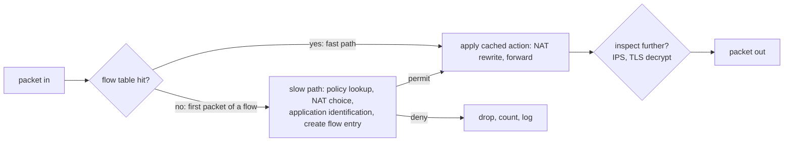

# NET 09: Network security: stateful firewalls, connection tracking, NAT, IPS and deep packet inspection

*Part of the [networking plan](00_plan.md) · You need: [NET 03](03_tcp_udp_and_transport.md) (the TCP handshake, flags, retransmission), [NET 06](06_linux_network_stack.md) (netfilter hooks, what a packet costs on the host), [NET 08](08_application_protocols_dns_http_tls.md) (the TLS handshake and certificates)*

A firewall decides, packet by packet, what may pass. Everything interesting about it is in what it must **remember** to decide, what that memory costs, and what an attacker can do to it. "How does a stateful firewall work, and what happens when its table fills?" is asked at Cisco and Palo Alto Networks in some form, and at Nvidia and Google as a data-plane design question: what state per flow, where it lives, how fast the lookup is, and how it fails.

A weak answer lists features (ACLs, NAT, VPN, IPS). A strong answer is a **cost model**: the cost of one rule per packet, the cost of one connection entry, the cost of looking inside a flow, and for each the failure mode and the attack that targets it. That is the structure here.

By the end you can:

- explain where a firewall decision is made and why long rule lists are slow and sets are not;
- show where a stateless filter fails and how connection tracking fixes it, and read a conntrack entry through its life;
- size a connection table, say what happens when it fills, and name the attacks on it;
- explain NAT as two tuples per flow and say which protocols it breaks and why;
- explain application identification, what TLS 1.3 took away from the middlebox, and why a port is not an application;
- tell IDS from IPS, explain evasion by segmentation and why the IPS must reassemble, and say what fail-open and fail-closed mean;
- explain Aho-Corasick and regular-expression denial of service, TLS interception, and what an IPsec tunnel costs on the wire;
- defend against a SYN flood, and protect the firewall's own CPU.

---

## 1. A firewall is a pipeline of decisions, and every decision has a price

A packet entering a firewall passes through stages, each of which can drop it, and each of which costs time:



The first packet of a flow takes the **slow path**: it is checked against the policy, a NAT mapping is chosen, the application may be identified, and a **flow entry** is created. Every later packet of that flow hits the entry in a hash table and takes the **fast path**: look up, apply the stored action, forward. This split is how a 100 Gb/s firewall works at all, and it is the answer to the standard design question (section 11).

### 1.1 Where the decision is made on Linux

On Linux the firewall is **netfilter** (NET 06): hooks at prerouting, input, forward, output and postrouting, with `nftables` rules attached to them. Earlier still, **XDP** (NET 07) can drop before an `sk_buff` exists, which is why the cheapest DDoS filter is an XDP program. A commercial firewall uses the same idea with its own engine, flow tables and often hardware. What transfers between them is the **shape** of each cost, not any number.

### 1.2 What one rule costs

A rule list is walked **in order**. A packet that matches nothing pays for every rule. Measured in an earlier run, forwarding throughput fell from roughly 814 k packets per second with no rules to 418 k at 100 rules, 90 k at 1,000 and 19 k at 5,000: about **10 ns per rule**. A single rule that matched a **set** of 5,000 addresses ran at about 752 k, almost as fast as no rules, because a set is a hash table or a tree, with a lookup cost that does not grow with its size.

The fixes for a slow ACL follow directly:

- put addresses and ports in **sets, maps or tries**, not one rule per address;
- order rules by how often they match, and put `ct state established accept` first, so the bulk of packets leave the list after one rule;
- split the list into chains by interface or direction, so a packet only walks the relevant one;
- compile the policy into a decision structure in advance (that is what hardware and commercial engines do).

### 1.3 The decision is a cache of a decision

The flow entry is a cache of the slow-path decision. Anything that changes the policy has to invalidate it, and anything that makes the entry's key unstable (NAT, tunnels, asymmetric routing) has to be handled. Asymmetric routing is the classic production failure: if the SYN passes through firewall A and the reply returns through firewall B, B has no entry, treats the SYN-ACK as unsolicited, and drops it.

---

## 2. Stateless and stateful filtering

### 2.1 A stateless filter sees one packet at a time

A stateless filter decides from the fields of one packet: addresses, ports, protocol, TCP flags. The trouble is that it cannot tell a reply from something that merely **looks** like a reply. The common attempt is "allow inbound packets that have ACK set", on the theory that only replies carry ACK. In the lab (a client, a firewall and a server in three network namespaces joined by veth pairs), with that rule a lone forged ACK from the outside **passed**, and the client answered it with a **`RST`**. The attacker learned that the client's address is live and that the port is closed, which is reconnaissance, and a crafted stream of such packets can also probe or disrupt.

```bash
# stateless: any inbound packet with ACK set is accepted
nft -f - <<'EOF'
table inet fwt {
  chain forward {
    type filter hook forward priority 0; policy drop;
    iifname "vfc" ip daddr 10.2.0.2 tcp dport 8080 accept
    iifname "vfs" tcp flags & ack == ack accept
  }
}
EOF
```

The packet came from scapy (a lone ACK with no connection behind it):

```python
from scapy.all import IP, TCP, sr1, conf
conf.verb = 0
r = sr1(IP(src="10.2.0.2", dst="10.1.0.2") / TCP(sport=8080, dport=4444, flags="A", seq=1000, ack=1), timeout=1.5)
print("reply:", r.summary() if r else "none")      # stateless rule: the client sends back an RST
```

### 2.2 A stateful filter remembers the connection

A stateful firewall keeps a **table of connections** keyed by the 5-tuple (protocol, source and destination address and port), and classifies every packet by how it relates to the table: **new** (no entry, and it is a valid opening packet), **established** (part of a known connection), **related** (for example an ICMP error about a known connection, or an FTP data connection), or **invalid** (does not fit).

```bash
nft -f - <<'EOF'
table inet fwt {
  chain forward {
    type filter hook forward priority 0; policy drop;
    ct state established,related accept
    ct state invalid counter drop
    iifname "vfc" ip daddr 10.2.0.2 tcp dport 8080 ct state new accept
  }
}
EOF
```

Three lines carry the whole idea: replies to connections the policy allowed are accepted because they match an entry; out-of-state packets are dropped and **counted**; only the specified new connections may start. With these rules the client reached port 8080 (HTTP 200), a connection to port 9090 **timed out** with no reply at all (the drop is silent: no RST, so a scan learns nothing), and the same lone ACK produced **no reply**.

One detail worth knowing: Linux's default `nf_conntrack_tcp_loose=1` lets conntrack **pick up an existing connection mid-stream** (so a firewall restart does not cut live flows). With `nf_conntrack_tcp_loose=0` a packet that does not fit the TCP state machine is `invalid` and the counter above increments (it counted 1 packet of 40 bytes for the lone ACK). Which setting is right is a trade: tolerance after a restart against strictness.

### 2.3 The life of a conntrack entry

An entry has a **state** and a **timeout**, and `conntrack -L` shows both. For a TCP connection held open for two seconds and then closed:

```
ESTABLISHED  431999  src=10.1.0.2 dst=10.2.0.2 sport=50768 dport=8080
                     src=10.2.0.2 dst=10.1.0.2 sport=8080 dport=50768 [ASSURED]
TIME_WAIT        119  (same tuples, after the close)
```

Read it: the entry has **two tuples**, the original direction and the reply direction (this is what NAT will change); `ESTABLISHED` has a timeout of **432,000 seconds (five days)** by default, so an idle connection with no keepalive occupies the table for days; `[ASSURED]` means traffic has been seen both ways, which protects the entry from early eviction (section 3); and after the close the entry lingers in `TIME_WAIT` for 120 seconds. Earlier runs also showed the transient states `SYN_SENT`, `SYN_RECV`, `FIN_WAIT` and `LAST_ACK`, each with its own short timeout.

**Which timeouts to change:** lower the established timeout for traffic where you control the keepalives (an idle connection should not hold an entry for five days, but a database connection that goes silent for an hour must survive), and keep the half-open timeouts short, because those entries are the cheap ones for an attacker to create.

---

## 3. The connection table is a resource

State is memory and a lookup. An entry is a few hundred bytes (about 256 bytes in an earlier run), kept in a hash table with chains. A stateful firewall therefore has three numbers that matter: **the maximum number of entries** (`nf_conntrack_max`, 262,144 on this VM), **the number of hash buckets**, and the **timeouts**, which together set how many entries live at a given rate.

### 3.1 Sizing

`entries in the table = new connections per second x average lifetime`. A firewall taking 200,000 new connections a second with a 30-second average lifetime needs **6 million entries**. At about 256 bytes each that is about **1.5 GB** of memory, and the hash needs enough buckets that chains stay short (a mean chain of 4 or fewer). Add headroom, because averages hide bursts. The same arithmetic shows why short-lived-connection workloads (DNS, HTTP without keep-alive) are harder on a firewall than a few long flows, and why reducing a timeout is as effective as buying memory.

### 3.2 When the table is full

When the table is full, the firewall **cannot create an entry for a new flow**, so new flows are dropped (the kernel logs `nf_conntrack: table full, dropping packet`). Existing flows keep working. That is a cheap denial of service: an attacker opens many cheap connections (or sends one-way packets that create half-open entries) until legitimate users cannot start new connections. The kernel's mitigation is **early drop**: when full, it evicts an entry that is not yet `ASSURED` to make room. In an earlier test with a limit of 1,000, a flood of one-way flows let 3 of 20 legitimate flows in, while a table of 1,000 **assured** flows let in 0 of 20, because there was nothing evictable. That is the point of `ASSURED`: a connection with traffic both ways is harder for a flood to push out, and also harder for a legitimate new one to enter.

### 3.3 What to do about it

- **Size the table and the hash** for peak new-connection rate times lifetime, and alert on utilisation (`conntrack -C` against `nf_conntrack_max`), not on the first drop.
- **Shorten the timeouts** that the attack uses (half-open, TIME_WAIT where safe), and keep idle established timeouts realistic.
- **Do not track what you do not need to.** A `notrack` rule (or no-state rule) for high-volume traffic that policy allows anyway, such as a load balancer's own health checks or internal east-west flows already protected elsewhere, takes it out of the table.
- **Rate-limit new connections** per source and cap the number of connections one source may hold (section 10), so one host cannot fill the table.
- **Use SYN cookies and a SYN proxy** so the table is not touched until the handshake completes (section 10).
- **Move the state off the CPU.** Hardware flow tables and `flowtable` offload let established flows bypass the slow path.

---

## 4. NAT and the protocols it breaks

NAT rewrites addresses and ports so a private network can share a public address (source NAT, masquerade) or so an external address can reach an internal server (destination NAT, port forwarding). It rides on conntrack: **an entry holds two tuples, and NAT makes them differ.**

With masquerade on the firewall, the entry for a client connecting to the server looks like:

```
ESTABLISHED  src=10.1.0.2 dst=10.2.0.2 sport=50772 dport=8080
             src=10.2.0.2 dst=10.2.0.1 sport=8080 dport=50772 [ASSURED]
```

The original tuple has the client's address, the **reply** tuple expects the server to answer the **firewall's** address (`10.2.0.1`), not the client's. When the reply arrives, conntrack finds the entry by the reply tuple and **rewrites the destination back** to the client. A NAT box with no entry cannot translate replies, which is why NAT depends on state, and why an entry timing out kills the connection through it.

Things to be able to discuss:

- **Port collisions.** Two internal hosts using the same source port to the same destination need distinct translated ports; the NAT picks another one. A NAT is limited by **ports per destination**, which is what port exhaustion on a busy gateway or carrier-grade NAT means.
- **Protocols that carry addresses in the payload break.** FTP active mode sends the client's address and port inside the control connection (`PORT 10,1,0,2,150,175`), and the server then connects back to that. Behind NAT that address is private, so the data connection fails. A NAT **helper (ALG)** reads the control connection, rewrites the address inside it, and creates an **expectation** so the incoming data connection is treated as related. SIP, H.323, TFTP and others are the same story. The costs of ALGs are that they are protocol-specific, break with encryption (you cannot rewrite what you cannot read), and are a historic source of bugs, so modern protocols avoid carrying addresses and use STUN, ICE and relays to traverse NAT.
- **Hairpin NAT**: a client inside reaching an internal server through its public address needs the firewall to translate both ways.
- **NAT is not a security feature.** It blocks unsolicited inbound as a side effect of having no entry, and a stateful firewall without NAT does the same thing.
- **IPv6** removes most of the need for NAT, but not for stateful filtering.

---

## 5. Knowing what is inside a flow: application identification

### 5.1 A port number is not an application

Policies written as "allow TCP 443" assume 443 is HTTPS. It is not: anything can run on 443 (a tunnel, a VPN, malware, a different protocol), and any application can run on a non-standard port. In an earlier test, 4 of 8 flows had a port that did not match their content. That is why next-generation firewalls identify the **application** from the traffic: the first few payload packets are matched against signatures and behaviour (the HTTP request line and Host header, the TLS ClientHello, DNS structure, protocol banners), the result is stored in the flow entry, and the policy then says "allow this application" instead of "allow this port". Palo Alto calls this App-ID, and the general technique is deep packet inspection (DPI) on the start of the flow.

### 5.2 What the TLS ClientHello gives away

Most traffic is TLS, so identification works on what TLS exposes before encryption starts: the **server name (SNI)**, the offered protocols (ALPN), the cipher suites and extensions. The way a client **orders and chooses** these is characteristic of the software, so a hash of those fields (the **JA3** or JA4 fingerprint) identifies the client library: in an earlier run two Python clients shared one JA3 hash across two sites. Fingerprinting is how a middlebox flags a known malware family's TLS stack without decrypting anything.

### 5.3 What TLS 1.3 took away

In TLS 1.2 the server's certificate crossed the network in the clear, so a passive box saw the name in the certificate. In TLS 1.3 **the certificate is encrypted** (NET 08): a capture shows only the two Hello messages, and the server name is still visible in the SNI (until **Encrypted Client Hello** hides that too). QUIC encrypts nearly everything, including most of its handshake. The consequence for a firewall is real: identification relies more on SNI, DNS and behaviour, and the choice becomes **decrypt (section 8) or accept less visibility**. Many enterprises block QUIC at the edge to force clients back to TCP and TLS, where policy still works.

---

## 6. IDS and IPS: detect or prevent

An **intrusion detection system (IDS)** inspects a **copy** of the traffic (a mirror port, a tap) and raises alerts. An **intrusion prevention system (IPS)** sits **in the path** and can drop. The detection logic is the same; the difference is position and consequence.

| | IDS | IPS |
|---|---|---|
| Position | Off the path, on a copy | Inline |
| Action | Alert and log | Alert, drop, reset |
| Failure effect | Blind, traffic unaffected | Can drop or pass all traffic |
| Latency impact | None | Added to every packet |
| False positive cost | A noisy alert | A blocked legitimate flow |

### 6.1 Signatures, and what a per-packet match misses

A signature rule says "if the traffic matches this pattern in this context, raise this alert". A Suricata rule that looks for a path traversal in an HTTP request URI:

```
alert http any any -> any any (msg:"LAB path traversal"; flow:to_server; http.uri; content:"/etc/passwd"; sid:1000001; rev:1;)
```

The tempting implementation, searching each packet's payload for the string, is **evaded** by splitting the request across two TCP segments so no single packet contains the pattern. The experiment: the same request sent once as one segment and once split after `/../../etc`:

| Traffic | Naive per-packet string search | Suricata with TCP reassembly |
|---|---|---|
| One segment | match | alert |
| Split across two segments | **no match** | **alert** |

An IPS must therefore **reassemble the TCP stream** (and IP fragments) before matching, and must do it **the way the destination will**, because different operating systems resolve overlapping segments and fragments differently, and an attacker exploits the difference (insertion and evasion attacks). It must also **normalise** (decode URL encoding, strip padding, handle chunked bodies) so that the matcher sees what the application will see. That reassembly is per-flow state and memory, which is why the IPS is a stateful component with its own limits and its own DoS surface.

### 6.2 What inline costs

An inline IPS adds latency to every packet and caps throughput at the speed of its inspection engine. In an earlier run on this tiny VM, an inline IPS dropped path traversals and a blocked TLS name correctly, while inline throughput fell from about 16 Gb/s to about 1 Gb/s. The number is not a product figure; the shape is: **inspection is the slowest stage of the pipeline**, which is why vendors run it only on flows the policy marks for inspection, and why IPS sizing is by "threat prevention throughput", a different (smaller) number than firewall throughput.

### 6.3 Failure: fail-open or fail-closed

What happens when the IPS software crashes or is overloaded? **Fail-closed** drops all traffic through it: safe but a total outage. **Fail-open** (bypass) lets traffic through uninspected: available but unprotected. In the lab, killing the inline engine dropped all traffic, and enabling the queue-bypass option let all of it through. Hardware appliances use a bypass relay that physically connects the ports on power loss. The choice is a business decision per segment (a data centre front door that must stay up against a segment that must never be uninspected) and an interviewer wants to hear that you would make it explicitly, add health checks, and alert when bypass engages.

### 6.4 IDS tuning, in one paragraph

An IDS that alerts on everything is ignored. Tuning means enabling rules relevant to your assets, suppressing known-benign matches, thresholding noisy rules, and measuring the false-positive rate before promoting a rule from alert to drop. A new rule should run in alert mode first.

---

## 7. Matching signatures fast

An IPS can have tens of thousands of patterns. Searching for each one separately, a pass over the data per pattern, is too slow.

### 7.1 Aho-Corasick: all strings in one pass

Build a **trie** of all patterns, add **failure links** (from each node, the longest proper suffix that is also a prefix in the trie), and scan the text once: each byte does one table step, **whatever the number of patterns**. When the scan lands on a node where a pattern ends, or a node reachable by failure links, it reports the match.

```python
from collections import deque

def build(patterns):
    goto, fail, out = [{}], [0], [set()]
    for p in patterns:                                   # 1. a trie of all patterns
        s = 0
        for ch in p:
            if ch not in goto[s]:
                goto.append({}); fail.append(0); out.append(set())
                goto[s][ch] = len(goto) - 1
            s = goto[s][ch]
        out[s].add(p)
    q = deque(goto[0].values())                          # 2. failure links, breadth first
    while q:
        s = q.popleft()
        for ch, t in goto[s].items():
            q.append(t)
            f = fail[s]
            while f and ch not in goto[f]:
                f = fail[f]
            fail[t] = goto[f].get(ch, 0)
            out[t] |= out[fail[t]]                       # a match may end inside a longer one
    return goto, fail, out

def scan(text, automaton):
    goto, fail, out = automaton
    s, hits = 0, []
    for i, ch in enumerate(text):                        # each byte read exactly once
        while s and ch not in goto[s]:
            s = fail[s]
        s = goto[s].get(ch, 0)
        for p in out[s]:
            hits.append((i - len(p) + 1, p))
    return hits

a = build(["he", "she", "his", "hers"])
print(sorted(scan("ushers", a)))     # [(1, 'she'), (2, 'he'), (2, 'hers')]
```

The classic example finds `she`, `he` and `hers` in `ushers` in one pass. The point for the interview is the scaling: a loop of one search per pattern costs time proportional to (patterns x text); the automaton costs time proportional to the text (plus a build step). An earlier benchmark at 10,000 patterns had the automaton about 22 times faster than a loop of searches, though the scan speed itself fell as the automaton outgrew the CPU cache (memory, not computation, is the limit). Production engines (Hyperscan, which Suricata uses) compile many patterns and regular expressions into automata and use SIMD.

### 7.2 Regular expressions: backtracking against automata

Many signatures are regular expressions. A **backtracking** engine (Perl, Python's `re`, PCRE) tries alternatives and returns on failure, and a nested quantifier can make that **exponential**. An input that almost matches does the damage:

```python
import re, time
pat = re.compile(r"^(a+)+$")
for n in (18, 20, 22, 24):
    s = "a" * n + "!"                                    # almost matches, then fails at the end
    t = time.perf_counter(); pat.match(s); dt = time.perf_counter() - t
    print(f"{n} chars: {dt * 1000:8.1f} ms")
```

On this VM it took about 10 ms at 18 characters, 40 at 20, 160 at 22 and 590 at 24: roughly **four times per two characters, doubling per character**. At 30 characters it would be tens of seconds. This is **ReDoS** (regular expression denial of service), and an IPS that takes an attacker-controlled input and a backtracking engine hands the attacker a CPU switch. Defences: use an **automaton engine** (RE2, Hyperscan: linear in the input, no backtracking), put time and step limits on matching, and review patterns for nested quantifiers. The trade is that automata do not support every feature (back-references, some look-around).

---

## 8. Decrypting TLS: what it buys, what it breaks

If most traffic is encrypted, an IPS sees nothing in it. **TLS inspection** (a forward proxy or "SSL decryption") terminates the client's TLS at the firewall and opens a **second** TLS connection to the server. To do that without browser warnings, the firewall **forges a certificate** for each site, signed by a CA that the organisation has installed in its devices' trust stores.

What it buys: the IPS, URL filtering, data-loss prevention and malware scanning can see the plaintext.

What it breaks and costs:

- **Clients that do not trust the firewall's CA fail**, including every device you do not manage.
- **Certificate pinning** (apps that accept only a specific key) fails.
- **Mutual TLS** fails, because the firewall cannot present the client's certificate.
- **Privacy and legal exposure**: the firewall now holds plaintext of banking, health and personal traffic, so policy has to exclude categories.
- **Cost**: two handshakes and two crypto passes. In an earlier lab test the connection setup cost about 4.2 ms against 1.9 ms direct.
- **A new attack surface**: the firewall's CA key is now a crown jewel.

Alternatives with no forged certificate: inspect the **metadata** only (SNI, JA3, certificate in TLS 1.2), terminate TLS at the endpoint or proxy you own (a reverse proxy in front of your service, where you hold the real key), and use host-based agents. The Staff-level answer is not "decrypt everything": it is **decrypt selectively, where you own one side or have legal and operational cover, and use metadata elsewhere**.

---

## 9. IPsec and VPNs: what a tunnel costs on the wire

An **IPsec** tunnel wraps each inner packet in an **ESP** packet: a new outer IP header, the ESP header (SPI and sequence number), the encrypted inner packet with padding and trailer, and an authentication tag. In tunnel mode with AES-GCM, that adds about **56 bytes** of overhead per packet (an earlier run built and decrypted real packets to confirm it).

- **Overhead matters most for small packets**: 56 bytes on a 1,500-byte packet is under 4 percent; on a 40-byte packet it is 140 percent. VoIP and small-packet traffic suffer.
- **MTU.** With a 1,500-byte link, the largest inner packet that fits after ESP is about 1,446 bytes, so the tunnel interface needs a smaller MTU (or TCP MSS clamping), or large packets fragment or are dropped when the path blocks ICMP. "VPN works for ping and small pages but hangs on large downloads" is the signature of a **path MTU** problem.
- **What a firewall in the middle sees.** An ESP packet is opaque: the firewall can filter on outer addresses and the protocol number (50 for ESP, UDP 500 and 4500 for IKE and NAT traversal), not on the inner traffic. NAT breaks plain ESP (no ports to translate), hence NAT-T, which wraps ESP in UDP 4500. Inspection of tunnelled traffic must be done at the tunnel endpoint, after decryption.
- **Scaling.** IPsec is per-packet cryptography, so the endpoint needs hardware crypto or AES instructions, and anti-replay windows make multi-core distribution of one tunnel hard; many tunnels spread across cores better than one big one.

WireGuard is the lighter alternative, with a small code base, UDP transport and modern fixed ciphers. IKE negotiation, xfrm policy in the kernel and the details are from the specifications and not measured here.

---

## 10. Floods and the firewall's own defences

### 10.1 What a flood attacks

A SYN flood attacks the **half-open connection queue**: the server allocates state when it receives a SYN and waits for the ACK that never comes. Fill the queue and real clients cannot connect. In an earlier test, with no defence a real client got 0 of 5 connections while about 2,000 spoofed SYNs a second arrived.

### 10.2 SYN cookies: put the state in the packet

With **SYN cookies** (`net.ipv4.tcp_syncookies=1`, which is the default here), the server does not store anything for a SYN when its queue is full. It encodes the needed information (a hash of the addresses and ports, a timestamp, the MSS) into the **initial sequence number** of its SYN-ACK. A legitimate client's ACK returns that number plus one, so the server can **recompute and verify** it and then create the connection. An attacker with spoofed addresses never sends the ACK, so nothing was stored. The costs: some TCP options (window scaling, selective ACK) may be lost unless encoded, and the verification adds a little CPU. In the earlier run, 17,979 cookies were sent and 5 of 5 real clients were served.

### 10.3 A SYN proxy: put the state in the firewall

A firewall can **answer the SYN itself** (with a cookie), and only when the client completes the handshake does it open a connection to the real server and splice the two. The server never sees the flood. This protects servers that cannot enable cookies, at the price of the firewall's CPU and sequence-number translation for the life of the connection. Both defences gave 5 of 5 in the test.

### 10.4 Other floods and slow attacks

An attacker does not have to be fast. A flood **below** the detection threshold, enough to keep a queue partly full, or slow connections that hold entries open for long (the Slowloris pattern), cost the defender continuously. Defences are limits on the **number of connections per source** and timeouts on incomplete requests. UDP and ICMP floods and reflection and amplification attacks (a small spoofed request, a large reply to the victim) are mitigated upstream: ingress filtering (BCP 38), response rate limiting, and scrubbing services that absorb traffic with anycast.

### 10.5 Protecting the firewall itself: policing

The firewall's management plane and control plane (SSH, routing protocols, ICMP handling, logging) run on a CPU that attackers can reach with traffic addressed to the box. **Control-plane policing** limits that traffic. The tool is a **token bucket**: tokens accumulate at a fixed rate up to a burst size, each packet costs a token, and packets arriving with no token are dropped.

```bash
# at most 20 ICMP echo requests per second to the firewall itself, burst of 10
nft -f - <<'RULES'
table inet fwt {
  chain input {
    type filter hook input priority 0; policy accept;
    icmp type echo-request limit rate over 20/second burst 10 packets drop
  }
}
RULES
```

In the lab, a bucket of 20 per second with a burst of 10 let 73 of 200 rapid pings through. The important refinement is **per source**: one global bucket lets a single attacker use all the tokens and starve everyone else; a per-source bucket (a meter keyed on the source address) kept a second, well-behaved sender at 5 of 5. And limit what one source may **hold open** (`ct count over N`), which refused 7 of 10 connections from a source over its limit.

---

## 11. Design question: the data path of a 100 Gb/s stateful firewall

The structure that answers it:

1. **Split fast and slow path.** The slow path (policy lookup, NAT choice, application ID, entry creation) handles the first packet or first few packets of each flow, in software, and can be slower. The fast path (flow-table lookup, apply stored action, forward) handles the rest and must hold line rate.
2. **The flow table**: a hash table keyed by a **symmetric** hash of the 5-tuple, so both directions land on the same entry and the same core, sized for the peak flows. Entries carry the action, NAT rewrite, counters, timeouts and the application ID.
3. **Parallelism**: steer a flow to one core (RSS or hardware flow steering) so the entry is touched by one core and needs no locks. Keep per-core state, and aggregate counters lazily.
4. **Offload**: install established flows in hardware (a SmartNIC or switch ASIC flow table) so the CPU only sees new flows and flows that need inspection.
5. **Inspection**: reassemble and run the IPS only on flows the policy marks, on a separate engine, with per-flow reassembly state bounded.
6. **Failure**: what happens when the table is full (early drop policy), when the inspection engine is overloaded (bypass or drop, explicitly chosen), when a core dies (flow failover to a standby with synchronised state), and when a route change sends traffic asymmetrically.
7. **Observability**: counters for every drop reason, table utilisation, slow-path rate, inspection queue depth.

---

## 12. Common mistakes

1. **A "stateless ACK" rule to allow replies.** It lets forged ACKs and probes through.
2. **A long rule list** where a set would do.
3. **Ignoring table size and timeouts**, then discovering the five-day established timeout.
4. **Dropping invalid packets silently with no counter**, so no one can see an attack or a bug.
5. **Asymmetric routing through a stateful firewall.**
6. **Assuming NAT is a firewall**, or breaking FTP, SIP or similar with NAT and no helper.
7. **Policy by port number** instead of application.
8. **Matching per packet**, not on the reassembled stream, in an IPS.
9. **A backtracking regular expression engine** on attacker-controlled input.
10. **Fail-open or fail-closed by accident** rather than by decision.
11. **Decrypting everything**, including traffic that cannot or must not be.
12. **Forgetting path MTU** when adding a tunnel.
13. **One global rate limiter**, which an attacker can drain.

---

## 13. Interview questions

1. What is the difference between a stateless and a stateful firewall? Give a case where stateless fails.
2. What is in a conntrack entry and what are the states of a TCP connection in it?
3. What happens when the connection table is full, and how would you defend against it?
4. Size a connection table for 200,000 new connections per second.
5. Why is a long ACL slow and what are the fixes?
6. How does NAT use connection tracking, and what does it break?
7. Why is a port number not an application? How does a firewall identify the application?
8. What did TLS 1.3 and QUIC change for a middlebox?
9. What is the difference between an IDS and an IPS?
10. How can an attacker evade a per-packet signature match, and how does an IPS stop it?
11. How does Aho-Corasick work and when is it the wrong tool?
12. What is ReDoS and how do you prevent it?
13. How does TLS interception work, and what does it break?
14. How do you defend against a SYN flood, and what does each defence cost?
15. What is the overhead of an IPsec tunnel, and what symptom does an MTU problem give?
16. Design the data path of a 100 Gb/s stateful firewall.

---

## 14. Scenarios and design questions

**S1. After a firewall failover, all long-lived database connections reset.** Why, and what do you do about it?

**S2. Users report that new connections fail intermittently at peak hour, but existing ones are fine.** Diagnose.

**S3. A security team wants to block a malicious string in HTTP requests, and a red team keeps getting around it.** What are they likely doing?

**S4. After enabling TLS inspection, one mobile banking app stops working.** Explain and fix.

**S5. A VPN is up, pings work, small pages load, large downloads hang.** Diagnose.

**S6. An internal service behind NAT works for most clients, but SIP calls have one-way audio.** Why?

**S7. A new IPS rule set doubles latency on a branch firewall.** What do you check, and how do you roll out rules safely?

**S8. A firewall pair in an active-active setup drops some TCP flows.** What is the probable cause?

---

## 15. Strong answers (outlines)

**Q1.** Stateless decides from one packet's fields; stateful keeps a table of connections and classifies each packet as new, established, related or invalid. Case: allowing "ACK set" lets a lone forged ACK through and the target answers with RST; with state the same packet is invalid and dropped silently.

**Q2.** Two tuples (original and reply), state (SYN_SENT, SYN_RECV, ESTABLISHED, FIN_WAIT, CLOSE_WAIT, LAST_ACK, TIME_WAIT), a timeout per state, flags such as ASSURED, plus counters and NAT info. Established defaults to five days.

**Q3.** New flows are dropped (table full), existing continue. Early drop evicts unassured entries. Defences: size by rate times lifetime, shorten half-open timeouts, limit per-source connections and rates, SYN cookies or proxy, `notrack` for traffic that does not need it, hardware flow offload, alert on utilisation.

**Q4.** Entries = rate x lifetime = 200,000 x 30 s = 6 million; at about 256 B that is about 1.5 GB; add headroom and enough hash buckets for short chains.

**Q5.** Linear walk, about 10 ns per non-matching rule, so thousands of rules cost tens of microseconds per packet. Use sets, maps and tries, put `established` first, split chains, compile policy.

**Q6.** The entry's reply tuple differs from the original, and replies are translated back by finding the entry. Breaks protocols carrying addresses in the payload (FTP active, SIP), fixed by helpers (ALGs) with expectations, which fail under encryption. Also port exhaustion and hairpin.

**Q7.** Anything can run on any port. Identify from the first payload (HTTP, TLS Hello, DNS structure, banners), fingerprints (JA3), behaviour, cache the result in the flow entry, write policy in terms of applications.

**Q8.** TLS 1.3 encrypts the certificate, leaving SNI and fingerprints; ECH would hide SNI; QUIC encrypts almost everything. Identification weakens, so decrypt selectively or use metadata; some sites block QUIC.

**Q9.** Position: IDS on a copy, alerts; IPS inline, can drop. IPS adds latency, a throughput cap, and a failure decision (fail-open or fail-closed).

**Q10.** Split across segments or fragments, overlap tricks, encoding. The IPS reassembles the stream the way the destination will and normalises before matching. Cost: per-flow state.

**Q11.** Trie plus failure links, one pass, one step per byte regardless of pattern count. Wrong tool for patterns with back-references or for few patterns where a simple search is as good; memory grows with the number of patterns and hurts cache behaviour.

**Q12.** Exponential backtracking on crafted input to nested quantifiers. Use RE2 or Hyperscan, limit steps and time, review patterns.

**Q13.** A forward proxy terminates the client's TLS, opens a second one, and signs a forged certificate with an installed CA. Breaks untrusted clients, pinning, mutual TLS, privacy, adds cost and a CA key to protect. Decrypt selectively.

**Q14.** Cookies encode state in the sequence number, nothing stored until the ACK; lose some TCP options. SYN proxy in the firewall, protects the server, costs firewall state and CPU. Add per-source limits and timeouts.

**Q15.** About 56 bytes per packet in tunnel mode with AES-GCM: small for large packets, large for small ones; the inner MTU shrinks (about 1,446 on a 1,500 link). Symptom of path MTU trouble: small packets work, large transfers hang. Fix with a smaller MTU or MSS clamping.

**Q16.** Fast and slow path, symmetric hash flow table, per-core ownership, hardware offload, selective inspection, failure modes and observability (section 11).

**S1.** State was not synchronised to the standby, so it sees mid-stream packets with no entry: invalid, or dropped. Use state synchronisation (conntrackd or the vendor's HA), and `tcp_loose` accepting pickups. Check timeouts.

**S2.** Table nearing full or a rate limit, or NAT port exhaustion, or a half-open flood. Check `conntrack -C` against max, drop counters, SYN queue, per-source counts.

**S3.** Splitting across segments, fragmenting, URL encoding or case variations. Make sure the IPS reassembles and normalises; match on the decoded URI, not raw bytes.

**S4.** The app pins its certificate or key, so the forged certificate fails. Exempt the destination from decryption (bypass list) and rely on metadata, or work with the vendor.

**S5.** Path MTU: ESP overhead made large packets exceed the path MTU, and ICMP is blocked so the sender never learns. Lower the tunnel MTU or clamp MSS, allow the ICMP needed.

**S6.** SIP carries addresses in the body and RTP uses separate ports, so the NAT has to rewrite and open pinholes. Without a working ALG or session-aware handling, media goes to the private address. Use a SIP-aware proxy or session border controller, or STUN and ICE.

**S7.** Check which rules are enabled and their cost, whether flows are being reassembled unnecessarily, hardware offload, and CPU. Roll out in alert mode first, per segment, and measure the false-positive rate and latency before enabling drops.

**S8.** Asymmetric routing: the SYN passes one unit and the reply the other, which has no entry. Fix with symmetric routing, state sync between units, or an active-passive design.

---

## 16. Cheat sheet

- A firewall is a pipeline: slow path for the first packet (policy, NAT, app-ID, create entry), fast path afterwards.
- Rules cost about 10 ns each when listed; sets are flat. `established` first.
- Stateless sees one packet; stateful has a table: new, established, related, invalid. A lone ACK passes a stateless "ACK" rule and is dropped by a stateful one.
- Entry: two tuples, state, timeout, ASSURED. Established timeout is five days by default.
- Table size = rate x lifetime x entry size. Full means new flows dropped; early drop evicts unassured entries.
- NAT: the reply tuple differs. Breaks payload-address protocols: helpers and expectations.
- A port is not an application. TLS 1.3 hides the certificate; SNI and JA3 remain; ECH and QUIC hide more.
- IDS on a copy, IPS inline. Reassemble and normalise. Fail-open or fail-closed is a decision.
- Aho-Corasick: one pass for all patterns. Backtracking regex: ReDoS; use RE2 or Hyperscan.
- TLS inspection: forged certificates, breaks pinning and mutual TLS; decrypt selectively.
- ESP adds about 56 bytes; watch the MTU.
- SYN cookies, SYN proxy, per-source limits, token buckets, per-source meters.

---

## 17. Sources and caveats

Sources used: the kernel's `nf_conntrack` and `nftables` documentation and the `nft`, `conntrack` and `sysctl` manual pages, the nftables wiki (stateful firewall, sets and maps, flowtables), the Suricata documentation (rules, `http.uri`, stream reassembly, IPS modes), the original Aho and Corasick paper and the RE2 and Hyperscan documentation, RFC 4987 (TCP SYN flooding mitigations), RFC 4303 (ESP), RFC 3022 (traditional NAT), and the interview-oriented firewall question lists on [Glassdoor](https://static-pc.glassdoor.fr/Interview/senior-network-security-engineer-interview-questions-SRCH_KO0,32_IP60.htm), [InterviewBit](https://www.interviewbit.com/palo-alto-interview-questions/) and [The Network DNA](https://www.thenetworkdna.com/2021/10/part-1-10-basic-questions-on-paloalto.html).

Caveats. The stateful and stateless rule sets, the lone-ACK test (the stateless rule drew an RST, the stateful one nothing, and the invalid counter read 1 packet of 40 bytes with `tcp_loose=0`), the conntrack entries and timeouts, the NAT entry, the Suricata alerts on the whole and split requests (1 and 1) against the naive per-packet search (match and no match), the Aho-Corasick example, the ReDoS timings (about 10, 40, 160 and 590 ms at 18, 20, 22 and 24 characters) and the sysctl defaults were run for this tutorial on one Linux 6.18 VM as root, in network namespaces joined by veth pairs, with `nft`, Suricata 7 and scapy. The rule-list throughput figures, the table-full behaviour, the entry size, the FTP helper, the JA3 and port-mismatch counts, the inline IPS latency and throughput, the Aho-Corasick benchmark, the TLS proxy cost, the ESP overhead build, the SYN flood and cookie counts and the token bucket results come from earlier runs of the previous version of this tutorial and were not re-run. The load generator and firewall shared two CPUs, so no rate here is a product figure. The kernel on this VM has no ESP and no WireGuard, so IPsec is arithmetic. Commercial engines (App-ID, hardware flow tables, CoPP in ASICs), ECH, QUIC blocking and DDoS scrubbing are described from documentation, not measured. Defaults (`tcp_loose`, timeouts, table sizes) vary by kernel and distribution.

Earlier and later: [NET 06](06_linux_network_stack.md), [NET 08](08_application_protocols_dns_http_tls.md), [NET 13](13_load_balancing_proxies_and_anycast.md), [the networking plan](00_plan.md).
