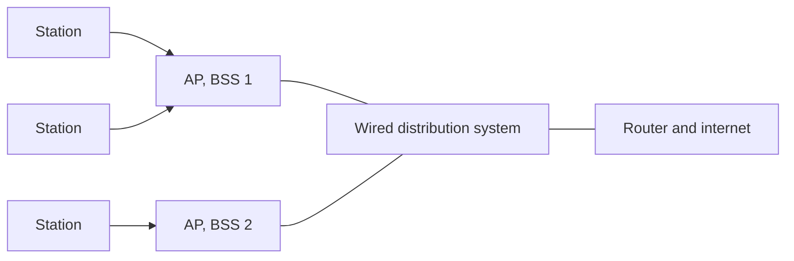
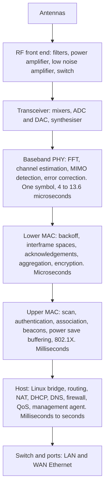
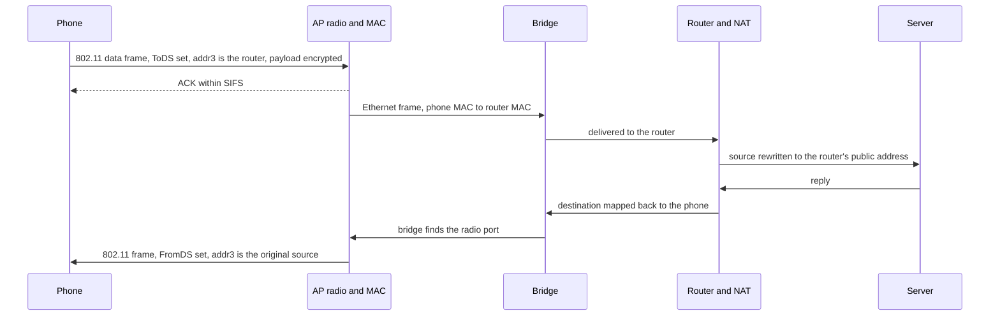

# WF 01: The Wi-Fi landscape and the anatomy of an access point

*Part of the [networking plan](../00_plan.md), Wi-Fi sub-track · Candela sessions 1a to 1d · You need: [NET 01](../01_network_models_and_layer2.md) (Ethernet and MAC addresses), [NET 02](../02_ip_routing_and_layer3.md) (NAT) and [NET 08](../08_application_protocols_dns_http_tls.md) (DHCP)*

Wi-Fi is not one thing. It is a radio standard that grew from 54 Mbit/s to tens of gigabits in twenty-five years, a family of topologies that decide who talks to whom, two organisations that each own half of what a customer calls "Wi-Fi", and a box, the access point, that is a radio, a switch, a router, a DHCP server and a firewall in one case. This tutorial takes them in that order and ends by building a small home router so that you have seen every part work.

"Walk me through what is inside a home router, and say where the Wi-Fi ends and the router begins" opens many wireless interviews. The follow-up is usually "what is the difference between IEEE 802.11 and the Wi-Fi Alliance". A senior answer connects four things: where a peak rate comes from, how a topology shows up in the frame bits, why some work must be done in hardware and some can be done in software, and what services make an access point a router.

By the end you can:

- explain where the peak rate of each Wi-Fi generation comes from and which change gave how much of the gain;
- read the topology (access point, ad hoc, mesh, bridge) from the bits of a frame, and say what the three or four MAC addresses mean;
- separate IEEE amendments, Wi-Fi Alliance certifications and regulations, and read the generation off a beacon;
- draw an access point as a stack of blocks and say which block has which deadline, and why the acknowledgement cannot be sent by Linux;
- describe FullMAC against SoftMAC and where `hostapd`, `cfg80211` and `mac80211` sit;
- trace a client joining a network and sending a packet through a home router, address by address;
- explain how DHCP and NAT behave when many clients share one access point.

---

## 1. How Wi-Fi grew

### 1.1 One formula for every generation

Every OFDM generation, from 802.11a on, gets its peak rate the same way. The radio sends one symbol every few microseconds. A symbol is spread over many narrow subcarriers. Each subcarrier carries a number of bits depending on the constellation (BPSK carries 1, 64-QAM carries 6, and so on), only part of which is real data because the rest is error correction, and each spatial stream (an independent antenna path) repeats the whole thing in parallel.

```text
rate = (data subcarriers) x (bits per subcarrier) x (coding rate) x (streams) / (symbol time)
```

Everything the physical layer does (WF 02) is a table of which values of these five numbers are allowed. A gain between generations must come from one of them: a wider channel (more subcarriers), a denser constellation (more bits), more streams, a better code or a shorter symbol.

The widest configuration each generation allows gives the headline numbers:

| Standard | Year | Bands | Widest channel | Top constellation | Streams | Peak rate |
|---|---|---|---|---|---|---|
| 802.11a / g | 1999 / 2003 | 5 / 2.4 GHz | 20 MHz | 64-QAM | 1 | 54 Mbit/s |
| 802.11n (Wi-Fi 4) | 2009 | 2.4, 5 | 40 MHz | 64-QAM | 4 | 600 Mbit/s |
| 802.11ac (Wi-Fi 5) | 2013 | 5 | 160 MHz | 256-QAM | 8 | 6.9 Gbit/s |
| 802.11ax (Wi-Fi 6, 6E) | 2021 | 2.4, 5, 6 | 160 MHz | 1024-QAM | 8 | 9.6 Gbit/s |
| 802.11be (Wi-Fi 7) | 2024 | 2.4, 5, 6 | 320 MHz | 4096-QAM | 16 | 46 Gbit/s |

(Years and parameters are from memory. 802.11b, 1999, used a single carrier with spread spectrum at up to 11 Mbit/s and is not an OFDM generation.)

To check one row, take 802.11n at 40 MHz: 108 data subcarriers, 6 bits each, coding rate 5/6, four streams, a 3.6 microsecond symbol. That is 108 x 6 x 5/6 x 4 / 3.6, which is 600 Mbit/s. The same arithmetic gives the other rows. From the first row to the last is a factor of roughly 850.

### 1.2 What each generation really changed

Look at the gain between neighbours and ask which factor moved.

- **a to n:** the channel doubled, MIMO arrived (up to four streams), the code got slightly better and the guard interval shorter. Most of the gain is width and MIMO.
- **n to ac:** the channel went to 160 MHz, the constellation to 256-QAM, and streams to eight. Clients had one or two streams, so in practice the gain was width and the constellation.
- **ac to ax:** this is the interesting one. The number of subcarriers more than quadrupled and the constellation went to 1024-QAM, but the symbol became almost four times longer (from 3.6 to 13.6 microseconds, because the subcarriers are four times closer together). The net peak went up by only about 40 percent. The longer symbol tolerates a longer guard interval, which makes the signal sturdier outdoors and in dense deployments. The real gain of Wi-Fi 6 was efficiency: OFDMA, uplink multi-user, spatial reuse and target wake time (WF 06), not the headline rate.
- **ax to be:** a channel twice as wide, 4096-QAM and 16 streams allowed by the standard. Real consumer silicon uses two to four.

This is the interview answer to "why is Wi-Fi 6 not twice as fast as Wi-Fi 5": the peak rate barely moved, and the gain was in how well a busy cell uses its airtime.

### 1.3 What a phone gets

A peak rate assumes the widest channel and the most streams. A phone usually has one or two antennas, and a laptop two. A one-stream phone at 80 MHz tops out at around 600 Mbit/s on Wi-Fi 6 and a bit more on Wi-Fi 7, several times lower than the headline. A client's rate is set by its own antennas, not by the access point's.

Routers are sold with a class label such as AX1800 or AX3000. The number is the sum of the peak rates of the bands, for example 2.4 GHz at 40 MHz plus 5 GHz at 80 MHz. No single client can use both bands at once, so the label describes the box, not any one user's speed. And a PHY rate is not throughput: preambles, interframe gaps, acknowledgements and contention eat a large share of the airtime. A good single client typically sees roughly half to two thirds of the PHY rate as TCP goodput (WF 03 explains why).

### 1.4 Generations and names

The Wi-Fi Alliance gave the generations numbers in 2018 so that customers need not remember letters:

| IEEE | Name | What it introduced |
|---|---|---|
| 802.11 (1997) | none | The MAC (CSMA/CA), the basic service set, 1 and 2 Mbit/s |
| 802.11b | none | DSSS and CCK, 11 Mbit/s, 2.4 GHz |
| 802.11a | none | OFDM, 5 GHz |
| 802.11g | none | OFDM on 2.4 GHz, compatible with b (so protection when a b client is present) |
| 802.11n | Wi-Fi 4 | MIMO, 40 MHz, frame aggregation, block acknowledgement |
| 802.11ac | Wi-Fi 5 | 80 and 160 MHz, 256-QAM, downlink multi-user MIMO |
| 802.11ax | Wi-Fi 6 (6E on 6 GHz) | OFDMA, uplink multi-user, 1024-QAM, BSS colouring, target wake time |
| 802.11be | Wi-Fi 7 | 320 MHz, 4096-QAM, multi-link operation, multiple resource units, preamble puncturing |
| 802.11bn | Wi-Fi 8 (in development) | Ultra high reliability, not a higher peak |

Two radios share the 802.11 name but are not what a router sells: 802.11ah (HaLow, sub-GHz, long range and low power) and 802.11ad and ay (60 GHz, short range, multi-gigabit). WF 14 covers them.

A practical consequence of the history: every access point supports its predecessors, because old clients are still in the building, and the slowest client on a channel can dominate the airtime. A 1 Mbit/s client sending a megabyte occupies the air for eight seconds. A Wi-Fi 6 client at over a gigabit needs a few milliseconds for the same bytes, a difference of more than a thousand. Every later tutorial keeps returning to this.

---

## 2. Topologies

### 2.1 The shapes

A **basic service set (BSS)** is a group of stations that share one radio channel and one identity, the **BSSID** (in an access point it is the radio's MAC address). Every Wi-Fi topology is a way of arranging BSSs.

| Topology | Who relays | Identity | Used for |
|---|---|---|---|
| **Infrastructure BSS** | Every frame goes through the access point, even between two stations in the same room | BSSID is the AP's address; the beacon says ESS | Homes, offices, hotspots: nearly all Wi-Fi |
| **ESS** (extended service set) | Several APs with the same SSID joined by a wired or wireless distribution system; stations roam | One SSID, one BSSID per AP | Campus and enterprise (roaming in WF 05) |
| **IBSS** (ad hoc) | No AP; stations talk directly and share the duty of beaconing | A random BSSID made by the first station; the beacon says IBSS | Two devices, field work |
| **Mesh BSS** (802.11s) | Every node forwards for others using a routing protocol in the MAC (HWMP) | A Mesh ID in the beacon | Large areas without cables |
| **Bridge (WDS)** | Two APs carry a wired segment across the air using a four-address frame | Both radios' addresses in the frame | Point-to-point links, repeaters, backhaul |

Three arrangements are built from these. A **repeater** is a station that associates to an AP and runs an AP of its own, forwarding between the two. A **vendor mesh** is usually infrastructure BSSs towards clients plus a private backhaul between nodes, with a controller or protocol on top (WF 07; the interoperable version is Wi-Fi Alliance EasyMesh). **Wi-Fi Direct** lets two devices connect without a router, one of them acting as a soft AP, which is how a phone casts to a television. **Wi-Fi Aware** is discovery without association.



### 2.2 The topology is in the frame

Two bits in the frame control field, **ToDS** and **FromDS**, and two capability bits in the beacon, **ESS** and **IBSS**, tell a receiver which topology it is looking at. The three beacon types differ in these bits:

| Beacon from | ESS bit | IBSS bit | Extra |
|---|---|---|---|
| Access point | 1 | 0 | none |
| Ad hoc station | 0 | 1 | none |
| Mesh point | 0 | 0 | a Mesh ID element |

So the SSID alone tells you nothing about topology; a scan separates them by these bits before any association.

The data frames use two bits to decide how many addresses the header carries and what they mean:

| ToDS | FromDS | Case | addr1 | addr2 | addr3 | addr4 |
|---|---|---|---|---|---|---|
| 0 | 0 | Ad hoc, or direct link | destination | source | BSSID | none |
| 1 | 0 | Station to AP | BSSID (the AP) | source | destination | none |
| 0 | 1 | AP to station | destination | BSSID | source | none |
| 1 | 1 | AP to AP (WDS, mesh) | receiver | transmitter | destination | source |

Why three or even four addresses? In Ethernet the receiver and the destination are the same device. On Wi-Fi they are not. A station sending to a server on the wired side must address its frame to the AP (the receiver on the air, which will acknowledge it) while naming the server as the final destination for the AP to forward to. So `addr1` and `addr2` are always the **receiver** and **transmitter** of this hop, and the end-to-end addresses live in `addr3` and, in the bridge case, `addr4`. In a bridge frame both bits are set, there is no BSSID field at all, and all four addresses are used. WF 03 returns to this header.

You can check all of this with a few lines of scapy and `tshark`. This builds the beacon of an access point and a data frame from a station to the AP:

```python
from scapy.all import RadioTap, Dot11, Dot11Beacon, Dot11Elt, LLC, SNAP, IP, wrpcap

BC = "ff:ff:ff:ff:ff:ff"
AP, STA, HOST = "02:00:00:00:00:01", "02:00:00:00:00:11", "02:00:00:00:00:aa"

beacon = (RadioTap()
          / Dot11(type=0, subtype=8, addr1=BC, addr2=AP, addr3=AP)
          / Dot11Beacon(cap="ESS", beacon_interval=100)
          / Dot11Elt(ID=0, info=b"lab"))

# station to a host behind the AP: ToDS set, destination in addr3
to_ap = (RadioTap()
         / Dot11(type=2, subtype=0, FCfield="to-DS", addr1=AP, addr2=STA, addr3=HOST)
         / LLC() / SNAP() / IP(dst="10.0.0.1"))

wrpcap("/tmp/frames.pcap", [beacon, to_ap])
```

Then read them back with `tshark -r /tmp/frames.pcap -T fields -e wlan.fc.tods -e wlan.fc.fromds -e wlan.ra -e wlan.ta -e wlan.da -e wlan.sa -e wlan.bssid`. Changing the flags and the address fields to the other three rows of the table and comparing the dissector's reading with your own is the best way to make the table stick.

### 2.3 What a wireless hop costs

When a node reaches the internet over the air through another node, that link is the **backhaul**. If the same radio serves clients and carries the backhaul on one channel, every frame of a client two hops away is transmitted twice, and the two transmissions cannot overlap because the nodes hear each other. The result is that a single-radio repeater chain gives roughly the link rate divided by the number of hops: a link that gives 600 at one hop gives about 300 at two and 200 at three.

A node with a **dedicated backhaul radio** keeps the client side clear, but the backhaul still shares the air between hops that can hear each other, so it falls over the first few hops and then levels off (when distant hops no longer interfere). A **wire**, or a different channel for every hop, does not lose anything.

This is the reasoning behind three standard pieces of advice: put a cable behind the nodes if you can; if you cannot, use a separate radio (often a second 5 GHz or a 6 GHz radio on a tri-band node) for backhaul; and do not chain more than two or three hops. Rate adaptation and contention make real numbers worse, so treat the division as the best case.

### 2.4 Which topology for which job

| Need | Topology | Why |
|---|---|---|
| A flat or house | One AP, infrastructure BSS | One BSSID, nothing to roam between |
| A house with a dead corner | Wired nodes in one ESS, or a mesh with a dedicated backhaul | A repeater halves the rate per hop |
| An office or campus | ESS of many wired APs, one SSID, 802.11k, v and r | Roaming and capacity from many small cells |
| A stadium or classroom | Many APs, narrow channels, low power | Capacity comes from reuse, not peak rate |
| A factory or warehouse | ESS with a controller, sometimes mesh for the last link | Moving devices, hard-to-run cable |
| Two devices, no network | Wi-Fi Direct or ad hoc | No infrastructure to depend on |
| Building to building | WDS bridge on a directional point-to-point link | Four-address frames carry the wired segment |
| A temporary site | 802.11s or vendor mesh | Nodes find each other and reroute |

---

## 3. Who defines Wi-Fi

### 3.1 Three bodies, three jobs

| Body | Produces | Example |
|---|---|---|
| **IEEE 802.11 working group** | The standard: frame formats, PHY, MAC, state machines, written as amendments with lower-case letters | 802.11n, 802.11ax, 802.11i |
| **Wi-Fi Alliance** | An interoperability programme: test plans, certification labs, the logo and the generation names. It certifies a subset of the standard in agreed combinations | Wi-Fi CERTIFIED 6, WPA3, Passpoint |
| **Regulators** (FCC, ETSI, national bodies) | Which frequencies, at what power, indoors or outdoors, with what radar avoidance | The 6 GHz rules, DFS |

Other bodies supply pieces without being "Wi-Fi": the IETF writes DHCP, DNS, RADIUS and EAP; 3GPP defines the cellular side of Wi-Fi calling and SIM-based authentication; the Wireless Broadband Alliance runs OpenRoaming; the Broadband Forum defines how a service provider manages a home gateway (TR-069 and its successor TR-369); and OpenWrt plus the kernel's wireless subsystem are the software most open access points run.

The distinction matters at work. A datasheet line "802.11a/b/g/n/ac/ax" says which amendments the radio implements. "Wi-Fi CERTIFIED 6" says a lab ran the Alliance tests on that product. An optional standard feature that no certification covers may exist in silicon and interoperate with nothing.

### 3.2 The life of a feature

1. A task group drafts an amendment, and the working group ballots each draft until comments are resolved.
2. Silicon vendors build to a draft as it stabilises, usually before publication. Wi-Fi 6 and Wi-Fi 7 products were certified from late drafts.
3. The Alliance writes a certification and runs interoperability events.
4. A regulator permits the band or power. The opening of 6 GHz is why "6E" is a regulatory event as much as a technical one: the same 802.11ax radio on a new band.
5. Periodically the amendments are merged into a new revision of the base standard (802.11-2012, -2016, -2020, -2024), after which the old letters are no longer cited on their own.

### 3.3 The lettered amendments by job

There are more letters than anyone can hold, but they fall into groups:

| Job | Amendments | What they added |
|---|---|---|
| Physical layer | b, a, g, n, ac, ax, be, bn; also p, ah, ad, ay, af, ba | Rates, bands, widths |
| Quality of service | e | Four access categories, block acknowledgement, APSD power save (WMM is its Alliance profile) |
| Security | i, w, ai | i: WPA2 and the four-way handshake; w: protected management frames; ai: fast initial link setup |
| Radio management | h, k, v | h: DFS and TPC; k: neighbour reports and measurement; v: BSS transition management |
| Roaming | r | Fast BSS transition |
| Mesh | s | Mesh BSS and routing in the MAC |
| Interworking | u | Network discovery and selection (basis of Passpoint) |
| Direct links | z | TDLS |
| Location and sensing | mc, az, bk, bf | Ranging and sensing |

Two rules save confusion. A lower-case letter is an amendment; an upper-case letter (802.11F, 802.11T) was a recommended practice or a withdrawn item. And once the alphabet ran out, names continue with two letters (`aa`, `ab`, ..., `ba`). A string like `k/v/r` or `a/b/g/n/ac/ax` in a vendor list is the feature set the product implements.

### 3.4 Wi-Fi Alliance programmes worth knowing

Besides the generation certifications (n, ac, 6, 6E, 7): **WPA2 and WPA3** (Personal and Enterprise) and **Enhanced Open** (OWE, encryption for open networks), **WMM** and **WMM Power Save**, **WPS** (push button and PIN pairing, with known weaknesses, WF 04), **DPP** (Device Provisioning Protocol, provisioning by QR code), **Passpoint** (automatic secure hotspot joining, built on 802.11u), **Agile Multiband** (the 802.11k, v and r behaviours for steering and roaming, WF 05), **Wi-Fi Direct and Aware**, and **EasyMesh** (interoperable multi-AP systems, WF 07).

### 3.5 The letters on the air

An access point announces what it supports in **information elements** in its beacon, so a client can see the generation before joining. The legacy Supported Rates element carries the a, b and g rates; HT Capabilities (element 45) announces 802.11n; VHT Capabilities (191) announces 802.11ac; and the newest generations use **extension elements** under identifier 255, HE Capabilities (extension 35, 802.11ax) and EHT Capabilities (extension 108, 802.11be). The extension mechanism exists because the one-byte element identifier was running out.

In a real capture each of these elements is full of detail: supported widths, streams, guard intervals and MCS. WF 08 shows how to read them, and WF 02 explains what the fields mean.

---

## 4. Anatomy of an access point

An access point is a stack of blocks, each with a different deadline.



### 4.1 Radio and baseband

The RF front end and transceiver turn digital samples into a signal at 2.4, 5 or 6 GHz at a regulated power, and back. A dual- or tri-band access point has one chain per band, and a MIMO device has one chain per spatial stream (a "4x4" radio has four). The power amplifier sets transmit power and the low noise amplifier sets how weak a signal can still be heard (WF 11). The baseband makes the OFDM symbols, estimates the channel, separates the spatial streams and runs the error correcting code. It is a fixed pipeline in dedicated hardware because the sample rate of a wide channel is far beyond what a general purpose core could sustain.

### 4.2 Lower and upper MAC

The MAC decides when to transmit and what a frame is (WF 03). The standard's timing forces it into two halves:

- The **lower MAC** handles what has a deadline in microseconds: counting backoff slots, enforcing interframe spaces, sending the acknowledgement a fixed time after every received frame, building aggregates, encrypting and decrypting every frame, retrying. It lives in the baseband chip or in firmware on a small dedicated processor.
- The **upper MAC** handles what can wait a few milliseconds: scanning, authentication and association state machines, beacon contents, buffering frames for sleeping stations and every management frame. It can live in firmware or on the host.

### 4.3 The host and its services

The host processor runs an operating system, nearly always Linux, and on it the services that make the box useful: a bridge joining the LAN ports and radios, a router with NAT, a DHCP and DNS server, a firewall, a traffic shaper (NET 14) and a management agent that a service provider or cloud controller talks to. In bigger access points, forwarding can be done by a dedicated hardware engine beside the CPU so that packets of established flows never reach the host. The Linux software version of that idea is the flowtable discussed in NET 02 and NET 09.

---

## 5. Why the work is split where it is

### 5.1 The 16 microsecond deadline

A station that receives a frame addressed to it must send an acknowledgement after a fixed gap, the **short interframe space (SIFS)**: 16 microseconds at 5 and 6 GHz and 10 at 2.4 GHz. If the acknowledgement is late, the sender assumes the frame was lost and retransmits. The next fixed gap, a slot, is 9 microseconds in a modern network.

Could Linux do this? I tested the idea by asking Linux to wake a thread exactly 16 microseconds after a point in time, many thousands of times in a row. A thread that sleeps and waits for the kernel to wake it missed the deadline every single time, typically by half a millisecond or more, thirty times the whole gap, with or without real-time priority. A thread that spins on the clock did much better, but still missed a few in every thousand, and under load it occasionally missed by milliseconds. One missed acknowledgement in a hundred would cost every sender a retry and a backoff. (The test ran in a virtual machine with a coarse timer, so bare metal would do better, but the argument holds: an operating system schedules with microsecond-ish jitter at best, and Wi-Fi needs it deterministically.)

The consequence is the design of every access point:

- Anything with a microsecond deadline runs in **hardware or in firmware on a dedicated core** that does nothing else.
- Anything that can wait milliseconds, such as a scan, an association or a DHCP lease, can run on the host, where it can be programmed, updated and secured with ordinary tools.

### 5.2 FullMAC and SoftMAC

Chip vendors draw the line between the two MAC halves in different places, and Linux has a name for each:

| Name | What runs where | Consequence |
|---|---|---|
| **SoftMAC** | Hardware does the lower MAC; the upper MAC runs in the kernel (`mac80211`) driven by `hostapd` or `wpa_supplicant` | Open and inspectable; the Atheros `ath9k` driver is the classic example |
| **FullMAC** | Firmware does both halves; the host issues high-level commands (scan, connect) through `cfg80211` | Simple for the host, opaque to the developer; many Broadcom and mobile chips |
| **Offloaded design** | Firmware does the real-time MAC and much of the upper MAC, with a driver mirroring the state | Modern high-end chips (the `ath11k`, `ath12k` and MediaTek families, with differences between them) |

On Linux the path from the daemon down is `hostapd` (or `wpa_supplicant`), the `nl80211` netlink interface, `cfg80211`, `mac80211` (for SoftMAC), the driver, the firmware and the radio. WF 10 builds this stack. You can run `hostapd` and `wpa_supplicant` with a `wired` driver on an Ethernet cable with no radio at all, which is a handy way to exercise the 802.1X and key management of WF 04 without Wi-Fi hardware.

---

## 6. Building a home router

A home "router" is five devices in one enclosure:

| Device | What it does | In the build below |
|---|---|---|
| Access point | Radio, bridges wireless clients to the LAN | A `veth` pair stands in for the radio |
| Ethernet switch | Joins the LAN ports and the AP at layer 2 | A Linux bridge |
| Router | Forwards between the LAN and the provider | IP forwarding |
| DHCP and DNS server | Hands out addresses and a gateway | `dnsmasq` |
| Firewall and NAT | Shares one public address, blocks unsolicited inbound | An `nft` masquerade rule |

### 6.1 The build

Four network namespaces model the pieces: `rt` (the router), `c1` and `c2` (two clients), and `isp` (a server beyond the WAN). The client links join a bridge on the LAN side of the router; the WAN is a point-to-point link.

```bash
R() { ip netns exec rt "$@"; }
for n in rt c1 c2 isp; do ip netns add $n; ip netns exec $n ip link set lo up; done

R ip link add brlan type bridge; R ip link set brlan up
for c in 1 2; do
  ip link add r$c netns rt type veth peer name e0 netns c$c
  R ip link set r$c master brlan; R ip link set r$c up
  ip netns exec c$c ip link set e0 up
done
ip link add w0 netns rt type veth peer name w1 netns isp

R ip addr add 192.168.1.1/24 dev brlan
R ip addr add 203.0.113.2/24 dev w0; R ip link set w0 up
ip netns exec isp ip addr add 203.0.113.1/24 dev w1
ip netns exec isp ip link set w1 up

R sysctl -qw net.ipv4.ip_forward=1
R nft add table ip nat
R nft add chain ip nat post '{ type nat hook postrouting priority 100; }'
R nft add rule ip nat post oifname w0 masquerade
```

The client links join the bridge, which carries the router's LAN address. The WAN link has a separate address. The last lines enable forwarding and add the single NAT rule, a masquerade on the WAN interface. Nothing else is needed for the clients to reach the "internet".

### 6.2 A client gets an address

After a client has associated and authenticated (WF 03 and WF 04) it has a link but no IP address. It broadcasts a DHCP discover, the server offers an address, the client requests it and the server acknowledges. Start `dnsmasq` as a DHCP server on the bridge and watch the exchange:

```bash
R dnsmasq --interface=brlan --bind-interfaces --port=0 \
    --dhcp-range=192.168.1.50,192.168.1.60,1h --dhcp-option=3,192.168.1.1 \
    --dhcp-leasefile=/tmp/dm.leases --no-resolv --no-hosts
R timeout 8 tshark -i brlan -f 'udp port 67 or udp port 68' -c 4 &
ip netns exec c1 dhclient -1 -q e0
```

You will see four frames: Discover and Request are broadcasts from `0.0.0.0` to `255.255.255.255` (the client has no address yet), and Offer and ACK come from the server to the offered address. The Request still names the server identifier, which is how the client tells other servers on the segment which offer it accepted. Afterwards the client has an address from the pool and a default route via the router.

On Wi-Fi one extra fact matters: broadcast and multicast frames are not acknowledged and are sent at a low basic rate so that every client can decode them. A network full of chatty broadcast protocols therefore spends its airtime at the slowest rate, and an AP buffers multicast for sleeping clients and sends it only after the beacon that announces it (the DTIM mechanism, WF 03).

### 6.3 NAT keeps clients apart

Two clients open TCP connections to the same server from the same source port. On the LAN side they are different sources; on the WAN side both would come from the router's one public address and the same port, and the server could not tell them apart. The router's connection tracking table resolves it:

```bash
ip netns exec isp nc -l -k -p 80 >/dev/null 2>&1 &
for c in 1 2; do ip netns exec c$c nc -q 1 -p 40000 203.0.113.1 80 </dev/null & done
R conntrack -L | grep dport=80
```

For each connection the table holds two tuples: what the client sent, and what the server will send back. The first connection keeps its source port; a later one that would collide gets a different port, chosen by the kernel, and replies are mapped back. That is the whole mechanism of NAT and PAT. Which client gets rewritten depends on which connection arrives second, so it varies from run to run.

### 6.4 One packet through the whole box

A TCP packet from a phone to a server beyond the router changes shape at every step:



Three layers of address are in play at once: the 802.11 addresses (next receiver on the air), the Ethernet addresses (next hop on the LAN) and the IP addresses and ports (the end-to-end identity, rewritten by NAT).

---

## 7. How big must the tables be

Two tables in the router grow with the number of clients, and both follow Little's law: entries equal arrival rate times lifetime (NET 14).

- The **DHCP pool** must hold every client seen within one lease time. A /24 holds about 250 clients. A cafe with 600 visitors an hour and a one-hour lease needs roughly 600 addresses; a 10-minute lease cuts that sharply, at the cost of more renewals (clients start renewing at half the lease).
- The **conntrack table** holds one entry for every open connection and every connection still waiting out its timers. A closed TCP connection lingers in TIME_WAIT for about two minutes, and an idle established one is kept for days by default. A few thousand busy clients at one new connection per second each can fill the default limit of a typical kernel with TIME_WAIT entries alone, so a busy access point or a carrier-grade NAT must have the table, the timers and the port range sized together.

---

## 8. Common mistakes

1. **Reading a peak PHY rate as throughput.** It needs the widest channel, the most streams and the top MCS, and a real link loses a large part of the airtime to overhead.
2. **Adding the bands of a class label.** AX3000 is a sum of bands that no client can use at once.
3. **Calling Wi-Fi 6 twice as fast as Wi-Fi 5.** The peak rate rose by about 40 percent; the gain is efficiency.
4. **Putting the destination in `addr1` of a frame to the AP.** `addr1` is the receiver of this hop; the destination is in `addr3`.
5. **Expecting a bridge frame to have a BSSID.** With both ToDS and FromDS set there are four addresses and no BSSID.
6. **Telling topologies apart by SSID.** The capability bits and the Mesh ID element are what distinguish them.
7. **Believing a single-radio repeater keeps its speed.** It divides by the number of hops.
8. **Assuming a dedicated backhaul radio removes all sharing.** Neighbouring hops still compete.
9. **Confusing IEEE amendments with Alliance certification.** A datasheet letter is implementation, a logo is a tested profile.
10. **Thinking 6E is a different radio.** It is Wi-Fi 6 on a new band.
11. **Putting a microsecond deadline on the host.** The acknowledgement belongs in hardware or dedicated firmware.
12. **Sizing a DHCP pool or NAT table by the number of clients.** Size by arrival rate times lifetime.
13. **Counting the router's antennas as the client's.** A client's rate is set by its own streams.

---

## 9. Interview questions

**1. What is inside a home router?**
An access point (radio, baseband, lower and upper MAC), a switch for the LAN ports, a router doing NAT, a DHCP and DNS server, a firewall, a shaper and a management agent, all on one Linux host. The wireless part ends at the bridge; everything from the bridge up is ordinary Linux.

**2. What is the difference between IEEE 802.11 and the Wi-Fi Alliance?**
IEEE writes the standard as lettered amendments. The Alliance certifies interoperability of a subset, in agreed combinations, and names the generations. Regulators set bands and power. A datasheet letter says what the silicon implements; a Wi-Fi CERTIFIED logo says a lab tested a profile.

**3. How do you compute a peak rate?**
Data subcarriers times bits per subcarrier times coding rate times streams, divided by the symbol time. It lets you answer what changed between generations by looking at which factor moved.

**4. Why was Wi-Fi 6 not twice as fast as Wi-Fi 5?**
Subcarriers and constellation grew, but the symbol got almost four times longer, so the peak barely moved. The benefits are OFDMA, uplink multi-user, spatial reuse and target wake time, which improve a busy cell.

**5. What are ToDS and FromDS, and why does 802.11 have three or four addresses?**
`addr1` and `addr2` are the receiver and transmitter of this hop; end-to-end addresses are in `addr3` and `addr4`. For station to AP the destination is in `addr3`; for AP to station the source is in `addr3`; with both bits set there are four addresses and no BSSID.

**6. How do you tell an access point, an ad hoc node and a mesh point apart?**
By the beacon: the ESS bit for an AP, the IBSS bit for ad hoc, and neither plus a Mesh ID element for mesh.

**7. Why does a wireless repeater halve the throughput?**
One radio carries the client side and the next hop in the same airtime, so each frame is sent once per hop. Fix it with a wire, a dedicated backhaul radio, and at most two or three hops.

**8. Why is the acknowledgement generated in hardware?**
The deadline is the SIFS, 16 microseconds at 5 GHz. A general purpose OS cannot meet a deadline that small reliably, even with real-time scheduling.

**9. FullMAC against SoftMAC?**
FullMAC: firmware runs the whole MAC and the host sends high-level commands. SoftMAC: hardware does the real-time half and the kernel's `mac80211` the management half, driven by `hostapd`. SoftMAC is open to inspection; FullMAC is simpler for the host.

**10. What happens when a client joins and asks for an address?**
Association and key setup first, then DHCP: discover (broadcast), offer, request (broadcast naming the server), acknowledge. The client ends with an address from the pool and a default route.

**11. How does NAT keep two clients with the same source port apart?**
The conntrack table keeps both tuples of every connection. When a later connection would collide on the public side, the router picks another source port and maps replies back.

**12. What do "AX3000" and "Wi-Fi 6E" mean?**
AX3000 is the sum of the peak rates of the bands, not a speed any client sees. 6E is Wi-Fi 6 on the 6 GHz band, which regulators opened; its value is wide, clean channels without legacy devices.

---

## 10. Scenarios and design questions

Each says where to practise it and how to approach it. Outlines of strong answers follow.

**S1. "My Wi-Fi 6 router is advertised at 3 Gbit/s and I get 400."** (talk-through)
Explain every reason the number is lower. *Approach:* go from the label down: sum of bands, one band for one client, client streams and width, PHY against goodput, distance and MCS, and the slowest client in the cell.

**S2. Read a topology from a capture** (Wireshark, 15 minutes, with any capture or the scapy snippet of section 2.2)
Given a capture, say which frames are from an AP, an ad hoc node and a mesh point, and for each data frame say who is the destination and the source. *Approach:* start from beacons (ESS, IBSS, Mesh ID), then for data frames read ToDS and FromDS and apply the address table.

**S3. Design the coverage of a two-storey house with one dead corner** (whiteboard)
Compare a repeater, a wired access point, a mesh with a dedicated backhaul and powerline. *Approach:* state the cost of each in airtime and in cabling, name the one you would pick and why, and say what you would measure after installing.

**S4. Where would you put the acknowledgement logic in a new chip design?** (whiteboard)
Justify the split between hardware, firmware and host for the lower MAC, upper MAC and services. *Approach:* start from deadlines, then from who needs to update it, then from what must be secured.

**S5. A cafe says new customers sometimes cannot get an address after lunchtime.** (talk-through)
Diagnose. *Approach:* think about pool size against lease time and arrival rate, then conntrack and NAT capacity, then broadcast load on the wireless side, then the DHCP server's behaviour when the pool is exhausted.

**S6. Explain `hostapd` to someone who knows Linux but not Wi-Fi** (talk-through)
*Approach:* put it in the stack (nl80211, cfg80211, mac80211, driver, firmware), say what it owns (beacons, authentication, association, keys) and what it does not (the real-time MAC), and mention that a wired driver exists.

**S7. Build and break the router lab** (your own Linux machine, 30 minutes)
Build the lab of section 6, then remove the masquerade rule and watch what a client sees; set a one-address DHCP pool and start two clients; run `conntrack -L` while two clients use the same source port. *Approach:* before each experiment, write down what you expect, then confirm with `tshark` and `conntrack`.

---

## 11. Strong answers

**S1.** The label sums the peak rate of the bands; one client can use only one band at a time. The client has maybe two antennas, not eight, and its channel width may be 80, not 160 MHz. A PHY rate loses a large share to preambles, gaps, acknowledgements and contention, so goodput is about half to two thirds of it at best. Distance and obstructions lower the MCS. And one slow client in the cell takes a disproportionate share of airtime. A good answer ends with how you would measure: a wired iperf server, the client's reported rate and MCS, and a capture to see retries.

**S2.** AP beacons have ESS set, ad hoc beacons IBSS set, mesh beacons neither and a Mesh ID. For data frames: ToDS only means station to AP, with the destination in `addr3`; FromDS only means AP to station with the source in `addr3`; neither means ad hoc or direct link; both means a bridge or mesh frame with four addresses.

**S3.** A repeater is cheapest to install but halves throughput per hop and adds latency. A wired access point (or a wired backhaul to a node) gives full rate and is best if a cable can be run, even through existing coax or a power-line adapter. A wireless mesh with a dedicated backhaul radio keeps client capacity but still shares the backhaul between hops. The right answer depends on whether a cable is possible; if not, a tri-band mesh with the third radio as backhaul. Afterwards: measure throughput at the dead corner and at the node, and check roaming.

**S4.** The acknowledgement and anything on the SIFS and slot timescale belong in hardware, because deadlines are microseconds. Management state machines can live in firmware (a closed but robust design) or on the host (open and easier to update and fix). Everything above the MAC (DHCP, NAT, firewall) is host software. A good answer mentions that moving more to the host helps flexibility and security updates but moves risk to timing, and that high-end chips offload more of the data path to keep the host out of it.

**S5.** The pool may be smaller than the number of visitors in one lease period; shorten the lease or enlarge the pool. The NAT table may be filling because many short connections linger in TIME_WAIT; raise the limit or lower the timers. A rush of broadcast traffic at the basic rate may be clogging the air, and the DHCP server may stop answering when the pool is exhausted. Look at the lease file, the conntrack count, and a capture of DHCP discovers going unanswered.

**S6.** `hostapd` is the user-space daemon for the access point side of the upper MAC: it builds beacons, runs authentication and association, handles 802.1X and the four-way handshake, and talks to the kernel over `nl80211`. The kernel's `cfg80211` is the configuration layer and `mac80211` is the software MAC for SoftMAC chips. The real-time MAC is in hardware or firmware. A wired driver lets the same daemon run security protocols over Ethernet.

**S7.** Removing masquerade leaves clients reaching the server but replies carrying private source addresses that the ISP side cannot route back, so connections hang. A one-address pool lets the first client in and the second see repeated discovers with no offer. With two clients using the same source port, `conntrack -L` shows a rewritten port on one of them.

---

## 12. Cheat sheet

| Topic | Fact |
|---|---|
| Rate formula | subcarriers x bits x coding x streams / symbol time |
| Wi-Fi 6 against 5 | Peak up about 40 percent; gain is efficiency |
| Client speed | Set by the client's streams and width |
| Topology bits | AP: ESS. Ad hoc: IBSS. Mesh: neither plus Mesh ID |
| Addresses | addr1 receiver, addr2 transmitter; station to AP: dest in addr3; AP to station: source in addr3; WDS: four addresses |
| Repeater | Rate divided by hops on one channel |
| SIFS | 16 microseconds at 5 and 6 GHz, 10 at 2.4 |
| Lower MAC | Hardware or dedicated firmware: ACK, backoff, aggregation, encryption |
| Upper MAC | Scan, auth, association, beacons, power save buffering |
| FullMAC / SoftMAC | Firmware does it all / kernel `mac80211` does management |
| Router parts | Bridge, IP forwarding, DHCP, NAT |
| Tables | Entries = arrival rate x lifetime |

---

## 13. Sources and caveats

Based on the Candela Wi-Fi course sessions 1a to 1d. The generation parameters and years, the amendment alphabet, the Alliance programmes, the block diagram of an access point and the FullMAC and SoftMAC descriptions are from memory and should be checked against the standard before being quoted. The wake-up deadline test and the router lab were run in a virtual machine with no radio and no wireless kernel stack, so the 802.11 frames are built with scapy and read with `tshark`; the wireless link of the router lab is a `veth` pair. The backhaul division by hops is a best-case model.
