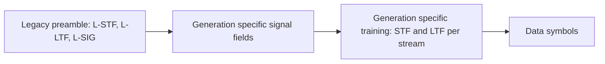

# WF 02: The Wi-Fi physical layer, from the channel to the PPDU

*Part of the [networking plan](../00_plan.md), Wi-Fi sub-track · Candela sessions 2a to 2d (the 802.11 PHY, modulation, MIMO and OFDMA) with the beamforming, regulatory power and DFS gaps folded in · You need: [WF 01](01_wifi_landscape_and_ap_anatomy.md) (the rate formula) and [WF 11](11_rf_fundamentals_and_link_budget.md) (decibels, noise floor, the SNR each MCS needs)*

The physical layer turns a number of bits into a number of microseconds of air. Everything above it, contention, aggregation, rate control and roaming, is a way of spending or saving those microseconds. This tutorial builds the PHY from the bottom: which frequencies exist, how a bit becomes a point on a constellation, how error correction buys back signal strength, how OFDM survives echoes, what the preamble costs, and how MIMO, beamforming and OFDMA multiply what one channel can carry.

"How does Wi-Fi 6 get from 54 Mbit/s to 9.6 Gbit/s" and "why is my 1.2 Gbit/s link only moving 500" are the two standard PHY questions, and they are the same question. The first is the peak-rate formula; the second is everything that formula leaves out: the preamble, the guard interval, the amplifier back-off, the sounding airtime and the acknowledgements. A senior answer carries both.

By the end you can:

- turn a channel number into a frequency, a bonded block and a primary channel, and explain why DFS and 6 GHz change planning;
- explain what a constellation point costs in signal to noise ratio and why higher MCS needs a cleaner link;
- explain what the convolutional and LDPC codes buy, and why the coding rate is part of the MCS;
- explain why OFDM exists, what the guard interval protects against, and what the subcarrier layout of each generation is;
- explain why the power amplifier, not the radio's maximum power, limits the range of high MCS;
- compute any rate in the standard from the MCS tables, and check it against a decoder;
- read a preamble, the L-SIG field and what a frame costs in airtime, and say how aggregation changes the efficiency;
- explain MIMO (capacity, diversity, rank), beamforming and sounding, MU-MIMO and when each pays;
- explain OFDMA and resource units, and when OFDMA helps and when it hurts;
- explain DFS and the 6 GHz power classes, and what they cost a design.

---

## 1. Bands and channels

A **channel number** is only a way of writing a centre frequency. In 2.4 GHz the centre is 2407 + 5n MHz, in 5 GHz it is 5000 + 5n, and in 6 GHz it is 5950 + 5n. So channel 6 is 2437 MHz, channel 36 is 5180 MHz and 6 GHz channel 1 is 5955 MHz. A small function makes this concrete:

```python
def centre_mhz(band, ch):
    base = {"2.4": 2407, "5": 5000, "6": 5950}[band]
    return 2484 if (band == "2.4" and ch == 14) else base + 5 * ch
```

### 1.1 2.4 GHz

Channels are 5 MHz apart but a 20 MHz signal is about 20 MHz wide, so adjacent channels overlap heavily. The old 802.11b spread-spectrum mask needed 25 MHz, which gives the familiar non-overlapping set **1, 6, 11**. A 20 MHz OFDM signal fits a 20 MHz spacing, so 1, 5, 9, 13 would also not overlap, but 1, 6, 11 is what everyone uses so that b-era neighbours do not clash. A 40 MHz channel in this band takes two of those three, so bonding in 2.4 GHz is a bad idea in any building with more than one access point.

### 1.2 5 GHz

The band is divided into sub-bands, and for design the important column is **DFS** (dynamic frequency selection, section 11): channels that must listen for radar and vacate when they hear it.

| Sub-band (US) | 20 MHz channels | DFS |
|---|---|---|
| UNII-1 | 36, 40, 44, 48 | no |
| UNII-2A | 52, 56, 60, 64 | yes |
| UNII-2C | 100 to 144 | yes |
| UNII-3 | 149, 153, 157, 161, 165 | no |
| UNII-4 | 169, 173, 177 | no (newer rules) |

(From memory; plans differ by regulator and by year.) Roughly 25 channels of 20 MHz exist, of which only 9 are free of DFS. Bonding makes it worse, since a wider block needs DFS if any 20 MHz member does: only a handful of 40 MHz blocks, two 80 MHz blocks and no 160 MHz block are DFS-free. A wide channel in 5 GHz therefore means accepting radar events.

The wider channel is always the aligned block that contains the **primary 20 MHz channel**. Beacons and legacy frames go on the primary; the extension channels are only used for wide data. An AP with primary channel 40 builds a 40 MHz channel from 36 and 40 (centre channel 38), an 80 MHz channel from 36 to 48 (centre 42) and a 160 MHz channel from 36 to 64 (centre 50).

### 1.3 6 GHz

The 6 GHz band (5925 to 7125 MHz in the US) is the clean slate: 59 channels of 20 MHz, room for 29 of 40 MHz, 14 of 80 MHz, 7 of 160 MHz and 3 of 320 MHz, no legacy devices and in most rules no DFS. Two rules are design inputs. The **preferred scanning channels (PSC)**, every 16th 20 MHz channel, exist because a client cannot afford to scan 59 channels, so APs are expected to put a discoverable beacon (or a pointer in a 2.4 or 5 GHz beacon, the reduced neighbour report) there. And 320 MHz channels come in two overlapping sets offset by 160 MHz, so a plan has to choose one set.

---

## 2. Modulation: what a symbol carries and what it costs

Each subcarrier carries one **constellation point** per symbol. BPSK has two points (1 bit), QPSK four (2 bits), 16-QAM sixteen (4 bits), and so on up to 4096-QAM (12 bits). With the same average power, more points means the points sit closer together, and the **minimum distance** between neighbours decides how likely noise is to push one into another.

The rule to remember is that each additional **2 bits per symbol costs about 6 dB** of signal to noise ratio for the same error rate. Going from BPSK to QPSK costs 3 dB, from QPSK to 16-QAM another 7, and each step after that about 6. In round numbers, to hold a low symbol error rate you need on the order of 7 dB for BPSK, about 24 dB for 64-QAM, about 30 dB for 256-QAM and about 42 dB for 4096-QAM, before coding. This is why a high MCS is only seen near the access point: the client needs a clean signal to afford a dense constellation.

The standard does not leave the choice to chance. MCS 0 to 11 pair a constellation with a coding rate, so that adjacent MCS differ by a modest step in both rate and required SNR (section 6).

---

## 3. Coding: buying signal-to-noise back

Before sending, the PHY adds redundancy so that errors can be corrected. 802.11 uses a **convolutional code** (constraint length 7, so a 64-state decoder), first at rate 1/2 and then **punctured**, that is, with some output bits deleted, to rates 2/3, 3/4 and 5/6. A higher coding rate means less redundancy, so more of the stream is payload, but less protection. From the standpoint of "bits per second per dB of SNR" a good code is worth a lot: the 1/2 code gains roughly 4 dB over uncoded transmission at a typical error rate, and the 5/6 code about 2.6 dB, because it protects less. **LDPC** codes, optional from 802.11n and the choice for the larger blocks in 802.11ax, add another 1 to 2 dB over the convolutional code.

So a link's required SNR is made of two things: the constellation (about 6 dB per two bits) and the code (how much protection is left). An MCS is a combination of both. A useful way to think about rate adaptation (WF 03) is that it picks the point on this curve where the extra bits per symbol stop being worth the extra errors.

---

## 4. OFDM: many slow subcarriers and a guard interval

### 4.1 Why OFDM

A radio signal reaches the receiver along several paths: direct, bounced off walls and floors. The echoes arrive later than the direct signal, and if the symbol is short compared with the delay spread, the echo of one symbol lands on top of the next one (inter-symbol interference). A single fast carrier needs complex equalisation to undo that. **OFDM** instead splits the channel into many narrow subcarriers, each carrying a slow symbol. A slow symbol is long compared with the echo delays, so each subcarrier sees a flat channel and needs only one complex multiplication to correct.

### 4.2 The guard interval

To get rid of the remaining interference, a copy of the end of each symbol is put in front of it, the **cyclic prefix** (guard interval). As long as the echo arrives within the guard interval, the receiver discards that part and what it sees is a clean circular convolution. The echo does no harm. If the echo arrives later than the guard, it leaks into the next symbol and the error grows quickly. This is what a guard interval is: protection against delay spread, paid for with airtime. Longer guards are used outdoors or in large halls, and short ones in small rooms.

### 4.3 Subcarrier layouts

The four numbers that describe a generation's OFDM are the spacing between subcarriers, the symbol length (the inverse of the spacing), the guard interval options, and the number of **data subcarriers** (out of the total, some carry pilots for tracking and some at the edge and centre are unused):

| Generation | Spacing | Symbol (without guard) | Guard options | Data subcarriers (20 / 40 / 80 / 160 MHz) |
|---|---|---|---|---|
| 802.11a / g | 312.5 kHz | 3.2 us | 0.8 us | 48 |
| 802.11n | 312.5 kHz | 3.2 us | 0.8, 0.4 us | 52 / 108 |
| 802.11ac | 312.5 kHz | 3.2 us | 0.8, 0.4 us | 52 / 108 / 234 / 468 |
| 802.11ax | 78.125 kHz | 12.8 us | 0.8, 1.6, 3.2 us | 234 / 468 / 980 / 1960 |
| 802.11be | 78.125 kHz | 12.8 us | 0.8, 1.6, 3.2 us | up to 3920 at 320 MHz |

(From memory.) 802.11ax made the subcarriers four times closer, so the symbol is four times longer. A longer symbol and a longer guard option make the signal robust in dense and outdoor environments, and it also lowers the relative overhead of the guard, but it is the reason the Wi-Fi 6 peak rate rose only modestly (WF 01).

### 4.4 Channel estimation

The receiver does not know the channel, so each frame starts with known **training fields**. It compares what it received with what it expected, estimates the channel at every subcarrier, and uses that to equalise the rest of the frame. More training symbols give a better estimate (the error falls by 3 dB each time the number of training symbols doubles), which is why MIMO frames carry one training field per stream and why a long frame in a changing channel needs mid-frame training (the **midambles** of the vehicle standard in WF 14).

---

## 5. The peak-to-average ratio and the amplifier

An OFDM signal is the sum of many subcarriers, and now and then they add in phase, making a brief high peak. The ratio of peak to average power is the **PAPR**, and for OFDM it is typically 10 to 12 dB at the high percentiles. The power amplifier must pass those peaks without clipping. A clipped peak distorts the signal, which shows up as an error in the constellation, quantified as the **error vector magnitude (EVM)**.

The standard sets a maximum EVM for each MCS, and it gets stricter as the constellation gets denser (about -5 dB for MCS 0 up to -35 dB for MCS 11 in 802.11ax, **from memory**). To meet the tight EVM of MCS 11 the amplifier must run **backed off**, far below its saturation point, which means a lower average output power for high MCS than for low MCS. The result: the highest MCS is limited not only by the receiver's SNR but by the transmitter's cleanliness, and a radio that can transmit 20 dBm at MCS 0 may only manage a few dBm less at MCS 11. This is why range figures quoted by a datasheet differ by MCS, and why a good amplifier and digital pre-distortion matter as much as the number of antennas.

---

## 6. The MCS tables and the rate formula

An **MCS index** is a short name for a pair of constellation and coding rate. In 802.11ax the 12 values are:

| MCS | Modulation | Coding | MCS | Modulation | Coding |
|---|---|---|---|---|---|
| 0 | BPSK | 1/2 | 6 | 64-QAM | 3/4 |
| 1 | QPSK | 1/2 | 7 | 64-QAM | 5/6 |
| 2 | QPSK | 3/4 | 8 | 256-QAM | 3/4 |
| 3 | 16-QAM | 1/2 | 9 | 256-QAM | 5/6 |
| 4 | 16-QAM | 3/4 | 10 | 1024-QAM | 3/4 |
| 5 | 64-QAM | 2/3 | 11 | 1024-QAM | 5/6 |

(Wi-Fi 7 adds MCS 12 and 13 with 4096-QAM; 802.11ac stops at 9 and 802.11n has MCS 0 to 7 per stream.) The rate formula of WF 01 turns an MCS, a width, a number of streams and a guard interval into a rate. As a function:

```python
from fractions import Fraction as F

BITS = [1, 2, 2, 4, 4, 6, 6, 6, 8, 8, 10, 10]
CODE = [F(1,2), F(1,2), F(3,4), F(1,2), F(3,4), F(2,3), F(3,4), F(5,6),
        F(3,4), F(5,6), F(3,4), F(5,6)]
TONES = {20: 234, 40: 468, 80: 980, 160: 1960}   # 802.11ax data subcarriers

def he_rate_mbps(mcs, width, streams=1, gi_us=0.8):
    return TONES[width] * BITS[mcs] * float(CODE[mcs]) * streams / (12.8 + gi_us)
```

`he_rate_mbps(11, 80)` gives about 600.5, the figure of a one-stream phone on Wi-Fi 6 at 80 MHz. Three consequences are worth internalising:

- **Width scales the rate almost exactly.** Doubling the channel doubles the data subcarriers (slightly more than doubles it at 80 MHz, since 80 MHz needs fewer guard tones than four 20 MHz channels).
- **A step in MCS buys less than a step in width,** and needs a better SNR: a higher MCS is a denser constellation or less coding. So the cheapest way to double the rate on a good link is more bandwidth or more streams, not a higher constellation.
- **A longer guard interval costs rate in direct proportion to the symbol:** 1.6 us costs about 6 percent and 3.2 us about 15 percent at the top MCS, which is the price of robustness.

You can verify your arithmetic independently. Build a frame with a radiotap header that announces an MCS, a width and a guard interval, write it to a capture file, and let `tshark` print the rate it computes:

```python
from scapy.all import RadioTap, Dot11, wrpcap
# an 802.11n frame announced as MCS 7, 20 MHz, long guard interval
pkt = RadioTap(present="MCS",
               knownMCS="MCS_bandwidth+MCS_index+guard_interval",
               MCS_bandwidth=0, MCS_index=7) / Dot11(type=2, subtype=0)
wrpcap("/tmp/rate.pcap", [pkt])
# tshark -r /tmp/rate.pcap -T fields -e wlan_radio.data_rate -e wlan_radio.11n.mcs_index
```

`tshark` prints a rate of 65 Mbit/s for this frame, which is what the formula gives for one stream at 20 MHz, MCS 7 and a long guard interval (52 subcarriers x 6 bits x 5/6 / 4 us).

If the dissector and your formula agree across several MCS, widths and guard intervals, you have confirmed the subcarrier counts and the coding rates. (This is a check on the arithmetic, not a measurement of any radio.)

---

## 7. The PLCP: preamble, L-SIG and what a frame costs

Every transmission starts with a **preamble** (PLCP header), and it is the same idea in every generation: first a legacy part that every device from 802.11a on can decode, so that old devices know the air is busy and for how long, then a new part that only newer devices understand and that tells them the MCS, the width and the number of streams.



- The **short training field (STF)** lets the receiver detect the frame and set its gain.
- The **long training field (LTF)** lets it estimate the channel and fix the frequency offset.
- The **L-SIG** field carries the rate and a 12-bit **LENGTH** that lets a legacy station compute how long the rest of the frame lasts and stay quiet. It tells a legacy device to defer, even if it cannot decode the payload. The 12-bit field limits the duration a legacy device can be told about to roughly 5.5 ms, which is why the maximum duration of a Wi-Fi frame is about that.
- The newer signal fields (HT-SIG, VHT-SIG-A, HE-SIG-A, EHT-SIG) say what the data field is.

The legacy preamble alone takes 20 microseconds. With the newer fields and per-stream training the total grows: roughly 36 us for 802.11n at one stream, 40 for 802.11ac, and over 40 for 802.11ax and 802.11be (and more with more streams, since each stream needs its own training symbol). At the top rates the payload of a 1500-byte frame lasts only tens of microseconds, so the preamble, the interframe gaps and the acknowledgement can take most of the airtime.

This is the reason for **aggregation** (WF 03): put many MPDUs in one PPDU so that one preamble and one acknowledgement serve many frames. At the highest rate of 802.11ax one 1500-byte MPDU delivers under 10 percent of the PHY rate as useful data; eight deliver about 40; a hundred or more reach 90 percent. The maximum PPDU duration (the 5.5 ms limit) bounds the aggregate, and a large aggregate has its own costs in latency and in retransmitting a whole burst on a loss.

---

## 8. MIMO: capacity, diversity and rank

With several antennas on each side, the radio can do three different things, and which one pays depends on the channel.

**Spatial multiplexing.** Send different data on each antenna. If the paths between the antennas are different enough (the channel has high **rank**), the receiver can separate the streams, and capacity grows roughly in proportion to the smaller of the two antenna counts. Capacity grows about 7.5 times from a 1x1 to an 8x8 link in an ideal uncorrelated channel.

**Diversity.** Send the same data, coded across antennas. A deep fade on one path is unlikely to hit all of them, so errors become much rarer: two receive antennas change the slope of the error-rate curve from about 1 (the error rate halves per 3 dB) to about 2 (it falls to a quarter).

**Rank is the limit.** In line of sight with correlated antennas there is only one strong path, the channel has rank one, and a second stream adds nothing. Two streams pay only if the SNR is high enough: in a simulated Rayleigh channel, two streams beat one only above roughly 20 dB with ideal eigenmode processing and 25 dB with a practical linear receiver. At the edge of the cell, with a low SNR, the best use of a second antenna is diversity or beamforming, not a second stream. Real arrays are correlated, so real gains are lower than in an ideal model.

---

## 9. Beamforming, sounding and MU-MIMO

### 9.1 Transmit beamforming

If the transmitter knows the channel to a client, it can weight the signals of its antennas so that they add up in phase at the client. With N transmit antennas the gain is 10 log10(N) dB (3 dB for 2 antennas, 6 for 4, 9 for 8). A few dB at the edge is worth several MCS steps. The difficulty is that the transmitter must know the channel.

### 9.2 Sounding

Since the AP cannot measure the downlink channel directly (it only sees the uplink), 802.11 uses **explicit sounding**. The AP sends a **null data packet announcement (NDPA)** naming the clients, then an **NDP** (a frame with only training fields), and each client measures the channel and returns a compressed **beamforming feedback** report. For several clients the AP polls them in turn. The whole exchange takes hundreds of microseconds for a handful of clients, which is airtime that carries no data. The AP therefore needs to sound often enough to keep the information fresh and rarely enough that the sounding does not eat the gain.

### 9.3 Why channel ageing matters

The feedback describes the channel at one instant. If the client moves, the channel changes. At 5.5 GHz a walking client decorrelates the channel noticeably in only a few milliseconds. Beamforming to a stale estimate points the energy in the wrong direction. This is why beamforming works well for slow or still clients and why MU-MIMO, which is far more sensitive, is rarely useful for moving ones.

### 9.4 MU-MIMO

**Multi-user MIMO** (downlink in 802.11ac wave 2, both directions in 802.11ax) sends different streams to different clients at the same time, using beamforming to put a null of one client's stream at the others. It needs accurate channel knowledge, because the nulls must be deep, and clients that are spatially separable. In a simulation of ageing channels a still client benefited from MU-MIMO at sounding intervals of tens of milliseconds, while a walking client was better served one at a time. The practical result is that MU-MIMO yields in real networks are modest, and mostly where many fixed clients such as TVs and laptops sit in separated places.

---

## 10. OFDMA: sharing a symbol among stations

Until 802.11ax a transmission was owned by one station at a time: whatever its size, a small frame occupied the whole channel, with its own preamble and acknowledgement. With **OFDMA** the channel is divided into **resource units (RUs)**, groups of subcarriers, and each RU can carry data for a different station in the same symbol.

| RU size (tones) | Approximate width | At 20 MHz how many |
|---|---|---|
| 26 | about 2 MHz | 9 |
| 52 | about 4 MHz | 4 |
| 106 | about 8 MHz | 2 |
| 242 | the whole 20 MHz | 1 |
| 484, 996, 2x996 | 40, 80, 160 MHz | |

Wi-Fi 7 adds multiple-RU combinations (WF 12).

In the downlink the AP sends an OFDMA PPDU with several RUs. In the uplink it sends a **trigger frame** that tells each station which RU to use and when, so several stations transmit at once, and then a multi-station block acknowledgement. The trigger frame and the sounding are overhead, so OFDMA pays when there are many stations with small frames: nine uplink transmissions of 100 bytes on nine RU26s take a fraction of the time of sending them one after another, because the preamble, gap and acknowledgement are paid once. For a single station with a big transfer, OFDMA only adds the cost of a trigger frame and loses a few percent. So the benefit is real for IoT, voice, acknowledgements and chat, and absent for bulk downloads (WF 06 returns to this with uplink scheduling).

---

## 11. Regulatory power and DFS

### 11.1 Power rules

Regulators limit the **EIRP**, the radiated power including antenna gain (WF 11 and WF 14 compute it). The limits depend on band, on indoor or outdoor use, and on channel. In 6 GHz the US rules define classes: **low power indoor** (for access points inside buildings), **standard power** (higher power, only with an **automated frequency coordination** service that checks incumbents at the AP's location) and **very low power** (for portable devices). A design that assumes the same power in every band and region will be wrong.

### 11.2 DFS

Some 5 GHz channels are shared with weather and military radar. A device operating there must:

1. listen before using a channel for a minimum time (a **channel availability check**, about a minute, and much longer on some European weather-radar channels);
2. keep listening while operating and, if it detects radar, stop transmitting within seconds and move;
3. keep off the channel for a **non-occupancy period** (about 30 minutes) after a detection.

The consequences for a design: DFS channels give more spectrum but come with interruptions; an AP must have an alternate channel ready, because a radar event means clients are moved with little notice; a false radar detection (often by a nearby device or a poor radio) causes outages that look random; and a plan that relies on a channel after a detection will lose it for half an hour. In a plan with many APs a radar event can hit several of them if they share a channel. The sensible practice is to use the non-DFS channels for critical services and DFS for capacity, and to log radar events so that persistent ones can be traced.

---

## 12. Common mistakes

1. **Quoting a PHY rate as throughput.** The preamble, gaps and acknowledgements take a large share, worst for small frames at high rates.
2. **Believing a higher MCS is free.** Each 2 bits costs about 6 dB, and the amplifier must be backed off further.
3. **Bonding channels in 2.4 GHz.** There are only a few channels, and bonding takes them from the neighbours.
4. **Forgetting that wide 5 GHz channels need DFS.** Almost every 80 MHz block and every 160 MHz block outside the 6 GHz band does.
5. **Treating the guard interval as waste.** It is the protection against echoes; shortening it in a hall causes errors.
6. **Assuming more antennas always means more streams.** Streams need a high-rank channel and a high SNR.
7. **Beamforming to a moving client with a stale estimate.**
8. **Enabling MU-MIMO and expecting a universal gain.** It needs separable fixed clients and fresh sounding.
9. **Expecting OFDMA to speed up a single large download.**
10. **Ignoring the primary channel.** It carries beacons and legacy frames and decides which neighbours the AP overlaps.
11. **Assuming the same power in every band and region.**
12. **Assuming an LDPC gain without checking the hardware supports it.**

---

## 13. Interview questions

**1. How does Wi-Fi 6 get from 54 Mbit/s to 9.6 Gbit/s?**
Data subcarriers times bits per subcarrier times coding rate times streams, divided by the symbol time. Compared with 802.11a the channel is eight times wider (160 MHz), the constellation is 1024-QAM, there can be eight streams, and the symbol is longer, which cuts the relative overhead.

**2. Why is my 1.2 Gbit/s link only moving 500 Mbit/s?**
The PHY rate is the speed of the data field only. The preamble, the interframe spaces, backoff, the acknowledgement and any retransmissions use airtime, and a single MPDU at a high rate spends most of its airtime on them. Aggregation recovers most of it. The rest is retries, contention with neighbours, and an MCS that is lower than the headline one.

**3. Why does a higher MCS need a better signal?**
A denser constellation brings points closer together, so noise causes errors, and each two more bits cost about 6 dB. A higher coding rate also leaves less protection. The amplifier also has to be backed off, so the transmitted power falls.

**4. What does OFDM solve, and what is the guard interval for?**
It solves multipath echoes: many narrow subcarriers have long symbols, so each sees a flat channel. The guard interval is a cyclic copy in front of each symbol so that echoes inside it do no harm. It costs airtime and protects against delay spread.

**5. Why did Wi-Fi 6 make the symbol four times longer?**
It spaced the subcarriers four times closer, which allows longer guard options and a smaller guard overhead and tolerates delay spread outdoors and in dense deployments. The side effect is that the headline rate rose little.

**6. What is the primary channel?**
The 20 MHz channel in a wide channel on which beacons and legacy frames are sent. The wider channel is the aligned block containing it. Choosing the primary decides what the AP overlaps with neighbours.

**7. What do spatial multiplexing, diversity and beamforming each need?**
Multiplexing needs a high-rank channel and a high SNR. Diversity needs only more antennas and helps in fades and at low SNR. Beamforming needs channel knowledge (sounding) and works best on slow clients.

**8. Why is MU-MIMO often disappointing?**
It needs accurate, fresh channel feedback and clients that are spatially separable. Sounding is overhead, channel ageing destroys the nulls for moving clients, and consumer clients have few antennas.

**9. When does OFDMA help and when does it not?**
It helps with many stations sending small frames, because the preamble, gap and acknowledgement are shared. A single station doing a bulk transfer only pays the trigger-frame overhead.

**10. What is DFS and what does it cost?**
Radar avoidance on shared 5 GHz channels: listen before using, vacate on detection, stay off for about half an hour. It gives more channels but causes interruptions and requires a fallback channel.

**11. What is the L-SIG field for?**
It lets legacy stations that cannot decode a newer frame know how long it lasts so they defer. The 12-bit length field limits the duration it can express.

**12. Why do the 6 GHz rules need preferred scanning channels?**
There are 59 channels; a client cannot scan them all quickly, so some channels are designated for discoverable beacons or pointers.

---

## 14. Scenarios and design questions

**S1. The 1.2 Gbit/s link that moves 500** (talk-through, then optional capture)
Explain the gap and say what you would capture to prove each cause. *Approach:* list the airtime consumers in order (preamble, IFS, backoff, ACK, retries, aggregation size) and say which field in a capture shows each (retry bit, A-MPDU length, rate).

**S2. Pick channels and widths for a dense office** (whiteboard)
Forty APs, three floors, 5 GHz and 6 GHz available. Choose widths and a reuse pattern. *Approach:* state the trade between width and reuse, count the usable channels at each width, treat DFS and 6 GHz explicitly, and say what changes for high-density rooms.

**S3. Clients on 6 GHz do not see the SSID** (talk-through)
*Approach:* think about discovery: PSC channels, reduced neighbour reports in 2.4 and 5 GHz beacons, out-of-band discovery, client regulatory domain and power class.

**S4. The AP on a DFS channel keeps moving** (talk-through)
*Approach:* separate real radar from false detections, look at logs for timing and repeated channels, consider nearby devices and radios, and say what plan you would choose (non-DFS primary for critical, DFS for capacity).

**S5. MU-MIMO enabled, throughput dropped** (talk-through)
*Approach:* sounding overhead against fresh channel information, clients moving, number of MU-capable clients, how the AP chooses groups, and how you would turn it off per client or per traffic type and measure.

**S6. Decode the rate from a capture** (Wireshark, 15 minutes)
Pick a data frame from any capture, read the radiotap fields, and recompute the rate with the formula of section 6. *Approach:* read MCS, width, streams and guard interval, then compute with `he_rate_mbps`-style arithmetic and compare with the dissector's figure.

**S7. Why does the high MCS disappear at the cell edge?** (whiteboard)
*Approach:* link budget (WF 11), required SNR per MCS, amplifier back-off, and what the rate-control algorithm sees.

**S8. Design question: a stadium access point** (whiteboard)
Choose antennas, widths and OFDMA settings for tens of thousands of small uplink flows. *Approach:* capacity from reuse, narrow channels, OFDMA for small uplinks, low power, and what you would verify.

---

## 15. Strong answers

**S1.** Walk through one frame's airtime: the preamble (tens of microseconds), the gap and backoff before it, the data field, the gap and the block acknowledgement after it. A single MPDU at a high rate spends more time on overhead than on data; aggregation shares that overhead. Then retries (retry bit in the header), contention from neighbours, a lower actual MCS than the headline, and a bottleneck elsewhere (the Ethernet port, the server). In a capture, read the A-MPDU size and the rate of each frame, count retries and measure idle time between frames.

**S2.** Wider channels give more rate per client but fewer non-overlapping channels, so more co-channel interference. In a dense deployment capacity comes from reuse, so favour 20 or 40 MHz in 5 GHz, and use 80 MHz where there are few APs or a lot of 6 GHz spectrum. In 5 GHz count the non-DFS and DFS channels; in 6 GHz use 80 MHz or 160 MHz with a reuse pattern that separates neighbours on the same floor and on adjacent floors. Use lower power in dense areas, and keep a few APs on wider channels where the clients are few and fast. Verify with a survey and with channel utilisation counters.

**S3.** The client may not scan 6 GHz channels other than PSC ones, so the AP should put a beacon on a PSC channel or announce itself in a reduced neighbour report in its 2.4 and 5 GHz beacons. Check that the AP's 6 GHz regulatory domain and power class are right and that the client supports 6 GHz in that domain. Also check WPA3 requirement: 6 GHz requires WPA3 or OWE, so an AP configured with WPA2 will not advertise there.

**S4.** Genuine radar tends to be periodic and location related; false detections come from noisy radios, nearby devices on adjacent channels and poor RF design. Look at timestamps and channels in the logs, compare several APs, and test the same channel with a different radio. A sensible plan keeps critical services on non-DFS channels, gives DFS APs a ready alternate channel, avoids channels with repeated events, and keeps the non-occupancy time in mind when planning moves.

**S5.** Sounding takes airtime and clients that move make the feedback stale, so the nulls fail and the streams interfere. Few MU-capable clients mean few groups, so nothing is gained. Measure with and without MU-MIMO per client and traffic type, look at the sounding interval, and disable MU for mobile clients while keeping it for fixed ones.

**S6.** Read MCS (or the VHT/HE rate index), width, number of spatial streams and the guard interval, compute subcarriers times bits times code rate times streams over the symbol time, and compare. A mismatch is usually a wrong guard interval or a wrong subcarrier count for the width.

**S7.** At the edge the SNR falls, so the required SNR of the top MCS cannot be met; the amplifier is also backed off for it, so the transmitted power is lower. The rate-control algorithm sees errors at that MCS and moves down. Improve the cell edge with lower noise, better antennas or more APs, not by adjusting rate tables.

**S8.** Use many APs, directional or sector antennas aimed at seating blocks, narrow channels and moderate power to reuse spectrum, and OFDMA so that many small uplink transmissions share one transmission. Verify with load tests that simulate thousands of clients, track airtime utilisation and retry rate, and plan DFS and 6 GHz usage explicitly.

---

## 16. Cheat sheet

| Topic | Fact |
|---|---|
| Centre frequency | 2.4 GHz: 2407 + 5n; 5 GHz: 5000 + 5n; 6 GHz: 5950 + 5n |
| 2.4 GHz | Use 1, 6, 11; do not bond |
| 5 GHz | Few DFS-free blocks; wide channels need DFS |
| 6 GHz | 59 x 20 MHz, 7 x 160, 3 x 320; PSC for discovery |
| Each 2 bits | About 6 dB more SNR |
| Codes | Convolutional 1/2, 2/3, 3/4, 5/6; LDPC about 1 to 2 dB better |
| OFDM | Guard interval protects against delay spread |
| Wi-Fi 6 symbol | 12.8 us plus guard, spacing 78.125 kHz |
| PAPR | 10 to 12 dB; high MCS needs amplifier back-off |
| Legacy preamble | 20 us; L-SIG carries a 12-bit length |
| Aggregation | Needed to recover efficiency at high rates |
| MIMO | Multiplexing needs rank and SNR; diversity helps at low SNR |
| Beamforming | 10 log10 N dB; needs sounding; ages quickly |
| MU-MIMO | Fresh feedback, separable fixed clients |
| OFDMA | Many small frames; RU sizes 26 to 996; trigger frame cost |
| DFS | Listen first, leave on radar, stay off about 30 minutes |

---

## 17. Sources and caveats

Based on the Candela Wi-Fi course sessions 2a to 2d. The channel plans, subcarrier counts, MCS tables, field durations, EVM limits, RU tables and DFS timers are from memory and change with the regulator and the standard revision, so check them before quoting them in a design or an interview. The MIMO, beamforming, MU-MIMO and OFDMA behaviour was explored with simple simulations on idealised channels (uncorrelated antennas, no real interference, a textbook amplifier), so treat the shapes as right and the magnitudes as optimistic. No radio was used.
