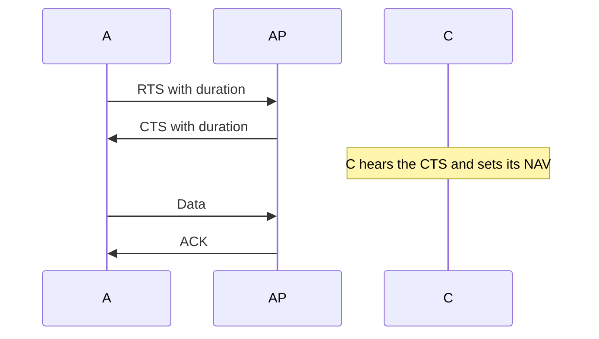
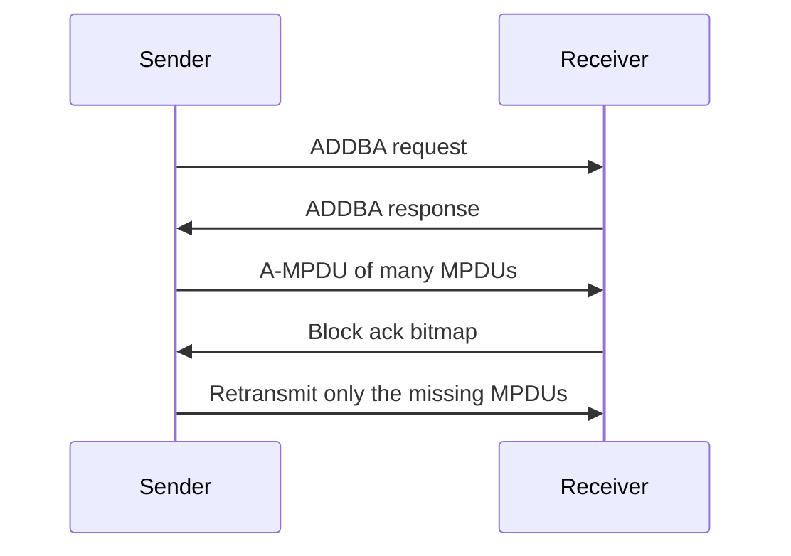
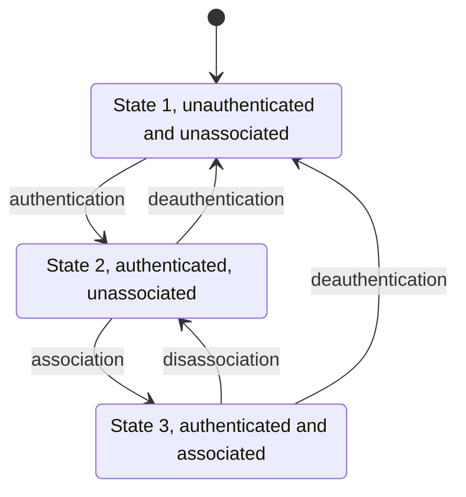
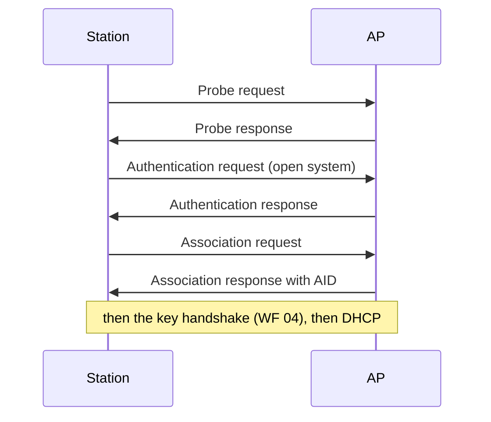

# WF 03: The Wi-Fi MAC: frames, contention, QoS, aggregation, power save and joining

*Part of the [networking plan](../00_plan.md), Wi-Fi sub-track · Candela sessions 3a to 3d (the 802.11 MAC) · You need: [WF 01](01_wifi_landscape_and_ap_anatomy.md) (topologies and addresses) and [WF 02](02_wifi_phy.md) (the PHY, the preamble and what a frame costs in airtime)*

The PHY decides how fast bits move once a station is on the air. The MAC decides **who is on the air, when, and what a frame is**. Wi-Fi shares one channel among everyone in range with no central scheduler, so the MAC is a set of polite rules: listen first, wait a random time, send, expect an acknowledgement, and back off further if there is none. On top of those rules sit priorities, aggregation, power saving, rate adaptation and the state machine of joining a network.

The MAC is where most real Wi-Fi performance problems live, and where most platform interview questions come from: "why does one slow client slow everyone down", "what is a hidden node", "how does a phone save battery on Wi-Fi", "what does a retry bit tell you". This tutorial covers all of it.

By the end you can:

- read an 802.11 frame header and say what each field is for, and tell management, control and data frames apart;
- explain DCF: carrier sense, interframe spaces, random backoff, the contention window and why collisions grow with stations;
- explain virtual carrier sense (the NAV), hidden nodes, RTS/CTS, protection for legacy devices and fragmentation;
- explain EDCA and WMM: access categories, AIFS, contention windows and TXOP limits, and how priorities map from DSCP;
- explain A-MSDU, A-MPDU and block acknowledgement, and why aggregation is the main efficiency tool;
- explain power save: TIM, DTIM, PS-Poll, U-APSD and target wake time, and why multicast hurts;
- explain rate adaptation and the performance anomaly, and why airtime fairness matters;
- walk through scanning, authentication, association and the three-state machine, and read retries and sequence numbers.

---

## 1. Frames

### 1.1 Three kinds of frame

Every 802.11 frame says in its first two bytes what it is. The **frame control** field holds a protocol version, a **type** and a **subtype**, plus eight flag bits.

| Type | What it is for | Examples |
|---|---|---|
| **Management** | Setting up and tearing down the relationship between stations and the AP | Beacon, probe request and response, authentication, association request and response, disassociation, deauthentication, action frames |
| **Control** | Helping the medium work: reserving it and acknowledging | RTS, CTS, ACK, block ack request and block ack, PS-Poll |
| **Data** | Carrying payload | Data, QoS data, null (a data frame with no payload, used to signal power state), QoS null |

The flag bits worth knowing: **ToDS** and **FromDS** (WF 01), **More Fragments**, **Retry** (this frame is a retransmission), **Power Management** (the sender will doze after this frame), **More Data** (the AP has more buffered frames for you), **Protected** (the body is encrypted) and **Order**.

A tiny decoder makes the layout concrete. The first two bytes are little-endian, the type is bits 2 and 3, the subtype bits 4 to 7, and the flags sit in the high byte:

```python
import struct

TYPES = {0: "management", 1: "control", 2: "data"}

def decode_fc(raw):
    fc, dur = struct.unpack("<HH", raw[:4])
    return {
        "type": TYPES.get((fc >> 2) & 3, "reserved"),
        "subtype": (fc >> 4) & 15,
        "to_ds": bool(fc & 0x0100), "from_ds": bool(fc & 0x0200),
        "more_frag": bool(fc & 0x0400), "retry": bool(fc & 0x0800),
        "power_mgmt": bool(fc & 0x1000), "more_data": bool(fc & 0x2000),
        "protected": bool(fc & 0x4000), "order": bool(fc & 0x8000),
        "duration_us": dur,
    }
```

Feeding it the bytes `88 09 2c 00` gives a QoS data frame (type data, subtype 8) from a station to the AP with the retry bit set and a duration of 44 microseconds.

### 1.2 The rest of the header

After frame control come:

- **Duration/ID** (2 bytes): in most frames the time in microseconds that the medium will be busy after this frame, which other stations use to set their NAV (section 3). In a PS-Poll it carries the association ID.
- **Address 1 to 3 (and 4)** (WF 01): receiver, transmitter and the end-to-end addresses.
- **Sequence control**: a 12-bit sequence number (counting up per frame to a destination) and a 4-bit fragment number. It lets a receiver drop a duplicate caused by a lost acknowledgement.
- **QoS control** (QoS data only): the traffic identifier (priority), the acknowledgement policy, and whether the payload is an A-MSDU (section 5).
- **HT/VHT/HE control** (when present): a small field used for link adaptation feedback and similar.
- **Frame body**, then a 32-bit **frame check sequence (FCS)**.

Control frames are small: an ACK is 14 bytes, a CTS 14, an RTS 20. They carry only a receiver address (and a transmitter for RTS), because they have no payload and need to be fast.

### 1.3 Frames you should recognise on sight

Beacon (management subtype 8) is broadcast every beacon interval (usually 100 time units, 102.4 ms) and carries the SSID, supported rates, capabilities and the TIM. Probe request (4) and probe response (5) are active scanning. Authentication (11), association request (0) and response (1) join a network. Deauthentication (12) and disassociation (10) leave. Action frames (13) carry extensions: block ack setup, spectrum management, radio measurement, BSS transition, fast transition. Control: RTS (11), CTS (12), ACK (13), block ack request (8), block ack (9), PS-Poll (10). Data: QoS data (8), null (4) and QoS null (12).

---

## 2. DCF: carrier sense, backoff and what contention costs

### 2.1 Listen before talk

The basic access method, the **distributed coordination function (DCF)**, is carrier sense multiple access with collision avoidance (CSMA/CA). A station with a frame to send listens. If the medium has been idle for a **DIFS**, it may transmit. If it is busy, the station waits until it becomes idle, then waits a DIFS and then a random **backoff** before transmitting, so that two stations that were both waiting do not start at the same instant.

The interframe spaces are fixed by the PHY. The **SIFS** (short interframe space) is the gap between a frame and its immediate response, such as data and ACK, so nobody else can sneak in: 16 microseconds at 5 GHz, 10 at 2.4. A **slot** is 9 microseconds in a modern network. The **DIFS** is the SIFS plus two slots, 34 microseconds at 5 GHz.

### 2.2 Backoff and the contention window

The random backoff is a number of slots chosen uniformly from 0 to the **contention window (CW)**. The station counts the slots down while the medium is idle and **freezes** the counter whenever the medium goes busy, resuming after the next DIFS. The first attempt uses the minimum window (15 for OFDM). If the ACK does not arrive, the station assumes a collision or loss, **doubles the window** (15, 31, 63, ... up to 1023), picks a new backoff and tries again, up to a retry limit (typically 7 for short frames and 4 for long ones), after which the frame is dropped. After a success the window resets.

Backoff is how the network stays stable under load: the more stations collide, the longer they spread out. The price is wasted idle slots. With a few stations the average backoff of 7.5 slots (67 microseconds) is a significant overhead for a short frame; with many stations collisions rise since the chance that two pick the same slot rises. Throughput under saturation falls as stations are added, and the loss per collision is large because a whole frame is sent before the sender learns about it.

### 2.3 What one frame costs

A frame is not just its payload. The airtime for one unaggregated frame includes the DIFS, the average backoff, the preamble, the data, the SIFS and the acknowledgement (with its own preamble). A small helper makes the point:

```python
def single_mpdu_efficiency(payload_bytes, rate_mbps, preamble_us=44,
                           sifs=16, difs=34, ack_us=44, mean_backoff_us=67.5):
    data_us = payload_bytes * 8 / rate_mbps
    overhead = difs + mean_backoff_us + preamble_us + sifs + ack_us
    return data_us / (data_us + overhead)
```

For a 1500-byte frame, `single_mpdu_efficiency(1500, 54)` is about 0.52: half the airtime is useful at 54 Mbit/s. At 600 Mbit/s the same frame is only about 9 percent useful, because the overhead is fixed in time and the payload shrinks as the rate rises. This single fact explains why every generation of Wi-Fi leans harder on aggregation (section 5), and why a high PHY rate and a modest throughput coexist.

### 2.4 Other timing

An **EIFS** (extended interframe space) replaces DIFS after a frame received in error, to give the other side's recovery a chance. A **PIFS** (SIFS plus one slot) is used by the access point for some priority cases. A station that finds the medium idle for a long time can transmit immediately after DIFS with no backoff, which is why light traffic is so fast.

---

## 3. Protection: the NAV, hidden nodes, RTS/CTS, legacy and fragmentation

### 3.1 Virtual carrier sense

Listening for energy is not enough, because a station may not hear every other station. So frames also carry a **duration** that tells everyone who hears it how long the exchange will occupy the medium. Each station keeps a **network allocation vector (NAV)**, a countdown set from the duration of every frame it overhears. While the NAV is non-zero the station treats the medium as busy even if its radio hears nothing. Physical carrier sense and the NAV together are the **virtual carrier sense**.

### 3.2 The hidden node

Two stations A and C are both in range of the AP B but not of each other. Neither hears the other, so both think the medium is idle and both transmit to B, whose receiver is hit by both and loses both. This is the **hidden node problem**, and it is the reason a collision cannot be avoided by listening alone.



**RTS/CTS** fixes it by moving the risk to short frames. The sender first sends a small **request to send**; the receiver replies with a **clear to send**, which hidden stations can hear, and they set their NAV and keep quiet for the whole exchange. If a collision happens it is between two 20-byte RTS frames, not two long data frames. The cost is two more frames and two more interframe spaces for every protected frame, so RTS/CTS is used only above a **size threshold**, or when many hidden nodes are expected. For small frames and few stations it hurts.

### 3.3 Protection for legacy stations

A mixed network of old and new stations must stop the old ones from colliding with transmissions they cannot decode. Since 802.11g and 802.11n, an AP that detects legacy stations turns on **protection**: a short frame at a legacy rate, either **CTS-to-self** or an RTS/CTS exchange, precedes the faster transmission so that legacy devices read the duration and defer. This is also what the legacy part of the preamble does (L-SIG, WF 02). Protection costs airtime at every transmission, which is one reason a single old device can slow a whole network and why networks switch off the lowest rates.

### 3.4 Fragmentation

A frame larger than the **fragmentation threshold** is split into smaller frames, each acknowledged separately, sent back to back with only SIFS between them. Smaller frames are less likely to be hit by a burst of interference, and a loss costs less to repeat. The price is extra headers and acknowledgements, so fragmentation is rarely used in modern networks; aggregation (section 5) goes in the opposite direction, and retransmission within an aggregate is handled by the block acknowledgement.

---

## 4. EDCA and WMM: priority as a share of the chances to transmit

DCF treats all traffic equally, which is wrong for voice. **EDCA** (enhanced distributed channel access, from 802.11e, certified as **WMM**) keeps contention but gives different traffic different parameters, so higher priority wins more often and waits less. It is a statistical priority, not a guarantee.

### 4.1 Four access categories

Each station runs four independent queues, each with its own backoff and parameters:

| Access category | Meant for | AIFSN | CWmin | CWmax | Max TXOP (OFDM, typical) |
|---|---|---|---|---|---|
| AC_VO (voice) | Calls | 2 | 3 | 7 | about 1.5 ms |
| AC_VI (video) | Streaming and conferencing | 2 | 7 | 15 | about 3 ms |
| AC_BE (best effort) | Ordinary traffic | 3 | 15 | 1023 | 0 (one frame) |
| AC_BK (background) | Bulk and backups | 7 | 15 | 1023 | 0 |

(From memory; the AP announces the actual values in the beacon.) Instead of DIFS a queue waits an **AIFS**, which is SIFS plus AIFSN slots: a lower number waits less. A smaller contention window means a shorter average backoff. Voice therefore waits two slots plus a tiny backoff, while background waits seven slots plus a large backoff. When two queues of one station expire at the same slot, the higher one wins and the other counts as a collision (an **internal collision**).

### 4.2 TXOP

A station that wins access for a high-priority category may send several frames back to back for a **transmit opportunity (TXOP)**, up to a time limit, with SIFS between them, so voice and video can send bursts and amortise the contention. A TXOP limit of zero means one frame.

### 4.3 From traffic to category

The 802.11 priority is a 3-bit user priority (0 to 7) set by the sender's QoS stack. User priorities 6 and 7 map to voice, 4 and 5 to video, 0 and 3 to best effort and 1 and 2 to background. The usual source is the **DSCP** value in the IP header, mapped by the top three bits (class selector): EF (46) lands in 5, which is video, not voice, in the default mapping, a well-known surprise; the bridge between IP QoS and Wi-Fi QoS (NET 14, WF 07) must be configured on purpose. A client sets the priority on the frames it sends and the AP does so on frames for the client.

### 4.4 Admission control

Priority alone cannot stop a cell filling with voice calls until none works. EDCA therefore defines **admission control**: an AP can require a station to request bandwidth for a category with a **traffic specification (TSPEC)** and refuse when the cell is full. Most deployments do not enable it and rely on limits elsewhere (such as call admission in the voice system).

### 4.5 What priority does and does not do

Priority is a share of the chances. In a cell dominated by best-effort bulk traffic, voice wins most contentions, so latency improves. But it does not help a link with a poor signal, does not reduce interference from other networks, and does not stop a congested uplink from a client. It also puts the burden on correct marking: a client that marks everything as voice starves the rest, and a network that strips markings makes it all best effort.

---

## 5. Aggregation and block acknowledgement

Section 2.3 showed that at high rates the fixed cost of each frame dominates. The answer since 802.11n is to **send many frames for one cost**.

### 5.1 A-MSDU and A-MPDU

- **A-MSDU** puts several network-layer packets (MSDUs) in one MAC frame, with one header and one FCS. It saves header bytes, but the whole frame is lost if the FCS fails, so it is for good links.
- **A-MPDU** puts several complete MAC frames (MPDUs), each with its own header and FCS, into one PHY transmission. If one fails, only that one needs to be resent. Almost all of the gain comes from A-MPDU.

Both can be combined. The maximum A-MPDU length grows with every generation (about 64 KB in 802.11n, 1 MB in 802.11ac, several MB in 802.11ax and more in 802.11be, from memory), and also is bounded by the maximum PPDU duration (WF 02).

### 5.2 Block acknowledgement

Acknowledging each frame separately would give the overhead back. Instead the receiver acknowledges the whole aggregate with one **block ack**: a bitmap of which MPDUs arrived. The two sides first set up a **block ack agreement** with action frames (ADDBA request and response), which fixes the **window size** (the number of outstanding frames: 64 in 802.11n and 802.11ac, 256 in 802.11ax, 1024 in 802.11be, from memory) and the starting sequence number.



The receiver holds out-of-order frames in a **reorder buffer** and delivers upward in order once the gap is filled or a window timeout expires, so a lost frame delays the ones behind it but not for long. A long aggregate raises throughput, and raises latency and the cost of a loss, so practical implementations size aggregates by airtime and by link quality. A drop in the aggregate size is a visible symptom of trouble in a capture.

### 5.3 Why it is the main efficiency tool

Everything fixed in time (DIFS, backoff, preamble, SIFS, acknowledgement) is paid once per aggregate instead of once per frame. At the highest rate of Wi-Fi 6, one 1500-byte frame delivers under 10 percent of the PHY rate and a hundred or so reach about 90 percent. So when you see a link with a high rate and low throughput, the first question is "how big are the aggregates?"

---

## 6. Power save

### 6.1 The basic mechanism

A radio that listens all the time costs far too much power. A station that wants to sleep tells the AP with the **power management bit** in a frame (often a null frame). From then on the AP **buffers** frames for it. The AP's beacons carry a **TIM** (traffic indication map): a bitmap, indexed by association ID, saying which sleeping stations have buffered frames. A sleeping station wakes for beacons (at a multiple of the beacon interval called the **listen interval**), reads the TIM, and if its bit is set sends a **PS-Poll** (or a trigger, below) to fetch the frames, staying awake while the **More Data** bit says there are more.

### 6.2 Multicast and the DTIM

Broadcast and multicast frames are for everyone, so the AP cannot send them when some stations sleep. It buffers them and sends them right after a beacon with a **DTIM** (delivery traffic indication message), which occurs every DTIM period of beacons. All stations that want multicast wake for the DTIM beacon, and the AP sends the buffered group traffic at the basic rate, with no acknowledgement. Two consequences: a long DTIM period saves power but delays multicast (and breaks protocols that need quick multicast replies, like discovery), and chatty multicast traffic keeps every station awake and uses the slowest rate, which is why networks filter or convert multicast (WF 07 and WF 14).

### 6.3 U-APSD

PS-Poll is slow, since a station must poll for each frame. **Unscheduled automatic power save delivery (U-APSD)** from 802.11e lets a station sleep and wake whenever it needs to send. Its own uplink frame acts as a **trigger**, and the AP replies by delivering the buffered downlink frames of the categories enabled for delivery, ending with a flag. It is the basis for efficient voice: the phone sends a voice frame every 20 ms, which triggers the delivery of the other side's voice frame, and sleeps in between.

### 6.4 Target wake time

**Target wake time (TWT)** from 802.11ah and 802.11ax moves from "wake every beacon and ask" to a negotiated schedule: a station and the AP agree on when it will wake and for how long, and the AP can schedule many stations into different slots, reducing contention as well as power. It is individual (one pair) or broadcast (a schedule for many). Chapter WF 06 explains it in detail.

### 6.5 What to look at when a phone drains its battery on Wi-Fi

A device that never sleeps (the PM bit stuck), a short DTIM period, frequent multicast or broadcast (mDNS, router advertisements), an AP that does not buffer correctly, a retried power-save frame, and aggressive background scanning.

---

## 7. Rate adaptation and the performance anomaly

### 7.1 Choosing an MCS

The transmitter must pick a rate for each frame, and it cannot see the channel directly. If it picks too high, frames fail and are retried at a cost; if too low, it wastes airtime. **Rate adaptation** is the algorithm that chooses. The standard says nothing about it; every vendor has its own. A classic open one, **Minstrel**, used in Linux, keeps a table of rates with the measured success probability and the expected throughput of each, mostly sends at the best one, and spends a small fraction of frames **probing** other rates. A retry chain tries the best, then the second best, then a safe fallback. Modern designs also use the signal strength and the feedback of the receiver.

### 7.2 Why a bad rate is expensive

A failed frame costs its full airtime and then a larger contention window, which is why a rate that is a little too ambitious loses far more than a rate that is a little too cautious. Retries also show in the retry bit, which is a useful health indicator in a capture: a high retry rate means a poor link or interference, not necessarily that rate adaptation is wrong.

### 7.3 The performance anomaly

DCF gives every station an equal chance to send **one frame**, not an equal share of time. A slow station takes far longer to send the same frame than a fast station. With equal frame sizes, the throughput of every station in the cell converges towards that of the slowest. The effect is large: a client at 1 Mbit/s sending a 1500-byte frame occupies the air for about 12 ms; a client at 600 Mbit/s needs a few tens of microseconds. If they alternate, the fast one sees a throughput close to the slow one's.

The fix is **airtime fairness**: give each station an equal share of time rather than frames. The AP schedules its own downlink to stay within airtime budgets (Linux's `mac80211` has an airtime fairness scheduler) and can disable the lowest rates so that nobody can occupy the air for so long. In an interview, "one slow client slows everyone down, and the fix is airtime fairness plus removing low basic rates" is the canonical answer.

---

## 8. Scanning, authentication, association and retries

### 8.1 Scanning

A station finds networks by **scanning**. **Passive scanning** listens on each channel for beacons for roughly a beacon interval; it is quiet and slow. **Active scanning** sends a **probe request** (to a specific SSID or the wildcard) and waits for **probe responses** for a short dwell time. Active scanning is quicker but not allowed on channels where radar must be heard first (DFS, WF 02), where the station must scan passively. A scan takes the radio off the serving channel, so aggressive scanning hurts a connected client's throughput.

### 8.2 The three states

A station's relationship with an AP is a state machine:



The class of frames allowed depends on the state: class 1 (probe, authentication, beacon) in any state, class 2 (association) after authentication, class 3 (data, disassociation) after association. An AP that receives a frame the sender's state does not allow answers with a deauthentication or disassociation, which is the origin of many mysterious disconnections.

### 8.3 Joining a network



The **authentication** frame of modern networks is a formality (**open system**); the real security is the key handshake afterwards (WF 04), and in WPA3 an authentication with a different algorithm (SAE) takes its place. The **association** request lists the rates and capabilities of the station (the HT, VHT and HE elements, section 9) and a reason to join; the response gives the **association ID (AID)** used in the TIM and a status code. Failures carry a status or reason code that is the first thing to read in a capture.

### 8.4 Retries and duplicates

If the ACK does not arrive, the sender sets the **retry bit** and resends with the same sequence number. The receiver uses the sequence number to detect a duplicate that arose because the ACK, not the data, was lost, and discards it while still acknowledging. A high retry fraction is the main symptom of a bad link, a hidden node, a too-high rate or interference. A frame dropped after the retry limit is the origin of "the Wi-Fi was fine but my video glitched".

---

## 9. How a station says what it can do

The association request and the AP's beacon carry **capability elements** that tell the other side what is supported. For 802.11n there is the **HT Capabilities** element (channel width, short guard interval, streams, aggregation limits, block ack support) and the **HT Operation** element (the AP's current channel and protection mode). 802.11ac and later add the **VHT** and **HE** and **EHT** capabilities and operation elements, and **extended capabilities** carry bits for features such as BSS transition, fine timing measurement and operating mode notification. The AP intersects its own capabilities with the client's to choose what to use, which is why a client that reports fewer capabilities than it has (for example no 80 MHz or one stream) gets a smaller rate than it could.

When debugging, read these elements in the association request first: they explain most "why only 150 Mbit/s" questions.

---

## 10. Common mistakes

1. **Equating a PHY rate with throughput.** Fixed overhead per transmission dominates at high rates.
2. **Thinking higher priority guarantees bandwidth.** EDCA is statistical.
3. **Expecting EF to land in voice.** The default mapping puts it in video unless configured.
4. **Enabling RTS/CTS everywhere.** It costs airtime and helps only with hidden nodes or large frames.
5. **Ignoring the retry bit.** It is the cheapest health indicator in a capture.
6. **Long DTIM on a network with multicast-dependent services.**
7. **Letting multicast flow freely.** It is sent at the lowest rate and wakes everyone.
8. **Letting one old client stay at 1 Mbit/s.** It dominates airtime unless low rates are disabled and airtime fairness is on.
9. **Aggressive client scanning on a connected radio.**
10. **Reading a deauthentication as "the AP kicked me" without reading the reason code.**
11. **Assuming aggregation is always good.** Long aggregates add latency and cost more on a loss.
12. **Believing rate adaptation is standardised.** It is vendor specific.

---

## 11. Interview questions

**1. What is the hidden node problem and how does RTS/CTS help?**
Two stations that cannot hear each other transmit to a common AP and collide. RTS/CTS makes the AP announce the reservation with a CTS that the hidden station hears, so it sets its NAV and waits. The price is two extra frames per exchange, so it is used for large frames or when hidden nodes exist.

**2. Walk through DCF.**
Listen, wait a DIFS if idle, count down a random backoff of 0 to CW slots (freezing while busy), transmit, wait for an ACK; on failure double the CW up to 1023 and retry up to a limit.

**3. What does EDCA change and what are the four categories?**
Different AIFS, contention window and TXOP per category, so voice and video win more often and wait less. AC_VO, AC_VI, AC_BE, AC_BK, mapped from user priority, typically from DSCP.

**4. Why is a high PHY rate not high throughput?**
The overhead (DIFS, backoff, preamble, SIFS, ACK) is fixed in time, so at a high rate the payload is a small part of the airtime. Aggregation shares the overhead.

**5. A-MSDU against A-MPDU?**
A-MSDU packs several packets under one MAC header and FCS, saving header bytes but losing all on one error. A-MPDU packs complete MPDUs with their own FCS, so only the damaged ones are resent. Block ack acknowledges an A-MPDU with a bitmap.

**6. How does a phone save power on Wi-Fi?**
It sets the power-management bit and dozes; the AP buffers frames and signals them in the TIM; the phone wakes for beacons or uses U-APSD triggers; newer networks use target wake time schedules. Multicast waits for the DTIM beacon.

**7. Why does one slow client slow everyone down?**
DCF gives equal chances per frame, not equal time, so a slow client occupies the air much longer. Airtime fairness and removing low basic rates fix it.

**8. What does the retry bit tell you?**
That the frame is a retransmission. A high fraction means a poor link, interference, a hidden node or a rate that is too high.

**9. What is the NAV?**
A countdown set from the duration field of overheard frames; while it is non-zero the station treats the medium as busy. It is virtual carrier sense.

**10. What happens in scanning, and what is the cost?**
Passive: listen for beacons per channel. Active: probe requests and responses. Either takes the radio off the serving channel and must be passive on DFS channels.

**11. What are the three states of a station?**
Unauthenticated and unassociated, authenticated and unassociated, authenticated and associated. Frame classes allowed depend on the state, and wrong-state frames cause deauth or disassociation.

**12. Is rate adaptation in the standard?**
No. It is vendor specific; Minstrel is an open example that probes rates and keeps success statistics.

---

## 12. Scenarios and design questions

**S1. "Wi-Fi is fine at the AP but terrible in the back of the hall."** (talk-through, then a capture)
*Approach:* hidden nodes, retry rate, rate adaptation, and what you would see in a capture near the clients (retries, RTS usage, rates).

**S2. A video call stutters while someone downloads a large file.** (whiteboard)
*Approach:* EDCA marking, whether the client and AP mark correctly, uplink contention, DSCP to user priority mapping, and what you would check in a capture (the QoS control field).

**S3. Battery life on a sensor is far worse than expected.** (talk-through)
*Approach:* the PM bit and null frames, DTIM period, multicast traffic, TWT availability, scanning, and the AP's buffering behaviour.

**S4. Throughput drops from 400 to 100 Mbit/s when an old laptop joins.** (whiteboard)
*Approach:* the performance anomaly, basic rates, protection, airtime fairness, and how to confirm with a capture.

**S5. Decode a frame control field by hand** (pen and paper, then the snippet of section 1)
Given the bytes `48 01 3a 01 ...`, say what the frame is. *Approach:* little-endian, type bits 2 and 3, subtype bits 4 to 7, flags in the high byte; check against `decode_fc`.

**S6. Design the rate adaptation for a driver you are writing.** (whiteboard)
*Approach:* the information you have (ACK feedback, retries, RSSI), exploration against exploitation, retry chains, aggregation interaction, and how you would test it.

**S7. Read a join failure in a capture** (Wireshark, 20 minutes)
A client never gets to State 3. *Approach:* filter `wlan.fc.type == 0`, follow probe, authentication and association, and read status and reason codes; check that the AP's response carries the expected capabilities.

**S8. Explain the cost and benefit of a 4 ms A-MPDU.** (whiteboard)
*Approach:* efficiency gain, added latency for other stations, loss cost, impact on voice, and airtime caps.

---

## 13. Strong answers

**S1.** Hidden nodes are likely, since the far clients cannot hear each other. In a capture near them look for a high retry fraction and rates that are lower than expected, and check whether RTS/CTS is used. Fixes: lower the RTS threshold, reduce power so cells are smaller, add an AP, or move clients to a better band. Also check that the AP's receive sensitivity is not the problem.

**S2.** Check that the video call is marked as voice or video (QoS control TID in the frames) and that the AP maps DSCP correctly; the download should be best effort or background. If everything is best effort, priority does nothing. Check the uplink, where clients contend against each other, and look at the retry rate and aggregation sizes; a large TXOP for the download hurts latency. Fixes: marking, mapping, airtime caps for bulk and AQM on the AP.

**S3.** A device that does not set the PM bit or is woken by frequent multicast never sleeps. A short DTIM period or a client that wakes every beacon uses power. TWT lets it sleep for long periods if the AP supports it. Check the beacon interval, DTIM, which multicast flows exist (mDNS and similar) and whether the AP converts or filters them, and the client's scanning.

**S4.** The old laptop sends at a low rate, so each frame takes far longer, and DCF gives equal frame opportunities, so everyone's throughput falls towards its level. Disable the lowest basic rates so it cannot sit at 1 Mbit/s, enable airtime fairness, and if protection is triggered by a legacy device, note the extra overhead on every transmission. A capture shows the long airtime of its frames.

**S5.** `48 01` is 0x0148. The low byte 0x48 is 0100 1000: version 0, type bits `10` (data), subtype bits `0100` (4, a null data frame). The high byte 0x01 sets ToDS. So this is a null frame from a station to the AP, typically a power-state signal.

**S6.** Inputs: ACK or block ack results per rate, retry counts, RSSI and the aggregation outcome. A good design keeps a success statistic per rate, picks the rate with the best expected throughput, probes neighbouring rates a small fraction of the time, falls back through a retry chain, and handles fast changes by trusting recent results more. Aggregation matters, since the cost of a failed rate rises with aggregate length. Test with a channel emulator and attenuators, with both stationary and moving clients, against a reference like Minstrel.

**S7.** Filter by management frames and find the last successful step. A missing probe response means a channel or SSID problem; an authentication failure shows a status code; an association response with a status such as unsupported rates or capabilities points to a mismatch (WPA3 only, 6 GHz rules, missing required rates); a deauth right after the association usually comes from the key handshake failing (WF 04). Check that the association request carries the right HT, VHT and HE capabilities.

**S8.** A longer A-MPDU improves efficiency and raises throughput, but every other station waits that long, which hurts voice and interactive traffic. A loss costs more, and in a poor channel the end of a long aggregate may be received at a worse channel state than the start. Airtime caps (often a few milliseconds) and per-category limits balance both; voice should use short bursts.

---

## 14. Cheat sheet

| Topic | Fact |
|---|---|
| Frame types | Management, control, data |
| Frame control flags | ToDS, FromDS, More Frag, Retry, PM, More Data, Protected, Order |
| SIFS / slot / DIFS | 16 / 9 / 34 microseconds at 5 GHz |
| Backoff | Random 0..CW, CW doubles to 1023, freeze when busy |
| NAV | Countdown from the duration of overheard frames |
| RTS/CTS | Fixes hidden nodes; costs overhead; use by threshold |
| EDCA | AC_VO, VI, BE, BK; AIFSN, CW, TXOP differ |
| EF in default mapping | Lands in video, not voice |
| A-MPDU | Many MPDUs per PPDU; block ack bitmap |
| Block ack window | 64, 256, 1024 by generation |
| Power save | PM bit, TIM, PS-Poll, U-APSD, TWT, DTIM for multicast |
| Anomaly | Equal frames not equal time; fix with airtime fairness |
| States | 1, 2, 3; deauth and disassoc move back |
| Join | Probe, auth, assoc, key handshake, DHCP |

---

## 15. Sources and caveats

Based on the Candela Wi-Fi course sessions 3a to 3d. Timing values, EDCA parameter defaults, block ack window sizes, the maximum aggregate lengths and the frame subtype numbers are from memory and should be checked against the standard before quoting. The frame-control decoder and the efficiency helper were run and give the values quoted; they are small illustrations, not a MAC implementation. The airtime figures assume a typical OFDM PHY and ignore interference.
