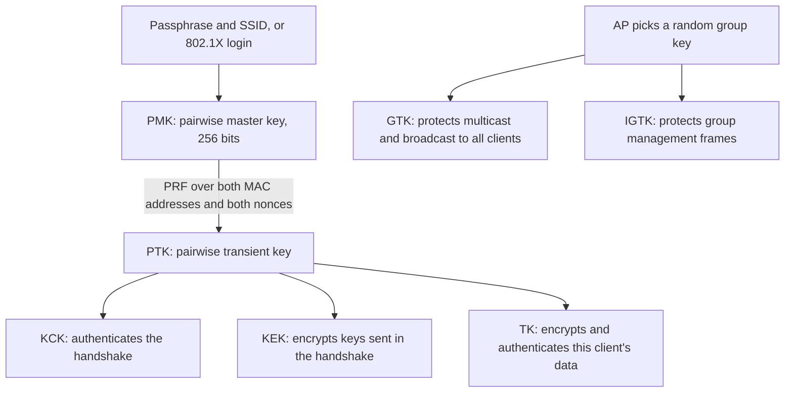
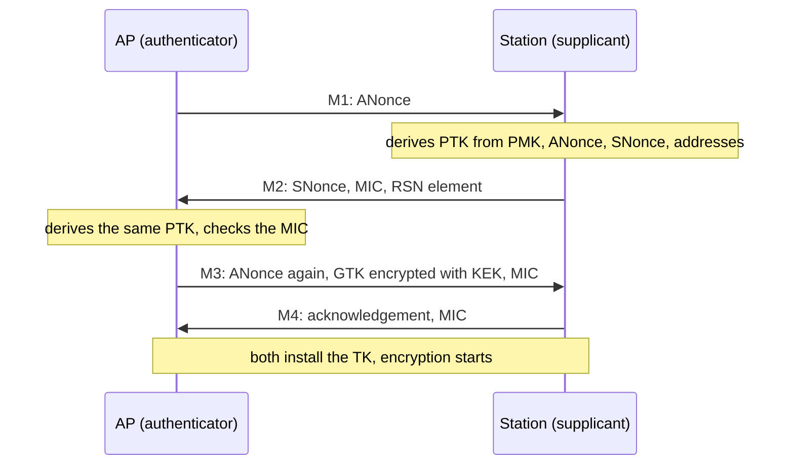
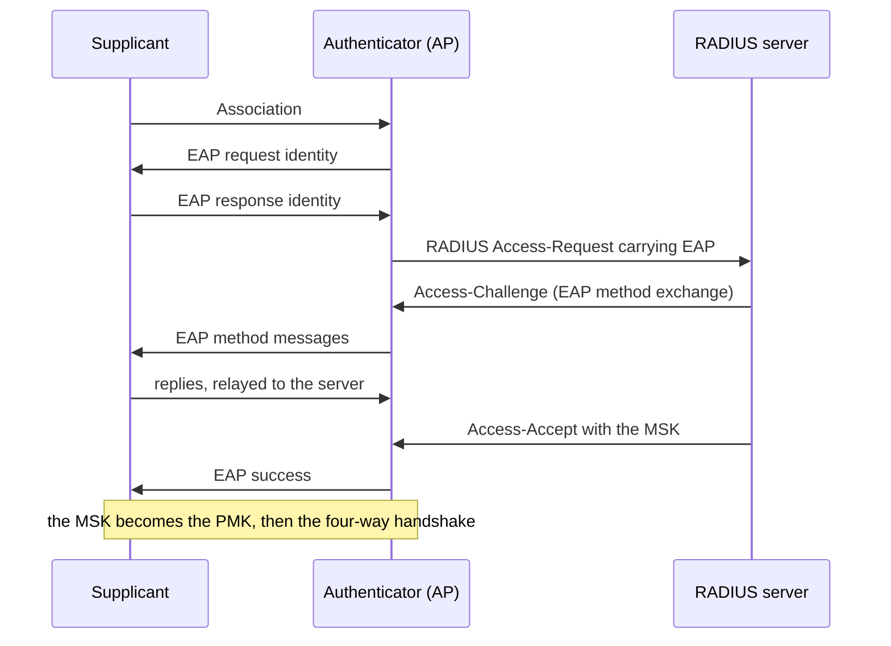

# WF 04: Wi-Fi security: from WEP to WPA3, keys, handshakes and enterprise authentication

*Part of the [networking plan](../00_plan.md), Wi-Fi sub-track · Candela session 4 (Wi-Fi security) plus gap topics (OWE, management frame protection, rogue access points) · You need: [WF 03](03_wifi_mac.md) (frames, association and the states), [NET 09](../09_network_security_firewalls_ips_dpi.md) (basic cryptography terms)*

A wired network is protected by the building. A wireless one is protected only by cryptography, because anyone in range hears every frame. So Wi-Fi security answers four questions: who may join (authentication), how the traffic is hidden (confidentiality), how tampering and replay are detected (integrity), and how the management of the network is protected from forgery. The answers changed four times in twenty-five years, and each change is a story of a specific design mistake. Knowing the mistakes is what lets you explain why the current design looks the way it does.

This is a core topic for a Wi-Fi platform engineer: interviews ask for the four-way handshake in detail, the difference between WPA2 and WPA3, and how enterprise authentication works end to end.

By the end you can:

- say what each generation of Wi-Fi security fixed and which mistake forced the change;
- explain why WEP failed in terms of its three design errors;
- derive the key hierarchy from a passphrase (PMK, PTK, GTK) and say what each key protects;
- walk through the four-way handshake message by message, and explain key reinstallation attacks;
- explain how CCMP and GCMP protect a frame and why a nonce must never repeat;
- explain why WPA2-PSK allows offline guessing and how WPA3-SAE removes it;
- explain what OWE gives and what it cannot;
- explain 802.1X, EAP and RADIUS and how a key per user is derived;
- explain deauthentication attacks, protected management frames and rogue access points;
- read the security of a network from the RSN element of a beacon;
- state a sensible security policy for home, office and guest networks.

---

## 1. What is protected, and the four generations

| Generation | Authentication | Data protection | Status |
|---|---|---|---|
| **Open** | none | none | Fine only with a captive portal or OWE |
| **WEP** (1997) | shared key | RC4 with a 24-bit IV and a CRC | Broken in minutes; never use |
| **WPA** (2003) | PSK or 802.1X | TKIP (RC4 with per-packet key mixing, Michael integrity) | A stopgap that ran on WEP hardware; deprecated |
| **WPA2** (2004, 802.11i) | PSK or 802.1X | CCMP (AES in counter mode with CBC-MAC) | The baseline for twenty years |
| **WPA3** (2018) | SAE instead of PSK; stronger enterprise suite | GCMP-256 optional, CCMP required; management frame protection mandatory | Current |
| **OWE** (Enhanced Open) | none, but encrypted | per-client keys by an unauthenticated key exchange | For open networks |

Protecting a wireless link means four separate things, and mixing them up is the commonest mistake in explanations: **authentication** (who is allowed on), **confidentiality** (an eavesdropper sees noise), **integrity and replay protection** (a modified or repeated frame is detected) and **protection of management frames** (an attacker cannot forge a disconnect).

---

## 2. WEP: three design errors

WEP encrypted each frame with the RC4 stream cipher, using a key made of the shared secret and a 24-bit **initialisation vector (IV)** sent in the clear with every frame. An **integrity check value** (a CRC-32) was added before encryption. Three mistakes follow from that design:

1. **The IV is far too short and the key mixing is trivial.** With only 24 bits, IVs repeat after a few million frames, and on a busy network within hours. Two frames with the same IV and key are encrypted with the same keystream, so XORing the two ciphertexts removes the keystream and leaves the XOR of the plaintexts, which is easy to attack with known formats (ARP, IP headers). Worse, RC4 had weaknesses with certain IV values (the Fluhrer, Mantin, Shamir attack and its successors), which let an attacker recover the key from tens of thousands of captured frames.
2. **The integrity check is linear.** A CRC is not a cryptographic MAC. Flipping chosen bits in the ciphertext flips the same bits in the plaintext, and the CRC can be adjusted to match without knowing the key. An attacker can modify frames and even inject them.
3. **There is no replay protection and no key management.** The same key is shared by everyone and never changes, so one leaked or cracked key breaks the whole network forever, and any station can read any other's traffic.

The lesson that shaped everything after: a cipher needs a **nonce that never repeats under one key**, a real **MAC**, **per-session keys** and **replay counters**. Every later generation adds exactly those.

---

## 3. The key hierarchy

Modern Wi-Fi never encrypts traffic with the password. The password (or a certificate login) is the root of a chain of keys, and each key has one job.



- The **PMK** comes from the passphrase (WPA2-PSK: PBKDF2-HMAC-SHA1 with the SSID as salt and 4096 iterations, giving 256 bits) or from the 802.1X exchange or SAE (WPA3). It is the long-lived secret between one client and the network.
- The **PTK** is made fresh for every association by a pseudo-random function (HMAC-SHA1 in WPA2) over the PMK, the two MAC addresses and two random numbers, the **ANonce** (from the AP) and the **SNonce** (from the station). It is split into the **KCK** (key confirmation key, used to compute the MIC that authenticates handshake messages), the **KEK** (key encryption key, used to wrap the group key in the handshake) and the **TK** (temporal key, used to protect the data frames). CCMP uses 384 bits in total.
- The **GTK** is chosen by the AP and shared by all clients, because multicast must be decryptable by everybody. The **IGTK** protects group-addressed management frames when protected management frames are on.

A short script reproduces the derivation exactly, and the result can be checked against `wpa_passphrase` (published test vector: passphrase `password`, SSID `IEEE`):

```python
import hashlib, hmac

def pmk_from_passphrase(passphrase, ssid):
    return hashlib.pbkdf2_hmac("sha1", passphrase.encode(), ssid.encode(), 4096, 32)

def prf(key, label, data, bits):
    out, i = b"", 0
    while len(out) * 8 < bits:
        out += hmac.new(key, label + b"\x00" + data + bytes([i]), hashlib.sha1).digest()
        i += 1
    return out[: bits // 8]

def ptk(pmk, aa, spa, anonce, snonce, bits=384):
    data = min(aa, spa) + max(aa, spa) + min(anonce, snonce) + max(anonce, snonce)
    return prf(pmk, b"Pairwise key expansion", data, bits)
```

`pmk_from_passphrase("password", "IEEE").hex()` gives `f42c6fc52df0ebef...`, the same as `wpa_passphrase IEEE password`. Two consequences follow from the structure. The SSID is part of the PMK, so a precomputed table of passphrase hashes is only useful for a given SSID (which is why common SSIDs such as "linksys" were attacked with rainbow tables). And because the PTK depends on both nonces and both addresses, two sessions with the same password get completely different data keys.

---

## 4. The four-way handshake

The handshake proves that both sides know the PMK without sending it, agrees on a fresh PTK, and delivers the group key. It runs over **EAPOL-Key** frames, which are data frames sent before the keys are installed, after association.



- **M1** gives the station the AP's random number. It carries no MIC, because no key exists yet.
- **M2** sends the station's random number and a **MIC** computed with the KCK. If the passphrase was wrong, the AP derives a different PTK and the MIC check fails. This is how a wrong password is detected. M2 also repeats the station's RSN element so the AP can check that nobody altered the offered ciphers on the way (a downgrade protection).
- **M3** tells the station to install the keys, delivers the GTK encrypted with the KEK, and repeats the AP's security parameters with a MIC, so the station can check them.
- **M4** confirms. Both sides install the TK and start encrypting.

A **replay counter** in each message stops an attacker from replaying old handshake messages.

**Key reinstallation attacks (KRACK).** The handshake had a subtle flaw: if M4 is lost, the AP retransmits M3, and a station that blindly installs the key again resets its **packet number** counter to zero. An attacker who blocks M4 and replays M3 can make the station reuse nonces under the same key, which breaks the confidentiality of the cipher. The fix was in the client implementations: install the key only once per handshake and ignore retransmitted M3 for key installation. It is also why you should know that "never reuse a nonce" is not abstract: the attack was a nonce reuse caused by a state machine bug.

You can watch a real handshake in a capture with `tshark -Y eapol`, and `tshark` can decrypt a capture if you give it the passphrase and the SSID (`wlan.enable_decryption` with `wpa-pwd:passphrase:ssid`), provided the capture contains the handshake.

---

## 5. Protecting the data: CCMP, GCMP and TKIP

### 5.1 CCMP

**CCMP** (counter mode with CBC-MAC protocol) uses AES. For each frame:

- A **packet number (PN)**, 48 bits, increases for every frame under a given key. It is carried in the frame header and, with the priority and the transmitter address, forms the **nonce**. A receiver rejects any frame whose PN is not larger than the last accepted one for that priority, which is the replay protection.
- The payload is encrypted in counter mode using the nonce. The result is **authenticated** with an 8-byte **MIC** (CBC-MAC) that covers the payload and the important parts of the header (the **additional authenticated data**): the addresses, the frame control bits that do not change on a retry, and the sequence control. So an attacker cannot change the destination address or other protected header fields without being detected. Fields that change on retransmission, such as the retry bit and duration, are masked out.

### 5.2 GCMP

**GCMP** (Galois counter mode) is the same idea built on a more efficient mode, and it is the cipher of 802.11ad (60 GHz) and of WPA3's 256-bit suite. It is faster in hardware and has a 16-byte tag option.

### 5.3 TKIP

**TKIP** was designed to run on WEP hardware with only a firmware update. It mixes the key per packet, uses a 48-bit sequence counter and adds a keyed integrity check called **Michael**, which is weak and needs countermeasures (shutting the link for a minute on two failures). It is deprecated, and under the 802.11n rules a device using TKIP is held to legacy rates, so allowing it costs speed as well as security.

### 5.4 The nonce rule

For every counter-based cipher, one rule matters above all: **a (key, nonce) pair must never be used twice**. If it is, two frames share a keystream and an attacker learns the XOR of the plaintexts (and for GCM, even the authentication key). Every security failure in this chapter, WEP's short IV, KRACK's reset counter, comes back to it.

---

## 6. WPA2-PSK weaknesses and WPA3-SAE

### 6.1 The offline guess

In WPA2-PSK everyone shares one passphrase, and the PMK is a deterministic function of it and the SSID. An attacker who captures a four-way handshake (M1 and M2 are enough, and a deauthentication frame can force a client to reconnect and produce one) has the ANonce, the SNonce, the addresses and a MIC. For each candidate passphrase the attacker computes the PMK, the PTK and the MIC, and compares. This is an **offline dictionary attack**: no more contact with the network is needed, and a modern graphics card tries millions of guesses a second against the 4096-iteration hash. A **PMKID** in the first message of some access points allows the same attack without even a client present. So the strength of a WPA2-PSK network is exactly the strength of its passphrase, and it has **no forward secrecy**: a passphrase learned later decrypts recorded traffic, since the PTK can be re-derived from the captured nonces.

### 6.2 SAE

WPA3-Personal replaces the PSK exchange with **simultaneous authentication of equals (SAE)**, a password-authenticated key exchange (a variant of Dragonfly). Both sides combine the password with a Diffie-Hellman style exchange so that:

- an observer or an active attacker gets **nothing to test guesses against offline**: each guess needs a live interaction with the AP, which can be rate limited;
- the resulting PMK is **different for every session** and not derivable from the password alone, giving **forward secrecy**;
- either side can initiate, and the AP protects against floods of exchanges with an anti-clogging token.

The first implementations had side-channel and downgrade flaws (collectively "Dragonblood"), which led to the **hash-to-element** method for deriving the password element without timing leaks. WPA3 also requires **protected management frames** (section 9), uses the same four-way handshake after SAE for key confirmation and group keys, and raises the minimum cryptographic strength in its enterprise mode.

### 6.3 Transition mode

Most networks run **transition mode** for a while, advertising both WPA2-PSK and WPA3-SAE with the same passphrase, so old devices still join. The weakness is a **downgrade**: an attacker can attack the WPA2 side of the same network. Transition mode is a migration step, not a destination.

---

## 7. Open networks and OWE

An open network sends everything in the clear, so anyone in range reads it. **Opportunistic wireless encryption (OWE)**, certified as **Enhanced Open**, uses an unauthenticated Diffie-Hellman exchange during association so that each client gets its own key without any password. It defeats a **passive eavesdropper**, and every client's traffic is protected from the others. But it provides no authentication: an attacker who sets up a fake access point with the same name can do the exchange with the client and relay everything, so OWE does not protect against an **evil twin**. It is the right choice for cafes and guest networks where a password would be pointless, but it is not a substitute for authenticating the network (a captive portal or certificate-based login does that).

---

## 8. 802.1X, EAP and RADIUS: a key per user

A shared passphrase cannot say who someone is and cannot be revoked for one person. Enterprise networks use **802.1X**, which has three roles:

- the **supplicant** (the client),
- the **authenticator** (the access point or switch, which blocks all traffic except EAP until authentication succeeds),
- the **authentication server** (a **RADIUS** server).



The AP does not understand the credential. It relays **EAP** (extensible authentication protocol) messages between the client and the RADIUS server, inside EAPOL on the air and inside RADIUS between the AP and the server. The **EAP method** decides how the user is authenticated:

| Method | How it authenticates | Notes |
|---|---|---|
| **EAP-TLS** | Client and server certificates | Strongest; needs a certificate for every device |
| **PEAP** (with MSCHAPv2) | Server certificate, then a password inside a TLS tunnel | Very common; weak if clients do not validate the server certificate |
| **EAP-TTLS** | Server certificate, then any inner method in a tunnel | Flexible |
| **EAP-FAST** | Tunnel protected by a provisioned credential | Cisco |
| **EAP-SIM / AKA** | The SIM card | Carrier Wi-Fi offload |

When the method succeeds, both sides hold a **master session key (MSK)**; the server sends it to the AP in the Access-Accept (protected by the RADIUS shared secret), and the first 256 bits become the PMK that feeds the same four-way handshake as before. The result is a **different PMK for every user and every session**.

The most common enterprise failure is **not validating the server certificate** on the client. Without it, an attacker's access point with the same SSID can present any certificate, complete the tunnel and harvest the inner credentials. Correct profiles pin the CA and the server name. WPA3-Enterprise adds a 192-bit mode with stronger ciphers and certificates (GCMP-256, SHA-384). `hostapd` and `wpa_supplicant` with the wired driver can run this exchange over Ethernet in a lab with no radio, together with FreeRADIUS.

---

## 9. Management frames: deauthentication, PMF and rogue access points

### 9.1 The problem

Authentication, deauthentication and disassociation frames were originally unauthenticated. Anyone can send a deauthentication frame with the AP's address as the source, and the client obeys. This is a cheap denial of service, and it is also the first step of a handshake-capture attack (force the reconnect). Data protection did nothing for it.

### 9.2 Protected management frames

**802.11w (PMF)** protects unicast management frames (deauth, disassoc, action frames) with the same TK, and group-addressed ones with the IGTK and a **broadcast integrity protocol (BIP)**. A forged deauthentication is now dropped. It also adds an **SA query** procedure so that an AP receiving a new association from an already-associated client checks whether it is real. In WPA3, PMF is mandatory; in WPA2 it is optional or required by configuration. Beacons themselves are still unprotected in 802.11w, and **beacon protection** was added in 802.11be.

### 9.3 Rogue and evil-twin access points

A **rogue AP** is an unauthorised AP on your network (a cheap router plugged into a wall port). An **evil twin** is an AP that copies your SSID to attract clients. The defences are layered: 802.1X with server certificate validation (so a fake AP cannot complete authentication), port security on switches, and a **wireless intrusion prevention system (WIPS)**, in which your own APs scan, classify neighbours as managed, neighbour or rogue (by whether they are on your wired network), and may contain a rogue by sending deauthentication frames (which PMF-protected clients ignore, and which is legally sensitive when the rogue belongs to a neighbour).

---

## 10. Reading security from a capture: the RSN element

The beacon and probe response carry the **RSN (robust security network) element**, which lists what the network accepts:

- the **group cipher** and the **pairwise ciphers** (CCMP, GCMP, TKIP),
- the **authentication and key management (AKM) suites** (802.1X, PSK, SAE, OWE, and the fast-transition variants),
- the **RSN capabilities**, including the two PMF bits: management frame protection **capable** and **required**,
- optionally a list of cached PMKIDs.

```text
tshark -r capture.pcap -Y "wlan.fc.type_subtype == 8" -T fields \
  -e wlan.ssid -e wlan.rsn.pcs.type -e wlan.rsn.akms.type \
  -e wlan.rsn.capabilities.mfpc -e wlan.rsn.capabilities.mfpr
```

Reading it tells you the network's posture at a glance: AKM 2 (PSK) with CCMP and PMF capable-not-required is a typical WPA2 network; AKM 8 (SAE) with PMF required is WPA3; both listed is transition mode; AKM 1 (802.1X) is enterprise; AKM 18 is OWE. The client's association request carries an RSN element too, with the one suite it chose, and the AP repeats it in M3 so that a tampered selection is detected.

---

## 11. Roaming keys

If a roaming client had to redo the whole exchange (and for enterprise, the whole EAP) at every AP, a voice call would break. Three mechanisms keep the keys across roams, covered in WF 05: **PMKSA caching** (the client reuses the PMK it already has with the same AP), **opportunistic key caching** (the PMK is shared among APs of the same controller) and **802.11r fast transition** (a key hierarchy, PMK-R0 and PMK-R1, that lets the client derive a key for the next AP in one round trip). The security requirement is that a key given to one AP must not let that AP, or a neighbour, impersonate the others or read earlier sessions.

---

## 12. A sensible policy

| Network | Recommendation |
|---|---|
| Home | WPA3-Personal, or WPA2/WPA3 transition with a long random passphrase if old devices exist; PMF enabled; WPS disabled |
| Office or campus | WPA3-Enterprise or WPA2-Enterprise with EAP-TLS or PEAP with strict server validation; PMF required; per-user VLANs |
| Guests | OWE or WPA3 with a rotating passphrase plus a captive portal; isolate clients from each other and from the corporate network |
| IoT | A separate SSID and VLAN; a per-device key where supported (a private pre-shared key per device); firewall rules by device class |
| All | Remove WEP and TKIP; keep firmware current; log authentication failures; monitor for rogues |

---

## 13. Common mistakes

1. **Confusing the passphrase with the data key.** The data is encrypted with the TK; the passphrase is the root only.
2. **Believing WPA2-PSK is safe with a weak passphrase.** The handshake allows offline guessing.
3. **Keeping TKIP "for compatibility".** It drags every other client down and weakens the network.
4. **Leaving WPS PIN enabled.** The PIN protocol can be brute forced in hours.
5. **Treating OWE as authentication.** It encrypts, but does not prove the network's identity.
6. **Running PEAP without server certificate validation.**
7. **Leaving transition mode forever.**
8. **Assuming a hidden SSID is a security measure.** It appears in probe requests and association frames.
9. **Relying on MAC filtering.** MAC addresses are visible and forgeable.
10. **Forgetting management frame protection.** Deauthentication stays a trivial attack.
11. **Reusing the same passphrase on a network for years with many people having it.** There is no revocation for one person.
12. **Calling a nonce reuse a theoretical problem.** KRACK made it practical.

---

## 14. Interview questions

**1. Why did WEP fail?**
A 24-bit IV that repeats, RC4 weaknesses that leak the key, a linear CRC instead of a MAC so frames can be modified, and no replay protection or per-session keys.

**2. Walk through the four-way handshake.**
M1 gives the ANonce, the station derives the PTK; M2 gives the SNonce and a MIC with the KCK, proving the station has the PMK; M3 confirms, delivers the GTK encrypted under the KEK and repeats the security parameters; M4 acknowledges; both install the TK.

**3. What does the PTK contain?**
KCK (authenticates the handshake), KEK (encrypts the group key in the handshake) and TK (protects the data), derived from the PMK, both addresses and both nonces.

**4. Why can WPA2-PSK be attacked offline and WPA3-SAE cannot?**
A captured handshake gives everything needed to test a passphrase guess locally. SAE is a password-authenticated key exchange: an observer learns nothing to test a guess against, and each guess needs a live exchange with the AP. SAE also gives forward secrecy.

**5. What is KRACK?**
An attack on the handshake: blocking M4 and replaying M3 made a vulnerable client reinstall the key and reset its packet number, so nonces were reused. The fix is to install a key only once per handshake.

**6. How does CCMP protect a frame?**
AES counter mode with a nonce made of the packet number, priority and transmitter address; an 8-byte CBC-MAC over the payload and the key header fields; the packet number also gives replay protection.

**7. What is OWE, and what does it not protect against?**
An unauthenticated Diffie-Hellman exchange for open networks, giving per-client encryption. It does not stop an evil twin.

**8. How does 802.1X work in a Wi-Fi network?**
The AP blocks everything except EAP, relays EAP to a RADIUS server, which authenticates the user by an EAP method; on success the server returns the MSK, which becomes the PMK for the four-way handshake. Every user gets different keys.

**9. How would you attack or defend a PEAP network?**
Attack: an evil twin with any certificate harvests credentials if clients do not validate the server. Defend: pin the CA and server name in the client profile, or use EAP-TLS.

**10. What does 802.11w add?**
Protection for management frames (deauth, disassoc, action) with the TK and for group management frames with the IGTK and BIP, plus SA query. It stops spoofed deauthentication.

**11. How do you read the security of a network from a capture?**
The RSN element in the beacon: ciphers, AKM suites and the PMF bits.

**12. Why is a long random passphrase still not enough for a company?**
It is shared, cannot identify or revoke one user, and has no forward secrecy; enterprise authentication gives a key per user.

---

## 15. Scenarios and design questions

**S1. Design the Wi-Fi security of a 500-person office with guests, laptops and printers** (whiteboard)
*Approach:* separate SSIDs or VLANs, enterprise authentication for staff with certificate validation, a private pre-shared key or MAC authentication bypass with a profile for printers, guest isolation and captive portal, PMF, and monitoring. State the failure cases of each choice.

**S2. A client cannot join a WPA3 network that its predecessor joined fine** (talk-through, then a capture)
*Approach:* RSN element and the client's capability (SAE, PMF), transition mode, 6 GHz requirement, the association status code, and what the SAE exchange looks like in a capture.

**S3. Users report random disconnects; you see a flood of deauthentication frames** (talk-through)
*Approach:* spoofed or real, reason codes, whether PMF is on, a WIPS alert, whether it is your own roaming logic or band steering, and what you would capture.

**S4. Explain to a colleague why changing the SSID name changes the password's hash** (talk-through)
*Approach:* the PBKDF2 salt, precomputed tables, and the effect on a leaked hash.

**S5. Derive keys by hand** (a Python session on your machine, 20 minutes)
Use the snippet of section 3 to derive a PMK and a PTK for made-up addresses and nonces, compare the PMK with `wpa_passphrase`, then change one nonce byte and see how much of the PTK changes. *Approach:* write down what you expect (every byte changes) before running.

**S6. Decrypt a capture** (Wireshark, 20 minutes)
Capture or obtain a lab capture with a handshake, set the decryption key as `wpa-pwd:passphrase:ssid`, and confirm that data frames become readable. Then remove the handshake from the capture and observe what fails. *Approach:* explain why a missing M1 or M2 prevents decryption.

**S7. Plan a migration from WPA2 to WPA3** (whiteboard)
*Approach:* inventory of client capabilities, transition mode with a deadline, PMF, 6 GHz-only SSIDs for WPA3 devices, rollback plan, and monitoring of association failures.

**S8. Review an enterprise profile that "just works" but has "do not validate server certificate" ticked** (talk-through)
*Approach:* what an attacker gains, how to fix it (CA pinning, server name, MDM-pushed profile), and how to roll it out without locking users out.

---

## 16. Strong answers

**S1.** Staff SSID with WPA3-Enterprise (or WPA2-Enterprise where needed) and EAP-TLS using certificates pushed by device management, falling back to PEAP only with strict server validation; PMF required; RADIUS with redundancy; VLANs by role. Printers and IoT on their own SSID or VLAN, using a private pre-shared key per device or MAC-based authentication with firewall limits. Guests on OWE or a rotating passphrase with a captive portal, client isolation and bandwidth limits, and no route to internal networks. Monitor with WIPS and logs of authentication failures. Failure cases: RADIUS outage (cache and local fallback), certificate expiry (monitor and automate renewal), and unsupported clients.

**S2.** Compare the RSN element in the beacon with what the client offers in its association request: a WPA3-only AP needs the SAE AKM and PMF; an older client without SAE cannot join. In transition mode it would fall back to PSK. Check the status code in the association response (and in the SAE commit and confirm frames), and the regulatory rules for 6 GHz, where WPA3 or OWE is required.

**S3.** A reason code and the source address help: a deauthentication from the AP's own address with no matching AP log is likely spoofed. With PMF required, a spoofed one is ignored, so check that PMF is enabled and that clients support it. Also rule out your own causes: band steering, load balancing or a roaming bug that kicks clients. Capture near the clients and look at the timing relative to association.

**S4.** The PMK is PBKDF2 with the SSID as salt, so the same passphrase on two SSIDs gives two different PMKs. Attackers cannot reuse a precomputed table across SSIDs, but common SSIDs have tables. A unique SSID makes precomputation useless, though it does not make a weak passphrase strong.

**S5.** Every byte of the PTK changes, since the PRF mixes all inputs and any change in a nonce byte alters the HMAC output. It demonstrates why the two nonces give a fresh key per session and why the nonces must come from a good random source.

**S6.** Decryption works only if the capture includes the handshake, since the PTK must be derived from the nonces and addresses in M1 and M2 (and M3 and M4 when confirming). Without it the TK is unknown, so the data frames stay ciphertext. With SAE, decryption from a passphrase is impossible, since the PMK depends on a per-session exchange.

**S7.** Inventory clients by capability from logs; enable transition mode with PMF capable; set a date to move; create a WPA3-only SSID for the 6 GHz band, where it is required; watch association failures by device model and fix or exclude them; keep a rollback. Move to WPA3 only when the old device list is small.

**S8.** An attacker's AP with the same SSID can present any certificate and the client completes the tunnel, giving the attacker the inner password hash or the MSCHAPv2 exchange, which can be cracked. The fix is a profile that pins the issuing CA and the server's name, pushed by MDM so users cannot override it, or a move to EAP-TLS. Roll out in stages and monitor for failures.

---

## 17. Cheat sheet

| Topic | Fact |
|---|---|
| WEP | 24-bit IV, RC4, CRC; broken |
| PMK | PBKDF2-HMAC-SHA1, SSID salt, 4096 iterations (PSK); MSK from EAP (enterprise); SAE output (WPA3) |
| PTK | PRF over PMK, both addresses, both nonces; KCK, KEK, TK |
| GTK / IGTK | Group data / group management frames |
| Handshake | M1 ANonce; M2 SNonce and MIC; M3 GTK and install; M4 confirm |
| CCMP | AES-CTR with 8-byte CBC-MAC; 48-bit PN; nonce from PN, priority, address |
| Nonce rule | Never reuse (key, nonce) |
| WPA2-PSK | Offline guess possible; no forward secrecy |
| WPA3-SAE | No offline guess; forward secrecy; PMF required |
| OWE | Encryption without authentication |
| 802.1X | Supplicant, authenticator, RADIUS; EAP method; MSK becomes PMK |
| EAP-TLS / PEAP | Certificates both ways / server certificate plus password |
| PMF (802.11w) | Protects deauth and disassoc; IGTK and BIP; SA query |
| RSN element | Ciphers, AKM suites, PMF bits |

---

## 18. Sources and caveats

Based on the Candela Wi-Fi security session and the 802.11i, 802.11w, WPA3 and OWE specifications as I know them. Message contents of the handshake, the cipher construction, AKM suite numbers and `tshark` field names are from memory. The key derivation code was run and reproduces the published test vector for the passphrase `password` and SSID `IEEE`; the handshake, EAP and SAE exchanges were not run against a live radio. Check the standard before quoting numbers, and note that attack details (WEP statistics, the exact guess rates of password cracking) change with hardware and time.
