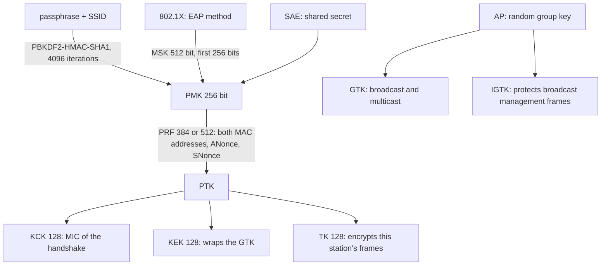

# WF 04: Wi-Fi security, from the passphrase to the protected frame

*Part of the [networking plan](../00_plan.md), Wi-Fi sub-track · Candela sessions 4a to 4d (security: WEP to WPA3, personal and enterprise, 802.1X, attacks and defences), with the key hierarchy, the 4-way handshake message by message, SAE and OWE, RADIUS and the MSK, management frame protection and the CWSP topic list folded in (the CWSP weights in the plan are design 50 %, monitoring 25 %, fast roaming 10 %, attacks 10 %, policy 5 %) · Time: about 12 hours · You need: [WF 03](03_wifi_mac.md) (the frame formats, the three states and the class 1 deauthentication) and [NET 09](../09_network_security_firewalls_ips_dpi.md) (the network side of security, TLS and IPsec). Wi-Fi security answers one question: **who may use the air, and what can someone who listens learn?** This tutorial builds the answer from the bottom: how a passphrase becomes a key (and what a guess costs), how the 4-way handshake proves both sides know it without sending it, how CCMP protects a frame, why WEP fell, what SAE and OWE change, how 802.1X and RADIUS deliver a key per user, and which frames and attacks still work. Every table comes from a script that runs here, and the most important check is independent: `tshark` derives the keys from the passphrase and decrypts the CCMP frames I built.*

"Walk me through the 4-way handshake" and "why is WPA3 better than WPA2" are the two standard questions, and a Staff level answer gives the mechanism and the number: what is derived from what, what the attacker holds after a capture, and what each step costs. This tutorial puts a computed or simulated number on each, and marks what was written from memory of the standard.

**Eight honest limits, stated first.**

1. **There is no radio here, so nothing was measured over the air.** Every frame is built byte by byte by a script. The independent checks are `wpa_passphrase` (the PMK), `tshark` 4.2.2 (which derives the pairwise keys from the passphrase and decrypts my CCMP frames, which checks the PMK, the PRF, the nonce and AAD construction and the handshake layout all at once) and its decoders for EAPOL, EAP, RADIUS, the RSN element and the PMKID.
2. **The standard was not re-read.** The cipher and AKM suite numbers, the key information bits, the EAP method list, the TKIP and Michael details, the 802.11r key hierarchy and the WPA3 rules are **from memory** and marked where they matter. The parts `tshark` decodes (the suite numbers in section 9, the key info bits, the EAP codes) are checked by that decode, and the rest is not.
3. **My SAE is simplified.** It uses the real P-256 group and the real structure (a password element, a commit of a scalar and an element, a shared secret, a confirm) but my own key derivation, so it is **not interoperable** and it does not reproduce the standard's bit exact messages. It demonstrates the properties (the password is never testable offline, a fresh secret every time), not the wire format.
4. **My OWE uses the right idea (an ECDH exchange in association, then a PMK by HKDF) with parameters from memory**; the evil twin demonstration is exact, because it does not depend on the parameters.
5. **The RADIUS Message-Authenticator and the MPPE key encryption are my own implementation.** `tshark` decodes the attributes and I round trip the keys, but nothing independent verified the HMAC or the response authenticator.
6. **The attack results are models with assumed values**: the deauthentication outage (the rejoin time is an input), the sequence number detector (the sniffer miss rate is an input) and the guesses per second (measured here on one core; the GPU figure is **from memory**). They show the shape of the problem and not any product's behaviour.
7. **Not run here:** `hostapd` and `wpa_supplicant` (this VM has no `cfg80211` or `mac80211`, so [WF 10](10_linux_wireless_stack_and_openwrt.md) covers them), a real WIPS, Passpoint and ANQP, 802.11r in practice (the keys and timings are in [WF 05](05_wifi_roaming_and_radio_management.md)) and TKIP with the Michael code (explained from memory, not built).
8. **All the attack code runs against frames I built myself, for a lab and for understanding.** Nothing was sent over a radio, and the point of each attack is the defence it motivates.

By the end you can:

- **derive the keys of a session from a passphrase** (computed and cross-checked: the PMK is PBKDF2-HMAC-SHA1 with the SSID as salt and 4,096 iterations, and `wpa_passphrase` agrees on two published test vectors, **f42c6fc5...** for "password" and "IEEE" and **0dc0d6eb...** for "ThisIsAPassword" and "ThisIsASSID"; the PTK is a 384 bit PRF over both addresses and both nonces: KCK 16, KEK 16 and TK 16 bytes);
- **price a passphrase guess** (measured: **1.41 ms** and **707 guesses per second** on one core; an 8 character lowercase passphrase falls in **4.7 years** on one core and **1.2 days** at 1e6 guesses per second, and **4 random words** of a 2,048 word list hold for **394 years** on one core and **0.28 years** at 1e6 per second);
- **walk the 4-way handshake and read its key information field** (built and decoded by `tshark`: messages of **99, 121, 155 and 99 bytes** with key information **0x008a, 0x010a, 0x13ca and 0x030a**; message 3 wraps a **GTK** in **56 bytes** of AES key wrapped key data; a wrong passphrase, SSID or bit flip makes the MIC of message 2 **invalid**);
- **explain CCMP** (computed, and decrypted by `tshark`: an 8 byte header with a 48 bit packet number, an 8 byte MIC, a nonce from the priority, the transmitter address and the packet number, and an AAD from the masked header; one flipped bit in the ciphertext or in the receiver address makes the frame **fail** authentication; a replayed packet number is dropped; **16 bytes** of overhead per frame, **13.8 %** of a 100 byte payload and **1.06 %** of a 1500 byte one);
- **say why WEP fell and what KRACK exploited** (simulated: random 24 bit IVs repeat after **5,028 packets** on median against a bound of **5,134**; a repeated IV gives the XOR of two plaintexts, so a known request line reveals the other; a bit flip and a CRC fix forged **"pay 9900 to alice"** from **"pay 0100 to alice"** with a valid check value; the same keystream reuse in CCMP when a packet number is reset);
- **explain what SAE fixes** (simulated on P-256 with a simplified exchange: the same password confirms and a different password does not, a second run gives a different secret, the password element needs a mean of **2.006** tries with a maximum of 12 in 2,000 passwords, and a capture holds nothing that tests a guess without a private value, so each guess costs one exchange);
- **explain what OWE gives and does not give** (computed: an ECDH exchange of **130 bytes** in association stops a passive listener; an evil twin that runs one exchange with each side reads **"GET /login password=hunter2"** and nobody notices);
- **walk 802.1X, EAP and RADIUS and say where the PMK comes from** (built and decoded by `tshark`: EAPOL-Start, Identity, MD5-Challenge, Success; a RADIUS Access-Request of **129 bytes** with an EAP-Message and a Message-Authenticator; the **MSK of 64 bytes** returned in two MS-MPPE attributes, the **PMK being its first 32 bytes**; an EAP-MD5 response cracked offline at **1.8 million guesses per second**);
- **say how the PMKID attack works and why deauthentication still works** (decoded by `tshark`: the **PMKID** in message 1 lets a guess be tested with no client present; a forged deauthentication every 5 s takes a client that needs 2 s to rejoin offline **36.7 %** of the time and with protected management frames **0.0 %**; a sequence number detector flags **97.5 to 100 %** of forged frames at a false positive rate of **0.01 % or less** with a sniffer that misses 10 % of frames);
- **read a security element from a capture** (decoded by `tshark`: the RSN element of eight network types, from WPA2-PSK at **22 bytes** to WPA3 Enterprise 192 bit with **GCMP-256**, with the AKM suites PSK, SAE, 802.1X, Suite-B-192 and OWE, and the PMF capable and required bits).

## Where the numbers come from

Each experiment is a script `sN_*.py` in `prog/` with its output frozen in `v/`, run with `run.sh`. `sec.py` is the module the scripts import: the PBKDF2 PMK, the PRF and the PTK, the EAPOL-Key frame and its MIC, the AES key wrap for the GTK, CCMP encryption and decryption, and the `tshark` caller; `dot11.py` is the frame builder of WF 03. `s1_keys.py` builds the key hierarchy and measures the cost of a guess, `s2_handshake.py` builds the 4-way handshake and the encrypted data frames and has `tshark` decrypt them, `s3_legacy.py` builds WEP and the attacks on it and the keystream reuse in CCMP, `s4_sae.py` the simplified SAE on P-256, `s5_owe.py` OWE and the evil twin, `s6_eap.py` the 802.1X exchange and RADIUS with the MSK, `s7_attacks.py` the PMKID, the deauthentication model and the sequence number detector, and `s8_rsn.py` the RSN element for eight network types. The answers to the problems are `ans_a` to `ans_e`.

Every number in the text is copied from `v/*.out` or computed from a printed figure with the arithmetic shown. A number that is not measured, simulated, modelled or computed here is marked **from memory**. The simulations use fixed seeds, so each run prints the same figures; the one exception is the guess rate, which is a timing and changes by run (`s1_keys` measured 707 per second and `ans_b` 796, on the same core).

## Data and timing

| What | Size or time |
|---|---|
| Key hierarchy and guess cost (`s1_keys.sh`) | 200 PBKDF2 runs, about 1 s |
| 4-way handshake, CCMP, `tshark` decrypt (`s2_handshake.sh`) | 8 frames in a pcap, under 1 s |
| WEP and keystream reuse (`s3_legacy.sh`) | 200 birthday runs, about 1 s |
| Simplified SAE (`s4_sae.sh`) | 2,000 password elements, about 5 s |
| OWE and the evil twin (`s5_owe.sh`) | under 1 s |
| 802.1X, EAP, RADIUS (`s6_eap.sh`) | 300,000 MD5 guesses, about 1 s |
| PMKID, deauthentication, detector (`s7_attacks.sh`) | 9 detector runs of 20,000 frames, about 2 s |
| RSN element (`s8_rsn.sh`) | 8 beacons in a pcap, under 1 s |

## Mapping to the Candela course

Candela sessions 4a to 4d are security: the generations from WEP to WPA3, personal against enterprise, 802.1X and EAP with RADIUS, and the attacks and defences. This tutorial covers the same ground and adds what a Senior or Staff interview asks for beyond the course: the key hierarchy and the handshake message by message with a decrypt that proves it (sections 3 and 4), the nonce and AAD of CCMP and the KRACK mechanism (section 5), SAE and OWE with what each does and does not protect (sections 6 and 7), the MSK and the PMK, and the RADIUS key transport (section 8), management frame protection with the PMKID and the detector (section 9), and reading the RSN element in a capture (section 10). The CWSP topic list in the plan maps like this: design (sections 3 to 8 and the checklist in section 12), monitoring (sections 9 and 12), attacks (sections 2, 5 and 9) and policy (section 12). The **fast roaming** keys (802.11r, PMK caching, OKC) are introduced in section 11 and used with timings in [WF 05](05_wifi_roaming_and_radio_management.md); **Passpoint, Hotspot 2.0, ANQP and OpenRoaming** are summarised in section 8 from memory; the 6 GHz security rules are in section 10 and in [WF 06](06_wifi6_6e_7_features.md); and the MLO security detail is in [WF 12](12_wifi7_eht_and_mlo.md).

---

## 1. What is protected, and the four generations

A wireless link has no wire to guard, so every frame can be heard, recorded and, with the right equipment, forged. Wi-Fi security therefore has to give four properties that a cable gives for free:

- **Authentication**: who may join (the network proves itself to the station and the station to the network).
- **Confidentiality**: someone who records the air learns nothing from the data frames.
- **Integrity and replay protection**: a frame cannot be changed or repeated without detection.
- **Key management**: the keys that give the first three are created fresh for each station and each session, and the key setup itself resists guessing.

What is protected is a short list: the **data frames** (the body), the **keys in flight** (the handshake), and, since 802.11w, some **management frames**. What is **not** protected, in every generation, is the header (addresses, durations, the frame type), the beacon and probe frames, and the fact that a station is present: an observer always sees who talks to whom and how much.

| Generation | Cipher and integrity | Key setup | What failed or changed (the numbers are from the sections below) |
|---|---|---|---|
| **WEP** (1997) | RC4 with a 24 bit IV, CRC-32 as the check | A static shared key, no handshake | IV reuse after about 5,000 packets, a linear check value (section 2) |
| **WPA** (2003, **from memory**) | TKIP (still RC4, with a per packet key mix and the Michael MIC) | PSK or 802.1X with the 4-way handshake | A stopgap that ran on WEP hardware; deprecated |
| **WPA2** (2004, 802.11i) | **CCMP**: AES in CCM mode, 8 byte MIC | PSK or 802.1X, 4-way handshake | The PSK can be guessed offline from a capture; no forward secrecy; management frames open (sections 6 and 9) |
| **WPA3** (2018, **from memory**) | CCMP or GCMP-256, 802.11w management frame protection required | **SAE** for personal (no offline guessing), 802.1X for enterprise (a 192 bit suite), **OWE** for open networks | Dragonblood side channels in the first SAE implementations, fixed by hash-to-element (section 6) |

Three practical facts follow from the table. **First**, "WPA2" is not a cipher but a certification that requires CCMP; a network that offers TKIP alongside is weaker for every client. **Second**, "Personal" and "Enterprise" are about **how the master key is obtained** (a shared passphrase against a per user server), not about the cipher below it, which is the same CCMP in both. **Third**, the **6 GHz band** requires WPA3 or OWE (**from memory** of the rule), so a 6 GHz access point never offers WPA2 or WEP.

## 2. WEP: three design errors, shown

WEP is the standard example because each of its failures is a general lesson, and the script reproduces all three. It encrypts each packet with RC4 under a per packet key made of a 3 byte **IV** (sent in the clear) followed by the shared key, appends a **CRC-32** of the data as an **integrity check value (ICV)**, and encrypts the CRC with the data.

--- WEP: RC4 with a per packet key IV (24 bits, sent in the clear) + the shared key; an integrity check value (CRC-32) is encrypted with the data
frame 23 bytes: IV 3 + key id 1 + ciphertext 19 (data 15 + ICV 4); decrypts to b'hello wep world' with a valid ICV

**Error 1: the IV space is too small.** The IV has 24 bits, so two packets under the same key share a keystream after, on average, a few thousand packets. The birthday bound for a random 24 bit value is `sqrt(pi/2 x 2^24)`.

--- 1. the IV space is 2^24: how long until two packets share a keystream (a repeated IV under one key)
random IVs (many cards pick them at random): first repeat after 5028 packets on median, 187 to 14240 over 200 runs; the birthday bound is sqrt(pi/2 x 2^24) = 5134
a counter IV repeats only after 2^24 = 16,777,216 packets; at 1000 frames per second that is 4.7 hours, and after a reboot the counter restarts at 0 (many devices)
at 1000 frames per second a random IV repeats after about 5.0 s

For random IVs the first repeat came after **5,028 packets** on median (**187 to 14,240** over 200 runs) against a bound of **5,134**, about **5 seconds** at 1,000 frames per second. A counter IV repeats only after 2^24 = 16.7 million packets, **4.7 hours** at 1,000 frames per second, and many devices restart the counter at 0 after every reboot.

**Error 2: a repeated keystream leaks plaintext.** A stream cipher computes `ciphertext = plaintext XOR keystream`. Two packets with the same IV and key share the keystream, so the XOR of the ciphertexts equals the XOR of the plaintexts, and any plaintext the attacker can guess (an HTTP request line, a DHCP or ARP packet, a header) reveals the same bytes of the other.

--- 2. a repeated IV leaks the XOR of the plaintexts (the keystream cancels), and a known plaintext then reveals the other
XOR of the two ciphertexts equals the XOR of the two plaintexts over 24 bytes: True
knowing the first plaintext (a predictable HTTP request line) recovers b'password=hunter2&user=bo' from the second

The script recovers **"password=hunter2&user=bo"** from the second packet by knowing the first. In a real attack the attacker collects thousands of such pairs, and a statistical attack on the RC4 key schedule (the Fluhrer, Mantin and Shamir weakness and its successors, **from memory**, not built here) recovers the key itself.

**Error 3: the integrity check is linear.** CRC-32 is an affine function: `crc(a XOR d) = crc(a) XOR crc(d) XOR crc(0)` for equal lengths. Because RC4 is also an XOR, the attacker can flip any bits of the ciphertext and fix the encrypted CRC with the same XOR, **without the key**.

--- 3. the CRC is linear: flip chosen bits in the ciphertext and fix the ICV without the key
forged frame decrypts to b'pay 9900 to alice' with a valid ICV: True (the attacker never had the key)
this is why an encrypted CRC is not an integrity check; TKIP added the Michael MIC and CCMP uses an authenticated cipher

The forged frame decrypts to **"pay 9900 to alice"** with a **valid** ICV. A checksum is not a message authentication code: it protects against noise and not against a chooser of bits. TKIP added the **Michael MIC** (a keyed check, **from memory**, with a countermeasure that shuts the network down for a minute after two failures in a minute), and CCMP uses an authenticated cipher so that one primitive gives both properties.

## 3. The key hierarchy: from a passphrase to the keys of a session

WPA2 and WPA3 never encrypt with the passphrase. They derive a chain of keys, each used for one purpose:



The **PMK** (pairwise master key) is the root of one authentication, and where it comes from is the **only** difference between the modes: PBKDF2 of a passphrase (WPA2-Personal), the first 256 bits of the **MSK** from an EAP method (Enterprise, section 8) or the secret of the SAE exchange (WPA3-Personal, section 6). The **PTK** (pairwise transient key) is derived **per session** from the PMK, the two MAC addresses and two fresh random numbers (the **nonces**), so every association has its own keys even though the PMK is the same. The **GTK** (group temporal key) is chosen by the access point and shared by all stations for broadcast and multicast; the **IGTK** is its analogue for protected management frames.

**From passphrase to PMK.** `PMK = PBKDF2(HMAC-SHA1, passphrase, SSID, 4096, 256 bits)`. The script checks it against `wpa_passphrase` and the two published test vectors:

--- the pairwise master key from a passphrase: PBKDF2-HMAC-SHA1, salt = SSID, 4096 iterations, 256 bits
passphrase password          SSID IEEE         PMK f42c6fc52df0ebef9ebb4b90b38a5f90...  wpa_passphrase agrees: True
passphrase ThisIsAPassword   SSID ThisIsASSID  PMK 0dc0d6eb90555ed6419756b9a15ec3e3...  wpa_passphrase agrees: True
the two published test vectors I remember (f42c6fc5... and 0dc0d6eb...) are both reproduced; the salt is the SSID, so the same passphrase gives a different PMK in every network name
same passphrase, two SSIDs: c4c5b44ebb507f6c 824d6dc082f20a25

Both vectors are reproduced and `wpa_passphrase` agrees, which fixes the algorithm, the salt (the SSID) and the length. Two consequences matter. **The SSID is the salt**, so the same passphrase gives a different PMK on a network called "home" and one called "office" (`c4c5b44e...` against `824d6dc0...`), and a precomputed table (a rainbow table) of PMKs is useful only for a common SSID name such as "linksys". **The 4,096 iterations are a work factor** meant to slow a guess, and the next table prices it.

**From PMK to PTK.** The pseudo-random function expands the PMK with HMAC-SHA1: `PRF-384(PMK, "Pairwise key expansion", min(AA,SPA) || max(AA,SPA) || min(ANonce,SNonce) || max(ANonce,SNonce))`.

--- the PTK: PRF-384 (HMAC-SHA1) over the PMK, "Pairwise key expansion", both MAC addresses and both nonces (sorted)
PTK 48 bytes: KCK (MIC key) 06e5aa44f2d4ed0f8f32e2481085f103 | KEK (key wrap key) db061575dddc8c37b2763921b99c911e | TK (data key) a7a67ec380d7b170f8bf7e7377c4de9b
swapping the two roles gives the same PTK (the inputs are sorted): True
a new ANonce gives a completely different PTK: 4d10bb3eb0db311d against 06e5aa44f2d4ed0f
key sizes: CCMP 384 bits (KCK 128, KEK 128, TK 128); TKIP 512 (TK 256); GCMP-256 and the SHA-384 suites use a 256 bit KEK and TK (from memory)

The inputs are **sorted**, so both sides compute the same value whichever is the authenticator, and **a new ANonce or SNonce gives a completely different PTK** (`4d10bb3e...` against `06e5aa44...`). The 48 byte PTK splits into the **KCK** (the key confirmation key, which signs the handshake messages), the **KEK** (the key encryption key, which wraps the GTK in message 3) and the **TK** (the temporal key, which encrypts the data frames of this station). TKIP needs a 512 bit PTK with a 256 bit TK, and the GCMP-256 and SHA-384 suites use a 256 bit KEK and TK (**from memory**).

**What a guess costs.** An attacker who holds a handshake can test a passphrase by computing the PMK, the PTK and the MIC and comparing (section 4). The cost of one guess is the PBKDF2:

--- what one passphrase guess costs: 4096 iterations of HMAC-SHA1 (measured here, one core, hashlib)
1.41 ms per guess, 707 guesses per second on one core
guesses at that rate; a GPU is faster by a factor that I did not measure (published figures are around 1e5 to 1e6 per second per card, from memory)
passphrase space                          size            years at this rate    years at 1e6/s
8 lowercase letters                     2.088e+11          4.678e+00         3.309e-03
8 lowercase + digits                    2.821e+12          6.320e+01         4.470e-02
8 of 95 printable                       6.634e+15          1.486e+05         1.051e+02
10 lowercase                            1.412e+14          3.162e+03         2.237e+00
4 random words of 2048                  1.759e+13          3.941e+02         2.787e-01
6 random words of 2048                  7.379e+19          1.653e+09         1.169e+06
20 of 95 printable                      3.585e+39          8.031e+28         5.680e+25
(half the space on average; the figures are the average time to hit the passphrase)
the passphrase is 8 to 63 characters; a 64 hex digit string is the PMK itself (256 bits)

One core does **707 guesses per second** (1.41 ms each). An 8 character lowercase passphrase, which is common, has a space of 2.1e11 and falls in **4.7 years** on average on one core, **1.2 days** at the 1e6 guesses per second that a GPU is said to reach (**from memory**, not measured here), and in under a day with several cards. **Eight printable characters** (6.6e15) hold for 105 years at 1e6 per second, and **six random words** from a 2,048 word list (7.4e19) for over a million years. The lesson is the **entropy of the choice**, not the length of the string: a human chosen eight character passphrase is far weaker than the table (which assumes random characters), and the iteration count cannot save a weak one, because it multiplies the cost by a constant while the passphrase space is exponential in its length. A passphrase of **20 random printable characters** is out of reach of any attack on the hash.

## 4. The 4-way handshake

The handshake has two jobs: **prove** that both sides hold the same PMK without sending it, and **install** fresh keys (the PTK, the GTK) with the nonces that make them unique. The access point is the **authenticator** and the station the **supplicant**.

```mermaid
sequenceDiagram
    participant S as Station (supplicant)
    participant A as Access point (authenticator)
    Note over S,A: both hold the PMK
    A->>S: 1: ANonce
    Note over S: SNonce, derives the PTK
    S->>A: 2: SNonce, RSN element, MIC
    Note over A: derives the PTK, checks the MIC
    A->>S: 3: ANonce, RSN element, wrapped GTK, MIC, Install
    S->>A: 4: MIC, Secure
    Note over S,A: install the TK; encrypted data starts
```

The script builds the four EAPOL-Key frames and reads the key information field bit by bit.

--- the four messages (WPA2, CCMP, HMAC-SHA1-128 MIC); key information field bit by bit
message  direction   key info  length  flags set                                        nonce          MIC present  key data
  1      AP to STA    0x008a     99   ACK                                              ANonce         no           0 bytes
  2      STA to AP    0x010a    121   MIC                                              SNonce         yes          22 bytes
  3      AP to STA    0x13ca    155   ACK, MIC, Install, Secure, Encrypted key data    ANonce         yes          56 bytes
  4      STA to AP    0x030a     99   MIC, Secure                                      zero           yes          0 bytes
message 3 carries the GTK inside the encrypted key data: RSN element (22 bytes) + GTK KDE (24 bytes), padded and wrapped with AES key wrap (RFC 3394) under the KEK: 56 bytes

The key information field is a bit map that says what each message is: **ACK** (the sender expects an answer), **MIC** (the frame carries a MIC), **Install** (install the key), **Secure** (the pairwise key is in use), **Encrypted key data** (the key data field is wrapped), plus the key type (pairwise) and the descriptor version in the low bits (2 for CCMP with HMAC-SHA1). Reading the four values gives the message: **0x008a is message 1** (ACK, no MIC, since neither side has the PTK), **0x010a message 2** (the MIC proves the station derived the PTK), **0x13ca message 3** (ACK, MIC, Install, Secure and encrypted key data: the GTK arrives) and **0x030a message 4** (MIC and Secure, the confirmation). In message 2 the station also sends its **RSN element** (22 bytes), which the access point compares with the one in its own beacon: if an attacker had downgraded the beacon (offered only TKIP), the two would differ and the access point would stop.

Message 3 carries **the GTK inside the key data**: the RSN element (22 bytes) and the **GTK key data element** (24 bytes) are padded and wrapped with AES key wrap (RFC 3394) under the KEK into **56 bytes**. This is why the GTK is delivered only to stations that proved the PMK.

**The MIC is the proof.** Each message from 2 on carries `HMAC-SHA1(KCK, frame with the MIC field zeroed)` cut to 128 bits. A wrong passphrase gives a different PMK, so a different KCK, so a MIC that does not verify:

--- the receiver of message 2 verifies the MIC with the KCK it derived; a wrong passphrase gives a different PMK, so a different KCK
AP checks message 2 with passphrase password     MIC valid
AP checks message 2 with passphrase Password     MIC INVALID
AP checks message 2 with passphrase passw0rd     MIC INVALID
AP checks message 2 with passphrase password_    MIC INVALID
this check is also the weakness: anyone who captured messages 1 and 2 holds ANonce, SNonce, both addresses and the MIC, so they can test guesses offline (section on dictionary attacks, s1_keys cost table)

Only the exact passphrase passes (**"Password"**, **"passw0rd"** and a trailing space all fail), and **a failed MIC in message 2 is how an access point rejects a wrong password**: the station sees the association end during the handshake (the deauthentication of reason 15 or 2, **from memory**), which is the symptom of a typo in a passphrase. The same check is the attacker's oracle: **anyone who captured messages 1 and 2** holds the ANonce, SNonce, both addresses and the MIC, so can test guesses offline, as the PBKDF2 cost above shows. Messages 3 and 4 add nothing for that.

**An independent check.** `tshark` is given only the passphrase and the SSID and the capture of the handshake. It derives the PTK itself and decrypts the three data frames I encrypted with CCMP:

--- CCMP data frames protected with the TK of this handshake, decrypted by tshark with only the passphrase and the capture of the handshake
frame | type_subtype | EAPOL key info | CCMP extended IV | protocol | UDP port | payload (decrypted by tshark)
1 | 0x0008 |  |  | 802.11 |  |
2 | 0x0020 | 0x008a |  | EAPOL |  |
3 | 0x0020 | 0x010a |  | EAPOL |  |
4 | 0x0020 | 0x13ca |  | EAPOL |  |
5 | 0x0020 | 0x030a |  | EAPOL |  |
6 | 0x0028 |  | 0x000000000001 | UDP | 5001 | hello from the station
7 | 0x0028 |  | 0x000000000002 | UDP | 5001 | hello from the station
8 | 0x0028 |  | 0x000000000003 | UDP | 5001 | hello from the station
without the passphrase tshark leaves the same frames encrypted (number | protocol | protected): 6|802.11|True; 7|802.11|True; 8|802.11|True

The decrypted frames are UDP packets to port 5001 carrying **"hello from the station"**, and the CCMP extended IV field shows packet numbers **1, 2 and 3**. This one check confirms the PMK, the PRF, the sorted inputs, the CCMP nonce and the AAD I built. Without the passphrase the same frames stay encrypted (protocol 802.11, Protected set). A decrypt is possible **only if the capture contains the handshake**: a station that was already associated when the capture began has keys that a passphrase alone cannot recover, which is the first thing to check when Wireshark shows "data" and not IP.

**Three behaviours to know.**

- **Retransmitted messages.** Messages are retransmitted when lost, and each carries a **replay counter** that must increase; the key is installed only **once**, and a repeated message 3 must not reset the packet number (section 5, KRACK).
- **Rekeying.** The PTK is refreshed by a new handshake (the station or the access point can start it, with the request bit), and the GTK by a **group key handshake** of two messages, when a station leaves or on a timer; a GTK rekey is how a former member is cut off.
- **What the handshake does not hide.** The nonces and MIC are in the clear. It protects keys, not the fact of association.

---

## 5. Protecting the data: CCMP, GCMP, TKIP and the nonce rule

Once the TK is installed, every unicast data frame is encrypted and authenticated. **CCMP** (counter mode with CBC-MAC, defined for AES with a 128 bit key) gives both with one key, and its construction is the part to know cold.

A protected frame is the original header, an **8 byte CCMP header**, the ciphertext and an **8 byte MIC**. The CCMP header holds the **packet number (PN)**, 48 bits split around a key ID byte, with the "extended IV" bit set. Two inputs feed the cipher:

- **The nonce** (13 bytes): the priority (the TID of a QoS frame), the **transmitter address (A2)** and the **PN**. Because the PN increases with every frame, the nonce never repeats under one key.
- **The additional authenticated data (AAD)**: a copy of the header with the mutable bits masked (retry, power management, more data, and the sequence number bits), so that **the addresses, the frame type and the TID are authenticated but not encrypted**.

The script builds the frame this way and the check is that `tshark` decrypted it (section 4). Now what the construction defends:

--- my own decryption, a replay check, and a tampered frame
decrypt frame 1: PN 1, 58 bytes, payload hello from the station
one flipped bit in the ciphertext: rejected (InvalidTag)
one flipped bit in the receiver address (it is in the AAD): rejected (InvalidTag)
replay window: receiver keeps the highest PN per priority and drops anything not above it
  PN 1: accepted
  PN 2: accepted
  PN 2: dropped as a replay
  PN 1: dropped as a replay
  PN 3: accepted
overhead: CCMP header 8 bytes + MIC 8 bytes = 16 bytes per frame; the 48 bit PN does not repeat in the life of the key (2^48 frames)

A **flipped bit in the ciphertext** is rejected (the MIC fails), and so is a **flipped bit in the receiver address**, which is in the AAD but not encrypted: an attacker cannot redirect a frame by editing its header. A **replayed frame** carries a PN that is not above the highest one the receiver has seen for that priority, and is dropped; the receiver keeps one counter per TID, so reordering across priorities (the QoS queues of [WF 03](03_wifi_mac.md)) is tolerated. The overhead is **16 bytes** per frame, and for other ciphers the table below (problem C) gives it: **TKIP 20, GCMP-256 24** (a 16 byte MIC), and WEP 8.

**GCMP** (Galois counter mode, 802.11ad and Wi-Fi 6 and 7 hardware, **from memory**) has the same shape with a 16 byte MIC option; **GCMP-256** is the cipher of the 192 bit enterprise suite (section 10). It is faster to compute in hardware, and the same nonce rule applies with a harsher failure: GCM with a repeated nonce leaks the authentication key as well as the keystream.

**TKIP** (from memory) was a patch that ran on WEP hardware: a **per packet key mix** so that the RC4 key differs for each frame, a 48 bit **TKIP sequence counter** with replay protection, and the **Michael MIC**, a weak keyed hash chosen to fit the old hardware, with a **countermeasure**: two MIC failures within a minute make the access point stop for a minute. It is deprecated, and a network that offers TKIP lets a client downgrade the whole group.

**The nonce rule and KRACK.** All of these ciphers share one fragile requirement: **a key and a nonce must never be used twice.** The key reinstallation attack on the 4-way handshake (KRACK, 2017, **from memory**) exploited a place where the implementation broke it. The access point retransmits message 3 when it does not see message 4. A client that **re-installs the key** on every message 3 resets its PN to 0, so the next frame is encrypted under the same key and PN as an earlier one, and the keystream repeats. The script shows what that gives an attacker, with CCMP:

--- the same keystream reuse in CCMP, if the packet number is reused with the same key (the KRACK mechanism: message 3 is replayed, the client reinstalls the key and resets the PN to 0)
two different plaintexts encrypted with the same key and the same PN: XOR of ciphertext equals XOR of plaintext: True
the attacker who knows the second (a predictable request) recovers: b'secret pin is 4521 ...'
the MIC still protects against forging new frames, but the keystream is exposed for the replayed PN; the fix is in the client: install a key once, and never reset the PN when a message is repeated

The XOR of the two ciphertexts equals the XOR of the two plaintexts, and a guessable request reveals **"secret pin is 4521 ..."**. The MIC still prevents forging **new** frames, so the damage is bounded to the replayed packet numbers, but they are real plaintext. The fix is in the client: **install a key once**, and ignore a repeated message 3 for key purposes. This is a good example of a protocol that was formally analysed as correct and still broken in the code: the proof assumed the key is installed once, and the specification did not say so.

**Size of the counter.** A 48 bit PN does not wrap for the life of the key: **9 years at 1 million frames per second** and thousands of years at normal rates (problem C), so there is no rekey for PN exhaustion at Wi-Fi rates. A 24 bit counter (WEP) wraps in **4.7 hours at 1,000 frames per second**.

## 6. WPA2-PSK weaknesses and WPA3-SAE

**What PSK gets wrong.** The handshake is a **verifier** for the passphrase: a capture of messages 1 and 2 is enough to test a guess offline, at the rate of section 3. The attacker does not need to be on the network, only to hear one association (or to force one with a deauthentication, section 9). There is a second route that needs **no client at all**:

--- the PMKID: the AP puts HMAC-SHA1-128(PMK, "PMK Name" || AA || SPA) in message 1 (and the association response) so a station can find a cached PMK; no client password is needed to get it
message 1 with a PMKID key data element: 121 bytes; tshark reads the PMKID 8ffa665471e109c2... (mine 8ffa665471e109c2...), key data length 22
an attacker who only associates (no handshake from a real client) gets the PMKID and tests guesses offline: one PBKDF2 and one HMAC per guess
  guess letmein    no
  guess password1  no
  guess sunshine1  MATCH
  guess qwerty123  no
so WPA2-PSK needs a strong passphrase whether or not a client is present, and the cost per guess is the PBKDF2 of s1_keys; WPA3-SAE has no such value (s4_sae)

The access point puts a **PMKID**, `HMAC-SHA1-128(PMK, "PMK Name" || AA || SPA)`, in message 1 (and in the association response) so that a station can recognise a cached PMK. An attacker who only associates receives it, and it is a verifier just like the MIC: one PBKDF2 and one HMAC per guess. `tshark` reads the PMKID from my message 1 (**8ffa6654...**) and the guess **"sunshine1"** matches. A third weakness is **no forward secrecy**: anyone who learns the passphrase later and holds a recorded handshake derives the PTK and decrypts the whole recorded session. And a fourth is **no isolation between members**: any holder of the passphrase who captures another station's handshake (or all of it) derives that station's PTK and reads its traffic.

**WPA3-Personal replaces the handshake's input with SAE** (simultaneous authentication of equals), a password authenticated key exchange based on Dragonfly. The 4-way handshake still runs afterwards, with the PMK that SAE produced. The mechanism, in the simplified form of the script:

1. Both sides turn the **password** (and both MAC addresses) into a point on the curve, the **password element (PWE)**.
2. Each picks two random numbers (`rand` and `mask`), and sends a **commit**: the **scalar** `rand + mask` and the **element** `-mask x PWE`.
3. Each computes the shared secret as `rand_own x (scalar_peer x PWE + element_peer)`. Both get `rand_A x rand_B x PWE`, and an attacker without the password cannot form PWE.
4. Each sends a **confirm**, a MAC over both commits keyed from the secret.

--- SAE (WPA3-Personal), simplified: both sides turn the password into a curve point (the password element, PWE), each sends a commit (scalar, element) and a confirm
P-256 group 19; generator order check n*G = infinity: True
same password: confirm accepted: True; PWE x = e74656857f62a1c1a636e6ff03304f22808eae9865911e791ee8df360b4ace20...
different password: confirm accepted: False (the sides derive different elements, so different secrets)
same password, a second run: the shared secret differs (fresh random values): True

The same password confirms and a different one does not, and a second run with the same password gives a different secret. The property that matters:

--- why a capture is useless for guessing: what the attacker holds against what a guess needs
captured: two scalars (255 bits each), two elements, the confirms; to test a password guess the attacker derives PWE_guess and then needs rand_A or rand_B
the attacker can compute S_B*PWE_guess + E_B (a point): bc1849f76deeba54... but turning that into the shared secret needs rand_A, which never left Alice; with the correct password the point equals rand_B*PWE and the secret is still rand_A*(that point)
so the attacker must take part in an exchange for every guess: one online guess per exchange, visible to the access point, which can rate limit (a PSK handshake capture allows unlimited offline guesses: 707 per second per core measured in s1_keys)
if the password leaks later, past sessions stay secret: the secret needs rand_A or rand_B, which are discarded (forward secrecy, the property PSK lacks)
30 runs with the same password: 0 confirms failed

A capture holds two scalars, two elements and the confirms. To test a password guess an attacker would derive `PWE_guess` and need `rand_A` or `rand_B`, which never leave their owners. So **each guess costs one live exchange**, which the access point sees and can rate limit, against the **unlimited offline guesses at 707 per second per core** of PSK. And **forward secrecy** follows: the secret needs a discarded `rand`, so a later leak of the password does not open a recorded session.

**What SAE does not fix.** It does not hide the password from the access point's owner, it does not stop an evil twin **that knows the password** (it can run SAE as well as the real one), and an online guesser still gets one guess per exchange. The first implementations also leaked through a **side channel**: the "hunting and pecking" derivation of the PWE tries values until one lies on the curve, so the number of tries depends on the password.

--- the hunt and peck loop: how many tries the password element takes (each try succeeds with probability about 1/2 on this curve)
2000 passwords: mean 2.006 iterations, distribution {1: 990, 2: 512, 3: 249, 4: 121, 5: 60, 6: 34, 7: 22}, maximum 12
the iteration count depends on the password and shows up as timing and cache behaviour: a side channel (the Dragonblood findings, from memory); hash-to-element (H2E, WPA3 version 3) derives the element with a fixed number of operations (from memory)

The loop took a mean of **2.006** tries with a maximum of **12** over 2,000 passwords, and the count shows up as timing and cache behaviour (the **Dragonblood** findings, 2019, **from memory**). **Hash-to-element (H2E)**, from the later WPA3 versions (**from memory**), derives the element with a fixed number of operations. **SAE-PK** (**from memory**) lets a password carry a public key fingerprint so that an evil twin that merely knows the password is also detected.

**Transition mode** keeps both doors open: a network that offers PSK and SAE together lets old clients in, and its security is that of the PSK path (section 10 shows the RSN element). A client that has once seen SAE should refuse to fall back (the transition disable indication, **from memory**).

## 7. Open networks: OWE and what it cannot do

An open network (no password) leaves every frame readable by every listener. **Opportunistic Wireless Encryption**, certified as **Enhanced Open**, puts a **Diffie-Hellman** exchange into association: the station sends an ECDH public key in the association request, the access point answers with its own, and both derive a PMK, which then goes through the normal 4-way handshake. The result is a **per station key with no password**.

--- OWE (Enhanced Open): the station puts an ECDH public key in the association request, the access point answers with its own; no password, no authentication
both sides derive the same secret: True; PMK 3258457d1d825e1a95689aa6965f25a0...
the PMK then goes through the normal 4-way handshake (s2_handshake): the data is encrypted per station with CCMP, with no shared password
an association request now carries a 65 byte public key and the response another: 130 bytes of key exchange on the air

The exchange costs **130 bytes** on the air, and a passive listener holds two public keys and cannot compute the shared secret without solving a discrete logarithm. That is exactly the gain: **a recording of the air is useless**, which ends the coffee shop attack in which one tool reads everyone's traffic. What OWE does **not** give is authentication:

--- an active attacker (an evil twin) runs one exchange with each side and relays: nothing in the exchange authenticates either end
station and attacker share a key: True; attacker and real AP share a key: True; station and real AP share a key: False
the station encrypts a request under its key: the attacker decrypts it with the key it shares with the station: b'GET /login password=hunter2', re-encrypts it for the real AP and nobody notices

An evil twin runs one exchange with the station and another with the real access point and relays between them, and the station and the access point end up with **different keys** that the attacker shares with each. The request **"GET /login password=hunter2"** is read in the middle and nobody notices, because **nothing in the exchange tells the station who it is talking to**. A user is no better off than on an open network against an active attacker, which is why OWE is "opportunistic" and why a hotspot with a login page still needs TLS above it. The summary of what each network type stops:

--- what each option protects against (the mechanism, not a measurement)
network type                   protects against                           still open to
open network, no OWE           nothing                                    listening, injection, an evil twin
OWE (Enhanced Open)            passive listening                          an active evil twin (no authentication)
WPA2-PSK                       outsiders who lack the passphrase          offline guessing; any member who captures your handshake can decrypt your traffic
WPA3-SAE                       outsiders, offline guessing, later leaks   online guesses (one per exchange); an evil twin that knows the password
802.1X (WPA2/3-Enterprise)     per user keys and per user revocation      depends on the EAP method and on checking the server certificate

## 8. 802.1X, EAP and RADIUS: a key per user

In **Enterprise** mode there is no shared passphrase. A user authenticates to a **RADIUS server** with credentials or a certificate, and the access point learns a key for that user's session. Three roles: the **supplicant** (the station), the **authenticator** (the access point, which only relays) and the **authentication server** (RADIUS). The access point keeps a **controlled port** closed to everything but EAP frames until the server says success.

**On the air: EAP in EAPOL.** The **extensible authentication protocol (EAP)** is a framework: the access point and the supplicant exchange **EAP packets** (code request, response, success or failure; an identifier; a type) carried in **EAPOL** frames (EtherType 0x888e) until a method finishes.

--- the 802.1X exchange on the air: EAP packets carried in EAPOL frames (EtherType 0x888e), before any other traffic is allowed (the controlled port is closed)
frame | EAPOL type | EAP code | EAP type | tshark info (frame 1 is the beacon)
1||||Beacon frame, SN=0, FN=0, Flags=........, BI=100, SSID="corp"
2|1|||Start
3|0|1|1|Request, Identity
4|0|2|1|Response, Identity
5|0|1|4|Request, MD5-Challenge EAP (EAP-MD5-CHALLENGE)
6|0|2|4|Response, MD5-Challenge EAP (EAP-MD5-CHALLENGE)
7|0|3||Success

`tshark` reads the exchange: **EAPOL-Start**, the **Identity** request and response, the **MD5-Challenge** request and response, then **Success**. EAP-MD5 is only a vehicle for the demonstration, and it shows why it is not used: the response is `MD5(id || password || challenge)`, the challenge and the response are both on the air, so every guess costs one hash.

--- EAP-MD5 cracked offline: the challenge and the response are on the air, the response is MD5(id || password || challenge), so every guess costs one hash
  guess password  no
  guess 123456    no
  guess qwerty    no
  guess letmein   MATCH
  guess dragon    no
  guess monkey    no
speed: 1.8 million guesses per second on one core (measured, hashlib MD5): a 6 character lowercase password (3.1e8) falls in 175 s; this is why EAP-MD5 and LEAP are not used for Wi-Fi and why the inner method must run inside a TLS tunnel (PEAP, TTLS)

The script finds **"letmein"** in a six word list and measures **1.8 million guesses per second** on one core, which finishes a six character lowercase password (3.1e8) in **175 seconds**. This is the argument for the methods that run **inside a TLS tunnel**.

The methods to know (from memory):

| Method | Server authenticates with | Client authenticates with | Note |
|---|---|---|---|
| **EAP-TLS** | certificate | **certificate** | The strongest; needs a client certificate on every device (a PKI or an MDM) |
| **PEAP** (usually with MSCHAPv2 inside) | certificate | password in a tunnel | The most common; safe only if the client **validates the server certificate** |
| **EAP-TTLS** | certificate | password in a tunnel (PAP, MSCHAPv2 and others) | Similar to PEAP, more inner choices |
| **EAP-FAST** | a PAC (a shared secret) or a certificate | password in a tunnel | Cisco's method, avoids a server certificate |
| **EAP-SIM, AKA** | SIM based | SIM | Cellular offload and Passpoint |
| **EAP-MD5, LEAP** | none | password | Not used: the section above |

The central risk is not the cipher but **the server certificate check**: a PEAP client that does not verify the server certificate (the default on many devices, or a user who clicks "accept") hands its password hash to an evil twin that runs a RADIUS server of its own. An enterprise design therefore pins the server certificate or the CA through a profile pushed to the devices.

**Between the access point and the server: RADIUS.** The access point wraps each EAP packet in a RADIUS **Access-Request** (UDP 1812) with attributes that identify the session, and signs the packet with a **Message-Authenticator**.

--- between the authenticator (AP) and the RADIUS server: the same EAP packet inside a RADIUS Access-Request (UDP 1812), signed with a Message-Authenticator
Access-Request 129 bytes: User-Name, NAS-IP-Address, NAS-Port-Type 19 (wireless IEEE 802.11), Called-Station-Id, Calling-Station-Id, EAP-Message (27 bytes), Message-Authenticator (HMAC-MD5 over the packet with the field zeroed, keyed with the shared secret)
frame | code | user | port type | EAP code | Message-Authenticator | info (tshark)
1|1|alice|19|2|70d99cdb62e9beb7c97f2f4ada5da2a0|Access-Request id=7
2|2|alice||3|4837cfd0c8dcfd811e1d8af4bfedaa88|Access-Accept id=7
my Message-Authenticator on the request: 70d99cdb62e9beb7c97f2f4ada5da2a0

`tshark` decodes the request (user **alice**, NAS-Port-Type **19**, which is wireless IEEE 802.11, an EAP code of 2 for a response, and the **Message-Authenticator**) and the **Access-Accept** with EAP code **3** (success). The **Message-Authenticator** is `HMAC-MD5(secret, packet with the field zeroed)`: it ties the packet to the **shared secret** between the access point and the server. (The check of that value is my own implementation, limit 5.)

**How the key gets to the access point.** The EAP method derives, on both ends, a **master session key (MSK)** of 64 bytes, and the server returns it to the access point inside the Access-Accept, in two vendor attributes (**MS-MPPE-Recv-Key** and **MS-MPPE-Send-Key**) encrypted with MD5 under the RADIUS shared secret and the request authenticator.

--- the Access-Accept carries the master session key (MSK, 64 bytes) in two vendor attributes, encrypted with MD5 under the shared secret and the request authenticator (RFC 2548 method)
Access-Accept 167 bytes; MS-MPPE-Recv-Key attribute 50 bytes, MS-MPPE-Send-Key 50 bytes
the AP decrypts them with the shared secret and the request authenticator: first 32 bytes match: True, second 32 bytes match: True
the PMK is the first 256 bits of the MSK (0e537ede9b3c7527cec32f7f...); from here the 4-way handshake of s2_handshake runs unchanged, with this PMK in place of the passphrase PMK
so the RADIUS shared secret protects the key on its way to the AP: a weak shared secret or RADIUS over an untrusted network exposes every session key; RadSec (RADIUS over TLS) and IPsec exist for this (from memory)
a wrong shared secret fails the check at once: decrypt with another secret gives False

The access point decrypts both halves with the shared secret and the **PMK is the first 256 bits of the MSK**. From there the 4-way handshake of section 4 runs **unchanged**, with this PMK in place of the passphrase PMK. This answers two interview questions: **why an enterprise network has no offline attack** (the PMK is a fresh random value per session, unrelated to any password, so a captured handshake verifies nothing guessable) and **why the RADIUS shared secret matters** (anyone who holds it and records the RADIUS traffic obtains the MSK of every session, so a weak secret or RADIUS over an untrusted network defeats the design; **RadSec**, RADIUS over TLS, and IPsec exist for this, **from memory**). A wrong secret fails at once: decrypting with another secret gives garbage.

**Beyond authentication (from memory).** The same RADIUS channel carries **authorisation**: a **VLAN or role per user**, a session timeout, a bandwidth limit, and the **change of authorisation** message that lets the server disconnect or re-authorise a user without a new login. **Passpoint** (Hotspot 2.0, 802.11u, **from memory**) adds automatic network discovery by the **ANQP** queries (network name, roaming consortium, EAP methods) before association, so a phone with a SIM or a certificate joins a hotspot without a login, and **OpenRoaming** federates such hotspots through a shared trust framework. The security properties are those of EAP-SIM, AKA or TLS above.

---

## 9. Management frames: deauthentication, PMF and the rogue access point

Section 4 protected the data. The **management frames** that start and end a connection (authentication, association, deauthentication, disassociation, action) were not protected at all before 802.11w, and the most common Wi-Fi attack uses that.

--- a spoofed deauthentication: a class 1 frame, accepted in any state (WF 03 s8). A model: one client online, the attacker sends one forged deauthentication every T seconds for 60 s; the client needs R seconds to rejoin (scan, join, handshake; assumed)
rejoin R   attack every T   outage without management frame protection   outage with it
   0.5 s         30 s                           0.8 %                            0.0 %
   0.5 s          5 s                           9.2 %                            0.0 %
   0.5 s          1 s                          49.2 %                            0.0 %
   2.0 s         30 s                           3.3 %                            0.0 %
   2.0 s          5 s                          36.7 %                            0.0 %
   2.0 s          1 s                          98.3 %                            0.0 %
   8.6 s         30 s                          14.3 %                            0.0 %
   8.6 s          5 s                          80.0 %                            0.0 %
   8.6 s          1 s                          94.3 %                            0.0 %
a deauthentication every few seconds is enough to take a client offline; with 802.11w the frame is protected (a MIC with the pairwise key for unicast, the group IGTK for broadcast), and a forged one is dropped
what 802.11w does not cover: frames before the keys exist (probe, authentication, association, and a deauthentication sent before the handshake completes), and clients that are not capable (PMF "optional" lets them stay unprotected; WPA3 requires it)
SA Query: if an unprotected disassociation arrives for a protected association, the station sends a SA Query to the AP and ignores the frame unless the AP fails to answer (from memory of the procedure)

A deauthentication is a **class 1 frame accepted in any state** ([WF 03](03_wifi_mac.md), section 8): the station believes the source address, drops its keys and starts again. The model (my assumptions: one client, an attack for 60 s, a rejoin time R of scan plus join plus handshake) shows how little it takes. With a rejoin of **2 s**, one forged frame every **5 s** keeps the client out **36.7 %** of the time, every **1 s** **98.3 %**; with the full **8.6 s** scan of [WF 03](03_wifi_mac.md) (a client that has to rescan) an attack every 5 s gives **80.0 %**. The attacker also learns something from the victim's rejoin: the **handshake of section 4**, which is how an offline PSK attack is fed.

**Protected management frames (802.11w, PMF).** After the handshake, unicast management frames carry a MIC under the pairwise key and broadcast ones a MIC under a group key (the **IGTK**, with a BIP integrity cipher). A forged deauthentication fails the check and is dropped: the model gives **0.0 %** outage in every row. The limits matter as much as the rule:

- **Before the keys exist** nothing can be protected: probe, authentication, association and a deauthentication sent before the handshake completes stay open.
- **Capable is not required.** A network with "PMF capable" lets old clients in unprotected, so an attacker targets those; "PMF required" (WPA3, and mandatory on 6 GHz) closes that door and locks out clients without support.
- **SA Query** (from memory): if an unprotected disassociation arrives for a protected association, the station asks the access point a protected question and ignores the frame unless the answer does not come. This stops an attacker from tearing down a protected association with a forged frame and from taking over one a client has lost.

**Detection, because not every client is protected.** A wireless intrusion detection system (WIPS) listens on a sensor and looks for forgeries. The simplest signal is the **sequence number**: the access point numbers its frames 0 to 4095 in order, and a forger that spoofs its address uses its own counter.

--- detecting forged frames by their sequence number: the AP numbers its frames 0 to 4095 in order; an attacker forging the AP address uses its own counter
sniffer miss rate    threshold T    forged frames flagged    genuine frames flagged
           0 %              4                   99.5 %                    0.00 %
           0 %             16                  100.0 %                    0.00 %
           0 %             64                   97.5 %                    0.00 %
          10 %              4                   99.4 %                    0.01 %
          10 %             16                  100.0 %                    0.00 %
          10 %             64                   97.8 %                    0.00 %
          30 %              4                  100.0 %                    0.92 %
          30 %             16                  100.0 %                    0.00 %
          30 %             64                   97.4 %                    0.00 %
a forged frame is flagged when its number is not just ahead of the last genuine one within T; a sniffer that misses frames makes genuine jumps larger, so T must grow with the miss rate and the detector blurs: it is a hint for a WIPS, not proof (the model assumes the attacker counter is unrelated to the AP counter)

With a threshold T of 16 the detector flagged **100 %** of forged frames at a sniffer miss rate of **0 %, 10 % and 30 %**, and **0.00 %** of the genuine ones; T of 4 starts to flag genuine frames (**0.92 %** at 30 % miss) because a sniffer that misses frames sees larger genuine jumps; T of 64 lets **2.5 %** of forgeries through at 0 % miss. The limit is that a forger that **copies the sequence counter** (or one that sends one frame at the right moment) is not seen by this test, so it is one signal among several (the number of deauthentications per second, a new access point that uses a known BSSID, a rogue SSID), and a rate limit on the alarm matters.

**The attack surface beyond the handshake (from memory).**

| Attack | What it does | Defence |
|---|---|---|
| **Evil twin** | An access point with the real SSID (and a stronger signal) that a client joins | Server certificate check (802.1X), SAE-PK, a monitoring system that knows the real BSSIDs; PSK and OWE do not stop it |
| **Rogue access point** | An unauthorised access point on the wired network (a user's own) | WIPS detection by BSSID and wired side correlation, port security (802.1X on the switch) |
| **Karma, known beacons** | The attacker answers every probe request, because clients broadcast the SSIDs they know | Clients should not send directed probes for hidden networks; a profile for a network that needs 802.1X pins the server |
| **Aggregation and fragmentation flaws** (FragAttacks, 2021) | Design and implementation flaws in how frames are aggregated, fragmented and reassembled, which let an attacker inject frames even on a protected network | Patched firmware; they apply to all the ciphers including WEP and WPA3 |
| **Dictionary and PMKID attacks** | Section 6 | Long random passphrase, SAE |
| **Hidden SSID** | Hiding the name | None: the name is in every probe request and association request, so it is no security |

The pattern is the same as in the rest of the tutorial: the attack that works is rarely a flaw in the cipher; it is **a place where a key is not bound to the party it belongs to** (the evil twin), **a frame that nothing protects** (deauthentication) or **an implementation that skipped a check** (KRACK, FragAttacks).

## 10. The RSN element: reading the security of a network from a capture

Every beacon and probe response of a secure network carries an **RSN element** (element ID 48) that lists what the network offers. It is the first place to look when a client will not join: the answer is in these bytes.

--- RSN element (id 48): group cipher, pairwise ciphers, AKM suites (how the key is obtained), capabilities (PMF capable and required)
element sizes built: 22, 28, 28, 32, 28, 28, 28, 22 bytes
network (from my builder)                       group    pairwise   AKM                       PMF capable  PMF required  mgmt group
WPA2-Personal (CCMP, PSK)                       CCMP-128 CCMP-128   PSK                       no           no            -
WPA2-Personal, PMF capable                      CCMP-128 CCMP-128   PSK                       yes          no            BIP-CMAC-128
WPA3-Personal (SAE, PMF required)               CCMP-128 CCMP-128   SAE                       yes          yes           BIP-CMAC-128
WPA3 transition (PSK and SAE, PMF capable)      CCMP-128 CCMP-128   PSK,SAE                   yes          no            BIP-CMAC-128
WPA2-Enterprise (802.1X, PMF capable)           CCMP-128 CCMP-128   802.1X                    yes          no            BIP-CMAC-128
WPA3-Enterprise 192 bit (GCMP-256, Suite B)     GCMP-256 GCMP-256   802.1X Suite-B-192        yes          yes           BIP-GMAC-256
Enhanced Open (OWE, PMF required)               CCMP-128 CCMP-128   OWE                       yes          yes           BIP-CMAC-128
legacy WPA/TKIP only (RSN element, TKIP)        TKIP     TKIP       PSK                       no           no            -
the table is what tshark reads from the bytes I built; the AKM and cipher suite numbers (00-0f-ac:n) are from memory of the standard and match the names tshark prints
what a client reads: if it supports the AKM and cipher offered it may join; if PMF required is set and it is not capable it must not; if both PSK and SAE are offered (transition) a WPA3 client picks SAE and an older one picks PSK
transition mode has a cost: the PSK path stays open to offline guessing, so the network is only as strong as its PSK and a downgrade (an evil twin offering PSK only) is possible for a client that does not remember it saw SAE (from memory of the transition-disable indication)

The fields, in order: a **version** (1), the **group cipher suite** (for multicast), the **pairwise cipher suites**, the **AKM suites** (how the key is obtained: PSK, SAE, 802.1X, OWE and others), and the **RSN capabilities** (bit 7 is "management frame protection capable" and bit 6 "required", from memory), then optional PMKIDs and the **group management cipher**. Every suite is the OUI `00-0f-ac` and a number (from memory of the standard; the names are what `tshark` prints). The five elements of problem E show the same thing from hex.

Reading the table row by row:

- **WPA2-Personal** (22 bytes): CCMP, PSK, no PMF.
- **WPA3-Personal** (28 bytes): AKM **SAE**, PMF **required**, management group cipher BIP-CMAC-128.
- **Transition mode** (32 bytes): AKMs **PSK and SAE**, PMF capable only: a WPA2 client joins with PSK. The element is the only difference from WPA3, and the weakness (a downgrade to PSK) is exactly the PSK door left open.
- **Enterprise, 192 bit** (28 bytes): GCMP-256 group and pairwise, **Suite-B-192** AKM, BIP-GMAC-256, PMF required. The CNSA style suite for high assurance networks.
- **Enhanced Open**: AKM **OWE**, PMF required.
- **A legacy network** with TKIP: no PMF, and in a mixed network the group cipher stays at TKIP.

A client reads this and joins only if it supports an AKM and a cipher offered; if the network sets "PMF required" and the client is not capable, it must not join. When a client fails to associate, **compare its capabilities with the element**: a cipher mismatch, a PMF requirement or an AKM it does not know is the usual cause. The same element goes in message 3 of the handshake (section 4) and the station's copy goes in the association request; the handshake compares them and drops the connection if they differ, which defeats a **downgrade** by a man in the middle.

**The 6 GHz rules (from memory).** A 6 GHz access point may not offer WEP, TKIP, WPA2-PSK or an open network: only **WPA3-SAE (with PMF required) and OWE**, plus 802.1X with the 192 bit or the usual AKMs under PMF. This is a decision in the standard and the certification, so the security of the new band is the baseline of WPA3 ([WF 06](06_wifi6_6e_7_features.md)).

## 11. Roaming keys: what a fast transition has to protect

A full authentication costs a RADIUS exchange and a 4-way handshake, which is too slow for a phone call as it moves between access points. The timing is in [WF 05](05_wifi_roaming_and_radio_management.md); the security question is here: **how can a new access point get a key without asking the server again, without trusting a stale key?** The answers, in the order they appeared (from memory):

- **PMKSA caching**: after the first 802.1X success the access point and the station keep the PMK for a lifetime. The station returns to the same access point and names the PMKID in the association request, skipping 802.1X.
- **Opportunistic key caching (OKC)**: the PMK is derived so that **several access points of one controller** can use it, so a station can roam to a neighbour and present the PMKID of the key it holds. The neighbour must already have the PMK. A pre-standard shortcut, widely deployed.
- **802.11r (fast BSS transition)**: a **key hierarchy** is added above the PTK. The first authentication produces the **PMK-R0**, held by a R0 key holder (usually the controller); from it each access point gets a **PMK-R1** (R1 key holder), and the PTK is derived from the PMK-R1 with new nonces. A roam is then **an authentication and reassociation exchange with the new access point carrying the nonces** (over the air, or **over the distribution system** through the current access point), and the 4-way handshake is folded in, which cuts the exchange to four frames with no RADIUS round trip.
- **802.11k and 802.11v** are not security, but they make the roam faster by telling the station which neighbour to try (a neighbour report, and a BSS transition request).

The security property to hold in mind is that **each access point gets its own PMK-R1**, so a stolen access point does not reveal the keys of the sessions on the others, and **the key is bound to the access point** through the R1 key holder name in the derivation. Where fast roaming goes wrong in practice is not the cryptography but **the mobility domain**: all the access points must share the mobility domain identifier and a key holder, and a client that does not support the AKM (FT-PSK or FT-802.1X) cannot join an SSID that offers only the FT AKM, which is why a **mixed** network lists both suites.

## 12. Design checklist and policy

The CWSP syllabus weights **design 50 %** and **monitoring 25 %**, fast roaming 10 %, attacks 10 % and policy 5 % (from memory). The checklist that follows from the sections above:

1. **Pick the AKM by who the users are.** A device with a SIM or a certificate or a managed device: **802.1X with EAP-TLS** (a key per user, no shared secret). A guest or an IoT device that cannot do 802.1X: **WPA3-Personal (SAE)** with a random passphrase of **length from the table of problem B**, and a separate VLAN. A public hotspot: **OWE** and TLS above.
2. **Require PMF** wherever every client supports it; use "capable" only for a stated transition period.
3. **Validate the server.** An 802.1X profile pins the CA and the server name; test it with an evil twin you control, because this is the check that breaks silently.
4. **Do not use** WEP, TKIP, EAP-MD5 or LEAP, and do not leave **transition mode** on forever: the PSK door is open as long as it is.
5. **Protect the RADIUS side**: a long random shared secret per access point or RadSec, a controlled network path, and failure handling (what does a client get when the server is down).
6. **Segment by role**: a VLAN or a policy per group from the RADIUS attributes, not a shared one, and a firewall between the guest and the corporate side ([NET 09](../09_network_security_firewalls_ips_dpi.md)).
7. **Monitor**: a WIPS with the known BSSIDs, rogue detection on the wired side, an alarm on the deauthentication rate and on a new access point with an old SSID.
8. **Write the policy down**: the accepted cipher suites, the rekey and passphrase rotation rules, the device onboarding path and the response to a lost device (revoke the certificate, or change the passphrase for everyone, which is why PSK does not scale to a company).

**Why PSK does not scale.** A lost device or a departing employee in a PSK network means **a new passphrase on every device and every access point**; there is no way to revoke one user. That operational cost, not the offline attack, is what moves most organisations to 802.1X.

## 13. Common mistakes

- **"WPA2 is broken, so use WPA3."** The cipher (CCMP) is not broken. The weaknesses of WPA2-Personal are the **offline guess** (**707 guesses per second per core**, and a 10 character lowercase passphrase survives about 1 year at 1e6 guesses per second, problem B), the PMKID and the missing forward secrecy. A random 20 character passphrase is stronger than a weak WPA3 one against offline guesses, but WPA3 removes the offline attack for any password.
- **"A hidden SSID is a security feature."** The name is in every probe and association request (section 9).
- **"MAC filtering stops attackers."** The address is in clear in every frame, and copying it is one command.
- **"WEP with a long key is fine."** The IV space is 2^24: a repeat after a median of **5,028** packets (section 2), and the CRC is linear (forgery).
- **"The 4-way handshake can be skipped for a trusted network."** It installs the keys and checks the RSN element; a KRACK style bug lives exactly here (section 5).
- **"PEAP is secure, so I need not check the certificate."** A client that does not validate the server certificate gives its credentials to an evil twin (section 8).
- **"WPA3 stops an evil twin."** Not by itself: an attacker that knows the password can run SAE (section 6); only SAE-PK, EAP-TLS with server validation and monitoring do.
- **"OWE is as secure as a password network."** It stops a passive listener and does not authenticate the access point (section 7).
- **"PMF capable is as good as PMF required."** It leaves the unprotected path open for every client that does not use it (section 9).
- **"Transition mode is WPA3."** The security is that of the PSK path (section 10).
- **"RADIUS traffic is on the wired side, so it is private."** The MSK of every session crosses it under only the shared secret (section 8).
- **"TKIP is OK if CCMP is also offered."** A TKIP group cipher is offered to the whole group and a downgrade is possible (section 5).

## 14. Interview questions

1. **Walk through the 4-way handshake and say what each message proves.** PMK known on both sides; ANonce, SNonce, PTK derived (KCK, KEK, TK); message 2 proves the supplicant has the PMK (MIC under the KCK); message 3 proves the authenticator has it, delivers the GTK and the RSN element; message 4 confirms the install. Lengths **99, 121, 155 and 99** bytes (section 4).
2. **How is the PMK made in PSK and in 802.1X?** PSK: PBKDF2-HMAC-SHA1 of the passphrase with the SSID, **4,096** iterations, 256 bits; 1.4 ms on one core. 802.1X: the first 256 bits of the MSK from the EAP method (sections 3 and 8).
3. **Why is WPA2-Personal open to an offline attack and how does WPA3 fix it?** The handshake is a verifier (the MIC) for the passphrase; SAE makes each guess cost an exchange with the access point and adds forward secrecy (section 6).
4. **What is the PMKID attack?** The PMKID in message 1 is an HMAC under the PMK, so no client is needed to get a verifier (section 6).
5. **Explain KRACK.** The client reinstalls the key on a repeated message 3 and resets the PN; the keystream repeats; the XOR of two plaintexts leaks (section 5). The fix is to install a key once.
6. **Why does CCMP use a counter and not a random nonce?** A random 48 bit value collides after about **1.98e7** packets, which is **5.5 hours** at 1,000 frames per second; the counter never repeats for the life of the key (problem D).
7. **What goes wrong with WEP?** A 24 bit IV (a repeat within a median of **5,028** packets), the XOR leaks plaintext, the CRC is linear so a message can be edited (section 2).
8. **What does a deauthentication attack cost the attacker and how do you stop it?** One frame every few seconds keeps a client out **36.7 %** of the time at a 2 s rejoin, **98.3 %** every second; PMF makes it **0.0 %** after the keys exist; WIPS detection by sequence number for the rest (section 9).
9. **What does OWE protect and what does it not?** A passive listener (a recording is useless); not an active attacker (section 7).
10. **Which EAP method would you choose and why?** EAP-TLS where a PKI exists (no password to guess or phish); PEAP or TTLS with server validation otherwise; never EAP-MD5 (**1.8 million guesses per second**, section 8).
11. **How do you tell what security a network offers from a capture?** Read the RSN element: group, pairwise, AKM, PMF flags; **28 bytes** for WPA3-Personal, **32** for transition mode (section 10).
12. **How does a fast roam keep the keys safe?** A key hierarchy (PMK-R0, PMK-R1 per access point, PTK from the R1), each key bound to the access point, no RADIUS exchange on the roam (section 11).

---

## 15. Problems

Each problem has a script in `prog/` (`ans_a.py` to `ans_e.py`) whose output is frozen in `v/`. Try them on paper with the formulas of this tutorial first.

**Problem A: derive the keys and find the message that fails.** For the passphrase `correct-battery-staple` and the SSID `Lab-5G`, derive the PMK, and for two chosen MAC addresses and nonces the PTK (KCK, KEK, TK). Build the message 2 MIC. Then say whether the MIC is valid after: one flipped bit of the key data, a changed replay counter, a typo in the passphrase, an SSID with one letter in another case, swapped nonces. Does the PTK depend on which side computes it?

**Problem B: how long must the passphrase be?** Using the measured guess rate of one core, a 64 core server, 1e6 and 1e9 guesses per second, find the shortest random passphrase that survives 1, 10 and 100 years for the alphabets: lowercase, lowercase plus upper plus digits, printable, and a 2,048 word list.

**Problem C: what does each cipher cost?** For WEP, TKIP, CCMP-128 and GCMP-256 give the overhead per frame, its share of a 100 byte and a 1500 byte payload, and the airtime at 54 Mbit/s. How long until the packet number wraps at 1,000, 100,000 and 1,000,000 frames per second for a 24 bit and a 48 bit counter?

**Problem D: why a counter and not a random nonce?** For n random 24 bit IVs give the chance that two are equal, the n at which it passes 50 % and 99 %, and compare with a random 48 bit value.

**Problem E: read five RSN elements.** Build, and decode from the bytes, the RSN elements for: WPA2-Personal with CCMP; WPA3-Personal with PMF required; a PSK and SAE transition network; a mixed TKIP and CCMP network; and a 192 bit enterprise network. Say what each client must support to join.

## 16. Answers

**Answer A.** The script runs the derivation of sections 3 and 4 and changes one input at a time.

```python
# ans_a.py: derive the keys of a session and find which handshake message fails when one thing is wrong
import sys, os
sys.path.insert(0, os.path.dirname(os.path.abspath(__file__)))
from sec import *
ssid, pw = b'Lab-5G', b'correct-battery-staple'
aa, spa = MAC('00:11:22:33:44:55'), MAC('66:77:88:99:aa:bb')
an, sn = bytes([0xa0 + i for i in range(32)]), bytes([0x10 + i for i in range(32)])
pmk = pmk_psk(pw, ssid)
ptk = ptk_derive(pmk, aa, spa, an, sn)
kck, kek, tk = split_ptk(ptk)
print('PMK %s' % pmk.hex())
print('PTK sorted inputs: MACs min %s max %s; nonces min %s... max %s...' % (min(aa, spa).hex(), max(aa, spa).hex(), min(an, sn).hex()[:8], max(an, sn).hex()[:8]))
print('KCK %s\nKEK %s\nTK  %s' % (kck.hex(), kek.hex(), tk.hex()))
m2 = with_mic(eapol_key(0x010a, 0, 1, sn, keydata=RSN_IE), kck)
print('message 2 MIC %s' % get_mic(m2).hex())
def check(label, frame, k): print('%-48s %s' % (label, 'MIC valid' if with_mic(frame, k)[81:97] == get_mic(frame) else 'MIC INVALID: the sender is dropped, the handshake fails'))
check('as sent, checked with the right KCK', m2, kck)
check('one bit of the key data flipped in flight', m2[:100] + bytes([m2[100] ^ 1]) + m2[101:], kck)
check('replay counter changed from 1 to 2', m2[:16] + bytes([m2[16] ^ 3]) + m2[17:], kck)
k_wrong = split_ptk(ptk_derive(pmk_psk(b'correct-battery-stapel', ssid), aa, spa, an, sn))[0]
check('verifier typed the passphrase with one letter wrong', m2, k_wrong)
k_ssid = split_ptk(ptk_derive(pmk_psk(pw, b'Lab-5g'), aa, spa, an, sn))[0]
check('right passphrase, SSID with a lower case g', m2, k_ssid)
k_swap = split_ptk(ptk_derive(pmk, aa, spa, sn, an))[0]
check('nonces swapped (ANonce and SNonce exchanged)', m2, k_swap)
print('the same PTK from both sides regardless of who is first: %s' % (ptk == ptk_derive(pmk, spa, aa, sn, an)))
```

PMK d8a007f6b7cc7f032c4c0d32d74e5aadfc3d4b39fdcce9037df27aa7a3b7722e
PTK sorted inputs: MACs min 001122334455 max 66778899aabb; nonces min 10111213... max a0a1a2a3...
KCK 15f3d5aa53e2b31ff30f4d3587400db3
KEK 7759b7bf0f0ed28510cb952fa935cf7e
TK  0a47c90a0722cedabcb8ea3c729f2db5
message 2 MIC 0dd6184b2d6de012fc4b8adb51ddd87d
as sent, checked with the right KCK              MIC valid
one bit of the key data flipped in flight        MIC INVALID: the sender is dropped, the handshake fails
replay counter changed from 1 to 2               MIC INVALID: the sender is dropped, the handshake fails
verifier typed the passphrase with one letter wrong MIC INVALID: the sender is dropped, the handshake fails
right passphrase, SSID with a lower case g       MIC INVALID: the sender is dropped, the handshake fails
nonces swapped (ANonce and SNonce exchanged)     MIC valid
the same PTK from both sides regardless of who is first: True

Every change to the frame, the replay counter, the passphrase or the SSID **invalidates the MIC**, because each changes the KCK or the covered bytes; the SSID case matters because it is the PBKDF2 salt, so a network named `Lab-5g` is a different network. **Swapped nonces still verify**, because the derivation sorts the two MAC addresses and the two nonces: the roles do not enter the key, which is why both sides derive the same PTK whichever goes first. The sorting is also why the MIC does not tell which nonce was whose; the replay counter and the message sequence do that.

**Answer B.**

```python
# ans_b.py: how long must a passphrase be: guesses per second, random characters and random words
import math, hashlib, time
n = 100; t0 = time.perf_counter()
for i in range(n): hashlib.pbkdf2_hmac('sha1', b'g%d' % i, b'ssid', 4096, 32)
core = n / (time.perf_counter() - t0)
print('measured: %.0f guesses per second on one core' % core)
for name, rate in (('one core (measured)', core), ('a server of 64 cores', 64 * core), ('an attacker at 1e6/s (a GPU, from memory)', 1e6), ('a cluster at 1e9/s (assumed)', 1e9)):
    print('--- %s: %.3g guesses per second' % (name, rate))
    for alphabet, an in (('lowercase (26)', 26), ('lower, upper, digits (62)', 62), ('printable (95)', 95), ('2048 word list', 2048)):
        for years in (1, 10, 100):
            need = 2 * rate * years * 31557600          # half the space searched on average within the target time: space must exceed 2 x guesses
            length = math.ceil(math.log(need, an))
            print('   %-28s survives %3d years of this attacker: %2d %s (space %.2e)' % (alphabet, years, length, 'words' if an == 2048 else 'characters', an ** length))
```

measured: 796 guesses per second on one core
--- one core (measured): 796 guesses per second
   lowercase (26)               survives   1 years of this attacker:  8 characters (space 2.09e+11)
   lowercase (26)               survives  10 years of this attacker:  9 characters (space 5.43e+12)
   lowercase (26)               survives 100 years of this attacker:  9 characters (space 5.43e+12)
   lower, upper, digits (62)    survives   1 years of this attacker:  6 characters (space 5.68e+10)
   lower, upper, digits (62)    survives  10 years of this attacker:  7 characters (space 3.52e+12)
   lower, upper, digits (62)    survives 100 years of this attacker:  8 characters (space 2.18e+14)
   printable (95)               survives   1 years of this attacker:  6 characters (space 7.35e+11)
   printable (95)               survives  10 years of this attacker:  6 characters (space 7.35e+11)
   printable (95)               survives 100 years of this attacker:  7 characters (space 6.98e+13)
   2048 word list               survives   1 years of this attacker:  4 words (space 1.76e+13)
   2048 word list               survives  10 years of this attacker:  4 words (space 1.76e+13)
   2048 word list               survives 100 years of this attacker:  4 words (space 1.76e+13)
--- a server of 64 cores: 5.1e+04 guesses per second
   lowercase (26)               survives   1 years of this attacker:  9 characters (space 5.43e+12)
   lowercase (26)               survives  10 years of this attacker: 10 characters (space 1.41e+14)
   lowercase (26)               survives 100 years of this attacker: 11 characters (space 3.67e+15)
   lower, upper, digits (62)    survives   1 years of this attacker:  7 characters (space 3.52e+12)
   lower, upper, digits (62)    survives  10 years of this attacker:  8 characters (space 2.18e+14)
   lower, upper, digits (62)    survives 100 years of this attacker:  9 characters (space 1.35e+16)
   printable (95)               survives   1 years of this attacker:  7 characters (space 6.98e+13)
   printable (95)               survives  10 years of this attacker:  7 characters (space 6.98e+13)
   printable (95)               survives 100 years of this attacker:  8 characters (space 6.63e+15)
   2048 word list               survives   1 years of this attacker:  4 words (space 1.76e+13)
   2048 word list               survives  10 years of this attacker:  5 words (space 3.60e+16)
   2048 word list               survives 100 years of this attacker:  5 words (space 3.60e+16)
--- an attacker at 1e6/s (a GPU, from memory): 1e+06 guesses per second
   lowercase (26)               survives   1 years of this attacker: 10 characters (space 1.41e+14)
   lowercase (26)               survives  10 years of this attacker: 11 characters (space 3.67e+15)
   lowercase (26)               survives 100 years of this attacker: 12 characters (space 9.54e+16)
   lower, upper, digits (62)    survives   1 years of this attacker:  8 characters (space 2.18e+14)
   lower, upper, digits (62)    survives  10 years of this attacker:  9 characters (space 1.35e+16)
   lower, upper, digits (62)    survives 100 years of this attacker:  9 characters (space 1.35e+16)
   printable (95)               survives   1 years of this attacker:  7 characters (space 6.98e+13)
   printable (95)               survives  10 years of this attacker:  8 characters (space 6.63e+15)
   printable (95)               survives 100 years of this attacker:  8 characters (space 6.63e+15)
   2048 word list               survives   1 years of this attacker:  5 words (space 3.60e+16)
   2048 word list               survives  10 years of this attacker:  5 words (space 3.60e+16)
   2048 word list               survives 100 years of this attacker:  5 words (space 3.60e+16)
--- a cluster at 1e9/s (assumed): 1e+09 guesses per second
   lowercase (26)               survives   1 years of this attacker: 12 characters (space 9.54e+16)
   lowercase (26)               survives  10 years of this attacker: 13 characters (space 2.48e+18)
   lowercase (26)               survives 100 years of this attacker: 14 characters (space 6.45e+19)
   lower, upper, digits (62)    survives   1 years of this attacker: 10 characters (space 8.39e+17)
   lower, upper, digits (62)    survives  10 years of this attacker: 10 characters (space 8.39e+17)
   lower, upper, digits (62)    survives 100 years of this attacker: 11 characters (space 5.20e+19)
   printable (95)               survives   1 years of this attacker:  9 characters (space 6.30e+17)
   printable (95)               survives  10 years of this attacker: 10 characters (space 5.99e+19)
   printable (95)               survives 100 years of this attacker: 10 characters (space 5.99e+19)
   2048 word list               survives   1 years of this attacker:  6 words (space 7.38e+19)
   2048 word list               survives  10 years of this attacker:  6 words (space 7.38e+19)
   2048 word list               survives 100 years of this attacker:  6 words (space 7.38e+19)

Against one core (796 guesses per second here) a **9 character lowercase** passphrase already lasts 10 years, but against a **1e6 per second** attacker it needs **11 characters for 10 years and 12 for 100**. A random **8 character printable** passphrase survives 100 years at 1e6 per second but needs **10** at 1e9, and a **5 word** random phrase from 2,048 words survives every case up to 1e6 per second; at 1e9 per second it needs **6 words**. The size to use follows the attacker you assume, not a rule of 8 characters, and the **word count must be random**: a phrase a person chooses has far less than 11 bits a word.

**Answer C.**

```python
# ans_c.py: the cost of encryption per frame, and when the packet number runs out
import math
HDR = {'WEP': (4, 4), 'TKIP': (8, 8 + 4), 'CCMP-128': (8, 8), 'GCMP-256': (8, 16)}
print('overhead per frame in bytes (header, trailer) from memory of each cipher: WEP IV 4 + ICV 4; TKIP IV/ExtIV 8 + Michael MIC 8 + ICV 4; CCMP header 8 + MIC 8; GCMP-256 header 8 + MIC 16')
print('cipher        overhead   share of a 100 byte payload   share of a 1500 byte payload   airtime added at 54 Mbit/s (us)')
for k, (h, t) in HDR.items():
    o = h + t
    print('%-12s %6d %18.1f %% %26.2f %% %31.1f' % (k, o, 100 * o / (100 + o), 100 * o / (1500 + o), 8 * o / 54))
print('PN size: 48 bits for TKIP, CCMP and GCMP (WEP 24)')
for name, bits in (('WEP IV', 24), ('TKIP TSC', 48), ('CCMP PN', 48)):
    for rate in (1000, 100000, 1e6):
        print('%-9s at %9.0f frames/s: %s until the counter wraps' % (name, rate, '%.1f seconds' % (2 ** bits / rate) if 2 ** bits / rate < 120 else '%.1f minutes' % (2 ** bits / rate / 60) if 2 ** bits / rate < 7200 else '%.1f hours' % (2 ** bits / rate / 3600) if 2 ** bits / rate < 86400 * 2 else '%.0f years' % (2 ** bits / rate / 31557600)))
```

overhead per frame in bytes (header, trailer) from memory of each cipher: WEP IV 4 + ICV 4; TKIP IV/ExtIV 8 + Michael MIC 8 + ICV 4; CCMP header 8 + MIC 8; GCMP-256 header 8 + MIC 16
cipher        overhead   share of a 100 byte payload   share of a 1500 byte payload   airtime added at 54 Mbit/s (us)
WEP               8                7.4 %                       0.53 %                             1.2
TKIP             20               16.7 %                       1.32 %                             3.0
CCMP-128         16               13.8 %                       1.06 %                             2.4
GCMP-256         24               19.4 %                       1.57 %                             3.6
PN size: 48 bits for TKIP, CCMP and GCMP (WEP 24)
WEP IV    at      1000 frames/s: 4.7 hours until the counter wraps
WEP IV    at    100000 frames/s: 2.8 minutes until the counter wraps
WEP IV    at   1000000 frames/s: 16.8 seconds until the counter wraps
TKIP TSC  at      1000 frames/s: 8919 years until the counter wraps
TKIP TSC  at    100000 frames/s: 89 years until the counter wraps
TKIP TSC  at   1000000 frames/s: 9 years until the counter wraps
CCMP PN   at      1000 frames/s: 8919 years until the counter wraps
CCMP PN   at    100000 frames/s: 89 years until the counter wraps
CCMP PN   at   1000000 frames/s: 9 years until the counter wraps

The overhead is **8 bytes for WEP (0.53 % of 1500)**, **20 for TKIP**, **16 for CCMP (13.8 % of a 100 byte frame, 1.06 % of 1500, 2.4 µs)** and **24 for GCMP-256**: for a voice frame the cipher choice is visible, for a bulk frame it is not. The **48 bit counter takes 9 years at 1 million frames per second**, so a key is never exhausted by counting; the 24 bit WEP IV wraps in **4.7 hours at 1,000 frames per second** and **16.8 s at 1e6**.

**Answer D.**

```python
# ans_d.py: WEP IV collisions: the chance of a repeated IV among n packets, and a counter IV that restarts
import math
space = 2 ** 24
print('chance that at least two of n random 24 bit IVs are equal (birthday): 1 - exp(-n(n-1)/(2 x 2^24))')
for n in (100, 1000, 2000, 5000, 5134, 10000, 20000, 50000, 100000):
    print('n = %6d: %6.2f %%' % (n, 100 * (1 - math.exp(-n * (n - 1) / (2 * space)))))
print('50 %% point: n = %.0f; 99 %% point: n = %.0f' % (math.sqrt(2 * space * math.log(2)), math.sqrt(2 * space * math.log(100))))
print('a station that restarts its counter at 0 after each power cycle repeats the same first IVs against the same key: the first 100 packets after every reboot are keystream that the attacker has seen')
print('for a 48 bit packet number the same formula needs n = %.2e packets for a 50 %% chance, that is 5.5 hours at 1,000 frames per second, so a random 48 bit value is not safe either and CCMP uses a counter, which never repeats within 2^48 frames' % math.sqrt(2 * 2 ** 48 * math.log(2)))
```

chance that at least two of n random 24 bit IVs are equal (birthday): 1 - exp(-n(n-1)/(2 x 2^24))
n =    100:   0.03 %
n =   1000:   2.93 %
n =   2000:  11.23 %
n =   5000:  52.52 %
n =   5134:  54.41 %
n =  10000:  94.92 %
n =  20000: 100.00 %
n =  50000: 100.00 %
n = 100000: 100.00 %
50 % point: n = 4823; 99 % point: n = 12431
a station that restarts its counter at 0 after each power cycle repeats the same first IVs against the same key: the first 100 packets after every reboot are keystream that the attacker has seen
for a 48 bit packet number the same formula needs n = 1.98e+07 packets for a 50 % chance, that is 5.5 hours at 1,000 frames per second, so a random 48 bit value is not safe either and CCMP uses a counter, which never repeats within 2^48 frames

The chance that two of n random 24 bit IVs are equal is **52.5 % at 5,000** and **94.9 % at 10,000** packets (the 50 % point is 4,823 and the 99 % point 12,431). A random 48 bit value is no better as a design: it collides at about **1.98e7** packets, **5.5 hours at 1,000 frames per second**, and CCMP loses its security at one repeat, so **a counter** (never repeats) is the only choice. The simulation of section 2 agrees with the formula: the median repeat was 5,028 packets.

**Answer E.**

```python
# ans_e.py: read an RSN element byte by byte
import struct
CIP = {1: 'WEP-40', 2: 'TKIP', 4: 'CCMP-128', 5: 'WEP-104', 6: 'BIP-CMAC-128', 8: 'GCMP-128', 9: 'GCMP-256', 10: 'CCMP-256', 11: 'BIP-GMAC-128', 12: 'BIP-GMAC-256'}
AKM = {1: '802.1X', 2: 'PSK', 3: 'FT over 802.1X', 4: 'FT-PSK', 5: '802.1X (SHA-256)', 6: 'PSK (SHA-256)', 8: 'SAE', 9: 'FT-SAE', 12: '802.1X Suite-B-192', 18: 'OWE'}
def build(group, pw, ak, caps, mg=None):
    s = lambda n: bytes([0, 0x0f, 0xac, n])
    b = struct.pack('<H', 1) + s(group) + struct.pack('<H', len(pw)) + b''.join(s(x) for x in pw) + struct.pack('<H', len(ak)) + b''.join(s(x) for x in ak) + struct.pack('<H', caps)
    if mg: b += struct.pack('<H', 0) + s(mg)
    return (bytes([48, len(b)]) + b).hex()
els = {'A': build(4, [4], [2], 0), 'B': build(4, [4], [8], 0xc0, 6), 'C': build(4, [4], [2, 8], 0x80, 6), 'D': build(2, [2, 4], [2], 0), 'E': build(9, [9], [12], 0xc0, 12)}
def parse(h):
    b = bytes.fromhex(h); assert b[0] == 48 and b[1] == len(b) - 2
    p = 4; g = b[p + 3]; p += 4
    n = struct.unpack('<H', b[p:p + 2])[0]; p += 2; pw = [b[p + 4 * i + 3] for i in range(n)]; p += 4 * n
    m = struct.unpack('<H', b[p:p + 2])[0]; p += 2; ak = [b[p + 4 * i + 3] for i in range(m)]; p += 4 * m
    caps = struct.unpack('<H', b[p:p + 2])[0]; p += 2
    mg = None
    if p < len(b):
        pm = struct.unpack('<H', b[p:p + 2])[0]; p += 2 + 16 * pm
        if p < len(b): mg = b[p + 3]
    return g, pw, ak, caps, mg
print('--- the five elements (hex)')
for k, h in els.items(): print('%s: %s' % (k, h))
print('--- decoded')
for k, h in els.items():
    g, pw, ak, caps, mg = parse(h)
    print('%s: group %s, pairwise %s, AKM %s, PMF capable %s, PMF required %s, management group %s' % (k, CIP.get(g), ','.join(CIP.get(x, str(x)) for x in pw), ','.join(AKM.get(x, str(x)) for x in ak), bool(caps & 0x80), bool(caps & 0x40), CIP.get(mg, '-')))
```

--- the five elements (hex)
A: 30140100000fac040100000fac040100000fac020000
B: 301a0100000fac040100000fac040100000fac08c0000000000fac06
C: 301e0100000fac040100000fac040200000fac02000fac0880000000000fac06
D: 30180100000fac020200000fac02000fac040100000fac020000
E: 301a0100000fac090100000fac090100000fac0cc0000000000fac0c

--- decoded
A: group CCMP-128, pairwise CCMP-128, AKM PSK, PMF capable False, PMF required False, management group -
B: group CCMP-128, pairwise CCMP-128, AKM SAE, PMF capable True, PMF required True, management group BIP-CMAC-128
C: group CCMP-128, pairwise CCMP-128, AKM PSK,SAE, PMF capable True, PMF required False, management group BIP-CMAC-128
D: group TKIP, pairwise TKIP,CCMP-128, AKM PSK, PMF capable False, PMF required False, management group -
E: group GCMP-256, pairwise GCMP-256, AKM 802.1X Suite-B-192, PMF capable True, PMF required True, management group BIP-GMAC-256

Read A: `30 14` (element 48, 20 bytes of body), `01 00` version 1, group `00-0f-ac:04` (CCMP), one pairwise `00-0f-ac:04`, one AKM `00-0f-ac:02` (PSK), capabilities `00 00`. B differs in the AKM (`08`, SAE) and the capabilities `c0 00` (**PMF required and capable**) and adds the management group cipher `06` (BIP-CMAC-128). C offers two AKMs (`02` and `08`) and capabilities `80 00` (**capable, not required**): a WPA2 client joins with PSK and a WPA3 client with SAE. D has TKIP (`02`) as group cipher and two pairwise ciphers (TKIP and CCMP), which is the mixed network whose group stays at TKIP. E uses GCMP-256 (`09`), the Suite-B-192 AKM (`0c`) and BIP-GMAC-256 (`0c`). A client joins when it supports **one pairwise suite, the group suite and one AKM** of the element, and meets the PMF requirement.

## 17. Cheat sheet

| Fact | Value |
|---|---|
| Generations | WEP (RC4, 24 bit IV), WPA 2003 (TKIP), WPA2 2004 (CCMP), WPA3 2018 (SAE, PMF, OWE); from memory |
| PMK (PSK) | PBKDF2-HMAC-SHA1(passphrase, SSID, 4096, 32 bytes); 1.41 ms, 707 guesses per second per core (measured) |
| PTK | PRF-384 of PMK, "Pairwise key expansion", sorted MACs and nonces; KCK 16, KEK 16, TK 16 bytes |
| EAPOL-Key messages | 99, 121, 155, 99 bytes; key information 0x008a, 0x010a, 0x13ca, 0x030a; MIC at bytes 81 to 97 |
| CCMP | 8 byte header (PN, key ID), 8 byte MIC; nonce = priority, A2, PN; AAD = masked header; 16 bytes of overhead |
| Overhead | WEP 8, TKIP 20, CCMP 16, GCMP-256 24 bytes |
| PN wrap | 48 bit: 9 years at 1e6 frames per second; WEP 24 bit IV: 4.7 hours at 1,000 per second |
| WEP | IV repeat median 5,028 packets (bound 5,134); CRC linear: bit flips with a valid ICV |
| KRACK | repeated message 3 resets the PN: keystream reuse; fix: install a key once |
| PMKID | HMAC-SHA1-128(PMK, "PMK Name", AA, SPA): an offline verifier without a client |
| SAE | commit (scalar, element) and confirm; a capture gives no offline guess; 2.006 tries mean, 12 maximum in hunt and peck |
| OWE | ECDH P-256 in association, 130 bytes; protects against passive listening only |
| EAP | Start, Identity, method, Success; MSK 64 bytes, PMK = first 32; RADIUS 1812, Message-Authenticator |
| EAP-MD5 | 1.8 million guesses per second; never used for Wi-Fi |
| Deauthentication | class 1, accepted in any state; PMF removes the outage (36.7 % to 0.0 % at 2 s rejoin, 5 s attack) |
| RSN element | ID 48; 22 bytes (WPA2-PSK), 28 (SAE, PMF required), 32 (transition); suite `00-0f-ac:n` |
| 6 GHz | WPA3-SAE with PMF required, and OWE; no WEP, TKIP, WPA2-PSK (from memory) |
| 802.11r | PMK-R0, PMK-R1 per access point, PTK; four frames on a roam (from memory) |
| CWSP weights | design 50 %, monitoring 25 %, fast roaming 10 %, attacks 10 %, policy 5 % (from memory) |

## Sources

- Candela Technologies, *Wi-Fi training course*, sessions 4a to 4d (security, WPA, 802.1X, attacks): <https://www.candelatech.com/course.php>.
- IEEE Std 802.11 with the 802.11i and 802.11w amendments (the key hierarchy, CCMP, the 4-way handshake, protected management frames, the RSN element): the numbers and field layouts that are not measured here are **from memory** and were not re-read for this tutorial.
- RFC 2865 (RADIUS), RFC 2548 (Microsoft vendor attributes, the MS-MPPE keys), RFC 3394 (AES key wrap, used in the key data), RFC 3748 (EAP), from memory of their structure and implemented in the scripts.
- `wpa_passphrase` (the PMK check of section 3) and `tshark` 4.2.2 (the independent decryption and frame decoder), plus Python `cryptography` 50.0.1 and `scapy` 2.5.0.
- The CWSP and CWAP study material and the mrncciew.com index (<https://mrncciew.com/2014/09/13/how-to-study-for-cwsp/>), used as the syllabus checklist for sections 5 to 12; the index gives topics, not content.
- Work on SAE, Dragonblood and KRACK (Vanhoef and Piessens, 2017 and 2019) and on FragAttacks (Vanhoef, 2021), from memory; the demonstrations here are my own simplified models (limits 5 and 6).
