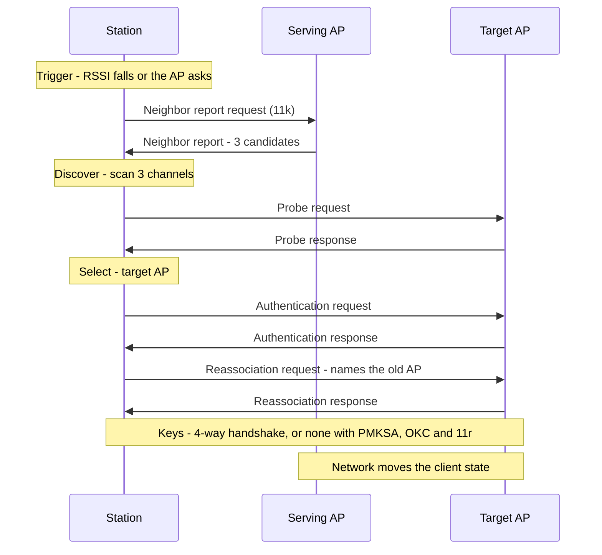

# WF 05: Wi-Fi roaming and radio management, from the roam decision to the channel plan

*Part of the [networking plan](../00_plan.md), Wi-Fi sub-track · Candela session 5a (roaming and radio resource management, with DFS), with 802.11k, v and r, PMKSA caching and opportunistic key caching, band and client steering, radio resource management (channel and power), DFS and the channel switch announcement, and the controller-era topics from the CWSP, CWAP and CCIE Wireless syllabus folded in · Time: about 10 hours · You need: [WF 03](03_wifi_mac.md) (scanning, the three states, DCF and the performance anomaly), [WF 04](04_wifi_security.md) (the 4-way handshake, PMKSA, the 802.11r key hierarchy in preview) and [WF 11](11_rf_fundamentals_and_link_budget.md) (path loss, shadowing, the link budget). Roaming answers two questions: **when should a station leave an access point, and how fast can it arrive at the next one with its keys and its state?** Radio management answers the matching question for the network: **which channel and which power should each access point use so that the stations have somewhere good to roam to?** This tutorial builds both from the bottom: the frames of 802.11k and v (decoded by `tshark`), the 802.11r key hierarchy, a roam time model that shows where the milliseconds go (the scan, not the handshake), simulations of roam thresholds and steering, channel and power planning on a 20 access point floor, and the DFS recovery policies.*

"Why does my call drop when I walk down the corridor" and "what does 802.11r do" are two of the most common wireless interview questions, and the Staff answer is a budget: how long each step takes, which step dominates, and which mechanism removes it. This tutorial puts a computed or simulated number on each step, and marks what comes from memory of the standard or of vendor behaviour.

**Eight honest limits, stated first.**

1. **There is no radio here, so no roam was measured.** The roam times are a model: the airtime of each frame comes from its size at 6 Mbit/s with the DCF waits of [WF 03](03_wifi_mac.md), and the processing time per frame (1 ms at each end) and the RADIUS round trips (5, 40 and 100 ms) are **assumptions**, printed beside every table. A real driver adds firmware latency, queues and scan policies that I did not measure.
2. **The standard was not re-read.** The layouts of the neighbor report, beacon report, BSS transition and channel switch frames are decoded by `tshark`, which checks the field positions. The **802.11r key derivation (KDF-SHA256, the labels, the context)** is **from memory** and has no independent check: `tshark` cannot derive FT keys and `wpa_supplicant` cannot run here, so a mistake in a label would not be caught. What the script demonstrates (one key per access point, binding to the identifiers) does not depend on the exact constants.
3. **My FT frames are structurally right and cryptographically empty.** The MIC fields are zero and the element contents are placeholders, so `tshark` decodes the fields but nothing is verified.
4. **The roam decision simulation is a corridor model**: nine access points in a line, log distance loss with correlated shadowing, no walls, one client, four policies of my own. Real clients decide with vendor specific logic, and the point of the simulation is the shape of the trade (stickiness against ping-pong against roam cost), not any phone.
5. **The steering model is a single cell with assumed behaviour**: 40 clients, 70 % dual band, every client asking for the same demand, and the compliance rates (35 % self-selection, 30 % ignoring) are my assumptions.
6. **The radio management model uses a simple propagation model and two simple algorithms** (a greedy colouring and a random local search) on one random floor. The vendor algorithms (the dynamic channel assignment and transmit power control of the controller era) and their thresholds are **from memory**.
7. **The DFS timers (60 s check, 30 minute non-occupancy, 10 s move time) are from memory** of the regulatory numbers and are inputs of a model; false detection rates are not modelled.
8. **Not run here:** a controller, mobility groups, anchor and foreign tunnels, FlexConnect, CleanAir, `hostapd` (this VM has no `cfg80211`, so [WF 10](10_linux_wireless_stack_and_openwrt.md) covers `hostapd_cli` and the roaming daemons) and any real client. Those sections are explained from memory and marked.

By the end you can:

- **say where a roam spends its time** (modelled: a full active scan of 38 channels at 30 ms is **1,140 ms**, a scan of the **3 channels** of an 802.11k neighbor list **90 ms**, and the exchange after it is **5.7 ms** for 802.11r, **10.6 ms** with PMKSA or OKC, **66.5 ms** for a full EAP-TLS with a 5 ms RADIUS server and **311.5 ms** at 40 ms, **1,039 ms** for PEAP at 100 ms; the whole roam is **1,451 ms** and **72** lost voice packets with no help, **96 ms** and **4** with a neighbor list and 802.11r, **6 ms** and **0** when the scan is skipped);
- **read and build the 802.11k and v frames** (built and decoded by `tshark`: a neighbor report response of **57 bytes** for two candidates at **15 bytes** each, a beacon report that carries RCPI **96** for **-62 dBm** and RSNI **70** for **25 dB**, and a BSS transition request with the disassociation imminent bit and a disassociation timer of **100 TU = 102.4 ms**);
- **derive the 802.11r keys and say what each protects** (computed, from memory of the KDF: one PMK-R0 per authentication, one **PMK-R1 per access point**, one PTK per association; four frames of **177, 177, 187 and 177 bytes** in my model of an over-the-air transition; pre-deriving every pair for **1,000 access points and 10,000 clients** takes **480 MB**, deriving on demand about **1.5 µs** per roam);
- **choose roam thresholds and hysteresis** (simulated on 200 walks: always roaming to the best access point gives **5.12 roams per 100 m** and **1.44 ping-pongs per 100 m**; roaming below **-80 dBm** is sticky, with **12.3 %** of the time below -75 dBm and **106.8 Mbit/s** mean; roaming below **-65 dBm** with a **5 dB** margin gives **3.53 roams**, **0.01 ping-pongs** and **139.9 Mbit/s**; with a **1,450 ms** roam the best-AP policy loses **8.83 %** of the time and falls from 142.8 to **130.2 Mbit/s**, while the -65 dBm policy keeps **131.2**);
- **explain band and client steering and where it fails** (modelled: with no steering **20.8 %** of the clients are on 5 GHz and the 2.4 GHz cell needs **95 %** of the air for 1.5 Mbit/s per client, so only **27 %** of the clients get their demand; with steering and every client complying **58 %** are on 5 GHz, both cells sit near **53 %** and **100 %** get it; if **30 %** ignore the steering **92 %** do; one 1 Mbit/s client in a cell of 20 raises the airtime from **88 %** to **235 %**);
- **plan channels and power** (simulated on 20 access points in 100 m by 100 m: 3 channels in 2.4 GHz leave **54** co-channel pairs that hear each other after greedy colouring against **60.4** at random, 9 channels in 5 GHz leave **13** against **20.1**, and **25** channels (with DFS) **0**; transmit power at **14 dBm** keeps **98.2 %** good coverage while the share of points with a second access point at -67 dBm or better falls from **97.9 %** to **71.7 %**; a failed access point opens **2.1 %** holes at 8 dBm and none at 14 dBm);
- **count beacon overhead** (computed: a 300 byte beacon at **1 Mbit/s** takes **2,592 µs**, **10.12 %** of the air for four SSIDs on one access point and **101.2 %** for ten access points on a channel; at 6 Mbit/s **1.64 %** and **16.4 %**);
- **handle a DFS event** (the channel switch announcement built and decoded by `tshark`; modelled outage per radar event of **1.0 s** when a non-DFS channel is announced, **60.5 s** when the move must wait for a 60 s channel check and **70.0 s** with no fallback chosen; with **2 events per day** that is **2 s**, **121 s** and **140 s** a day).

## Where the numbers come from

Each experiment is a script `sN_*.py` in `prog/` with its output frozen in `v/`, run with `run.sh`. `dot11.py` is the frame builder of [WF 03](03_wifi_mac.md) and `ft.py` the 802.11r key functions. `s1_kv.py` builds the six action frames of 802.11k and v and has `tshark` decode them, `s2_ft.py` derives the FT key hierarchy and builds the four frames of a fast transition, `s3_roamtime.py` is the roam time model, `s4_decision.py` the corridor walk with four roam policies, `s5_steering.py` the band steering model, `s6_rrm.py` the channel, power and coverage hole model, and `s7_dfs.py` the channel switch announcement and the DFS recovery policies. The answers to the problems are `ans_a` to `ans_e`.

Every number in the text is copied from `v/*.out` or computed from a printed figure with the arithmetic shown. A number that is not measured, simulated, modelled or computed here is marked **from memory**. The simulations use fixed seeds, so each run prints the same figures.

## Data and timing

| What | Size or time |
|---|---|
| 802.11k and v frames (`s1_kv.sh`) | 6 frames in a pcap, under 1 s |
| FT keys and frames (`s2_ft.sh`) | 3 access points, 4 frames, under 1 s |
| Roam time model (`s3_roamtime.sh`) | arithmetic, under 1 s |
| Corridor walks (`s4_decision.sh`) | 8 rows of 200 walks of 333 steps, about 2 s |
| Steering model (`s5_steering.sh`) | 4 rows of 400 draws, under 2 s |
| Channels, power, holes (`s6_rrm.sh`) | 20 access points, about 3 s |
| CSA and DFS (`s7_dfs.sh`) | 4 frames and arithmetic, under 1 s |

## Mapping to the Candela course

Candela session 5a covers roaming and radio resource management, with the DFS mechanics. This tutorial covers the same ground and adds what a Senior or Staff interview asks for beyond the course: the frames of 802.11k and v and what each field is for (sections 2 and 3), the 802.11r key hierarchy and why each access point gets its own key (section 4), the cost of each key caching method and the scan that dominates (sections 5 and 6), the roam decision as a design problem with hysteresis and roam cost (section 7), steering (section 8), channel and power planning with beacon overhead (section 9) and the DFS recovery policies (section 10). The CWSP fast roaming topics (PMK caching, OKC, preauthentication, FT over the air and over the DS) are sections 4 and 5, and the **controller-era** topics (mobility groups, L2 and L3 roaming, anchor and foreign, FlexConnect, client exclusion, rogue handling, coverage hole detection, RF groups, CleanAir) are in section 11, from memory. The **6 GHz discovery** items that matter for roaming (reduced neighbor report, preferred scanning channels, FILS discovery) are in section 6 and in [WF 06](06_wifi6_6e_7_features.md); **multi-link roaming** is in [WF 12](12_wifi7_eht_and_mlo.md) and the **seamless roaming of multi-AP coordination** in [WF 13](13_wifi8_uhr_802_11bn.md).

---

## 1. Who decides, and what a roam is

In an ESS (several access points with one SSID, [WF 01](01_wifi_landscape_and_ap_anatomy.md)) **the station decides when to roam**. The standard gives the access point no way to move a station: it can only advise (a BSS transition request), make the current link worse (ignore a station, lower its rate, send a deauthentication) or make the neighbour more attractive. Everything below follows from that. A roam has four phases:

1. **Trigger**: the station concludes that the current link is not good enough (RSSI below a threshold, too many retries, a low rate, missed beacons) or an access point asks it to move.
2. **Discover**: it finds the candidates: scan channels, listen to beacons and probe responses, or use a list from the network (802.11k).
3. **Select**: it ranks the candidates (RSSI, load from the BSS load element, rate, band preference).
4. **Execute**: authentication, **reassociation** (which names the previous access point so that the network can move state), the key setup of [WF 04](04_wifi_security.md), and the resumption of traffic, plus whatever the network does behind: the switch learns the new location of the MAC address, a controller moves the client entry, and downlink frames queued at the old access point are lost or forwarded.



The reassociation request (subtype 2, [WF 03](03_wifi_mac.md)) carries the **current AP address**, which is how the target learns where to fetch the station's context from (a controller, or the access point over the wired side with a vendor protocol or the old IAPP, **from memory**). A station that does not roam properly uses **association** (subtype 0) and a full authentication, which in an enterprise network means a full 802.1X exchange: the table of section 5 prices that difference.

Two facts frame the rest of the tutorial. **First**, the scan and the key exchange are most of the time (section 6). **Second**, roaming is a **policy** problem as much as a protocol problem: a station that roams too late is stuck at a low rate and drags everyone down ([WF 03](03_wifi_mac.md) section 7), and one that roams too often loses service at every move (section 7).

## 2. 802.11k: telling the station where to look

802.11k (**radio resource measurement**) lets an access point and a station ask each other for measurements, and gives the station a **neighbor report**: the list of nearby access points of the same ESS with their channels. Its value is the scan: with the list the station visits 3 channels and not 38.

The frames are **action frames of category 5** (radio measurement). The script builds the neighbor report request and response, a **beacon request** (the access point asks the station to measure beacons) and the **beacon report** that answers, and a BSS transition request and response (section 3), and `tshark` decodes all six:

--- the six action frames, built here and decoded by tshark (category 5 radio measurement, category 10 WNM)
frame  size  what                                           decoded by tshark
  1     33  neighbor report request                        category_code=5 action_code=4 dialog_token=1
  2     57  neighbor report response                       category_code=5 action_code=5 dialog_token=1
  3     47  radio measurement request (beacon request)     category_code=5 action_code=0 dialog_token=2
  4     58  radio measurement report (beacon report)       category_code=5 action_code=1 dialog_token=2 channelnumber=36 rcpi=96 rsni=70
  5     46  BSS transition management request              category_code=10 action_code=7 dialog_token=0x03 pref_cand=1 disassoc_imminent=1 disassoc_timer=100 validity_interval=10
  6     35  BSS transition management response             category_code=10 action_code=8 dialog_token=0x03 bss_transition_status_code=0 bss_transition_target_bss=02:00:00:00:00:02

A **neighbor report element** (element ID 52) is **15 bytes per candidate**: the BSSID (6), the BSSID information (4: reachability, whether the security matches, key scope, spectrum management, QoS, APSD, radio measurement, delayed and immediate block ack, **mobility domain** (bit 10: the same 802.11r domain, so a fast transition is possible), **high throughput** and very high throughput bits), the **operating class** and **channel** (which tell the station where to look) and the PHY type, with optional sub-elements (for example a preference). The response of two candidates is **57 bytes**.

--- the numbers inside
neighbor report element: id 52, 13 bytes of body per candidate (BSSID 6 + BSSID information 4 + operating class 1 + channel 1 + PHY type 1), 15 bytes with the element header; frame 2 is 57 bytes for two candidates = 24 header and 2 action bytes + 1 token + 2 x 15 = 57
BSSID information built here: 0x00000c0f (bits: reachable 3, security 4, key scope 8, mobility domain 0x400, HT 0x800); the dump of tshark -V on this frame showed the same value 0x00000c0f
RCPI = 2 x (dBm + 110): -62 dBm -> 96, decoded -62 dBm; RSNI = 2 x (SNR + 10): 25 dB -> 70, decoded 25.0 dB
operating class 115 = 5 GHz channels 36 to 48 (20 MHz), 81 = 2.4 GHz channels 1 to 13 (from memory of the regulatory table); the candidate list uses these two numbers to say where the station should look
request mode bits used: 0x05 = preferred candidate list included (bit 0) + disassociation imminent (bit 2); disassociation timer 100 TU = 102.4 ms; validity interval 10 beacon intervals
a transition request is advice, the response status 0 (accept) is a promise from the client and is not binding in time: the AP must still disassociate the client if it does not move (that is the disassociation timer)

**RCPI and RSNI.** The beacon report returns what the station heard. **RCPI** (received channel power indicator) is `2 x (dBm + 110)` in one byte (so **-62 dBm is 96**, with a range of -110 to 0 dBm), and **RSNI** (received signal to noise indicator) is `2 x (SNR + 10)` (**25 dB is 70**). The decode shows both values. Three ways to measure are defined, **passive** (listen), **active** (probe) and **beacon table** (report the beacons already heard, with no new scan), and the table mode is what lets an access point learn how the station sees the network without disturbing it.

**What else 802.11k can measure (from memory):** the **channel load** (how busy a channel is), the **noise histogram** (the distribution of the noise power), **station statistics** (the counters of the station), the **link measurement** (the path loss and margin between a station and its access point) and the **transmit stream measurement** (the delay of a voice stream), and the **location** requests. The **RM enabled capabilities element** in the association request says which of them a station supports, and support in practice is partial: many phones implement the neighbor report request and the beacon report and not the rest, so a design should not rely on the rest.

**How the network uses it.** A client that supports it asks for the neighbor report (usually when its RSSI falls), and the access point builds the list from its own knowledge or from the controller (the RF group of section 9). A bad list is worse than none: if the access point lists neighbours that are far away or on a wrong channel, the station spends its scan time on them.

## 3. 802.11v: asking the station to move

802.11v (**wireless network management**, WNM, action frames of **category 10**) contains the tool that fixes the sticky client: the **BSS transition management (BTM) request**. The frame in the decode above carries:

- a **request mode** byte: bit 0 **preferred candidate list included**, bit 1 **abridged** (the candidates not listed are less preferred), bit 2 **disassociation imminent**, bit 3 BSS termination included, bit 4 **ESS disassociation imminent**, and a **link removal imminent** bit for multi-link devices ([WF 12](12_wifi7_eht_and_mlo.md));
- a **disassociation timer** in TU (100 TU is 102.4 ms in the decode: the access point will disassociate the station after this time if it has not moved) and a **validity interval** for the candidate list (10 beacon intervals);
- the **candidate list**: neighbor report elements with a **preference** sub-element, so the access point can rank them. (`tshark` shows the list as raw bytes in my frame.)

The **BTM response** carries a **status code** and, for status 0 (accept), the **target BSSID** (the decode shows `02:00:00:00:00:02`). The other status codes tell why the station refused (no suitable candidate, the list is stale, the station is busy with a call), **from memory** of the table. The key property is in the standard and often missed: **a BTM request is advice**. A station may refuse, and the access point has only its disassociation timer to make a point, which is why a design that depends on it is only as strong as the client population. The station can also **ask** (a BTM query, action 6, **from memory**) with its reason for wanting to leave.

**Other WNM tools (from memory)** that matter in a design: **proxy ARP** (the access point answers ARP for its stations so that sleeping devices need not wake), **DMS** (directed multicast: convert multicast to unicast for each station), **BSS max idle** (how long the access point keeps a silent station, which sets the keepalive of a phone), **WNM sleep mode** (a longer sleep than the listen interval of [WF 03](03_wifi_mac.md)) and the **collocated interference** report.

## 4. 802.11r: the key hierarchy that makes the roam short

[WF 04](04_wifi_security.md) priced the full authentication: an EAP exchange with a server (7 to 10 rounds) and a 4-way handshake. 802.11r (**fast BSS transition, FT**) removes both from the roam by putting a **key hierarchy** above the PTK and letting the target access point derive its key **before** the station arrives.

--- the key hierarchy: one authentication gives PMK-R0, each AP then gets its own PMK-R1, each association its own PTK
XXKey (first 256 bits of the MSK)  000102030405060708090a0b...
PMK-R0      6cc86edab4b94fc82ebafdf8...   PMKR0Name dcddd090c3c909b2f17463e61e952432
AP1  PMK-R1 03d8cdef27b2df62...  PMKR1Name e0a9eaf2b38c76c0  PTK KCK 7eb858e4f6e9433b... TK 7e511f64734bea9b...
AP2  PMK-R1 6329c7a3ca95bc83...  PMKR1Name 8576299a8d73c0a8  PTK KCK f4410e5870fbb33b... TK a70ab52c8b116537...
AP3  PMK-R1 2dc7a697a3278ee6...  PMKR1Name 9f53e2ac764a31a6  PTK KCK ccf63edf0a97c328... TK 04d0bbca1531009f...
all three PMK-R1 differ: True; the same PMK-R0 would give a different PTK if either nonce changes: True
another SSID gives another PMK-R0: True; another mobility domain: True
what the R0 key holder (the controller or a cloud key server) must do on a roam: derive PMK-R1 for the target AP and hand it over (over the DS or the air); the AP never sees PMK-R0, so a stolen AP exposes only its own sessions
key sizes: PMK-R0 32 bytes, PMK-R1 32 bytes, PTK 48 bytes (KCK 16, KEK 16, TK 16); names are 16 bytes

The roles (from memory of the standard; the script implements them):

- **PMK-R0** is derived once per authentication from the XXKey (the first 256 bits of the MSK in 802.1X, or the PMK for FT-PSK) with the SSID, the **mobility domain identifier (MDID)** and the identities of the **R0 key holder** and the station. It lives at the **R0KH**: a controller, or a cloud key server. **No access point holds it.**
- **PMK-R1** is derived from PMK-R0 and the identities of an access point (the **R1KH-ID**) and the station. **Each access point of the mobility domain gets its own PMK-R1**, pushed to it by the R0 key holder (or pulled by it on a roam). The names, PMKR0Name and PMKR1Name (16 bytes), are what appear in frames so that the keys are never sent.
- The **PTK** is derived from PMK-R1 with the two nonces and both addresses, as in [WF 04](04_wifi_security.md), but now **the exchange that carries the nonces is the authentication and reassociation of the roam itself**.

The output shows the property that matters: three access points get **three different PMK-R1** and so three different PTKs, another SSID or another mobility domain gives another PMK-R0, and a new nonce changes the PTK. Consequences: **a stolen access point exposes only its own sessions** (it never held the R0), and **a station cannot use a key at an access point that does not hold the R1 for it**: the roam fails if the key holder has not pushed the key.

**The four frames.** The station sends an **authentication frame with algorithm 2 (FT)** carrying its nonce, the **mobility domain element** (id 54: the MDID and the FT capability and policy byte), the **RSN element with the PMKR0Name** and the **fast transition element** (id 55: the MIC control, the MIC, ANonce, SNonce and sub-elements with the R1KH-ID and R0KH-ID). The access point answers in kind with its ANonce. Then comes the **reassociation request and response**, carrying the same elements and a MIC over the exchange, and the keys are installed.

--- the four frames of an over-the-air fast transition (authentication algorithm 2, then reassociation), decoded by tshark
frame  size  subtype                    auth alg  seq     mobility domain  FT capability  AKM  PMKIDs  SNonce        ANonce        R0KH-ID
  1     177  authentication request     2         0x0001  0x3412           0x01           3    1       111111111111  000000000000  r0kh-001
  2     177  authentication response    2         0x0002  0x3412           0x01           3    1       111111111111  222222222222  r0kh-001
  3     187  reassociation request      -         -       0x3412           0x01           3    1       111111111111  222222222222  r0kh-001
  4     177  reassociation response     -         -       0x3412           0x01           3    1       111111111111  222222222222  r0kh-001
the station sends the nonce SNonce in frame 1 and the AP answers with ANonce in frame 2: with PMK-R1 held by the target AP both can derive the PTK before reassociation; the MIC in the reassociation frames (the FT element) proves it
no EAP, no RADIUS exchange and no separate 4-way handshake: the exchange is 4 frames of 177, 177, 187 and 177 bytes

`tshark` decodes the mobility domain **0x3412**, the capability byte, the AKM (**3**, FT over 802.1X), the **PMKID count** (1: the PMKR0Name), the nonces and the R0KH-ID. (My frames have a zero MIC, limit 3.) There is **no EAP, no RADIUS exchange and no separate 4-way handshake**.

**Over the air against over the DS.** In the **over-the-air** variant the station talks directly to the target. In the **over-the-DS** variant it sends the FT frames to its current access point in an **action frame** (FT request and response), which forwards them over the wired side to the target: the station need not leave the channel until it is ready, at the price of two extra hops on the wired network and a dependence on it (the model in section 5 adds 4 ms).

**The AKMs and the resource request.** The FT suites are **FT-802.1X (AKM 3)**, **FT-PSK (4)**, **FT-SAE (9)** and the SHA-384 variants for 192 bit networks (from the AKM list of [WF 04](04_wifi_security.md)). The FT exchange can also carry a **resource request** so that a TSPEC ([WF 03](03_wifi_mac.md)) is admitted at the target in the same exchange, which is what makes voice roams complete with their QoS.

**The bookkeeping** is a design cost, and the script prices it:

PMK-R0 23aaf960d63a75d6177b91202d73db65...  PMKR0Name 3ff3b904f1983469b330bd5ab93a238c
R1KH-ID 02:00:00:00:01:01: PMK-R1 2ea9e1320658d2bf63b1bd50dfff80e9...  PMKR1Name ba5a875ccb1d514c9c60327ad65ccc3d
R1KH-ID 02:00:00:00:01:02: PMK-R1 fa54cdcf0be2707ace8a6c0f00ec9331...  PMKR1Name 48e354f54c7996500cd8f8f2dab519ec
R1KH-ID 02:00:00:00:01:03: PMK-R1 33199ff444800dac2b866976de188bff...  PMKR1Name e44d85915e19c1e3accc00ab6f608e4a
a target AP that derives R1 with the wrong R1KH-ID gets a different key: True (the PTK is then different and the MIC of the reassociation fails)
the PTK for the same nonces differs for each AP: True
--- bookkeeping at the R0 key holder: pre-deriving every PMK-R1 for every client against deriving on demand
  100 APs x   1000 clients = 1.00e+05 pairs x 48 bytes (key and name) = 4.8 MB; on demand: one derivation per roam, 2 HMAC-SHA256 blocks (about 1.5 us)
 1000 APs x  10000 clients = 1.00e+07 pairs x 48 bytes (key and name) = 480.0 MB; on demand: one derivation per roam, 2 HMAC-SHA256 blocks (about 1.5 us)
 5000 APs x  50000 clients = 2.50e+08 pairs x 48 bytes (key and name) = 12000.0 MB; on demand: one derivation per roam, 2 HMAC-SHA256 blocks (about 1.5 us)
a client in the mobility domain roams to a handful of neighbours (say 8): 8 keys per client, 3.8 MB for 10,000 clients (against 480 MB for all 1,000 APs)

Pre-deriving all pairs for **1,000 access points and 10,000 clients** is **480 MB** and **12,000 MB** for 5,000 and 50,000, so real systems derive **on demand** (two HMAC-SHA256 blocks per derivation, about 1.5 µs, the figure in the output being my estimate) or push the keys of the handful of neighbours a client is likely to visit (8 keys per client: **3.8 MB** for 10,000 clients).

**Where 802.11r goes wrong (from memory of common field reports).** The cryptography is not the problem. The problems are **client support** (some older clients fail to join an SSID that advertises the FT AKM, so many networks list both the FT and the plain suite, the mixed mode of [WF 04](04_wifi_security.md)), a **mobility domain that is not consistent** across access points (the MDID or the key holder differs, so the key never arrives), **key push latency** (the R1 must reach the target before the station does), and **time** (the reassociation deadline of the FT exchange).

## 5. Key caching without 802.11r: PMKSA, OKC and preauthentication

802.11r is not the only way to skip the EAP exchange. Three older mechanisms, all from memory of the standard and the vendor practice, trade complexity against coverage:

- **PMKSA caching**: after a full 802.1X success the access point and the station keep the **PMK** (a PMKSA) for its lifetime and name it by the **PMKID**. When the station comes back to **the same access point** it puts the PMKID in the reassociation and skips EAP: only the 4-way handshake runs. It does nothing for the first visit to a new access point.
- **Opportunistic key caching (OKC)**: a vendor extension in which the PMK is derived so that **every access point under the same controller** can use it. The station presents the PMKID for the **target** access point and the controller already holds the key. The station must support it (it computes the target PMKID), and the access points must share a key holder.
- **Preauthentication**: the station authenticates to the neighbour **through the current access point** before it moves, so the PMKSA is waiting at the target. It is in the standard and rarely used, because the exchange is the full EAP one and the station must know which neighbour is next.

Priced by the model, the exchange after the scan:

--- model inputs (assumptions, not measurements)
management frames at 6 Mbit/s; one frame costs DIFS 34 + mean backoff 7.5 x 9 + preamble 20 + bits/rate + SIFS 16 + ACK; 1000 us processing per frame at each end
frame costs (ms, idle medium): authentication pair 2.43, association pair 2.75, 4-way handshake 5.34, FT over the air (4 frames) 5.66

--- the exchange after the scan, by mechanism (ms)
RADIUS round trip       5 ms (same site)   40 ms (cloud)   100 ms (far)
full 802.1X, EAP-TLS (7 rounds)                        66.5          311.5           731.5
full 802.1X, PEAP (10 rounds)                          89.4          439.4          1039.4
PMKSA or OKC (no EAP, 4-way kept)                      10.6           10.6            10.6
WPA2-PSK (4-way only)                                  10.5           10.5            10.5
802.11r over the air                                    5.7            5.7             5.7
802.11r over the DS (+ 4 ms for the DS hops)            9.7            9.7             9.7

Read the table. A **full EAP roam depends on the server distance**: EAP-TLS costs **66.5 ms** with a RADIUS server on the same site (5 ms round trip), **311.5 ms** at 40 ms (a cloud service) and **731.5 ms** at 100 ms, and PEAP, which needs 10 rounds, **89.4, 439.4 and 1,039.4 ms**. **PMKSA or OKC removes the dependence** (**10.6 ms**), and **802.11r is the shortest at 5.7 ms**, with the over-the-DS variant at **9.7 ms**. The 4-way handshake still costs about **5.3 ms**, the difference between 802.11r (which folds it into the roam) and OKC. The lesson for a cloud managed network is that the server round trip multiplies by the number of EAP rounds, so **a cloud RADIUS without key caching makes every roam a perceptible event**.


## 6. The roam time budget: the scan is the cost

The exchange after the scan is small. The scan before it is not. A station that has no list visits every channel it supports, and each channel costs a dwell time (a passive scan waits for a beacon, so at least one beacon interval of 102.4 ms, and an active scan sends a probe request and waits for responses, often 20 to 40 ms). The model uses 30 ms per channel and prices the scan:

--- the scan before it (ms), active scan with 30 ms per channel (assumed) and the channel count
all 2.4 and 5 GHz channels, no help (13 + 25)      38 channels     1140 ms
5 GHz only, non-DFS (9)                            9 channels      270 ms
802.11k neighbor list (3 channels)                 3 channels       90 ms
the same band, one channel (known target)          1 channels       30 ms

**38 channels cost 1,140 ms, 9 channels 270 ms, the 3 channels of a neighbor report 90 ms and 1 channel 30 ms** (modelled, 30 ms dwell). Put the two halves together:

--- a complete roam: scan + exchange, and the voice packets lost at 20 ms packetisation (frames lost = gap / 20 ms)
case                                                             total ms       lost
no help, full scan, EAP-TLS, RADIUS 40 ms                            1451         72
no help, full scan, PSK                                              1151         57
neighbor list (3 ch), PMKSA or OKC                                    101          5
neighbor list (3 ch), 802.11r over the air                             96          4
target known (1 ch), 802.11r over the air                              36          1
target known, 802.11r, scan skipped (probe-less, 0 ms)                  6          0
a voice call tolerates about 50 ms of gap (from memory of the usual target); the rows that fit are the ones that skip both the scan and the EAP exchange

The result in one table (modelled, section 5 inputs, voice packets every 20 ms):

| Roam | Time | Lost voice packets |
| --- | --- | --- |
| Full EAP-TLS roam, full scan, RADIUS at 40 ms | 1,451 ms | 72 |
| PSK roam, full scan | 1,151 ms | 57 |
| Neighbor list plus PMKSA or OKC | 101 ms | 5 |
| Neighbor list plus 802.11r | 96 ms | 4 |
| Station knows the target (one channel) plus 802.11r | 36 ms | 1 |
| Scan skipped (target already known and measured) plus 802.11r | 6 ms | 0 |

Three conclusions follow, and they decide what to build first.

1. **The scan is 79 percent of the worst case and most of the best realistic one.** Fixing the key exchange alone (802.11r with a full scan) still leaves over a second. The neighbor report (802.11k) is as important as 802.11r, and the two together are what the Candela course means by the 11k, 11v and 11r set.
2. **A voice call tolerates about 50 ms of outage** (the usual design target, from memory), and the only rows that meet it are the last two. A neighbor list plus 802.11r (96 ms) is close, and the gap closes only if the station skips the scan.
3. **A station can skip the scan** if it already measured the target recently (its background scan, which the next section's decision depends on) or if the network gives it a short list with the channel and the time of the last beacon. That is why a good client scans in the background while it is still connected, and why **a client that does no background scanning is the one that roams badly whatever the network does**.

**Budget by arithmetic.** For a target outage the question is how many channels a scan may visit and how far the RADIUS server may be. The script computes both:

exchange costs (ms): auth 2.43, assoc 2.75, reassoc 2.83, 4-way 5.34, FT 5.66
--- largest RADIUS round trip for a full EAP roam to fit a budget (no scan, rounds of 2 frames + the server each)
one EAP round on the air: 2.65 ms; Start and Success 2.43 ms
EAP-TLS, 7 rounds  budget  50 ms: RADIUS round trip at most 2.6 ms
EAP-TLS, 7 rounds  budget 150 ms: RADIUS round trip at most 16.9 ms
EAP-TLS, 7 rounds  budget 300 ms: RADIUS round trip at most 38.4 ms
PEAP, 10 rounds    budget  50 ms: RADIUS round trip at most 1.1 ms
PEAP, 10 rounds    budget 150 ms: RADIUS round trip at most 11.1 ms
PEAP, 10 rounds    budget 300 ms: RADIUS round trip at most 26.1 ms
--- how many channels a scan may visit inside the budget, by dwell time per channel (after subtracting the exchange)
budget  50 ms, FT over the air : dwell 10 ms:  4 channels; dwell 20 ms:  2 channels; dwell 30 ms:  1 channels; dwell 40 ms:  1 channels; dwell 110 ms:  0 channels;
budget  50 ms, PMKSA or OKC    : dwell 10 ms:  3 channels; dwell 20 ms:  1 channels; dwell 30 ms:  1 channels; dwell 40 ms:  0 channels; dwell 110 ms:  0 channels;
budget  50 ms, WPA2-PSK full   : dwell 10 ms:  3 channels; dwell 20 ms:  1 channels; dwell 30 ms:  1 channels; dwell 40 ms:  0 channels; dwell 110 ms:  0 channels;
budget 150 ms, FT over the air : dwell 10 ms: 14 channels; dwell 20 ms:  7 channels; dwell 30 ms:  4 channels; dwell 40 ms:  3 channels; dwell 110 ms:  1 channels;
budget 150 ms, PMKSA or OKC    : dwell 10 ms: 13 channels; dwell 20 ms:  6 channels; dwell 30 ms:  4 channels; dwell 40 ms:  3 channels; dwell 110 ms:  1 channels;
budget 150 ms, WPA2-PSK full   : dwell 10 ms: 13 channels; dwell 20 ms:  6 channels; dwell 30 ms:  4 channels; dwell 40 ms:  3 channels; dwell 110 ms:  1 channels;
budget 300 ms, FT over the air : dwell 10 ms: 29 channels; dwell 20 ms: 14 channels; dwell 30 ms:  9 channels; dwell 40 ms:  7 channels; dwell 110 ms:  2 channels;
budget 300 ms, PMKSA or OKC    : dwell 10 ms: 28 channels; dwell 20 ms: 14 channels; dwell 30 ms:  9 channels; dwell 40 ms:  7 channels; dwell 110 ms:  2 channels;
budget 300 ms, WPA2-PSK full   : dwell 10 ms: 28 channels; dwell 20 ms: 14 channels; dwell 30 ms:  9 channels; dwell 40 ms:  7 channels; dwell 110 ms:  2 channels;
--- a passive scan (110 ms dwell) of all 25 channels of 5 GHz plus 13 of 2.4 GHz: 4.2 s; with the 11k list of 3 channels: 330 ms

For a **50 ms budget** a full EAP-TLS roam survives only a RADIUS round trip of **2.6 ms** (PEAP: **1.1 ms**), which is a server in the same rack, so **a roam that must stay below 50 ms cannot include an EAP exchange** and the choice is key caching or 802.11r. For 150 ms the EAP-TLS server may be **16.9 ms** away, and for 300 ms **38.4 ms**. With FT at 30 ms per channel, **a 150 ms budget allows 4 channels and a 50 ms budget 1**. A **passive scan of 38 channels at 110 ms** is **4.2 s** and a passive scan of the 3 channels of a list **330 ms**, so the list must also say which channels are worth an **active** probe.

**6 GHz makes the scan worse and gives new tools (from memory).** The 6 GHz band has up to **59 channels of 20 MHz** and a station may not probe on a channel before it has heard an access point there (the rules of [WF 01](01_wifi_landscape_and_ap_anatomy.md)), so a full scan is slow. The standard added three discovery aids, all in 802.11ax and 802.11-2024:

- the **reduced neighbor report (RNR) element**, carried in the beacons and probe responses of the 2.4 GHz and 5 GHz radios of an access point, which lists the **6 GHz** BSSIDs, their channels and a short SSID, so a station learns the 6 GHz neighbours while it is on another band;
- **preferred scanning channels (PSC)**: of the 59 channels, every fourth (starting at channel 5) is a PSC, and an access point whose primary channel is not a PSC is expected to be found through the RNR instead, so a station scans the 15 PSCs only (from memory of the count);
- **FILS discovery frames** (fast initial link setup): a short broadcast frame (smaller than a beacon) sent every 20 TU or less on a PSC, which lets a station find an access point in about 20 ms and not 102.4 ms, and **unsolicited probe responses** as an alternative.

All three are the same idea as the neighbor report: tell the station where to look so that it does not scan everything.

## 7. The roam decision: when and where to go

The standard says nothing about **when** a station roams, so every vendor chooses. The common triggers are an **RSSI threshold** (-70 to -75 dBm is typical for a phone, **from memory** of vendor documents; a laptop is often later), a **retry or rate drop**, **missed beacons**, a **BTM request**, and, on some clients, an **application hint** (a voice call). The selection looks at RSSI first and adds a bias for 5 GHz and 6 GHz and a penalty for a high **channel utilization** (the BSS load element of [WF 03](03_wifi_mac.md)).

The script walks 200 stations along a corridor of **9 access points 25 m apart** (17 dBm, shadowing 4 dB with a decorrelation distance of 5 m, speed 1.2 m/s) and compares four policies, with a roam outage of 50 ms (802.11r with a list) and of 1,450 ms (full EAP roam, full scan):

--- a walk along 9 access points 25 m apart (200 m), there and back at 1.2 m/s, shadowing 4 dB with 5 m decorrelation, 200 walks per row (a model)
--- FT roam, outage 50 ms
policy                                           roams/100m pingpong/100m   time < -75 mean Mbit/s   outage % Mbit/s after outage
best AP always (no hysteresis)                         5.12         1.44         0.0%      142.8      0.31%          142.4
roam below -80 dBm to the best (sticky)                1.59         0.00        12.3%      106.8      0.10%          106.7
roam below -70 dBm and the target 8 dB better          3.38         0.00         0.0%      130.8      0.20%          130.5
roam below -65 dBm and the target 5 dB better          3.53         0.01         0.0%      139.9      0.21%          139.6
--- full scan and EAP roam, outage 1450 ms
policy                                           roams/100m pingpong/100m   time < -75 mean Mbit/s   outage % Mbit/s after outage
best AP always (no hysteresis)                         5.08         1.42         0.0%      142.8      8.83%          130.2
roam below -80 dBm to the best (sticky)                1.60         0.00        12.2%      107.3      2.78%          104.3
roam below -70 dBm and the target 8 dB better          3.35         0.00         0.0%      130.6      5.81%          123.0
roam below -65 dBm and the target 5 dB better          3.54         0.02         0.0%      139.8      6.15%          131.2

Read the policies, because the table has a trap in it.

- **Best access point always** (roam as soon as another is stronger) gives the **best throughput (142.8 Mbit/s) and the worst behaviour**: **5.12 roams per 100 m and 1.44 ping-pong roams per 100 m** (a roam back to the previous access point). With a 50 ms outage it costs **0.31 percent** of the time, and with the full 1,450 ms roam **8.83 percent**.
- **Sticky** (roam only below -80 dBm) has the **fewest roams (1.59 per 100 m, no ping-pong) and the worst radio**: **12.3 percent of the time below -75 dBm**, and **106.8 Mbit/s**. It costs the least outage (2.78 percent at 1,450 ms) and the most capacity, which is the **sticky client** of [WF 03](03_wifi_mac.md).
- **Threshold plus margin** (roam below -70 dBm and only to an access point 8 dB better) gives **3.38 roams per 100 m, no ping-pong, 0 percent of time below -75 dBm and 130.8 Mbit/s**. The variant with -65 dBm and 5 dB gives 3.53 roams, **139.9 Mbit/s** and 0.01 ping-pong, at a slightly higher outage at 1,450 ms (6.15 percent against 5.81).

So **the best policy depends on the roam cost**. When a roam costs 50 ms, roaming early is nearly free, and the throughput is best with a high threshold and a small margin. When a roam costs 1.45 s, every avoided roam is worth 1.45 s, and a larger margin and a lower threshold win. **This is why the order of the work is: make the roam cheap (sections 4 to 6), and only then tune the thresholds.**

**Why hysteresis works.** The difference between two shadowed RSSI values is itself noisy (the model has **sigma 5.66 dB** for the difference of two 4 dB values), so near the midpoint between two access points the station sees the "better" access point flip at random. The script computes the chance that noise alone exceeds a margin:

RSSI of the serving AP and of the neighbour each carry shadowing of sigma 4 dB; the difference has sigma 5.66 dB
hysteresis (dB)        P(noise alone exceeds it)  samples per hour at 1 Hz (independent draws, an upper bound)
0                      0.5000                     1800
2                      0.3618                     1303
4                      0.2398                     863
6                      0.1444                     520
8                      0.0786                     283
10                     0.0385                     139
12                     0.0169                     61
--- the midpoint between two APs 25 m apart: log distance loss 40 + 32 log10(d); AP power 17 dBm
distance   5.0 m: RSSI  -45.4 dBm
distance  10.0 m: RSSI  -55.0 dBm
distance  12.5 m: RSSI  -58.1 dBm
distance  20.0 m: RSSI  -64.6 dBm
distance  30.0 m: RSSI  -70.3 dBm
distance  40.0 m: RSSI  -74.3 dBm
--- what a threshold costs: the distance at which RSSI crosses it, and the SNR it leaves above a noise floor of -95 dBm
roam threshold  -60 dBm: reached at  14.3 m from the AP, SNR 35 dB
roam threshold  -65 dBm: reached at  20.5 m from the AP, SNR 30 dB
roam threshold  -70 dBm: reached at  29.4 m from the AP, SNR 25 dB
roam threshold  -75 dBm: reached at  42.2 m from the AP, SNR 20 dB
roam threshold  -80 dBm: reached at  60.4 m from the AP, SNR 15 dB
roam threshold  -85 dBm: reached at  86.6 m from the AP, SNR 10 dB
with 25 m spacing the midpoint between two APs (12.5 m from each) is at -58.1 dBm; a client that waits for -80 dBm would be 60 m from its AP, which in this corridor is beyond the next two access points: it would have gone through their cells long before, so a sticky client sits on a far AP with much louder neighbours near it

With **no margin the chance is 0.5**, and the margin that makes a spurious roam unlikely is **8 to 12 dB** (0.0786 at 8 dB, 0.0169 at 12 dB). The same output gives the geometry: the midpoint RSSI at 12.5 m is **-58.1 dBm** and the thresholds -60, -65, -70, -75, -80 and -85 dBm are reached at **14.3, 20.5, 29.4, 42.2, 60.4 and 86.6 m**, with **35, 30, 25, 20, 15 and 10 dB** of SNR left (against a noise floor of -95 dBm, modelled). At -80 dBm a station has an SNR of 15 dB, which is the **lowest MCS** territory of [WF 02](02_wifi_phy.md), so a station that waits for -80 dBm is already at a quarter of its rate.

**Roam cost for the other users.** A station that stays at a low rate steals airtime: section 8 prices it. A roam also hurts at the **application** layer: TCP sees a gap of the length of the outage and may go into a retransmission timeout (the minimum RTO of Linux is 200 ms, [NET 03](../03_tcp_udp_and_transport.md), **from memory**), so a 100 ms roam is a stall of at least 200 ms for a TCP flow that was sending at that moment.

## 8. Steering: band steering, client steering and load balancing

Roaming moves a station between access points. **Steering** is the network's attempt to choose which radio and which access point a station uses, with the tools it has: the BSS transition request (section 3), and the older tricks of **withholding responses** (an access point ignores the probe requests and authentication of a dual band station on 2.4 GHz for a while, so that it joins 5 GHz) and **deauthenticating** a station with a status code that asks it to try elsewhere (a vendor feature, **from memory**).

- **Band steering** moves dual band stations to 5 GHz or 6 GHz, because 2.4 GHz has 3 non-overlapping channels and slow, long frames ([WF 01](01_wifi_landscape_and_ap_anatomy.md)).
- **Client steering** (or load balancing) moves stations between access points, to even the load or to push a sticky station away.
- **Load balancing** in controller products (from memory) refuses an association when the access point has more than a set number of clients compared with its neighbours. It trades some association failures for an even load and can strand a client that has no other access point to go to.

The script simulates **40 stations** (70 percent dual band, 20 MHz channel on 2.4 GHz and 80 MHz on 5 GHz, demand 1.5 Mbit/s each, 400 random draws) with four scenarios:

--- 40 clients in one cell, 70 % dual band, 20 MHz on 2.4 GHz and 80 MHz on 5 GHz, 400 random draws (a model); each client wants 1.5 Mbit/s of 1500 byte frames
policy                                                 % on 5G 2.4G airtime 5G airtime  mean Mbit/s   10th pct   demand met
no steering (35 % of capable clients find 5 GHz)         20.8%          95%        20%         1.37       1.34          27%
band steering, all clients comply                        58.0%          53%        54%         1.50       1.50         100%
band steering, 30 % of clients ignore it                 40.2%          73%        38%         1.49       1.49          92%
band steering, only 30 % dual band                       24.8%          90%        23%         1.42       1.40          41%
airtime above 85 % cannot be served: every client then gets the same fraction of its demand (DCF shares packets), so one slow client costs all the others
example, 20 clients at 54 Mbit/s wanting 1.5 Mbit/s: airtime 88 %, each gets 1.45; replace one by a 1 Mbit/s client: airtime 235 %, each gets 0.54 (63 % lost)

| Scenario | On 5 GHz | 2.4 GHz airtime | 5 GHz airtime | Demand met |
| --- | --- | --- | --- | --- |
| No steering | 20.8 % | 95 % | 20 % | 27 % of draws |
| Steering, all comply | 58.0 % | 53 % | 54 % | 100 % |
| Steering, 30 % ignore it | 40.2 % | 73 % | 38 % | 92 % |
| Only 30 % are dual band | 24.8 % | 90 % | 23 % | 41 % |

The result is what the theory predicts and it contains a warning. Steering turns an overloaded 2.4 GHz channel (95 percent busy, 27 percent of the draws meeting demand) into a balanced network (53 and 54 percent, all draws met). **The gain depends on compliance and on the client mix**: if 30 percent of the stations ignore the advice only **40.2 percent** end up on 5 GHz and the demand is met in 92 percent of the draws, and if only 30 percent of the stations are dual band, steering moves very little (24.8 percent), because the stations that cannot move are the ones that are left.

**The airtime example from the output** is the reason to care about slow stations: **20 stations at 54 Mbit/s that each want 1.5 Mbit/s use 88 percent of the airtime and each gets 1.45 Mbit/s**. **Replace one of them by a station at 1 Mbit/s and the demand is 235 percent of the airtime, and each gets 0.54 Mbit/s, a loss of 63 percent**, which is the anomaly of [WF 03](03_wifi_mac.md) section 7 and the reason to **remove the low rates from the basic rate set** (which also removes the 1 Mbit/s beacons of section 9) and to roam sticky clients away.

**Where steering fails (from memory of field reports).** A station that **blacklists** an SSID after a rejected association; a **voice or IoT** device that is not designed for repeated rejection; a station that is dual band but **does not support the band** it is sent to (a 5 GHz channel in the DFS range that it cannot use); and **mixed signalling**, where the network rejects the station on one access point and a neighbour accepts it on a worse channel. Steering is a policy with side effects, so it must be **measured** (the share of stations that really move, the time to join, the rejections) before it is trusted.


## 9. Radio resource management: channels, power and coverage

**RRM** is the name for the controller or cloud function that sets the **channel**, the **transmit power** and the **channel width** of every access point and reacts to change. Vendors use different names (DCA and TPC in controller products, ARM and AutoRF in others, from memory) and the same three jobs. The script uses a model of **20 access points** on a jittered 5 by 4 grid in 100 m by 100 m (20 dBm, loss 40 dB plus 32 log10 of the distance in metres: a model, not a measurement) to show what the algorithms do and what they cannot do.

--- 20 access points on a jittered 5 x 4 grid in 100 m x 100 m, transmit power 20 dBm, loss 40 dB + 32 log10(d) (a model)
pairs of APs that hear each other: 182 above -82 dBm, 60 above -70 dBm, 8 above -60 dBm (of 190 pairs); mean APs heard above -82 dBm per AP: 18.2

**Most access points hear most others.** Of 190 pairs, **182 are above -82 dBm** (a level at which the preamble is detected and the channel is deferred, [WF 03](03_wifi_mac.md)), 60 above -70 dBm and 8 above -60 dBm, which is **18.2 neighbours per access point** in a floor of 100 m by 100 m. That is the case for a careful channel plan: in an office, the "cell" picture of one access point per channel does not exist.

**Channel assignment.** The problem is a colouring problem on a graph in which two access points are linked if they hear each other, and the aim is to keep linked access points on different channels. The script compares a random plan, a greedy plan and a local search:

--- channel assignment: co-channel pairs that hear each other, and the total interference between them (dBm)
co-channel pairs: pairs of access points on one channel that hear each other above -82 dBm; interference: the power sum at the receivers of those pairs
2.4 GHz, 3 channels                          random  60.4 pairs   -45.5 dBm | greedy 54 pairs   -50.7 dBm | local search 54 pairs   -50.7 dBm
5 GHz, 9 non-DFS channels                    random  20.1 pairs   -50.8 dBm | greedy 13 pairs   -63.0 dBm | local search 13 pairs   -63.5 dBm
5 GHz, 25 channels with DFS                  random   7.3 pairs   -56.5 dBm | greedy  0 pairs  -200.0 dBm | local search  0 pairs  -200.0 dBm

- **2.4 GHz with 3 channels** is hopeless: **60.4 co-channel pairs at random, 54 after the best search** (a graph this dense cannot be coloured with 3 colours). The only real tools are to **turn off** some 2.4 GHz radios and to lower their power.
- **5 GHz with 9 non-DFS channels**: **20.1 pairs at random, 13 after optimisation**.
- **5 GHz with 25 channels (DFS included): 7.3 at random and 0 after optimisation.** DFS channels are what make a clean plan possible, at the price of radar events (section 10).

So **channel count is the resource**, and an algorithm cannot create it. A designer who bans the DFS channels (for the voice reasons of section 10) gives up the plan that has no co-channel neighbours, and has to accept 13 pairs of mutual interference in this model.

**Transmit power.** Lower power shrinks the cells and the interference but also the coverage and the overlap that roaming needs. The script measures both on a grid of points (a client needs at least -67 dBm for a good rate, a hole is a point below -75 dBm):

--- transmit power: coverage against overlap (a client needs at least -67 dBm for a good rate; a hole is a point below -75 dBm; 20 m grid of points; client uplink power is not modelled)
transmit power plan                good cov %    holes % second AP >= -67 % APs per point >= -75
all 20 dBm                              100.0        0.0               97.9                10.80
all 14 dBm                               98.2        0.0               71.7                 5.70
all 8 dBm                                77.3        0.2               16.2                 2.68
all 2 dBm                                37.8       12.2                2.2                 1.23
TPC: 3rd neighbour at -70 dBm            98.2        0.0               75.8                 5.91
TPC result powers (dBm): min 10.9, median 14.2, max 20.0; mean power of the 12 access points on the outer ring 15.2 dBm, of the 8 inside 13.2 dBm
pairs that hear each other above -82 dBm after TPC: 139 (before: 182)

| Power plan | Good coverage | Holes | Second AP at -67 dBm or better | APs heard at -75 dBm or better |
| --- | --- | --- | --- | --- |
| All 20 dBm | 100.0 % | 0.0 % | 97.9 % | 10.80 |
| All 14 dBm | 98.2 % | 0.0 % | 71.7 % | 5.70 |
| All 8 dBm | 77.3 % | 0.2 % | 16.2 % | 2.68 |
| All 2 dBm | 37.8 % | 12.2 % | 2.2 % | 1.23 |
| TPC (third neighbour at -70 dBm) | 98.2 % | 0.0 % | 75.8 % | 5.91 |

At **14 dBm coverage is still 98.2 percent**, and the number of access points a point hears at -75 dBm or better falls from **10.8 to 5.7**, which is half the contention. At 8 dBm coverage collapses to **77.3 percent**. **TPC** with the classic rule (set the power so that the third strongest neighbour is heard at -70 dBm, the controller rule, from memory) gives **98.2 percent coverage with 75.8 percent second-AP overlap and a power spread of 10.9 to 20.0 dBm (median 14.2)**. The mean power of the **12 outer access points is 15.2 dBm and of the 8 inside 13.2 dBm**: the edge keeps more because it has fewer neighbours. After TPC, **139 pairs hear each other, down from 182**.

**The client side of power.** Two limits the model leaves out. A client transmits at 14 to 20 dBm (a phone often less), so an access point at 20 dBm that a client hears at -75 dBm is a link where the **uplink is the weak direction** (the asymmetric link of [WF 01](01_wifi_landscape_and_ap_anatomy.md) and [WF 11](11_rf_fundamentals_and_link_budget.md)). And **raising the power does not help the client hear better**: it makes the access point look strong and keeps a sticky client attached. **The access point power is a design choice for the uplink, and a good design lowers it.**

**Coverage holes and failure.** RRM reacts to a failed or removed access point, which is its coverage hole mitigation (from memory): when clients are seen at a low SNR, the neighbours raise power. The script removes one access point and then lets the four nearest neighbours add 6 dB:

--- a coverage hole: AP 7 fails; the plan at 8 dBm has no overlap to hide it, the plan at 14 dBm does; the four nearest neighbours then add 6 dB (the idea of RRM coverage hole mitigation, from memory)
plan                    holes, all up      AP 7 down  AP 7 down, +6 dB nearby
all 14 dBm                       0.0%           0.0%                     0.0%
all 8 dBm                        0.2%           2.1%                     0.2%
all 5 dBm                        3.0%           7.2%                     3.0%

With **14 dBm everywhere the failure leaves no hole (0.0 percent)** because the overlap covers it. With **8 dBm the failure opens 2.1 percent holes** and the +6 dB reaction closes them back to 0.2 percent; at 5 dBm **7.2 percent** shrinks to 3.0 percent, which is the hole that was there before the failure. The lesson is a **trade**: a plan tuned for the lowest interference has no redundancy, and a plan with redundancy has more interference. A designer should decide the redundancy explicitly (N+1 coverage) and not discover it in an outage.

**What RRM does not do.** It does not know the building, it reacts on a time scale of minutes to hours (so it cannot follow a crowd), a change of channel **disconnects or interrupts** stations (the CSA of section 10 is the polite way, and not every client follows it), and its input is mostly what the access points hear of each other and of the clients. The CleanAir style of products (section 11) adds a spectrum view for non-Wi-Fi interference.

**Beacon overhead, the cost of a plan with many SSIDs.** Every access point sends a beacon for every SSID, at the lowest basic rate, every 102.4 ms. The script prices it:

a beacon is about 300 bytes (the elements of an HE AP are 250 to 400 bytes, from WF 01); one every 102.4 ms per SSID
beacon rate (Mbit/s)       us per beacon  1 SSID       4 SSIDs      8 SSIDs
1                          2592           2.53 %       10.12 %      20.25 %
2                          1392           1.36 %       5.44 %       10.88 %
6                          420            0.41 %       1.64 %       3.28 %
12                         220            0.21 %       0.86 %       1.72 %
24                         120            0.12 %       0.47 %       0.94 %
--- all the APs of one channel hear each other: the sum for N APs on a channel, 4 SSIDs each, beacon at 1, 6 and 12 Mbit/s
beacon at  1 Mbit/s: 1 APs:  10.1 %, 3 APs:  30.4 %, 5 APs:  50.6 %, 10 APs: 101.2 %, 20 APs: 202.5 %
beacon at  6 Mbit/s: 1 APs:   1.6 %, 3 APs:   4.9 %, 5 APs:   8.2 %, 10 APs:  16.4 %, 20 APs:  32.8 %
beacon at 12 Mbit/s: 1 APs:   0.9 %, 3 APs:   2.6 %, 5 APs:   4.3 %, 10 APs:   8.6 %, 20 APs:  17.2 %
--- the airtime left for data
10 APs, 4 SSIDs, beacons at  1 Mbit/s: 101.2 % of the air is beacons; 0.0 % remains for data
10 APs, 4 SSIDs, beacons at  6 Mbit/s:  16.4 % of the air is beacons; 83.6 % remains for data
20 APs, 4 SSIDs, beacons at  6 Mbit/s:  32.8 % of the air is beacons; 67.2 % remains for data
--- the same figures per AP when SSIDs are merged into one with a multi-BSSID element (one beacon carries the others, from memory of 802.11ax 6 GHz rules): 1 beacon per AP
beacon of 450 bytes at 6 Mbit/s: 0.61 % per AP; 10 APs: 6.1 %

A 300 byte beacon takes **2,592 µs at 1 Mbit/s, 1,392 µs at 2, 420 µs at 6, 220 µs at 12 and 120 µs at 24 Mbit/s**. For one access point the air share is **2.53 percent for 1 SSID and 10.12 percent for 4 SSIDs at 1 Mbit/s**, against **0.41 and 1.64 percent at 6 Mbit/s**. The part that surprises designers is the **sum over the access points that hear each other** on one channel: **4 SSIDs, beacons at 1 Mbit/s, 10 access points on one channel is 101.2 percent of the air** (the model counts airtime, and a value over 100 means the beacons do not fit, which in practice means collisions and lost beacons), and at **6 Mbit/s it is 16.4 percent**, at 12 Mbit/s **8.6 percent**. **Raising the lowest basic rate from 1 to 6 or 12 Mbit/s is the cheapest capacity upgrade in Wi-Fi**, with the cost that a station at the cell edge needs a good link to even hear the beacon, which is a reason to lower the transmit power at the same time. **Multiple BSSID** (the 6 GHz and 802.11ax mechanism of [WF 06](06_wifi6_6e_7_features.md), one beacon for several SSIDs) reduces it: **0.61 percent per access point for a 450 byte beacon at 6 Mbit/s and 6.1 percent for 10 access points**, from the model.

## 10. DFS and channel switching

In the 5 GHz bands that radar shares (UNII-2A, 2C and the weather band, the rules of [WF 01](01_wifi_landscape_and_ap_anatomy.md) and regulatory limits from memory), an access point must run **dynamic frequency selection**: listen for a **channel availability check (CAC, 60 s, and 600 s on the weather channels)** before using a channel, listen all the time, and **leave within a closing transmission time of 260 ms** when it detects radar, and not return for a **non-occupancy period of 30 minutes** (the numbers are from memory of the regulations, and the standard's timers are the same ones). The access point announces the move to its stations with a **channel switch announcement (CSA)**: an element (id 37) in beacons, probe responses and an action frame, with a **mode** (1 means stop transmitting until the switch, which is required after radar), the **new channel** and a **count of beacons** until the switch. The **extended** form (id 60) adds the operating class. The script builds all of them, and `tshark` decodes them:

--- the channel switch announcement: an element in the beacon (and in probe responses and an action frame) that counts beacons until the move; built here, decoded by tshark
frame  size  frame                                         mode  new channel  beacons left  DS channel
  1      60  beacon with CSA element (id 37)              1     36           5             100
  2      60  beacon, count 4                              1     36           4             100
  3      61  beacon with extended CSA (id 60)             -     -            0x00000003    100
  4      31  action frame, spectrum management, CSA       1     36           0             -
mode 1 = stop transmitting until the switch (required after radar); the count decrements in each beacon, 0 means the next beacon is on the new channel; an extended announcement also carries the operating class (115 = 5 GHz 36 to 48)
a station that decodes the element can move at once; a station that misses every beacon of the countdown (asleep, off channel scanning) learns only when the AP is gone: it scans (see the table below)

The decode shows mode 1, the new channel 36 and the counts 5 and 4 in two beacons, an extended announcement with a count of 3 (the field `wlan.extchansw.switchcount`) and the spectrum management action frame with a count of 0, which is the frame an access point can send to a single station that missed the beacons.

**The cost of a radar event** depends on **the policy**, and on whether the client received the announcement:

--- time costs (assumed, from memory of the typical regulatory numbers): channel move time 10 s, closing transmission 260 ms, channel availability check 60 s (600 s on the weather channels), non-occupancy 30 min

--- outage per radar event, by recovery policy (seconds a client has no service)
policy                                                       client has CSA client misses CSA
switch at once to a non-DFS channel announced by CSA                    1.0              9.1
switch to another DFS channel (CAC must run first)                     60.5             68.6
no pre-selected channel: AP scans for a free channel, then CAC           70.0             78.6
dual 5 GHz radios: one stays on a non-DFS channel (the client roams)            0.1              1.2

| Policy | Client has the CSA | Client misses the CSA |
| --- | --- | --- |
| Switch at once to a non-DFS channel announced by CSA | 1.0 s | 9.1 s |
| Switch to another DFS channel (CAC first) | 60.5 s | 68.6 s |
| No pre-selected channel: scan, then CAC | 70.0 s | 78.6 s |
| Two 5 GHz radios, one stays on a non-DFS channel | 0.1 s | 1.2 s |

**One pre-selected non-DFS fallback turns 70 s into 1.0 s per event.** The cost of a client that misses the CSA (asleep, or off channel in a scan) is the time it takes to notice that the access point is gone and to scan, **8 s more** in the model. Then the daily total:

--- expected daily outage on a DFS channel for r radar events per day and the policy above (outage seconds per day)
policy (client has CSA)                                         r = 0.2      r = 2     r = 10     r = 50
switch at once to a non-DFS channel announced by CSA                0.2        2.0       10.1       50.6
switch to another DFS channel (CAC must run first)                 12.1      121.0      605.1     3025.6
no pre-selected channel: AP scans for a free channel, then CAC       14.0      140.0      700.0     3500.0
dual 5 GHz radios: one stays on a non-DFS channel (the client roams)        0.0        0.2        1.0        5.0
a false radar detection (a burst that looks like a radar pulse, a microwave oven or a noisy radio) costs exactly the same as a real one; the non-occupancy period is 30 min per channel (1800 s), so at r = 50 events per day on one channel, 25.0 hours a day are lost to the NOP alone
moral: the policy decides the cost; one pre-selected non-DFS fallback cuts the outage from 70 s to 1.0 s per event

At **0.2 events per day** (one every five days, a quiet site) the cost is **0.2 s a day with the non-DFS fallback and 12.1 s with a switch to another DFS channel**. At **10 events a day** (an airport or a harbour, or a site with a microwave oven or a noisy radio that looks like radar) the figures are **10.1 s and 605 s**, and at **50 events a day on one channel, 25 hours a day are lost to the non-occupancy period alone**. A **false detection costs exactly the same as a real one**, so the policy is more important than the detector. The design rules are: **choose non-DFS channels where voice must survive, pre-select a non-DFS fallback channel where DFS is used, never let every access point of an area share one DFS channel, and use a second 5 GHz radio** (the dual 5 GHz access points of [WF 01](01_wifi_landscape_and_ap_anatomy.md)) **where the budget allows**, so that a radar event is a roam of 0.1 s and not an outage.

## 11. Controller-era architecture: what the Candela course leaves to the vendors

Roaming and RRM are the places where product architecture matters, and a Staff interview about Wi-Fi will use the vocabulary of controller products. The facts here are **from memory of vendor documentation and standard practice**, and are marked as such. The architecture itself is the subject of [WF 07](07_wifi_architectures_mesh_and_services.md); this is the part that touches roaming.

- **Mobility groups and L2 against L3 roaming.** When an access point is on another subnet or controller than the previous one, the client's IP address belongs to the old network. **Layer 2 roaming** (same VLAN and subnet) needs only a move of the client entry. **Layer 3 roaming** keeps the old address by **tunnelling the client's traffic back to the original controller**: the **anchor** controller (where the client first joined, which keeps the address) and the **foreign** controller (where the client is now, which tunnels to the anchor). It keeps sessions alive and adds a tunnel hop, and many designs avoid it by using one large VLAN per SSID, at the cost of a large broadcast domain (the proxy ARP of section 3 is what makes this tolerable).
- **Local, central and FlexConnect switching.** In **central switching** all client traffic goes through the controller, which makes roaming a controller state change. In **FlexConnect** (hybrid REAP, the Cisco name) or **local switching** a branch access point puts the traffic on the local VLAN and works even if the controller is not reachable: in **connected** mode the controller authenticates, in **standalone** mode the access point has to authenticate clients itself, which is why a branch design needs **local EAP** or a **local RADIUS** and a key caching or 802.11r design that works without a controller round trip (the roam budget of section 6).
- **Client exclusion and rogue handling.** Controllers **exclude** (blacklist) a client for a time after repeated failures (failed authentications, an excessive association rate, a policy violation) and classify other access points as **friendly, malicious, unclassified or rogue** by whether they are known and whether they are on the wired network (the detection through the rogue location discovery or the switch port, **from memory**), with a **containment** option that sends deauthentication frames to the clients of a rogue, which is legally and technically delicate ([WF 04](04_wifi_security.md): protected management frames limit the effect).
- **RF groups and CleanAir.** An **RF group** is the set of access points that exchange the neighbour messages that RRM uses for the channel and power plan, and a **leader** that runs the algorithm. **CleanAir** is the spectrum analysis in the access point silicon, which classifies non-Wi-Fi interference (microwave, Bluetooth, video bridges, cordless phones) and reports its duty cycle and severity, so DCA can avoid the channel ([WF 08](08_wifi_capture_tools_and_debug.md) covers the spectrum tools).
- **Dynamic channel assignment (DCA), transmit power control (TPC) and load balancing** are the algorithms of section 9, with **event-driven** changes (a high interference or a radar event) and **scheduled** changes (once a day at night, because every change interrupts clients, **from memory**).
- **Cloud and controllerless designs.** The same functions run in a cloud service (the access points report neighbours and the cloud assigns the plan) or in the access points themselves (a distributed protocol, an elected leader). The roam path then must not depend on the controller or the cloud: **key caching and 802.11r keys must live on the access points of the mobility domain** (a distributed key holder, a shared R0KH), because a cloud round trip of 40 ms makes the figures of section 5 fall apart.

## 12. Reading a roam from a capture, and a design checklist

A roam trace has a few frames, and the time between them tells the story. In a monitor-mode capture ([WF 08](08_wifi_capture_tools_and_debug.md)) filter on the **station address** and read the sequence on both channels (a single radio sees only one channel, so capture on the old and the new channel at once, or the roam will look like a station that disappeared).

| What to find | tshark display filter | What it tells you |
| --- | --- | --- |
| Reassociation, not association | `wlan.fc.type_subtype == 2` (request), `3` (response) | The client used the roaming path and named the old AP |
| Authentication algorithm | `wlan.fixed.auth.alg == 2` | 2 is FT, 0 is open system (including OKC and PMKSA roams) |
| FT elements | `wlan.mobility_domain.mdid`, `wlan.ft.anonce`, `wlan.ft.snonce` | The mobility domain and nonces of an 802.11r roam |
| AKM suites | `wlan.rsn.akms.type` | 3, 4 or 9 is FT, 1 or 2 is not |
| PMKIDs in the request | `wlan.rsn.pmkid.count` | A PMKID means key caching or FT, none means a full authentication |
| 4-way handshake after the reassociation | `eapol` | Present in a PMKSA or OKC roam, absent in an FT roam |
| EAP after the reassociation | `eap` | A full 802.1X roam: the expensive case |
| Neighbor report and BTM | `wlan.fixed.category_code == 5` or `10`, `wlan.fixed.action_code` | 11k and 11v activity |
| BTM request fields | `wlan.fixed.request_mode.disassoc_imminent`, `wlan.fixed.disassoc_timer` | A steering request and its deadline |
| BTM response status | `wlan.fixed.bss_transition_status_code` | 0 accepted, other values refused |
| Channel switch | `wlan.csa.new_channel_number`, `wlan.csa.channel_switch.count` | A DFS or planned move |

The measures to take from the trace are **the gap between the last data frame on the old access point and the first on the new one** (the real outage), **the time between the authentication and the end of the key exchange**, **the number of channels visited before the authentication** (the scan), and whether the client **asked** for a neighbor report first. A gap of 100 ms with 4 probe-only channels in front is a client doing a scan, and a gap of 6 ms with no probes is a client that knew the target.

**A design checklist, in order of effect:**

1. **Cheap roam first**: 802.11r where the clients support it (and a fallback for those that do not), or OKC or PMKSA caching as the minimum, and a **key holder that lives close to the access points**.
2. **Short scans**: 802.11k neighbor reports on, with an accurate list; the RNR and PSC channels on 6 GHz; remove channels the clients should not scan.
3. **Honest overlap**: 14 dBm and a plan with N+1 coverage for the critical areas, not 20 dBm everywhere.
4. **Fewer, faster beacons**: the lowest basic rate at 6 or 12 Mbit/s, few SSIDs, multiple BSSID on 6 GHz.
5. **Steering with a measurement**: BTM and band steering with a counter of acceptance, and the sticky clients identified from the retry and rate data.
6. **A DFS policy**: non-DFS where voice must survive and a pre-selected non-DFS fallback elsewhere.
7. **Only then tune the thresholds**, with hysteresis of 8 to 12 dB between the old and the new access point.

## 13. Common mistakes

1. **Thinking the access point decides the roam.** It can only advise or make the link worse. A design that depends on BTM is only as good as the clients.
2. **Enabling 802.11r without testing the clients.** Some do not join a network that advertises the FT AKM. Use the mixed mode, and test the clients that matter (scanners, medical carts, old phones).
3. **Believing 802.11r fixes the roam time.** The key exchange is 6 to 10 ms, and the scan is 30 to 1,140 ms. Without a short scan (11k, 6 GHz discovery, background scanning) a roam is still long.
4. **A cloud RADIUS without key caching.** Every roam pays the EAP rounds at the server distance (731 ms for EAP-TLS at 100 ms, section 5).
5. **A different mobility domain or key holder on neighbouring access points.** The R1 key never arrives and the roam falls back to a full authentication, or fails.
6. **Transmit power at maximum.** More power does not help the uplink, keeps sticky clients attached and nearly doubles the contention (10.8 against 5.7 access points heard, section 9).
7. **Banning DFS without counting the channels.** The plan with 9 channels has 13 co-channel pairs in the model, against 0 with 25, and the DFS risk is a policy question that a fallback channel solves.
8. **Using DFS without a fallback.** 70 s of outage per radar event against 1.0 s.
9. **Steering that is never measured.** Compliance decides the result (40.2 percent against 58.0 percent on 5 GHz) and some clients blacklist an SSID after a rejection.
10. **Judging a roam from a single-channel capture.** The client leaves the channel, so the trace shows a silence. Capture both channels.
11. **Tuning the RSSI threshold before the roam is cheap.** The best threshold depends on the roam cost (section 7).
12. **Keeping 1 and 2 Mbit/s as basic rates.** The beacons alone take 10 percent of the air with 4 SSIDs, and one slow station can take 63 percent of everyone's throughput.


## 14. Interview questions

1. **Who decides when a station roams, and what can the network do about it?** The station. The network can advise (BSS transition request), make the link worse, or make the neighbour better; a BTM request is advice that the station may refuse (sections 1 and 3).
2. **What do 802.11k, v and r each do?** k gives measurements and the neighbor report (a short scan), v gives the BTM request and WNM services, r gives the key hierarchy that removes the EAP exchange and the 4-way handshake from the roam (sections 2 to 4).
3. **Where does the time of a roam go?** In the model: scan **1,140 ms** for 38 channels against **90 ms** for 3, and the exchange **66.5 to 1,039 ms** for a full EAP roam (server at 5 to 100 ms) against **5.7 ms** for 802.11r. The scan is 79 percent of the worst case (section 6).
4. **Why does 802.11r not fix a roam on its own?** It fixes the exchange (5.7 ms) and not the scan; without 11k or a known target the roam is still over a second (section 6).
5. **Explain the 802.11r key hierarchy.** PMK-R0 at the R0 key holder, PMK-R1 per access point, PTK from the R1; the names PMKR0Name and PMKR1Name appear in frames; a stolen access point exposes only its own sessions (section 4).
6. **What is the difference between PMKSA caching, OKC and 802.11r?** PMKSA: the same access point only. OKC: any access point with the same key holder, needs a 4-way handshake, vendor feature. 802.11r: derived keys, the handshake is folded into the roam, standard (sections 4 and 5).
7. **How does a station learn which channels to scan?** The neighbor report (11k), the RNR element and PSC channels on 6 GHz, and its own background scan (sections 2 and 6).
8. **What is a sticky client and what do you do about it?** A station that stays on a weak access point (12.3 percent of the time below -75 dBm in the sticky policy). BTM with a disassociation timer, a minimum RSSI on the access point, lower power and a lower threshold on the client if it can be set (sections 3 and 7).
9. **Why use hysteresis in a roam decision?** The difference of two shadowed RSSI values has a standard deviation of **5.66 dB**, so with no margin the better access point flips at random (probability 0.5); an 8 to 12 dB margin cuts spurious roams to **7.9 to 1.7 percent** (section 7).
10. **What does band steering do and when does it fail?** It moves dual band stations to 5 or 6 GHz (20.8 to 58.0 percent on 5 GHz in the model); it fails when clients ignore it (40.2 percent) or are not dual band (24.8 percent) (section 8).
11. **How do you choose the channel and the power in a dense network?** Channel count is the resource (13 co-channel pairs with 9 channels, 0 with 25); lower power to 14 dBm keeps 98.2 percent coverage and halves the number of access points heard (10.8 to 5.7); keep N+1 overlap where it matters (section 9).
12. **What happens when radar is detected on a DFS channel and how do you limit the damage?** The access point must leave within 260 ms, announces with a CSA, and cannot return for 30 minutes; a pre-selected non-DFS fallback gives **1.0 s** of outage instead of **70 s** (section 10).

---

## 15. Problems

Each problem has a script in `prog/` (`ans_a.py` to `ans_e.py`) whose output is frozen in `v/`. Try them on paper first.

**Problem A: decode the 11k and 11v frames by hand.** From the bytes of the neighbor report response, the beacon report and the BSS transition request, decode the BSSID information, the operating class and channel of each candidate, the RCPI and RSNI, and the request mode and disassociation timer. Add a table of RCPI and RSNI against dBm and dB.

**Problem B: the roam time budget.** For outage budgets of 50, 150 and 300 ms, find the largest RADIUS round trip that a full EAP-TLS or PEAP roam without a scan can have, and how many channels a scan may visit with FT at 30 ms per channel. Price a passive scan of 38 channels and of 3 channels at a 110 ms dwell.

**Problem C: 802.11r key bookkeeping.** Derive PMK-R0 once and PMK-R1 for three access points, show that a wrong R1KH-ID gives a different key, and compute the memory of pre-deriving every pair for 100 access points by 1,000 clients, 1,000 by 10,000 and 5,000 by 50,000, against deriving on demand.

**Problem D: roam thresholds and hysteresis.** For two access points 25 m apart with a path loss model and shadowing of 4 dB, find the midpoint RSSI, the distance at which RSSI reaches -60 to -85 dBm, the SNR left, and the chance that noise alone exceeds a margin of 0 to 12 dB.

**Problem E: beacon overhead.** For a 300 byte beacon at 1, 2, 6, 12 and 24 Mbit/s give the airtime, the share of the air for 1 and 4 SSIDs, the total for 1 to 20 access points on one channel at 1, 6 and 12 Mbit/s, and the effect of multiple BSSID.

## 16. Answers

**Answer A.** The script decodes the three frames of section 2 from their bytes.

```python
# ans_a.py: decode a neighbor report response, a beacon report and a BSS transition request from their bytes (no library)
import struct, os, sys
sys.path.insert(0, os.path.dirname(os.path.abspath(__file__)))
from dot11 import *
nr = lambda b, info, oc, ch, ph: ie(52, b + struct.pack('<I', info) + bytes([oc, ch, ph]))
AP2 = MAC('02:00:00:00:00:02'); AP3 = MAC('02:00:00:00:00:03')
nrr = bytes([5, 5, 1]) + nr(AP2, 0x0c0f, 115, 36, 9) + nr(AP3, 0x000f, 81, 11, 7)
brp = bytes([5, 1, 2]) + ie(39, bytes([1, 0, 5, 115, 36]) + struct.pack('<QH', 123456, 20) + bytes([0, 96, 70]) + AP2 + bytes([0]) + struct.pack('<I', 99))
btm = bytes([10, 7, 3, 0x05, 100, 0, 10]) + nr(AP2, 0x0c0f, 115, 36, 9)
mac = lambda b: ':'.join('%02x' % x for x in b)
def body(f):
    return f
def neighbors(b):
    p = 0; out = []
    while p < len(b):
        i, n = b[p], b[p + 1]; e = b[p + 2:p + 2 + n]; p += 2 + n
        if i == 52:
            info = struct.unpack('<I', e[6:10])[0]
            out.append('BSSID %s info 0x%08x (reachability %d, security %d, key scope %d, mobility domain %d, HT %d) class %d channel %d PHY type %d' % (mac(e[:6]), info, info & 3, (info >> 2) & 1, (info >> 3) & 1, (info >> 10) & 1, (info >> 11) & 1, e[10], e[11], e[12]))
    return out
print('--- frame 1: neighbor report response, %d bytes: category %d (radio measurement), action %d, token %d' % (len(nrr), nrr[0], nrr[1], nrr[2]))
for l in neighbors(nrr[3:]): print('   ' + l)
print('--- frame 2: beacon report, %d bytes: category %d, action %d, token %d' % (len(brp), brp[0], brp[1], brp[2]))
e = brp[5:]; t = e[2]; r = e[3:]
print('   measurement type %d (5 = beacon report), class %d, channel %d, start TSF %d us, duration %d TU' % (t, r[0], r[1], struct.unpack('<Q', r[2:10])[0], struct.unpack('<H', r[10:12])[0]))
rc, rs = r[13], r[14]
print('   RCPI byte %d -> %.1f dBm (2 x (dBm + 110)); RSNI byte %d -> %.1f dB (2 x (SNR + 10)); BSSID %s' % (rc, rc / 2 - 110, rs, rs / 2 - 10, mac(r[15:21])))
print('--- frame 3: BSS transition management request, %d bytes: category %d (WNM), action %d, token %d' % (len(btm), btm[0], btm[1], btm[2]))
mode = btm[3]
print('   request mode 0x%02x: candidate list included %d, abridged %d, disassociation imminent %d, BSS termination %d, ESS disassociation imminent %d' % (mode, mode & 1, (mode >> 1) & 1, (mode >> 2) & 1, (mode >> 3) & 1, (mode >> 4) & 1))
print('   disassociation timer %d TU = %.1f ms, validity interval %d' % (struct.unpack('<H', btm[4:6])[0], struct.unpack('<H', btm[4:6])[0] * 1.024, btm[6]))
for l in neighbors(btm[7:]): print('   candidate: ' + l)
print('--- the same numbers as a table: RCPI and RSNI for a few levels')
for dbm in (-90, -80, -70, -62, -50): print('   %4d dBm -> RCPI %3d' % (dbm, int(2 * (dbm + 110))))
for snr in (0, 10, 25, 40): print('   %4d dB  -> RSNI %3d' % (snr, int(2 * (snr + 10))))
```

--- frame 1: neighbor report response, 33 bytes: category 5 (radio measurement), action 5, token 1
   BSSID 02:00:00:00:00:02 info 0x00000c0f (reachability 3, security 1, key scope 1, mobility domain 1, HT 1) class 115 channel 36 PHY type 9
   BSSID 02:00:00:00:00:03 info 0x0000000f (reachability 3, security 1, key scope 1, mobility domain 0, HT 0) class 81 channel 11 PHY type 7
--- frame 2: beacon report, 34 bytes: category 5, action 1, token 2
   measurement type 5 (5 = beacon report), class 115, channel 36, start TSF 123456 us, duration 20 TU
   RCPI byte 96 -> -62.0 dBm (2 x (dBm + 110)); RSNI byte 70 -> 25.0 dB (2 x (SNR + 10)); BSSID 02:00:00:00:00:02
--- frame 3: BSS transition management request, 22 bytes: category 10 (WNM), action 7, token 3
   request mode 0x05: candidate list included 1, abridged 0, disassociation imminent 1, BSS termination 0, ESS disassociation imminent 0
   disassociation timer 100 TU = 102.4 ms, validity interval 10
   candidate: BSSID 02:00:00:00:00:02 info 0x00000c0f (reachability 3, security 1, key scope 1, mobility domain 1, HT 1) class 115 channel 36 PHY type 9
--- the same numbers as a table: RCPI and RSNI for a few levels
    -90 dBm -> RCPI  40
    -80 dBm -> RCPI  60
    -70 dBm -> RCPI  80
    -62 dBm -> RCPI  96
    -50 dBm -> RCPI 120
      0 dB  -> RSNI  20
     10 dB  -> RSNI  40
     25 dB  -> RSNI  70
     40 dB  -> RSNI 100

The neighbor report gives the BSSID information **0x00000c0f** for the first candidate: reachability 3, security 1, key scope 1, **mobility domain 1** and HT 1 (so a fast transition to it is possible), operating class **115 (5 GHz channels 36 to 48), channel 36**, PHY type 9 (the PHY code of the 5 GHz OFDM / HT family in the table of the standard, from memory); the second candidate is class 81 (2.4 GHz) channel 11 and is not in the mobility domain. The beacon report carries RCPI **96, which is -62.0 dBm**, and RSNI **70, which is 25.0 dB**, for a 20 TU measurement. The BTM request mode **0x05** is candidate list included plus disassociation imminent, with a **timer of 100 TU, which is 102.4 ms**.

**Answer B.**

```python
# ans_b.py: a roam time budget: which mechanisms fit in 50, 150 and 300 ms, and how long a scan may be
RATE = 6.0
frame = lambda n: 34 + 67.5 + 20 + 8 * n / RATE + 16 + 20 + 8 * 14 / RATE
exch = lambda *s: sum(frame(n) + 1000 for n in s) / 1000.0
auth, assoc, reassoc, four, ft = exch(30, 30), exch(150, 150), exch(180, 180), exch(99, 121, 155, 99), exch(177, 177, 187, 177)
print('exchange costs (ms): auth %.2f, assoc %.2f, reassoc %.2f, 4-way %.2f, FT %.2f' % (auth, assoc, reassoc, four, ft))
print('--- largest RADIUS round trip for a full EAP roam to fit a budget (no scan, rounds of 2 frames + the server each)')
rnd = exch(100, 120)
print('one EAP round on the air: %.2f ms; Start and Success %.2f ms' % (rnd, exch(30, 30)))
for name, rounds in (('EAP-TLS, 7 rounds', 7), ('PEAP, 10 rounds', 10)):
    for budget in (50, 150, 300):
        fixed = auth + assoc + exch(30, 30) + four + rounds * rnd
        room = (budget - fixed) / rounds
        print('%-18s budget %3d ms: %s' % (name, budget, 'cannot fit even with a 0 ms server (fixed %.1f ms)' % fixed if room < 0 else 'RADIUS round trip at most %.1f ms' % room))
print('--- how many channels a scan may visit inside the budget, by dwell time per channel (after subtracting the exchange)')
for budget in (50, 150, 300):
    for mech, ex in (('FT over the air', ft), ('PMKSA or OKC', auth + reassoc + four), ('WPA2-PSK full', auth + assoc + four)):
        room = budget - ex
        print('budget %3d ms, %-16s: %s' % (budget, mech, ' '.join('dwell %d ms: %2d channels;' % (d, max(0, int(room // d))) for d in (10, 20, 30, 40, 110))))
print('--- a passive scan (110 ms dwell) of all 25 channels of 5 GHz plus 13 of 2.4 GHz: %.1f s; with the 11k list of 3 channels: %.0f ms' % (38 * 110 / 1000, 3 * 110))
```

exchange costs (ms): auth 2.43, assoc 2.75, reassoc 2.83, 4-way 5.34, FT 5.66
--- largest RADIUS round trip for a full EAP roam to fit a budget (no scan, rounds of 2 frames + the server each)
one EAP round on the air: 2.65 ms; Start and Success 2.43 ms
EAP-TLS, 7 rounds  budget  50 ms: RADIUS round trip at most 2.6 ms
EAP-TLS, 7 rounds  budget 150 ms: RADIUS round trip at most 16.9 ms
EAP-TLS, 7 rounds  budget 300 ms: RADIUS round trip at most 38.4 ms
PEAP, 10 rounds    budget  50 ms: RADIUS round trip at most 1.1 ms
PEAP, 10 rounds    budget 150 ms: RADIUS round trip at most 11.1 ms
PEAP, 10 rounds    budget 300 ms: RADIUS round trip at most 26.1 ms
--- how many channels a scan may visit inside the budget, by dwell time per channel (after subtracting the exchange)
budget  50 ms, FT over the air : dwell 10 ms:  4 channels; dwell 20 ms:  2 channels; dwell 30 ms:  1 channels; dwell 40 ms:  1 channels; dwell 110 ms:  0 channels;
budget  50 ms, PMKSA or OKC    : dwell 10 ms:  3 channels; dwell 20 ms:  1 channels; dwell 30 ms:  1 channels; dwell 40 ms:  0 channels; dwell 110 ms:  0 channels;
budget  50 ms, WPA2-PSK full   : dwell 10 ms:  3 channels; dwell 20 ms:  1 channels; dwell 30 ms:  1 channels; dwell 40 ms:  0 channels; dwell 110 ms:  0 channels;
budget 150 ms, FT over the air : dwell 10 ms: 14 channels; dwell 20 ms:  7 channels; dwell 30 ms:  4 channels; dwell 40 ms:  3 channels; dwell 110 ms:  1 channels;
budget 150 ms, PMKSA or OKC    : dwell 10 ms: 13 channels; dwell 20 ms:  6 channels; dwell 30 ms:  4 channels; dwell 40 ms:  3 channels; dwell 110 ms:  1 channels;
budget 150 ms, WPA2-PSK full   : dwell 10 ms: 13 channels; dwell 20 ms:  6 channels; dwell 30 ms:  4 channels; dwell 40 ms:  3 channels; dwell 110 ms:  1 channels;
budget 300 ms, FT over the air : dwell 10 ms: 29 channels; dwell 20 ms: 14 channels; dwell 30 ms:  9 channels; dwell 40 ms:  7 channels; dwell 110 ms:  2 channels;
budget 300 ms, PMKSA or OKC    : dwell 10 ms: 28 channels; dwell 20 ms: 14 channels; dwell 30 ms:  9 channels; dwell 40 ms:  7 channels; dwell 110 ms:  2 channels;
budget 300 ms, WPA2-PSK full   : dwell 10 ms: 28 channels; dwell 20 ms: 14 channels; dwell 30 ms:  9 channels; dwell 40 ms:  7 channels; dwell 110 ms:  2 channels;
--- a passive scan (110 ms dwell) of all 25 channels of 5 GHz plus 13 of 2.4 GHz: 4.2 s; with the 11k list of 3 channels: 330 ms

With no scan, a roam must keep the **RADIUS round trip below 2.6 ms (EAP-TLS) or 1.1 ms (PEAP) for 50 ms**, below 16.9 and 11.1 ms for 150 ms and below 38.4 and 26.1 ms for 300 ms. So a 50 ms target is possible only with key caching or 802.11r. The channels allowed to a scan are the **budget divided by the dwell**, less the exchange: 4 channels for 150 ms with FT and 1 for 50 ms. The passive scan of 38 channels takes **4.2 s** and of 3 channels **330 ms**, so even the short list is a passive scan of a third of a second unless the station probes actively.

**Answer C.**

```python
# ans_c.py: the 802.11r key bookkeeping: derive R0 and R1 keys, show the binding to the AP, and the memory of pre-deriving every pair
import os, sys
sys.path.insert(0, os.path.dirname(os.path.abspath(__file__)))
from dot11 import *
from ft import *
xx = bytes(range(32)); ssid, mdid = b'office', bytes([0xab, 0xcd])
sta = MAC('02:00:00:00:00:aa'); r0kh = b'ctrl-A'
r0, r0n = pmk_r0(xx, ssid, mdid, r0kh, sta)
print('PMK-R0 %s...  PMKR0Name %s' % (r0.hex()[:32], r0n.hex()))
aps = [MAC('02:00:00:00:01:%02x' % i) for i in range(1, 4)]
r1 = {}
for a in aps:
    k, n = pmk_r1(r0, r0n, a, sta); r1[a] = k
    print('R1KH-ID %s: PMK-R1 %s...  PMKR1Name %s' % (':'.join('%02x' % x for x in a), k.hex()[:32], n.hex()))
wrong, _ = pmk_r1(r0, r0n, aps[1], sta)
print('a target AP that derives R1 with the wrong R1KH-ID gets a different key: %s (the PTK is then different and the MIC of the reassociation fails)' % (wrong != r1[aps[0]]))
sn, an = bytes([1] * 32), bytes([2] * 32)
p = [ptk(r1[a], sn, an, a, sta) for a in aps]
print('the PTK for the same nonces differs for each AP: %s' % (len(set(p)) == 3))
print('--- bookkeeping at the R0 key holder: pre-deriving every PMK-R1 for every client against deriving on demand')
for aps_n, clients in ((100, 1000), (1000, 10000), (5000, 50000)):
    pairs = aps_n * clients
    print('%5d APs x %6d clients = %.2e pairs x 48 bytes (key and name) = %.1f MB; on demand: one derivation per roam, 2 HMAC-SHA256 blocks (about %.1f us)' % (aps_n, clients, pairs, pairs * 48 / 1e6, 1.5))
print('a client in the mobility domain roams to a handful of neighbours (say 8): %d keys per client, %.1f MB for 10,000 clients (against 480 MB for all 1,000 APs)' % (8, 8 * 10000 * 48 / 1e6))
```

PMK-R0 23aaf960d63a75d6177b91202d73db65...  PMKR0Name 3ff3b904f1983469b330bd5ab93a238c
R1KH-ID 02:00:00:00:01:01: PMK-R1 2ea9e1320658d2bf63b1bd50dfff80e9...  PMKR1Name ba5a875ccb1d514c9c60327ad65ccc3d
R1KH-ID 02:00:00:00:01:02: PMK-R1 fa54cdcf0be2707ace8a6c0f00ec9331...  PMKR1Name 48e354f54c7996500cd8f8f2dab519ec
R1KH-ID 02:00:00:00:01:03: PMK-R1 33199ff444800dac2b866976de188bff...  PMKR1Name e44d85915e19c1e3accc00ab6f608e4a
a target AP that derives R1 with the wrong R1KH-ID gets a different key: True (the PTK is then different and the MIC of the reassociation fails)
the PTK for the same nonces differs for each AP: True
--- bookkeeping at the R0 key holder: pre-deriving every PMK-R1 for every client against deriving on demand
  100 APs x   1000 clients = 1.00e+05 pairs x 48 bytes (key and name) = 4.8 MB; on demand: one derivation per roam, 2 HMAC-SHA256 blocks (about 1.5 us)
 1000 APs x  10000 clients = 1.00e+07 pairs x 48 bytes (key and name) = 480.0 MB; on demand: one derivation per roam, 2 HMAC-SHA256 blocks (about 1.5 us)
 5000 APs x  50000 clients = 2.50e+08 pairs x 48 bytes (key and name) = 12000.0 MB; on demand: one derivation per roam, 2 HMAC-SHA256 blocks (about 1.5 us)
a client in the mobility domain roams to a handful of neighbours (say 8): 8 keys per client, 3.8 MB for 10,000 clients (against 480 MB for all 1,000 APs)

A key derived with a wrong R1KH-ID differs, so the PTK differs and the MIC of the reassociation fails: the roam fails, which is the usual symptom of an inconsistent mobility domain. The full pre-derivation is **4.8 MB, 480 MB and 12,000 MB** for the three sizes, so derive on demand (two HMAC blocks per roam) or push the keys for the neighbours of each client (8 keys per client, 3.8 MB for 10,000 clients).

**Answer D.**

```python
# ans_d.py: roam thresholds: shadowing makes two APs look equal for a while; the chance that a hysteresis margin is exceeded by noise alone
import math
SIG = 4.0
print('RSSI of the serving AP and of the neighbour each carry shadowing of sigma %.0f dB; the difference has sigma %.2f dB' % (SIG, SIG * math.sqrt(2)))
print('%-22s %-26s %-30s' % ('hysteresis (dB)', 'P(noise alone exceeds it)', 'samples per hour at 1 Hz (independent draws, an upper bound)'))
for h in (0, 2, 4, 6, 8, 10, 12):
    p = 0.5 * math.erfc(h / (SIG * math.sqrt(2) * math.sqrt(2)))
    print('%-22d %-26.4f %-30.0f' % (h, p, 3600 * p))
print('--- the midpoint between two APs 25 m apart: log distance loss 40 + 32 log10(d); AP power 17 dBm')
for d in (5, 10, 12.5, 20, 30, 40):
    print('distance %5.1f m: RSSI %6.1f dBm' % (d, 17 - 40 - 32 * math.log10(d)))
print('--- what a threshold costs: the distance at which RSSI crosses it, and the SNR it leaves above a noise floor of -95 dBm')
for thr in (-60, -65, -70, -75, -80, -85):
    d = 10 ** ((17 - 40 - thr) / 32)
    print('roam threshold %4d dBm: reached at %5.1f m from the AP, SNR %d dB' % (thr, d, thr + 95))
print('with 25 m spacing the midpoint between two APs (12.5 m from each) is at %.1f dBm; a client that waits for -80 dBm would be %.0f m from its AP, which in this corridor is beyond the next two access points: it would have gone through their cells long before, so a sticky client sits on a far AP with much louder neighbours near it' % (17 - 40 - 32 * math.log10(12.5), 10 ** ((17 - 40 + 80) / 32)))
```

RSSI of the serving AP and of the neighbour each carry shadowing of sigma 4 dB; the difference has sigma 5.66 dB
hysteresis (dB)        P(noise alone exceeds it)  samples per hour at 1 Hz (independent draws, an upper bound)
0                      0.5000                     1800
2                      0.3618                     1303
4                      0.2398                     863
6                      0.1444                     520
8                      0.0786                     283
10                     0.0385                     139
12                     0.0169                     61
--- the midpoint between two APs 25 m apart: log distance loss 40 + 32 log10(d); AP power 17 dBm
distance   5.0 m: RSSI  -45.4 dBm
distance  10.0 m: RSSI  -55.0 dBm
distance  12.5 m: RSSI  -58.1 dBm
distance  20.0 m: RSSI  -64.6 dBm
distance  30.0 m: RSSI  -70.3 dBm
distance  40.0 m: RSSI  -74.3 dBm
--- what a threshold costs: the distance at which RSSI crosses it, and the SNR it leaves above a noise floor of -95 dBm
roam threshold  -60 dBm: reached at  14.3 m from the AP, SNR 35 dB
roam threshold  -65 dBm: reached at  20.5 m from the AP, SNR 30 dB
roam threshold  -70 dBm: reached at  29.4 m from the AP, SNR 25 dB
roam threshold  -75 dBm: reached at  42.2 m from the AP, SNR 20 dB
roam threshold  -80 dBm: reached at  60.4 m from the AP, SNR 15 dB
roam threshold  -85 dBm: reached at  86.6 m from the AP, SNR 10 dB
with 25 m spacing the midpoint between two APs (12.5 m from each) is at -58.1 dBm; a client that waits for -80 dBm would be 60 m from its AP, which in this corridor is beyond the next two access points: it would have gone through their cells long before, so a sticky client sits on a far AP with much louder neighbours near it

The difference of two independent shadowing values of 4 dB has a standard deviation of 4 times the square root of 2, which is **5.66 dB**. The chance that it exceeds a margin m is the Gaussian tail of m over 5.66: **0.5 at 0 dB, 0.24 at 4 dB, 0.079 at 8 dB, 0.017 at 12 dB**. The midpoint of two access points 25 m apart is 12.5 m from each, where the model gives **-58.1 dBm**, so a client that waits for -80 dBm is **60.4 m** from the access point, farther than the next access point is, which is why a sticky threshold must be set against the cell size and not by habit.

**Answer E.**

```python
# ans_e.py: beacon overhead: how much airtime beacons take, by SSID count, basic rate and number of APs on a channel
BI = 0.1024
def beacon_us(rate_mbps, ssids_bytes=300, long_preamble=False):
    pre = 192.0 if long_preamble else (20.0 if rate_mbps >= 6 else 96.0)
    return pre + 8 * ssids_bytes / rate_mbps
print('a beacon is about 300 bytes (the elements of an HE AP are 250 to 400 bytes, from WF 01); one every 102.4 ms per SSID')
print('%-26s %-14s %-12s %-12s %-12s' % ('beacon rate (Mbit/s)', 'us per beacon', '1 SSID', '4 SSIDs', '8 SSIDs'))
for r, lp in ((1, True), (2, True), (6, False), (12, False), (24, False)):
    u = beacon_us(r, 300, lp)
    print('%-26s %-14.0f %-12s %-12s %-12s' % (r, u, '%.2f %%' % (100 * u / (BI * 1e6)), '%.2f %%' % (400 * u / (BI * 1e6)), '%.2f %%' % (800 * u / (BI * 1e6))))
print('--- all the APs of one channel hear each other: the sum for N APs on a channel, 4 SSIDs each, beacon at 1, 6 and 12 Mbit/s')
for r, lp in ((1, True), (6, False), (12, False)):
    u = beacon_us(r, 300, lp)
    print('beacon at %2d Mbit/s: ' % r + ', '.join('%d APs: %5.1f %%' % (n, 400 * n * u / (BI * 1e6)) for n in (1, 3, 5, 10, 20)))
print('--- the airtime left for data')
for r, lp, n in ((1, True, 10), (6, False, 10), (6, False, 20)):
    u = beacon_us(r, 300, lp); used = 400 * n * u / (BI * 1e6)
    print('%2d APs, 4 SSIDs, beacons at %2d Mbit/s: %5.1f %% of the air is beacons; %.1f %% remains for data' % (n, r, used, max(0, 100 - used)))
print('--- the same figures per AP when SSIDs are merged into one with a multi-BSSID element (one beacon carries the others, from memory of 802.11ax 6 GHz rules): 1 beacon per AP')
for r, lp in ((6, False),):
    u = beacon_us(r, 450, lp)
    print('beacon of 450 bytes at %d Mbit/s: %.2f %% per AP; 10 APs: %.1f %%' % (r, 100 * u / (BI * 1e6), 1000 * u / (BI * 1e6)))
```

a beacon is about 300 bytes (the elements of an HE AP are 250 to 400 bytes, from WF 01); one every 102.4 ms per SSID
beacon rate (Mbit/s)       us per beacon  1 SSID       4 SSIDs      8 SSIDs
1                          2592           2.53 %       10.12 %      20.25 %
2                          1392           1.36 %       5.44 %       10.88 %
6                          420            0.41 %       1.64 %       3.28 %
12                         220            0.21 %       0.86 %       1.72 %
24                         120            0.12 %       0.47 %       0.94 %
--- all the APs of one channel hear each other: the sum for N APs on a channel, 4 SSIDs each, beacon at 1, 6 and 12 Mbit/s
beacon at  1 Mbit/s: 1 APs:  10.1 %, 3 APs:  30.4 %, 5 APs:  50.6 %, 10 APs: 101.2 %, 20 APs: 202.5 %
beacon at  6 Mbit/s: 1 APs:   1.6 %, 3 APs:   4.9 %, 5 APs:   8.2 %, 10 APs:  16.4 %, 20 APs:  32.8 %
beacon at 12 Mbit/s: 1 APs:   0.9 %, 3 APs:   2.6 %, 5 APs:   4.3 %, 10 APs:   8.6 %, 20 APs:  17.2 %
--- the airtime left for data
10 APs, 4 SSIDs, beacons at  1 Mbit/s: 101.2 % of the air is beacons; 0.0 % remains for data
10 APs, 4 SSIDs, beacons at  6 Mbit/s:  16.4 % of the air is beacons; 83.6 % remains for data
20 APs, 4 SSIDs, beacons at  6 Mbit/s:  32.8 % of the air is beacons; 67.2 % remains for data
--- the same figures per AP when SSIDs are merged into one with a multi-BSSID element (one beacon carries the others, from memory of 802.11ax 6 GHz rules): 1 beacon per AP
beacon of 450 bytes at 6 Mbit/s: 0.61 % per AP; 10 APs: 6.1 %

The beacon airtime is the preamble and header at the basic rate plus the bytes at the same rate, so it falls from 2,592 µs at 1 Mbit/s to 420 µs at 6 and 220 µs at 12. The total over the access points that share a channel is linear in their number, so **4 SSIDs at 1 Mbit/s with 10 access points need 101.2 percent of the air**, which is impossible, and the same network at 6 Mbit/s uses 16.4 percent. Multiple BSSID merges the SSIDs of one access point into one beacon (6.1 percent for 10 access points).

## 17. Cheat sheet

| Fact | Value |
|---|---|
| Who roams | The station; the network advises (BTM), degrades or improves |
| 802.11k | Action category 5; neighbor report (element 52, 15 bytes per candidate), beacon report, RCPI = 2 x (dBm + 110), RSNI = 2 x (SNR + 10) |
| 802.11v | Action category 10; BTM request (mode bits: candidate list, abridged, disassociation imminent), timer in TU, proxy ARP, DMS, BSS max idle |
| 802.11r | MDIE id 54, FTE id 55, auth algorithm 2, AKM 3 (802.1X), 4 (PSK), 9 (SAE); PMK-R0, PMK-R1 per AP, PTK |
| FT time (model) | 5.7 ms over the air, 9.7 ms over the DS; 4-way handshake 5.3 ms; PMKSA or OKC 10.6 ms |
| EAP roam (model) | EAP-TLS 66.5 / 311.5 / 731.5 ms at RADIUS 5 / 40 / 100 ms; PEAP 89.4 / 439.4 / 1,039.4 ms |
| Scan (model, 30 ms/ch) | 38 ch 1,140 ms; 9 ch 270; 3 ch 90; 1 ch 30 |
| Whole roam (model) | 1,451 ms with 72 lost voice packets; 96 ms with 11k and 11r; 6 ms with a known target |
| Voice budget | About 50 ms (design target, from memory) |
| Hysteresis | Sigma of the RSSI difference 5.66 dB; margin 8 to 12 dB gives 7.9 to 1.7 percent spurious roams |
| Steering (model) | 5 GHz share 20.8 to 58.0 percent; 40.2 percent with 30 percent non-compliant |
| Channels | 2.4 GHz: 54 co-channel pairs of 20 APs even after search; 5 GHz 9 ch: 13; 25 ch: 0 |
| Power | 14 dBm keeps 98.2 percent coverage; APs heard 10.8 to 5.7; 8 dBm drops to 77.3 percent |
| Beacons | 300 bytes: 2,592 us at 1 Mbit/s, 420 at 6; 4 SSIDs at 1 Mbit/s: 10.1 percent per AP |
| 6 GHz discovery | RNR in 2.4/5 GHz beacons, 15 PSC channels, FILS discovery every 20 TU or less (from memory) |
| DFS | CAC 60 s (600 s weather), leave within 260 ms, NOP 30 min (from memory); CSA id 37, ECSA id 60 |
| DFS cost (model) | Non-DFS fallback 1.0 s per event; DFS to DFS 60.5 s; no plan 70.0 s |
| Controller terms | Anchor/foreign (L3 roam), FlexConnect, local EAP, client exclusion, RF group, DCA, TPC, CleanAir (from memory) |

## Sources

- Candela Technologies, *Wi-Fi training course*, session 5a (roaming, 802.11k, v and r, band and client steering, RRM, DFS): <https://www.candelatech.com/course.php>.
- IEEE Std 802.11 with the 802.11k, 802.11r and 802.11v amendments (now part of the 802.11-2024 base standard): frame layouts, element IDs and timers not measured here are **from memory** and were not re-read for this tutorial.
- Wireshark 4.2.2 `tshark` as the independent decoder of the 11k, 11v, 11r and CSA frames built here, and Python `scapy` 2.5.0 and `cryptography` for the key derivations.
- The mrncciew.com CWAP, CWSP and CCIE Wireless indexes (<https://mrncciew.com/2014/09/13/how-to-study-for-cwsp/>), used as the topic checklist for roaming, key caching, RRM and controller features; the indexes give topics, not content.
- Vendor RRM, FlexConnect and mobility documentation (controller products), from memory of their terms; the algorithms of section 9 are my own models, not any vendor's implementation (limits in the introduction).
- Regulatory DFS timers (CAC, closing transmission time, non-occupancy period), from memory of the ETSI and FCC rules; check the rules of the country before relying on them.
