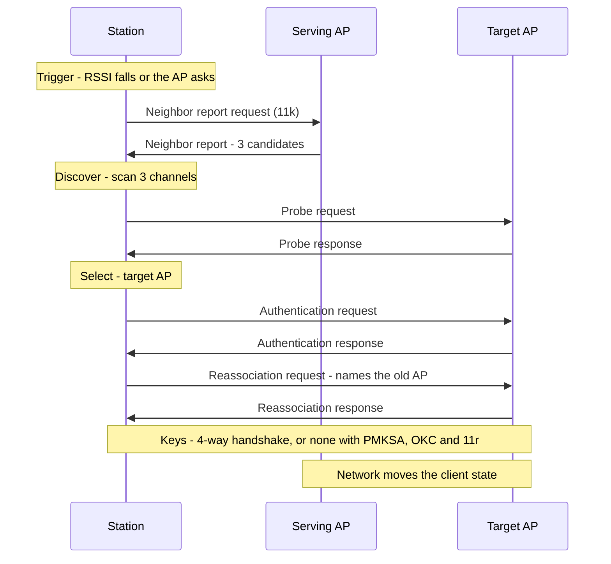
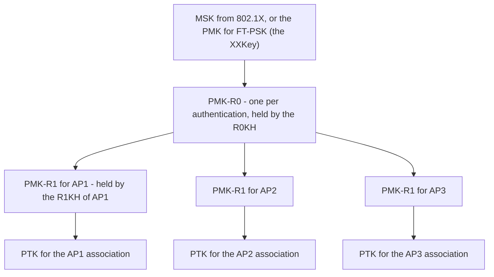

# WF 05: Wi-Fi roaming and radio management: from the roam decision to the channel plan

*Part of the [networking plan](../00_plan.md), Wi-Fi sub-track · Candela session 5a (roaming and radio resource management, with DFS) plus gap topics (key caching, steering, controller-era roaming) · You need: [WF 03](03_wifi_mac.md) (frames, scanning, the association states), [WF 04](04_wifi_security.md) (PMK, PTK, the 4-way handshake)*

A Wi-Fi network is a set of access points that a client treats as one network. The client is the one that walks; the network has to make that walk invisible. Two halves of the job: **roaming**, which is how a client moves from one access point to the next without the call dropping, and **radio resource management (RRM)**, which is how the network chooses channels, power and widths so that there is a next access point worth moving to. Both are policy problems wrapped around a few protocol tools (802.11k, 802.11v, 802.11r), and both are where most real-world Wi-Fi complaints come from: "my call drops in the corridor", "my phone sticks to the far access point", "the network keeps changing channels".

This is a favourite topic in Senior and Staff interviews because it is where protocol, RF and product design meet. A strong answer is not a list of amendments. It is a budget (where the time of a roam goes), a decision (who chooses when to move), and a trade-off (every knob that helps one client hurts another).

By the end you can:

- say who decides a roam, what the four steps of a roam are, and why the station, not the network, is in charge;
- explain where a roam spends its time and which mechanism removes which part;
- read and build the 802.11k and 802.11v frames (neighbor report, beacon report, BSS transition management) and say why a BTM request is advice, not a command;
- explain the key-caching ladder: full 802.1X, PMKSA caching, opportunistic key caching, preauthentication and 802.11r, with the cost and the failure mode of each;
- derive the 802.11r key hierarchy (PMK-R0, PMK-R1, PTK), name the key holders, and walk through the over-the-air and over-the-DS exchanges;
- choose roam thresholds and hysteresis, and explain sticky clients and ping-pong roaming;
- design band steering and client steering, and say where steering fails;
- explain what RRM does (channel, power, width, coverage holes), how an RF group and leader work, and why RRM is slow and conservative on purpose;
- explain DFS, the channel switch announcement and the cost of a radar event, and set a DFS policy;
- read a roam from a capture and measure its real outage;
- debug the common roaming symptoms from the evidence.

---

## 1. Who decides, and what a roam is

In an ESS (several access points with the same SSID and security, [WF 01](01_wifi_landscape_and_ap_anatomy.md)) **the station decides when and where to roam**. The standard gives the access point no way to move a station. It can only advise (a BSS transition request), make the current link worse (ignore the station, lower its rate, send a deauthentication) or make the neighbour more attractive. Almost every roaming problem traces back to this one fact: the network has the information and the client has the control.

A roam has four steps:

1. **Trigger.** The station decides the current link is not good enough (RSSI below a threshold, many retries, a low rate, missed beacons), or the access point asks it to move.
2. **Discover.** The station finds the candidates: it scans channels, listens to beacons and probe responses, or uses a list from the network (802.11k).
3. **Select.** It ranks the candidates (RSSI first, then band, load from the BSS load element, supported rates).
4. **Execute.** Authentication, **reassociation** (which names the previous access point), the key setup of [WF 04](04_wifi_security.md), and the resumption of traffic. Behind the scenes the wired side has to learn that the station moved.



**Reassociation, not association.** The reassociation request (subtype 2, [WF 03](03_wifi_mac.md)) carries the **current AP address**. That is how the target learns where to fetch the station's context from (a controller, or the old access point over a vendor protocol). A client that does a plain association (subtype 0) is not roaming: it is a fresh join, and the network treats it so.

**What the wired side does.** The switch must learn that the MAC address now lives behind a different port. The new access point (or the controller) sends a **gratuitous frame** with the station's source address so that switches update their tables, and frames queued at the old access point are lost or forwarded depending on the product. A roam that looks perfect on the air can still lose a second of downlink traffic because the switch kept sending to the old port.

Two facts frame the rest of this tutorial. **First**, the scan and the key exchange are most of the time of a roam (section 2). **Second**, roaming is a policy problem as much as a protocol problem: a client that roams too late sits at a low rate and drags the others down ([WF 03](03_wifi_mac.md) section 7), and a client that roams too often loses service at every move (section 3).

## 2. Where a roam spends its time

A roam is short only if every step is short. The steps and what makes each long:

| Step | What it costs | What shortens it |
|---|---|---|
| Decide to leave | The client waits until the link is bad (often seconds of poor service) | A BTM request, a higher threshold, hysteresis done well |
| Scan | A **passive** scan waits for a beacon, so at least one beacon interval (about 100 ms) per channel. An **active** scan sends a probe request and waits for responses, tens of ms per channel. A client with no list scans every channel it supports, which is a second or more | An 802.11k neighbor list (3 or 4 channels, not 30 or more), a short preferred-channel list, 6 GHz discovery aids |
| Authenticate and associate | A few frames: milliseconds | Nothing needed |
| Keys | A full 802.1X exchange is 7 to 10 round trips to a RADIUS server, so the time is the **server distance times the number of rounds**. A 4-way handshake is 4 frames | Key caching (PMKSA, OKC) or 802.11r |
| Network update | Switch learning, controller state move, queued frames | Gratuitous frames, a fast controller path, no L3 tunnel |

Two lessons come out of the table. First, **the scan is usually the biggest single cost** on a network that has already deployed key caching, so 802.11k is more valuable than most engineers think. Second, **a full EAP roam depends on where the RADIUS server is**. With a server on the same site the exchange is tens of milliseconds. With a cloud RADIUS service 40 ms away and 7 to 10 rounds, it is a third of a second to a second or more. Apple's own deployment guidance says that with full 802.1X authentication roaming can take several seconds, during which data cannot pass, and that the fast-roaming features exist to prevent that gap. A cloud-managed network without key caching makes every roam a perceptible event.

**What is the budget?** Voice is the tightest user. A common design target is a roam outage of about **50 ms** (a design target, not a standard; the ITU G.114 limit on one-way delay is 150 ms, and a gap shows up as lost voice packets that a codec conceals for a short time). Data traffic tolerates more, but TCP is touchy: a gap of a few hundred milliseconds can trigger a retransmission timeout, and the flow then recovers slowly. So the **order of work** is: make the roam cheap (keys and scan), and only then tune the thresholds (section 3).

## 3. The roam decision: when and where to go

The standard says nothing about when a station roams, so every vendor chooses. The common triggers:

- an **RSSI threshold** (Apple documents that Macs start looking for a candidate at about -75 dBm and iPhone, iPad and Apple Vision Pro at about -70 dBm);
- a **rate or retry** drop, or **missed beacons**;
- a **BTM request** from the access point;
- an application hint on some clients (an active voice call roams earlier).

The selection compares candidates, mostly by RSSI, with a bonus for 5 GHz and 6 GHz and a penalty for high channel utilisation (the BSS load element) and for many associated clients. Apple documents that a candidate must be about **12 dB stronger** than the current access point for a Mac, or for an idle iPhone, and about **8 dB stronger** for a phone that is sending data, which is a deliberate hysteresis. Windows, Android and Linux (`wpa_supplicant` with its bgscan modules) each have their own logic and defaults.

### 3.1 The two failure modes

- **Sticky client.** A client that waits too long (-80 dBm or worse) sits at a low rate on a far access point while a nearby one is much louder. It is slow itself, and by the airtime anomaly of [WF 03](03_wifi_mac.md) it slows everyone in the cell. The first line of defence is a network that makes the far access point **less attractive**: lower transmit power, a higher minimum basic rate so that the far cell edge disappears, and a minimum RSSI to stay associated.
- **Ping-pong.** A client that roams as soon as another access point looks better flips back and forth near the midpoint, because shadowing makes the two RSSI values wobble by several dB. Each flip is a roam, and each roam costs an outage. The cure is **hysteresis**: a margin of about 8 to 12 dB between the serving and the target access point. It is the reason Apple's margin is 8 to 12 dB.

A quick way to see why the margin has that size: the difference of two noisy RSSI values is noisier than either. With shadowing of about 4 dB on each, the difference wobbles by about 5.7 dB, so with no margin the "better" access point flips about half the time near the midpoint, and a margin of 8 to 12 dB brings spurious flips down to a few percent.

### 3.2 What the network can do about it

Because the client controls the decision, the network works on the inputs:

| Tool | What it does | Cost |
|---|---|---|
| Lower transmit power | Shrinks cells so overlap is moderate and the far access point is not louder than needed | Too low and coverage holes appear (section 9) |
| Raise the minimum basic and mandatory rate | Removes the lowest rates so the cell edge is short and a sticky client falls off | A client at the edge may not even hear the beacon |
| Minimum RSSI or low-ack disconnect | The access point disassociates a station below a threshold | Aggressive settings cause reconnect loops; clients may mark the SSID bad |
| BTM request (section 5) | Advice to move, optionally with a candidate list and a deadline | Only works on clients that implement it |
| Probe and authentication suppression | Ignore a client below a threshold so it looks elsewhere | Older trick; poor clients blacklist the SSID |

**The honest summary for an interview:** you cannot make a client roam, you can only make staying worse and moving cheaper.

## 4. 802.11k: telling the station where to look

802.11k (**radio resource measurement**) lets an access point and a station ask each other for measurements, and gives the station a **neighbor report**: the list of nearby access points of the same ESS with their channels. Its value is the scan: with the list the station visits 3 or 4 channels, not 30.

The frames are **action frames of category 5** (radio measurement).

| Action | What it does |
|---|---|
| Neighbor report request (4) and response (5) | The station asks, the access point lists nearby BSSes |
| Radio measurement request (0) and report (1) | The access point asks the station to measure something (beacon, channel load, noise histogram, station statistics, location) and the station answers |
| Link measurement request and report | Path loss and margin between a station and its access point |

### 4.1 The neighbor report element

Element ID 52. Each candidate is: the **BSSID** (6 bytes), the **BSSID information** (4 bytes), the **operating class** (1), the **channel number** (1) and the **PHY type** (1), plus optional sub-elements (for example a preference). The BSSID information word carries: AP reachability, whether security matches, key scope, a group of capability bits (spectrum management, QoS, APSD, radio measurement, block ack), the **mobility domain bit** (the target is in the same 802.11r domain, so a fast transition is possible), and the HT, VHT, FTM and HE bits.

```python
import struct

def parse_neighbor_report(ie):
    """Decode one neighbor report element (id 52) given as bytes."""
    assert ie[0] == 52
    body = ie[2:2 + ie[1]]
    bssid = ":".join("%02x" % b for b in body[:6])
    info = struct.unpack("<I", body[6:10])[0]
    return dict(bssid=bssid, opclass=body[10], channel=body[11], phy=body[12],
                reachable=info & 3, security=bool(info & 4), key_scope=bool(info & 8),
                mobility_domain=bool(info & 0x400), ht=bool(info & 0x800),
                vht=bool(info & 0x1000), ftm=bool(info & 0x2000), he=bool(info & 0x4000))

ie = bytes([52, 13]) + bytes.fromhex("020000000002") + struct.pack("<I", 0x00000c0f) + bytes([115, 36, 9])
print(parse_neighbor_report(ie))
# {'bssid': '02:00:00:00:00:02', 'opclass': 115, 'channel': 36, 'phy': 9, 'reachable': 3,
#  'security': True, 'key_scope': True, 'mobility_domain': True, 'ht': True, ...}
```

The **operating class** and **channel** together say where to look: class 115 is 5 GHz channels 36 to 48 (20 MHz), class 81 is 2.4 GHz channels 1 to 13. A client reading the list probes only those channels.

### 4.2 Beacon requests and reports

An access point can ask a station to measure the beacons it hears, in three modes: **passive** (listen), **active** (probe) and **beacon table** (report what is already in the table, with no new scan). The station answers with a **beacon report** per BSS: channel, BSSID, and two quality values.

- **RCPI** (received channel power indicator) is `2 x (dBm + 110)` in one byte, so -62 dBm is 96.
- **RSNI** (received signal to noise indicator) is `2 x (SNR + 10)`, so 25 dB is 70.

```python
def rcpi(dbm): return max(0, min(220, round(2 * (dbm + 110))))
def rsni(snr): return max(0, min(255, round(2 * (snr + 10))))
print(rcpi(-62), rsni(25))   # 96 70
```

The beacon table mode is what lets an access point or controller learn **how the station sees the network** without disturbing it. That is the raw material for client-aware steering, and also the reason privacy researchers worry: repeated beacon requests reveal what surrounds a device and, over time, where it moves.

### 4.3 Other measurements and the real world

802.11k also defines **channel load** (how busy a channel is), **noise histogram**, **station statistics** (counters), **link measurement** and **transmit stream measurement**. A station advertises what it supports in the **RM enabled capabilities** element at association. In practice **support is partial**: many phones implement the neighbor report request and the beacon report, and little else, so a design should not rely on the rest.

### 4.4 How a network uses it

A client that supports it asks for the neighbor report when its RSSI falls, and the access point builds the list from its own knowledge or from a controller. **A bad list is worse than none**: if the list holds access points that are far away or on a channel plan that changed, the client spends its scan time on them. The list has to stay in step with the RRM plan, which is a quiet integration problem in products. Apple's guidance is blunt: with 802.11k enabled the roam scan "runs more quickly", and without it clients scan more methodically, which can add seconds.

## 5. 802.11v: asking the station to move

802.11v (**wireless network management**, WNM, action frames of **category 10**) contains the tool that fixes the sticky client: the **BSS transition management (BTM) request**.

| Field | Meaning |
|---|---|
| Request mode, bit 0 | **Preferred candidate list included** |
| bit 1 | **Abridged**: candidates not listed are less preferred than those listed |
| bit 2 | **Disassociation imminent**: the access point will disassociate the station soon |
| bit 3 | **BSS termination included** |
| bit 4 | **ESS disassociation imminent** |
| Disassociation timer | In TU (1 TU = 1.024 ms); the deadline after which the access point disassociates the station if it has not moved |
| Validity interval | How many beacon intervals the candidate list stays valid |
| Candidate list | Neighbor report elements, each with a **preference** sub-element so the access point can rank them |

The **BTM response** carries a status code and, on accept, the target BSSID.

| Status | Meaning |
|---|---|
| 0 | Accept |
| 1 | Reject, unspecified |
| 2 | Reject, insufficient beacon or probe responses (the client has no fresh data on the candidates) |
| 3 | Reject, insufficient capacity at the candidates |
| 4 | Reject, BSS termination undesired |
| 5 | Reject, BSS termination delay requested |
| 6 | Reject, the station's own candidate list is provided |
| 7 | Reject, no suitable candidates |
| 8 | Reject, leaving the ESS |

A BTM request can be built and decoded in a few lines. The bytes below are the action frame body, category 10, action 7, token 3, request mode 0x05 (candidate list included plus disassociation imminent), a 100 TU timer and a validity interval of 10:

```python
import struct
def btm_request(token, mode, timer_tu, validity, cands=b""):
    return bytes([10, 7, token, mode]) + struct.pack("<HB", timer_tu, validity) + cands
print(btm_request(3, 0x05, 100, 10).hex())   # 0a07030564000a
```

Wrapped in a Dot11 management frame (type 0, subtype 13) and decoded by `tshark`, the fields appear as `Preferred Candidate List Included: 1`, `Disassociation Imminent: 1`, `Disassociation Timer: 100`, `Validity Interval: 10`.

**The key property, often missed: a BTM request is advice.** The client can refuse, and the access point has only its disassociation timer to make a point. So a design that depends on BTM is as strong as the client population. The client can also ask first, with a **BTM query** (action 6) saying why it wants to leave.

**Other WNM tools that matter in a design:**

- **Proxy ARP**: the access point answers ARP (and neighbor discovery) for its sleeping stations, which lets a large layer 2 domain work without broadcast storms waking every phone.
- **DMS** (directed multicast service): convert multicast to unicast per station.
- **BSS max idle period**: how long the access point keeps a silent station, which sets the keepalive interval of a phone and so its battery life.
- **WNM sleep mode**: a longer sleep than the listen interval of [WF 03](03_wifi_mac.md).

**Security note.** A BTM request is a robust action frame, so protected management frames ([WF 04](04_wifi_security.md)) protect it once the keys are installed. A forged BTM request from a rogue access point, before the keys exist, can steer a client toward it. This is one of the reasons a roam toward an unknown BSSID in a BTM list should still go through normal authentication.

## 6. Key caching: how a roam skips the slow part

The slow part of a secured roam is the key setup. Four mechanisms remove it, from old to new. For the key vocabulary see [WF 04](04_wifi_security.md).

| Mechanism | How it works | Needs | Failure mode |
|---|---|---|---|
| Full 802.1X | EAP with a RADIUS server, then the 4-way handshake | Nothing | Slow, depends on server distance |
| **PMKSA caching** | After a full success both sides keep the PMK, named by the **PMKID**. Returning to the **same** access point, the station presents the PMKID in the reassociation and skips EAP | Client and AP support (almost universal) | Only helps a return visit, not a first visit to a new access point |
| **OKC** (opportunistic key caching) | A vendor extension. The PMK is derived so that every access point under the same controller or key holder can use it. The station computes the PMKID for the target and presents it | Same controller or key holder, client support | Not in the standard; clients that do not compute the target PMKID fall back to a full exchange |
| **Preauthentication** | The station authenticates to a neighbour through the current access point before moving, so the PMKSA is waiting at the target | Client support, a wired path | In the standard but rarely used: the exchange is a full EAP and the client must know the next access point |
| **802.11r (FT)** | A key hierarchy, so the target derives its key before the station arrives and the roam folds the 4-way handshake into the authentication and reassociation | Client and AP support, a mobility domain, a key holder | Client compatibility, key distribution (section 7) |

For a PSK network there is no EAP to skip, so the roam costs the 4-way handshake (4 frames), and 802.11r with FT-PSK removes that too. Windows documents a related fallback: if 802.11r is not available it uses OKC. Apple documents that all its devices support PMKID caching even without 802.11r.

## 7. 802.11r: the key hierarchy that makes the roam short

802.11r (**fast BSS transition, FT**) puts a **key hierarchy above the PTK** and lets the target access point derive its key before the station arrives. The roam then needs no EAP and no separate 4-way handshake: the handshake material rides in the authentication and reassociation frames of the roam itself.

### 7.1 The hierarchy



- **PMK-R0** is derived once per authentication from the XXKey (the first 256 bits of the MSK in 802.1X, or the PMK in FT-PSK), the SSID, the **mobility domain identifier (MDID)**, and the identities of the **R0 key holder (R0KH)** and the station. It lives at the R0KH: a controller or a cloud key server. **No access point holds it** unless the access point is itself the R0KH.
- **PMK-R1** is derived from PMK-R0 and the identity of an access point (the **R1KH-ID**) and the station. **Each access point in the mobility domain gets its own PMK-R1**, pushed to it by the R0 key holder, or pulled on a roam. The **names** (PMKR0Name and PMKR1Name, 16 bytes) appear in frames so that the keys never do.
- The **PTK** is derived from PMK-R1 with the two nonces, both addresses and PMKR1Name. The nonces travel in the roam's own authentication frames.
- **Key holders:** the R0KH and R1KH on the network side, the **S0KH and S1KH** on the station side. A controller that does all the encryption is both R0KH and R1KH.

Why two levels? One level (a PMK shared by all access points) would let a stolen access point impersonate the station to any other. With PMK-R1 per access point, **a stolen access point exposes only its own sessions** (it never held the R0), and a station cannot use a key at an access point that has not been given its R1: the roam fails if the key holder has not pushed the key.

### 7.2 A working derivation

The labels (`FT-R0`, `FT-R1`, `FT-PTK`, `FT-R0N`, `FT-R1N`) also appear as strings inside the installed `hostapd` and `wpa_supplicant` binaries, which confirms the names. The code follows the 802.11 KDF (a counter-mode HMAC-SHA256 key derivation) as I understand the standard; it was not cross-checked against hostapd's output, so treat it as an aid to reasoning, not a reference implementation.

```python
import hashlib, hmac, struct

def kdf256(key, label, context, bits):
    out, i = b"", 1
    while len(out) * 8 < bits:
        out += hmac.new(key, struct.pack("<H", i) + label + context + struct.pack("<H", bits),
                        hashlib.sha256).digest()
        i += 1
    return out[: bits // 8]

def pmk_r0(xxkey, ssid, mdid, r0kh_id, s0kh_id):
    ctx = bytes([len(ssid)]) + ssid + mdid + bytes([len(r0kh_id)]) + r0kh_id + s0kh_id
    okm = kdf256(xxkey, b"FT-R0", ctx, 384)           # 256-bit key, 128-bit name salt
    return okm[:32], hashlib.sha256(b"FT-R0N" + okm[32:]).digest()[:16]

def pmk_r1(r0, r0name, r1kh_id, s1kh_id):
    key = kdf256(r0, b"FT-R1", r1kh_id + s1kh_id, 256)
    return key, hashlib.sha256(b"FT-R1N" + r0name + r1kh_id + s1kh_id).digest()[:16]

def ft_ptk(r1, snonce, anonce, bssid, sta, r1name, bits=384):
    return kdf256(r1, b"FT-PTK", snonce + anonce + bssid + sta + r1name, bits)
```

Running it with three access points gives three different PMK-R1, three different PTKs, and a different PMK-R0 if the SSID or the mobility domain changes (all checked). Sizes: PMK-R0 32 bytes, PMK-R1 32 bytes, PTK 48 bytes (KCK 16, KEK 16, TK 16 for CCMP), names 16 bytes.

**The bookkeeping is a real design cost.** Pre-deriving a key for every access point and client pair grows as access points times clients, which is large at campus scale. Real systems **derive on demand** (a couple of HMAC-SHA256 blocks, microseconds) or **push the keys of the handful of neighbours a client is likely to visit**.

### 7.3 The exchange

**Initial mobility domain association.** The first association to the domain is a normal one: the station sees the **mobility domain element** (id 54, carrying the MDID and the FT capability and policy byte) in the beacon, and the AKM in the RSN element is an FT suite. It authenticates with open system, associates, and then does a full 802.1X or PSK exchange and a 4-way handshake, in which the FT elements establish PMK-R0 and PMK-R1 at the first access point.

**The roam, over the air.** Four frames, as mrncciew's capture of a Cisco roam shows:

1. **Authentication request** (algorithm 2, FT): the station's RSN element with the **PMKR0Name** as a PMKID, the mobility domain element, and the **FT element** (id 55) with the **SNonce** and the R0KH-ID.
2. **Authentication response**: the target access point answers with its **ANonce**, the R1KH-ID and R0KH-ID. Both sides can now derive the PTK.
3. **Reassociation request**: the same elements plus a **MIC** over the exchange, proving the station holds the key.
4. **Reassociation response**: the same plus the **group key** (GTK) wrapped for the station.

No EAP, no RADIUS exchange, no separate 4-way handshake. In the mrncciew capture the exchange completes in about 14 ms including real-world delays, and the model of four management frames at a low rate is in the single-digit milliseconds.

**The roam, over the DS.** The station sends the FT frames to its **current** access point inside **action frames** (FT request, FT response), which forward them over the wired side to the target. The station can stay on the old channel until the key material is ready, at the price of two extra wired hops and a dependency on the wired path. The beacon's mobility domain element carries an "over the DS" capability bit, which the administrator can disable (on a Cisco controller, `no security ft over-the-ds`).

**Resource request.** The FT exchange can carry a **resource request** so a TSPEC ([WF 03](03_wifi_mac.md)) is admitted at the target in the same exchange. That is what makes voice roams complete with their QoS.

### 7.4 The AKMs and the deployments

| AKM | Name | Notes |
|---|---|---|
| 3 | FT over 802.1X | Needs EAP; Windows documents 802.1X-only FT support |
| 4 | FT-PSK | Works without a controller if the access points can derive PMK-R1 locally |
| 9 | FT-SAE | WPA3 personal with fast transition |
| 13 | FT over 802.1X SHA-384 | 192-bit mode |

For a **controllerless PSK deployment** with hostapd, each access point is its own key holder and derives PMK-R1 from the PSK, so no key push is needed:

```
# hostapd.conf fragment (hostapd 2.10 option names; OpenWrt's UCI names ieee80211r and ieee80211k
# are wrappers that generate these)
wpa=2
wpa_key_mgmt=FT-PSK
mobility_domain=a1b2        # identical on every AP of the domain
ft_psk_generate_local=1     # derive PMK-R0/R1 locally from the PSK
ft_over_ds=0                # over the air
nas_identifier=ap1.example.com
rrm_neighbor_report=1
rrm_beacon_report=1
bss_transition=1
```

With 802.1X the keys must be pushed between access points or held by a controller or cloud key server (hostapd's `r0kh=` and `r1kh=` entries list the peers).

### 7.5 Where 802.11r goes wrong

The cryptography is not the problem. The problems are all operational:

- **Client support.** Some older or embedded clients fail to join an SSID that advertises an FT AKM because they do not parse the element. The workaround is **mixed mode** (both the FT and the plain suite in one SSID, [WF 04](04_wifi_security.md)), or Cisco's **adaptive 802.11r**, or a separate SSID for legacy devices.
- **Inconsistent mobility domain.** If the MDID or the key-holder configuration differs between access points, the key never arrives and the roam fails over to a full authentication.
- **Key push latency.** The R1 must reach the target before the station does. A cloud key holder with a slow link breaks this.
- **Timing.** The FT exchange has a reassociation deadline; a slow target can miss it.
- **Over-the-DS support.** Many clients only use over the air, so a design must work with it.

## 8. Steering: band, client and load balancing

Roaming moves a station between access points on its own initiative. **Steering** is the network's attempt to choose the radio and the access point, with the tools it has: the **BSS transition request** (section 5), and older tricks such as **withholding responses** (an access point ignores the probes and authentication of a dual-band station on 2.4 GHz for a while, so it joins 5 GHz) and **deauthenticating** with a reason that asks the station to try elsewhere.

- **Band steering** moves dual-band stations to 5 GHz or 6 GHz, because 2.4 GHz has 3 non-overlapping channels, slow rates and long frames ([WF 01](01_wifi_landscape_and_ap_anatomy.md)).
- **Client steering** or **load balancing** moves stations between access points to even the load or to push a sticky station away.
- **Load balancing in controller products** refuses an association when an access point has more clients than its neighbours. It trades some association failures for an even load, and can strand a client that has no other access point.

**Why steering matters in airtime terms.** DCF shares transmission opportunities, not time ([WF 03](03_wifi_mac.md)). If twenty stations at a good rate each want a modest load, the cell is comfortable. Replace one with a station at the lowest rate and the airtime demand more than doubles, so **every** station gets a fraction of what it wanted. One slow station costs all the others, which is why the rule list is: remove the low rates from the basic rate set, keep dual-band stations on the fast band, and roam sticky stations away.

**Where steering fails** (all common field reports):

- A station **blacklists an SSID** after a rejected association and then refuses to try again.
- **Voice or IoT devices** that were not designed for repeated rejection.
- A station that claims dual band but **cannot use the channel** it is sent to (a DFS channel its radio does not allow).
- **Mixed signalling**: the network rejects the client on one access point and a neighbour accepts it on a worse channel.
- **Compliance**: steering only moves the clients that listen. With a population in which a large share ignores BTM, the benefit shrinks, and if few clients are dual band there is little to move.

Steering is a policy with side effects, so it must be **measured**: the share of clients that really move, the time to join, the number of rejections, and complaints. Roll it out with a counter and a rollback.

## 9. Radio resource management: channels, power and coverage

**RRM** is the name for the controller or cloud function that sets the **channel**, the **transmit power** and the **channel width** of every access point and reacts to change. Vendors name it differently (Cisco RRM with DCA and TPC, Aruba ARM and AirMatch, Ruckus ChannelFly with background scanning, Meraki Auto RF, Mist RRM) but the three jobs are the same.

### 9.1 What it does, using Cisco's published design as the reference

Cisco's RRM technical note describes the design in detail, and it is a good template for the vocabulary of any system (the numbers are from older controller releases; verify against current documentation before relying on them):

- **RF group.** Controllers that share an RF group name and whose access points **hear each other's neighbor messages** form a group. Access points send neighbor messages on all serviced channels at a regular interval (60 seconds by default), and neighbours are added above about -80 dBm.
- **Leader.** One controller is elected leader (by group identifier). It runs **DCA** and **TPC** for the group, polling the others, and coverage hole detection runs locally on each controller.
- **DCA (dynamic channel assignment).** Inputs: load, noise, interference and signal strength of the neighbours. It is conservative on purpose: a change is considered only if it improves the worst access point by a margin (the **sensitivity** setting, a hysteresis in dB), changes favour local adjustments to avoid cascades across the site, and an **anchor time** and interval make the changes predictable (typically at night). A channel change disconnects or interrupts clients, so stability matters more than optimality.
- **TPC (transmit power control).** The classic rule: set the power so that the **third strongest neighbour** is heard at a threshold (the default is about -70 dBm). The formula is `Tx_max + (threshold - third-neighbour RSSI)`. It lowers power only if it has a margin of several dB, and raises it only with a smaller one. It only **reduces** power; increases come from coverage hole logic.
- **Coverage hole detection.** If the average client SNR on a radio stays below a cutoff (a function of transmit power and a coverage profile) for a minimum time and a minimum number of clients, the radio raises its power one step at a time, and neighbours raise power when an access point fails.
- **Limits.** The document itself says RRM does not replace RF design, that scale limits the size of a group, that frequent neighbour changes cause leader re-elections and instability, and that off-channel scanning costs a little throughput.

### 9.2 Channels: a colouring problem on a dense graph

Draw access points as nodes and link two if they hear each other above the carrier-sense threshold (about -82 dBm for the preamble). The aim is to give linked nodes different channels. In an office floor **most access points hear most others** (in one simulated floor of 20 access points in 100 m by 100 m, 182 of 190 pairs heard each other above -82 dBm), so the picture of "one access point per channel cell" does not exist.

| Band | Reality |
|---|---|
| 2.4 GHz | 3 non-overlapping channels: a dense graph cannot be coloured with 3 colours. The real tools are to **turn off** some 2.4 GHz radios and to lower their power |
| 5 GHz without DFS | About 9 channels at 20 MHz: workable with care |
| 5 GHz with DFS | About 25 channels at 20 MHz in some regions: a clean plan is possible, at the price of radar events (section 10) |
| 6 GHz | Many 20 MHz channels, but wide channels use them up fast |

**Channel count is the resource**; an algorithm cannot create it. Wider channels (40, 80, 160 MHz) multiply the rate of one link and divide the number of channels, so in a **dense** deployment 20 MHz (or at most 40) is often the right answer even though the data sheet lists 160. Two kinds of interference to keep apart: **co-channel** (same channel: the access points defer to each other, which costs airtime but is polite) and **adjacent-channel** (overlapping channels such as 2.4 GHz channels 1 and 4: the signals are not decoded, only noise, which is worse). That is why 1, 6 and 11 are the plan in 2.4 GHz.

### 9.3 Power: coverage against overlap

Lower power shrinks cells and interference and also shrinks coverage and the overlap that roaming needs. A simulation on the same floor shows the shape: at full power every point hears about 11 access points above -75 dBm, at a moderate power coverage is still near 98 percent while the number heard halves, and at low power coverage collapses. The right target is **enough overlap to roam and no more**, which is the second-strongest access point at roughly -67 dBm, not 20 dBm everywhere.

Two client-side limits shape the choice:

- A client transmits at 14 to 20 dBm (a phone often less), so an access point that is loud and a client that is quiet make a link where the **uplink is the weak direction** ([WF 01](01_wifi_landscape_and_ap_anatomy.md), [WF 11](11_rf_fundamentals_and_link_budget.md)).
- **Raising access point power does not help the client hear better**. It makes the access point look strong and keeps a sticky client attached. Access point power is a design choice for the uplink, and a good design lowers it.

**Redundancy is a trade.** A plan tuned for the lowest interference has no overlap to hide a failed access point. A plan with redundancy has more interference. Decide the redundancy explicitly (N+1 coverage for critical areas) instead of discovering it during an outage. Coverage hole logic, which raises neighbours' power when an access point fails, closes only part of the gap.

### 9.4 Beacon overhead: the cost of many SSIDs

Every access point sends a beacon for every SSID every 102.4 ms at the lowest basic rate. A 300 byte beacon occupies the air for about 2.6 ms at 1 Mbit/s, about 0.42 ms at 6 Mbit/s and about 0.22 ms at 12 Mbit/s. For **one** access point with one SSID that is roughly 2.5 percent, 0.4 percent and 0.2 percent of the air. The part that surprises designers is the **sum over the access points that hear each other** on a channel: four SSIDs with beacons at 1 Mbit/s and ten access points on one channel need about as much airtime as the channel has. At 6 Mbit/s it is about 16 percent, which is still a lot.

So **raising the lowest basic rate from 1 to 6 or 12 Mbit/s is the cheapest capacity upgrade in Wi-Fi**, with the cost that a client at the cell edge needs a decent link to hear the beacon (so lower the power at the same time). The other levers: **fewer SSIDs** (every SSID costs beacons and probe responses on every access point), and **multiple BSSID** for 6 GHz and 802.11ax, in which one beacon carries the information of several SSIDs ([WF 06](06_wifi6_6e_7_features.md)).

### 9.5 What RRM does not do

It does not know the building. It reacts on a time scale of minutes to hours, so it cannot follow a crowd. A channel change interrupts stations (a channel switch announcement is the polite way, and not every client follows it). Its inputs are mostly what access points hear of each other and of clients, so non-Wi-Fi interference needs a spectrum view (Cisco's CleanAir, similar features in other products, [WF 08](08_wifi_capture_tools_and_debug.md)). And aggressive RRM can **hurt**: a network that changes channels all day annoys voice clients more than a fixed, mediocre plan.

### 9.6 6 GHz and discovery

On 6 GHz a client cannot scan blindly (there are many channels, and scanning 59 of them wastes time), and a 6 GHz access point cannot answer wildcard probes freely. So discovery uses: the **reduced neighbor report** (RNR) element in 2.4 and 5 GHz beacons that points to the 6 GHz BSS, the **preferred scanning channels** (PSC, every fourth channel), **FILS discovery frames** and unsolicited probe responses sent frequently by the 6 GHz access point. The practical rule: **co-locate the 6 GHz radio with 2.4 or 5 GHz radios** that advertise it, so clients find it through RNR ([WF 06](06_wifi6_6e_7_features.md)).

## 10. DFS and channel switching

In the 5 GHz sub-bands that radar shares (UNII-2A, 2C and the weather band), an access point must run **dynamic frequency selection**:

- a **channel availability check (CAC)** before using a channel, typically 60 seconds (10 minutes on weather channels in some regions);
- continuous listening for radar while operating;
- on detection, **leave within a closing transmission time** (about 260 ms of activity, 10 s total move time in the rules) and do not return for a **non-occupancy period** of 30 minutes.

The access point announces a move with a **channel switch announcement (CSA)**: an element (id 37) carried in beacons, probe responses and an action frame. It has a **mode** (1 means stop transmitting until the switch, required after radar), the **new channel** and a **count of beacons** until the switch. The **extended** form (id 60) adds the operating class. A client that decodes it can move at once. A client that misses it (asleep, off-channel scanning) finds the access point gone and must scan.

**The cost of a radar event** depends on the policy, not the detector:

| Policy | Outage per event (order of magnitude) |
|---|---|
| Switch at once to a pre-selected **non-DFS** channel, announced by CSA | About a second |
| Switch to another DFS channel (CAC must run first) | About a minute |
| No pre-selected channel: scan for a free channel, then CAC | More than a minute |
| Two 5 GHz radios, one stays on a non-DFS channel | The client roams: about 0.1 s |

Add a **client that misses the CSA** and each figure grows by several seconds. A **false detection costs exactly what a real one costs**, and the non-occupancy period is 30 minutes per channel, so a site with dozens of events a day on one channel loses most of the day on it. False triggers come from microwave ovens, badly shielded radios and some video bridges.

**Design rules:**

1. Choose **non-DFS channels where voice must survive**.
2. **Pre-select a non-DFS fallback** where DFS is used.
3. **Never let every access point in an area share one DFS channel**: one event removes the area.
4. Use a **second 5 GHz radio** (dual-5 GHz access points, [WF 01](01_wifi_landscape_and_ap_anatomy.md)) where the budget allows.
5. Watch the DFS event count per channel and **ban a channel that keeps triggering**.

(DFS timers and details differ by region; the figures above are the typical ETSI and FCC numbers and must be checked for the country.)

## 11. Controller-era architecture: what roaming means in a product

A Staff interview about Wi-Fi will use the vocabulary of controller products. The architecture itself is the subject of [WF 07](07_wifi_architectures_mesh_and_services.md); this is the part that touches roaming.

- **Layer 2 and layer 3 roaming.** Within one VLAN and subnet a roam moves only the client entry. When the new access point is on another subnet, the client keeps its IP address by **tunnelling its traffic back to the original controller**: the **anchor** (where the client first joined, which owns the address) and the **foreign** controller (where it is now, which tunnels to the anchor). It keeps sessions alive and adds a tunnel hop, so many designs avoid it with **one large VLAN per SSID**, at the price of a big broadcast domain (which proxy ARP and multicast-to-unicast make tolerable).
- **Central, local and FlexConnect switching.** With central switching all client traffic goes through the controller, so a roam is a controller state change. With **FlexConnect** (hybrid REAP) or **local switching** a branch access point puts traffic on the local VLAN and keeps working if the controller is unreachable. In standalone mode the access point must authenticate clients itself, so a branch design needs **local EAP** or a local RADIUS and a key caching or 802.11r design that works **without a controller round trip**.
- **Client exclusion and rogue handling.** Controllers exclude (blacklist) a client for a time after repeated failures, and classify other access points as friendly, malicious, unclassified or rogue. **Containment** (sending deauthentication frames to a rogue's clients) is legally and technically delicate, and protected management frames limit its effect ([WF 04](04_wifi_security.md)).
- **Cloud and controllerless designs.** The same functions run in a cloud service or in the access points themselves. The roam path then **must not depend on the controller or the cloud**: key caching and FT keys have to live on the access points of the mobility domain, because a 40 ms cloud round trip makes a full EAP roam a visible event.

## 12. Reading a roam from a capture

A roam trace is a few frames, and the time between them tells the story. In a monitor-mode capture ([WF 08](08_wifi_capture_tools_and_debug.md)) filter on the **station address**. A single radio sees only one channel, so capture on the old **and** the new channel at once, or the roam will look like a station that disappeared.

| What to find | tshark display filter | What it tells you |
|---|---|---|
| Reassociation, not association | `wlan.fc.type_subtype == 2` (request), `3` (response) | The client used the roaming path |
| Authentication algorithm | `wlan.fixed.auth.alg == 2` | 2 is FT, 0 is open system (including OKC and PMKSA roams) |
| FT elements | `wlan.mobility_domain.mdid`, `wlan.ft.anonce`, `wlan.ft.snonce` | An 802.11r roam |
| AKM suites | `wlan.rsn.akms.type` | 3, 4 or 9 is FT; 1 or 2 is not |
| PMKIDs in the request | `wlan.rsn.pmkid.count` | A PMKID means caching or FT; none means a full authentication |
| 4-way handshake after reassociation | `eapol` | Present in a PMKSA or OKC roam, absent in an FT roam |
| EAP after reassociation | `eap` | A full 802.1X roam: the expensive case |
| Neighbor report and BTM | `wlan.fixed.category_code == 5` or `10`, `wlan.fixed.action_code` | 11k and 11v activity |
| BTM request fields | `wlan.fixed.request_mode.disassoc_imminent`, `wlan.fixed.disassoc_timer` | A steering request and its deadline |
| BTM response status | `wlan.fixed.bss_transition_status_code` | 0 accepted, others refused |
| Channel switch | `wlan.csa.new_channel_number`, `wlan.csa.channel_switch.count` | A DFS or planned move |

Four numbers to take from the trace:

1. **The gap between the last data frame on the old access point and the first on the new one.** That is the real outage.
2. **The time from authentication to the end of the key exchange.** That is the key cost.
3. **How many channels were probed before the authentication.** That is the scan.
4. **Whether the client asked for a neighbor report first.** That says whether 802.11k is in use.

A gap of 100 ms or more with four probe-only channels in front is a client doing a scan. A gap of a few milliseconds with no probes is a client that already knew its target.

## 13. Debugging roaming: symptom, likely cause, first check

| Symptom | Likely cause | First check |
|---|---|---|
| Voice breaks for 1 to 3 s when walking | Full EAP roam to a distant RADIUS, or a full scan | Capture: is there EAP after the reassociation? How many channels probed? |
| Phone clings to the far access point, throughput poor | Sticky client, power too high, low basic rates enabled | RSSI and rate of the client; neighbours' RSSI at the client; BTM response if sent |
| Roams every few seconds near a midpoint | No hysteresis, shadowing | Roam count per hour per client; margin of the client |
| Some devices cannot join after enabling 802.11r | Client does not parse the FT AKM | Try mixed mode or a legacy SSID; look at the association response status |
| Roam works to some access points but falls back to full auth on others | Mobility domain or key-holder mismatch | Compare MDID and R0KH/R1KH settings; check the PMKR0Name in the auth request |
| BTM sent but ignored | Client does not support 11v, or it rejects with status 2 or 7 | The BTM response status; the client's extended capabilities |
| Network changes channels in the middle of the day | RRM sensitivity too high, or an interferer, or false radar | RRM change log; DFS event log per channel |
| Whole area drops for a minute at random | Radar event on a shared DFS channel | DFS events, and whether a non-DFS fallback exists |
| New SSID made everything slower | Beacon overhead with low basic rates | Beacon airtime on the channel; basic rate set |
| Roam OK on the air, but downlink stalls for a second | Switch did not learn the move, or an L3 tunnel is slow | Capture on the wired side: where do downlink frames go after the roam? |

## 14. Common mistakes

1. **Believing the network can force a roam.** It can advise and degrade. Design for clients that ignore it.
2. **Enabling 802.11r without a fallback** for clients that do not support it, and then blaming the clients.
3. **Setting the thresholds before making the roam cheap.** Fix keys and scan first, then tune.
4. **Running full power "for coverage".** It extends the cell for the access point and not for the client, and it keeps sticky clients attached.
5. **Keeping the 1 Mbit/s basic rate** and several SSIDs on a dense channel. The beacons eat the air.
6. **Using 80 or 160 MHz channels in a dense deployment** and ending up with co-channel contention.
7. **Letting RRM run unattended during working hours**, so a channel change interrupts voice.
8. **A stale neighbor list**: a plan change that the 802.11k list does not follow.
9. **One DFS channel for every access point in an area**, with no fallback.
10. **Testing roaming with one phone model** and concluding the network is fine (or broken).
11. **Capturing on one channel only** and concluding "the client vanished".

## 15. Interview questions

1. **Who decides when a client roams, and what can the network do about it?** The client decides. The network can advise (BTM), degrade the current link (lower power, higher basic rate, disassociate a weak client) or improve the neighbour. It cannot force a move.
2. **What are the four steps of a roam and where does the time go?** Trigger, discover, select, execute. The scan and the key exchange dominate. Without a list a client scans every channel; with full 802.1X the server distance times the number of rounds adds up.
3. **What does 802.11k give a client?** A neighbor report: the access points of the same ESS with their channels, so the client scans a few channels instead of all. It also defines beacon, channel load and other measurements, of which clients support only some.
4. **What does 802.11v add, and why is it only advice?** BSS transition management: the access point can suggest a move with a candidate list and a deadline. The client may refuse (status codes 1 to 8); the only enforcement is the disassociation timer.
5. **Explain 802.11r.** A key hierarchy above the PTK: PMK-R0 at the R0 key holder, PMK-R1 per access point, PTK per association. The target holds its R1 before the client arrives, so a roam is four frames with no EAP and no separate 4-way handshake.
6. **Why does each access point get its own PMK-R1?** So a compromised access point exposes only its own sessions, and a client cannot use a key at an access point that was not given its R1.
7. **Compare PMKSA caching, OKC and 802.11r.** PMKSA helps only a return to the same access point. OKC lets access points under one key holder share the PMK but is vendor-specific. 802.11r is in the standard and also folds the 4-way handshake into the roam; it needs client support and key distribution.
8. **Over the air against over the DS?** Over the air: the client talks to the target directly. Over the DS: it sends action frames through the current access point, staying on the old channel longer, at the price of a wired dependency. Many clients only use over the air.
9. **What is a sticky client and how do you handle it?** One that holds on to a weak access point. Lower power, raise the minimum basic rate, set a minimum RSSI or low-ack disconnect, and send BTM requests for clients that support them.
10. **What is hysteresis in roaming and why 8 to 12 dB?** A margin between the serving and the target access point. Shadowing makes the difference of two RSSI values noisy (several dB), so without a margin the client flips near the midpoint.
11. **Explain DCA and TPC.** DCA assigns channels using neighbour measurements, conservatively and often on a schedule. TPC lowers power until the third-strongest neighbour is heard at about a threshold. Both prefer stable changes to optimal ones.
12. **What happens on a radar event and how do you limit the damage?** The access point stops within a short time, announces a CSA, and cannot use that channel for 30 minutes. A pre-selected non-DFS fallback turns a minute-long outage into a second or so; a second 5 GHz radio turns it into a roam.

## 16. Scenarios and design questions

Each scenario names where to practise, then gives an approach. Strong answers follow in section 17.

**S1. Voice breaks for a second or two when users walk between floors on the corporate SSID.** *Where to practise:* a two-AP lab with `hostapd` and a monitor capture on both channels (`wlan.fixed.auth.alg`, `eap`, `eapol`). *Approach:* capture the roam, measure the gap, check for EAP after the reassociation, count probed channels, and find where the RADIUS server is.

**S2. A phone sticks to an access point at the end of the corridor and the cell is slow for everyone.** *Where to practise:* a lab with attenuators or a walking test with RSSI logs. *Approach:* read the client RSSI and rate, the neighbours' RSSI at the client, and the power and basic rate settings; decide between power, basic rate, minimum RSSI and BTM.

**S3. After you enable 802.11r on the main SSID, some printers and old scanners cannot connect.** *Where to practise:* association captures from the failing devices. *Approach:* look at the association response status, the RSN element, and decide between mixed mode, adaptive 802.11r and a separate SSID.

**S4. Design roaming for a hospital with voice badges and a 50 ms budget.** *Where to practise:* write it as a design review. *Approach:* cover the key holder placement, one L2 domain per SSID, scan reduction, power and overlap, DFS policy, N+1 coverage and monitoring.

**S5. Read a roam from a capture description.** The client sends probe requests on channels 1, 6 and 11, then an authentication with algorithm 0, a reassociation with no PMKID, an EAP exchange of eight frames, a 4-way handshake and then data. *Where to practise:* any roam capture. *Approach:* name the mechanism, find the three costs, and say what to change.

**S6. RRM keeps changing channels and users complain.** *Where to practise:* the controller change log and a DFS event list. *Approach:* decide whether it is real interference, a sensitivity setting, a false radar trigger or a neighbour-list effect, and what to freeze.

**S7. A site near an airport reports random one-minute outages on 5 GHz.** *Where to practise:* the DFS event log per channel. *Approach:* connect the outages to CAC and non-occupancy time and change the policy.

**S8. Design a channel assignment algorithm for 200 access points.** *Where to practise:* write the pseudocode on a whiteboard, then run it on a random floor. *Approach:* build the interference graph from neighbour RSSI, choose a cost, do local search, add hysteresis and constraints.

**S9. Design key distribution for 802.11r in a cloud-managed network with no controller.** *Where to practise:* a lab with three hostapd instances and `ft_psk_generate_local`. *Approach:* cover PSK against 802.1X, who is the R0KH and R1KH, push or pull, and failure behaviour.

**S10. You roll out BTM-based steering and only 30 percent of clients seem to move. What next?** *Where to practise:* collect BTM response status codes from a test group. *Approach:* measure, classify the refusals, set a fallback and decide what not to do.

## 17. Strong answers (outlines)

**S1.** Capture on both channels. Measure the gap between the last data frame on the old access point and the first on the new one. Count the probed channels. Look for `eap` after the reassociation: if present, the roam is a full 802.1X exchange whose cost is the RADIUS distance times about 7 to 10 rounds. The fixes in order: key caching or 802.11r, 802.11k so the scan is a few channels, and a RADIUS (or a key holder) near the access points. Confirm with a second capture. Do not tune the thresholds until the roam is cheap.

**S2.** First confirm: the client's RSSI and rate on the far access point and the RSSI of a nearby one. Then work on the network side because the client cannot be changed: lower the transmit power so the far cell is smaller, raise the minimum basic rate so the cell edge disappears, set a minimum RSSI or low-ack disconnect with care (some clients reconnect in a loop), and send BTM requests to clients that support them. Measure the client population before and after: the share of time below -75 dBm and the airtime of low-rate frames.

**S3.** Read the association response status and the RSN element in the beacon. The device likely does not parse the FT AKM. Options: mixed mode with both the FT and the plain AKM (works for most), a vendor adaptive 802.11r, or a separate SSID for legacy devices with a plain AKM. Do not disable 802.11r for the whole network if voice depends on it.

**S4.** Start from the budget (50 ms and no gaps), then work through the steps. Keys: 802.11r with a fallback for clients that do not support it, and key holders on site (not in a cloud). Scan: 802.11k on with an accurate list; fewer channels (a plan with few DFS channels). Overlap: 14 dBm style power, N+1 coverage in critical areas. Layer 2: one VLAN per SSID where possible to avoid anchor and foreign tunnels, proxy ARP. DFS: non-DFS channels for voice. Beacons: a basic rate of 6 or 12, few SSIDs. Validation: walk tests with the actual badges, with captures of the roam gap, and a monitoring dashboard.

**S5.** The client scanned three channels without a list, did an open authentication and a reassociation with no PMKID, so there was no key caching, and then a full EAP of eight frames and a 4-way handshake. The costs: the scan (three channels of dwell), the EAP (server distance times rounds) and the 4-way handshake. Changes: enable 11k (shorter scan), key caching or 11r (remove EAP and, with 11r, the 4-way handshake), and measure again.

**S6.** Read the change log: what triggered each change, and when. If changes are daily and driven by small improvements, raise the **sensitivity** (hysteresis) and set an **anchor time** at night. If they follow DFS events, find the false trigger source. If they follow non-Wi-Fi interference, use a spectrum view. Freeze the channels of voice areas and let RRM handle the rest. Check that the 802.11k list is refreshed after a change.

**S7.** Count events per channel per day. Outage per event is the CAC (about a minute) plus the 30 minute non-occupancy for that channel. With a fallback on a non-DFS channel the outage is about a second; without it, a minute or more. Change the policy: a pre-selected non-DFS fallback, ban the channels with the most events, and use a second 5 GHz radio for critical areas. Check that the "radar" is real and not a local interferer.

**S8.** Nodes are access points. Edge weights are the **interference** between them (the neighbour RSSI, converted to power, plus the load). The objective is the sum of weights of co-channel pairs (and a penalty for adjacent-channel overlap). Start greedy (highest-degree first) and improve with local search (change one access point's channel if it reduces the cost). Add constraints: DFS availability, a limit on how many access points change per run, and a **hysteresis** so a change must beat the current plan by a margin. Add channel width as a second variable, usually 20 MHz in dense areas. The graph is dense, so the number of channels, not the algorithm, decides the quality; say so.

**S9.** PSK: every access point can derive PMK-R1 from the PSK and a shared mobility domain, so no key distribution is needed (`ft_psk_generate_local`). 802.1X: someone must hold PMK-R0 (R0KH) and give each access point its PMK-R1 (R1KH); options are push after authentication to the neighbours, or pull on the first roam. A cloud holder is slow, so push to the likely neighbours (from the neighbor list) ahead of time. Failure behaviour: if the key is missing the roam must fall back to a full authentication (slow but working), and the system should log it. Security: PMK-R1 is per access point, so a stolen access point exposes only its own sessions.

**S10.** Collect BTM responses and group by status code. Status 0 is compliance. Status 2 (insufficient beacon data) suggests the client lacks fresh scan data; status 7 or 3 suggests the candidate list is poor. A silent client does not support 11v, and nothing helps but the network-side tools of section 3. Next steps: improve the candidate list, send BTM at the right time (before the link is bad), fall back to power and rate controls for non-supporting clients, and do not disassociate aggressively because clients may blacklist the SSID.

## 18. Cheat sheet

| Fact | Value |
|---|---|
| Who roams | The station; the network advises, degrades or improves |
| Roam steps | Trigger, discover, select, execute |
| Biggest costs | The scan; the key exchange (EAP: server distance times rounds) |
| 802.11k | Action category 5; neighbor report (element 52, 13-byte body per candidate), beacon report, RCPI = 2 x (dBm + 110), RSNI = 2 x (SNR + 10) |
| 802.11v | Action category 10; BTM request mode bits (0 candidates, 1 abridged, 2 disassoc imminent, 3 BSS termination, 4 ESS disassoc imminent); timer in TU; status 0 accept |
| 802.11r | Mobility domain element id 54, FT element id 55, auth algorithm 2; AKM 3 (802.1X), 4 (PSK), 9 (SAE); PMK-R0, PMK-R1 per AP, PTK |
| 802.11r roam | 4 frames: auth req (SNonce), auth resp (ANonce), reassoc req (MIC), reassoc resp (GTK); no EAP, no separate 4-way |
| Key caching | PMKSA (same AP), OKC (shared key holder, vendor), preauth (rare), 802.11r (standard) |
| Voice budget | About 50 ms (a design target) |
| Apple thresholds | Mac about -75 dBm, iPhone about -70 dBm; margin 12 dB idle, 8 dB when sending |
| Hysteresis | 8 to 12 dB between serving and target |
| Cisco RRM (older releases) | Neighbor messages 60 s; DCA 600 s plus anchor time; TPC third neighbour at -70 dBm; coverage hole check 180 s |
| 2.4 GHz | 3 channels: turn radios off and lower power |
| Beacon cost | 300 byte beacon: about 2.6 ms at 1 Mbit/s, 0.42 ms at 6 |
| 6 GHz discovery | RNR in 2.4 and 5 GHz beacons, PSC channels, FILS discovery |
| DFS | CAC 60 s (10 min weather), leave fast, NOP 30 min; CSA element 37, ECSA 60 |
| DFS policy | Non-DFS fallback about 1 s; DFS to DFS about 1 min; second 5 GHz radio about 0.1 s |
| Controller terms | Anchor and foreign (L3 roam), FlexConnect, local EAP, client exclusion, RF group and leader |

## 19. Sources and caveats

Web sources used for this tutorial: mrncciew on the [802.11r key hierarchy](https://mrncciew.com/2014/09/05/cwsp-802-11r-key-hierarchy/) and the [over-the-air FT exchange](https://mrncciew.com/2014/09/07/cwsp-802-11r-over-the-air-ft/); Microsoft on [fast roaming with 802.11k, v and r](https://learn.microsoft.com/en-us/windows-hardware/drivers/network/fast-roaming-with-802-11k--802-11v--and-802-11r); Apple's [Wi-Fi network roaming support](https://support.apple.com/103274) (thresholds, margins, PMKID caching); the [11k and 11v overview](https://gengstah.github.io/wiki/concepts/radio-resource-mgmt/) (beacon reports, forged BTM and protection); and Cisco's [RRM technical note](https://www.cisco.com/c/en/us/support/docs/wireless-mobility/wireless-lan-wlan/71113-rrm-new.html) (RF group, DCA, TPC, coverage holes; written for older controller releases). The Candela course (session 5a) is the syllabus.

Caveats. The key-derivation code follows the standard's structure and uses labels that exist in the hostapd binaries, but it was not checked against hostapd output. The BTM frame and the neighbor report parser were checked with `tshark` and by hand. There is no radio in the working environment, so no roam was measured here, and DFS timers vary by region. Vendor numbers (RRM intervals, thresholds) are from documentation of particular releases. The BTM status code list and neighbor report bit positions come from the 802.11 standard as I know it and should be confirmed against the current amendment text before being quoted exactly.
