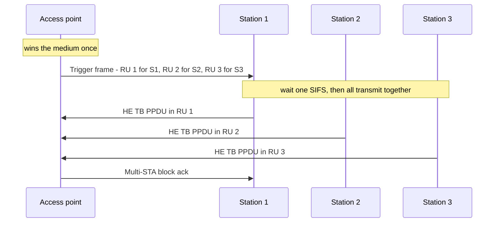

# WF 06: Wi-Fi 6, 6E and 7 features, from OFDMA to the 6 GHz band

*Part of the [networking plan](../00_plan.md), Wi-Fi sub-track · Candela sessions 5b, 5c and 5d (Wi-Fi 6 and 6E, the 6 GHz band, Wi-Fi 7), with the HE MAC and PHY changes (OFDMA and resource units, uplink and downlink MU-MIMO, BSS colouring and spatial reuse, target wake time, MU EDCA), the 6 GHz rules and access point discovery (reduced neighbor report, preferred scanning channels, FILS discovery, multiple BSSID), and an overview of 802.11be (320 MHz, 4096-QAM, multi-RU, preamble puncturing, MLO) · Prerequisites: [WF 01](01_wifi_landscape_and_ap_anatomy.md), [WF 02](02_wifi_phy.md), [WF 03](03_wifi_mac.md) and [WF 05](05_wifi_roaming_and_radio_management.md) (the scan and roaming budget that 6 GHz discovery attacks)*

"What does Wi-Fi 6 actually change, and why is the measured gain so much smaller than the 9.6 Gbit/s on the box" is a standard Staff question for a wireless platform team, and the honest answer is that 802.11ax is not a peak-rate standard. It is a **dense-network efficiency** standard: it cuts the overhead per frame for many small transmissions (OFDMA), serves several stations at once (MU-MIMO in both directions), lets neighbouring cells transmit together (spatial reuse), lets a sensor sleep for minutes (target wake time) and, in its 6 GHz form, opens 1,200 MHz of clean spectrum that has no legacy devices. Each of these has a number attached, and each has a condition under which it does nothing or hurts. This tutorial builds the numbers.

**Eight honest limits, stated first.**

1. **There is no radio here, so nothing was measured on the air.** The rate tables, the OFDMA airtime model, the MU-MIMO simulation, the spatial reuse simulation and the TWT power model are computations and simulations with assumptions that are stated beside each result. The only decoder in the loop is `tshark` 4.2.2, which checks the layout of the frames I built byte by byte.
2. **The standard was not re-read.** The resource unit counts, the HE preamble durations, the OBSS PD rule (-82 to -62 dBm, a 21 dBm reference power), the MU EDCA layout, the TWT fields, the 6 GHz power limits and the EHT multi-RU sizes are **from memory** and are marked so. Where `tshark` decodes a field the position is checked, not the meaning.
3. **The preamble durations of the OFDMA model are assumptions** (44 µs for an HE single user PPDU and 52 µs for a trigger-based one), and so are the frame sizes of the trigger and the block ack. The shape of the result (a big gain for many small frames, no gain or a loss when frames differ in size) does not depend on them; the exact crossover does.
4. **The MU-MIMO simulation uses Rayleigh channels, single antenna clients, zero forcing and a Shannon rate with an 8 dB gap** (the same gap as in [WF 11](11_rf_fundamentals_and_link_budget.md)). It ignores channel ageing (done in [WF 02](02_wifi_phy.md)) and the codebook quantisation of the feedback. The sounding cost uses report sizes from the 4 by 1 angle counts, from memory.
5. **The spatial reuse simulation is a two-cell downlink model.** It ignores the uplink, acknowledgements, hidden stations and the exposed-node effects that a full simulation would include, and it uses one propagation model. Its purpose is to show **when** reuse pays and when it does not.
6. **The TWT power numbers are assumed** (5 mW sleep, 150 mW idle, 200 mW receive, 700 mW transmit, 2 ms to wake) for a small IoT module, and I show a second table with a 0.3 mW sleep because the result depends on it. Real chips differ.
7. **The 6 GHz rules are the US ones, from memory.** The regulations of the EU, Japan, India and others differ (LPI and VLP limits, the lower 500 MHz only in some regions), and AFC operation is not run here.
8. **Not run here:** an AFC system, a 6 GHz radio, `hostapd` (no `cfg80211` in this VM, so [WF 10](10_linux_wireless_stack_and_openwrt.md) covers the configuration), a real HE or EHT PPDU on the air, and any client behaviour. Wi-Fi 7 gets an overview here; the multi-link material is in [WF 12](12_wifi7_eht_and_mlo.md).

By the end you can:

- **compute any HE or EHT rate from one formula** (computed: data subcarriers times bits times coding rate times streams over 12.8 µs plus the guard interval; **9,607.8 Mbit/s** for 160 MHz, 8 streams, MCS 11 at 0.8 µs, **600.5 Mbit/s** for one stream at 80 MHz, and **46,117.6 Mbit/s** for 802.11be at 320 MHz, 16 streams, MCS 13), and say why a real 2 stream laptop at 160 MHz sees **2,402 Mbit/s** on the link and far less on a speed test;
- **explain resource units and when OFDMA wins** (modelled: nine stations sending 100 byte frames need **1,986 µs** one after another against **427 µs** with one trigger frame, **4.65 times** less; a 1,500 byte frame gives **1.71 times**, and one 1,500 byte frame among small ones gives **0.92 times**, a loss, because every station pads to the longest);
- **say what MU-MIMO buys and what it costs** (simulated: 4 antennas and 2 single-antenna users give **1.61 times** the single-user rate and 3 users **1.91 times**; two users whose channels are 95 % correlated keep only **47.8 %**; the sounding takes **934 µs** for 2 users, so a 1 ms burst loses and a 5 ms burst nets **1.36 times**);
- **say when spatial reuse helps** (simulated on pairs of cells that hear each other: with clients within 6 m the best threshold gives **150 %** of the no-reuse throughput, with 12 m only **105.9 %** at -78 dBm and **69.3 %** at -62 dBm, and with 20 m every threshold loses), and why a BSS colour is only a label until the OBSS PD rule is applied;
- **decide when target wake time pays** (modelled: with a 0.3 mW sleep floor a sensor at one report per 10 s draws **0.40 mW** with TWT against **0.78 mW** waking every tenth beacon and **4.11 mW** waking every beacon, **722 days** of battery against **374** and **71**; with a 5 mW sleep floor all the modes are within **5.10 to 8.70 mW**);
- **read the 6 GHz channel plan and power limits** (computed: **59** 20 MHz channels, **29** of 40 MHz, **14** of 80, **7** of 160 and **3** of 320; **15** preferred scanning channels at 5 + 16n; LPI EIRP of **18 dBm** at 20 MHz and **30 dBm** at 320 MHz from a 5 dBm/MHz limit);
- **explain 6 GHz discovery with numbers** (modelled: a passive scan of all 59 channels takes **3,300 ms** on average, the 15 preferred channels **880 ms**, with FILS discovery frames **168 ms**, and the out-of-band route through the 5 GHz reduced neighbor report **71 ms**), and decode a **reduced neighbor report**, a **FILS discovery frame**, a **TWT element** and a **HE operation element** from their bytes (built and decoded by `tshark`, with the short SSID **0xcc054d84** matching the CRC-32 of the SSID);
- **put preamble puncturing and multi-RU in numbers** (computed: with one busy 20 MHz subchannel an 80 MHz channel keeps **71.6 %** of its data subcarriers instead of **23.9 %** or **47.8 %** after falling back, and a 320 MHz channel keeps **92.9 %**).

## Where the numbers come from

Each experiment is a script `sN_*.py` in `prog/` with its output frozen in `v/`, run with `run.sh`. `dot11.py` is the frame builder of [WF 03](03_wifi_mac.md) and `he_ie.py` builds the HE and 6 GHz elements. `s1_ru.py` computes the resource unit tables, the peak rates and the puncturing gain. `s2_ofdma.py` is the uplink OFDMA airtime model. `s3_mumimo.py` simulates zero forcing and prices the sounding. `s4_sr.py` simulates spatial reuse and counts colour collisions. `s5_twt.py` is the TWT power model. `s6_6ghz.py` builds the 6 GHz channel plan, the power classes and the discovery time model. `s7_frames.py` builds a 6 GHz beacon with its HE elements, a TWT setup frame and a FILS discovery frame and decodes them with `tshark`. `ans_a.py` to `ans_e.py` solve the five problems.

Every number in the text is copied from `v/*.out` or computed from a printed figure with the arithmetic shown. A number that is not measured, simulated, modelled or computed here is marked **from memory**. The simulations use fixed seeds, so each run prints the same figures.

## Data and timing

| What | Size or time |
|---|---|
| Resource units and rates (`s1_ru.sh`) | arithmetic, under 1 s |
| OFDMA airtime (`s2_ofdma.sh`) | arithmetic, under 1 s |
| MU-MIMO (`s3_mumimo.sh`) | 3,000 draws per row, about 10 s |
| Spatial reuse (`s4_sr.sh`) | 15 rows of 6,000 draws, about 5 s |
| TWT power (`s5_twt.sh`) | arithmetic, under 1 s |
| 6 GHz plan and discovery (`s6_6ghz.sh`) | arithmetic, under 1 s |
| HE and 6 GHz frames (`s7_frames.sh`) | 3 frames decoded by `tshark`, under 2 s |

## Mapping to the Candela course

Candela sessions 5b and 5c cover Wi-Fi 6 and Wi-Fi 6E and session 5d covers Wi-Fi 7. This tutorial covers all three and adds what a Senior or Staff interview asks for beyond the course: the numbers behind each feature (sections 2 to 6), the 6 GHz rules and discovery in full (section 7, with the mrncciew 6 GHz discovery series as the source for the lab behaviour of FILS, unsolicited probe responses and the reduced neighbor report), and a Wi-Fi 7 overview (section 8) that [WF 12](12_wifi7_eht_and_mlo.md) then takes down to the multi-link element.

---


## 1. What Wi-Fi 6 changed, and the rate formula

802.11ax (**HE**, high efficiency, certified as Wi-Fi 6, and Wi-Fi 6E when it runs in 6 GHz) keeps OFDM and changes four things at the PHY and several at the MAC:

- **Longer symbols and a finer grid.** The subcarrier spacing falls from 312.5 kHz to **78.125 kHz**, so the useful symbol grows from 3.2 µs to **12.8 µs**, with guard intervals of **0.8, 1.6 or 3.2 µs** (from [WF 02](02_wifi_phy.md)). A 20 MHz channel has **256** subcarriers, 4 times as many as 802.11ac.
- **1024-QAM** (MCS 10 and 11), 25 percent more bits per subcarrier than 256-QAM.
- **OFDMA** (section 2): the subcarriers are split into **resource units** that go to different stations in the same PPDU.
- **MU-MIMO in both directions** (section 3), and **four PPDU formats**: HE SU (one station), **HE MU** (downlink to several stations), **HE ER SU** (extended range, a narrow single-user format with a repeated preamble) and **HE TB** (trigger-based, the uplink response to a trigger frame), from memory of the format list.

At the MAC it adds the trigger frame, buffer status reports, **BSS colour and spatial reuse** (section 4), **target wake time** (section 5), **MU EDCA** (section 6), multi-TID aggregation, operating mode control and dynamic fragmentation (from memory).

**One formula gives every rate.** The PHY rate of one user is

`rate = data subcarriers x bits per subcarrier x coding rate x streams / (12.8 µs + guard interval)`.

The script applies it to the HE resource units. For a full channel the data subcarriers are **234** at 20 MHz, **468** at 40, **980** at 80 and **1,960** at 160 MHz:

--- peak rates by width, 1 stream and the usual maximum, MCS 11 at 0.8 us (802.11ax) and MCS 13 (802.11be)
standard  width  streams  MCS  GI us  Mbit/s
ax         20       1    11   0.8       143.4
ax         80       1    11   0.8       600.5
ax         80       2    11   0.8      1201.0
ax        160       2    11   0.8      2402.0
ax        160       8    11   0.8      9607.8
be        160       2    13   0.8      2882.4
be        320       2    13   0.8      5764.7
be        320       8    13   0.8     23058.8
be        320      16    13   0.8     46117.6

**9,607.8 Mbit/s** is the headline of Wi-Fi 6 (160 MHz, 8 streams, MCS 11, 0.8 µs guard interval), and it is the product of four things almost no real link has at once. A **2 stream** phone or laptop has a quarter of the streams, a common 80 MHz channel has half the width of 160, and MCS 11 needs an SNR near **33 dB** in my model (answer B below). The same formula for 802.11be gives **46,117.6 Mbit/s** (320 MHz, 16 streams, MCS 13, 4096-QAM), and a 2 stream Wi-Fi 7 laptop at 320 MHz **5,764.7 Mbit/s**. The gap between the box and a speed test is the subject of [WF 01](01_wifi_landscape_and_ap_anatomy.md) section 5 and [WF 03](03_wifi_mac.md) (preamble, contention, acknowledgements: 9.1 to 90.4 percent efficiency).

**Efficiency, not peak, is the design target.** The standard's own goal (from memory of the project authorisation) was **four times the average per-station throughput in dense deployments**, not four times the peak, and every feature below is aimed at that.

## 2. OFDMA and resource units

In 802.11ac a PPDU belongs to one station (or, with downlink MU-MIMO, a group of them on **all** the subcarriers). A phone that wants to send 100 bytes uses the whole 80 MHz channel for 50 µs and pays the full cost of contention, preamble and acknowledgement. **OFDMA** divides the subcarriers of the PPDU into **resource units (RUs)** and assigns each RU to one station, so one PPDU carries small frames of many stations and the overhead is shared.

### 2.1 The RU grid

The RU sizes (in tones) are **26, 52, 106, 242, 484, 996 and 2x996**; each size holds fewer **data** subcarriers than tones because some tones are pilots (**24, 48, 102, 234, 468, 980 and 1,960**). The counts per channel width, computed from the sizes:

--- resource units of 802.11ax: tones, data subcarriers and how many fit in each width (counts from memory of the standard, the sums are computed)
width  RU sizes in tones (count)                                           tones in the 26 tone grid  FFT size
 20    26 (9), 52 (4), 106 (2), 242 (1)                                          234                      256
 40    26 (18), 52 (8), 106 (4), 242 (2), 484 (1)                                468                      512
 80    26 (37), 52 (16), 106 (8), 242 (4), 484 (2), 996 (1)                      962                      1024
160    26 (74), 52 (32), 106 (16), 242 (8), 484 (4), 996 (2), 1992 (1)          1924                      2048

A 20 MHz channel holds **9 RUs of 26 tones** or 4 of 52 or 2 of 106 or one of 242; an 80 MHz channel up to **37 stations** at once. The rate of one RU at one stream follows from the formula:

--- data rate of one RU, one spatial stream, 0.8 us guard interval (Mbit/s) = data subcarriers x bits x coding / (12.8 + GI)
MCS  modulation  coding         26      52     106     242     484     996    1992
  0  BPSK       0.500       0.9     1.8     3.7     8.6    17.2    36.0    72.1
  1  QPSK       0.500       1.8     3.5     7.5    17.2    34.4    72.1   144.1
  2  QPSK       0.750       2.6     5.3    11.2    25.8    51.6   108.1   216.2
  3  16-QAM     0.500       3.5     7.1    15.0    34.4    68.8   144.1   288.2
  4  16-QAM     0.750       5.3    10.6    22.5    51.6   103.2   216.2   432.4
  5  64-QAM     0.667       7.1    14.1    30.0    68.8   137.6   288.2   576.5
  6  64-QAM     0.750       7.9    15.9    33.8    77.4   154.9   324.3   648.5
  7  64-QAM     0.833       8.8    17.6    37.5    86.0   172.1   360.3   720.6
  8  256-QAM    0.750      10.6    21.2    45.0   103.2   206.5   432.4   864.7
  9  256-QAM    0.833      11.8    23.5    50.0   114.7   229.4   480.4   960.8
 10  1024-QAM   0.750      13.2    26.5    56.2   129.0   258.1   540.4  1080.9
 11  1024-QAM   0.833      14.7    29.4    62.5   143.4   286.8   600.5  1201.0

The smallest RU at MCS 0 carries **0.9 Mbit/s** (0.882), which is why a 26-tone RU suits an IoT sensor or a block ack and not a video stream. The grid is not free: **nine 26-tone RUs hold 216 data subcarriers against 234 in one 242-tone RU (92.3 percent)**, so a fully split channel loses about 8 percent of its raw capacity (computed).

--- what one 26-tone RU buys: the slowest rate and the grid overhead
26-tone RU, MCS 0, 1 stream, 0.8 us: 0.882 Mbit/s; 9 RUs of 26 tones carry 216 data subcarriers against 234 in one 242-tone RU (92.3 %)
GI effect on one 242-tone RU at MCS 7: 0.8 us -> 86.0 Mbit/s, 1.6 us -> 81.2 Mbit/s, 3.2 us -> 73.1 Mbit/s
4096-QAM gain over 1024-QAM at the same coding rate 5/6: 20 % more bits per subcarrier (12 against 10), and a square QAM needs about 6.02 dB more SNR for the same error rate (10 log10 of 4096 / 1024)

The guard interval costs capacity too: at MCS 7 one 242-tone RU runs at **86.0, 81.2 and 73.1 Mbit/s** with 0.8, 1.6 and 3.2 µs. HE uses the longer guard intervals when the delay spread is large (outdoors) or in the long HE-LTF modes.

### 2.2 The trigger-based uplink exchange

Downlink OFDMA is straightforward: the access point puts several stations in an HE MU PPDU, and the HE-SIG-B field of the preamble says which RU belongs to whom (from memory). **Uplink** is the hard part, because stations that decide independently would not transmit at the same instant on the right subcarriers with the right power. The access point therefore **coordinates** them with a **trigger frame**:



The trigger carries a **common info** field (the trigger type, the uplink length, the bandwidth) and one **user info** field per station (the station's association ID, the RU allocation, the MCS, the target RSSI for power control). Trigger types (from memory) include **basic** (data), **BSRP** (buffer status report poll: ask who has data and how much), **MU-BAR**, **MU-RTS**, **NFRP** (an NDP feedback report poll) and the beamforming report poll of section 3. A station answers **a SIFS later**, so the PPDUs line up in time, and its **carrier frequency offset and timing** must be accurate enough to line up in frequency; the access point controls the transmit **power** of the stations (the target RSSI) so that they arrive at similar levels, the reason OFDMA uplink is harder to build than the downlink.

How does the access point know what to schedule? Stations report **buffer status** (in the QoS control field or in a BSR of the HE control field), and for stations with nothing known, **UL OFDMA random access (UORA)** lets a station pick a **random** RU from the ones the trigger marks for random access, with an OFDMA backoff counter (from memory). The scheduler (which stations, which RUs, which MCS) is **not in the standard**: it is the vendor's, and it is where the products differ.

### 2.3 When OFDMA wins, in numbers

The script compares the airtime of N stations each sending one frame, first as N separate EDCA transmissions on the whole 20 MHz channel and then as one trigger with N RUs (assumptions in the output header: preamble 44 and 52 µs, trigger and block ack at 24 Mbit/s, MCS 5):

--- assumptions: contention DIFS 34 us + mean backoff 7.5 slots; HE SU preamble 44 us, HE trigger-based preamble 52 us (assumed); 20 MHz, MCS 5, 0.8 us GI; trigger and block ack at 24 Mbit/s

--- N stations each with one frame of the size shown: total airtime (us), one trigger against N separate transmissions, and the gain
payload  N   EDCA total   OFDMA total   gain    EDCA per station  OFDMA per station
   60    2        414          289    1.43x             207              144
   60    4        828          320    2.59x             207               80
   60    9       1864          386    4.83x             207               43
  100    2        441          302    1.46x             221              151
  100    4        883          347    2.54x             221               87
  100    9       1986          427    4.65x             221               47
  300    2        469          357    1.31x             234              178
  300    4        937          456    2.06x             234              114
  300    9       2109          658    3.20x             234               73
 1000    2        632          547    1.15x             316              274
 1000    4       1264          850    1.49x             316              213
 1000    9       2843         1447    1.96x             316              161
 1500    2        768          670    1.15x             384              335
 1500    4       1536         1136    1.35x             384              284
 1500    9       3455         2018    1.71x             384              224

| Frame | N = 2 | N = 4 | N = 9 |
|---|---|---|---|
| 60 bytes | 1.43x | 2.59x | 4.83x |
| 100 bytes | 1.46x | 2.54x | 4.65x |
| 300 bytes | 1.31x | 2.06x | 3.20x |
| 1,000 bytes | 1.15x | 1.49x | 1.96x |
| 1,500 bytes | 1.15x | 1.35x | 1.71x |

The table is the case for OFDMA: it is a **small-frame, many-station** technology. Nine stations sending 100 byte frames take **1,986 µs** one after another and **427 µs** with one trigger (**4.65 times** less airtime), because the contention (DIFS plus a mean backoff of 101.5 µs), the preamble and the acknowledgement are paid once. With 1,500 byte frames the data dominates and the gain falls to 1.71 times for nine stations. In a 26-tone RU a station has 24 data subcarriers against 234, so its data takes **9.75 times longer**: OFDMA does not make data faster, it makes the **overhead** shared.

The model also shows the condition that equal frames hide:

--- equal frames always favour OFDMA in this model (the overhead is shared); unequal frames do not, because every station pads to the longest
sizes (bytes)                      EDCA total  OFDMA total  gain    padding share of the RU time
[100,100,100,100]                       883         347   2.54x    0.0 %
[1500,100,100,100]                     1046        1136   0.92x   68.0 %
[1500,100,100,100,100,100,100,100,100]     2150        2018   1.07x   81.2 %
[1500,1500,100,100]                    1209        1136   1.06x   45.3 %
[300,300,300,300,300,300,300,300,300]     2109         658   3.20x    0.0 %
[1500,60,60,60,60,60,60,60,60]         2041        2018   1.01x   83.3 %

| Frames (bytes) | EDCA | OFDMA | Gain | Padding in the RUs |
|---|---|---|---|---|
| 4 x 100 | 883 µs | 347 µs | 2.54x | 0.0 % |
| 1500 and 3 x 100 | 1,046 µs | 1,136 µs | **0.92x** | 68.0 % |
| 1500 and 8 x 100 | 2,150 µs | 2,018 µs | 1.07x | 81.2 % |
| 9 x 300 | 2,109 µs | 658 µs | 3.20x | 0.0 % |
| 1500 and 8 x 60 | 2,041 µs | 2,018 µs | 1.01x | 83.3 % |

**A trigger-based PPDU lasts as long as the longest station needs**, so the others pad. One 1,500 byte frame among small ones makes OFDMA **slower** than plain contention (0.92 times, with **68 percent** of the RU time wasted). A scheduler therefore has to **group stations with similar queue sizes**, or give the heavy station a bigger RU, and a network whose traffic is a mix of video and sensor frames sees little gain. This is the honest reason measured OFDMA gains in the field are small: they depend on there being **many stations with small, similar uplink frames** at the same moment (voice, ACKs, IoT, chat), and a typical home has one active streaming client.

**Where else the cost sits (from memory):** the trigger frame itself and the multi-STA block ack are overhead, power control must be good, a station that is far from the access point has a weak RU and low MCS, and legacy clients on the same channel cannot be triggered, so a mixed network gets less.

## 3. MU-MIMO: serving several stations on the same subcarriers

MU-MIMO (introduced for the downlink in 802.11ac, extended to the uplink in 802.11ax) uses **spatial separation** instead of frequency separation: the access point with N antennas sends different streams to different stations on the **same** subcarriers, with a precoder that **nulls** each stream at the other stations. It needs the channel, so it needs **sounding**.

### 3.1 The sounding exchange

The access point sends an **NDP announcement** (naming the stations), then a **null data packet (NDP)** that every station measures, and each station returns a **compressed beamforming report** (a set of angles that describe its channel, a Givens rotation form, from memory). For several stations the reports are polled in turn with a **beamforming report poll (BFRP)** trigger. Only then does the first data PPDU go out, and the channel is stale after a few milliseconds when anything moves (the ageing curve in [WF 02](02_wifi_phy.md)).

### 3.2 What it buys, simulated

The script uses a 4 antenna access point, single antenna stations, Rayleigh channels, a per-antenna SNR of 25 dB and zero forcing (the precoder inverts the channel so that each station sees only its own stream):

--- 4 antenna access point, single antenna users, Rayleigh channels, per-antenna SNR 25 dB, rate = log2(1 + SINR / 8 dB gap), bit/s/Hz, 3000 draws
users  single user (MRT)   ZF to all users   gain    per-user rate under ZF
  1            7.45              7.45      1.00x       7.45
  2            7.46             12.01      1.61x       6.01
  3            7.46             14.22      1.91x       4.74
  4            7.46             12.72      1.70x       3.18

| Users served together | Single user, in turn | Zero forcing | Gain |
|---|---|---|---|
| 1 | 7.45 bit/s/Hz | 7.45 | 1.00x |
| 2 | 7.46 | 12.01 | **1.61x** |
| 3 | 7.46 | 14.22 | **1.91x** |
| 4 | 7.46 | 12.72 | 1.70x |

Serving 3 users gives about 1.9 times the sum rate, and serving **all 4 on 4 antennas is worse than 3**: with no spare degree of freedom the zero-forcing inverse amplifies noise for the user with the worst channel (a known effect, and the reason real schedulers pick users, not just count them). **User selection** is worth a lot:

--- user selection: 8 users in the cell, serve 4 at a time; random against the best of 40 random subsets (a greedy scheduler would do better)
random 4 of 8: 12.68   best of 40 subsets: 19.09   (51 % better)

Picking the best of 40 random subsets of 4 users out of 8 gives **19.09** against **12.68** for a random choice, **51 percent** more. The scheduler also has to avoid **correlated** users:

--- correlated users (for example two phones on one desk): ZF sum rate of 2 users on 4 antennas against the correlation of their channels
correlation   ZF sum rate   against uncorrelated
   0.00          12.02        100.0 %
   0.50          11.21         93.3 %
   0.80           9.16         76.2 %
   0.90           7.44         61.9 %
   0.95           5.75         47.8 %
   0.99           2.49         20.7 %

Two users with channels correlated by 0.9 keep **61.9 percent** of the uncorrelated sum rate and at 0.95 only **47.8 percent**: two phones on the same desk look alike to the array and cannot be separated. (Correlation 0.0 is 12.02, the table's first row.)

### 3.3 The sounding cost decides whether it is worth it

--- the sounding cost (assumed sizes): NDP announcement, NDP, then a beamforming report from each user; airtime and the gain left for a data burst of the length shown
feedback report size per user, 20 MHz: grouping 4 -> 224 bytes, grouping 16 -> 59 bytes (the angle counts are from memory of the 4x1 case)
2 users: announcement 32 us, NDP 60 us, poll 32 us, reports 762 us: total 934 us
    data burst  1000 us: efficiency 0.52 of the burst; with the ZF gain of 1.61x simulated above the net gain is 0.83x
    data burst  2000 us: efficiency 0.68 of the burst; with the ZF gain of 1.61x simulated above the net gain is 1.10x
    data burst  5000 us: efficiency 0.84 of the burst; with the ZF gain of 1.61x simulated above the net gain is 1.36x
    data burst 10000 us: efficiency 0.91 of the burst; with the ZF gain of 1.61x simulated above the net gain is 1.47x
4 users: announcement 32 us, NDP 60 us, poll 36 us, reports 1523 us: total 1699 us
    data burst  1000 us: efficiency 0.37 of the burst; with the ZF gain of 1.70x simulated above the net gain is 0.63x
    data burst  2000 us: efficiency 0.54 of the burst; with the ZF gain of 1.70x simulated above the net gain is 0.92x
    data burst  5000 us: efficiency 0.75 of the burst; with the ZF gain of 1.70x simulated above the net gain is 1.27x
    data burst 10000 us: efficiency 0.85 of the burst; with the ZF gain of 1.70x simulated above the net gain is 1.46x

Sounding two users takes **934 µs** (the reports are 224 bytes each with a grouping of 4 and 59 bytes with a grouping of 16, from the 4 by 1 angle counts of memory), and four users **1,699 µs**. A data burst must be long enough to pay for it: for 2 users the net gain is **0.83 times at 1 ms** (a loss), **1.10 times at 2 ms**, **1.36 times at 5 ms** and **1.47 times at 10 ms**; for 4 users **0.63, 0.92, 1.27 and 1.46 times**. MU-MIMO therefore needs **long bursts to stationary stations with different directions**: a speed test of 4 laptops on a desk is the best case and a phone call in a pocket the worst.

**Uplink MU-MIMO** in 802.11ax (stations transmit on the same RU in space, the access point separates them) is optional and rarely implemented (from memory of vendor feature lists); the practical uplink gain comes from OFDMA. A client that supports **MU-MIMO beamformee** with 1 or 2 antennas is the usual case: the access point has 4 or 8 antennas and the stations 1 or 2, so the **spatial streams per station** are few and the number of stations served is what is multiplied.


## 4. BSS colour and spatial reuse

In a dense building, 802.11ac stations defer to **every** frame they hear on the channel, including frames of the **neighbour's** cell that are far too weak to interfere (the carrier sense of [WF 03](03_wifi_mac.md): preamble detect at **-82 dBm**, energy detect at -62 dBm). That is the **overlapping BSS (OBSS)** problem: two cells that could transmit together take turns. 802.11ax adds two pieces.

**BSS colour.** The access point puts a **6 bit colour** (0 means none, so 63 usable values, from memory) in the HE operation element of its beacons and in the **HE-SIG-A** field of every HE PPDU. A station that receives a PPDU early reads the colour: **the same colour is an intra-BSS frame** (set the NAV, defer), **a different colour is an inter-BSS frame**, and then the station may apply the second piece. The decode of the element in the frame I built:

--- decoded by tshark: BSS colour 21 (0x15); 6 GHz operation: primary channel 37, width code 2 (0 20, 1 40, 2 80, 3 160), centre channel 39
    MU EDCA AIFSN per category (BE, BK, VI, VO order of the ACI field) 2,4,1,1, MU EDCA timer 0x08 in each category x 8 TU = 65.5 ms; non-SRG OBSS PD max offset 10 dB; 6 GHz capabilities 0x00f8
    OBSS PD threshold with that offset: -82 + 10 = -72 dBm

The BSS colour is **21** (byte 0x15: colour in bits 0 to 5, a partial-colour bit and a colour-disabled bit), the 6 GHz operation information gives primary channel **37**, width code 2 (80 MHz) and centre channel **39**, and the spatial reuse element carries a **non-SRG OBSS PD maximum offset of 10 dB**, which sets the threshold to **-82 + 10 = -72 dBm**.

**OBSS PD spatial reuse.** For an inter-BSS PPDU received **below the OBSS PD level**, a station may **treat the medium as idle** and transmit, provided it **reduces its transmit power**: the limit is `21 dBm - (OBSS PD level + 82 dB)` for a level between -82 and -62 dBm (from memory of the rule): every dB of threshold costs a dB of power.

--- the transmit power cost: the limit when a frame is sent after ignoring an OBSS frame = 21 dBm - (OBSS PD level + 82 dBm)
OBSS PD -82 dBm -> at most 21 dBm
OBSS PD -78 dBm -> at most 17 dBm
OBSS PD -72 dBm -> at most 11 dBm
OBSS PD -68 dBm -> at most 7 dBm
OBSS PD -62 dBm -> at most 1 dBm

At -72 dBm the power is limited to **11 dBm** and at the maximum threshold (-62 dBm) to **1 dBm**. (A second mechanism, **SRP-based spatial reuse**, lets a station reuse a trigger frame's own stated tolerance for interference; it needs the neighbour's cooperation and is rarer, from memory.)

### 4.1 When it pays, simulated

The script places two cells at random distances (15 to 70 m apart) on one channel and, for the pairs that hear each other above -82 dBm, compares **taking turns** with **transmitting together at reduced power** for several thresholds and three client distances:

--- two cells on one channel, centres 15 to 70 m apart (uniform), 20 dBm, loss 47 + 35 log10(d); sum rate of the two cells, bit/s/Hz, over only the pairs that hear each other above -82 dBm (simulated, 6000 draws, the pairs that do not hear each other are the same under every policy)
client radius   policy                                   sum rate   against no reuse   pairs that reuse
    6 m        no spatial reuse (preamble detect -82)      8.33        100.0 %             0.0 %
    6 m        OBSS PD -78 dBm                            10.91        131.0 %            40.1 %
    6 m        OBSS PD -72 dBm                            12.51        150.2 %            81.1 %
    6 m        OBSS PD -68 dBm                            12.49        149.9 %           100.0 %
    6 m        OBSS PD -62 dBm (the maximum)              11.32        135.9 %           100.0 %
   12 m        no spatial reuse (preamble detect -82)      8.18        100.0 %             0.0 %
   12 m        OBSS PD -78 dBm                             8.66        105.9 %            40.1 %
   12 m        OBSS PD -72 dBm                             7.96         97.3 %            81.1 %
   12 m        OBSS PD -68 dBm                             6.91         84.5 %           100.0 %
   12 m        OBSS PD -62 dBm (the maximum)               5.66         69.3 %           100.0 %
   20 m        no spatial reuse (preamble detect -82)      6.74        100.0 %             0.0 %
   20 m        OBSS PD -78 dBm                             6.26         92.9 %            40.1 %
   20 m        OBSS PD -72 dBm                             4.82         71.6 %            81.1 %
   20 m        OBSS PD -68 dBm                             3.62         53.7 %           100.0 %
   20 m        OBSS PD -62 dBm (the maximum)               2.67         39.7 %           100.0 %

| Client within | Policy | Sum rate against no reuse |
|---|---|---|
| 6 m | OBSS PD -78 dBm | 131.0 % |
| 6 m | OBSS PD -72 dBm | **150.2 %** |
| 6 m | OBSS PD -62 dBm | 135.9 % |
| 12 m | OBSS PD -78 dBm | **105.9 %** |
| 12 m | OBSS PD -72 dBm | 97.3 % |
| 12 m | OBSS PD -62 dBm | 69.3 % |
| 20 m | OBSS PD -78 dBm | 92.9 % |
| 20 m | OBSS PD -72 dBm | 71.6 % |
| 20 m | OBSS PD -62 dBm | 39.7 % |

This is the honest picture of spatial reuse, and it is not the one on the marketing slide. **It helps small cells** (clients within 6 m of their access point have a strong signal to spare, so the power cut and the interference cost little: up to **+50 percent**), **gains about 6 percent** at the best threshold for 12 m cells, and **loses** for 20 m cells at every threshold, because a client 20 m away has no margin to give. The **maximum threshold is never the best** in this model: reuse at -62 dBm lets a station transmit over a neighbour it can hear and cuts its own power to 1 dBm. A product that raises the OBSS PD level everywhere without looking at the client distances can make a network slower. The right design uses **small cells** (lower power, more access points, [WF 05](05_wifi_roaming_and_radio_management.md) section 9) and then lets reuse work, which is a reason to treat BSS colouring as a tool of a planned network, not a feature that fixes a bad one.

### 4.2 Colour collisions

A colour is chosen by the access point (or assigned by a controller). If **two cells that hear each other** pick the same colour, each treats the other's frames as intra-BSS, sets the NAV and **defers**, so reuse never starts. At random the chance is:

--- BSS colour: 6 bits, 63 usable values (0 means none, from memory); chance that at least two of n mutually audible cells pick the same colour at random
n =  3 cells: 4.7 %
n =  5 cells: 15.0 %
n = 10 cells: 52.9 %
n = 20 cells: 96.6 %
n = 40 cells: 100.0 %

With only **10** mutually audible cells the chance of at least one collision is **52.9 percent** (the birthday effect: 63 colours, the first n with probability over one half is 10). The cure is not more colours but **coordination**: a controller or a cloud assigns colours so that cells that hear each other differ, and the standard lets an access point announce a **colour change** (a BSS color change announcement element, from memory) when it detects a collision from its neighbours' frames. A multiple BSSID set shares one colour, so a collision matters only between separate BSSs that hear each other.

## 5. Target wake time

Legacy power save ([WF 03](03_wifi_mac.md) section 6) makes a station wake for **every beacon, or every DTIM** (a multiple of the 102.4 ms beacon interval), look in the TIM for its bit, and go back to sleep: it is **access point driven** and wakes often even when nothing is waiting. **Target wake time (TWT)** turns it around: the station and the access point **agree on a schedule**, and the station wakes only at the agreed times. It is the feature that matters for battery IoT devices, which is also where the numbers are.

### 5.1 The negotiation and the frame

An **individual TWT** agreement is set up with a **TWT setup** action frame (category 22, the S1G category, action 6, reused by HE) that carries a **TWT element** (ID 216). The frame I built and `tshark` decoded:

--- frame 2: TWT setup request, 44 bytes, category 22 action 6 (an S1G action frame reused by HE): requester bit 1, setup command 1 (0 request, 1 suggest, 2 demand), implicit 1, flow type 0 (0 announced)
    wake interval = mantissa x 2^exponent us = 800 x 2^10 = 819200 us = 819.2 ms; nominal minimum wake duration = 8 x 256 us = 2.048 ms; a duty cycle of 0.25 %

The request type says **requester**, a setup **command** (request, suggest, demand, then accept, alternate, dictate, reject in the reply, from memory), **trigger** (the access point sends a trigger frame at the start of the service period) or not, **implicit** (the schedule repeats by itself) or explicit, **announced** (the station tells the access point it is awake with a PS-Poll or a null frame) or unannounced, and the **wake interval** as a 16 bit **mantissa times 2 to a 5 bit exponent** microseconds. Here the interval is **800 x 2^10 = 819.2 ms** and the minimum wake duration **8 x 256 µs = 2.048 ms**, a duty cycle of **0.25 percent**. **Broadcast TWT** (the access point announces a schedule that any station may join) saves the per-station negotiation, and **flexible** schedules and **TWT teardown** and **information** frames complete the set (from memory).

The fields have wide ranges (answer E): a wake duration up to **65.3 ms** in units of 256 µs, and an interval up to **65,535 x 2^31 µs, about 4.46 years**.

### 5.2 What it saves, modelled

The model is a sensor that sends one 100 byte report per period and listens for a reply, with the power states of limit 6 (assumed):

--- average power (mW) and battery life of 2 x AA at 7,000 mWh (a rough figure, no self-discharge, no converter loss) for one 100 byte report per period; SLEEP POWER 0.3 mW
mode                                       period 1 s        10 s        60 s    life at 10 s (days)   life at 60 s (days)
radio always on (idle)                        150.00      150.00      150.00              2                    2
wake every beacon (listen interval 1)           5.11        4.11        4.02             71                   73
wake every 3rd beacon (listen interval 3)       2.64        1.65        1.55            177                  188
wake every 10th beacon (listen interval 10)      1.78        0.78        0.69            374                  423
target wake time (one wake per period)          1.34        0.40        0.32            722                  919

Two things decide the result. **The sleep floor**: with the 0.3 mW sleep power TWT gives **0.40 mW** at a 10 s period (**722 days**) against **0.78 mW** (374 days) for waking every tenth beacon and **4.11 mW** (71 days) for every beacon; with a **5 mW** sleep floor, all the modes sit between **5.10 and 8.70 mW** and TWT is only **7 percent** better than waking every tenth beacon (the 5.0 mW table below), because the sleep power, not the wake-ups, is the cost. TWT only pays when the chip can **sleep deeply**; on a part with a 5 mW floor a longer listen interval gets most of the gain. **The latency price**: a frame for a TWT station waits up to the **whole interval**:

--- average power (mW) and battery life of 2 x AA at 7,000 mWh (a rough figure, no self-discharge, no converter loss) for one 100 byte report per period; SLEEP POWER 5.0 mW
mode                                       period 1 s        10 s        60 s    life at 10 s (days)   life at 60 s (days)
radio always on (idle)                        150.00      150.00      150.00              2                    2
wake every beacon (listen interval 1)           9.70        8.70        8.61             34                   34
wake every 3rd beacon (listen interval 3)       7.30        6.31        6.22             46                   47
wake every 10th beacon (listen interval 10)      6.46        5.47        5.38             53                   54
target wake time (one wake per period)          6.02        5.10        5.02             57                   58

--- the latency price: the longest wait for a frame the access point holds for the station
wake every beacon: 102 ms; listen interval 3: 307 ms; listen interval 10: 1024 ms; TWT with a 10 s period: up to 10,000 ms

so TWT suits sensors and meters, and does not suit a phone that must receive a message in a second. For the **access point** it also means buffering: at 5 downlink frames per second a 60 s interval holds **300 frames per station** (answer E).

**The contention benefit** is the second use. Without a schedule, N stations that report at random instants collide in proportion to N:

--- contention without TWT: N stations that all report once per 10 s at random instants, each frame 0.8 ms on the air; the chance that a given report overlaps another (Poisson arrivals)
   10 stations: channel busy 0.08 %, chance a given frame overlaps another about 0.16 %
  100 stations: channel busy 0.80 %, chance a given frame overlaps another about 1.59 %
  500 stations: channel busy 4.00 %, chance a given frame overlaps another about 7.69 %
 2000 stations: channel busy 16.00 %, chance a given frame overlaps another about 27.39 %
with TWT the access point places the wake times: the same 2000 stations in a schedule of 10 s have no overlap by construction, at the cost of the setup frames and a schedule that must be kept

At 2,000 stations the channel is **16 percent** busy with 0.8 ms frames and a given report has a **27.4 percent** chance of overlapping another; a TWT schedule places the periods so that there is **no overlap by construction** (5,000 stations of 2 ms fit end to end in a 10 s interval; with OFDMA, 9 or 37 per service period, answer E). The price is the setup frames and a **schedule that the access point must keep**; a station that moves to another access point loses its agreement (the roaming of [WF 05](05_wifi_roaming_and_radio_management.md) must carry it, or renegotiate).

**Support in practice (from memory):** TWT is optional in Wi-Fi 6 and in the Wi-Fi certification, many consumer access points ignore requests or accept only broadcast TWT, and the battery gain on phones is small because the radio is a small part of the phone's power. It is a real gain for IoT chips built for it.

## 6. The rest of the HE MAC: MU EDCA, buffer status, operating mode

**MU EDCA.** After a station has sent in an uplink OFDMA exchange it would, with normal EDCA parameters, keep winning the channel at the same rate as before. The **MU EDCA parameter set** (extension element 38) gives the access point a way to **lower a station's EDCA priority for a while** after it has been served by a trigger. Decoded from the bytes of my beacon:

--- MU EDCA parameter set, 16 bytes
  QoS info 0x00
  AC BE: AIFSN 2, ACM 0, ECWmin 4 (CWmin 15), ECWmax 10 (CWmax 1023), MU EDCA timer 8 x 8 TU = 65.5 ms
  AC BK: AIFSN 4, ACM 0, ECWmin 4 (CWmin 15), ECWmax 10 (CWmax 1023), MU EDCA timer 8 x 8 TU = 65.5 ms
  AC VI: AIFSN 1, ACM 0, ECWmin 4 (CWmin 15), ECWmax 10 (CWmax 1023), MU EDCA timer 8 x 8 TU = 65.5 ms
  AC VO: AIFSN 1, ACM 0, ECWmin 4 (CWmin 15), ECWmax 10 (CWmax 1023), MU EDCA timer 8 x 8 TU = 65.5 ms

The four access categories carry AIFSN **2, 4, 1 and 1** (so voice and video have the shortest wait), an ECWmin of 4 (a contention window of 15) and an ECWmax of 10 (1,023), and a **MU EDCA timer of 8 x 8 TU = 65.5 ms**: during that time the station uses the MU values, not its normal ones. It exists so that a station that is scheduled does not also compete at full strength.

**Other HE MAC features (from memory):** the **HE control field** in the MAC header carries **buffer status reports** and **operating mode** changes (a station tells the access point it is dropping to fewer streams or a narrower channel, which is how a phone saves power), **multi-TID A-MPDU** lets one aggregate hold frames of several traffic IDs, **dynamic fragmentation**, **TXOP duration based RTS** (the **TXOP duration RTS threshold** in the HE operation element) and the **NAV** extensions with two NAV timers (an intra-BSS and a basic NAV). The **TWT required** bit in the HE operation element makes TWT mandatory for the BSS.


## 7. The 6 GHz band

Wi-Fi 6E is Wi-Fi 6 in a new band: **5,925 to 7,125 MHz, 1,200 MHz of spectrum**, more than all of 2.4 and 5 GHz together. Only HE and EHT devices may use it (no legacy 802.11a/n/ac, no 802.11b rates), and that is the whole point: the band starts **clean**.

### 7.1 The channel plan

--- the channel plan: 20 MHz channels are numbered 1, 5, ..., 233; wider channels are aligned groups of them (from memory of the plan; counts computed)
width   count   first centre channels                     last
  20      59   1, 5, 9, 13, 17, 21, 25, ...               233
  40      29   3, 11, 19, 27, 35, 43, 51, ...             227
  80      14   7, 23, 39, 55, 71, 87, 103, ...            215
 160       7   15, 47, 79, 111, 143, 175, 207             207
 320       3   31, 95, 159                                159

There are **59 channels of 20 MHz, 29 of 40, 14 of 80, 7 of 160 and 3 of 320 MHz** (from memory of the plan; the counts are computed). Seven 160 MHz channels is the number that matters: in 5 GHz a dense deployment has one or two. The 320 MHz channels are at centres 31, 95 and 159; the band is wide enough for **three non-overlapping** ones, which is where Wi-Fi 7 gets its peak rate (section 8).

### 7.2 Rules, device classes and AFC

The band is **regulated by region**. In the United States (from memory of the FCC rules) three classes exist:

--- power classes (FCC, from memory): maximum EIRP is the smaller of the cap and the power spectral density limit plus 10 log10 of the width
class                         cap dBm   PSD dBm/MHz   20 MHz   40 MHz   80 MHz   160 MHz   320 MHz
standard power (AFC)             36           23      36.0     36.0     36.0     36.0     36.0
low power indoor (LPI)           30            5      18.0     21.0     24.0     27.0     30.0
very low power (VLP)             14           -8       5.0      8.0     11.0     14.0     14.0
LPI at 20 MHz is 18.0 dBm: the same radio that sends 30 dBm in 5 GHz is held to 18.0 dBm, and a 320 MHz channel is the first to reach the 30 dBm cap (30.1 dBm before the cap)

- **Low power indoor (LPI):** indoor only, no AFC, a **30 dBm** EIRP cap and a **power spectral density limit of 5 dBm/MHz**. The PSD limit decides: **18 dBm at 20 MHz, up to 30 dBm only at 320 MHz.** No outdoor use, no weatherproof housing, an integrated antenna (no external one).
- **Standard power (SP):** indoor and outdoor, up to **36 dBm** EIRP and **23 dBm/MHz**, but only under the control of an **Automated Frequency Coordination (AFC)** system. The access point reports its **location and antenna details** to the AFC, which answers with the **channels and maximum power** allowed there, protecting fixed microwave links. The answer has an **expiry** and the device must ask again, and stop if it cannot (from memory).
- **Very low power (VLP):** **14 dBm** with a PSD of **-8 dBm/MHz**, anywhere including outdoors and in vehicles (for wearables and phones sharing a link).

The consequence for a designer is in the PSD, not the cap. In the model of Problem C the **SNR at a fixed distance is the same at 20, 40, 80 and 160 MHz under the LPI limit** (the power doubles with each doubling of the width, and the noise doubles too), while a limit of 24 dBm total (as in much of 5 GHz) would lose 3 dB per doubling:

--- SNR at 20 m of a downlink to a client with one antenna, loss 47 + 35 log10 d + 20 log10 (6.1 / 5.5) (a model)
class                  width   EIRP dBm   noise dBm    SNR dB at 20 m   SNR dB at 40 m
LPI (PSD limit 5)        20      18.0       -94.0           18.6              8.0
LPI (PSD limit 5)        80      24.0       -88.0           18.6              8.0
LPI (PSD limit 5)       160      27.0       -85.0           18.6              8.0
LPI (PSD limit 5)       320      30.0       -81.9           18.5              8.0
VLP (PSD limit -8)       20       5.0       -94.0            5.6             -5.0
VLP (PSD limit -8)       80      11.0       -88.0            5.6             -5.0
VLP (PSD limit -8)      160      14.0       -85.0            5.5             -5.0
VLP (PSD limit -8)      320      14.0       -81.9            2.5             -8.0

--- the same radios with a fixed 24 dBm EIRP whatever the width (a total power limit, as in much of 5 GHz): the SNR falls by 3 dB per doubling
fixed 24 dBm,  20 MHz: SNR at 20 m 24.6 dB
fixed 24 dBm,  80 MHz: SNR at 20 m 18.5 dB
fixed 24 dBm, 160 MHz: SNR at 20 m 15.5 dB
fixed 24 dBm, 320 MHz: SNR at 20 m 12.5 dB

So **wider channels do not shorten the LPI reach**, a surprising result that follows from the PSD rule. They do cost **less range per client** than they would under a total power limit. What does shorten the reach is the **band itself** (about 1.7 dB more free space loss than 5.5 GHz at 6.1 GHz, included in that model) and the **18 dBm** that an LPI access point may use on a 20 MHz channel. Other regions differ (the European Union and the United Kingdom opened only the **lower 500 MHz, 5,945 to 6,425 MHz**, and others have other rules, from memory), so a product needs a **regulatory database per country**, the subject of the country code in [WF 03](03_wifi_mac.md) and of the Linux regulatory database in WF 10.

### 7.3 Security requirements

The 6 GHz band is **WPA3 only (from memory of the Wi-Fi Alliance certification)**: **SAE** (with the hash-to-element method, H2E, [WF 04](04_wifi_security.md)) or **OWE** for open networks (the 6 GHz "open" network is encrypted), and **WPA3-Enterprise** with a 192 bit mode or its replacement; **protected management frames are mandatory**; **no WPA2-PSK, no TKIP, no WEP**. That removes the downgrade attacks of the older bands by construction, and a design must keep in mind that **a 6 GHz BSS that uses a transition mode does not exist**: a WPA2 client cannot join it at all.

### 7.4 Finding an access point: the problem and the answers

In 2.4 and 5 GHz a station sends **probe requests** on each channel and the access points answer. In 6 GHz this is **restricted**: the station may send a probe request only **after it knows an access point is there** (a unicast to a known BSSID and SSID, or in the preferred scanning channels), because **59 channels of active probing would flood the band**. The standard gives four tools:

1. **Passive scan**: wait for a beacon on each channel. 110 ms times 59 channels is **3.3 s on average and 6.5 s at worst** in the model below.
2. **Preferred scanning channels (PSC)**: every **fourth** 20 MHz channel, **5 + 16n: 5, 21, 37, ..., 229**. There are **15**, and an access point whose primary channel is **not** one must still be advertised on one (below). The 20 MHz channels at the PSC are inside each 80 MHz channel, so **one PSC per 80 MHz block** is guaranteed.
3. **Out of band discovery**: the **reduced neighbor report (RNR)** element in the beacons and probe responses of the **2.4 and 5 GHz** radios of the same access point lists the 6 GHz BSS: channel, operating class, BSSID, short SSID, BSS parameters, PSD. A dual-band client finds the 6 GHz network **while it is on 5 GHz** and goes directly to the right channel for a 20 ms probe.
4. **In band discovery**: on the PSC the access point sends **FILS discovery frames** (a short action frame with SSID, capabilities and a few fields) every **20 TU (20.48 ms)**, or an **unsolicited probe response**, so a station that dwells 21 ms is sure to hear one.

The scan times from the model:

--- finding an access point: expected scan time by method (modelled: passive dwell 110 ms, FILS dwell 21 ms, an access point on a uniform random channel of the set, found when its channel is visited)
method                                                          channels   mean ms    worst ms
passive scan of all 20 MHz channels, beacons only                 59       3300       6490
passive scan of the preferred scanning channels, beacons only     15        880       1650
preferred scanning channels with FILS discovery (every 20 TU)     15        168        315
out of band: wait for a 5 GHz beacon (the RNR), then probe one 6 GHz channel for 20 ms     1         71        122
an access point on a channel that is not a preferred scanning channel is found only by scanning all 59 or through the RNR; FILS discovery frames are sent on the preferred channels (from memory)

**FILS discovery** cuts the scan from **880 to 168 ms** (mean) for 15 channels, and the **out of band** route reaches **71 ms**, the reason a phone prefers to learn the 6 GHz BSS from 5 GHz. The price is air time:

--- the air cost of discovery: a FILS discovery frame of about 100 bytes at 6 Mbit/s every 20 TU against a 300 byte beacon every 100 TU (assumed sizes)
FILS frame 160 us, every 20.48 ms: 0.78 % of the air per access point; beacon 424 us every 102.4 ms: 0.41 %; five access points on a channel: 3.9 % against 2.1 %

A FILS discovery frame of about 100 bytes every 20.48 ms takes **0.78 percent** of the channel for each access point (five access points on one channel: **3.9 percent**), against **0.41 percent** for the beacon, so in a dense 6 GHz network the discovery frames cost more than the beacons and should be sent only on a PSC.

The elements, **decoded from the frame I built** (the RNR and the multiple BSSID element):

--- the reduced neighbor report: class 131 (131 is 20 MHz in 6 GHz), channel 37, TBTT information length 13 bytes (offset 1, BSSID 6, short SSID 4, BSS parameters 1, PSD 1), BSSID 02:00:00:00:10:01
    short SSID from tshark 0xcc054d84; CRC-32 of the SSID b'corp6' computed here: 0xcc054d84; BSS parameters 0x08 (bit 3 = transmitted BSSID); PSD subfield 10 = 5.0 dBm/MHz (steps of 0.5 dB)

The RNR carries class **131** (the 6 GHz class for 20 MHz, starting at 5,950 MHz), channel **37**, a TBTT information length of **13** bytes (a TBTT offset, the BSSID, the 4 byte **short SSID** and BSS parameters), and the short SSID **0xcc054d84, which is the CRC-32 of the SSID "corp6"** (the tool recomputes it in the verification). The BSS parameters byte (0x08) is the field that says whether this is the **same SSID** as the reporting BSS, whether it is a transmitted BSSID of a multiple BSSID set, and whether the channel is **active** or the access point only answers probes there (from memory). The last byte is the **PSD** (**5.0 dBm/MHz** here), so a client can compute its own transmit power limit without the AFC or the region.

--- multiple BSSID: MaxBSSID indicator n = 3, so up to 2^n - 1 = 7 non-transmitted BSSIDs; the profile carries the SSID and an index 1
    BSSID of index i = the transmitted BSSID with its low n bits replaced by (low n bits + i) mod 2^n; transmitted 02:00:00:00:10:a4, n = 3
    i=1 02:00:00:00:10:a5, i=2 02:00:00:00:10:a6, i=3 02:00:00:00:10:a7, i=4 02:00:00:00:10:a0, i=5 02:00:00:00:10:a1, i=7 02:00:00:00:10:a3

**Multiple BSSID (MBSSID)** puts several SSIDs of one radio into **one beacon**. The transmitted BSSID carries the element, and each non-transmitted BSSID is derived as the transmitted address with the **low n bits** replaced by `(low bits + index) mod 2^n`, where n is the **MaxBSSID indicator**: with n = 3 the set holds up to **7** other BSSIDs. For the transmitted BSSID 02:00:00:00:10:a4 the BSSIDs for indexes 1, 2, 3, 4, 5 and 7 are **a5, a6, a7, a0, a1 and a3** (the arithmetic wraps within the 3 bits). It saves beacon air time (one beacon, not eight) and is **required in 6 GHz** for any BSS beyond the first on a radio, which is why a 6 GHz probe response to a broadcast request can answer for all of them. The mrncciew lab (6 GHz AP discovery parts 1 and 5) observes exactly this: probe responses on 6 GHz are **broadcast** (the same frame answers any station), the 5 GHz RNR points to the 6 GHz BSS, and **Apple clients rely on out-of-band discovery** instead of scanning 6 GHz at all, which is why a Wi-Fi 6E SSID is **not seen** by an iPhone that has no 5 GHz radio of the same access point advertising it (a configuration requirement for products: enable the RNR in the lower bands, from the lab observations).

**The link to roaming:** the RNR, the neighbor report and the BSS transition request of [WF 05](05_wifi_roaming_and_radio_management.md) are the same family. A 6 GHz roaming client uses the **neighbor list** (802.11k) to learn the channels instead of scanning, because passive scanning takes **seconds**, as the table shows.

## 8. Wi-Fi 7 in one section

Wi-Fi 7 (802.11be, **EHT**, extremely high throughput) is covered in depth in [WF 12](12_wifi7_eht_and_mlo.md). This section gives the items that Candela groups with 6 GHz and a view of the numbers.

**What changed**

- **320 MHz channels** (6 GHz only, 3 of them), twice the width of 160.
- **4096-QAM** (MCS 12 and 13): 12 bits per subcarrier instead of 10, **20 percent more bits** for the same width, which needs **6.02 dB more SNR** than 1024-QAM (a square QAM needs 6 dB per added bit pair).
- **Multi-RU** and **preamble puncturing**: an allocation can combine several resource units and a busy 20 MHz sub-channel can be punched out of the transmission.
- **Multi-link operation (MLO)**: one device with **several links** (2.4, 5 and 6 GHz) under one association and one MAC address, with modes from "pick the best link" to "aggregate several".
- 16 spatial streams in the standard (real devices use 2 to 4) and an enhanced trigger-based uplink.

**The numbers** (from the table, computed with the rate formula of section 1):

--- peak rates by width, 1 stream and the usual maximum, MCS 11 at 0.8 us (802.11ax) and MCS 13 (802.11be)
standard  width  streams  MCS  GI us  Mbit/s
ax         20       1    11   0.8       143.4
ax         80       1    11   0.8       600.5
ax         80       2    11   0.8      1201.0
ax        160       2    11   0.8      2402.0
ax        160       8    11   0.8      9607.8
be        160       2    13   0.8      2882.4
be        320       2    13   0.8      5764.7
be        320       8    13   0.8     23058.8
be        320      16    13   0.8     46117.6

The headline **46.1 Gbit/s** is a **16 stream, 320 MHz, MCS 13** PHY rate that no device has; a phone with **2 streams on 320 MHz** reaches **5.76 Gbit/s**, and the 8 stream access point of the specification **23.06 Gbit/s**. Real throughput is below the PHY rate by the MAC overhead (preamble, interframe spaces, the acknowledgement, [WF 03](03_wifi_mac.md) section 7) and by the SNR needed for MCS 13, which is **38.1 dB** in the model (Problem B), reachable only in the same room as the access point.

**Preamble puncturing** is where Wi-Fi 7 helps most in a real, busy 6 GHz band:

--- preamble puncturing (802.11be, from memory of the multi-RU sizes): one 20 MHz subchannel is busy with a neighbour; without puncturing the channel falls back to the largest clean aligned block that holds the primary channel
width   busy subchannel (0 = primary)   without puncturing        with puncturing (multi-RU)      gain
  80     1                               20 MHz:  234 subcarriers   484 + 242           :  702 subcarriers   3.00x
  80     2                               40 MHz:  468 subcarriers   484 + 242           :  702 subcarriers   1.50x
  80     3                               40 MHz:  468 subcarriers   484 + 242           :  702 subcarriers   1.50x
 160     1                               20 MHz:  234 subcarriers   996 + 484 + 242     : 1682 subcarriers   7.19x
 160     2                               40 MHz:  468 subcarriers   996 + 484 + 242     : 1682 subcarriers   3.59x
 160     7                               80 MHz:  980 subcarriers   996 + 484 + 242     : 1682 subcarriers   1.72x
 320     1                               20 MHz:  234 subcarriers   3 x 996 + 484 + 242 : 3642 subcarriers   15.56x
 320     2                               40 MHz:  468 subcarriers   3 x 996 + 484 + 242 : 3642 subcarriers   7.78x
 320    15                              160 MHz: 1960 subcarriers   3 x 996 + 484 + 242 : 3642 subcarriers   1.86x
a punctured 80 MHz channel keeps 71.6 % of the data subcarriers; the fallback keeps 23.9 % (busy channel next to the primary) or 47.8 % (busy channel in the far half)

With one 20 MHz sub-channel busy in an 80 MHz channel, **puncturing keeps 702 of 980 subcarriers (71.6 percent)**, where falling back to the primary 40 MHz keeps 468 (47.8 percent) and to the primary 20 MHz only 234 (23.9 percent). In 320 MHz the gain is the largest: the transmission keeps **92.9 percent**. The multi-RU sizes are from memory and the table assumes the access point can use them all.

A per-RU view, because the other change is the allocation:

--- what one 26-tone RU buys: the slowest rate and the grid overhead
26-tone RU, MCS 0, 1 stream, 0.8 us: 0.882 Mbit/s; 9 RUs of 26 tones carry 216 data subcarriers against 234 in one 242-tone RU (92.3 %)
GI effect on one 242-tone RU at MCS 7: 0.8 us -> 86.0 Mbit/s, 1.6 us -> 81.2 Mbit/s, 3.2 us -> 73.1 Mbit/s
4096-QAM gain over 1024-QAM at the same coding rate 5/6: 20 % more bits per subcarrier (12 against 10), and a square QAM needs about 6.02 dB more SNR for the same error rate (10 log10 of 4096 / 1024)

## 9. Reading an HE or 6 GHz capture

A capture needs a radio in monitor mode (WF 08). With a capture file, these `tshark` fields answer the usual questions (the names are those of 4.2.2, verified against the frames in this tutorial):

| Question | Field |
|---|---|
| What is the BSS colour? | `wlan.ext_tag.bss_color_information.bss_color` (hexadecimal) |
| Primary channel and width in 6 GHz | `wlan.ext_tag.he_operation.6ghz.primary_channel`, `.6ghz.control.channel_width`, `.6ghz.chan_center_freq_seg_0` |
| MU EDCA values | `wlan.ext_tag.mu_edca_parameter_set.aifsn`, `.mu_edca_timer` |
| Spatial reuse | `wlan.ext_tag.spatial_reuse.non_srg_obss_pd_max_offset` |
| 6 GHz capabilities | `wlan.tag.he_6ghz.cap_inf` |
| RNR entries | `wlan.rnr.tbtt_info.operating_class`, `.channel_num`, `.bssid`, `.sh_ssid`, `.bss_parameters`, `wlan.rnr.tbt_info.psd_subfield` |
| Multiple BSSID | `wlan.multiple_bssid`, `wlan.multiple_bssid_index.bssid_index` |
| TWT setup | `wlan.fixed.category_code`, `wlan.s1g.action`, `wlan.twt.setup_cmd`, `.implicit`, `.flow_type`, `.wake_interval_exp`, `.wake_interval_mantissa`, `.nom_min_twt_wake_duration` |
| FILS discovery | `wlan.fixed.publicact`, `wlan.fils_discovery.ssid_length` |

**An efficient reading order** for a 6 GHz problem: (1) beacons of the BSS in 6 GHz, check the operation element (channel, width, colour); (2) the RNR in the 5 GHz beacon, does it point to this BSS; (3) a probe response, is it broadcast; (4) the association request, are the HE and 6 GHz capabilities present; (5) the SAE exchange and the 4-way handshake with PMF ([WF 04](04_wifi_security.md)).

**A design checklist.** 6 GHz channels at 80 MHz with the PSC reachable; **RNR enabled** in the lower bands; **colour assigned** by a controller; **OBSS PD** left at defaults unless the cells are small; **TWT** only for devices known to use it; **AFC** link monitored if standard power is used; **WPA3 with H2E**; the country code set.

## 10. Common mistakes

1. **Believing OBSS PD always helps.** The simulation loses up to **60 percent** for 20 m cells at -62 dBm. It is a tool for small cells.
2. **Setting the maximum OBSS PD level.** The transmit power limit falls to **1 dBm**; the best threshold in the model was -72 dBm for 6 m cells and **-78 dBm** for 12 m cells.
3. **Assuming a TWT gain without a deep sleep state.** With a 5 mW sleep floor TWT is only about **7 percent** better than a long listen interval.
4. **Assuming OFDMA is always faster.** Equal frames of 100 to 300 bytes gain; **unequal frames lose** (0.92x with one 1,500 byte frame and three 100 byte frames).
5. **Counting MU-MIMO gain without the sounding cost.** The gain is **0.83x** for two users at a 1 ms burst; it needs **bursts of 5 ms or more** to clear 1.3x.
6. **Treating correlated users as separable.** A correlation of **0.9** removes **38 percent** of the sum rate.
7. **Assuming LPI power is limited by the cap.** It is limited by the **PSD** (18 dBm at 20 MHz).
8. **Calling 6 GHz "5 GHz with more channels".** Discovery, security and power rules differ; a legacy client does not exist there.
9. **Forgetting the RNR in the lower bands.** A client that depends on out-of-band discovery never finds the 6 GHz SSID.
10. **Quoting the PHY rate as throughput.** 9,607.8 Mbit/s and 46.1 Gbit/s are PHY rates of devices that do not exist in phones.
11. **Colour collisions ignored.** At 10 audible cells the chance of a collision is 52.9 percent.
12. **Ignoring the 6 GHz region.** The usable band is 500 MHz in some regions and 1,200 MHz in others.

## 11. Interview questions

1. What does OFDMA add to 802.11ax that OFDM did not have, and when does it **lose** to EDCA?
2. How many 26-tone RUs fit in 20, 40, 80 and 160 MHz, and why do nine of them carry less than one 242-tone RU?
3. What is the sounding sequence of downlink MU-MIMO and what does it cost?
4. What happens to MU-MIMO when two users are correlated?
5. Explain BSS colour and OBSS PD. What is the transmit power rule?
6. When does spatial reuse reduce throughput?
7. What does TWT do that listen interval does not? What decides the battery gain?
8. What is a broadcast TWT and what is it for?
9. Which three device classes does the 6 GHz band have in the United States and how do they differ?
10. Why is LPI power limited by the PSD, and what does that mean for channel width?
11. How does a station find an access point in 6 GHz? Name four mechanisms.
12. What is in an RNR element and what is the short SSID?
13. How does multiple BSSID derive the other BSSIDs from the transmitted one?
14. Which security options are allowed in 6 GHz and why?
15. What does preamble puncturing buy in 80 and 320 MHz?
16. Why is the 46.1 Gbit/s peak rate of Wi-Fi 7 not a real throughput?


## 12. Problems

Each problem has a script in `prog/` (`ans_a.py` to `ans_e.py`) whose output is frozen in `v/`. Try them on paper first.

**Problem A: decode the HE and 6 GHz elements by hand.** From the bytes of the HE operation element, the MU EDCA parameter set, the reduced neighbor report and the TWT element of this tutorial, find the BSS colour, the 6 GHz primary and centre channel and the 20 MHz channels of the 80 MHz block, the AIFSN, contention window and timer of each access category, the RNR class, channel and short SSID (and check the CRC-32), and the TWT interval and minimum wake duration.

**Problem B: rates and RU plans.** Give the PHY rate of eight client types (a phone with 1 and 2 streams, a laptop, an IoT sensor, Wi-Fi 7 devices), the sum rate when an 80 MHz channel is split among 1, 2, 4, 8, 16 and 37 stations with equal RUs, and the SNR and modelled range that MCS 7, 9, 11 and 13 need.

**Problem C: 6 GHz power and range.** For the LPI and VLP limits find the EIRP and the SNR at 20 and 40 m at 20, 80, 160 and 320 MHz, compare with a fixed 24 dBm limit, and find the distance that supports MCS 11.

**Problem D: OBSS PD and colours.** Tabulate the power limit for thresholds from -82 to -62 dBm, the distance beyond which a neighbour may be ignored and the SNR left for a client 10 m away, and find the number of mutually audible cells at which a colour collision becomes more likely than not.

**Problem E: TWT scheduling.** How many stations fit in a TWT schedule at 1, 10 and 60 s intervals and 2 or 5 ms service periods, how many with OFDMA, what can the interval field express, how many frames does the access point buffer, and what air time does a mixed schedule use?

## 13. Answers

**Answer A.** The script decodes the four elements from their bytes, with no dissector.

```python
# ans_a.py: decode the 6 GHz elements by hand from their bytes (HE operation, MU EDCA, reduced neighbor report, TWT), without a dissector
import struct, os, sys, zlib
sys.path.insert(0, os.path.dirname(os.path.abspath(__file__)))
from he_ie import *
def hx(b): return ' '.join('%02x' % x for x in b)
print('--- HE operation element, %d bytes: %s' % (len(he_op), hx(he_op)))
b = he_op[3:]                                       # skip element id, length, extension id
params = int.from_bytes(b[0:3], 'little'); color = b[3]; mcs = struct.unpack('<H', b[4:6])[0]; o = b[6:]
print('  parameters 0x%06x: TWT required %d, RTS threshold %d, VHT operation present %d, co-hosted BSS %d, ER SU disable %d, 6 GHz operation present %d' % (params, (params >> 3) & 1, (params >> 4) & 0x3ff, (params >> 14) & 1, (params >> 15) & 1, (params >> 16) & 1, (params >> 17) & 1))
print('  BSS colour byte 0x%02x: colour %d, partial %d, colour disabled %d' % (color, color & 0x3f, (color >> 6) & 1, (color >> 7) & 1))
print('  basic HE-MCS and NSS 0x%04x: 2 bits per stream, %s' % (mcs, ', '.join('%d SS: %s' % (i + 1, ['MCS 0-7', 'MCS 0-9', 'MCS 0-11', 'not supported'][(mcs >> (2 * i)) & 3]) for i in range(3))))
print('  6 GHz operation: primary channel %d, control 0x%02x (width code %d, duplicate beacon %d, regulatory info %d), centre %d, second centre %d, minimum rate %d' % (o[0], o[1], o[1] & 3, (o[1] >> 2) & 1, (o[1] >> 3) & 7, o[2], o[3], o[4]))
w = {0: 20, 1: 40, 2: 80, 3: 160}[o[1] & 3]
print('  an 80 MHz channel with centre channel %d covers 20 MHz channels %s; the primary channel %d is one of them: %s' % (o[2], [o[2] - 6, o[2] - 2, o[2] + 2, o[2] + 6], o[0], o[0] in [o[2] - 6, o[2] - 2, o[2] + 2, o[2] + 6]))
print('--- MU EDCA parameter set, %d bytes' % len(mu))
m = mu[3:]
print('  QoS info 0x%02x' % m[0])
for i in range(4):
    a, e, t = m[1 + 3 * i: 4 + 3 * i]
    print('  AC %s: AIFSN %d, ACM %d, ECWmin %d (CWmin %d), ECWmax %d (CWmax %d), MU EDCA timer %d x 8 TU = %.1f ms' % (['BE', 'BK', 'VI', 'VO'][(a >> 5) & 3], a & 15, (a >> 4) & 1, e & 15, 2 ** (e & 15) - 1, e >> 4, 2 ** (e >> 4) - 1, t, t * 8 * 1.024))
print('--- reduced neighbor report, %d bytes: %s' % (len(rnr), hx(rnr)))
h = struct.unpack('<H', rnr[2:4])[0]
print('  TBTT information header 0x%04x: type %d, filtered %d, count field %d (so %d entries), length %d' % (h, h & 3, (h >> 2) & 1, (h >> 4) & 15, ((h >> 4) & 15) + 1, h >> 8))
ent = rnr[6:]
print('  operating class %d, channel %d; entry: offset %d, BSSID %s, short SSID 0x%08x (CRC-32 of %r: 0x%08x), BSS parameters 0x%02x, PSD %.1f dBm/MHz' % (rnr[4], rnr[5], ent[0], ':'.join('%02x' % x for x in ent[1:7]), struct.unpack('<I', ent[7:11])[0], b'corp6', zlib.crc32(b'corp6'), ent[11], struct.unpack('b', ent[12:13])[0] / 2))
print('  the class table of 6 GHz (from memory): 131 = 20 MHz, 132 = 40, 133 = 80, 134 = 160 (all starting at 5950 MHz) and 136 = 20 MHz starting at 5925 MHz, as listed on the mrncciew RNR page')
print('--- TWT element, %d bytes: %s' % (len(twt), hx(twt)))
t = twt[2:]
rt = struct.unpack('<H', t[1:3])[0]
print('  control 0x%02x; request type 0x%04x: requester %d, command %d, trigger %d, implicit %d, flow type %d, flow id %d, exponent %d, protection %d' % (t[0], rt, rt & 1, (rt >> 1) & 7, (rt >> 4) & 1, (rt >> 5) & 1, (rt >> 6) & 1, (rt >> 7) & 7, (rt >> 10) & 31, (rt >> 15) & 1))
mant = struct.unpack('<H', t[12:14])[0]
print('  wake interval %d x 2^%d us = %.1f ms; minimum wake duration %d x 256 us = %.3f ms' % (mant, (rt >> 10) & 31, mant * 2 ** ((rt >> 10) & 31) / 1000, t[11], t[11] * 0.256))
```

--- HE operation element, 14 bytes: ff 0c 24 00 00 02 15 fc ff 25 02 27 00 00
  parameters 0x020000: TWT required 0, RTS threshold 0, VHT operation present 0, co-hosted BSS 0, ER SU disable 0, 6 GHz operation present 1
  BSS colour byte 0x15: colour 21, partial 0, colour disabled 0
  basic HE-MCS and NSS 0xfffc: 2 bits per stream, 1 SS: MCS 0-7, 2 SS: not supported, 3 SS: not supported
  6 GHz operation: primary channel 37, control 0x02 (width code 2, duplicate beacon 0, regulatory info 0), centre 39, second centre 0, minimum rate 0
  an 80 MHz channel with centre channel 39 covers 20 MHz channels [33, 37, 41, 45]; the primary channel 37 is one of them: True
--- MU EDCA parameter set, 16 bytes
  QoS info 0x00
  AC BE: AIFSN 2, ACM 0, ECWmin 4 (CWmin 15), ECWmax 10 (CWmax 1023), MU EDCA timer 8 x 8 TU = 65.5 ms
  AC BK: AIFSN 4, ACM 0, ECWmin 4 (CWmin 15), ECWmax 10 (CWmax 1023), MU EDCA timer 8 x 8 TU = 65.5 ms
  AC VI: AIFSN 1, ACM 0, ECWmin 4 (CWmin 15), ECWmax 10 (CWmax 1023), MU EDCA timer 8 x 8 TU = 65.5 ms
  AC VO: AIFSN 1, ACM 0, ECWmin 4 (CWmin 15), ECWmax 10 (CWmax 1023), MU EDCA timer 8 x 8 TU = 65.5 ms
--- reduced neighbor report, 19 bytes: c9 11 00 0d 83 25 00 02 00 00 00 10 01 84 4d 05 cc 08 0a
  TBTT information header 0x0d00: type 0, filtered 0, count field 0 (so 1 entries), length 13
  operating class 131, channel 37; entry: offset 0, BSSID 02:00:00:00:10:01, short SSID 0xcc054d84 (CRC-32 of b'corp6': 0xcc054d84), BSS parameters 0x08, PSD 5.0 dBm/MHz
  the class table of 6 GHz (from memory): 131 = 20 MHz, 132 = 40, 133 = 80, 134 = 160 (all starting at 5950 MHz) and 136 = 20 MHz starting at 5925 MHz, as listed on the mrncciew RNR page
--- TWT element, 17 bytes: d8 0f 00 23 28 00 00 00 00 00 00 00 00 08 20 03 00
  control 0x00; request type 0x2823: requester 1, command 1, trigger 0, implicit 1, flow type 0, flow id 0, exponent 10, protection 0
  wake interval 800 x 2^10 us = 819.2 ms; minimum wake duration 8 x 256 us = 2.048 ms

The HE operation parameters are **0x020000** (only the 6 GHz operation bit is set), the colour byte **0x15** is colour **21** with the partial and disabled bits clear, the 6 GHz information gives primary channel **37** in an 80 MHz channel with centre **39**, which covers the 20 MHz channels **33, 37, 41 and 45**. The MU EDCA set gives the same contention window to all four categories and differs in AIFSN (2, 4, 1, 1). The RNR entry is class **131**, channel **37**, with the short SSID that equals the CRC-32 of the SSID. The TWT element is a **suggest, implicit** request with an interval of **819.2 ms** and a **2.048 ms** wake duration.

**Answer B.**

```python
# ans_b.py: rates and resource unit plans for real client types (computed)
BITS = {'BPSK': 1, 'QPSK': 2, '16-QAM': 4, '64-QAM': 6, '256-QAM': 8, '1024-QAM': 10, '4096-QAM': 12}
MCS = [('BPSK', 1/2), ('QPSK', 1/2), ('QPSK', 3/4), ('16-QAM', 1/2), ('16-QAM', 3/4), ('64-QAM', 2/3), ('64-QAM', 3/4), ('64-QAM', 5/6), ('256-QAM', 3/4), ('256-QAM', 5/6), ('1024-QAM', 3/4), ('1024-QAM', 5/6), ('4096-QAM', 3/4), ('4096-QAM', 5/6)]
NSD = {20: 234, 40: 468, 80: 980, 160: 1960, 320: 3920}
def rate(w, mcs, nss, gi=0.8):
    m, r = MCS[mcs]
    return NSD[w] * BITS[m] * r * nss / (12.8 + gi)
print('--- the rate a client can negotiate: width, streams, MCS (the PHY rate, before any MAC overhead; 0.8 us guard interval)')
print('client                                  standard  width  streams  MCS   Mbit/s')
for name, std, w, n, mcs in [('phone, 1 stream', 'ax', 80, 1, 11), ('phone, 2 streams', 'ax', 80, 2, 11), ('laptop, 2 streams', 'ax', 160, 2, 11), ('laptop, 2 streams, MCS 9', 'ax', 160, 2, 9), ('IoT sensor, 1 stream, 20 MHz', 'ax', 20, 1, 7),
                              ('Wi-Fi 7 phone, 2 streams', 'be', 160, 2, 13), ('Wi-Fi 7 laptop, 2 streams', 'be', 320, 2, 13), ('Wi-Fi 7 access point, 4 streams', 'be', 320, 4, 13)]:
    print('%-38s %-8s %5d %6d %6d %9.1f' % (name, std, w, n, mcs, rate(w, mcs, n)))
print('--- split one 80 MHz channel: the access point serves k stations at once with equal RUs (the largest single RU size that gives every station its own), MCS 7, 1 stream')
RU = [(996, 980, 1), (484, 468, 2), (242, 234, 4), (106, 102, 8), (52, 48, 16), (26, 24, 37)]
print('stations  RU tones  RUs in 80 MHz  rate per station Mbit/s  sum Mbit/s  data subcarriers used')
for k in (1, 2, 4, 8, 16, 37):
    tones, nsd, cnt = next(r for r in RU if r[2] >= k)         # the smallest grid that has at least k RUs
    m, c = MCS[7]
    rt = nsd * BITS[m] * c / 13.6
    print('%6d    %6d  %12d  %22.1f  %10.1f  %14d of 980' % (k, tones, cnt, rt, rt * k, k * nsd))
print('the sum is not constant: the grid of each RU size leaves some subcarriers unused (936 of 980 for 2 or 4 RUs, 768 for 16 RUs of 52 tones, 888 for 37 RUs of 26 tones), and a station that needs only a few kbit/s still occupies a whole RU')
print('--- what 4096-QAM needs: the SNR for each MCS with the 8 dB gap model, and the distance at 20 MHz with the 47 + 35 log10 d model and 20 dBm, noise -95 dBm')
import math
for i in (7, 9, 11, 13):
    m, c = MCS[i]
    bits = BITS[m] * c
    snr = 10 * math.log10(2 ** bits - 1) + 8
    d = 10 ** ((20 - 47 - (-95 + snr)) / 35)
    print('MCS %2d (%-8s %.3f): %.2f bit per subcarrier, SNR needed about %.1f dB, range about %.0f m' % (i, m, c, bits, snr, d))
```

--- the rate a client can negotiate: width, streams, MCS (the PHY rate, before any MAC overhead; 0.8 us guard interval)
client                                  standard  width  streams  MCS   Mbit/s
phone, 1 stream                        ax          80      1     11     600.5
phone, 2 streams                       ax          80      2     11    1201.0
laptop, 2 streams                      ax         160      2     11    2402.0
laptop, 2 streams, MCS 9               ax         160      2      9    1921.6
IoT sensor, 1 stream, 20 MHz           ax          20      1      7      86.0
Wi-Fi 7 phone, 2 streams               be         160      2     13    2882.4
Wi-Fi 7 laptop, 2 streams              be         320      2     13    5764.7
Wi-Fi 7 access point, 4 streams        be         320      4     13   11529.4
--- split one 80 MHz channel: the access point serves k stations at once with equal RUs (the largest single RU size that gives every station its own), MCS 7, 1 stream
stations  RU tones  RUs in 80 MHz  rate per station Mbit/s  sum Mbit/s  data subcarriers used
     1       996             1                   360.3       360.3             980 of 980
     2       484             2                   172.1       344.1             936 of 980
     4       242             4                    86.0       344.1             936 of 980
     8       106             8                    37.5       300.0             816 of 980
    16        52            16                    17.6       282.4             768 of 980
    37        26            37                     8.8       326.5             888 of 980
the sum is not constant: the grid of each RU size leaves some subcarriers unused (936 of 980 for 2 or 4 RUs, 768 for 16 RUs of 52 tones, 888 for 37 RUs of 26 tones), and a station that needs only a few kbit/s still occupies a whole RU
--- what 4096-QAM needs: the SNR for each MCS with the 8 dB gap model, and the distance at 20 MHz with the 47 + 35 log10 d model and 20 dBm, noise -95 dBm
MCS  7 (64-QAM   0.833): 5.00 bit per subcarrier, SNR needed about 22.9 dB, range about 19 m
MCS  9 (256-QAM  0.833): 6.67 bit per subcarrier, SNR needed about 28.0 dB, range about 14 m
MCS 11 (1024-QAM 0.833): 8.33 bit per subcarrier, SNR needed about 33.1 dB, range about 10 m
MCS 13 (4096-QAM 0.833): 10.00 bit per subcarrier, SNR needed about 38.1 dB, range about 7 m

A one stream 80 MHz phone at MCS 11 reaches **600.5 Mbit/s**; the Wi-Fi 7 laptop on 320 MHz **5,764.7 Mbit/s**. Splitting an 80 MHz channel gives a sum between **282.4 and 360.3 Mbit/s** and never exceeds the single station case, because the grid of each RU size leaves subcarriers unused (768 of 980 for 16 RUs). OFDMA is a scheduling gain (small frames, many stations), not a rate gain. MCS 13 needs **38.1 dB** and has a modelled reach of about **7 m**, against 10 m for MCS 11.

**Answer C.**

```python
# ans_c.py: 6 GHz power limits and range against channel width: a PSD limit keeps the SNR constant, a total power limit does not (computed)
import math
def pl(d, f_ghz=6.1): return 47.0 + 35.0 * math.log10(max(d, 1.0)) + 20 * math.log10(f_ghz / 5.5)   # the 5.5 GHz model of the other scripts plus the frequency step
NF = 7.0
def noise(bw): return -174 + 10 * math.log10(bw * 1e6) + NF
def snr(eirp, bw, d): return eirp - pl(d) - noise(bw)
print('--- noise floor by width with a 7 dB receiver noise figure: ' + ', '.join('%d MHz %.1f dBm' % (w, noise(w)) for w in (20, 40, 80, 160, 320)))
print('--- SNR at 20 m of a downlink to a client with one antenna, loss 47 + 35 log10 d + 20 log10 (6.1 / 5.5) (a model)')
print('class                  width   EIRP dBm   noise dBm    SNR dB at 20 m   SNR dB at 40 m')
for name, cap, psd in [('LPI (PSD limit 5)', 30, 5), ('VLP (PSD limit -8)', 14, -8)]:
    for w in (20, 80, 160, 320):
        e = min(cap, psd + 10 * math.log10(w))
        print('%-22s %4d %9.1f %11.1f %14.1f %16.1f' % (name, w, e, noise(w), snr(e, w, 20), snr(e, w, 40)))
print('--- the same radios with a fixed 24 dBm EIRP whatever the width (a total power limit, as in much of 5 GHz): the SNR falls by 3 dB per doubling')
for w in (20, 80, 160, 320):
    print('fixed 24 dBm, %3d MHz: SNR at 20 m %.1f dB' % (w, snr(24, w, 20)))
print('--- the distance for 33.1 dB (MCS 11, 8 dB gap model) under each limit')
def reach(e, w, need=33.1): return 10 ** ((e - 47 - 20 * math.log10(6.1 / 5.5) - noise(w) - need) / 35)
for w in (20, 80, 160, 320):
    print('%3d MHz: LPI %.1f m, fixed 24 dBm %.1f m' % (w, reach(min(30, 5 + 10 * math.log10(w)), w), reach(24, w)))
print('under a PSD limit the width does not change the SNR until the total cap is reached (LPI at 320 MHz), so wide channels cost no range; under a total power limit each doubling costs 3 dB, about %.0f %% of the range at exponent 3.5' % (100 * (1 - 10 ** (-3 / 35))))
```

--- noise floor by width with a 7 dB receiver noise figure: 20 MHz -94.0 dBm, 40 MHz -91.0 dBm, 80 MHz -88.0 dBm, 160 MHz -85.0 dBm, 320 MHz -81.9 dBm
--- SNR at 20 m of a downlink to a client with one antenna, loss 47 + 35 log10 d + 20 log10 (6.1 / 5.5) (a model)
class                  width   EIRP dBm   noise dBm    SNR dB at 20 m   SNR dB at 40 m
LPI (PSD limit 5)        20      18.0       -94.0           18.6              8.0
LPI (PSD limit 5)        80      24.0       -88.0           18.6              8.0
LPI (PSD limit 5)       160      27.0       -85.0           18.6              8.0
LPI (PSD limit 5)       320      30.0       -81.9           18.5              8.0
VLP (PSD limit -8)       20       5.0       -94.0            5.6             -5.0
VLP (PSD limit -8)       80      11.0       -88.0            5.6             -5.0
VLP (PSD limit -8)      160      14.0       -85.0            5.5             -5.0
VLP (PSD limit -8)      320      14.0       -81.9            2.5             -8.0
--- the same radios with a fixed 24 dBm EIRP whatever the width (a total power limit, as in much of 5 GHz): the SNR falls by 3 dB per doubling
fixed 24 dBm,  20 MHz: SNR at 20 m 24.6 dB
fixed 24 dBm,  80 MHz: SNR at 20 m 18.5 dB
fixed 24 dBm, 160 MHz: SNR at 20 m 15.5 dB
fixed 24 dBm, 320 MHz: SNR at 20 m 12.5 dB
--- the distance for 33.1 dB (MCS 11, 8 dB gap model) under each limit
 20 MHz: LPI 7.7 m, fixed 24 dBm 11.4 m
 80 MHz: LPI 7.7 m, fixed 24 dBm 7.7 m
160 MHz: LPI 7.7 m, fixed 24 dBm 6.3 m
320 MHz: LPI 7.7 m, fixed 24 dBm 5.2 m
under a PSD limit the width does not change the SNR until the total cap is reached (LPI at 320 MHz), so wide channels cost no range; under a total power limit each doubling costs 3 dB, about 18 % of the range at exponent 3.5

Under the PSD limit the SNR is **the same (18.6 dB at 20 m) at every width up to 160 MHz**, and the distance that supports MCS 11 is **7.7 m at every width**. Under a fixed 24 dBm limit it falls **3 dB per doubling**: 11.4 m at 20 MHz and 5.2 m at 320 MHz.

**Answer D.**

```python
# ans_d.py: OBSS PD and the power cost, the signal needed to ignore a neighbour, and colour collisions (computed)
import math
OBSS_MIN, OBSS_MAX, REF = -82.0, -62.0, 21.0
def pl(d): return 47.0 + 35.0 * math.log10(max(d, 1.0))
print('--- the rule: OBSS PD level L in [-82, -62] dBm; transmit power limit = 21 dBm - (L + 82 dB), so each dB of threshold costs a dB of power (from memory of 802.11ax)')
print('threshold dBm   power limit dBm   neighbour ignorable beyond (m)   SNR of an own client 10 m away (dB)')
for L in (-82, -78, -72, -68, -62):
    d = 10 ** ((20 - 47 - L) / 35)
    p = min(20, REF - (L - OBSS_MIN))
    snr_own = p - pl(10) - (-95)
    print('%8d      %10.0f   %24.1f   %27.1f' % (L, p, d, snr_own))
print('--- reading it: at -72 dBm a neighbour more than %.0f m away may be ignored, but then the own transmission is limited to %.0f dBm; a client 10 m away still has %.1f dB SNR, a client 30 m away %.1f dB' % (10 ** ((20 - 47 + 72) / 35), REF - 10, 11 - pl(10) + 95, 11 - pl(30) + 95))
print('--- BSS colour collisions: 63 colours, n cells that hear each other choose at random; the number of cells at which a collision is more likely than not')
n = 1
while 1 - math.prod((63 - i) / 63 for i in range(n)) < 0.5: n += 1
print('first n with probability over 0.5: %d' % n)
print('a controller that assigns colours avoids the collisions among cells that hear each other; a collision matters only between cells that are in range of each other, and a multiple BSSID set (several SSIDs in one beacon) shares one colour')
```

--- the rule: OBSS PD level L in [-82, -62] dBm; transmit power limit = 21 dBm - (L + 82 dB), so each dB of threshold costs a dB of power (from memory of 802.11ax)
threshold dBm   power limit dBm   neighbour ignorable beyond (m)   SNR of an own client 10 m away (dB)
     -82              20                       37.3                          33.0
     -78              17                       28.7                          30.0
     -72              11                       19.3                          24.0
     -68               7                       14.8                          20.0
     -62               1                       10.0                          14.0
--- reading it: at -72 dBm a neighbour more than 19 m away may be ignored, but then the own transmission is limited to 11 dBm; a client 10 m away still has 24.0 dB SNR, a client 30 m away 7.3 dB
--- BSS colour collisions: 63 colours, n cells that hear each other choose at random; the number of cells at which a collision is more likely than not
first n with probability over 0.5: 10
a controller that assigns colours avoids the collisions among cells that hear each other; a collision matters only between cells that are in range of each other, and a multiple BSSID set (several SSIDs in one beacon) shares one colour

At -72 dBm a neighbour farther than **19 m** may be ignored, and the own power is limited to 11 dBm, so a client 10 m away keeps **24 dB** and a client 30 m away only **7.3 dB**: this is the same trade-off as the simulation of section 4. Colour collisions become more likely than not at **10 cells**.

**Answer E.**

```python
# ans_e.py: scheduling devices with target wake time: how many fit, what the interval field can express (computed)
print('--- individual TWT: a station wakes for a service period of D every interval T; the access point places the periods so that they do not overlap')
for T, D in [(10.0, 0.002), (10.0, 0.005), (60.0, 0.002), (1.0, 0.002)]:
    print('interval %5.1f s, service period %5.1f ms: %5d stations fit end to end (T / D); the radio is on %.3f %% of the time' % (T, D * 1000, int(T / D), 100 * D / T))
print('--- with OFDMA the access point serves several stations in the same service period (a trigger frame with k RUs): 9 stations in 20 MHz, 37 in 80 MHz (computed counts of RUs)')
for T, D, k in [(10.0, 0.002, 9), (10.0, 0.002, 37)]:
    print('interval %.1f s, period %.1f ms, %d stations per period: %d stations in all' % (T, D * 1000, k, int(T / D) * k))
print('--- what the fields can say: wake duration in units of 256 us (8 bits, so at most %.1f ms), the interval is a 16 bit mantissa times 2 to the exponent (5 bits)' % (255 * 0.256))
print('examples: an interval of 100 ms = mantissa 3125 x 2^5 us = %d us; 1 s = 15625 x 2^6 = %d us' % (3125 * 32, 15625 * 64))
mx = 65535 * 2 ** 31
print('longest interval: 65535 x 2^31 us = %.3e us = %.1f days = %.2f years' % (mx, mx / 1e6 / 86400, mx / 1e6 / 86400 / 365.25))
print('--- the cost of a missed service period (the station sleeps, the access point had a frame): the frame waits in the access point buffer for up to the interval, and a buffer of B frames overflows when frames arrive faster than B per interval')
for T, rate in [(1.0, 5), (10.0, 5), (60.0, 5), (60.0, 0.1)]:
    print('interval %5.1f s, downlink frames at %.1f per second: %6.1f frames buffered per station by the end of the interval' % (T, rate, T * rate))
print('--- an aligned schedule: stations of two groups with intervals of 1 s and 10 s share the channel: the 10 s group is placed in the idle part of the 1 s group; the number of conflicts is zero if the sum of D / T is below 1 and the offsets are chosen')
groups = [(1.0, 0.002, 100), (10.0, 0.002, 1000)]
load = sum(D / T * n for T, D, n in groups)
print('load of 100 stations at 1 s and 1000 stations at 10 s, 2 ms each: %.1f %% of the air time' % (100 * load))
```

--- individual TWT: a station wakes for a service period of D every interval T; the access point places the periods so that they do not overlap
interval  10.0 s, service period   2.0 ms:  5000 stations fit end to end (T / D); the radio is on 0.020 % of the time
interval  10.0 s, service period   5.0 ms:  2000 stations fit end to end (T / D); the radio is on 0.050 % of the time
interval  60.0 s, service period   2.0 ms: 30000 stations fit end to end (T / D); the radio is on 0.003 % of the time
interval   1.0 s, service period   2.0 ms:   500 stations fit end to end (T / D); the radio is on 0.200 % of the time
--- with OFDMA the access point serves several stations in the same service period (a trigger frame with k RUs): 9 stations in 20 MHz, 37 in 80 MHz (computed counts of RUs)
interval 10.0 s, period 2.0 ms, 9 stations per period: 45000 stations in all
interval 10.0 s, period 2.0 ms, 37 stations per period: 185000 stations in all
--- what the fields can say: wake duration in units of 256 us (8 bits, so at most 65.3 ms), the interval is a 16 bit mantissa times 2 to the exponent (5 bits)
examples: an interval of 100 ms = mantissa 3125 x 2^5 us = 100000 us; 1 s = 15625 x 2^6 = 1000000 us
longest interval: 65535 x 2^31 us = 1.407e+14 us = 1628.9 days = 4.46 years
--- the cost of a missed service period (the station sleeps, the access point had a frame): the frame waits in the access point buffer for up to the interval, and a buffer of B frames overflows when frames arrive faster than B per interval
interval   1.0 s, downlink frames at 5.0 per second:    5.0 frames buffered per station by the end of the interval
interval  10.0 s, downlink frames at 5.0 per second:   50.0 frames buffered per station by the end of the interval
interval  60.0 s, downlink frames at 5.0 per second:  300.0 frames buffered per station by the end of the interval
interval  60.0 s, downlink frames at 0.1 per second:    6.0 frames buffered per station by the end of the interval
--- an aligned schedule: stations of two groups with intervals of 1 s and 10 s share the channel: the 10 s group is placed in the idle part of the 1 s group; the number of conflicts is zero if the sum of D / T is below 1 and the offsets are chosen
load of 100 stations at 1 s and 1000 stations at 10 s, 2 ms each: 40.0 % of the air time

With a 2 ms service period **5,000 stations** fit end to end in a 10 s interval and **185,000** in 80 MHz with 37 per period. The interval field reaches **4.46 years**. At 5 downlink frames per second a 60 s interval makes the access point buffer **300 frames per station**, so a TWT deployment must size the power save buffer, not only the schedule. 100 stations at 1 s plus 1,000 at 10 s with 2 ms periods already load the air **40 percent**.

## 14. Cheat sheet

| Fact | Value |
|---|---|
| Wi-Fi 6 rate | 980 data subcarriers at 80 MHz; MCS 11 1 stream 80 MHz 600.5 Mbit/s; 8 streams 160 MHz 9,607.8 Mbit/s |
| RUs | 20 MHz: 9 of 26 tones, 4 of 52, 2 of 106, 1 of 242; 80 MHz: 37, 16, 8, 4, 2, 1 (996 tones) |
| OFDMA (model) | Gain 1.4 to 4.8x for 60 to 100 byte frames, 1.15 to 1.7x at 1,500; loses (0.92x) when frames are unequal |
| MU-MIMO (model) | 4 antennas: 1.61x, 1.91x, 1.70x for 2, 3, 4 users; sounding 934 us for 2 users; needs bursts of 5 ms |
| Correlation | 0.9 correlation leaves 62 percent of the sum rate; 0.99 leaves 21 percent |
| BSS colour | 6 bits, 63 usable; in HE operation and HE-SIG-A; 10 cells give a 52.9 percent collision chance |
| OBSS PD | -82 to -62 dBm; power limit = 21 dBm - (level + 82); non-SRG offset 10 gives -72 dBm and 11 dBm (from memory) |
| Spatial reuse (model) | 6 m cells up to +50 percent; 12 m about +6 percent; 20 m loses up to 60 percent |
| TWT | Category 22 action 6, element 216; interval mantissa x 2^exp us, wake duration x 256 us; individual, broadcast |
| TWT battery (model) | 0.40 mW against 0.78 mW (LI 10) with a 0.3 mW sleep floor; only 7 percent better with 5 mW |
| MU EDCA | Element ext 38; AIFSN 2, 4, 1, 1; timer 8 x 8 TU = 65.5 ms (the frame here) |
| 6 GHz band | 5,925 to 7,125 MHz; 59 / 29 / 14 / 7 / 3 channels at 20 / 40 / 80 / 160 / 320 MHz |
| PSC | 5 + 16n, 15 channels; FILS discovery every 20 TU |
| Power (US, from memory) | LPI 30 dBm cap, 5 dBm/MHz (18 dBm at 20 MHz); SP 36 dBm with AFC; VLP 14 dBm |
| Discovery (model) | Passive 59 channels 3,300 ms; PSC 880; PSC with FILS 168; out of band 71 ms |
| RNR | Class 131 (20 MHz), TBTT info length 13, short SSID = CRC-32, PSD field |
| MBSSID | n = 3: up to 7 BSSIDs, (low bits + index) mod 2^n |
| Security | WPA3 only: SAE (H2E), OWE; PMF mandatory (from memory) |
| Wi-Fi 7 | 320 MHz (3 channels), 4096-QAM (+20 percent, +6 dB), multi-RU, puncturing (80 MHz keeps 71.6 percent), MLO |
| Wi-Fi 7 peak | 2 streams 320 MHz MCS 13 5,764.7 Mbit/s; 16 streams 46,117.6 Mbit/s |

## Sources

- Candela Technologies, *Wi-Fi training course*, sessions 5b, 5c and 5d (802.11ax, 6 GHz, 802.11be): <https://www.candelatech.com/course.php>.
- IEEE Std 802.11ax, 802.11be and the 802.11-2024 base standard: resource unit tables, the OBSS PD rule, element IDs and field layouts not measured here are **from memory** and were not checked against the standard text (limits in the introduction).
- mrncciew.com, *6 GHz AP discovery*, part 1 (<https://mrncciew.com/2023/09/20/6ghz-ap-discovery-part-1/>) and part 5 (<https://mrncciew.com/2023/10/10/6ghz-ap-discovery-part-5/>): probe responses, RNR, FILS discovery and the observed client behaviour.
- Wireshark 4.2.2 `tshark` as the independent decoder of the frames built here, and Python `scapy` 2.5.0, `numpy` and `scipy` for the models.
- FCC 6 GHz rules (LPI, standard power with AFC, VLP) from memory; check the rules of the country before relying on any figure.
