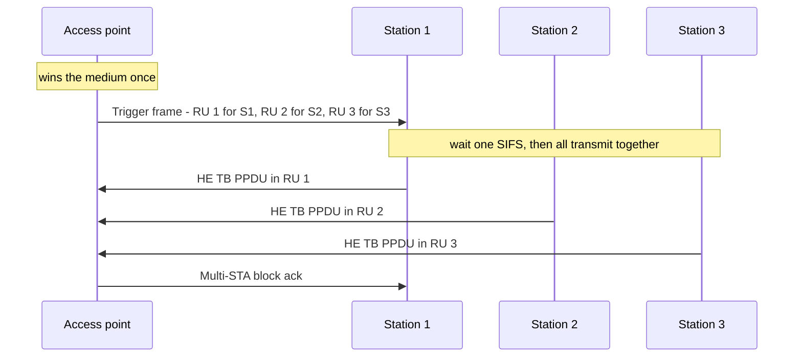

# WF 06: Wi-Fi 6, 6E and 7 features: from OFDMA to the 6 GHz band

*Part of the [networking plan](../00_plan.md), Wi-Fi sub-track · Candela session 6 (802.11ax, Wi-Fi 6E and the 6 GHz band, with a first look at Wi-Fi 7) · You need: [WF 02](02_wifi_phy.md) (OFDM, MCS, MIMO), [WF 03](03_wifi_mac.md) (DCF, EDCA, power save), [WF 05](05_wifi_roaming_and_radio_management.md) (neighbor reports, channel planning)*

Wi-Fi 6 (802.11ax, **HE**, high efficiency) is the generation where the goal changed. Earlier generations chased the peak rate of one client. Wi-Fi 6 was designed to improve the **average throughput per client in crowded places**: stadiums, offices, apartment blocks, hundreds of phones and sensors on a handful of channels. Almost every feature is a response to one observation: modern networks are limited by overhead and contention, not by raw rate, so the PHY now lets many stations share one transmission, and the MAC lets neighbours stop waiting for each other.

This topic is a staple of Senior and Staff Wi-Fi interviews, because it mixes PHY (resource units, symbol timing), MAC (triggers, TWT, EDCA), RF planning (spatial reuse, 6 GHz power rules) and product thinking (which features actually help, and which only appear on a data sheet). A strong answer says what each feature changes, what it needs from the client, and when it does nothing.

By the end you can:

- say what 802.11ax changed at the PHY and the MAC, and why the design target was efficiency, not peak rate;
- explain OFDMA and resource units, the trigger-based uplink exchange, and what the scheduler decides;
- compare OFDMA with MU-MIMO and say when each wins;
- explain the sounding exchange behind MU-MIMO and why it has a cost;
- explain BSS colour, OBSS PD and spatial reuse, and the transmit power trade that comes with them;
- explain target wake time (individual and broadcast), what it saves, and why it is hard to deploy;
- explain MU EDCA and the other HE MAC features;
- describe the 6 GHz band: the channel plan, the regulatory classes (LPI, standard power with AFC, VLP), why power is limited by PSD, and why WPA3 is mandatory;
- explain how a client finds a 6 GHz access point (PSC, RNR, FILS discovery, unsolicited probe responses, multiple BSSID);
- read an HE or 6 GHz capture and debug the usual symptoms;
- say what Wi-Fi 7 adds on top, in one paragraph.

---

## 1. What Wi-Fi 6 changed, and why

802.11ax keeps OFDM and changes four things at the PHY:

| Change | What it does |
|---|---|
| **Longer symbols, finer grid** | The subcarrier spacing falls from 312.5 kHz to **78.125 kHz**, so the useful symbol grows from 3.2 µs to **12.8 µs**. A 20 MHz channel has 256 subcarriers, four times as many as 802.11ac. Longer symbols make the guard interval a smaller fraction of the symbol and help outdoors |
| **Guard intervals** | **0.8, 1.6 or 3.2 µs**. The long ones suit outdoor delay spreads |
| **1024-QAM** | MCS 10 and 11: 10 bits per subcarrier instead of 8, so 25 percent more bits for the same width, at the price of about 6 dB more SNR |
| **OFDMA** | The subcarriers of one PPDU are split into **resource units (RUs)** that go to different stations (section 2) |
| **MU-MIMO in both directions** | Downlink existed in 802.11ac. Uplink MU-MIMO is new (section 3) |
| **Four PPDU formats** | HE SU (one station), **HE MU** (downlink to several), **HE ER SU** (extended range: a single-user format with a boosted, repeated preamble for the cell edge) and **HE TB** (trigger-based: the uplink response to a trigger frame) |

At the MAC it adds the **trigger frame**, buffer status reports, **BSS colour and spatial reuse** (section 4), **target wake time** (section 5), **MU EDCA** and several smaller features (section 6).

**One formula still gives every rate.** The PHY rate of one user is

`rate = data subcarriers x bits per subcarrier x coding rate x streams / (12.8 us + guard interval)`

```python
from fractions import Fraction as F
BITS = [1, 2, 2, 4, 4, 6, 6, 6, 8, 8, 10, 10]                       # MCS 0..11
CODE = [F(1,2), F(1,2), F(3,4), F(1,2), F(3,4), F(2,3), F(3,4), F(5,6), F(3,4), F(5,6), F(3,4), F(5,6)]
DATA_SC = {26: 24, 52: 48, 106: 102, 242: 234, 484: 468, 996: 980, 1992: 1960}   # data subcarriers per RU

def ru_rate(ru_tones, mcs, streams=1, gi_us=0.8):
    return DATA_SC[ru_tones] * BITS[mcs] * float(CODE[mcs]) * streams / (12.8 + gi_us)

print(round(ru_rate(26, 0), 2))     # 0.88 Mbit/s: the smallest RU at the lowest MCS
print(round(ru_rate(242, 11), 1))   # 143.4 Mbit/s: a full 20 MHz channel, one stream, MCS 11
print(round(ru_rate(996, 11), 1))   # 600.5 Mbit/s: a full 80 MHz channel
```

The headline of Wi-Fi 6 is 9.6 Gbit/s (160 MHz, 8 streams, MCS 11, 0.8 µs guard interval). A phone has two streams and an 80 MHz channel at best, so a realistic peak is 1.2 Gbit/s, and MCS 11 needs an SNR in the low 30s of dB, so most links run far below it. The gap between the box and a speed test is the subject of [WF 01](01_wifi_landscape_and_ap_anatomy.md) and [WF 03](03_wifi_mac.md) (preamble, contention, acknowledgements).

**The design goal, in the standard's own project terms, was about four times the average per-station throughput in dense deployments**, not four times the peak. Keep that sentence in mind for every feature below: ask what it does for the average station in a crowd.

## 2. OFDMA and resource units

In 802.11ac a PPDU belongs to one station (or, with downlink MU-MIMO, a group of stations on **all** the subcarriers). A phone that wants to send 100 bytes uses the whole channel for a few tens of microseconds, and pays the full cost of contention, preamble and acknowledgement: the useful part of the exchange is tiny. **OFDMA** (orthogonal frequency division multiple access, the multiple access scheme of cellular networks) divides the subcarriers of one PPDU into **resource units** and gives each RU to a different station, so one transmission carries the small frames of many stations and the overhead is shared.

### 2.1 The resource unit grid

RU sizes are counted in **tones** (subcarriers): **26, 52, 106, 242, 484, 996 and 2x996**. Each size holds fewer **data** subcarriers than tones because some tones are pilots (24, 48, 102, 234, 468, 980, 1960 data subcarriers). How many fit in a channel:

| Width | 26-tone | 52-tone | 106-tone | 242-tone | 484-tone | 996-tone |
|---|---|---|---|---|---|---|
| 20 MHz | 9 | 4 | 2 | 1 | | |
| 40 MHz | 18 | 8 | 4 | 2 | 1 | |
| 80 MHz | 37 | 16 | 8 | 4 | 2 | 1 |

So a 20 MHz channel can serve up to **9 stations** at once, an 80 MHz channel up to **37**. The smallest RU at the lowest MCS carries well under 1 Mbit/s, which is why a 26-tone RU suits a sensor, a block acknowledgement or a small voice frame, and not a video stream. The grid is not free: nine 26-tone RUs hold fewer data subcarriers than one 242-tone RU, so a fully split channel loses a few percent of raw capacity.

**What an RU buys, qualitatively.** If one station has a full buffer, a whole-channel RU (242 tones in 20 MHz) is the right allocation and OFDMA gives nothing over 802.11ac. OFDMA wins when there are **many stations with small frames**: voice, video-call uplinks, IoT telemetry, TCP acknowledgements, web requests. Fewer contentions, fewer preambles, fewer acknowledgements, and also less tail latency, because a station no longer waits for a long frame of another station.

### 2.2 Downlink and the trigger-based uplink

**Downlink** is straightforward. The access point builds an HE MU PPDU with several users, and the **HE-SIG-B** field of the preamble says which RU belongs to whom.

**Uplink** is the hard part. Stations that decide independently would not transmit at the same instant, on the right subcarriers, at the right power. The access point therefore **coordinates** them with a **trigger frame**:



The trigger has a **common info** field (trigger type, uplink length, bandwidth) and one **user info** field per station (association ID, RU allocation, MCS, and the **target RSSI** for power control). Trigger types include **basic** (carry data), **BSRP** (buffer status report poll: ask who has data and how much), **MU-BAR**, **MU-RTS**, **NFRP** (NDP feedback report poll) and **BFRP** (beamforming report poll, section 3).

Why is the uplink harder to build than the downlink?

- **Timing.** Every station must start a SIFS after the trigger, within a small error.
- **Frequency.** The access point receives several transmitters at once, each with its own oscillator error, so stations must correct their carrier frequency offset against the trigger.
- **Power.** The access point controls each station's transmit power through the target RSSI so that the RUs arrive at similar levels, because a strong neighbour leaks into adjacent RUs.

**How does the access point know what to schedule?** Stations report **buffer status** (in the QoS control field or the HE control field), and the access point can poll them with a BSRP. For stations with nothing known, **UL OFDMA random access (UORA)** lets a station pick a random RU from those the trigger marks for random access, with an OFDMA backoff counter (a small contention inside the trigger). **The scheduler itself is not in the standard.** Which stations, which RUs, which MCS and how long: it is the vendor's, and it is where products differ. A good scheduler gives low latency to small frames without starving big flows; a poor one can make OFDMA slower than plain contention.

### 2.3 When OFDMA does nothing

- One heavy client, no others: no gain, only the trigger overhead.
- Clients without HE support (legacy clients cannot be scheduled in RUs).
- Few clients per access point: the stations are served in turn at full width anyway.
- Poor uplink power control or frequency offset: trigger-based uplink degrades, and some vendors fall back to contention.

OFDMA is a **tail latency and efficiency feature for crowded cells with many small flows**. Marketing numbers rarely say so.

## 3. MU-MIMO: serving several stations on the same subcarriers

MU-MIMO uses **spatial separation** instead of frequency separation. An access point with N antennas sends different streams to different stations on the **same** subcarriers, with a precoder that nulls each stream at the other stations. This needs the channel, so it needs **sounding**.

### 3.1 The sounding exchange

The access point sends an **NDP announcement** (naming the stations), then a **null data packet (NDP)** that every station measures, and each station returns a **compressed beamforming report**, a compact description of its channel (angles from a Givens rotation). For several stations the reports are collected one after another with a **beamforming report poll (BFRP)** trigger. Only then does the first data PPDU go out, and the information goes stale in milliseconds when anything moves (the ageing of the channel, [WF 02](02_wifi_phy.md)).

### 3.2 What it buys, and what it costs

- **Gain.** With a few single-antenna users and an access point with several antennas, a simulation (zero-forcing precoder, Rayleigh channels) shows the sum rate rising to roughly 1.6 to 1.9 times a single user for two or three users, and **not** growing linearly: the gain peaks below the antenna count, and then falls as the noise enhancement of the precoder grows. Real hardware is worse than the model.
- **Cost.** Sounding is overhead (an announcement, an NDP, a report per user). It is worth it only if the data that follows is long enough, and if the channel stays valid. Highly mobile clients make the report stale.
- **Needs.** Clients with MU-MIMO support, spatial separation (users that are not on the same side of the room), and an access point with more antennas than the clients have streams.

The practical result is a short rule: **MU-MIMO helps with a few well-separated stations that have a lot of traffic, OFDMA helps with many stations that have little**. In real deployments MU-MIMO is often disabled or rarely triggered because its conditions are rare, which is a good answer to "does MU-MIMO matter?".

| | OFDMA | MU-MIMO |
|---|---|---|
| Separates users by | Frequency (subcarriers) | Space (antennas) |
| Needs channel knowledge | No (only the grid) | Yes (sounding) |
| Best for | Many small frames, low latency | A few heavy flows to separated clients |
| Cost | Trigger overhead, scheduler | Sounding overhead, stale channel |
| Direction in 802.11ax | Both | Both |

## 4. BSS colour and spatial reuse

In a dense building, 802.11ac stations defer to **every** frame they hear on the channel, including frames of a neighbour's cell that are far too weak to interfere. The carrier sense rules of [WF 03](03_wifi_mac.md) (preamble detection at about -82 dBm, energy detection at -62 dBm) make two cells that could transmit together take turns. This is the **overlapping BSS (OBSS)** problem, and 802.11ax adds two pieces to fix it.

**BSS colour.** The access point puts a **6-bit colour** in the HE operation element of its beacons and in the **HE-SIG-A** field of every HE PPDU (0 means none, so 63 usable values). A station that receives a PPDU reads the colour early: **the same colour is an intra-BSS frame** (set the NAV and defer), **a different colour is an inter-BSS frame**, and then the station may apply the second piece.

**OBSS PD spatial reuse.** For an inter-BSS PPDU received **below the OBSS PD level**, a station may treat the medium as idle and transmit, provided it **reduces its transmit power**. The rule is a straight trade: every dB the threshold is raised above -82 dBm costs a dB of transmit power from a reference of about 21 dBm for an access point:

```python
def obss_pd_tx_limit_dbm(obss_pd_dbm, ref=21):
    """Maximum transmit power after ignoring an OBSS frame heard at obss_pd_dbm (-82 to -62)."""
    return ref - (obss_pd_dbm + 82)

print([obss_pd_tx_limit_dbm(x) for x in (-82, -72, -62)])   # [21, 11, 1]
```

A threshold of -72 dBm allows about 11 dBm, and the maximum threshold of -62 dBm only 1 dBm. So spatial reuse trades **range for concurrency**. It helps when cells are small and the stations are close to their own access point, and hurts when a station at the cell edge now transmits at a lower power than it needs. A second mechanism, **SRP-based spatial reuse**, lets an access point state in its trigger how much interference it tolerates, so cooperating neighbours can transmit at once; it needs cooperation and is rarer.

**Colour collisions.** Two neighbouring cells with the **same colour** on the same channel treat each other's frames as their own, defer when they need not (the NAV of a frame from the other cell) and cannot apply spatial reuse. Neighbour cells must therefore have **different colours**, which is another job of the RRM function ([WF 05](05_wifi_roaming_and_radio_management.md)) and why a controller assigns them. When a collision is detected the colour is changed, announced in a **BSS color change announcement** element in the beacon.

**What to say in an interview.** Colour is cheap and nearly free to enable; spatial reuse is a tuning knob that is safest left at defaults unless cells are small and a measurement shows a gain. The standard claim "spatial reuse increases capacity" holds only when stations are close to their access point.

## 5. Target wake time

Legacy power save ([WF 03](03_wifi_mac.md) section 6) makes a station wake for **every beacon, or every DTIM**, look in the TIM for its bit, and sleep again. It is **access point driven** and wakes often even when nothing is waiting. **Target wake time (TWT)** reverses it: the station and the access point **agree on a schedule**, and the station wakes only at the agreed times. The idea comes from 802.11ah (HaLow) and matters most for battery IoT devices.

### 5.1 The negotiation

A TWT agreement is set up with a **TWT setup** action frame carrying a **TWT element** (ID 216). The main parameters:

| Parameter | Meaning |
|---|---|
| Setup command | Request, suggest or demand from the station; accept, alternate, dictate or reject from the access point |
| Requester or responder | Who is asking |
| **Wake interval** | A 16-bit **mantissa** times 2 to a 5-bit **exponent**, in microseconds |
| **Nominal minimum wake duration** | How long the station stays awake in each service period, in units of 256 µs |
| **Implicit or explicit** | Implicit: the schedule repeats by itself from the interval. Explicit: each service period is announced |
| **Announced or unannounced** | Announced: the station tells the access point it is awake (a PS-Poll or a null frame). Unannounced: the access point may send without that signal |
| **Trigger-enabled** | The access point sends a trigger frame at the start of the service period |
| Flow ID | A station can hold several agreements |

```python
def twt_wake_interval_us(mantissa, exponent): return mantissa * (1 << exponent)
print(twt_wake_interval_us(800, 10))   # 819200 us = 819.2 ms
print(8 * 256)                         # 2048 us = 2.048 ms of wake duration: a duty cycle of 0.25 percent
```

The range is wide: an interval up to 65,535 x 2^31 µs, which is years. **Broadcast TWT** lets the access point announce a schedule that any station may join, which saves the per-station negotiation and scales better.

### 5.2 What it saves and why it is hard to deploy

A device that sleeps 99 percent of the time uses a tiny fraction of the energy of one that wakes for every DTIM. That is the promise. The constraints are what makes deployment hard:

- **The application must tolerate the latency.** A device asleep for seconds cannot answer a command promptly. TWT suits sensors that report periodically, not devices that must react to the network.
- **Buffer limits.** The access point buffers frames only for a limited time, so a long sleep can drop data.
- **Access point and client support.** The access point must negotiate, buffer and, in trigger mode, schedule. Many early access points implemented TWT poorly or not at all.
- **Scheduling at scale.** Many devices with schedules that collide pile into the same service period, so the access point must **spread** the service periods. This is the real engineering problem of TWT.
- **Security and privacy.** TWT setup is a robust action frame, protected by management frame protection once keys exist. But the schedule is visible to anyone who watches the negotiation, and forged triggers during a service period can keep a device awake. Per-vendor defaults can also fingerprint device models.

On Linux the tools are `iw dev wlan0 twt ...` on a mac80211 driver with HE support, and `he_twt_required=1` in `hostapd.conf` makes TWT mandatory for the BSS (the **TWT required** bit in the HE operation element).

## 6. The rest of the HE MAC

- **MU EDCA.** After a station has sent in a triggered uplink exchange, normal EDCA parameters would let it keep winning the channel at the same rate. The **MU EDCA parameter set** lets the access point **lower a station's EDCA priority for a while** (a larger AIFSN and contention window, for a MU EDCA timer period) after it has been served by a trigger, so a scheduled station does not also compete at full strength.
- **HE control field.** Carries **buffer status reports** and **operating mode** changes (a station tells the access point it is dropping to fewer streams or a narrower channel, which is how a phone saves power without disassociating).
- **Multi-TID A-MPDU**: one aggregate can hold frames of several traffic IDs.
- **Dynamic fragmentation**, **TXOP duration based RTS**, and **two NAV timers** (an intra-BSS NAV and a basic NAV, which make spatial reuse safe).
- **Dual carrier modulation (DCM)** and **ER SU**: robust, low-rate modes that extend range and help IoT.
- **UL MU disable and OMI**: ways for a station to opt out of triggered uplink.

## 7. The 6 GHz band

Wi-Fi 6E is Wi-Fi 6 in a new band: **5,925 to 7,125 MHz, 1,200 MHz of spectrum** in the United States (more than the 2.4 and 5 GHz bands put together). Only HE and EHT devices may use it, with no legacy 802.11a/n/ac and no 802.11b rates, and that is the whole point: **the band starts clean**, and 160 MHz channels become practical without the DFS restrictions of 5 GHz.

### 7.1 The channel plan

Channels are numbered 1, 5, 9, ... 233 for 20 MHz, and wider channels are aligned groups:

| Width | Channels in the US plan |
|---|---|
| 20 MHz | 59 |
| 40 MHz | 29 |
| 80 MHz | 14 |
| 160 MHz | 7 |
| 320 MHz | 3 (Wi-Fi 7) |

Seven 160 MHz channels is the number that matters: in 5 GHz a dense deployment has one or two. In practice vendors say **80 MHz is becoming the norm** on 6 GHz, with 160 MHz possible where the band is quiet.

### 7.2 Regulation by region, and device classes

The band is **regulated per country**. The United States opened the full 1,200 MHz. The European Union and the United Kingdom opened only the **lower 500 MHz** (5,945 to 6,425 MHz), and other countries have other rules. A product needs a **regulatory database per country** (the country code of [WF 03](03_wifi_mac.md) and the Linux regulatory database in [WF 10](10_linux_wireless_stack_and_openwrt.md)).

In the United States three classes exist, and the numbers in this table are the FCC rules as published by vendors such as Cisco and Meraki:

| Class | Where | Control | Maximum EIRP | PSD limit |
|---|---|---|---|---|
| **Low power indoor (LPI)** | Indoors only; integrated antenna, not battery powered, no weatherproof housing | None | 30 dBm | 5 dBm/MHz |
| **Standard power (SP)** | Indoors and outdoors | **AFC** (automated frequency coordination) required | 36 dBm | 23 dBm/MHz |
| **Very low power (VLP)** | Anywhere, including outdoors and vehicles (wearables, phone-to-device links) | None | 14 dBm | -8 dBm/MHz |

Clients are generally allowed about 6 dB less than the access point.

**The PSD limit decides, not the cap.** The allowed EIRP is the smaller of the cap and the PSD limit plus 10 log10 of the width in MHz:

```python
import math
def eirp_dbm(width_mhz, cap, psd):
    return min(cap, psd + 10 * math.log10(width_mhz))

print([round(eirp_dbm(w, 30, 5), 1) for w in (20, 40, 80, 160, 320)])   # LPI: [18.0, 21.0, 24.0, 27.0, 30]
print([round(eirp_dbm(w, 14, -8), 1) for w in (20, 320)])               # VLP: [5.0, 14]
```

So an LPI access point on a 20 MHz channel may use only about **18 dBm**, and reaches 30 dBm only at 320 MHz. Because the power doubles with each doubling of the width (and the noise doubles too), **the SNR at a fixed distance is about the same at any width under the PSD rule**, whereas a fixed total power limit (as in much of 5 GHz) would lose 3 dB per doubling. So wider channels do not shorten LPI reach. What does shorten it is the higher band (a little more path loss than 5 GHz) and the 18 dBm limit at 20 MHz.

**AFC.** Standard power exists to allow outdoor use and higher power. The access point reports its **location, antenna height and uncertainty** to an AFC system, which answers with the **channels and maximum power** allowed at that spot so that licensed fixed microwave links are protected. The access point must check in regularly (at least every 24 hours in the US rules) and stop transmitting if it cannot. AFC protects incumbents; it does not coordinate new Wi-Fi devices with each other. If the AFC link fails, a device falls back to low power or stops. For a designer: AFC is an operational dependency, so it needs monitoring.

### 7.3 Security requirements

The band is **WPA3 only**: **SAE** (with hash-to-element, H2E, [WF 04](04_wifi_security.md)) or **OWE** for open networks (a "6 GHz open network" is encrypted), **WPA3-Enterprise**, and **protected management frames are mandatory**. There is **no WPA2-PSK, no TKIP, no WEP**, and **no transition mode**: a WPA2 client cannot join a 6 GHz BSS at all. That removes the downgrade attacks of the older bands by construction.

### 7.4 Finding an access point

In 2.4 and 5 GHz a station sends **probe requests** on each channel and access points answer. In 6 GHz this is **restricted**: a station may send a probe request only after it knows an access point is there, because actively probing 59 channels would flood the band. The standard gives several tools, and a client combines them:

1. **Passive scan.** Wait for a beacon on each channel. With 59 channels and a roughly 100 ms beacon interval that is several seconds, which is too slow for a roam.
2. **Preferred scanning channels (PSC).** Every **fourth** 20 MHz channel: 5, 21, 37, ... 229, **15 channels**. A client scans these first.
3. **Out-of-band discovery.** The **reduced neighbor report (RNR)** element in the beacons and probe responses of the **2.4 and 5 GHz** radios of the same access point lists the 6 GHz BSS (channel, operating class, BSSID, short SSID, BSS parameters, PSD). A dual-band client learns of the 6 GHz network while on 5 GHz and goes straight to the right channel for a short probe. This is the fastest route.
4. **In-band discovery.** On a PSC the access point sends **FILS discovery frames** (a short action frame with SSID and capabilities) every 20 TU or so, or sends **unsolicited probe responses**, so a station that dwells about 20 ms is sure to hear one. These cost airtime (more than beacons if sent often), so send them only on PSCs.

```python
import zlib
print([5 + 16 * n for n in range(15)][:4], 5 + 16 * 14)        # [5, 21, 37, 53] 229
print(hex(zlib.crc32(b"corp6")))                                # 0xcc054d84: the "short SSID" in an RNR
```

The **short SSID** in the RNR is the CRC-32 of the SSID. An access point whose primary channel is **not** a PSC must still be advertised through an RNR or through FILS discovery on a nearby PSC.

**Multiple BSSID (MBSSID).** Several SSIDs of one radio share **one beacon**. The transmitted BSSID carries the element, and each non-transmitted BSSID is the transmitted address with its low n bits replaced by `(low bits + index) mod 2^n`, where n is the MaxBSSID indicator:

```python
def mbssid(tx, n, i):
    mask = (1 << n) - 1
    return tx[:-1] + bytes([(tx[-1] & ~mask) | (((tx[-1] & mask) + i) & mask)])
tx = bytes.fromhex("02000000" "10a4")
print([mbssid(tx, 3, i).hex(":") for i in (1, 4)])   # ['02:00:00:00:10:a5', '02:00:00:00:10:a0']
```

MBSSID saves beacon airtime (one beacon, not eight, [WF 05](05_wifi_roaming_and_radio_management.md)) and is required in 6 GHz for BSSes beyond the first on a radio.

**What clients actually do.** Many clients, Apple's in particular, **rely on out-of-band discovery** and do not scan 6 GHz on their own. A 6 GHz SSID can therefore be "invisible" to a phone if the 2.4 and 5 GHz radios of the same access point do not advertise it in an RNR. This is a common deployment bug, and a good interview detail.

**Design guidance (from vendors).** Prefer 80 MHz channels with a PSC reachable; keep the RNR enabled in the lower bands; plan multi-gigabit wired backhaul and the PoE budget (tri-radio access points draw more); expect similar range to Wi-Fi 6 at the same power but less than 5 GHz at higher power; and replace access points whose radios are not 6 GHz capable, since 6 GHz needs new radios.

## 8. Wi-Fi 7 in one paragraph

Wi-Fi 7 (802.11be, **EHT**) is the subject of [WF 12](12_wifi7_eht_and_mlo.md). On top of Wi-Fi 6 it adds **320 MHz channels** (6 GHz only, three of them), **4096-QAM** (12 bits per subcarrier, 20 percent more bits for about 6 dB more SNR than 1024-QAM), **multi-RU** and **preamble puncturing** (one busy 20 MHz sub-channel is punched out and the rest of the channel is still used, which helps most in a busy 6 GHz band) and **multi-link operation (MLO)** (one device with several links on different bands under one association). The standard allows 16 streams; real devices use 2 to 4.

## 9. Reading an HE or 6 GHz capture

A capture needs a radio in monitor mode ([WF 08](08_wifi_capture_tools_and_debug.md)). These `tshark` fields answer the usual questions (names from tshark 4.2):

| Question | Field |
|---|---|
| What is the BSS colour? | `wlan.ext_tag.bss_color_information.bss_color` |
| Primary channel and width in 6 GHz | `wlan.ext_tag.he_operation.6ghz.primary_channel`, `.6ghz.control.channel_width`, `.6ghz.chan_center_freq_seg_0` |
| MU EDCA values | `wlan.ext_tag.mu_edca_parameter_set.aifsn`, `.mu_edca_timer` |
| Spatial reuse | `wlan.ext_tag.spatial_reuse.non_srg_obss_pd_max_offset` |
| 6 GHz capabilities | `wlan.tag.he_6ghz.cap_inf` |
| RNR entries | `wlan.rnr.tbtt_info.operating_class`, `.channel_num`, `.bssid`, `.sh_ssid`, `.bss_parameters` |
| Multiple BSSID | `wlan.multiple_bssid`, `wlan.multiple_bssid_index.bssid_index` |
| TWT setup | `wlan.twt.setup_cmd`, `.implicit`, `.flow_type`, `.wake_interval_exp`, `.wake_interval_mantissa`, `.nom_min_twt_wake_duration` |
| FILS discovery | `wlan.fixed.publicact`, `wlan.fils_discovery.ssid_length` |

**An efficient reading order for a 6 GHz problem:** (1) the beacon of the 6 GHz BSS: channel, width, colour; (2) the RNR in the 5 GHz beacon: does it point to this BSS; (3) a probe response: is it broadcast; (4) the association request: are the HE and 6 GHz capabilities present; (5) the SAE exchange and the 4-way handshake with PMF ([WF 04](04_wifi_security.md)).

## 10. Debugging: symptom, likely cause, first check

| Symptom | Likely cause | First check |
|---|---|---|
| The 6 GHz SSID is not visible on a phone | No RNR in the 2.4 or 5 GHz beacons, or the channel is not a PSC and there is no FILS discovery | Beacons on 5 GHz: RNR present? 6 GHz channel number |
| A client sees the SSID but cannot join on 6 GHz | WPA2 or transition mode configured; PMF off; H2E not supported | RSN element of the 6 GHz beacon: AKM must be SAE, OWE or 802.1X with PMF required |
| 6 GHz range is poor | LPI power limit at 20 MHz (about 18 dBm) and a client that transmits at a lower power | EIRP by width; client power; a link-budget calculation ([WF 11](11_rf_fundamentals_and_link_budget.md)) |
| OFDMA enabled but no latency gain | Few clients, legacy clients, a scheduler that falls back | Count of HE clients; trigger frames in a capture |
| Uplink throughput worse after enabling UL OFDMA | Poor frequency offset or power control on some clients | Per-client uplink rates; disable UL OFDMA for those |
| IoT device drops while using TWT | Service periods collide, or a missed trigger, or buffer limits | TWT setup frames; the schedule; the access point buffer time |
| Throughput fell after raising OBSS PD | Edge clients now transmit at lower power | Per-client rate; return to the default threshold |
| Two neighbouring cells slow each other | Same BSS colour | Colour in the HE operation element of both |
| Access point stopped on 6 GHz standard power | AFC check-in failed | AFC link status and the log |

## 11. Common mistakes

1. **Quoting 9.6 Gbit/s** as what a Wi-Fi 6 network delivers.
2. **Assuming OFDMA helps a single heavy client.** It helps many small flows.
3. **Assuming MU-MIMO is always active.** It needs sounding, supporting clients and separation.
4. **Raising the OBSS PD threshold everywhere** and then wondering why edge clients are slow.
5. **Using the same BSS colour** on neighbouring access points.
6. **Enabling TWT without a plan** for spreading service periods.
7. **Thinking a wider channel always gives more range in 6 GHz.** The PSD rule keeps the SNR the same, but power per MHz does not rise.
8. **Forgetting the RNR**, so the 6 GHz SSID cannot be found.
9. **Configuring WPA2 or a transition mode on 6 GHz.** It does not exist there.
10. **Expecting standard power without an AFC dependency.**

## 12. Interview questions

1. **What was the design goal of 802.11ax?** Average throughput per station in dense deployments (about four times), not peak rate.
2. **What changed in the PHY?** Longer symbols (12.8 µs, 78.125 kHz spacing), 1024-QAM, OFDMA with resource units, UL MU-MIMO, and the new PPDU formats.
3. **Explain OFDMA and resource units.** The subcarriers of one PPDU are divided into RUs of 26 to 2x996 tones, each assigned to a station, so many small frames share one preamble and one acknowledgement.
4. **How does uplink OFDMA work?** The access point sends a trigger frame with a user info field per station; stations answer a SIFS later in their RUs, after correcting timing, frequency and power.
5. **What decides which station gets which RU?** The vendor's scheduler; it is not in the standard.
6. **OFDMA against MU-MIMO?** OFDMA separates in frequency and wins with many small frames; MU-MIMO separates in space, needs sounding and wins for a few heavy, well-separated clients.
7. **Why does MU-MIMO need sounding and what does that cost?** The precoder needs the channel; the announcement, NDP and reports are overhead, and the channel goes stale quickly.
8. **What are BSS colour and OBSS PD?** Colour labels a BSS so a station can tell intra-BSS from inter-BSS frames; OBSS PD lets it ignore weak inter-BSS frames and transmit, at a reduced power.
9. **What is the trade-off of spatial reuse?** Concurrency against range: every dB of threshold costs a dB of transmit power.
10. **What is TWT and why is it hard to deploy?** A negotiated wake schedule. Hard because of latency limits, buffering, client and access point support, and spreading many devices.
11. **Why is the 6 GHz power limit set as PSD?** So that wide channels get more total power, keeping the SNR constant with width; it protects incumbents per MHz.
12. **How does a client find a 6 GHz access point and why not scan everything?** PSC, RNR from 2.4 or 5 GHz beacons, FILS discovery and unsolicited probe responses; scanning 59 channels is slow and active probing would flood the band.

## 13. Scenarios and design questions

**S1. A customer says the Wi-Fi 6 upgrade did not improve their speed test.** *Where to practise:* a lab with one HE client, then twenty small-flow clients. *Approach:* explain that Wi-Fi 6 targets crowds, check the client's streams and width, then compare latency under load.

**S2. The 6 GHz SSID does not appear on iPhones but does on a laptop.** *Where to practise:* a capture of the 5 GHz beacons. *Approach:* find the RNR, check the channel is a PSC or advertised, and check WPA3-only.

**S3. Design an office floor for 300 users on Wi-Fi 6E.** *Where to practise:* a design review. *Approach:* channel widths, PSC, colours, LPI power and AFC option, backhaul, band steering to 6 GHz, SSID count and MBSSID.

**S4. Uplink OFDMA made some clients slower. Why and what do you do?** *Where to practise:* per-client uplink rate captures. *Approach:* frequency offset and power control, per-client fallback, scheduler, vendor settings.

**S5. IoT sensors use TWT and the battery life is far below the data sheet.** *Where to practise:* a capture of the TWT setup and the service periods. *Approach:* check negotiated interval and duration, trigger-enabled, missed triggers, retries, and whether the client really sleeps.

**S6. Neighbouring offices complain about each other's Wi-Fi after both upgraded to Wi-Fi 6.** *Where to practise:* captures of the HE operation elements. *Approach:* colours, OBSS PD, channel overlap, power.

**S7. A standard power outdoor access point stopped transmitting at night.** *Where to practise:* the AFC log. *Approach:* AFC check-in, the 24-hour rule, fallback to LPI, monitoring.

**S8. Explain to a manager why 6 GHz range looks worse than 5 GHz.** *Where to practise:* a link-budget sketch. *Approach:* the PSD limit at 20 MHz, extra path loss, client power, and why a wider channel does not extend range.

**S9. Design the scheduler of an OFDMA access point.** *Where to practise:* write the pseudocode. *Approach:* inputs (buffer status, QoS class, rate, age), choice of RU size, fairness and latency goals, fallbacks, and what to measure.

## 14. Strong answers (outlines)

**S1.** Wi-Fi 6 raises average per-client throughput in crowded cells, not the single-client peak. A speed test from one phone at the same SNR, width and streams gives a similar number. Check the client (streams, width, MCS), then test under load with many clients and small flows, and compare latency and tail latency. Show OFDMA triggers in a capture. The honest message: the benefit appears in the crowd.

**S2.** Check the beacon of the 6 GHz BSS and the 5 GHz beacons of the same access point. Many phones depend on the RNR for discovery, so if it is missing or lists the wrong channel the SSID is invisible. Check that the 6 GHz primary channel is a PSC or that FILS discovery is sent. Check the security: WPA3 (SAE or OWE) with PMF required; a transition mode will not work in 6 GHz.

**S3.** Use 80 MHz channels, with 20 or 40 MHz in the densest areas; plan around the PSC so clients find the BSS; assign colours (different between neighbours); LPI power is limited by the PSD, so plan enough access points; consider standard power with AFC for outdoor areas and accept the dependency; multi-gigabit backhaul and PoE; make 5 GHz a fallback for non-6E clients; enable the RNR; use MBSSID and few SSIDs; steer capable clients to 6 GHz with a measurement.

**S4.** Uplink OFDMA needs good timing, frequency and power control from each client. Some clients have a large frequency offset or poor power control and leak into neighbouring RUs, so the access point sees errors. Look at per-client uplink rates and retries with and without UL OFDMA; disable it for those clients (or those models) if the product allows; raise the target RSSI margin; update the client drivers. Keep the feature on for the good clients.

**S5.** Read the TWT setup frames: the interval, duration, trigger-enabled and announced flags. A device that wakes at the wrong times, misses triggers, or has an interval much shorter than the data sheet's will not save power. Check that the access point accepted the agreement (not an alternate), that service periods are spread, and that the device does not keep the radio on for other reasons (keepalives, ARP, the TCP stack). The negotiated parameters are the first thing to compare with the data sheet.

**S6.** Capture beacons from both and read the colour, channel and width. If the colours are the same, change one. If the channels overlap, replan. Check OBSS PD settings: high thresholds increase reuse but cut transmit power. Look at the power and the overlap of the cells; lower power is often the right answer.

**S7.** Check the AFC log. Standard power requires periodic check-in (about every 24 hours in the US rules) and the device must stop or fall back to low power if the check fails. Causes: the AFC service is unreachable (firewall, DNS), the location data is out of date or uncertain, or an incumbent change reduced the allowed power. Monitor the AFC link as a service, and design with an LPI fallback.

**S8.** The LPI limit is 5 dBm per MHz, so a 20 MHz channel gets about 18 dBm, much less than the 5 GHz limit, and the client transmits at lower power. Path loss is a little higher at 6 GHz. A wider channel gets more total power but also more noise, so the SNR is the same: width does not help range, only rate at a given SNR. A link-budget table makes the point.

**S9.** Inputs: per-station buffer status, traffic class, link quality (MCS per RU size), age of data. Decisions: which stations are in the trigger, the RU size for each, the MCS, the duration. Goals: low latency for small and voice flows, fair share for bulk flows, keep the trigger overhead below the gain. Strategy: large RUs for heavy flows, small RUs for many small ones, a fallback to single-user transmission when OFDMA does not pay. Measure: tail latency, airtime efficiency, retry rate. Mention that the standard does not define the scheduler.

## 15. Cheat sheet

| Fact | Value |
|---|---|
| 802.11ax design goal | About 4x average per-station throughput in dense deployments |
| Symbol | 12.8 µs useful, 78.125 kHz spacing; GI 0.8, 1.6, 3.2 µs |
| Modulation | 1024-QAM (MCS 10, 11) |
| PPDU formats | HE SU, HE MU, HE ER SU, HE TB |
| RU sizes (tones) | 26, 52, 106, 242, 484, 996, 2x996 |
| Stations per channel | 9 (20 MHz), 18 (40), 37 (80) at the 26-tone grid |
| Uplink OFDMA | Trigger frame, response a SIFS later, power control by target RSSI, UORA for random access |
| Scheduler | Vendor-defined |
| MU-MIMO | Needs sounding (NDPA, NDP, compressed report, BFRP); gain peaks below antenna count |
| BSS colour | 6 bits, in HE operation and HE-SIG-A |
| OBSS PD | Each dB of threshold above -82 dBm costs a dB of transmit power |
| TWT | Element ID 216; interval = mantissa x 2^exponent µs; individual and broadcast |
| 6 GHz (US) | 5,925 to 7,125 MHz; 59, 29, 14, 7, 3 channels at 20, 40, 80, 160, 320 MHz |
| EU and UK | Lower 500 MHz only (5,945 to 6,425 MHz) |
| LPI | 30 dBm cap, 5 dBm/MHz; 18 dBm at 20 MHz |
| Standard power | 36 dBm, 23 dBm/MHz, AFC required |
| VLP | 14 dBm, -8 dBm/MHz |
| Security in 6 GHz | WPA3 only (SAE with H2E, OWE), PMF mandatory, no transition mode |
| Discovery | PSC (5, 21, ... 229: 15 channels), RNR, FILS discovery, unsolicited probe response |
| MBSSID | One beacon for several SSIDs; non-transmitted BSSID by index within n low bits |

## 16. Sources and caveats

Web sources used for this tutorial: Cisco's [6 GHz regulation white paper](https://www.cisco.com/c/en/us/products/collateral/wireless/catalyst-9100ax-access-points/ghz-unlicensed-spectrum-reg-wp.html) (device classes, power, AFC rules); Meraki's [Wi-Fi 6E FAQ](https://documentation.meraki.com/MR/Other_Topics/Wi-Fi_6E_Frequently_Asked_Questions) (PSC, discovery, WPA3 requirement, client behaviour, deployment guidance); Extreme's [RU allocation article](https://www.extremenetworks.com/resources/blogs/how-does-an-802-dot-11ax-ap-allocate-resource-units) (RU signalling in the trigger frame); the Nordic Semiconductor [target wake time guide](https://academy.nordicsemi.com/topic/target-wake-time/) and a [TWT overview](https://gengstah.github.io/wiki/concepts/twt/) (negotiation, constraints, security notes); and Wikipedia's [IEEE 802.11ax](https://en.wikipedia.org/wiki/IEEE_802.11ax) (symbol and subcarrier numbers). The Candela course (session 6) is the syllabus.

Caveats. There is no radio in the working environment, so no frame here was captured from a real HE device; the code snippets were run and agree with the figures quoted. The OBSS PD reference power (about 21 dBm for an access point), the BSS colour and TWT field layouts, the RU counts and the 6 GHz regional allocations are from the standards and regulatory summaries as I know them; check the current amendment text and the country's rules before quoting them exactly. Regulatory details change, and the 6 GHz status of each country must be checked in the Wi-Fi Alliance and regulator tables.
