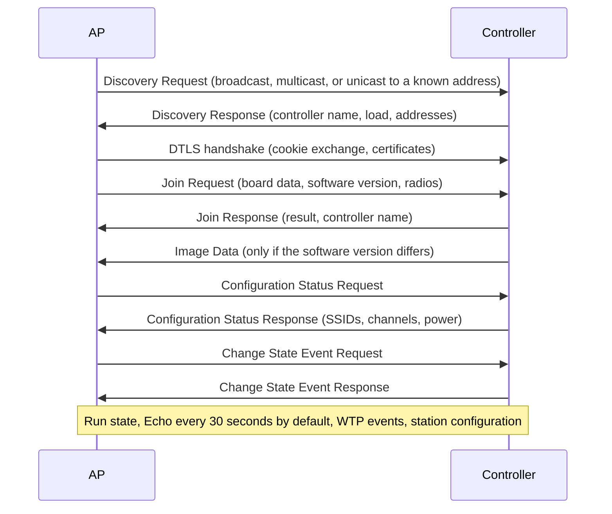

# WF 07: Controller architectures, mesh and services, from CAPWAP tunnels to sensing

*Part of the [networking plan](../00_plan.md), Wi-Fi sub-track · Candela sessions 6a, 6b, 6c and 6d (access point and controller architectures, mesh and services, analytics and sensing, IT and OT), with the gaps the mrncciew CWNA, CWAP and CCIE Wireless material adds (autonomous access point roles, WDS, Wi-Fi Direct, Wi-Fi Aware, EasyMesh) · Prerequisites: [WF 01](01_wifi_landscape_and_ap_anatomy.md) (access point anatomy and topologies), [WF 03](03_wifi_mac.md) (the MAC and the four address frame), [WF 05](05_wifi_roaming_and_radio_management.md) (roaming and radio management, which a controller automates) and [NET 14](../14_queueing_qos_and_traffic_management.md) (token bucket, policing and shaping), with [the data plane against the control plane note](../../11_hld/03_systems_domain/01_data_plane_vs_control_plane.md) as the design vocabulary · Time: about 8 hours · Practice: seven experiments and five problem scripts in `prog/`*

"Where does the data path of a Wi-Fi client go, what happens to the network when the controller dies, and how do you operate 50,000 access points" is the Staff version of the question that Candela's session 6 asks as "thick against thin access points". The honest answer is a set of numbers: what the tunnel costs per packet, how many cores the encryption needs, how long failure detection takes at the default timers, how a fleet reconnects after an outage, how fast a mesh falls with each hop, what a rate limit costs in airtime. This tutorial builds each of them from a small program, and separates what was measured here from what is taken from the standards and from memory.

**Eight honest limits, stated first.**

1. **There is no radio, no controller and no access point software here.** The CAPWAP, Wi-Fi Direct, Wi-Fi Aware and IEEE 1905.1 packets are **built by hand** and decoded by the `tshark` 4.2.2 dissectors, which shows that the bytes are laid out as the dissector expects, not that a real controller accepts them. Nothing was sent on the air.
2. **The protocol details are from memory.** The CAPWAP header and message types (RFC 5415), the default timers, the DTLS record overhead (37 bytes for an AES-GCM record, **from memory**), the 802.11s airtime metric constants, the NAN discovery window (16 TU in every 512 TU), the Wi-Fi Direct group owner rule and the EasyMesh message types were not checked against the standards text. Each is marked **from memory** where it appears.
3. **The mesh numbers use the link model of [WF 11](11_rf_fundamentals_and_link_budget.md)** (80 MHz, 20 dBm, a loss of 47 + 35 log10 d dB, an 8 dB gap, 2 streams, a MAC efficiency of 0.65), not a measurement, and the chain model puts all hops in one collision domain.
4. **The cryptographic speeds are measured on this virtual machine** with Python and OpenSSL, not on a controller. Two runs of the same script gave 17.07 and 15.16 Gbit/s for AES-GCM on one core, so the text quotes the frozen run and treats the result as a within 20 percent figure.
5. **The telemetry sizes come from synthetic records** (random counters, realistic field names), so the compression ratios are **pessimistic** for real counters. The reconnect storm is simulated in one second slots with a collector that accepts a fixed number of connections per second.
6. **The rate limit simulation is one TCP Reno flow** with ideal loss recovery and no timeouts, not the Linux kernel, so it shows the shape of the policer and shaper trade-off, not a prediction for a given device.
7. **The location simulation draws independent shadowing for every reading**, while real shadowing is correlated in space, so the fingerprinting results are **optimistic**: neighbouring cells look more alike in a real building and fingerprints are less distinctive but also less brittle than here.
8. **Not run here:** a real controller or a cloud management service, an EasyMesh stack (prplMesh), a Wi-Fi Direct or NAN supplicant, 802.11mc fine timing measurement, channel state information sensing, DPI or DNS filtering, and a captive portal. Those parts are from memory and marked.

By the end you can:

- **say where each function lives in each architecture** and what survives a controller failure (the table of section 1), and relate it to the data plane against the control plane split of system design.
- **decode a CAPWAP packet by hand** (built and decoded here: an **8 byte** header, **36 bytes** of tunnel headers plus 14 of outer Ethernet, so a 100 byte inner IP packet grows by **30.5 percent** and a 1,450 byte one by **3.3 percent**; a 1,500 byte inner packet no longer fits an outer MTU of 1,500 and is split by CAPWAP into **1,464 + 50** byte fragments).
- **size a controller** (measured and computed: AES-GCM on one core of this VM runs at **15.16 Gbit/s**, so central switching of 1,000 access points at 300 Mbit/s needs about **19.8 cores** for the encryption alone, against **0.07 cores** for the control traffic of 50,000 access points under local switching).
- **compute failure detection and rejoin time** (computed: the default timers (30 s echo, 5 retransmissions every 3 s) notice a dead controller after **45 s** at worst, against **4 s** with a 1 s echo; the handshakes of 50,000 access points need **1.4 s** of cryptography on 8 cores but about **33 s** once other join work is counted, at an assumed 5 ms per access point).
- **design the fleet telemetry and its reconnect behaviour** (simulated: 50,000 access points at a 30 s interval send **1,667 reports per second**, **6.77 MB/s** as JSON and **1.41 MB/s** as compressed binary, **121.4 GB per day**; after a collector outage a fixed 5 s retry needs **121 s** against an ideal **25 s**, exponential backoff without jitter **1,279 s**, full jitter **77 s**).
- **predict a mesh from its hops** (modelled: on one channel the goodput falls as 1 over the hop count, **112.7, 56.3, 37.6 Mbit/s** for one, two and three hops of 20 m; a 120 m span is best covered by **8 hops at 20.9 Mbit/s** against **0.6 Mbit/s** for one; the airtime metric picks a two hop path at **95.0 Mbit/s** where hop count picks the direct link at **3.9 Mbit/s**).
- **say what a rate limit costs** (computed and simulated: a 25 Mbit/s cap needs **4.4 percent** of the air at a PHY rate of 866 Mbit/s and **641 percent** at 6 Mbit/s, so it cannot be met; a policer with a 3,000 byte bucket gives a TCP flow only **6.0 percent** of a 20 Mbit/s cap, a shaper with a 50 packet queue **99.2 percent** at **19.4 ms** of delay).
- **bound what RSSI location and sensing can do** (simulated: trilateration with 4 dB shadowing has a median error of **5.0 m** with 3 access points and **3.8 m** with 9; a fingerprint after the furniture moved has a median of **5.1 m**; a motion threshold of 1.3 dB gives **1.9 percent** false alarms and **100 percent** detection in the model).
- **explain Wi-Fi Direct, Wi-Fi Aware and EasyMesh at the frame level** (built and decoded here: a GO negotiation with intent 11 and tie breaker 1, a NAN service descriptor with a 6 byte service ID, a 1905.1 topology discovery message of **29 bytes**; a NAN discovery window of 16 TU in 512 TU is **3.12 percent** of the time).

## Where the numbers come from

Each experiment is a script `sN_*.py` in `prog/` with its output frozen in `v/`, run with `run.sh`. `dot11.py` is the frame builder of [WF 03](03_wifi_mac.md) and `capwap.py` builds the CAPWAP header, control messages and the UDP, IP and Ethernet wrapper with the checksums. The five problem scripts `ans_a.py` to `ans_e.py` are in sections 13 and 14.

Every number in the text is copied from `v/*.out` or computed from a printed figure with the arithmetic shown. A number that is not measured, simulated, modelled or computed here is marked **from memory**.

## Data and timing

| What | Size or time |
|---|---|
| CAPWAP packets (`s1_capwap.sh`) | 5 packets decoded by `tshark`, under 1 s |
| Mesh backhaul (`s2_mesh.sh`) | arithmetic and a shortest path, under 1 s |
| Rate limits (`s3_policy.sh`) | 8 simulated 30 s TCP runs, under 1 s |
| Telemetry (`s4_telemetry.sh`) | 80 synthetic reports and 3 storm runs of 50,000 access points, about 2 s |
| Controller cost (`s5_ctrl.sh`) | 5 timed loops of 1 s, about 5 s |
| Location and sensing (`s6_location.sh`) | 6,400 grid searches, about 3 s |
| P2P, NAN and 1905 frames (`s7_frames.sh`) | 5 frames decoded by `tshark`, under 1 s |

## Mapping to the Candela course

Candela sessions 6a and 6b cover thick and thin access points, physical and cloud controllers, tunnelling, the control and data plane split, traffic shaping and policing, parental controls and analytics (sections 1 to 3 and 6). Session 6c covers mesh access, backhaul and roaming (sections 4 and 5) and session 6d covers sensing, location and the move from IT to OT (sections 7 to 9). This tutorial adds the numbers behind each topic, and the gaps from the mrncciew CWNA and CCIE Wireless material: the roles of an autonomous access point (root, repeater, workgroup bridge, wireless bridge, WDS), the controller era topics of FlexConnect style local switching, and the Wi-Fi Alliance protocols (Wi-Fi Direct, Wi-Fi Aware, EasyMesh).

---


## 1. Three architectures and what lives where

Every Wi-Fi product answers the same question: which **functions** run in the access point (AP) and which somewhere else. The functions are the **real-time MAC** (acknowledgements, retries, backoff, beacon timing, aggregation, [WF 03](03_wifi_mac.md)), **encryption**, **association and authentication**, **radio resource management** ([WF 05](05_wifi_roaming_and_radio_management.md)), **policy** (VLAN, firewall, rate limits), **configuration**, and **statistics**. Three answers dominate (the vendor names are examples from memory):

| | Autonomous (standalone) | Controller based | Cloud managed |
|---|---|---|---|
| Where the brains are | In each AP | In a controller (appliance, virtual machine, or one elected AP) | In a cloud service |
| Real-time MAC | AP | AP (**local MAC**) or split with the controller (**split MAC**, now rare) | AP |
| Client data path | AP bridges to its own VLAN | **Tunnelled** to the controller (central switching) or bridged locally (**local switching**, FlexConnect style) | Bridged locally, always |
| Authentication, roaming state | AP | Controller (holds the PMK cache, the mobility domain) | AP, with the cloud as the policy source |
| RRM (channel, power) | Per AP, or none | Controller, with a global view | Cloud, with a global view across sites |
| When the management point dies | Nothing changes (nothing was central) | Clients on tunnelled WLANs lose service unless a backup controller takes over; locally switched WLANs keep working | Existing clients and SSIDs keep working from the cached configuration; no new configuration, no new analytics |
| Scale limit | Operator effort | Controller capacity (access points, clients, throughput) | Telemetry and connection handling (section 3) |

Two ideas run through the table, and both are the vocabulary of the [data plane against the control plane note](../../11_hld/03_systems_domain/01_data_plane_vs_control_plane.md).

**The control plane may fail, the data plane should not.** A design in which a controller outage drops every client has coupled the planes too tightly. The remedy is a cached configuration in the AP (it keeps beaconing and bridging after the controller is gone, so only new associations that need the controller fail), local switching for traffic that does not need a central policy point, and a backup controller.

**Central switching buys policy and mobility, at the cost of a bottleneck and a hairpin.** With every client frame tunnelled to the controller, the controller applies one firewall and one VLAN policy and a roam between two APs needs **no change of the client's IP address and VLAN** (the roam stays inside one tunnel endpoint), but every packet crosses the controller twice if the server is local, and the controller must carry the **sum** of all client traffic (section 2.4). Local switching reverses that: no hairpin, any wired VLAN, but the policy lives in the AP and a roam between two APs on different subnets needs the mobility machinery of [WF 05](05_wifi_roaming_and_radio_management.md) section 11.

**Split MAC and local MAC.** The CAPWAP architecture allows the AC to do the encryption and the association handling (split MAC) with the AP doing only the real-time parts, or the AP to do everything except the policy (local MAC). Modern APs use **local MAC** because the encryption has to be at line rate in the radio chip anyway and the real-time deadlines (SIFS of 16 µs, [WF 03](03_wifi_mac.md)) make a round trip to a controller impossible.

**What a Staff answer adds:** a design is described by **which failure it survives**. Draw the three planes (client data, control and management) for the design and mark what each failure of the AP, the uplink, the controller and the cloud does to each plane.

## 2. CAPWAP: the protocol between an AP and a controller

CAPWAP (RFC 5415 for the protocol, RFC 5416 for the 802.11 binding, from memory) is the standard version of what vendors did privately: a **control channel** (UDP port **5246**) that configures and monitors the AP and a **data channel** (UDP port **5247**) that carries the client traffic. The control channel is protected by **DTLS** and the data channel may be. A controller that speaks CAPWAP and a vendor that speaks a private protocol look the same on the wire from the outside: an encapsulated tunnel with a keepalive. The mechanisms here appear under every vendor's names.

### 2.1 The AP's life cycle



The states are **Idle, Discovery, DTLS setup, Join, Image data, Configure, Data check, Run**, plus **Reset, Sulking** (a back off period after repeated failures) and **Dead** (from memory). An AP finds a controller by one of: a **static** address, the address of a **previous** controller, **DHCP** (option 138 for a CAPWAP controller address in the standard, or a vendor option in a vendor's class, from memory), **DNS** (a well known name resolved in the local domain), or a **broadcast or multicast** discovery on the local subnet. The AP may send the request to several controllers and picks one by the load and priority in the response, so the order of discovery is also the failover plan.

### 2.2 The packets, built and decoded

The CAPWAP header is **8 bytes** with no optional fields: a preamble byte (version 0, payload type 0 for plain or 1 for DTLS), then **HLEN** (header length in 4 byte words, 2 here), a **radio ID**, a **wireless binding ID** (1 for 802.11), the flags **T** (payload type: 802.3 or native), **F** (fragment), **L** (last fragment), **W** (wireless information present), **M** (radio MAC present), **K** (keep alive), a **fragment ID** and a **fragment offset in units of 8 bytes**. A control message follows with a **message type**, a **sequence number**, a **length** and **message elements** (type, length, value). The script builds a discovery exchange and tunnelled data, with a CAPWAP header around an Ethernet frame:

--- the packets: sizes on the wire (outer Ethernet frame, bytes)
discovery request (UDP 5246)                    73
discovery response                              94
data, inner frame 142 bytes (UDP 5247)         192
data fragment 1 of 2                          1514
data fragment 2 of 2                           100

`tshark` decodes the same packets with its CAPWAP dissector:

--- decoded by tshark (version | type | header words | T F L | fragment id | offset (8 byte units) | message type | sequence | element types | element lengths)
  1|0|0|2|False|False|False|0|0|1|1|20,44,41|1,1,1
  2|0|0|2|False|False|False|0|0|2|1|1,4,10|12,6,6
  3|0|0|2|False|False|False|0|0||||
  4|0|0|2|False|True|False|77|0||||
  5|0|0|2|False|True|True|77|183||||

Frame 1 is a discovery request (message type **1**, sequence 1) with three elements (types 20 discovery type, 44 WTP MAC type and 41 WTP frame tunnel mode), frame 2 the response (type **2**) with the controller descriptor, name and control address, frame 3 a data packet with the F bit clear, and frames 4 and 5 two fragments of one inner frame (the **F** bit set, fragment ID **77**, the **L** bit set on the last, fragment offset **183** units of 8 bytes, that is 1,464 bytes).

The same decode by hand, which is what an interview asks you to do from a hex dump (Problem A):

```python
# ans_a.py: decode a CAPWAP discovery response and a fragmented data packet from their bytes, then the tunnel overhead and the MTU a client can use (no dissector)
import struct, os, sys
sys.path.insert(0, os.path.dirname(os.path.abspath(__file__)))
from capwap import *
resp = hdr() + control(2, 9, [elem(1, struct.pack('>HHHHBBBB', 0, 1000, 12, 5000, 0, 0, 0, 0)), elem(4, b'ac-lab'), elem(10, AC_IP + struct.pack('>H', 3))])
def hx(b): return ' '.join('%02x' % x for x in b)
print('--- discovery response, %d bytes: %s' % (len(resp), hx(resp)))
v = resp[0]; w = int.from_bytes(resp[1:4], 'big')
print('preamble 0x%02x: version %d, payload type %d (0 = CAPWAP header, 1 = DTLS follows)' % (v, v >> 4, v & 15))
print('header bits 0x%06x: header length %d words (%d bytes), radio ID %d, wireless binding %d, T %d, F %d, L %d, W %d, M %d, K %d' % (w, w >> 19, 4 * (w >> 19), (w >> 14) & 31, (w >> 9) & 31, (w >> 8) & 1, (w >> 7) & 1, (w >> 6) & 1, (w >> 5) & 1, (w >> 4) & 1, (w >> 3) & 1))
fid, fo = struct.unpack('>HH', resp[4:8]); print('fragment id %d, fragment offset %d (units of 8 bytes)' % (fid, fo >> 3))
c = resp[8:]
mt, seq, ln, fl = struct.unpack('>IBHB', c[:8])
print('control header: message type %d (enterprise number %d), sequence %d, length %d (elements plus the flags byte), flags %d' % (mt & 255, mt >> 8, seq, ln, fl))
p = 8; end = 7 + ln
names = {1: 'AC descriptor', 4: 'AC name', 10: 'CAPWAP control IPv4 address'}
while p < end:
    t, l = struct.unpack('>HH', c[p:p + 4]); val = c[p + 4:p + 4 + l]
    if t == 1: d = 'stations %d, limit %d, active WTPs %d, max WTPs %d' % struct.unpack('>HHHH', val[:8])
    elif t == 4: d = val.decode()
    else: d = '%d.%d.%d.%d, WTP count %d' % (*val[:4], struct.unpack('>H', val[4:6])[0])
    print('  element %d (%s), %d bytes: %s' % (t, names[t], l, d)); p += 4 + l
print('--- the tunnel overhead and the usable client MTU for some outer path MTUs (a client that sends full size packets is split by CAPWAP into two fragments if the inner frame does not fit)')
print('outer MTU   without DTLS data: inner IP MTU   with DTLS data (37 bytes more, from memory)   client MSS (inner MTU - 40)')
for m in (1500, 1492, 1400, 1280, 9000):
    a = m - 20 - 8 - 8 - 14; b = a - 37
    print('%9d %31d %45d %29d' % (m, a, b, a - 40))
print('a 1500 byte inner IP packet is a 1514 byte frame: at an outer MTU of 1500 it splits into %d + %d payload bytes (two outer packets of %d and %d bytes without the outer Ethernet header)' % (1464, 1514 - 1464, 1464 + 36, 50 + 36))
print('--- fragmentation cost: the packets per second double for the full size packets that fragment; at 100,000 full size packets per second that is %d extra outer packets per second and %.1f Mbit/s of extra header bytes (36 + 14 bytes each)' % (100000, 100000 * 50 * 8 / 1e6))
```

--- discovery response, 52 bytes: 00 10 00 00 00 00 00 00 00 00 00 02 09 00 25 00 00 01 00 0c 00 00 03 e8 00 0c 13 88 00 00 00 00 00 04 00 06 61 63 2d 6c 61 62 00 0a 00 06 0a 00 00 02 00 03
preamble 0x00: version 0, payload type 0 (0 = CAPWAP header, 1 = DTLS follows)
header bits 0x100000: header length 2 words (8 bytes), radio ID 0, wireless binding 0, T 0, F 0, L 0, W 0, M 0, K 0
fragment id 0, fragment offset 0 (units of 8 bytes)
control header: message type 2 (enterprise number 0), sequence 9, length 37 (elements plus the flags byte), flags 0
  element 1 (AC descriptor), 12 bytes: stations 0, limit 1000, active WTPs 12, max WTPs 5000
  element 4 (AC name), 6 bytes: ac-lab
  element 10 (CAPWAP control IPv4 address), 6 bytes: 10.0.0.2, WTP count 3
--- the tunnel overhead and the usable client MTU for some outer path MTUs (a client that sends full size packets is split by CAPWAP into two fragments if the inner frame does not fit)
outer MTU   without DTLS data: inner IP MTU   with DTLS data (37 bytes more, from memory)   client MSS (inner MTU - 40)
     1500                            1450                                          1413                          1410
     1492                            1442                                          1405                          1402
     1400                            1350                                          1313                          1310
     1280                            1230                                          1193                          1190
     9000                            8950                                          8913                          8910
a 1500 byte inner IP packet is a 1514 byte frame: at an outer MTU of 1500 it splits into 1464 + 50 payload bytes (two outer packets of 1500 and 86 bytes without the outer Ethernet header)
--- fragmentation cost: the packets per second double for the full size packets that fragment; at 100,000 full size packets per second that is 100000 extra outer packets per second and 40.0 Mbit/s of extra header bytes (36 + 14 bytes each)

### 2.3 The cost of the tunnel

An outer packet carries the inner **Ethernet frame** (the CAPWAP payload type 0 carries an 802.3 frame, with its own 14 byte header), behind **20 bytes of IP, 8 of UDP and 8 of CAPWAP**: 36 bytes, plus the outer Ethernet header:

--- overhead against the inner frame size (data tunnel, no DTLS; with DTLS data add 37 bytes, from memory of AES-GCM records: 13 header, 8 nonce, 16 tag)
inner IP packet   inner frame   outer frame   overhead %   with DTLS %
        60             74           124        40.3         54.0
       100            114           164        30.5         43.3
       300            314           364        13.7         21.7
       576            590           640         7.8         12.9
      1000           1014          1064         4.7          7.9
      1400           1414          1464         3.4          5.8
      1450           1464          1514         3.3          5.6

The overhead is a **fixed 50 bytes per packet**, so it hurts small packets: a 60 byte voice or acknowledgement packet grows **40.3 percent** (**54.0 percent** with DTLS on the data channel), a full size packet only **3.3 percent**. The real cost for a full size packet is not the bytes but the **MTU**:

--- the largest inner IP packet that fits one 1500 byte outer packet: 1450 bytes without DTLS data, 1413 with DTLS; a 1500 byte inner packet is split by CAPWAP into 2 fragments (first 1464, then 50 payload bytes)

A client that sends a 1,500 byte IP packet produces a 1,514 byte inner frame, which does not fit in a 1,500 byte outer packet. CAPWAP then **fragments** the tunnelled frame itself (fragment ID, offset and the L bit), so a path with a 1,500 byte MTU sees **two outer packets for every full size packet** and the controller must reassemble them, which is slower than forwarding. In the experiment 100,000 full size packets per second add 100,000 extra outer packets per second and 40 Mbit/s of header bytes (answer A). The fixes are the usual ones: **clamp the TCP MSS** on the WLAN (to **1,410** at an outer MTU of 1,500, 1,402 at 1,492 for PPPoE, **1,190** at 1,280), raise the MTU of the path between the APs and the controller (jumbo frames), and make sure the path MTU discovery of [NET 02](../02_ip_routing_and_layer3.md) works through the tunnel (the outer packets are sent with the **don't fragment** bit set in this experiment).

### 2.4 What a controller costs to run

The controller carries the **sum** of all client traffic if the WLAN is tunnelled, and encrypts the control channel (DTLS) and optionally the data channel. The cost is measured here on one core of this VM:

--- bulk encryption measured on one core of this VM (python cryptography, OpenSSL): AES-128-GCM and ChaCha20-Poly1305 on 1400 byte packets (this VM is not a controller; scale with your own hardware)
AES-128-GCM          1353969 packets/s    15.16 Gbit/s on one core
ChaCha20-Poly1305     553306 packets/s     6.20 Gbit/s on one core

--- tunnelled data: cores needed for the AEAD alone when all client traffic goes through the controller (central switching), at 1,400 byte packets; the user-space numbers above are a ceiling on cost, kernel and NIC offload do better
APs   Mbit/s per AP   aggregate Gbit/s   cores for AES-GCM   cores for ChaCha
  100           100               10.0                 0.7                1.6
 1000           100              100.0                 6.6               16.1
 1000           300              300.0                19.8               48.4
 5000           100              500.0                33.0               80.7
50000            20             1000.0                65.9              161.4

At **15.16 Gbit/s per core** (a user space ceiling, hardware offload does better) AES-GCM is cheap per bit, and the number of **cores** is driven by the aggregate rate: 1,000 APs at 300 Mbit/s each (a Wi-Fi 6 busy hour) need **19.8 cores** for the data encryption alone, and 50,000 APs at 20 Mbit/s need **65.9 cores**, which is why large deployments use local switching for bulk traffic. Without data channel encryption (the default in many networks, because the traffic is already protected by the WPA2 or WPA3 encryption between the client and the AP) the controller only forwards and the cores go to packet processing instead. Under **local switching** the controller receives only control traffic:

--- local switching (the AP puts the client frames on its own VLAN) sends only the control traffic to the controller: 50,000 APs x 20 kbit/s of control = 1.0 Gbit/s, or 0.07 cores of AES-GCM

The other cost is **the connection rate**, a burst problem. A DTLS handshake costs one key exchange, one signature and one verification on the controller:

--- one TLS or DTLS full handshake needs an ECDHE key exchange and a signature on the server and a verification on the client; measured here for P-256 (server side: one ECDH, one ECDSA sign, one verify of the client certificate)
ECDH   17260 /s   ECDSA sign   37667 /s   ECDSA verify   13163 /s   full handshake about   4579 per second per core (0.22 ms)

About **4,579 handshakes per second per core** (0.22 ms each) is a **floor**: it leaves out certificate chain parsing, the cookie exchange, the join and configuration messages and the AP side. The consequence appears when a controller fails and its APs rejoin a standby:

--- after a controller failover the APs rejoin: handshakes needed = APs; the standby controller has K cores for handshakes at the measured rate (computed, no overlap with other work)
APs      cores   handshakes per s   crypto only (s)   with 5 ms other work per AP (assumed) (s)
  1000       4              18315               0.1                                       1.3
 10000       4              18315               0.5                                      13.0
 50000       8              36631               1.4                                      32.6
 50000      32             146523               0.3                                       8.2
the handshake figure is a floor: it leaves out certificate chain parsing, the DTLS cookie exchange, the join, configuration status and change state messages, and the AP side, so a real rejoin is slower; the 5 ms of other work is an assumption, not a measurement

With 8 cores the handshakes alone take **1.4 s** for 50,000 APs, but with an assumed 5 ms of other work per AP the rejoin takes **32.6 s**, and a join also sends a configuration that the AP must apply, so a real rejoin takes minutes, not seconds, if the AP software is slow to apply it. That is the reason for **backup controllers that are already connected** (the AP keeps a second DTLS session in the **Run** state, in some vendor designs, from memory) and for **staggered rejoin**.

### 2.5 Failure detection

The AP detects a dead controller by missing **echo** answers: an echo request every **EchoInterval** (default 30 s, from memory), and after a lost request **MaxRetransmit** retransmissions every **RetransmitInterval**:

--- controller failure detection: the AP sends an echo request every EchoInterval and declares the controller dead after MaxRetransmit unanswered retransmissions (CAPWAP defaults from memory: EchoInterval 30 s, MaxRetransmit 5, RetransmitInterval 3 s)
EchoInterval 30 s, MaxRetransmit 5, RetransmitInterval 3 s: worst case  45 s to notice, mean  30.0 s
EchoInterval 10 s, MaxRetransmit 3, RetransmitInterval 1 s: worst case  13 s to notice, mean   8.0 s
EchoInterval  5 s, MaxRetransmit 3, RetransmitInterval 1 s: worst case   8 s to notice, mean   5.5 s
EchoInterval  1 s, MaxRetransmit 3, RetransmitInterval 1 s: worst case   4 s to notice, mean   3.5 s

The defaults need **45 s at worst** and 30 s on average to notice the failure, which is longer than most voice sessions survive; a design with a 1 s echo and three retransmissions notices in **4 s at worst**, at the price of a false failover on a congested link and **N times more echo traffic** (a small cost: 50,000 APs at a 1 s echo send 50,000 packets per second to the controller). The detection time is also the **time during which a tunnelled WLAN loses clients**, so it must be shorter than what the application tolerates, or the WLAN must be locally switched.

## 3. Operating a fleet: telemetry, rollout and reconnects

A cloud managed or large controller deployment has the same engineering problem as any fleet: thousands of devices, each reporting state and receiving configuration, with the network and the collector as the shared resource. [Project 05 `telemetrix`](../../14_projects/05_telemetrix_fleet_telemetry/SPEC.md) builds this system; this section gives the numbers it needs.

### 3.1 What one report costs

A report holds the AP's identity, CPU and memory, and for each radio the channel, width, power, utilisation, noise floor and counters, plus a record per client (address, signal, rate, counters). The size by encoding, on synthetic records:

--- the size of one report by encoding, measured on synthetic records (random counters compress worse than real ones, so the zlib figures are pessimistic)
clients   JSON bytes   JSON+zlib   binary   binary+zlib   zlib JSON / binary
      0          370         218       70            78               3.11
     10         1600         597      400           362               1.49
     30         4066        1210     1060           842               1.14
    100        12697        3295     3370          2461               0.98

A report with 30 clients is **4,066 bytes as JSON**, **1,210 after zlib** (a 3.4 times saving), **1,060 as packed binary** and **842 as binary plus zlib**. The text format costs a factor of **3 to 4** in size and compression recovers most of it for a mid sized report, but binary plus zlib is still **30 percent smaller** and the parsing is cheaper. At 100 clients the gap closes (zlib of JSON is 3,295 bytes against 2,461 for binary plus zlib) because repeated field names compress well. The counters in these records are random, so a real report compresses better; the table gives the shape, not the final figure.

### 3.2 What a fleet costs

--- fleet load: 50,000 APs, 30 clients each (binary with zlib, from the table), compared with sending every report as JSON
interval s   reports per s   MB/s (JSON)   MB/s (JSON+zlib)   MB/s (binary+zlib)   GB per day (binary+zlib)
      10            5000         20.32               6.06                 4.21                    364.2
      30            1667          6.77               2.02                 1.41                    121.4
      60             833          3.39               1.01                 0.70                     60.7
     300             167          0.68               0.20                 0.14                     12.1
(report sizes used: JSON 4064, JSON+zlib 1212, binary+zlib 843 bytes)

At a **30 s interval** 50,000 APs send **1,667 reports per second**, which is **6.77 MB/s** as JSON and **1.41 MB/s** as compressed binary, **121.4 GB a day**; at **10 s** the same fleet sends 5,000 reports per second and **364 GB per day**. The levers are the **interval** (state that changes slowly does not need 10 s), the **encoding**, **deltas** (send the change in a counter, not its value), **sampling** (clients with a stable signal need fewer records) and **aggregation at the edge** (an on-site collector that forwards 5 minute averages). Answer D carries the storage side: keeping 7 days of full reports and 83 days of 5 minute averages needs **0.74 TB** for 20,000 APs against **4.37 TB** for 90 days at full resolution.

### 3.3 The reconnect storm

When the collector is down and returns, every AP reconnects at about the same moment. A collector that accepts 2,000 new connections per second needs **25 s** at least for 50,000 APs (the ideal), and the policy of the APs decides how close it gets:

--- the reconnect storm: the collector was down, 50,000 APs retry; the collector accepts 2,000 connections per second and refuses the rest (simulated, 1 s slots)
policy                      99 percent connected at (s)   all connected at (s)   attempts   attempts per AP   peak attempts in one second
fixed 5 s                                    120                    121       650000             13.0                      50000
exponential, no jitter                      1278                   1279       650000             13.0                      50000
exponential, full jitter                      40                     77       216196              4.3                      50000

A fixed 5 s retry synchronises the APs: all 50,000 try at second 0, 2,000 succeed, and **48,000 try again at second 5**, so the collector refuses **13 attempts per AP** and finishes after **121 s**, about **4.8 times** the ideal. **Exponential backoff without jitter** is worse: the APs stay synchronised, every wave of retries arrives together at the same instants and the last AP connects after **1,279 s**. **Full jitter** (a random delay between 0 and the backoff limit) spreads the retries: **99 percent connected at 40 s** and the last at 77 s, with **4.3 attempts per AP**, the policy to use. The same logic applies to **firmware rollouts** (stagger the download, never push to the whole fleet at once, canary a small group first, from memory), to **configuration pushes** (version the configuration, make updates idempotent) and to **zero touch provisioning** (an AP with no configuration finds its management service by a well known name and an enrolment token, from memory).


## 4. Autonomous AP roles: root, repeater, bridge and WDS

An autonomous AP can play more than one role, and the roles that put **a radio on the uplink** are where the throughput and addressing surprises are. The table is the CWNA and CCIE Wireless vocabulary (from memory), with the cost of each role:

| Role | Uplink | What it serves | Addressing | Cost |
|---|---|---|---|---|
| **Root AP** | Ethernet | Clients | 3 address frames | None |
| **Repeater** | Wireless, on the **same radio** | Clients | 3 address, bridged through the parent | Every frame is sent twice on the same channel: half the rate per hop (section 5.1) |
| **Workgroup bridge (WGB)** | Wireless, as a **client** of a root AP | **Wired devices** behind its Ethernet port | The root AP sees one client address, so the WGB must either **rewrite** addresses (MAC NAT or cloning, one device) or tell the AP about the wired devices (a vendor update message) or use **4 address frames** | The wired devices are invisible to the standard bridge learning of the parent |
| **Wireless bridge** (point to point or point to multipoint) | Wireless to another bridge | A wired network on each side | **4 address frames** (WDS) | A long outdoor link with directional antennas; a loop risk |
| **WDS / 4 address mode** | Wireless | Another AP or station | RA, TA, DA, SA: **30 byte** MAC header instead of 24 (the 6 byte fourth address) | Interoperability: client devices rarely support it; standard clients cannot be WDS stations |
| **Mesh point** | Wireless, 802.11s | Mesh peers and clients | Mesh header with a 6 address extension (section 5.3) | A routing protocol, and the cost of section 5.1 |

**Why the fourth address.** A normal Wi-Fi client frame carries three addresses ([WF 03](03_wifi_mac.md) section 1): receiver, transmitter and the one that is the source or destination on the wired side. A frame that goes from an AP to an AP on behalf of a station behind it needs the **receiving AP, the transmitting AP, the final destination and the original source** at once: four. The `ToDS` and `FromDS` bits are both 1 and the fourth address follows the sequence control field. It is the same format that a Linux interface uses in `4addr` mode (from memory of `iw dev wlan0 set 4addr on`), and it is how a bridge between two APs keeps the wired source and destination addresses end to end.

**The traps of a bridge.** A wireless bridge joins two Ethernet segments, so it joins their **broadcast domains and spanning tree**: a second path (a cable plus a wireless link, or two wireless links) is a **loop** and needs spanning tree to be on and to see the bridge (from memory of the usual outage: a bridge with spanning tree filtered at the radio, producing a broadcast storm). A workgroup bridge that rewrites addresses hides its wired devices from the network's policy: the AP's firewall sees one client where there are several, so the policy and the per client limits of section 6 apply to the **WGB**, not to each device behind it. A repeater has the 1 over N problem of the next section with the additional trap that the **repeated frames compete with the originals on the same channel**, which is what the numbers of the mesh experiment quantify.

## 5. Mesh: backhaul, hops, metrics and EasyMesh

A mesh is a set of APs that use **Wi-Fi itself as the backhaul** (the link between APs), so only some of them (the **gateways**) need a cable. The Candela session calls the same thing "mesh access", and the design questions are the same in every product: what carries the backhaul, how many hops, how the path is chosen, how a client roams.

### 5.1 Hops cost throughput: the numbers

Every bit that crosses n wireless hops on one channel is **sent n times**, and the hops are in one collision domain if they hear each other. The model uses the link of [WF 11](11_rf_fundamentals_and_link_budget.md):

--- the link model: 80 MHz, 20 dBm, loss 47 + 35 log10 d, 8 dB gap, 2 streams, MAC efficiency 0.65 (a model)
distance m   SNR dB   PHY Mbit/s   goodput Mbit/s
        5     36.5        606.2          394.0
       10     26.0        383.5          249.3
       20     15.4        173.4          112.7
       30      9.3         78.5           51.0
       40      4.9         36.8           23.9
       60     -1.3         10.3            6.7
       80     -5.6          3.9            2.5

A 20 m link carries **112.7 Mbit/s** of goodput at 80 MHz and 2 streams, 30 m only **51.0**, 40 m **23.9**. A chain of hops of 20 m:

--- a chain of N hops of 20 m: every bit is sent N times; all hops in one collision domain share one channel
hops   one channel for all hops   reuse after 3 hops   one wired hop (reference)
   1              112.7                112.7                  112.7
   2               56.3                 56.3                  112.7
   3               37.6                 37.6                  112.7
   4               28.2                 37.6                  112.7
   5               22.5                 37.6                  112.7
   6               18.8                 37.6                  112.7
a repeater that receives and retransmits on one radio gives g / N: 1 hop 113, 2 hops 56, 3 hops 38 Mbit/s; a dedicated backhaul radio keeps the client radio free, but the backhaul hops still share their own channel

On **one channel** the end to end rate is **g over N**: **112.7, 56.3, 37.6, 28.2, 22.5 and 18.8 Mbit/s** for 1 to 6 hops. The table's second column shows **spatial reuse** after 3 hops (hops three links apart do not hear each other, so they transmit at the same time): the rate stops falling at **37.6 Mbit/s**, one third of a link, which is the best a single channel chain can do. A **dedicated backhaul radio** moves the backhaul to its own channel, so the **clients' radio is no longer shared with the backhaul**, but the backhaul hops still share their channel. A **wired** backhaul has no such law. That is why a **tri-band** node (2.4 GHz and one 5 GHz radio for clients, a second 5 GHz or 6 GHz radio for backhaul) outperforms a dual band repeater, and why a **wired backhaul** (Ethernet between the mesh nodes, the "wired mesh") beats either.

**The best hop length.** More hops make each link shorter and faster but repeat the bits. For a fixed span of 120 m:

--- a fixed span of 120 m covered by N equal hops: more hops give shorter, faster links, but every extra hop repeats the bits
hops   hop m   hop goodput   end to end (one channel)
   1   120.0           0.6                  0.6
   2    60.0           6.7                  3.4
   3    40.0          23.9                  8.0
   4    30.0          51.0                 12.8
   6    20.0         112.7                 18.8
   8    15.0         167.0                 20.9
  12    10.0         249.3                 20.8
  16     7.5         309.1                 19.3
  24     5.0         394.0                 16.4
best: 8 hops (20.9 Mbit/s); the optimum balances the rate gain of a shorter hop against the repeated airtime

One hop of 120 m delivers **0.6 Mbit/s** (an SNR of about -12 dB at the far end, below the lowest rate), two hops **3.4**, and the best is **8 hops of 15 m at 20.9 Mbit/s**, with 12 hops at 20.8 close behind and then a slow decline (16 hops give 19.3). The optimum balances the rate gain of a shorter hop against the repeated airtime, and it lies far from the intuition "fewer hops": the loss exponent of 3.5 makes each doubling of the distance cost 10.5 dB of SNR, so the rate collapses before the hops multiply. A real design also counts the **cost of an extra node** (a device, power, a place), so the practical answer is **the fewest hops that keep the weakest link above about 15 dB of SNR**, and a **wire** wherever a cable is possible.

### 5.2 Choosing the path: hop count against airtime

A routing protocol on a wireless mesh must not use **hop count**: a one hop path over a 6 Mbit/s link looks shorter than two hops over 300 Mbit/s links. The 802.11s **airtime link metric** (from memory of the HWMP default) estimates the time to send a **test frame** over the link:

--- the 802.11s airtime link metric: c = (Oca + Op + Bt / r) / (1 - ef), Oca 75 us, Op 110 us, Bt 8192 bits (from memory of the HWMP metric), ef = frame error rate of the test frame
rate Mbit/s   ef     airtime us   metric (units of 0.01 TU = 10.24 us)
         6   0.00       1550.3          151.4
        54   0.00        336.7           32.9
        54   0.20        420.9           41.1
       300   0.00        212.3           20.7
       300   0.10        235.9           23.0
       866   0.00        194.5           19.0

with c = (Oca + Op + Bt over r) divided by (1 minus the frame error rate): a channel access overhead of **75 µs**, a protocol overhead of **110 µs** and a test frame of **8,192 bits** at the link rate r. A 6 Mbit/s link costs **1,550 µs**, a 300 Mbit/s link **212 µs** (the fixed overheads of 185 µs dominate there, which is why a fast link is **never free**). On a small mesh the paths are selected by Dijkstra on that metric:

--- path selection from the gateway A to E: links A-B 300, B-E 300 (5 % loss), A-E 6 (direct), A-C-D-E 130 each (10 % loss)
hop count        path A-E          hops 1   end to end 3.9 Mbit/s
airtime metric   path A-B-E        hops 2   end to end 95.0 Mbit/s

Hop count picks the **direct** 6 Mbit/s link (**3.9 Mbit/s** end to end) and the airtime metric the **two hop** path (**95.0 Mbit/s**): a factor of **24**. Problem B computes it for a three radio node.

### 5.3 802.11s, vendor meshes and EasyMesh

**IEEE 802.11s (from memory).** A **mesh point (MP)** is a station that forms peer links with other MPs on the same **mesh ID** (an information element); a **mesh AP (MAP)** also serves clients; a **mesh portal (MPP)** bridges to the wired network. Peering is authenticated with **SAE** (the same handshake as WPA3 personal, [WF 04](04_wifi_security.md)) and the keys are the **AMPE** (authenticated mesh peering exchange). The default path selection is **HWMP** (hybrid wireless mesh protocol): **reactive** path discovery with a path request (PREQ) and path reply (PREP) frame, and **proactive** root announcements (RANN) for a gateway. A mesh data frame has a **mesh control** header with a **mesh TTL**, a **sequence number** and an optional **address extension** for the 5th and 6th address (a source and destination behind a proxy). 802.11s is in Linux mac80211 and in OpenWRT (`mesh_id` in the wireless configuration, from memory) and is rare in consumer products.

**Vendor meshes (from memory).** Most commercial meshes do **not** use 802.11s: the nodes connect as a **client of a hidden or dedicated backhaul BSS** on a node closer to the gateway, form a tree, and run a private routing and steering protocol over Ethernet or a control tunnel. The client sees one SSID, many BSSIDs and the usual 802.11 roaming, so the fast roaming features of [WF 05](05_wifi_roaming_and_radio_management.md) (11k, 11v, 11r) are what makes a roam between mesh nodes quick. A client of a repeater roams badly for the same reason a repeater is slow: the repeater's BSS looks like another AP with a weak backhaul that the client cannot see.

**EasyMesh (Wi-Fi Alliance, built on IEEE 1905.1 and the Multi-AP specification, from memory).** It standardises the control plane between a **Multi-AP controller** and **agents** (the APs). Two kinds of BSS exist: a **fronthaul BSS** for clients and a **backhaul BSS** for agents (so the backhaul is separate and can be hidden). Agents and the controller exchange **CMDUs**, control messages of IEEE 1905.1, over **Ethernet type 0x893a** to the multicast address 01:80:c2:00:00:13 or by unicast, over wired and wireless links alike. The messages built and decoded here:

--- IEEE 1905.1 (the EasyMesh backbone): CMDU over Ethernet type 0x893a to the multicast 01:80:c2:00:00:13; topology discovery and an AP autoconfiguration search built by hand
  1|43|0x0000|0x0001|0x01,0x02,0x00|6,6,0
  2|47|0x0007|0x0002|0x01,0x0d,0x0e,0x80,0x00|6,1,1,2,0
(frame | bytes | message type | message id | TLV types | TLV lengths): topology discovery 0x0000 carries the AL MAC (type 1) and the sending interface MAC (type 2); the search 0x0007 asks for a controller (role 0) on the 5 GHz band (type 0x0e value 1) and lists the supported service (type 0x80)

A **topology discovery** (message type 0x0000) holds the 1905 abstraction layer MAC address (TLV 1) and the sending interface's MAC (TLV 2) and an end of message TLV: **29 bytes of CMDU**, **43 on the wire**. An **AP autoconfiguration search** (0x0007) asks "is there a controller?" with a searched role (0, the registrar), a frequency band (1 for 5 GHz) and the supported service (TLV 0x80). The controller answers (0x0008) and the **WSC exchange** (0x0009) hands the agent its BSS configuration. Neighbours send a topology discovery about every **60 s** (from memory), so a mesh of 10 agents with 3 interfaces each sends **0.5 frames per second**, negligible against the 1 over N law of the backhaul. EasyMesh also defines **onboarding** (by WPS push button, or the newer Device Provisioning Protocol), **client steering** (the BSS transition request of [WF 05](05_wifi_roaming_and_radio_management.md) as a controller command), **link and AP metrics** reports and, in later releases, channel scanning and QoS management (from memory of releases 1 to 3). Its value is that **agents of different vendors can follow one controller**; its limit is that the data plane and the routing inside each vendor's agent are not specified.

## 6. Services in the network: rate limits, isolation, filtering and analytics

### 6.1 Rate limits are an airtime problem

A per client or per SSID **rate limit** (a cap in bit/s) looks like a wired feature, and on Wi-Fi it hides the fact that the resource is **airtime**, not bits. The air time a cap needs is the cap divided by the client's goodput:

--- airtime share needed to deliver a per-client cap C at PHY rate r (goodput = 0.65 r; above 100 % it cannot be met) (computed)
cap Mbit/s     r=6     r=24     r=54    r=130    r=300    r=866
        2    51.3%    12.8%     5.7%     2.4%     1.0%     0.4%
        5   128.2%    32.1%    14.2%     5.9%     2.6%     0.9%
       25   641.0%   160.3%    71.2%    29.6%    12.8%     4.4%
      100  2564.1%   641.0%   284.9%   118.3%    51.3%    17.8%

A 25 Mbit/s cap uses **4.4 percent** of the air for a client at 866 Mbit/s and **12.8 percent** at 300, but **71.2 percent** at 54 and **641 percent** at 6 Mbit/s, which cannot be met at all: **the cap says nothing about what the client costs the others**, and a slow client holds the air as long as it holds a bit rate. Ten clients capped at 25 Mbit/s:

--- ten clients each capped at 25 Mbit/s: total airtime of the group, and the largest uniform cap the group could all reach with 90 percent of the air (the rest is management, contention and retries) (computed)
group                      total airtime %   verdict   largest uniform cap Mbit/s
10 at 866                           44.4 %   fits               50.7
10 at 300                          128.2 %   too much           17.6
9 at 866 and 1 at 130               69.6 %   fits               32.3
9 at 866 and 1 at 54               111.2 %   too much           20.2
9 at 866 and 1 at 6                681.0 %   too much            3.3
5 at 866 and 5 at 54               378.3 %   too much            5.9

Ten fast clients (**44.4 percent** of the air) fit; ten at 300 Mbit/s (**128.2 percent**) do not, so the AP delivers about **17.6 Mbit/s** each, not 25; one slow client among nine fast ones breaks the budget (**681 percent** if it is at 6 Mbit/s). A cap protects the **wired side** and a bill, an **airtime limit** protects the radio ([WF 03](03_wifi_mac.md) section 7 covers airtime fairness). A guest network with a **per client cap and an airtime share** is a better design than a cap alone.

### 6.2 Policer or shaper, simulated

A cap can be enforced by dropping the excess (a **policer**, a token bucket with no queue) or by queueing it (a **shaper**), the subject of [NET 14](../14_queueing_qos_and_traffic_management.md). On a TCP flow the two behave very differently (simulated, 20 Mbit/s cap, 20 ms round trip, one Reno flow):

--- one TCP Reno flow, RTT 20 ms, cap 20 Mbit/s, sender line rate 100 Mbit/s, 30 s (simulated; no timeouts, ideal loss recovery): policer bucket depth against throughput
policer bucket    throughput Mbit/s   share of the cap   drops %
      3000 bytes           1.20                6.0 %    20.14
     15000 bytes           6.56               32.8 %     1.53
     60000 bytes          13.20               66.0 %     0.88
    250000 bytes          15.49               77.4 %     1.57
shaper queue (packets)  throughput Mbit/s   share of the cap   mean queue delay ms   drops %
          10                18.42               92.1 %                 2.6     0.15
          50                19.85               99.2 %                19.4     0.10
         100                19.88               99.4 %                41.5     0.08
         400                19.96               99.8 %               107.0     0.07

A policer with a **3,000 byte** bucket (two packets) gives the flow only **6.0 percent** of the cap and drops 20 percent of its packets: TCP sends in bursts at line rate and the tiny bucket drops the burst. A bucket of **60 kB** gives 66.0 percent, **250 kB** (about five times the 50 kB bandwidth delay product) still only **77.4 percent**, because Reno's slow start overshoots and a policer signals loss only after the damage. A **shaper** with a 50 packet queue gives **99.2 percent** of the cap at **19.4 ms** of added delay, one with 400 packets **99.8 percent** at **107 ms** (bufferbloat): the shaper gives the throughput and charges in delay, the policer charges in throughput. The practical rule (answer C): a policer's bucket should be **at least the bandwidth delay product of the cap** (50 kB for 20 Mbit/s and 20 ms), and a shaper's queue should hold about **one round trip** of data. **Policing the traffic of an AP happens in the radio's queue first**, so a vendor's "per client rate limit" is usually a shaper in the AP and a policer at the gateway.

### 6.3 Isolation, filtering and parental controls

These are the services Candela lists under session 6, and each is a mechanism you can describe at the packet level (all from memory):

- **Client isolation** (peer to peer blocking): the AP drops frames between two clients on the same BSS so a guest cannot reach another guest. It must also block the **broadcast and multicast** relay and the proxy ARP path, or it leaks.
- **Guest network**: a separate SSID mapped to its own VLAN, a captive portal ([WF 04](04_wifi_security.md)), a bandwidth cap, an airtime share and a firewall that allows only the Internet.
- **Parental controls and content filtering**: three mechanisms of increasing cost: a **DNS filter** (the gateway answers a blocked name with a block page address or refuses it, cheap, and evaded by DNS over HTTPS or a hard coded resolver), **SNI filtering** (reading the name in the TLS handshake, [NET 08](../08_application_protocols_dns_http_tls.md), evaded by encrypted client hello) and **DPI** application identification ([NET 09](../09_network_security_firewalls_ips_dpi.md)). A **schedule** (time of day per device profile) is a policy on top, and it works only if the **device is identifiable**, which MAC address randomisation weakens (a private address per network is stable per SSID on most phones, so a profile bound to the MAC survives, but not after a "forget network").
- **Analytics**: the AP or controller records per client **signal, rate, retries, airtime, roams and failures**, and a cloud service derives a **health score**. A client's **type** comes from the DHCP parameter request list (option 55), the user agent and the capability elements of its association request (an association fingerprint), the OUI of its MAC (useless when it is randomised). The numbers worth watching are **percentiles** (the 10th percentile of the rate, the 95th percentile of the retry rate), because means hide the clients that complain.


## 7. Location and sensing

Candela session 6c ends with **sensing and location**: the ability of a network to say where a device is and whether something moves. The physics is the RSSI and timing of the frames the APs already receive; the engineering is how much **error** that allows. All the numbers below are simulated (limit 7).

### 7.1 Location from signal strength

**Trilateration.** An AP turns an RSSI into a distance by inverting the path loss model, d = 10 to the power (P0 minus RSSI) over (10 n), and the position is the point that best fits the distances to several APs. The shadowing σ makes each distance wrong by a **factor**, not a fixed amount:

--- ranging error: with the path loss exponent n and shadowing sigma the distance estimate is off by a factor 10^(x / (10 n)) with x ~ N(0, sigma); the +1 sigma and -1 sigma factors (computed)
exponent   sigma dB   factor +1s   factor -1s   a true 10 m reads as (m)   a true 20 m reads as (m)
     2.0          4         1.58         0.63          6.3 to 15.8           12.6 to 31.7
     2.0          8         2.51         0.40          4.0 to 25.1            8.0 to 50.2
     3.0          4         1.36         0.74          7.4 to 13.6           14.7 to 27.2
     3.0          8         1.85         0.54          5.4 to 18.5           10.8 to 37.0
     4.0          4         1.26         0.79          7.9 to 12.6           15.9 to 25.2
     4.0          8         1.58         0.63          6.3 to 15.8           12.6 to 31.7
at n = 3 and sigma = 4 dB a reading is off by a factor of 1.36 either way; the error is proportional to the distance, so far APs add more error than they add information

At an exponent of 3 and a shadowing of 4 dB a reading is off by a factor of **1.36 either way**: a client 20 m away reads as anywhere from **14.7 to 27.2 m** (the error is **proportional to the distance**, so the far APs add the most error and the least information). The simulation, on a 40 m by 40 m floor with a median and 90th percentile of the error in metres:

--- trilateration: a client at random points of a 40 m x 40 m floor, RSSI from n APs with log-normal shadowing sigma, grid search for the least squares position; median and 90th percentile error in metres (simulated, 400 points)
APs   sigma 2 dB     sigma 4 dB     sigma 6 dB     sigma 8 dB
  3     2.8 /  10.1     5.0 /  17.3     7.9 /  23.8     9.6 /  27.0
  4     2.4 /   7.3     4.2 /  17.2     6.2 /  22.8     6.5 /  24.8
  6     2.0 /   7.1     3.9 /  15.2     5.7 /  22.9     8.7 /  25.1
  9     1.8 /   5.7     3.8 /  13.5     5.2 /  19.3     6.4 /  23.7

With 4 dB of shadowing the median error is **5.0 m with 3 APs** and **3.8 m with 9**: more APs help slowly. At **8 dB** it is 9.6 m with 3 and 6.4 m with 9, with a 90th percentile of **24 to 27 m**, which is the building's size. (The non monotonic row at 8 dB with 6 APs, 8.7 m against 6.5 for 4 APs, is sampling noise of 400 points; I left it in the table, as the honest sign of how noisy the median is.) **RSSI trilateration is a room level technique at best**, and any claim of metre accuracy from it needs a **calibration** (the model constants for the building).

**Fingerprinting.** Survey the building once on a grid and store the vector of RSSIs from the APs at each cell, then place a client at the cell whose vector is the nearest. It captures what the model cannot, the **place dependent** offsets of walls and furniture:

--- fingerprinting: a survey on a 2 m grid, each cell stores the mean RSSI vector from 6 APs measured with 20 samples; a client is placed at the cell whose vector is nearest (simulated, shadowing fixed per place: the same obstacle gives the same offset each time, sigma_f = 4 dB; measurement noise 2 dB)
client on a surveyed point (best case)                   median  0.0 m   90th percentile  8.2 m
between surveyed points (offsets differ by sigma 2 dB)   median  0.0 m   90th percentile 10.2 m
between points, furniture moved (sigma 3.6 dB)           median  5.1 m   90th percentile 15.2 m

On a surveyed point and between surveyed points the median error is **0.0 m** (the simulation assumes independent random offsets per cell, so every cell is distinctive: **optimistic**, limit 7) with a 90th percentile of **8.2 to 10.2 m**; after the furniture moves (3.6 dB of change) it is **5.1 m** median and **15.2 m** at the 90th percentile, the same as trilateration. The **cost** is the survey (answer E):

--- the effort of a fingerprint survey: cells of 2 m over an area, 20 samples per cell at one sample per second (computed)
area m2    cells   hours   cells for a 1 m grid
   1000      250     1.4                 1000
   5000     1250     6.9                 5000
  20000     5000    27.8                20000

A 5,000 m² floor on a 2 m grid has **1,250 cells** and takes **6.9 hours** at 20 samples per cell, and it must be **repeated** when the building changes. The other methods, from memory, are **time of flight** (the fine timing measurement of 802.11mc and 802.11az, a round trip time measured with a nanosecond clock: **0.3 m per ns**, so a 10 ns clock resolution is 3 m before averaging, and the measurement needs a line of sight), **angle of arrival** (an antenna array measures the phase difference, centimetre class in the lab, expensive) and **Bluetooth or UWB** beacons (a separate infrastructure). A product that says "Wi-Fi location" usually fuses RSSI, a fingerprint and the **association** itself (the AP a client is on is a position with a 10 to 30 m resolution).

### 7.2 Sensing: is something moving

A moving person changes the multipath of a link, so the RSSI of a **fixed** link (an AP and a device that does not move) fluctuates. A window of 20 beacons, the standard deviation of their RSSI against a threshold, with a quiet room at 1 dB of noise and a walking person adding a fade of 4 dB and 3 dB of extra noise (simulated):

--- motion sensing from the RSSI of a fixed link: variance over a window of 20 beacons; a person walking adds a fade of several dB (simulated: still room sigma 1 dB, with motion the mean fades 4 dB with 3 dB of extra noise), threshold on the standard deviation
threshold dB   false alarm %   detection %
         1.0            39.8         100.0
         1.3             1.9         100.0
         1.6             0.0         100.0
         2.0             0.0         100.0
         2.5             0.0          99.4
         3.0             0.0          95.2

**A threshold of 1.3 dB gives 1.9 percent false alarms and 100 percent detection**, and 3.0 dB drops detection to **95.2 percent** with no false alarms. The false alarm rate is not a guess: for a still link N s² over σ² follows a **chi-square law with N − 1 degrees of freedom** (the scipy values of answer E, **39.46 and 1.94 percent** at 1.0 and 1.3 dB against 39.6 and 1.9 in the simulation), so the threshold can be set from the noise of the empty room. In a real house the quiet noise is not Gaussian and the fades are not sinusoidal, so the model gives the **method**, not the figure. Better sensing uses the **channel state information (CSI)**, the per subcarrier channel estimate that the beamforming feedback of [WF 02](02_wifi_phy.md) already carries, and an IEEE amendment (**802.11bf**, from memory) standardises the measurement; presence, fall and breathing detection are research and product topics built on it, with the **privacy** consequence that a network which can see people move needs a consent and retention policy as much as a camera does.

## 8. Wi-Fi Direct and Wi-Fi Aware

Both are Wi-Fi Alliance protocols for **device to device** connections without an infrastructure AP, built from ordinary 802.11 frames (from memory of the specifications; the frames below are built and decoded here).

### 8.1 Wi-Fi Direct (P2P)

One device becomes the **group owner (GO)**, which behaves as an AP for the group (a SoftAP with WPS or a passphrase) and the others are **clients**. Discovery uses ordinary probe requests with a **P2P information element** (a vendor element, OUI 50:6F:9A type 9, with **attributes** such as the capability and the **listen channel**) and the wildcard SSID `DIRECT-`, sent in **scan** and **listen** phases on the **social channels 1, 6 and 11**, so two devices find each other when one listens where the other scans. Then the devices run a **GO negotiation** (a public action frame: request, response, confirmation) in which each states a **GO intent** from 0 to 15 and a **tie breaker bit**, plus its operating channel and interface address:

--- frames 1 and 2: Wi-Fi Direct probe request (SSID DIRECT-, P2P IE with capability and listen channel) and GO negotiation request; frame 3: NAN publish; fields as tshark names them
(frame | type/subtype | P2P attribute types | GO intent | tie breaker | listen channel | operating channel | NAN attribute | service id | instance | service control type)
  1|0x0004|2,6|||6|||||
  2|0x000d|2,4,5,17,9|11|1||11||||
  3|0x000d||||||3|b3:c2:5f:03:ef:db|0x05|0x00
  the service ID is the first 6 bytes of SHA-256 of "wifi-aware-demo": b3c25f03efdb

The decode shows the probe request (frame 1) with attribute types 2 (P2P capability) and 6 (listen channel 6) and the negotiation request (frame 2) with attributes 2, 4 (**GO intent 11 with the tie breaker bit set**), 5 (configuration timeout), 17 (operating channel 11) and 9 (the intended interface address). The rule that decides the group owner:

--- GO negotiation: each side states an intent 0 to 15 and a tie breaker bit; the higher intent becomes the group owner; equal intents are decided by the tie breaker bit (the peer sends the opposite value); both 15 means failure
intent A 11, intent B  3, tie breaker bit in A request 0: A is GO
intent A  7, intent B  7, tie breaker bit in A request 1: A is GO
intent A  7, intent B  7, tie breaker bit in A request 0: B is GO
intent A 15, intent B 15, tie breaker bit in A request 1: fail (two groups cannot form; both intent 15)
intent A  0, intent B  0, tie breaker bit in A request 1: A is GO

The higher intent wins and **an equal intent is settled by the tie breaker bit** (the initiator sets a random bit and the peer uses the opposite one, so exactly one wins); **both at 15 is a failure**, because two devices cannot both be the owner. A device that is also a client of an infrastructure AP (**concurrent operation**) must put the group on **the same channel as the infrastructure link**, or time slice between the two, which is why a phone's screen mirroring lowers the throughput of its normal Wi-Fi. The GO sleeps with the **notice of absence** mechanism (a schedule announced in beacons, from memory), and the same stack carries **Wi-Fi Display (Miracast)**.

### 8.2 Wi-Fi Aware (neighbor awareness networking)

**Wi-Fi Aware** is a **publish and subscribe** discovery and data service between nearby devices, with no AP and no association. All devices in a **cluster** wake together for a short **discovery window** and exchange service discovery frames:

--- Wi-Fi Aware (NAN): devices wake together for a discovery window of 16 TU at the start of every 512 TU (from memory of the NAN spec) on channel 6; the timing arithmetic
discovery window 16 TU = 16.4 ms every 512 TU = 524.3 ms: duty cycle 3.12 %; a subscriber that wakes at a random time waits on average 254 ms (half the period less the window overlap) and at most 508 ms for the next window
  window every 512 TU: duty cycle 3.12 %, worst wait for a window 508 ms
  window every 1024 TU: duty cycle 1.56 %, worst wait for a window 1032 ms
  window every 2048 TU: duty cycle 0.78 %, worst wait for a window 2081 ms

A discovery window of **16 TU every 512 TU** (16.4 ms in 524.3 ms) is **3.12 percent** of the time, so a device is awake only 3 percent of the time for discovery, and a subscriber that arrives between windows waits up to **508 ms**; doubling the period halves the duty cycle (**1.56 percent**) and doubles the wait (**1,032 ms**): the same **energy against latency** trade-off as the listen interval and TWT of [WF 06](06_wifi6_6e_7_features.md). The service is named by a **6 byte service ID**, the first 6 bytes of the **SHA-256 of the service name** (here `b3c25f03efdb` for `wifi-aware-demo`), carried in the **service descriptor attribute** with an **instance ID** and a **service control** field (publish, subscribe or follow up). The decode of the NAN frame (frame 3 of the experiment) shows the attribute type **3**, the service ID, the instance **0x05** and the service control type **0x00** (publish). Once matched, the two devices can open a **NAN data path** (an encrypted device to device link with its own keys) in the **further availability** slots they negotiate; the standard is the basis of the Android and Apple proximity services (from memory).

## 9. IT, OT and IoT on Wi-Fi

Session 6d is about **operational technology**: factories, warehouses, hospitals and buildings where the Wi-Fi network carries devices whose owners are not IT. The problems are organisational as much as technical, and each has a mechanism you can name (all from memory):

- **Segmentation.** An IoT device must not share a broadcast domain with a laptop. The patterns, in order of effort: a **separate SSID per device class** mapped to its own VLAN (simple, but airtime grows with every SSID: a beacon per SSID, [WF 05](05_wifi_roaming_and_radio_management.md) section 9), **one SSID with a per device VLAN** chosen by the **identity** (802.1X for devices that support it, **MAC authentication bypass** for those that do not, or a **private pre-shared key per device or group**, which is the least bad option for a headless device), and **client isolation** inside a class.
- **Constrained devices.** A sensor is usually **2.4 GHz, 1 stream, 20 MHz, a legacy rate** and sleeps most of the time, so it needs a **long listen interval or TWT** ([WF 06](06_wifi6_6e_7_features.md): **0.40 mW** against **0.78 mW** with a deep sleep state), a network that **does not disable the low rates it uses**, and a **sub-GHz** option (**802.11ah, HaLow**, from memory) when the range is the issue.
- **Mobility with a deadline.** A forklift, an AGV or a handheld scanner crosses cells all day, so the roam time budget of [WF 05](05_wifi_roaming_and_radio_management.md) (**96 ms** with 11k and 11r against **1,451 ms** for a full roam) is a **safety** number, not a convenience. The cure is the same stack: fast transition, a neighbour list, and cells sized for the speed.
- **Determinism.** Wi-Fi is a shared medium with random access, so a **latency bound** is statistical (a 99.9th percentile), not guaranteed. The tools are **EDCA** voice priority ([WF 03](03_wifi_mac.md)), **OFDMA with scheduled uplink** and **TWT** (Wi-Fi 6), and **restricted TWT** in Wi-Fi 7 (reserved service periods, from memory), and WF 13 follows the reliability work of Wi-Fi 8. A network that needs a **hard** bound uses a wire.
- **Protocols above Wi-Fi.** The device speaks MQTT, OPC UA or a proprietary protocol over TCP ([NET 08](../08_application_protocols_dns_http_tls.md)), and **keepalive and reconnect behaviour** is the part that breaks first when a roam or an AP reboot drops the connection for a second.
- **Ownership.** The IT team owns security and the change window, the OT team owns the process and the uptime. A wireless change that is routine for IT (a channel plan update, a controller upgrade) is a **production outage** for a plant, so the architecture of section 1 (what survives a controller loss) is also a **change management** question.

## 10. Reading these in a capture and a design checklist

| Question | Display filter or field (tshark 4.2.2) |
|---|---|
| Is an AP talking to a controller? | `udp.port == 5246 || udp.port == 5247` |
| CAPWAP control message type | `capwap.control.header.message_type` (1 discovery request, 2 response, 3 join request, 4 join response, 13 echo request, 14 echo response, from memory of RFC 5415) |
| A tunnelled data packet | `capwap` with `capwap.header.flags.t` (payload type), `capwap.header.flags.f` (fragmented), `capwap.header.flags.l` (last fragment) |
| Why can I not see the join and configuration? | After the DTLS handshake the control channel is encrypted: filter `dtls`, and decode only with the key log of the AP or the controller |
| Wi-Fi Direct | `wifi_p2p`, `wifi_p2p.go_intent`, `wifi_p2p.go_intent_tie_breaker`, `wifi_p2p.listen_channel.channel_number` |
| Wi-Fi Aware | `wifi_nan`, `wifi_nan.service_id`, `wifi_nan.instance_id`, `wifi_nan.attribute.type` |
| EasyMesh and 1905.1 | `eth.type == 0x893a` or `ieee1905`, `ieee1905.message_type`, `ieee1905.tlv_type` |
| 4 address frames (WDS) | `wlan.fc.tods == 1 && wlan.fc.fromds == 1` |

**A design checklist.**

1. **Architecture:** list the failures it must survive (AP, uplink, controller, cloud) and mark what each does to the client data path, the control plane and management.
2. **Data path:** tunnelled or local switching per WLAN; outer **MTU** and **MSS clamp**; the controller's cores for the encryption if the data channel is encrypted.
3. **Failure detection:** echo interval and retransmissions against the application tolerance (**45 s** at the defaults); backup controllers; staggered rejoin with **full jitter**.
4. **Fleet:** report interval, encoding, deltas; a collector sized with the connection rate (APs over C), not only the bytes; staged firmware rollouts with a canary.
5. **Mesh:** a **wire** wherever possible; a **dedicated backhaul radio** otherwise; no more than the number of hops that keeps the weakest link at 15 dB of SNR; the **airtime metric**, never hop count.
6. **Services:** an airtime share beside every cap; a policer bucket of at least the bandwidth delay product; a shaper queue of about one round trip; isolation on guest and IoT classes.
7. **Location and sensing:** state the accuracy honestly (a room, not a metre), calibrate or fingerprint, keep a privacy and retention policy.


## 11. Common mistakes

1. **Calling a controller outage a data plane outage.** Under local switching and a cached configuration the clients keep working; the design question is which WLANs are tunnelled.
2. **Ignoring the MTU of the tunnel.** An outer MTU of 1,500 leaves an inner IP MTU of **1,450** (1,413 with DTLS data); a full size packet is split into **1,464 + 50** byte fragments and the packet rate doubles. Clamp the MSS to 1,410.
3. **Sizing a controller by the number of APs, not by the aggregate rate.** 1,000 APs at 300 Mbit/s need **19.8 cores** of AES-GCM, while 50,000 locally switched APs need **0.07**.
4. **Believing the default echo timers.** 30 s and 5 retransmissions every 3 s detect a failure after **45 s** at worst.
5. **A fixed retry interval after an outage.** It synchronises the fleet: **121 s** against an ideal 25 s. Exponential backoff without jitter is worse (**1,279 s**); use full jitter.
6. **Sizing telemetry by bytes alone.** The connection rate (APs over the collector's connections per second) and the reconnect time matter as much as the **1.41 MB/s**.
7. **Using hop count in a wireless mesh.** It picked a 3.9 Mbit/s direct link over a 95.0 Mbit/s two hop path.
8. **Putting the clients and the backhaul on one radio.** The rate is **g over N** (112.7, 56.3, 37.6 Mbit/s for 1, 2, 3 hops); use a dedicated backhaul radio or a wire.
9. **Adding hops to reach further without the SNR in mind.** A 120 m span on one hop gives **0.6 Mbit/s**; the best is 8 hops at **20.9**, and the real answer is a cable.
10. **A rate cap without an airtime budget.** A 25 Mbit/s cap at 6 Mbit/s needs **641 percent** of the air; ten clients at 300 Mbit/s need **128 percent**.
11. **A policer with a tiny bucket on a TCP flow.** A 3,000 byte bucket gives **6.0 percent** of the cap; use a shaper, or a bucket of at least the bandwidth delay product.
12. **Quoting metre accuracy from RSSI.** The median error is **3.8 to 5.0 m** with 4 dB of shadowing and the 90th percentile **13.5 to 17.3 m**; say a room.
13. **Forgetting the privacy side of location and sensing.** A network that can see people move needs a consent and retention policy.
14. **A bridge or a repeater without spanning tree.** A second path through a wireless bridge is a loop.
15. **Treating EasyMesh as a data plane standard.** It standardises the control plane between a controller and its agents; the routing inside each vendor's agent is not specified.

## 12. Interview questions

1. Compare an autonomous, a controller based and a cloud managed deployment: where does each function live, and what survives the loss of the controller or the cloud?
2. What is the difference between local MAC and split MAC, and why did local MAC win?
3. Walk through the life cycle of an AP in CAPWAP: how does it find a controller, what does DTLS protect, and what do the join and configuration messages carry?
4. What does a tunnel cost per packet, and what happens to a 1,500 byte packet at an outer MTU of 1,500?
5. How would you size a controller for 1,000 APs? What changes with local switching?
6. How long does an AP take to notice a dead controller at the default timers, and how would you shorten it without causing false failovers?
7. 50,000 APs lose their connection to the collector and reconnect together. What goes wrong and how do you fix it? Why is jitter needed on top of exponential backoff?
8. Design the telemetry path for a 50,000 AP fleet: report contents, encoding, interval, transport, storage and retention.
9. Why does a repeater halve the throughput? What does a dedicated backhaul radio change, and what does it not change?
10. Why is hop count a bad metric for a wireless mesh? Write the airtime metric and explain its terms.
11. What is the difference between a fronthaul and a backhaul BSS in EasyMesh, and which messages do the controller and agent exchange?
12. A customer sets a 25 Mbit/s cap per guest. Why can the AP still fall over?
13. What is the difference between a policer and a shaper on a TCP flow, and how do you size each?
14. How accurate is RSSI location? Compare trilateration and fingerprinting and say what each needs.
15. How do you detect motion from RSSI, and how do you set the threshold?
16. How do two Wi-Fi Direct devices decide who is the group owner? How does a Wi-Fi Aware subscriber find a publisher?
17. How would you put 5,000 IoT sensors and a laptop population on one AP? What do you segment and what do you change in the power save?

## 13. Problems

Each problem has a script in `prog/` (`ans_a.py` to `ans_e.py`) whose output is frozen in `v/`. Try them on paper first.

**Problem A: decode CAPWAP from bytes.** From the 52 bytes of a discovery response decode the preamble, the header length, the flags, the control header and the three message elements; then give the largest inner IP packet and the TCP MSS for outer MTUs of 1,500, 1,492, 1,400, 1,280 and 9,000, with and without DTLS data, and the cost of fragmentation at 100,000 full size packets per second.

**Problem B: a mesh node and its paths.** For a client 8 m from a node, compare a wired gateway, a dual band repeater, a tri-band node and two tri-band hops for backhaul links of 10 to 40 m, and use the airtime metric to choose among a lossy direct link, two hops and three hops.

**Problem C: rate limits.** Compute the bandwidth delay product for caps of 5 to 500 Mbit/s and round trips of 10 to 100 ms, the queue delay of a shaper, and whether 40 guests at 5 Mbit/s fit for four mixes of PHY rates.

**Problem D: telemetry sizing.** For 20,000 APs find the report rate, the ingest and the storage at 30, 60 and 300 s intervals for three encodings, the saving from downsampling, the handshake rate for a connection per report, and the reconnect time for several collector capacities.

**Problem E: how wrong is RSSI.** Compute the ranging error factors for several exponents and shadowing values, the effort of a fingerprint survey, and the false alarm rate of a motion threshold from the chi-square law.

## 14. Answers

**Answer A.**

```python
# ans_a.py: decode a CAPWAP discovery response and a fragmented data packet from their bytes, then the tunnel overhead and the MTU a client can use (no dissector)
import struct, os, sys
sys.path.insert(0, os.path.dirname(os.path.abspath(__file__)))
from capwap import *
resp = hdr() + control(2, 9, [elem(1, struct.pack('>HHHHBBBB', 0, 1000, 12, 5000, 0, 0, 0, 0)), elem(4, b'ac-lab'), elem(10, AC_IP + struct.pack('>H', 3))])
def hx(b): return ' '.join('%02x' % x for x in b)
print('--- discovery response, %d bytes: %s' % (len(resp), hx(resp)))
v = resp[0]; w = int.from_bytes(resp[1:4], 'big')
print('preamble 0x%02x: version %d, payload type %d (0 = CAPWAP header, 1 = DTLS follows)' % (v, v >> 4, v & 15))
print('header bits 0x%06x: header length %d words (%d bytes), radio ID %d, wireless binding %d, T %d, F %d, L %d, W %d, M %d, K %d' % (w, w >> 19, 4 * (w >> 19), (w >> 14) & 31, (w >> 9) & 31, (w >> 8) & 1, (w >> 7) & 1, (w >> 6) & 1, (w >> 5) & 1, (w >> 4) & 1, (w >> 3) & 1))
fid, fo = struct.unpack('>HH', resp[4:8]); print('fragment id %d, fragment offset %d (units of 8 bytes)' % (fid, fo >> 3))
c = resp[8:]
mt, seq, ln, fl = struct.unpack('>IBHB', c[:8])
print('control header: message type %d (enterprise number %d), sequence %d, length %d (elements plus the flags byte), flags %d' % (mt & 255, mt >> 8, seq, ln, fl))
p = 8; end = 7 + ln
names = {1: 'AC descriptor', 4: 'AC name', 10: 'CAPWAP control IPv4 address'}
while p < end:
    t, l = struct.unpack('>HH', c[p:p + 4]); val = c[p + 4:p + 4 + l]
    if t == 1: d = 'stations %d, limit %d, active WTPs %d, max WTPs %d' % struct.unpack('>HHHH', val[:8])
    elif t == 4: d = val.decode()
    else: d = '%d.%d.%d.%d, WTP count %d' % (*val[:4], struct.unpack('>H', val[4:6])[0])
    print('  element %d (%s), %d bytes: %s' % (t, names[t], l, d)); p += 4 + l
print('--- the tunnel overhead and the usable client MTU for some outer path MTUs (a client that sends full size packets is split by CAPWAP into two fragments if the inner frame does not fit)')
print('outer MTU   without DTLS data: inner IP MTU   with DTLS data (37 bytes more, from memory)   client MSS (inner MTU - 40)')
for m in (1500, 1492, 1400, 1280, 9000):
    a = m - 20 - 8 - 8 - 14; b = a - 37
    print('%9d %31d %45d %29d' % (m, a, b, a - 40))
print('a 1500 byte inner IP packet is a 1514 byte frame: at an outer MTU of 1500 it splits into %d + %d payload bytes (two outer packets of %d and %d bytes without the outer Ethernet header)' % (1464, 1514 - 1464, 1464 + 36, 50 + 36))
print('--- fragmentation cost: the packets per second double for the full size packets that fragment; at 100,000 full size packets per second that is %d extra outer packets per second and %.1f Mbit/s of extra header bytes (36 + 14 bytes each)' % (100000, 100000 * 50 * 8 / 1e6))
```

--- discovery response, 52 bytes: 00 10 00 00 00 00 00 00 00 00 00 02 09 00 25 00 00 01 00 0c 00 00 03 e8 00 0c 13 88 00 00 00 00 00 04 00 06 61 63 2d 6c 61 62 00 0a 00 06 0a 00 00 02 00 03
preamble 0x00: version 0, payload type 0 (0 = CAPWAP header, 1 = DTLS follows)
header bits 0x100000: header length 2 words (8 bytes), radio ID 0, wireless binding 0, T 0, F 0, L 0, W 0, M 0, K 0
fragment id 0, fragment offset 0 (units of 8 bytes)
control header: message type 2 (enterprise number 0), sequence 9, length 37 (elements plus the flags byte), flags 0
  element 1 (AC descriptor), 12 bytes: stations 0, limit 1000, active WTPs 12, max WTPs 5000
  element 4 (AC name), 6 bytes: ac-lab
  element 10 (CAPWAP control IPv4 address), 6 bytes: 10.0.0.2, WTP count 3
--- the tunnel overhead and the usable client MTU for some outer path MTUs (a client that sends full size packets is split by CAPWAP into two fragments if the inner frame does not fit)
outer MTU   without DTLS data: inner IP MTU   with DTLS data (37 bytes more, from memory)   client MSS (inner MTU - 40)
     1500                            1450                                          1413                          1410
     1492                            1442                                          1405                          1402
     1400                            1350                                          1313                          1310
     1280                            1230                                          1193                          1190
     9000                            8950                                          8913                          8910
a 1500 byte inner IP packet is a 1514 byte frame: at an outer MTU of 1500 it splits into 1464 + 50 payload bytes (two outer packets of 1500 and 86 bytes without the outer Ethernet header)
--- fragmentation cost: the packets per second double for the full size packets that fragment; at 100,000 full size packets per second that is 100000 extra outer packets per second and 40.0 Mbit/s of extra header bytes (36 + 14 bytes each)

The preamble byte is **0x00** (version 0, a plain CAPWAP header) and the header bits **0x100000** give a length of **2 words (8 bytes)**, no radio MAC, no wireless information and no flags. The control header holds message type **2** (discovery response), sequence **9** and a length of **37** (36 bytes of elements plus the flags byte). The three elements are the descriptor (limit **1,000**, **12** active, **5,000** at most), the name `ac-lab` and the control address 10.0.0.2. At an outer MTU of 1,500 the client MTU is **1,450** and the MSS **1,410**; PPPoE (1,492) gives 1,402. At 100,000 full size packets per second the fragments add **100,000 packets per second** and **40 Mbit/s** of header bytes.

**Answer B.**

```python
# ans_b.py: a three radio mesh node against a dual band repeater: end to end rates of the second hop client, and hop count against airtime metric paths (model of the mesh experiment)
import math
BW, TX, NF, GAP, EFF, RMAX = 80e6, 20.0, 7.0, 8.0, 0.65, 1201.0
def snr(d): return TX - (47.0 + 35 * math.log10(max(d, 1))) - (-174 + 10 * math.log10(BW) + NF)
def good(d): return EFF * min(RMAX, BW / 1e6 * 0.8 * math.log2(1 + 10 ** ((snr(d) - GAP) / 10)))
acc = good(8)
print('--- a client 8 m from a mesh node (goodput %.1f Mbit/s on the access link); the node is one or two hops from the wired gateway; hop distance in the table (modelled)' % acc)
print('backhaul m   wired gateway   dual band repeater (backhaul shares the access channel)   tri-band node (own backhaul channel)   two hops tri-band (nodes on the same backhaul channel)')
for d in (10, 20, 30, 40):
    b = good(d)
    rep = 1 / (1 / acc + 1 / b)                        # client access and backhaul share one channel: every bit twice
    tri = min(acc, b)                                   # separate channels: the slower link limits
    two = min(acc, 1 / (2 / b))                         # two backhaul hops on one backhaul channel
    print('%10d %15.1f %57.1f %38.1f %56.1f' % (d, acc, rep, tri, two))
print('the repeater column is the harmonic sum: the client radio and the backhaul take turns; the tri-band column is the slower of the two links; the last column shows that two backhaul hops on the same channel give half the backhaul rate')
print('--- the 802.11s airtime metric chooses between three paths to the gateway: c = (75 + 110 + 8192 / r) / (1 - ef) microseconds for each link, summed over the path (from memory of the metric)')
paths = {'direct, 1 hop (20 Mbit/s, 30 % loss)': [(20, 0.3)], 'two hops (130 Mbit/s each, 5 % loss)': [(130, 0.05)] * 2, 'three hops (300 Mbit/s each, 2 % loss)': [(300, 0.02)] * 3}
print('path                                       hops   metric (us)   test frame rate Mbit/s (8192 bits per metric)')
for n, p in paths.items():
    m = sum((75 + 110 + 8192 / r) / (1 - e) for r, e in p)
    print('%-42s %4d %13.0f %33.1f' % (n, len(p), m, 8192 / m))
print('the metric is the airtime of a test frame summed over the path, so the lowest metric (two hops, 522 us) is the highest rate: 15.7 Mbit/s against 9.6 for the direct link and 12.6 for three hops, whose per hop overhead of 185 us costs more than the faster links save; hop count would pick the direct link')
```

--- a client 8 m from a mesh node (goodput 295.6 Mbit/s on the access link); the node is one or two hops from the wired gateway; hop distance in the table (modelled)
backhaul m   wired gateway   dual band repeater (backhaul shares the access channel)   tri-band node (own backhaul channel)   two hops tri-band (nodes on the same backhaul channel)
        10           295.6                                                     135.2                                  249.3                                                    124.6
        20           295.6                                                      81.6                                  112.7                                                     56.3
        30           295.6                                                      43.5                                   51.0                                                     25.5
        40           295.6                                                      22.1                                   23.9                                                     12.0
the repeater column is the harmonic sum: the client radio and the backhaul take turns; the tri-band column is the slower of the two links; the last column shows that two backhaul hops on the same channel give half the backhaul rate
--- the 802.11s airtime metric chooses between three paths to the gateway: c = (75 + 110 + 8192 / r) / (1 - ef) microseconds for each link, summed over the path (from memory of the metric)
path                                       hops   metric (us)   test frame rate Mbit/s (8192 bits per metric)
direct, 1 hop (20 Mbit/s, 30 % loss)          1           849                               9.6
two hops (130 Mbit/s each, 5 % loss)          2           522                              15.7
three hops (300 Mbit/s each, 2 % loss)        3           650                              12.6
the metric is the airtime of a test frame summed over the path, so the lowest metric (two hops, 522 us) is the highest rate: 15.7 Mbit/s against 9.6 for the direct link and 12.6 for three hops, whose per hop overhead of 185 us costs more than the faster links save; hop count would pick the direct link

For a backhaul of 10 m the client sees **295.6 Mbit/s** on a wired gateway, **249.3** on a tri-band node (the slower of two links), **135.2** on a dual band repeater (the harmonic sum of the access and backhaul rates) and **124.6** on two tri-band hops (the backhaul hops share one channel). At 30 m the order is the same but the numbers are **51.0, 43.5 and 25.5**: a repeater loses **15 percent** against the tri-band node at 30 m and **46 percent** at 10 m, because at 10 m the access link is fast enough that sharing the channel with the backhaul is the larger cost. The airtime metric chooses the two hop path (**522 µs**, a test frame rate of **15.7 Mbit/s**) over the lossy direct link (**849 µs**, 9.6) and the three fast hops (**650 µs**, 12.6): three hops pay **185 µs** of overhead each.

**Answer C.**

```python
# ans_c.py: rate limits: the policer bucket a flow needs against its bandwidth delay product, the shaper queue delay, and a hotel AP with capped guests (computed)
EFF = 0.65
print('--- the bandwidth delay product of a capped flow: bytes in flight at the cap C and round trip time RTT, and the bucket depth of a policer that does not hold TCP back below that (computed; the simulation in the tutorial shows 77 percent of the cap at a bucket of 250 kB for 20 Mbit/s and 20 ms, so the rule of thumb is a floor)')
print('cap Mbit/s     RTT 10 ms      RTT 20 ms      RTT 50 ms     RTT 100 ms')
for c in (5, 20, 100, 500):
    print('%9d ' % c + ' '.join('%11.0f kB' % (c * 1e6 / 8 * r / 1e3) for r in (0.01, 0.02, 0.05, 0.1)))
print('--- a shaper adds queueing delay: a full queue of Q packets of 1500 bytes drains at the cap (computed)')
print('cap Mbit/s   Q=10 pkts   Q=50 pkts   Q=100 pkts   Q=400 pkts   (queue delay in ms)')
for c in (5, 20, 100):
    print('%9d ' % c + ' '.join('%10.1f' % (q * 1500 * 8 / (c * 1e6) * 1e3) for q in (10, 50, 100, 400)))
print('--- a hotel AP with 40 guests capped at 5 Mbit/s: the airtime for each mix of PHY rates (goodput = 0.65 r), and the cap the AP could give each guest with 90 percent of the air')
mixes = {'40 at 300 Mbit/s': [300] * 40, '30 at 300 and 10 at 54': [300] * 30 + [54] * 10, '20 at 130 and 20 at 24': [130] * 20 + [24] * 20, '36 at 130 and 4 at 6': [130] * 36 + [6] * 4}
print('mix                          airtime at a 5 Mbit/s cap   uniform cap that uses 90 % of the air (Mbit/s)')
for n, m in mixes.items():
    print('%-28s %20.1f %%   %38.1f' % (n, 100 * sum(5 / (EFF * r) for r in m), 0.9 / sum(1 / (EFF * r) for r in m)))
print('four clients at 6 Mbit/s take %.0f %% of the air at a 5 Mbit/s cap each; a per client cap in bit/s does not bound the airtime a slow client takes, so an airtime limit protects the other guests where a rate limit does not' % (100 * 4 * 5 / (EFF * 6)))
```

--- the bandwidth delay product of a capped flow: bytes in flight at the cap C and round trip time RTT, and the bucket depth of a policer that does not hold TCP back below that (computed; the simulation in the tutorial shows 77 percent of the cap at a bucket of 250 kB for 20 Mbit/s and 20 ms, so the rule of thumb is a floor)
cap Mbit/s     RTT 10 ms      RTT 20 ms      RTT 50 ms     RTT 100 ms
        5           6 kB          12 kB          31 kB          62 kB
       20          25 kB          50 kB         125 kB         250 kB
      100         125 kB         250 kB         625 kB        1250 kB
      500         625 kB        1250 kB        3125 kB        6250 kB
--- a shaper adds queueing delay: a full queue of Q packets of 1500 bytes drains at the cap (computed)
cap Mbit/s   Q=10 pkts   Q=50 pkts   Q=100 pkts   Q=400 pkts   (queue delay in ms)
        5       24.0      120.0      240.0      960.0
       20        6.0       30.0       60.0      240.0
      100        1.2        6.0       12.0       48.0
--- a hotel AP with 40 guests capped at 5 Mbit/s: the airtime for each mix of PHY rates (goodput = 0.65 r), and the cap the AP could give each guest with 90 percent of the air
mix                          airtime at a 5 Mbit/s cap   uniform cap that uses 90 % of the air (Mbit/s)
40 at 300 Mbit/s                            102.6 %                                      4.4
30 at 300 and 10 at 54                      219.4 %                                      2.1
20 at 130 and 20 at 24                      759.4 %                                      0.6
36 at 130 and 4 at 6                        725.8 %                                      0.6
four clients at 6 Mbit/s take 513 % of the air at a 5 Mbit/s cap each; a per client cap in bit/s does not bound the airtime a slow client takes, so an airtime limit protects the other guests where a rate limit does not

A 20 Mbit/s cap at 20 ms needs a **50 kB** bucket and a 100 Mbit/s cap at 100 ms **1,250 kB**. A shaper queue of 100 packets at 20 Mbit/s adds **60 ms** and at 5 Mbit/s **240 ms**. Forty guests at 5 Mbit/s need **102.6 percent** of the air at 300 Mbit/s (the AP can give each **4.4**), **219.4 percent** if a quarter are at 54 Mbit/s, and four clients at 6 Mbit/s alone take **513 percent**: the hotel cannot promise 5 Mbit/s each, and an airtime limit is the fix.

**Answer D.**

```python
# ans_d.py: sizing the telemetry of a 20,000 AP fleet: rates, daily volume, retention, connections and the reconnect time with capacity C (computed from the report sizes measured in the telemetry experiment)
J, JZ, BZ = 4064, 1212, 843                 # bytes per report with 30 clients, from the telemetry experiment: JSON, JSON+zlib, binary+zlib
def row(aps, iv, size, ret_days):
    rps = aps / iv; bps = rps * size
    return rps, bps / 1e6, bps * 86400 / 1e9, bps * 86400 * ret_days / 1e12
print('--- 20,000 APs: report rate, ingest, daily volume and storage for 90 days of raw data, by interval and encoding (computed from 4,064, 1,212 and 843 bytes per report)')
print('interval s   encoding         reports/s   MB/s   GB/day   TB for 90 days')
for iv in (30, 60, 300):
    for n, s in (('JSON', J), ('JSON+zlib', JZ), ('binary+zlib', BZ)):
        print('%9d   %-15s %10.0f %6.2f %8.1f %16.2f' % (iv, n, *row(20000, iv, s, 90)))
print('--- downsampling: keep full reports for 7 days, 5 minute averages for 90 days (a report every 30 s, 10 samples per 5 minute average of the numeric counters; the average keeps about one report in ten)')
full = row(20000, 30, BZ, 7)[3]; ds = row(20000, 300, BZ, 83)[3]
print('full resolution 7 days %.2f TB + 5 minute resolution 83 days %.2f TB = %.2f TB, against %.2f TB for 90 days at full resolution' % (full, ds, full + ds, row(20000, 30, BZ, 90)[3]))
print('--- connections: a persistent connection per AP means 20,000 open connections; a new connection per report means this many handshakes per second at a 30 s interval: %.0f (about %.2f cores at roughly 4,500 handshakes per second per core, the figure measured in the controller experiment on this VM)' % (20000 / 30, 20000 / 30 / 4500))
print('--- reconnect time after the collector returns: the collector accepts C connections per second; the best case is APs / C, and a policy that synchronises retries takes longer (fixed retry every 5 s, from the experiment: 120 s for 50,000 APs at 2,000 per second against 25 s ideal)')
print('APs      C per s   ideal (s)   99 percent connected with full jitter (1.6 x ideal, as measured in the experiment)')
for a, c in ((20000, 2000), (20000, 500), (50000, 2000), (50000, 10000)):
    print('%6d %9d %11.1f %31.1f' % (a, c, a / c, 1.6 * a / c))
print('--- the ratio in the experiment: fixed retry took %.1f times the ideal, full jitter %.1f times the ideal for the last AP (77 s against 25 s) and 1.6 times for 99 percent (40 s)' % (121 / 25, 77 / 25))
```

--- 20,000 APs: report rate, ingest, daily volume and storage for 90 days of raw data, by interval and encoding (computed from 4,064, 1,212 and 843 bytes per report)
interval s   encoding         reports/s   MB/s   GB/day   TB for 90 days
       30   JSON                   667   2.71    234.1            21.07
       30   JSON+zlib              667   0.81     69.8             6.28
       30   binary+zlib            667   0.56     48.6             4.37
       60   JSON                   333   1.35    117.0            10.53
       60   JSON+zlib              333   0.40     34.9             3.14
       60   binary+zlib            333   0.28     24.3             2.19
      300   JSON                    67   0.27     23.4             2.11
      300   JSON+zlib               67   0.08      7.0             0.63
      300   binary+zlib             67   0.06      4.9             0.44
--- downsampling: keep full reports for 7 days, 5 minute averages for 90 days (a report every 30 s, 10 samples per 5 minute average of the numeric counters; the average keeps about one report in ten)
full resolution 7 days 0.34 TB + 5 minute resolution 83 days 0.40 TB = 0.74 TB, against 4.37 TB for 90 days at full resolution
--- connections: a persistent connection per AP means 20,000 open connections; a new connection per report means this many handshakes per second at a 30 s interval: 667 (about 0.15 cores at roughly 4,500 handshakes per second per core, the figure measured in the controller experiment on this VM)
--- reconnect time after the collector returns: the collector accepts C connections per second; the best case is APs / C, and a policy that synchronises retries takes longer (fixed retry every 5 s, from the experiment: 120 s for 50,000 APs at 2,000 per second against 25 s ideal)
APs      C per s   ideal (s)   99 percent connected with full jitter (1.6 x ideal, as measured in the experiment)
 20000      2000        10.0                            16.0
 20000       500        40.0                            64.0
 50000      2000        25.0                            40.0
 50000     10000         5.0                             8.0
--- the ratio in the experiment: fixed retry took 4.8 times the ideal, full jitter 3.1 times the ideal for the last AP (77 s against 25 s) and 1.6 times for 99 percent (40 s)

At a 30 s interval 20,000 APs send **667 reports per second**, **0.56 MB/s** as compressed binary, **48.6 GB per day**, **4.37 TB** for 90 days (**21.07 TB** as JSON), and **0.74 TB** when only 7 days are kept at full resolution. A connection per report is **667 handshakes per second**, about **0.15 cores**; the reconnect takes at best **10 s** at 2,000 connections per second and about **16 s** for 99 percent with full jitter (the 1.6 times of the experiment, scaled).

**Answer E.**

```python
# ans_e.py: how wrong RSSI ranging is: distance error from shadowing, survey effort, and the false alarm rate of RSSI variance motion detection from the chi-square law (computed)
import math
from scipy.stats import chi2
print('--- ranging error: with the path loss exponent n and shadowing sigma the distance estimate is off by a factor 10^(x / (10 n)) with x ~ N(0, sigma); the +1 sigma and -1 sigma factors (computed)')
print('exponent   sigma dB   factor +1s   factor -1s   a true 10 m reads as (m)   a true 20 m reads as (m)')
for n in (2.0, 3.0, 4.0):
    for sg in (4, 8):
        up, dn = 10 ** (sg / (10 * n)), 10 ** (-sg / (10 * n))
        print('%8.1f %10d %12.2f %12.2f %12.1f to %4.1f %14.1f to %4.1f' % (n, sg, up, dn, 10 * dn, 10 * up, 20 * dn, 20 * up))
print('at n = 3 and sigma = 4 dB a reading is off by a factor of 1.36 either way; the error is proportional to the distance, so far APs add more error than they add information')
print('--- the effort of a fingerprint survey: cells of 2 m over an area, 20 samples per cell at one sample per second (computed)')
print('area m2    cells   hours   cells for a 1 m grid')
for a in (1000, 5000, 20000):
    cells = a / 4
    print('%7d %8.0f %7.1f %20.0f' % (a, cells, cells * 20 / 3600, a))
print('--- motion detection: the standard deviation s of N samples of a still link with sigma 1 dB (numpy default, divide by N): N s^2 / sigma^2 follows a chi-square law with N - 1 degrees of freedom; the false alarm rate for a threshold th is P(s > th) (computed, N = 20)')
print('threshold dB   false alarm % (chi-square)   (simulated in the tutorial experiment)')
sim = {1.0: 39.6, 1.3: 1.9, 1.6: 0.0}
for th in (1.0, 1.3, 1.6, 2.0):
    p = 100 * chi2.sf(20 * th * th / 1.0, 19)
    print('%12.1f %26.2f %37s' % (th, p, ('%.1f' % sim[th]) if th in sim else 'not simulated'))
print('the chi-square values match the simulation, so the threshold can be set from the noise of the quiet room: 1.6 dB gives a false alarm rate far below one in a thousand windows')
```

--- ranging error: with the path loss exponent n and shadowing sigma the distance estimate is off by a factor 10^(x / (10 n)) with x ~ N(0, sigma); the +1 sigma and -1 sigma factors (computed)
exponent   sigma dB   factor +1s   factor -1s   a true 10 m reads as (m)   a true 20 m reads as (m)
     2.0          4         1.58         0.63          6.3 to 15.8           12.6 to 31.7
     2.0          8         2.51         0.40          4.0 to 25.1            8.0 to 50.2
     3.0          4         1.36         0.74          7.4 to 13.6           14.7 to 27.2
     3.0          8         1.85         0.54          5.4 to 18.5           10.8 to 37.0
     4.0          4         1.26         0.79          7.9 to 12.6           15.9 to 25.2
     4.0          8         1.58         0.63          6.3 to 15.8           12.6 to 31.7
at n = 3 and sigma = 4 dB a reading is off by a factor of 1.36 either way; the error is proportional to the distance, so far APs add more error than they add information
--- the effort of a fingerprint survey: cells of 2 m over an area, 20 samples per cell at one sample per second (computed)
area m2    cells   hours   cells for a 1 m grid
   1000      250     1.4                 1000
   5000     1250     6.9                 5000
  20000     5000    27.8                20000
--- motion detection: the standard deviation s of N samples of a still link with sigma 1 dB (numpy default, divide by N): N s^2 / sigma^2 follows a chi-square law with N - 1 degrees of freedom; the false alarm rate for a threshold th is P(s > th) (computed, N = 20)
threshold dB   false alarm % (chi-square)   (simulated in the tutorial experiment)
         1.0                      39.46                                  39.6
         1.3                       1.94                                   1.9
         1.6                       0.01                                   0.0
         2.0                       0.00                         not simulated
the chi-square values match the simulation, so the threshold can be set from the noise of the quiet room: 1.6 dB gives a false alarm rate far below one in a thousand windows

At n = 3 and σ = 4 dB the distance factor is **0.74 to 1.36**; at n = 2 and σ = 8 dB it is **0.40 to 2.51**, so a true 20 m reads as 8.0 to 50.2 m. A survey of 5,000 m² on a 2 m grid takes **6.9 hours**. The chi-square values (**39.46, 1.94 and 0.01 percent** at 1.0, 1.3 and 1.6 dB) agree with the simulation.

## 15. Cheat sheet

| Fact | Value |
|---|---|
| Architectures | Autonomous (all in the AP), controller (local or split MAC, tunnelled or local switching), cloud (data plane local) |
| CAPWAP | UDP 5246 control (DTLS), 5247 data; header 8 bytes; types 1 and 2 discovery, 3 and 4 join, 13 and 14 echo (from memory) |
| Tunnel overhead | 36 bytes of IP, UDP and CAPWAP + 14 outer Ethernet; 100 byte packet +30.5 percent, 1,450 byte +3.3 percent |
| MTU | Outer 1,500: inner IP 1,450 (1,413 with DTLS data), MSS 1,410; a 1,500 byte inner packet splits 1,464 + 50 |
| Crypto (measured here) | AES-GCM 15.16 Gbit/s per core, ChaCha20 6.20; DTLS handshake about 4,579 per second per core |
| Controller cores | 1,000 APs at 300 Mbit/s: 19.8 cores for the data encryption; local switching 0.07 |
| Failure detection | Echo 30 s, 5 x 3 s: 45 s worst; echo 1 s, 3 x 1 s: 4 s |
| Rejoin of 50,000 APs | 8 cores: 1.4 s crypto, 32.6 s with 5 ms of other work (assumed) |
| Telemetry | 30 clients: JSON 4,066 bytes, binary plus zlib 842; 50,000 APs at 30 s: 1,667 per s, 1.41 MB/s, 121.4 GB per day |
| Reconnect (50,000 APs, 2,000 per s) | Ideal 25 s; fixed 5 s 121 s; exponential, no jitter 1,279 s; full jitter 77 s (99 percent at 40 s) |
| Mesh, one channel | 112.7, 56.3, 37.6 Mbit/s for 1, 2, 3 hops of 20 m; reuse floor at one third |
| Hop length (120 m) | 1 hop 0.6 Mbit/s; best 8 hops 20.9 |
| Airtime metric | (75 + 110 + 8192 / r) / (1 - ef) µs (from memory); two hop 95.0 against direct 3.9 Mbit/s |
| EasyMesh | Controller and agents, fronthaul and backhaul BSS, CMDU over Ethernet type 0x893a, topology discovery 29 bytes |
| Rate caps | 25 Mbit/s needs 4.4 percent of the air at 866, 12.8 at 300, 71.2 at 54, 641 at 6 |
| Policer against shaper | 3,000 byte bucket 6.0 percent of a 20 Mbit/s cap; 250 kB 77.4; shaper 50 packets 99.2 percent at 19.4 ms |
| Location | Trilateration 4 dB: median 5.0 m (3 APs), 3.8 m (9); fingerprint after changes 5.1 m; survey 6.9 hours for 5,000 m2 |
| Motion sensing | 1.3 dB threshold: 1.9 percent false alarm, 100 percent detection; chi-square law |
| Wi-Fi Direct | GO intent 0 to 15 plus tie breaker bit; social channels 1, 6, 11; DIRECT- SSID |
| Wi-Fi Aware | Discovery window 16 TU per 512 TU (3.12 percent); service ID = 6 bytes of SHA-256 (from memory) |

## Sources

- Candela Technologies, *Wi-Fi training course*, sessions 6a to 6d (architectures, mesh, services, sensing, IT and OT): <https://www.candelatech.com/course.php>.
- IETF RFC 5415 (CAPWAP protocol), RFC 5416 (the IEEE 802.11 binding) and RFC 5417 (access controller discovery with DHCP), from memory: message types, default timers and flag layouts that were not measured here were **not** checked against the text.
- IEEE Std 802.11-2024 (including 802.11s mesh networking, the airtime link metric and HWMP, and the 802.11mc and 802.11az fine timing measurement), IEEE 1905.1a, and the Wi-Fi Alliance specifications for Wi-Fi Direct, Wi-Fi Aware and EasyMesh (the Multi-AP specification), from memory of their structure.
- The mrncciew.com CWNA, CWAP and CCIE Wireless indexes (<https://mrncciew.com/2014/09/13/how-to-study-for-cwsp/>), used as the topic checklist for autonomous AP roles, WDS, controller features and mesh.
- Wireshark 4.2.2 `tshark` (the CAPWAP, `wifi_p2p`, `wifi_nan` and `ieee1905` dissectors) as the independent decoder of the packets built here; Python `cryptography` (OpenSSL) for the timings and `scipy` for the chi-square law.
- Vendor controller, FlexConnect and cloud management documentation, from memory of their terms; the numbers of sections 2 to 6 are my own models, not any vendor's implementation.
