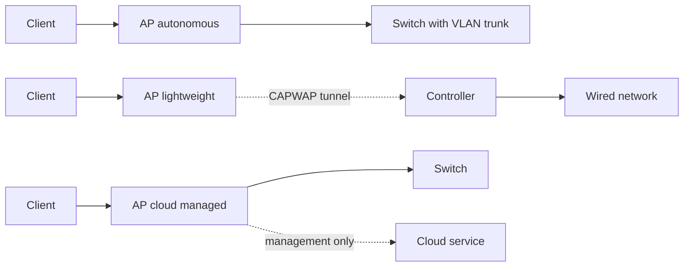
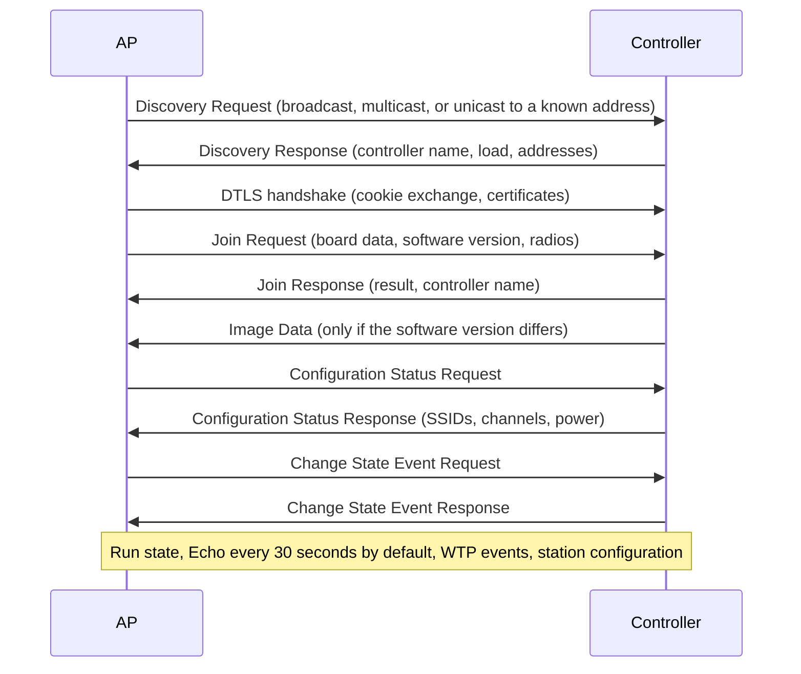

# WF 07: Wi-Fi architectures, mesh and services: from CAPWAP tunnels to sensing

*Part of the [networking plan](../00_plan.md), Wi-Fi sub-track · Candela session 6 (architectures, mesh, services, location, Wi-Fi Direct and Aware, IT/OT/IoT) · You need: [WF 03](03_wifi_mac.md) (frames, 4-address format), [WF 05](05_wifi_roaming_and_radio_management.md) (roaming, RRM), [NET 02](../02_ip_routing_and_layer3.md) (MTU, fragmentation)*

A Wi-Fi network is not only radios. Someone decides where the brains live (in each access point, in a controller, in a cloud), how client traffic reaches the wired network (tunnelled or dropped locally), how thousands of access points are configured and kept alive, and what happens when the part in the middle fails. The same questions apply to mesh (where Wi-Fi itself carries the backhaul), to services (rate limits, isolation, analytics, location) and to the odd corners (Wi-Fi Direct, Wi-Fi Aware, factory floors). This tutorial is the system-design side of Wi-Fi, and it is where a platform engineer's experience counts most.

Interviewers use this topic to separate people who know Wi-Fi from people who can **design and operate** it. The best answers are framed as failures: which failure does the design survive, what does each failure do to the data path, the control plane and management, and what does it cost to get that property.

By the end you can:

- compare autonomous, controller-based and cloud-managed designs by what lives where and what each failure does;
- explain split MAC and local MAC, central and local switching, and why modern access points use local MAC;
- explain CAPWAP: discovery, DTLS, join, run, the control and data channels, the header, fragmentation and the MTU cost of the tunnel;
- compute failure detection time from the echo timers, and design a staggered rejoin;
- describe how to operate a fleet: telemetry, configuration, staged rollouts and the reconnect storm;
- explain repeater, workgroup bridge, wireless bridge and 4-address (WDS) roles and their traps;
- explain mesh: backhaul choices, why throughput falls per hop, the airtime metric, 802.11s, vendor meshes and EasyMesh;
- explain rate limits as an airtime problem, policer against shaper, isolation, guest networks and analytics;
- explain RSSI location, fingerprinting, and Wi-Fi sensing, with their accuracy and privacy limits;
- explain Wi-Fi Direct and Wi-Fi Aware at the frame level;
- state the special needs of IT, OT and IoT on Wi-Fi.

---

## 1. Three architectures and what lives where

Every Wi-Fi product answers the same question: which **functions** run in the access point (AP) and which somewhere else. The functions are the **real-time MAC** (acknowledgements, retries, backoff, beacon timing, aggregation, [WF 03](03_wifi_mac.md)), **encryption**, **association and authentication**, **radio resource management** ([WF 05](05_wifi_roaming_and_radio_management.md)), **policy** (VLAN, firewall, rate limits), **configuration**, and **statistics**. Three answers dominate:

| | Autonomous (standalone) | Controller based | Cloud managed |
|---|---|---|---|
| Where the brains are | In each AP | In a controller (appliance, virtual machine, or one elected AP) | In a cloud service |
| Real-time MAC | AP | AP (**local MAC**) or split with the controller (**split MAC**) | AP |
| Client data path | AP bridges to its own VLAN | **Tunnelled** to the controller (central switching) or bridged locally (**local switching**, FlexConnect style) | Bridged locally, always |
| Authentication, roaming state | AP | Controller (PMK cache, mobility domain) | AP, with the cloud as the policy source |
| RRM (channel, power) | Per AP, or none | Controller, with a global view | Cloud, with a global view across sites |
| When the management point dies | Nothing changes (nothing was central) | Clients on tunnelled WLANs lose service unless a backup controller takes over; locally switched WLANs keep working | Existing clients and SSIDs keep working from the cached configuration; no new configuration, no new analytics |
| Scale limit | Operator effort | Controller capacity (APs, clients, throughput) | Telemetry and connection handling (section 3) |



Two ideas run through the table, and both are the vocabulary of the data plane against the control plane.

**The control plane may fail, the data plane should not.** A design in which a controller outage drops every client has coupled the planes too tightly. The remedies: a **cached configuration in the AP** (it keeps beaconing and bridging after the controller is gone, so only new associations that need the controller fail), **local switching** for traffic that does not need a central policy point, and a **backup controller**.

**Central switching buys policy and mobility, at the cost of a bottleneck and a hairpin.** With every client frame tunnelled to the controller, one firewall and one VLAN policy apply, and a roam between two APs needs no change of the client's IP address (the roam stays inside one tunnel endpoint). But every packet crosses the controller, which must carry the **sum** of all client traffic. Local switching reverses that: no hairpin, any wired VLAN, but policy lives in the AP and a roam between APs on different subnets needs the mobility machinery of [WF 05](05_wifi_roaming_and_radio_management.md) section 11.

**Split MAC and local MAC.** The CAPWAP architecture allows the controller to do encryption and association handling (**split MAC**, with the AP doing only the real-time parts), or the AP to do everything except policy (**local MAC**). Modern APs use **local MAC**: the encryption has to be at line rate in the radio chip anyway, and the real-time deadlines (a SIFS of 16 µs) make a round trip to a controller impossible. The old picture of a "dumb" AP with a smart controller is mostly historical.

**What a Staff answer adds:** a design is described by **which failure it survives**. Draw the planes (client data, control and management) and mark what a failure of the AP, the uplink, the controller and the cloud does to each. An interviewer who hears "it depends" wants to hear the dependency.

## 2. CAPWAP: the protocol between an AP and a controller

CAPWAP (RFC 5415 for the protocol, RFC 5416 for the 802.11 binding) is the standard version of what vendors did privately (Cisco's LWAPP is its ancestor). It defines a **control channel** (UDP port **5246**) that configures and monitors the AP and a **data channel** (UDP port **5247**) that carries the client traffic. The control channel is protected by **DTLS**; the data channel may be, but is not by default, because client traffic is already encrypted over the air. On the wire, a CAPWAP controller and a vendor's private protocol look alike: an encapsulated tunnel with a keepalive.

### 2.1 The AP's life cycle



The states are Idle, Discovery, DTLS setup, Join, Image data, Configure, Data check, Run, plus Reset, Sulking (a back-off after repeated failures) and Dead. An AP finds a controller by one of:

- a **static** address configured in advance;
- the address of a **previous** controller;
- **DHCP** (a standard option for the controller address, or a vendor option);
- **DNS** (a well-known name resolved in the local domain);
- **broadcast or multicast** discovery on the local subnet.

The AP may send the request to several controllers and picks one by the **load and priority** in the response, so the **order of discovery is also the failover plan**. Security: the DTLS handshake authenticates both sides with certificates (or pre-shared keys), which stops a rogue controller from adopting your AP, and a rogue AP from joining your controller.

### 2.2 The header, and a decode by hand

The CAPWAP header is **8 bytes** with no optional fields: a preamble byte (version in the high nibble, payload type in the low one: 0 plain, 1 DTLS follows), then **HLEN** (header length in 4-byte words, 2 here), a **radio ID**, a **wireless binding ID** (1 for 802.11), the flags **T** (payload type: 802.3 or native), **F** (fragment), **L** (last fragment), **W** (wireless information present), **M** (radio MAC present), **K** (keepalive), a **fragment ID** and a **fragment offset in units of 8 bytes**. A control message follows with a message type, a sequence number, a length and message elements (type, length, value).

```python
import struct

def capwap_header(rid=0, wbid=1, t=0, f=0, l=0, w=0, m=0, k=0, frag_id=0, frag_off=0, hlen=2, dtls=False):
    bits = (hlen << 19) | (rid << 14) | (wbid << 9) | (t << 8) | (f << 7) | (l << 6) | (w << 5) | (m << 4) | (k << 3)
    return bytes([0x01 if dtls else 0x00]) + bits.to_bytes(3, "big") + struct.pack(">HH", frag_id, frag_off << 3)

def parse_header(b):
    w = int.from_bytes(b[1:4], "big")
    fid, fo = struct.unpack(">HH", b[4:8])
    return dict(version=b[0] >> 4, payload=b[0] & 15, hlen_bytes=4 * (w >> 19), rid=(w >> 14) & 31,
                wbid=(w >> 9) & 31, T=(w >> 8) & 1, F=(w >> 7) & 1, L=(w >> 6) & 1,
                frag_id=fid, frag_off_bytes=(fo >> 3) * 8)

print(parse_header(capwap_header(f=1, frag_id=77, frag_off=183)))
# {'version': 0, 'payload': 0, 'hlen_bytes': 8, 'rid': 0, 'wbid': 1, 'T': 0, 'F': 1, 'L': 0,
#  'frag_id': 77, 'frag_off_bytes': 1464}
```

Wrapped in a UDP packet to port 5246 with a control header whose message type is 1, `tshark` decodes it as a CAPWAP **Discovery Request**. Message types worth knowing: 1 discovery request, 2 discovery response, 3 join request, 4 join response, 5 and 6 configuration status, 13 echo request, 14 echo response.

### 2.3 The cost of the tunnel

An outer packet carries the inner **Ethernet frame** behind **20 bytes of IP, 8 of UDP and 8 of CAPWAP**, plus the outer Ethernet header. With DTLS on the data channel, add about 37 bytes more (record header, nonce and tag of AES-GCM).

```python
def inner_ip_mtu(outer_mtu, dtls=False):
    return outer_mtu - 20 - 8 - 8 - 14 - (37 if dtls else 0)

print(inner_ip_mtu(1500), inner_ip_mtu(1500, True))   # 1450 1413
```

The overhead is a **fixed 50 bytes per packet**, so it hurts small packets (a 60-byte voice or acknowledgement packet grows by about 40 percent) and matters little for big ones (about 3 percent). The real cost for a full-size packet is the **MTU**: a client that sends a 1,500-byte IP packet produces a 1,514-byte inner frame, which does not fit in a 1,500-byte outer packet. CAPWAP then **fragments** the tunnelled frame (fragment ID, offset, the L bit), so a path with a 1,500-byte MTU sees **two outer packets for every full-size packet**, and the controller must reassemble them, which is slower than forwarding. The fixes are the usual ones:

- **clamp the TCP MSS** on the WLAN (to about 1,410 for an outer MTU of 1,500; lower for PPPoE or smaller paths);
- raise the MTU between the APs and the controller (jumbo frames);
- make sure path MTU discovery ([NET 02](../02_ip_routing_and_layer3.md)) works through the tunnel.

This is a classic field problem: "web pages load slowly but pings are fine" on a tunnelled WLAN is very often an MTU or fragmentation issue.

### 2.4 What a controller costs to run

Under central switching the controller carries the **sum** of all client traffic. With data channel encryption the AEAD work scales with the aggregate rate: modern AES-GCM does around 10 Gbit/s per core in software and more with offload, so the cores needed depend on thousands of access points times their busy-hour rate, and large deployments use **local switching for bulk traffic** so the controller sees only control traffic. Without data channel encryption (the default in many networks) the controller only forwards, and the cost moves to packet processing and to the **fragmentation** above.

The other cost is the **connection rate**. A DTLS handshake costs a key exchange, a signature and a verification on the controller. A modern core does a few thousand per second as a floor (certificate parsing, cookies, the join and configuration messages and the AP side add much more), which matters when a controller fails and all its APs rejoin a standby at once (section 3.3).

### 2.5 Failure detection

The AP detects a dead controller by missing **echo** answers: an echo request every **EchoInterval** (default 30 s), then **MaxRetransmit** retransmissions every **RetransmitInterval** (defaults: 5 and 3 s):

```python
def worst_case_detect_s(echo_interval, max_retransmit, retransmit_interval):
    return echo_interval + max_retransmit * retransmit_interval

print(worst_case_detect_s(30, 5, 3))   # 45 s with the defaults
print(worst_case_detect_s(10, 3, 1))   # 13 s with a tuned setting
```

So with defaults an AP may take **up to 45 seconds** to notice that the controller is gone. Faster timers detect failure sooner, and cost more echo traffic and more false failures on a lossy WAN link. The design question: what does the application tolerate, and does the AP keep serving clients (local switching, cached configuration) while it waits? An AP in **standalone mode** after losing its controller must authenticate clients itself, which requires local EAP or a local RADIUS ([WF 05](05_wifi_roaming_and_radio_management.md)).

## 3. Operating a fleet: telemetry, rollout and reconnects

A design for 20 access points and a design for 20,000 differ in kind, not size.

### 3.1 Telemetry

Each AP reports **statistics** (client counts, airtime, retries, RSSI and rate percentiles, interference), **events** (association, roam, failure, radar) and **health**. At fleet scale:

- **Rate times count is the load.** Many small reports from many APs is a connection and parsing problem more than a bandwidth one.
- **Send deltas and use compact encodings**, not full snapshots; set the report interval from what the analytics really needs, not the lowest the AP supports.
- **Size the collector by connections and messages per second**, not only bytes.
- **Retention costs more than collection.** Decide the raw, rolled-up and long-term tiers early.

### 3.2 Configuration and firmware

Configuration is pushed as a **desired state** that the AP applies and acknowledges, and the controller keeps the intended and actual state. Firmware is rolled out **in stages**: a canary group, then a wave, then the rest, with automatic stop on failure rates and the ability to roll back. Never upgrade all APs of an area at once: a bad image takes the whole area down and removes the neighbours that would have covered for it.

### 3.3 The reconnect storm

When a controller or cloud service fails and returns, **every AP tries to rejoin at once**. Each rejoin is a DTLS handshake plus a join and a configuration exchange, so the standby sees a burst far above steady state, which overloads it, causing failures and more retries: a **retry storm**. The defences are the standard ones:

- **Exponential backoff with full jitter** on the AP, so rejoin attempts spread out;
- **a backup controller that is already connected** (the AP keeps a second session) so failover is a switch, not a rejoin;
- **admission control** on the controller (accept N joins per second, ask the rest to retry);
- **the Sulking state** of CAPWAP, which exists for exactly this.

An interviewer who asks "what happens when your cloud comes back after an outage" wants this answer.

## 4. Autonomous AP roles: root, repeater, bridge and WDS

An autonomous AP can play more than one role, and the roles that put **a radio on the uplink** are where throughput and addressing surprises appear.

| Role | Uplink | Serves | Addressing | Cost |
|---|---|---|---|---|
| **Root AP** | Ethernet | Clients | 3-address frames | None |
| **Repeater** | Wireless, on the **same radio** | Clients | 3-address, bridged through the parent | Every frame is sent twice on the same channel: about half the rate per hop |
| **Workgroup bridge (WGB)** | Wireless, as a **client** of a root AP | **Wired devices** behind its Ethernet port | The parent sees one client address, so the WGB rewrites addresses (MAC NAT or cloning), tells the AP about the wired devices (a vendor update), or uses **4-address frames** | The wired devices are invisible to the standard bridge learning of the parent |
| **Wireless bridge** (point to point or multipoint) | Wireless to another bridge | A wired network on each side | **4-address frames** (WDS) | Long outdoor links with directional antennas; loop risk |
| **Mesh point** | Wireless, 802.11s | Mesh peers and clients | Mesh header with address extension | A routing protocol and the per-hop cost |

**Why a fourth address.** A normal client frame carries three addresses ([WF 03](03_wifi_mac.md)): receiver, transmitter and the one that is the source or destination on the wired side. A frame that goes from an AP to an AP on behalf of a station behind it needs the **receiving AP, the transmitting AP, the final destination and the original source**: four. The `ToDS` and `FromDS` bits are both 1 and the fourth address follows the sequence control field, making the MAC header 30 bytes instead of 24. On Linux this is `4addr` mode (`iw dev wlan0 set 4addr on`). Standard client devices rarely support it, so a normal phone cannot be a WDS station.

**The traps of a bridge.** A wireless bridge joins two Ethernet segments, so it joins their **broadcast domains and spanning tree**: a second path (a cable plus a wireless link) is a **loop** and needs spanning tree to be on and to see the bridge. A classic outage is a bridge that drops spanning tree frames at the radio and produces a broadcast storm. A workgroup bridge that rewrites addresses hides its wired devices from the network's policy: the AP's firewall sees one client where there are several, so per-client limits apply to the **WGB**, not to each device behind it. A repeater has the throughput problem of the next section with an additional trap: **repeated frames compete with the originals on the same channel**.

## 5. Mesh: backhaul, hops, metrics and EasyMesh

A mesh is a set of APs that use **Wi-Fi itself as the backhaul** (the link between APs), so only some of them (the **gateways**) need a cable. The design questions are the same in every product: what carries the backhaul, how many hops, how the path is chosen, how a client roams.

### 5.1 Why hops cost throughput

A radio cannot transmit and receive on the same channel at once. A node that receives a frame from its parent and forwards it to a child on **the same radio and channel** uses the air twice for each byte, so the end-to-end rate falls to about **half per hop**, and worse in practice because the two links also contend with each other and with the neighbours:

```python
def same_radio_rate(link_mbps, hops):
    return link_mbps / (2 ** (hops - 1))
print([same_radio_rate(400, h) for h in (1, 2, 3)])   # [400.0, 200.0, 100.0]
```

The cures, in order of effect:

1. **Use a wire** wherever one can be run. A wired backhaul beats any wireless one and a wired node is a gateway.
2. **A dedicated backhaul radio** (a second or third radio in a different band that carries only backhaul). Tri-band mesh nodes exist for this reason: the 5 GHz or 6 GHz radio carries backhaul and the other radios serve clients, so the second hop does not halve.
3. **Fewer hops**, with each link good (a link at a poor rate costs more airtime than it looks).
4. **Directional or higher-power links** for fixed backhaul.

A rule of thumb used in designs: wireless backhaul links should run at a good SNR (about 25 dB or more, for a high rate), because a mesh link is a **shared, repeating** link and its poor rate costs everyone on the path.

### 5.2 Choosing the path: hop count against airtime

A routing protocol on a wireless mesh must not use **hop count**: a one-hop path over a 6 Mbit/s link looks shorter than two hops over 300 Mbit/s links. The 802.11s **airtime link metric** estimates the time to send a test frame over the link:

```python
def airtime_metric_us(rate_mbps, frame_error=0.0, oca=75, op=110, bt=8192):
    """802.11s airtime link metric: (channel access + protocol overhead + test frame at rate) / success probability."""
    return (oca + op + bt / rate_mbps) / (1 - frame_error)
print([round(airtime_metric_us(r), 1) for r in (6, 54, 300)])   # [1550.3, 336.7, 212.3] microseconds
```

A 6 Mbit/s link costs about 1,550 µs and a 300 Mbit/s link 212 µs (the fixed overheads of 185 µs dominate there, so a fast link is never free). In a small example where the direct A-E link is 6 Mbit/s and a two-hop path over 300 Mbit/s links exists, hop count picks the direct link (a few Mbit/s end to end) and the airtime metric picks the two-hop path (about 25 times better). The lesson: **a metric must measure time on the air**.

### 5.3 802.11s, vendor meshes and EasyMesh

**IEEE 802.11s.** A **mesh point (MP)** forms peer links with other MPs on the same **mesh ID**; a **mesh AP (MAP)** also serves clients; a **mesh portal (MPP)** bridges to the wired network. Peering is authenticated with **SAE** (the WPA3 personal handshake, [WF 04](04_wifi_security.md)) and the keys come from the authenticated mesh peering exchange (AMPE). Path selection is **HWMP**: reactive discovery with path request and reply frames (PREQ, PREP) and proactive root announcements (RANN) for a gateway. A mesh data frame carries a **mesh control** header with a TTL, a sequence number and an optional address extension for the fifth and sixth address. 802.11s is in Linux mac80211 and OpenWrt (`mesh_id`), and is **rare in consumer products**.

**Vendor meshes.** Most commercial meshes do **not** use 802.11s. Nodes connect as a client of a hidden or dedicated backhaul BSS on a node closer to the gateway, forming a tree, and run a private routing and steering protocol. The client sees one SSID and many BSSIDs and uses ordinary roaming, so 802.11k, v and r ([WF 05](05_wifi_roaming_and_radio_management.md)) make a roam between nodes quick. A client of a plain **repeater** roams badly: the repeater's BSS looks like another AP with a weak backhaul that the client cannot see.

**EasyMesh (Wi-Fi Alliance).** It standardises the **control plane** between a **Multi-AP controller** and **agents** (the APs), built on IEEE 1905.1 and the Multi-AP specification. It defines a **fronthaul BSS** for clients and a **backhaul BSS** for agents, **onboarding** (by WPS push button or the newer Device Provisioning Protocol (DPP), which uses QR-code onboarding), **client steering** (the BSS transition request of [WF 05](05_wifi_roaming_and_radio_management.md) issued as a controller command), **link and AP metrics** reports and, in later releases, channel scanning and QoS management. Agents and the controller exchange 1905.1 **CMDU** messages over Ethernet type **0x893a** (to the multicast address `01:80:c2:00:00:13` or by unicast), over wired and wireless links alike. Its value is that **agents of different vendors can follow one controller**; its limit is that the data plane and the routing inside each vendor's agent are not specified, and it targets home and small office networks.

**What to say in an interview.** "Mesh" in marketing usually means many APs coordinated by a controller, not 802.11s. The questions that matter are: what is the backhaul, how many hops, and how does a client move between nodes.

## 6. Services in the network

### 6.1 Rate limits are an airtime problem

A per-client or per-SSID **rate limit** looks like a wired feature, and on Wi-Fi it hides the fact that the resource is **airtime**, not bits. A cap of 25 Mbit/s costs a small share of the air for a client at a high PHY rate and a **huge** share for a client at a low rate: a client at a few Mbit/s cannot even reach the cap, and while it tries it holds the air for everyone. The cap says nothing about what the client costs the others. A cap protects the **wired side** or a bill; an **airtime limit** (airtime fairness, [WF 03](03_wifi_mac.md)) protects the radio. A guest network with **both a per-client cap and an airtime share** is a better design than a cap alone.

### 6.2 Policer or shaper

A cap can be enforced by dropping the excess (a **policer**, a token bucket with no queue) or by queueing it (a **shaper**), the subject of [NET 14](../14_queueing_qos_and_traffic_management.md). On a TCP flow they behave very differently. A policer with a tiny bucket drops TCP's bursts and gives the flow a small fraction of the cap; a policer signals loss only after the damage, so even a large bucket under-delivers. A **shaper** with a sensible queue delivers nearly the whole cap and charges in **delay** (a huge queue is bufferbloat). The practical rules: a policer's bucket should be **at least the bandwidth-delay product of the cap**, and a shaper's queue should hold about **one round trip** of data. In products, a per-client rate limit is usually a shaper in the AP and a policer at the gateway.

### 6.3 Isolation, filtering and analytics

- **Client isolation** (peer-to-peer blocking): the AP drops frames between two clients on the same BSS so a guest cannot reach another guest. It must also block the **broadcast and multicast** relay and the proxy ARP path, or it leaks.
- **Guest network**: a separate SSID on its own VLAN, a captive portal ([WF 04](04_wifi_security.md)), a bandwidth cap, an airtime share and a firewall that allows only the Internet.
- **Parental controls and content filtering**, in three mechanisms of rising cost: a **DNS filter** (cheap; evaded by DNS over HTTPS or a hard-coded resolver), **SNI filtering** (reading the name in the TLS handshake, [NET 08](../08_application_protocols_dns_http_tls.md); evaded by encrypted client hello) and **DPI** application identification ([NET 09](../09_network_security_firewalls_ips_dpi.md)). A **schedule** per device profile works only if the **device is identifiable**, which MAC address randomisation weakens (a phone uses a stable private address per SSID, so a profile survives, but not after "forget network").
- **Analytics**: the AP or controller records per client **signal, rate, retries, airtime, roams and failures**, and a service derives a **health score**. A client's **type** comes from the DHCP parameter request list, the capability elements in its association request (an association fingerprint), and the OUI of its MAC (useless when randomised). Watch **percentiles** (the 10th percentile of the rate, the 95th percentile of the retry rate): means hide the clients that complain.

## 7. Location and sensing

### 7.1 Location

| Method | How | Accuracy and limits |
|---|---|---|
| **Presence by AP** | The client is associated to, or heard by, a known AP | Room or zone, depending on cell size |
| **RSSI ranging** | Distance from RSSI by a path-loss model, trilaterated from several APs | Poor: shadowing of several dB turns into metres of error |
| **Fingerprinting** | A survey records RSSI vectors at known points; a client is matched to the nearest | A few metres, but it needs a survey and goes stale when furniture or APs change |
| **Round-trip time (FTM, 802.11mc)** | Time of flight of frames, from which distance follows ([WF 14](14_wifi_amendments_and_special_phys.md)) | A metre or two in good conditions, needs support at both ends |
| **Angle of arrival** | Antenna arrays at the AP measure the direction | Good accuracy, needs special hardware |

Honest accuracy statements are an interview skill: "a room, not a metre" for RSSI-based location.

### 7.2 Sensing

A moving person changes the multipath of a link, so the RSSI of a **fixed** link fluctuates. The simplest detector takes the standard deviation of RSSI over a window of beacons and compares it with a threshold set from the noise of the empty room (the false-alarm rate follows a chi-square law, so the threshold can be set from measurements, not guessed). Better sensing uses the **channel state information (CSI)**, the per-subcarrier channel estimate, and the IEEE amendment **802.11bf** standardises the measurement. Presence, fall and breathing detection are built on it. The consequence is **privacy**: a network that can see people move needs a consent and retention policy as much as a camera does.

## 8. Wi-Fi Direct and Wi-Fi Aware

Both are Wi-Fi Alliance protocols for **device-to-device** connections without an infrastructure AP, built from ordinary 802.11 frames.

### 8.1 Wi-Fi Direct (P2P)

One device becomes the **group owner (GO)**, which behaves as an AP for the group, and the others are **clients**. Discovery uses probe requests with a **P2P information element** (a vendor element, OUI 50:6F:9A type 9, with attributes such as capability and **listen channel**) and the wildcard SSID `DIRECT-`, in **scan** and **listen** phases on the **social channels 1, 6 and 11**, so two devices find each other when one listens where the other scans. Then they run a **GO negotiation** (request, response, confirmation public action frames) in which each states a **GO intent** from 0 to 15 and a **tie-breaker bit**:

```python
def go_winner(intent_a, intent_b, tie_breaker_a):
    if intent_a == 15 and intent_b == 15: return "fail"      # two groups cannot form
    if intent_a != intent_b: return "A" if intent_a > intent_b else "B"
    return "A" if tie_breaker_a else "B"                     # the peer uses the opposite bit
print(go_winner(11, 3, 0), go_winner(7, 7, 1), go_winner(7, 7, 0), go_winner(15, 15, 1))   # A A B fail
```

A device that is also a client of an infrastructure AP (**concurrent operation**) must put the group on **the same channel as the infrastructure link**, or time-slice between them, which is why screen mirroring can reduce a phone's normal Wi-Fi throughput. The GO sleeps with a **notice of absence** schedule announced in beacons, and the same stack carries **Wi-Fi Display (Miracast)**.

### 8.2 Wi-Fi Aware (neighbor awareness networking)

Wi-Fi Aware is a **publish and subscribe** discovery and data service between nearby devices, with no AP and no association. Devices in a **cluster** wake together for a short **discovery window** and exchange service discovery frames. With a 16 TU window every 512 TU, a device is awake about 3 percent of the time for discovery, and a subscriber waits up to about half a second for the next window; doubling the period halves the duty cycle and doubles the wait, the same **energy against latency** trade as the listen interval and TWT ([WF 06](06_wifi6_6e_7_features.md)). A service is named by a **6-byte service ID**, the first 6 bytes of the SHA-256 of the service name:

```python
import hashlib
print(hashlib.sha256(b"wifi-aware-demo").digest()[:6].hex())   # b3c25f03efdb
```

Once matched, the two devices can open a **NAN data path** (an encrypted device-to-device link with its own keys) in agreed time slots. It is the basis of proximity services on phones.

## 9. IT, OT and IoT on Wi-Fi

Operational technology (factories, warehouses, hospitals, buildings) puts devices on the network whose owners are not IT. The problems are organisational as much as technical.

- **Segmentation.** An IoT device must not share a broadcast domain with a laptop. In order of effort: a **separate SSID per device class** mapped to its own VLAN (simple, but airtime grows with every SSID, [WF 05](05_wifi_roaming_and_radio_management.md)); **one SSID with a per-device VLAN** chosen by identity (802.1X for devices that support it, **MAC authentication bypass** for those that do not, or a **private pre-shared key per device or group**, which is the least bad option for a headless device); and **client isolation** inside a class.
- **Constrained devices.** A sensor is usually 2.4 GHz, one stream, 20 MHz, a legacy rate, and sleeps most of the time. It needs a long listen interval or **TWT** ([WF 06](06_wifi6_6e_7_features.md)), a network that does not disable the low rates it uses, and sometimes a **sub-GHz** option (802.11ah HaLow, [WF 14](14_wifi_amendments_and_special_phys.md)).
- **Mobility with a deadline.** A forklift, an AGV or a handheld scanner crosses cells all day, so the roam budget of [WF 05](05_wifi_roaming_and_radio_management.md) is a **safety** number, not a convenience: fast transition, a neighbour list and cells sized for the speed.
- **Determinism.** Wi-Fi is a shared medium with random access, so a **latency bound is statistical** (a 99.9th percentile), not guaranteed. The tools are EDCA voice priority, OFDMA with scheduled uplink and TWT (Wi-Fi 6), and **restricted TWT** in Wi-Fi 7 ([WF 12](12_wifi7_eht_and_mlo.md)); [WF 13](13_wifi8_uhr_802_11bn.md) follows the reliability work of Wi-Fi 8. A network that needs a **hard** bound uses a wire.
- **Protocols above Wi-Fi.** The device speaks MQTT, OPC UA or a proprietary protocol over TCP, and **keepalive and reconnect behaviour** is the part that breaks first when a roam or an AP reboot drops the connection for a second.
- **Ownership.** IT owns security and the change window; OT owns the process and the uptime. A change that is routine for IT (a channel plan update, a controller upgrade) is a **production outage** for a plant, so the architecture of section 1 (what survives a controller loss) is also a **change management** question.

## 10. Reading these in a capture

| Question | Display filter or field (tshark) |
|---|---|
| Is an AP talking to a controller? | `udp.port == 5246 \|\| udp.port == 5247` |
| CAPWAP control message type | `capwap.control.header.message_type` (1 discovery request, 2 response, 3 join request, 4 join response, 13 echo request, 14 echo response) |
| A tunnelled data packet | `capwap`, with `capwap.header.flags.t`, `.f` (fragmented), `.l` (last fragment) |
| Why can I not see the join and configuration? | After the DTLS handshake the control channel is encrypted: filter `dtls`, and decode only with the key log |
| Wi-Fi Direct | `wifi_p2p`, `wifi_p2p.go_intent`, `wifi_p2p.listen_channel.channel_number` |
| Wi-Fi Aware | `wifi_nan`, `wifi_nan.service_id` |
| EasyMesh and 1905.1 | `eth.type == 0x893a` or `ieee1905` |
| 4-address frames (WDS) | `wlan.fc.tods == 1 && wlan.fc.fromds == 1` |

## 11. Debugging: symptom, likely cause, first check

| Symptom | Likely cause | First check |
|---|---|---|
| Web pages load slowly on the tunnelled SSID, pings are fine | MTU and CAPWAP fragmentation | Capture the data tunnel: fragmented packets (F and L bits); MSS in the SYN |
| All APs of a site drop and rejoin repeatedly | Controller overload, a reconnect storm, or a WAN flap | Echo timers, join rate on the controller, WAN loss |
| Clients lose service when the controller reboots | All WLANs centrally switched with no cached configuration | Switching mode per WLAN; standalone behaviour of the AP |
| Mesh node's clients get half the throughput of the parent's | Same-radio backhaul | Backhaul radio and band; use a wire or a dedicated radio |
| Loops and broadcast storms after adding a wireless bridge | Spanning tree not seen across the bridge | STP state on both ends; the 4-address link |
| Per-client rate limit set but users complain | Slow clients hold the air; the cap is not an airtime limit | Airtime per client; add airtime fairness |
| Guest users reach each other | Isolation does not block multicast or proxy ARP paths | Test ARP and mDNS between guests |
| Location jumps between rooms | RSSI ranging with shadowing | Use zones and fingerprinting; state the accuracy |
| Phone's Wi-Fi slows while screen mirroring | Concurrent P2P group on another channel | Channel of the group against the infrastructure link |

## 12. Common mistakes

1. **Describing a design without its failure modes.** Say what each failure does.
2. **Tunnelling all traffic through a controller** without sizing it, and without an MTU plan.
3. **Leaving the CAPWAP echo timers at defaults** when the application cannot tolerate 45 seconds.
4. **Rejoining with no jitter**, so the first outage becomes a storm.
5. **Upgrading all APs at once.**
6. **Using a repeater** where a wire or a dedicated backhaul radio was possible.
7. **Routing a mesh by hop count.**
8. **Treating a rate limit as a capacity plan.** The resource is airtime.
9. **Policing TCP with a tiny bucket.**
10. **Promising metre-level location** from RSSI.
11. **Mixing IoT and laptops** in one broadcast domain.
12. **Calling any multi-AP product "802.11s".**

## 13. Interview questions

1. **Compare autonomous, controller-based and cloud-managed WLANs.** Where the brains are, the data path, and what each failure of AP, uplink, controller or cloud does.
2. **What is the difference between central and local switching?** Central tunnels all client traffic to the controller (one policy point, simple mobility, a bottleneck); local bridges at the AP (no hairpin, policy at the edge, a roam across subnets needs mobility tunnels).
3. **Why do modern APs use local MAC?** Real-time deadlines (SIFS of 16 µs) and line-rate encryption in the radio chip; a controller round trip is far too slow.
4. **Walk through how an AP joins a controller with CAPWAP.** Discovery (static, DHCP, DNS, broadcast), controller choice by load and priority, DTLS, join, image download if needed, configuration, run with echoes.
5. **What does the CAPWAP tunnel cost?** About 50 bytes per packet and a lower inner MTU; fragmentation of full-size packets if the path MTU is 1,500, fixed by MSS clamp or jumbo frames.
6. **How long does an AP take to notice that its controller is gone?** Echo interval plus retransmissions times the retransmit interval: 45 s with the defaults.
7. **What is a reconnect storm and how do you stop it?** All APs rejoining at once; use jittered exponential backoff, backup sessions, admission control.
8. **What is a workgroup bridge and what does it break?** A wireless client with wired devices behind it; the parent sees one MAC, so per-device policy and visibility are lost unless 4-address or a vendor update is used.
9. **Why does a repeater halve throughput?** One radio receives and retransmits each frame on the same channel; also contention between hops.
10. **802.11s against a vendor mesh against EasyMesh?** 802.11s is a standard peering and routing (HWMP, airtime metric); vendor meshes use private routing and a client-style backhaul; EasyMesh standardises the control plane (controller and agents), not the data plane.
11. **Why is hop count a bad mesh metric?** It ignores link rate; an airtime metric measures the time to send a frame.
12. **Why is a per-client rate cap not enough on Wi-Fi?** The scarce resource is airtime; a slow client under a cap still consumes the air.

## 14. Scenarios and design questions

**S1. Design the architecture for a 500-AP campus with branch offices.** *Where to practise:* a design review. *Approach:* controller or cloud, local against central switching per WLAN, failure table, key holders for fast roaming, sizing.

**S2. Users report slow web pages on the tunnelled corporate SSID, pings fine.** *Where to practise:* a lab capture of the data tunnel with a large download. *Approach:* MTU, MSS, fragmentation.

**S3. A controller failed over and APs took ten minutes to come back.** *Where to practise:* a lab with 20 simulated APs rejoining. *Approach:* handshake rate, jitter, backup sessions, admission control.

**S4. A warehouse mesh gives half the throughput on the second hop.** *Where to practise:* a lab with three nodes and one radio per node, then a tri-band one. *Approach:* same-radio backhaul, dedicated radio, wire, metric.

**S5. Design a guest network for a hotel.** *Where to practise:* write a policy table. *Approach:* SSID, VLAN, portal, per-client cap, airtime share, isolation, mDNS handling, DNS filtering.

**S6. A customer wants to track staff positions to one metre with Wi-Fi.** *Where to practise:* a survey on a floor. *Approach:* the accuracy of RSSI against FTM and AoA, fingerprints, infrastructure, privacy and consent.

**S7. Design the firmware rollout for 20,000 APs.** *Where to practise:* write the rollout plan. *Approach:* canary, waves, stop conditions, rollback, avoid neighbouring APs together, maintenance windows.

**S8. A factory wants Wi-Fi for AGVs with a 50 ms roam and 20 ms latency target.** *Where to practise:* a design review. *Approach:* 802.11r, 11k, cell size, DFS, EDCA, statistical latency, what Wi-Fi cannot promise, a wired option.

**S9. Design an AP telemetry pipeline.** *Where to practise:* sketch the data flow. *Approach:* delta reports, batching, connection counts, collector sizing, retention tiers, health scores from percentiles.

## 15. Strong answers (outlines)

**S1.** Choose by what must survive. Controller or cloud management for configuration and RRM; **local switching** for bulk data so the controller or cloud is not a data-path bottleneck, with a **cached configuration** in the AP so an outage does not drop clients. Centrally switch only WLANs that need a central policy point or L3 mobility. For branches: FlexConnect-style local switching and local authentication, so the WAN is not on the critical path. Key holders for 802.11r on the site. A failure table (AP, uplink, controller or cloud, WAN) with what each does to data, control and management. Size the controller by connections and aggregate throughput if tunnelled.

**S2.** Compare a ping at size 56 with a large ping with don't-fragment set; look at the CAPWAP data tunnel for fragmented packets (F and L bits); check the SYN for the MSS. A 1,500-byte inner packet does not fit in a 1,500-byte outer packet, so each is split in two, doubling packets per second and burdening the controller. Fix: clamp the MSS on the WLAN gateway to about 1,410, raise the AP-to-controller MTU, or switch locally. Confirm with a repeat capture.

**S3.** Estimate handshakes per second the standby can do against the number of APs; add configuration push time. All APs retried at once with fixed timers, so the standby was overloaded and many joins failed and retried. Fixes: jittered exponential backoff, a second session kept warm on a backup controller, admission control with a join rate, staged recovery by site, and a bigger standby. Test failover with a real rejoin drill.

**S4.** A node with one radio receives and retransmits on the same channel, so each hop halves the rate and contends with the other hops. Use a wire where possible; use a tri-band node with a dedicated backhaul radio on 5 or 6 GHz; reduce hops; get good SNR on backhaul links; use an airtime metric for path choice. State the expected result: the second hop should not halve with a dedicated radio.

**S5.** A separate SSID and VLAN, a captive portal with terms, a per-client cap and an airtime share, client isolation including multicast and proxy ARP, a firewall that allows only the Internet, DNS filtering for categories, DHCP lease sizing, a session timeout, and few SSIDs to limit beacon overhead. Mention logging and the legal retention rules of the country. Mention that MAC randomisation breaks "remember this device" by MAC.

**S6.** RSSI trilateration gives errors of several metres because shadowing is several dB. Fingerprinting after a survey gets a few metres but ages. FTM time of flight (802.11mc) can approach a metre with support at both ends; AoA with antenna arrays does well but needs hardware. Be honest: state a zone-level guarantee, offer a better method if the device supports FTM, and require a privacy and consent policy (staff tracking has legal limits).

**S7.** Stage by risk: a lab, a canary of a few percent in different sites, then waves. Never upgrade neighbours together (they cover for each other). Stop automatically on rising failure rates (join failures, reboots, client-visible errors), keep the previous image for rollback, use jitter to avoid a download storm from the image server, and schedule by site maintenance windows. Report progress to the operators.

**S8.** Say what Wi-Fi can and cannot promise: a statistical bound. Design: 802.11k, v and r with a local key holder for roams under 50 ms; cell overlap sized for the speed; non-DFS channels or a fallback; EDCA voice or a dedicated SSID; no overlapping-channel interference; OFDMA and TWT where devices support them; measure the 99.9th percentile with real AGVs; offer a wired or private-network alternative for a hard bound.

**S9.** Report deltas and aggregates at intervals set by need; batch and compress; use a connection protocol that survives reconnects; size the collector by connection count and messages per second; store raw data briefly and roll up for long retention; compute health from percentiles per client and per AP; add jitter to avoid synchronised bursts; and make the pipeline degrade gracefully when the cloud is unreachable (the AP buffers a bounded amount).

## 16. Cheat sheet

| Fact | Value |
|---|---|
| Architectures | Autonomous, controller-based (local or split MAC), cloud-managed |
| Data path | Central (tunnelled) or local switching |
| CAPWAP ports | Control 5246 (DTLS), data 5247 (optional DTLS) |
| CAPWAP header | 8 bytes; flags T F L W M K; fragment offset in 8-byte units |
| CAPWAP states | Discovery, DTLS, Join, Image, Configure, Run (plus Sulking, Dead) |
| Message types | 1 and 2 discovery, 3 and 4 join, 13 and 14 echo |
| Tunnel overhead | About 50 bytes per packet; inner MTU 1,450 at outer 1,500 (1,413 with DTLS) |
| Failure detection | EchoInterval + MaxRetransmit x RetransmitInterval: 30 + 5 x 3 = 45 s |
| Reconnect storm defence | Jittered backoff, warm backup session, admission control |
| 4-address frame | ToDS and FromDS both 1; 30-byte header |
| Repeater | About half the rate per hop on one radio |
| 802.11s | Mesh ID, SAE peering, HWMP, airtime metric |
| Airtime metric | (75 µs + 110 µs + 8192 bits / rate) / (1 - frame error) |
| EasyMesh | Controller and agents, 1905.1 CMDU on Ethernet type 0x893a |
| Rate limit | Cap in bits does not bound airtime; policer bucket at least the BDP; shaper queue about one RTT |
| Location | RSSI zone-level; fingerprint a few metres; FTM about a metre |
| Wi-Fi Direct | GO intent 0 to 15, tie-breaker, social channels 1, 6, 11, SSID DIRECT- |
| Wi-Fi Aware | Service ID = first 6 bytes of SHA-256 of the name; discovery window 16 TU / 512 TU |

## 17. Sources and caveats

Web sources used for this tutorial: NetworkLessons on [Cisco wireless network architectures](https://networklessons.com/wireless/cisco-wireless-network-architectures) (autonomous against split MAC, the CAPWAP tunnel roles and ports); a 2010 [CAPWAP survey](https://classes.engineering.wustl.edu/~jain/cse574-10/ftp/capwap/index.html) (local, remote and split MAC, DTLS on the control channel); a [mesh overview](https://gengstah.github.io/wiki/concepts/wifi-mesh/) (802.11s, HWMP, vendor meshes); and the Wi-Fi Alliance [EasyMesh page](https://wi-fi.org/discover-wi-fi/wi-fi-easymesh) (steering, onboarding, interoperability). The Candela course (session 6) is the syllabus.

Caveats. The CAPWAP header decode and the fragmentation example were built and decoded with `tshark`; the message-type numbers, state names, default timers (echo 30 s, retransmit 5 and 3 s) and the 802.11s airtime metric constants (75 µs, 110 µs, 8,192 bits) are from the RFC and the standard as I know them and were not re-read here. The AES-GCM per-core figure is a rough order of magnitude. EasyMesh details (message formats, releases) come from my knowledge of the specification and the Alliance page is brief. Check vendor documents for the real defaults of a product.
