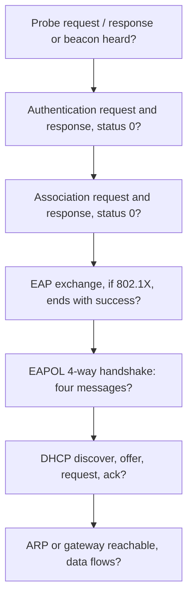

# WF 08: Wi-Fi capture, tools and debugging: from radiotap to a failed login

*Part of the [networking plan](../00_plan.md), Wi-Fi sub-track · Candela sessions on sniffing, tools and debugging · You need: [WF 03](03_wifi_mac.md) (frames and the connection sequence), [WF 04](04_wifi_security.md) (handshakes, 802.1X), [WF 02](02_wifi_phy.md) (rates and preambles)*

Every Wi-Fi bug report starts as an opinion ("the Wi-Fi is slow", "it keeps dropping") and ends as a fact only when someone looks at what the radio actually did. The skill that separates a senior Wi-Fi engineer from everyone else is not knowing more frame types. It is **choosing the right instrument, knowing what it cannot show, and following a sequence with a stopping rule** until the cause is on the screen.

Interviewers test this with "a customer says X, what do you do?". A strong answer names the instrument at each step, says what a result would mean, and is honest about the limits of a sniffer. This tutorial builds that toolkit: where to capture, how to read a capture, what a sniffer misses, the other instruments (spectrum, survey, throughput tools, logs), and a playbook that ties them together.

By the end you can:

- choose between a wired capture, a client capture, a monitor-mode sniffer and an in-AP capture, and say what each one cannot see;
- set up monitor mode on Linux, macOS and an AP, capture a handshake, and decrypt a WPA2 capture;
- parse a radiotap header correctly and explain why fixed offsets fail;
- write display filters and capture filters, and avoid mixing them up;
- read a connection from probe to DHCP and name the first failing step from the frames;
- explain why a sniffer misses frames, how channel hopping breaks handshake capture, and why two sniffers disagree on order;
- compute airtime from a capture and explain the beacon tax;
- read a spectrum display and tell Wi-Fi from a microwave, Bluetooth or radar;
- plan and read a site survey, and say why a signal map is not a quality map;
- run `iperf3` and `ping` so the result means something;
- read `hostapd`, `wpa_supplicant` and driver logs, and drive them from their control sockets;
- run a debugging playbook that ends in a cause.

---

## 1. What a capture is, and where to take one

A capture answers one question: **what did the radio do**, as opposed to what the driver, the log or the user says it did. The first decision is where to stand, because each vantage point shows a different truth.

| Vantage point | What you see | What you miss |
|---|---|---|
| **Wired side of the AP** (mirror port or tap) | Ethernet frames after decryption, with the client MAC, after the AP rewrote 802.11 to 802.3 | All of 802.11: management frames, retries, rates, power save, the 4-way handshake, signal |
| **Client host in managed mode** (`tcpdump -i wlan0`) | Decrypted data as 802.3, as the driver hands it up | The same: no 802.11 headers, no retries, no control frames |
| **Monitor-mode sniffer** next to the pair | 802.11 frames as they cross the air, with radiotap metadata (rate, channel, signal) | Frames it did not hear, and plaintext of encrypted data unless it holds the keys |
| **Inside the AP** (monitor interface on the AP's own radio, or the driver log) | What the AP radio heard: the best view of the AP's own receive problems | The client's side, and anything the chip filtered before the host |

Two consequences matter every day.

1. **A managed-mode capture on a client cannot show a retry.** "The Wi-Fi is slow" cannot be split into "the air is bad" and "the network is bad" from it.
2. **A sniffer is a third receiver with its own reception.** It hears the pair as it hears them at its position, not as they hear each other (section 5).

**What a Staff answer adds:** capture is evidence, and evidence has a vantage point. Before reading one frame, say where the sniffer stood, on which channel and width, what it could decrypt and how long it ran. A missing ACK in a capture is first a fact about the sniffer.

## 2. Capture platforms and the practical setup

| Platform | Monitor mode and how | Notes and traps |
|---|---|---|
| **Linux** | `ip link set wlan0 down`, `iw dev wlan0 set type monitor`, `ip link set wlan0 up`, `iw dev wlan0 set channel 36 80MHz`; capture with `tcpdump -i wlan0 -w x.pcap` or Wireshark | The best platform: radiotap with the most fields. NetworkManager and `wpa_supplicant` fight for the interface, so stop them (the Google Matter guide turns Wi-Fi management off first) or add a second virtual interface |
| **macOS** | Wireless Diagnostics: hold Option, click the Wi-Fi menu, open Wireless Diagnostics, Window, Sniffer; or `tcpdump -I -i en0` | The built-in sniffer writes a `.pcap` under `/var/tmp`. It can silently fail to start, so repeat if the file is empty. You cannot stay associated while sniffing |
| **Windows** | Npcap supports monitor mode on some adapters; `netsh trace start wireless_dbg` records the driver's view (an `.etl` file) | Most internal adapters cannot sniff. The usual answer is a Linux live USB, a WLANPi or a commercial capture driver |
| **WLANPi** | A small Linux appliance with a supported USB adapter and a web interface | Good for walking around. The adapter decides which PHY rates you can capture: a Wi-Fi 6 adapter cannot decode Wi-Fi 7 frames |
| **Inside an AP** | OpenWrt style: `iw phy phy0 interface add mon0 type monitor`, then `tcpdump -i mon0`; many vendors have a "sniffer" command that streams to a host | Right place for the AP's receive problems. It costs airtime and CPU, so use a capture filter |
| **Remote over SSH** | `ssh ap 'tcpdump -i mon0 -U -w -' \| wireshark -k -i -`, or Wireshark's `sshdump` | `-U` writes each packet at once; without it the stream arrives in chunks and looks like a stall |

**Which channel?** A sniffer sees one channel at a time, so find it first. Read the AP's admin page or the client's own Wi-Fi status. Failing that, list the channels the APs use and capture 15 seconds on each, then filter by the device address (`wlan.addr == <mac>`) to see which channel carries it. Always set **channel and width** (a 20 MHz sniffer on an 80 MHz BSS misses most data frames).

**Decrypting WPA2-Personal.** Give Wireshark the passphrase and SSID (Edit, Preferences, Protocols, IEEE 802.11, Decryption keys: type `wpa-pwd`, value `passphrase:SSID`), **and** the capture must contain the complete 4-way handshake of that station, because the keys are derived from it. If the station was already associated when the sniff started, force a reassociation (toggle its Wi-Fi). For connectivity problems alone, management frames are enough and the handshake is not needed. Two limits come from [WF 04](04_wifi_security.md): with **PMF** the deauthentication trick to force a handshake does not work, and with **WPA3-SAE** or Enhanced Open the passphrase alone is not enough, so you need keys exported from the supplicant or AP. In tshark, `wlan.enable_decryption` is on by default and the key goes in the `uat:80211_keys` preference. Share a **PSK hash**, not the plain passphrase, when a capture leaves the building.

## 3. Radiotap: the header that carries the radio's view

A monitor-mode capture has link type **DLT 127 (IEEE802_11_RADIOTAP)**. Every packet starts with a radiotap header built by the driver, then the 802.11 frame. It is the only place the receive rate, channel, signal and timestamp exist. The format is an **extensible bitmask**:

- an 8-byte fixed part: version, a pad byte, the total header length and a 32-bit **present** word;
- bit 31 of a present word means **another present word follows**;
- then the fields, **in bit order, each aligned to its own size** (the 8-byte TSF timestamp to 8, the 2-byte channel field to 2, the 1-byte signal to 1).

Because of the alignment and the optional fields, **the same field sits at different byte offsets in different drivers**. A parser must walk the bitmask:

```python
import struct

# bit -> (name, alignment, size)
FIELDS = {0: ("tsft", 8, 8), 1: ("flags", 1, 1), 2: ("rate", 1, 1), 3: ("channel", 2, 4),
          5: ("dbm_antsignal", 1, 1), 6: ("dbm_antnoise", 1, 1), 11: ("antenna", 1, 1),
          14: ("rx_flags", 2, 2), 19: ("mcs", 1, 3), 20: ("ampdu", 4, 8), 21: ("vht", 2, 12)}

def parse_radiotap(b):
    _ver, _pad, length, present = struct.unpack("<BBHI", b[:8])
    off, word = 8, present
    while word & (1 << 31):                      # skip extended present words
        word = struct.unpack("<I", b[off:off + 4])[0]; off += 4
    out = {}
    for bit in range(32):
        if not present & (1 << bit): continue
        if bit not in FIELDS: break              # unknown size: cannot skip safely, stop
        name, al, sz = FIELDS[bit]
        off = (off + al - 1) // al * al          # align
        out[name] = b[off:off + sz]; off += sz
    return length, out
```

Built with two different drivers' field sets, the same signal byte is at **offset 22** in a header that carries TSF, flags, rate and channel, and at **offset 14** in one that carries only flags and channel. A reader that hard-codes an offset returns a wrong number, with no error. This is why a radiotap bug quietly corrupts every later statistic.

Fields to know: **TSF** (microsecond timer of the receiver, used to align captures), **flags** (bit 0x10 means the FCS is included, 0x40 means the FCS failed), **rate** or the **MCS/VHT/HE** fields, **channel** (frequency and flags), **signal and noise** per antenna, and **A-MPDU** status. In Wireshark these are `radiotap.*` fields.

**The FCS trap.** A frame with a bad checksum is still delivered by many drivers. tshark does **not** verify the checksum unless you ask (`-o wlan.check_checksum:TRUE`), so a test for "not bad" passes on everything. Corrupted frames in a capture are a clue to a weak or noisy link, not content to trust.

## 4. Filters: two languages, two jobs

| | Capture filter (BPF) | Display filter (Wireshark) |
|---|---|---|
| When | While capturing, in the kernel | After capture, in the dissector |
| Syntax | `wlan addr2 aa:bb:...`, `type mgt subtype beacon` | `wlan.addr == aa:bb:...`, `wlan.fc.type_subtype == 0x08` |
| Sees | Raw bytes at fixed positions | Decoded fields |
| Use | Shrink a capture (SSH streams, in-AP capture) | Find the frames you care about |

They are not interchangeable. A capture filter cannot see decoded fields and a display filter cannot make a capture smaller. A classic trap: **`wlan addr2 X` drops ACKs and CTS frames**, which have no transmitter address, so the capture shows data frames with no acknowledgements and the link looks broken.

The display filters used daily (checked against a synthetic capture decoded by tshark 4.2):

| Question | Filter |
|---|---|
| Beacons, probe requests and responses | `wlan.fc.type_subtype == 0x08`, `0x04`, `0x05` |
| Authentication, association request and response | `0x0b`, `0x00`, `0x01` |
| Reassociation request and response (a roam) | `0x02`, `0x03` |
| Deauthentication and disassociation | `0x0c`, `0x0a` |
| Action frames (BTM, neighbour report, FT) | `0x0d` |
| ACK, RTS, CTS | `0x1d`, `0x1b`, `0x1c` |
| QoS data, null, QoS null | `0x28`, `0x24`, `0x2c` |
| Failed association | `wlan.fc.type_subtype == 0x01 && wlan.fixed.status_code != 0` |
| Status and reason codes | `wlan.fixed.status_code`, `wlan.fixed.reason_code` |
| Retries | `wlan.fc.retry == 1` |
| One device | `wlan.addr == aa:bb:cc:dd:ee:ff`, or `wlan.ta`, `wlan.ra` |
| One BSS | `wlan.bssid == ...` |
| The handshake | `eapol` |
| Rate, channel, signal | `radiotap.datarate`, `radiotap.channel.freq`, `radiotap.dbm_antsignal` |

Careful with **`wlan.ssid`**: it matches every frame that carries an SSID element (beacons, probe responses, association requests), not only beacons. Combine it with a subtype. The I/O graph (Statistics, I/O Graph) with the filter `wlan.fc.retry == 1` over all frames shows when the retry rate moves, which is usually the first useful picture.

## 5. Reading a connection in a capture

A client's life, in the frames of [WF 03](03_wifi_mac.md) and [WF 04](04_wifi_security.md), is a ladder. The **first rung that fails** is the answer to "why can't it connect".



| Where it stops | What it looks like | Likely causes |
|---|---|---|
| No probe or beacon answer | The client probes, nothing comes back, or the AP is on another channel | Wrong channel or band, regulatory domain, AP down, client below sensitivity |
| Authentication fails | Auth response with a non-zero status, or no response | MAC filter, AP full, wrong algorithm (an SAE client on an open AP) |
| Association rejected | Association response status 17 (AP cannot handle more stations), 1 (unspecified), or a rate or capability mismatch | Load, a required rate or HE/VHT capability the client lacks, a missing PMF capability |
| EAP stops | A request/identity loop, or a TLS alert, then deauthentication reason 23 (802.1X failed) | RADIUS unreachable, certificate or trust failure, wrong credentials (the first TLS alert in either log is the clue) |
| Handshake stops at message 1 or 3 repeated | The AP retransmits message 1 or 3, and finally deauthenticates with reason 15 (4-way handshake timeout) | Wrong passphrase (message 2 has a bad MIC), a client that cannot hear the AP, a sniffer-visible loss |
| DHCP stalls | Discover repeated, no offer | VLAN or DHCP server problem, or a data path that drops broadcast (a power-save or group-key issue) |
| Works, then drops | A deauthentication or disassociation from the AP, or silence until a timeout | Read the **reason code and who sent it**: an AP-sent deauth is a decision (idle timeout, load balance, policy), silence is a link problem |

Status and reason codes you should know by heart (from the standard's tables; look up the rest): status 0 success, 1 unspecified failure, 13 authentication algorithm not supported, 17 AP unable to handle another station, 53 invalid PMKID; reason 1 unspecified, 2 previous authentication no longer valid, 3 station is leaving, 4 inactivity, 5 AP overloaded, 6 and 7 class 2 and 3 frames from a non-authenticated or non-associated station, 15 4-way handshake timeout, 16 group key handshake timeout, 23 802.1X authentication failed, 34 poor channel conditions. The **retry flag** adds the physical picture: a burst of `wlan.fc.retry == 1` around the failure points at the radio, a clean failure with no retries points at policy.

**Roaming** adds reassociation (`0x02`, `0x03`), action frames and, for 802.11r, authentication frames with the FT algorithm. Capture it with **two sniffers**, one per channel, and compare the gap between the last frame to the old AP and the first to the new ([WF 05](05_wifi_roaming_and_radio_management.md)).

## 6. The limits of a sniffer

### 6.1 Position and the missing ACK

A sniffer is a third receiver. At a different position it hears a **different subset** of the frames: data frames sent at a high rate need a strong signal and are missed first, while ACKs go out at a low basic rate and are heard far more reliably. The result is a counter-intuitive one: **a distant sniffer shows more apparent retransmissions** (it hears the retry and misses the first attempt) and shows data frames with no ACK even though the link is fine. In a simulation of a link with a true retry rate of about 10 percent, moving the sniffer out until it heard roughly a third of the data frames and nearly all the ACKs raised the apparent retry rate to about 14 percent with no change in the link. The rule: **put the sniffer next to the device whose receive side you care about**, and compare counts of data frames and ACKs before believing a loss.

### 6.2 Channel hopping

Scanning tools hop across channels. A handshake or a roam takes tens of milliseconds, a sniffer that dwells 50 ms on each of 25 channels is on the right channel about 4 percent of the time, and it must be there for **all four handshake messages**, so it catches the whole handshake in a few percent of attempts. For a specific problem: **pin the channel**. To watch several channels, use **several radios**.

### 6.3 Two sniffers and their clocks

Merging captures from two sniffers by host time orders the frames wrongly when the clocks drift or the host adds jitter (capture timestamps in the host are taken after interrupt and queue delay). Use the **TSF** from the radiotap header and fit one sniffer's timer to the other with beacons that both heard. A residual of a few hundred microseconds still reorders exchanges whose steps are 16 µs (SIFS) apart, so use merged captures for **millisecond-scale** questions (roaming, handshake gaps) and not for microsecond ordering.

## 7. Airtime from a capture

Airtime is the currency of Wi-Fi ([WF 03](03_wifi_mac.md)), and a capture gives you every frame's rate and length, so you can account for it. The duration of an OFDM frame is a preamble of 20 µs (preamble plus SIGNAL field) plus an integer number of 4 µs symbols that carry the bits:

```python
import math

def ofdm_airtime_us(nbytes, rate_mbps):
    ndbps = rate_mbps * 4                      # data bits per 4 us symbol
    return 20 + 4 * math.ceil((16 + 8 * nbytes + 6) / ndbps)

print(ofdm_airtime_us(1000, 6), ofdm_airtime_us(1000, 54), ofdm_airtime_us(100, 6))   # 1360 172 160
```

A 1,000-byte frame takes 1,360 µs at 6 Mbit/s and 172 µs at 54 Mbit/s: the same payload costs about eight times the air at the low rate. This is why one slow client lowers everyone's throughput (the rate anomaly), and why airtime, not bytes, is what to sum.

**Airtime by category and by transmitter.** Sum frame durations (plus the fixed gaps) grouped by management, control, data and by source. The shape of the answer is the diagnosis:

- management and beacons dominating a quiet network: too many SSIDs or low basic rates (below);
- one transmitter holding most of the data airtime at a low rate: a slow or distant client;
- a high retry share on a heavily used channel: interference or hidden nodes;
- airtime used by other BSSs on the channel: co-channel contention, a channel-plan problem ([WF 05](05_wifi_roaming_and_radio_management.md)).

**Utilisation from a capture is a lower bound**, because a sniffer that hears only part of the frames undercounts. Use the AP's own channel-busy counters (`iw dev wlan0 survey dump` gives active, busy and transmit time per channel) for the truth, and the capture for the breakdown.

**The beacon tax.** Every SSID on every radio sends a beacon every 102.4 ms, at the lowest enabled basic rate. At 1 Mbit/s (802.11b rates left on) a 300-byte beacon takes about 2.6 ms, so ten SSIDs spend a quarter of the channel on beacons alone; at 6 Mbit/s the same ten SSIDs spend about 4 percent:

```python
def beacon_load_pct(n_ssid, rate_mbps, beacon_bytes=300, interval_tu=100):
    t = (192 + beacon_bytes * 8 / rate_mbps) if rate_mbps in (1, 2) else ofdm_airtime_us(beacon_bytes, rate_mbps)
    return 100 * n_ssid * t / (interval_tu * 1024)

print(round(beacon_load_pct(10, 1), 1), round(beacon_load_pct(10, 6), 1))   # 25.3 4.1
```

The fixes are the standard ones: disable the 802.11b rates, raise the minimum basic rate, cut SSIDs (or use multiple BSSID on 6 GHz, [WF 06](06_wifi6_6e_7_features.md)). It is the cheapest capacity win in many deployments.

## 8. Spectrum analysis: what the capture cannot see

A sniffer decodes **Wi-Fi**. A **spectrum analyzer** shows **energy**, whatever made it: a microwave oven, a Bluetooth link, a video bridge, a cordless phone, a radar, a faulty power supply. When retries rise but the capture shows no cause, or when the frames are corrupted, the answer is in the spectrum. Instruments range from a USB spectrum dongle to the spectrum view that many APs and Wi-Fi cards provide (an FFT of the receiver), and test-bench analyzers.

Three displays, read together:

1. **FFT (amplitude against frequency)**: where energy is now, with trace modes for max-hold (peak seen) and average.
2. **Waterfall (frequency against time, colour is power)**: history. This is the display that identifies sources by **shape**.
3. **Duty cycle**: how much of the time each frequency is occupied. Wi-Fi shows as a plateau 20 MHz wide at the channel with a duty cycle that follows traffic.

| Source | Waterfall signature |
|---|---|
| Wi-Fi 20/40/80 MHz | Flat-topped block of 20, 40 or 80 MHz, bursty, with the shoulders of the transmit mask |
| Microwave oven | A broad sweep across the upper half of 2.4 GHz that repeats every 16.7 ms (60 Hz mains; 20 ms at 50 Hz) while it runs |
| Bluetooth classic | Narrow short dashes hopping over the whole 2.4 GHz band |
| Bluetooth LE, Zigbee | Short narrow bursts on fixed channels |
| Analogue video or baby monitor | A constant narrow carrier, continuous in time |
| Radar (DFS channels) | A very short, strong pulse that appears on 5 GHz channels, often swept across time |
| Faulty switch-mode supply or LED driver | Broad low-level noise floor lift, sometimes with comb lines |

**Why the display can mislead.** A spectrum is measured through a filter of width **RBW** (resolution bandwidth) and a **detector** (peak, average, RMS). A narrow tone has the same level at every RBW, but wide signals and noise change with RBW (wide noise rises 10 dB for ten times the RBW). A **swept** analyzer looks at each frequency for a fraction of the sweep, so a one-microsecond **radar pulse** can pass between visits, and an *average* detector lowers a pulse by its duty cycle (a 1 µs pulse every millisecond reads 30 dB below its peak). For pulses, use a **max-hold or peak detector**, a real-time (FFT) analyzer, or a radar detector in the AP. The lesson for interviews: **state the RBW and detector** with any spectrum claim, and use the waterfall for identification and the peak trace for pulses.

From pictures to a decision: a periodic 16.7 ms sweep that coincides with your retry bursts is a microwave, and the fix is a channel move (5 GHz, or the far end of 2.4) and not a configuration change. A radar hit is not a bug: the AP must vacate within the DFS rules and the interference is the regulatory design, so the fix is to plan around DFS channels or accept the CAC wait ([WF 05](05_wifi_roaming_and_radio_management.md)).

## 9. Site survey and heatmaps

A survey answers "will this design work here" (before) or "where does it not work" (after). Three kinds:

| Kind | What it is | Use |
|---|---|---|
| **Predictive** | A floor plan with walls and materials, a propagation model, virtual APs | Design before buying; fast; only as good as the wall data |
| **Passive** | Walk the site with a survey tool that listens to every AP's beacons, with no association | Coverage, co-channel overlap, interference, the **as-built** truth |
| **Active** | The survey client is **associated** and runs traffic | Real throughput, roaming, retries from the client's side |

Points that decide whether a survey is worth anything:

- **Survey with a device like the clients**, because a laptop and a phone hear different RSSI (antenna, transmit power) and the weaker one is the design target. Many targets are -65 to -67 dBm for voice and video and -70 dBm for data, with the AP and client powers matched (a loud AP and a quiet phone give a one-way link).
- **An RSSI map is not a quality map.** Quality depends on **SINR** (signal against interference plus noise): a strong signal on a channel shared with a neighbour's strong signal has poor SINR. The same floor can show 30 percent or 90 percent of its area above a 20 dB SINR with only the **channel plan** changed. Show SINR (or the survey's co-channel overlap map), not RSSI alone.
- **Interpolation needs enough points.** A coarse uniform grid of 12 measurements can make an interpolated map worse than the model with no measurements. Take points along **walls, corridors and doors** where the signal changes, and verify at the weak points.
- **Check the transmit side.** A client's uplink is weaker than the AP's downlink, so a map from the AP's view overstates coverage. An active survey and the AP's view of client RSSI complete the picture.
- **Validate after install.** Walk the site again, run the roaming path and the capacity test (many clients at once) before you hand over.

## 10. Throughput and latency: iperf3 and ping

`iperf3` is the standard throughput test, and the number it prints depends on settings the report usually leaves out.

- **TCP, one stream.** Throughput is limited by **window over RTT**: a 16 KB window gives about 64 Mbit/s at 2 ms of RTT and 1.3 Mbit/s at 100 ms. Wi-Fi adds jitter that makes a single TCP stream under-fill the link, so test with **`-P 4`** or more, and in **both directions** (`-R` for reverse). Quote the RTT, the window, the congestion control and the stream count with any figure.
- **UDP (`-u -b 200M`).** Reports **loss and jitter** at a given offered load, which is what real-time traffic needs. Raise the load until loss appears to find the ceiling.
- **Packets per second.** Small packets are limited by **per-packet cost**, not bits: Wi-Fi spends a fixed airtime per frame (preamble, backoff, ACK), so 64-byte packets reach a small fraction of the large-packet rate. A voice or gaming workload cares about this, and so does a CPU-limited AP.
- **Bufferbloat.** Run `ping` while a download saturates the link. If latency rises from a few ms to hundreds with goodput unchanged, a deep queue (in the AP, the router or the driver) is filling ([NET 14](../14_queueing_qos_and_traffic_management.md)). The fix is a smaller queue or an AQM (fq_codel, CAKE), and the effect is the same on different congestion controls except that loss-based ones fill the queue and BBR keeps it shorter.
- **The first ping.** A client in power save sleeps between beacons, so the first ping after idle takes tens to a hundred milliseconds and later pings are fast. That is power save, not a slow network.
- **Test the test.** Check that the endpoints are not the bottleneck (CPU of a small AP running `iperf3`, a 100 Mbit/s Ethernet port, a USB 2 adapter), and run it **wired** first to know the baseline.

## 11. Logs, management interfaces and the debug playbook

### 11.1 Where the evidence lives

| Source | What it tells you |
|---|---|
| **`hostapd` log** (`-d`, `-dd`, `-ddd`; or syslog on an AP) | Per station: authentication, association with status, EAPOL steps, RADIUS exchanges, deauth with reason |
| **`wpa_supplicant` log** | The client's view: scan results, selected BSS, state changes (`SCANNING`, `ASSOCIATING`, `4WAY_HANDSHAKE`, `COMPLETED`), EAP and TLS errors |
| **RADIUS server log** | The reason an 802.1X login failed (unknown user, bad credentials, TLS alert), which the client never sees |
| **Driver and kernel log** (`dmesg`, ath, mt76, iwlwifi messages, firmware crash dumps) | Firmware errors, regulatory changes, DFS events, queue stalls |
| **`iw dev wlan0 station dump`** | Per station: signal, TX and RX rate, retries and failed counts, inactive time, last-ack signal |
| **`iw dev wlan0 survey dump`** | Per channel: noise, active, busy and transmit time (the real utilisation) |
| **`iw event -t`** | Live events: connect, disconnect, station new and del, DFS, channel switches |

A **log is a sequence of decisions**, so read it with the capture: the capture shows what crossed the air and the log shows why each side acted.

The same bad symptom can have different roots with an identical client log. A wrong password and a server that cannot reach its RADIUS backend can both end as a failed handshake or timeout on the client, and only the **server log** separates them. A successful 802.1X login also does **not** prove the server was verified: with no `ca_cert` configured the supplicant accepts any certificate, so check the trust setting when you audit.

### 11.2 The control sockets

Both daemons expose a control interface, which is how you script and monitor them.

```text
hostapd_cli -i wlan0 status             # BSS, channel, number of stations
hostapd_cli -i wlan0 all_sta            # per-station MIB: flags, capabilities, rx/tx counters
hostapd_cli -i wlan0 deauthenticate <mac>
hostapd_cli -i wlan0 log_level DEBUG    # change verbosity at run time

wpa_cli -i wlan0 status                 # state, SSID, BSSID, key management
wpa_cli -i wlan0 scan_results           # visible BSSs with signal and flags
wpa_cli -i wlan0 bss <bssid>            # all elements of one BSS
wpa_cli -i wlan0 bssid_ignore <bssid>   # keep away from a BSS (for roam testing)
```

A monitoring agent for station health follows `iw station dump` or the daemon's event stream, computes the **retry share** and the **failed share** per station, and raises an alarm with **hysteresis** so a single bad second does not page anyone. Every verbose level costs CPU and flash: `-ddd` on an embedded AP under load is a performance parameter, so leave it on for a reproduction and off in production.

### 11.3 Console and vendor tools

Know the escape hatches: the **serial console** (a UART at 115200 baud is how you see a boot crash or a firmware panic when the network is down), the **vendor's debug shell** or "sniffer" commands, and **driver debugfs and tracing** (`/sys/kernel/debug/ieee80211/phy0/`, `trace-cmd` with the `mac80211` and `cfg80211` events) for the kernel side. Security tools in a Kali-style toolbox (aircrack-ng suite, `airodump-ng`, `mdk4`, `hcxdumptool`) are in this tutorial only as **diagnostic and audit tools on networks you own**: `airodump-ng` is a convenient channel-hopping view of nearby BSSs and clients, and a short script that parses beacons and probe requests can do the same.

### 11.4 The debugging playbook

| Symptom | First instrument | Look for | Second instrument |
|---|---|---|---|
| A client cannot associate | Supplicant log, then a capture on the AP's channel | Status code (17, 1...), a missing response, retries | The AP log for the same station |
| Connects, then drops every few minutes | Capture the disconnect and the AP log | The reason code and **who sent it** (AP deauth is a decision) | Controller log; PMF and timeout settings |
| Slow throughput | Airtime by category, then `iperf3` both ways | Retries, low rates, airtime of other BSSs | Spectrum, if retries do not follow load |
| High latency under load | `ping` under load | Queue depth in the AP or driver | Queue discipline settings, AQM |
| 802.1X fails | Supplicant log, then RADIUS log | First TLS alert, "no such user", certificate trust | Capture the EAP exchange on the wired side |
| Intermittent loss with a period | Spectrum waterfall | A periodic non-Wi-Fi emitter (microwave at 16.7 ms) | Survey for where it hits |
| Poor roaming | Two sniffers and the client's roam log | Gap between the last frame to the old AP and the first to the new | Roam threshold, neighbour report, 11r ([WF 05](05_wifi_roaming_and_radio_management.md)) |
| Dead zones | Passive survey, SINR map | Signal below target, co-channel overlap | Channel and power plan |
| Works for one client model only | Capture of that client's association request | Missing capabilities, a vendor quirk, power-save behaviour | Driver and firmware version of the client |

**What a Staff answer adds:** a debugging answer is a **sequence with a stopping rule**. Each step names the instrument, what it can and cannot show, and which result sends you to the next step. "Capture and look" is not a plan. State the hypothesis each step tests.

## 12. Common mistakes

1. **Reading a fixed offset out of radiotap.** The same field is at a different byte in different drivers; walk the bitmask.
2. **Trusting the FCS check by default.** tshark leaves it unverified unless asked.
3. **Mixing the two filter languages**, and dropping ACKs with `wlan addr2`.
4. **Assuming `wlan.ssid` selects beacons.**
5. **Reading a missing ACK as a lost frame.** It is first a property of the sniffer's position.
6. **Catching a handshake with a hopping sniffer.** Pin the channel.
7. **Merging two sniffers on host time** instead of the TSF, and then trusting microsecond order.
8. **Reporting utilisation from a capture as the truth.** It is a lower bound; use the AP's survey counters.
9. **Leaving the 802.11b rates on**, so beacons eat a quarter of the channel.
10. **Reading a spectrum display without its RBW and detector.**
11. **Counting devices from probe requests.** Random MACs inflate the count several times.
12. **Presenting an RSSI heatmap as quality.** Show SINR.
13. **Surveying on a coarse uniform grid.**
14. **Quoting a throughput without RTT, window, streams and direction.**
15. **Judging latency from a deep buffer** as if the link were slow.
16. **Debugging a wrong password from the client log alone.**
17. **Leaving `-ddd` on in production.**
18. **Capturing on a client in managed mode and reading retries.** There are none.
19. **Believing the dissector's draft labels.** The bytes are the truth.
20. **Sharing a capture with the plain passphrase.**

## 13. Interview questions

1. **A customer says the Wi-Fi is slow in one room. What is your first hour?** Reproduce with a client in that room, capture beside the client and beside the AP, compute airtime by category and the retry share, check rates and signal, then the spectrum if the retries do not follow the load.
2. **Why does a sniffer miss frames and how do you tell?** It is a third receiver at another position; compare data-frame and ACK counts, check the rate of the missed frames, move it next to the transmitter. A missing ACK is first a fact about the sniffer.
3. **How do you capture and decrypt a WPA2 handshake?** Fix channel and width, start before the client associates or force a reassociation, give Wireshark the passphrase and SSID; with PMF the deauth trick fails and with SAE the passphrase alone is not enough.
4. **What is in a radiotap header and why must a parser walk it?** Present bitmask words, aligned fields in bit order, chained words; offsets differ between drivers.
5. **What is the difference between a capture filter and a display filter?** Kernel BPF on raw bytes while capturing, against decoded fields after; one shrinks the capture, the other selects.
6. **Walk the ladder of a failed connection and name where each failure shows.** Probe, auth, association status, EAP, 4-way handshake, DHCP, data; the first failing rung and the reason code.
7. **What do deauth reason 15 and status 17 tell you?** Reason 15 is a 4-way handshake timeout (a wrong passphrase or a lost message 2 or 4); status 17 means the AP could not take another station (load).
8. **How would you count devices in a building from Wi-Fi?** Probe MACs are randomised, so use associated stations and the controller's client table; sequence numbers and element sets are weak fingerprints.
9. **How do you tell a microwave from a Bluetooth link on a spectrum display?** The waterfall: a sweep every 16.7 ms against short hopping dashes; the duty cycle alone cannot separate them.
10. **Why can a spectrum analyzer miss a radar pulse?** It looks at a frequency for a fraction of the sweep and an average detector lowers a pulse by its duty cycle; use peak hold or a real-time analyzer.
11. **A TCP test gives 6 Mbit/s on a 100 Mbit/s link. List the causes.** Window over RTT, a single stream, congestion control reacting to loss, a shaper, a CPU-bound endpoint; try `-P` and `-R`.
12. **What is bufferbloat and how do you see it?** Latency that rises with load while goodput stays flat; ping under a download, then change the queue or the AQM.
13. **What does a heatmap show and not show?** Interpolated measurements; not SINR unless computed, not the uplink, not shadowing between the points.
14. **An 802.1X client fails. What do you check first?** The first TLS alert in either log, then the RADIUS log for the reason, then the trust (`ca_cert`) setting.

## 14. Scenarios and design questions

**S1. One client disconnects every 20 minutes; others are fine.** *Where to practise:* a lab AP with `hostapd -dd` and a Linux client, capturing the disconnect with a sniffer. *Approach:* find who sent the deauth and the reason code, read the AP log for the same station, check power save and idle timeout, then that client's roaming behaviour.

**S2. A handshake never completes with a new client model.** *Where to practise:* capture the exchange on a lab AP with the model. *Approach:* count EAPOL messages, find the last one and its MIC, check the RSN element in the association request against the AP's, check PMF capability, check the driver version.

**S3. A warehouse has retries spiking every few seconds.** *Where to practise:* a spectrum dongle or the AP's spectrum view with a microwave oven in the lab. *Approach:* retry graph against a waterfall, period of the burst, source identification, channel move.

**S4. Design a repeatable test for "the AP handles 200 clients".** *Where to practise:* a lab with a client simulator or many virtual stations. *Approach:* association rate, steady traffic mix, airtime by category, latency under load, logs for failures, a pass or fail rule.

**S5. Throughput is half of the vendor figure.** *Where to practise:* `iperf3` against a wired server with `-P` and `-R`. *Approach:* baseline wired, rate and retries from `station dump`, airtime of other BSSs, window and RTT, CPU of both ends, then spectrum.

**S6. A customer wants proof that a 'slow Wi-Fi' complaint is not the network.** *Where to practise:* capture plus the client's own logs on the same time line. *Approach:* show retries, rate, airtime and signal at the time of the complaint, and the wired-side latency; the evidence either clears the radio or shows the cause.

**S7. Build a station-health monitor for 5,000 APs.** *Where to practise:* a script over `iw station dump` and events. *Approach:* the metrics, the sampling period, hysteresis, per-AP baselines, compact reporting, and what to alarm on.

**S8. A decrypted capture shows garbage after a roam.** *Where to practise:* a lab with a capture across a roam. *Approach:* the key changed with the new handshake or the FT key hierarchy, the decryption needs the new handshake, check PMF and the FT exchange.

**S9. Walk a new warehouse after install and prove it is ready.** *Where to practise:* a passive plus an active survey on a floor. *Approach:* target signal and SINR, roaming path with the real client, capacity test, evidence in a report with the instrument and vantage point named.

## 15. Strong answers (outlines)

**S1.** Capture the disconnect with a sniffer on the right channel: who sent the frame (AP deauth or the client), the reason code. If the AP sent it, read the `hostapd` log for the decision (inactivity timeout, load balancing, key rekey failure, RADIUS reauthentication). If the client sent it, read the supplicant log (it decided to roam, or lost beacons). A 20 minute period suggests a timer such as a group rekey or a session timeout, so check the cadence against the config.

**S2.** Count the four EAPOL messages. Message 2 with the wrong MIC means a key mismatch (passphrase); message 3 retransmitted means the client does not receive or reject message 3 (a capability mismatch in the RSN element, which the AP checks against the association request, or a PMF requirement). Compare the association request's RSN capabilities to the AP's. Then test other firmware versions of the client.

**S3.** Graph `wlan.fc.retry == 1` over time, read the period, compare with a waterfall at the same moment. A 16.7 ms sweep that matches the bursts is a microwave. Fix by moving the radio to 5 GHz or a clear 2.4 GHz channel, and keep the 2.4 GHz band only for devices that need it.

**S4.** A fixed profile: N stations at an association rate the controller supports, a traffic mix (web, video, voice, background), a time to steady state. Measure association success, per-client throughput and latency percentiles, airtime split, AP CPU and memory, and logs for failures. Pass criteria are written before the test. Repeat with one change at a time.

**S5.** Establish the wired baseline, then the Wi-Fi rate and retries from `station dump`; if the rate is low, the problem is the radio (signal, interference, airtime shared); if the rate is high and throughput is low, the problem is the transport (window, single stream, endpoint CPU). Report with the RTT and the stream count.

**S6.** Collect the evidence on a shared timeline: client signal and rate, AP retries and airtime, wired-side latency and loss. If the radio is clean and the wired side is slow, say so, and show the numbers and where they were taken. State the vantage points so the customer can challenge them.

**S7.** Poll or subscribe, compute retry and failed shares per station per interval, aggregate to AP level, keep per-AP baselines (a quiet room and a busy lobby differ), alarm on sustained deviation with hysteresis, send deltas, and bound the agent's CPU and memory.

**S8.** After a roam the keys change: a new PTK from a new handshake, or an FT-derived PTK. Wireshark decrypts only with the handshake it saw, so a roam that the sniffer missed on another channel breaks decryption. Capture the roam with two sniffers or pin the channel for both APs.

**S9.** A passive survey for coverage and overlap with SINR, an active survey for throughput and roaming from the client's side, a capacity test, and a short report listing each result with its instrument and position, and open items.

## 16. Cheat sheet

| Fact | Value |
|---|---|
| Monitor mode (Linux) | `iw dev wlan0 set type monitor`, `set channel 36 80MHz` |
| Radiotap | DLT 127; present bitmask, aligned fields in bit order; walk it |
| Filter types | Capture (BPF, kernel) against display (Wireshark, decoded) |
| Subtypes | `0x08` beacon, `0x04/05` probe, `0x0b` auth, `0x00/01` assoc, `0x02/03` reassoc, `0x0a` disassoc, `0x0c` deauth, `0x0d` action |
| Codes | Status 17 AP full; reason 15 handshake timeout; reason 23 802.1X failed |
| Decrypt WPA2 | Passphrase and SSID, plus the 4-way handshake in the capture |
| Sniffer limits | Position, hopping, clocks; a missing ACK is first the sniffer |
| Airtime (OFDM) | 20 + 4 ceil((16 + 8 bytes + 6) / (4 rate)) µs |
| Beacon tax | 10 SSIDs: 25 percent at 1 Mbit/s, 4 percent at 6 Mbit/s |
| Spectrum | State RBW and detector; microwave sweep period 16.7 ms |
| Survey | Passive for coverage, active for throughput; map SINR |
| iperf3 | `-P` for streams, `-R` for reverse, `-u -b` for loss and jitter |
| Bufferbloat | Ping under load; AQM or smaller queue |
| Logs | `hostapd -dd`, `wpa_supplicant -dd`, RADIUS log, `iw station dump`, `iw survey dump` |
| Playbook rule | Name the instrument, what it can miss, and the result that moves you on |

## 17. Sources and caveats

Web sources used for this tutorial: Cisco Meraki's guide to [analyzing wireless packet captures](https://documentation.meraki.com/MR/Troubleshooting_and_Support/Troubleshooting/Analyzing_Wireless_Packet_Captures) (filters, the connection ladder, retries, deauthentication); Google's [Matter guide to capturing WLAN traffic](https://developers.home.google.com/matter/wifi-capture) (monitor-mode setup on Linux and macOS, finding the channel, the handshake requirement, sharing the PSK hash instead of the passphrase); and the Wireshark documentation for the 802.11 preferences. The Candela course material is the syllabus.

Caveats. The radiotap parser, the airtime and beacon functions and the display filters were run here: the parser and filters against synthetic captures decoded with tshark 4.2, the formulas as plain Python. There is no radio in this environment, so the platform commands (macOS Wireless Diagnostics, Windows Npcap, `iw` and `hostapd_cli` usage) are from experience and the tools' help text, and may differ by version. The status and reason code numbers are from the standard's tables as I know them. The Meraki page lists two filter values (null data and action frames) with errors, so the subtype numbers here were checked against the standard instead. The sniffer-position and survey interpolation figures come from earlier simulations and are illustrations of direction, not field measurements.
