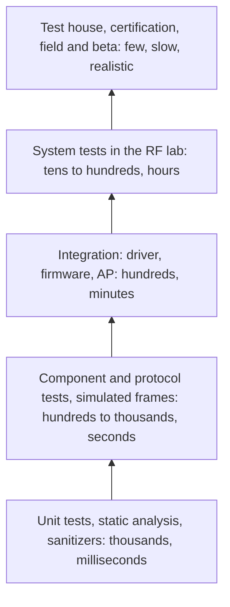

# WF 09: Wi-Fi testing: from one noisy number to a defensible verdict

*Part of the [networking plan](../00_plan.md), Wi-Fi sub-track · Candela session 8 (testing: throughput, roaming, latency, scale, test houses, automation, test plans) · You need: [WF 08](08_wifi_capture_tools_and_debug.md) (capture, iperf3, logs), [WF 05](05_wifi_roaming_and_radio_management.md) (roaming), [WF 02](02_wifi_phy.md) (rates and sensitivity)*

Wi-Fi is the hardest kind of system to test, because the medium is shared, random and uncontrolled. The same build, the same client and the same chair can give a throughput that differs by a factor of two between two runs. A test engineer who reports "500 Mbit/s" and "it regressed by 4 percent" from single runs is not measuring the product, they are measuring the room.

Interviewers ask about testing to find out whether you can turn "it feels slower" into an experiment with a verdict. The strong answer states the **question**, the **environment**, the **metric definition**, the **number of runs and the statistic**, and what result would change the decision. This tutorial is that method, applied to Wi-Fi: what to measure and exactly what the number means, how much a number moves, how to benchmark without fooling yourself, how to test scale and failure, how to cover a combination matrix, and how to automate it all.

By the end you can:

- write a test as a question with an oracle, and place it on the test pyramid;
- choose between a conducted lab, an over-the-air chamber, a test house and the field, and say what each cannot tell you;
- define throughput, latency, jitter, loss, roaming time and capacity so two labs get the same number;
- explain why a single run cannot call a regression, and compute the runs needed and the smallest effect you can detect;
- run a benchmark with a golden reference, a calibrated bed and recorded configuration;
- test rate against range, roaming and channel switching in a repeatable way;
- design scale, stress, soak and fault-injection tests;
- describe conformance, interoperability, certification and regulatory testing and who does each;
- automate tests, handle flaky tests honestly, and build a test plan with all-pairs coverage;
- report results so a manager can act on them.

---

## 1. What a test is for

A test answers a question with evidence. Write the question first, because it fixes the environment, the metric and the number of runs.

| Question | Kind of test | Typical environment | Output |
|---|---|---|---|
| Does the code do what the author meant? | unit, component | developer machine, simulation | pass or fail |
| Does the device follow the standard? | conformance | shielded lab, golden reference, analyzer | pass or fail per clause |
| Does it work with other vendors' devices? | interoperability | lab with a client zoo, test house | a matrix of pairs |
| How fast, how far, how low a latency? | performance, benchmarking | conducted lab, then OTA chamber | a distribution, not a number |
| How many clients, how fast a churn? | scale and stress | emulated plus real clients | a capacity curve and a knee |
| Does it still work after three days? | soak | lab rack | time series of metrics |
| Does a failure heal? | fault injection | lab with controllable power, links, RF | recovery time distribution |
| Does it work where people live? | field, test house, beta | houses, offices, campuses | a population of results with the environment recorded |
| May it be sold here? | regulatory (emissions, power, DFS) | accredited lab | a report |
| May it carry the logo? | certification | authorised test lab | a certificate |

**Verification** asks "did we build it right" (does it meet the spec); **validation** asks "did we build the right thing" (does the spec serve the user). A product can pass every datasheet test and still freeze the video in the bedroom, which is why the house and the field exist.

**The oracle.** A test oracle is the rule that says what a correct result is. For conformance it is the standard; for performance it is a requirement with a statistical rule ("median of 10 runs at least 450 Mbit/s with a 95 percent lower bound of 430"); for interoperability it is "the same as the reference stack". **A test with no oracle produces a number, not a verdict**, and most arguments about results are arguments about the oracle. Write it before the first run.

**Black, grey and white box.** Black box uses only the interfaces a customer has (the air, the Ethernet port) and cannot say why a test failed. White box uses internals (logs, counters, a serial console, injected faults) and explains failures. **Grey box** is the Wi-Fi default: run the test through the air and record the driver's rate, retry and airtime counters every second alongside it, because a throughput drop is only useful with the rate and retry history next to it ([WF 08](08_wifi_capture_tools_and_debug.md)).

**The test pyramid.** Many fast, cheap tests at the bottom and few slow, realistic ones at the top:



Cost and realism both rise about tenfold per level. The rule that follows: **every escape from a higher level becomes a test at the lowest level that can express it.** A failure found in the field that a frame replay reproduces becomes a protocol test with a captured frame; a race that needed four hours of soak becomes a component test with an injected delay.

Test approaches that recur: **baseline and delta** (one change at a time), **boundary and equivalence** (channels 36, 64, 100, 144, 165; widths 20 to 160 MHz), **factorial and pairwise** (section 10), **regression** (rerun on every change), **exploratory** (a person with a hypothesis, walking away from the AP on a video call), **negative and fault injection** (wrong PSK, rogue deauth, kill RADIUS), **soak and stress**, and **differential** (our AP against a reference AP in the same spot).

## 2. Where to test: conducted lab, chamber, test house, field

| Property | Conducted lab (cables, attenuators, shield boxes) | OTA chamber (turntable) | Test house or office | Field |
|---|---|---|---|---|
| RF control | complete | high | low | none |
| Repeatability | best (a few percent) | very good | poor (tens of percent) | poorest |
| Propagation realism | none (a wire has no multipath) | good if positioning is good | real | real |
| Realism of clients and neighbours | what you bring | what you bring | partly | all of it |
| Cost per run | low | high | medium | high |
| Finds | protocol, rate adaptation, capacity, regressions | antenna, beamforming, MIMO, range, orientation | roaming, coverage, real interferers, usability | the unknown unknowns |
| Failure mode | a perfect result no customer will see | long and expensive | non-repeatable | an anecdote |

A good programme uses all four and does not ask one to do another's job: **lab for regression and diagnosis, chamber for antenna and range, test house for realism and interoperability, field for what nobody thought of**, with findings flowing back down into automated lab tests.

**Isolation is the foundation of a conducted test.** Two devices on a bench are connected by the air as well as by the cable, and free-space loss at one metre is only about 40 dB at 2.4 GHz and 47 dB at 5 GHz, while a receiver floor is around -95 dBm for a 20 MHz channel. A leaked signal 10 dB under that floor needs on the order of **75 to 80 dB of isolation at one metre**, and bare devices are tens of dB short. Three consequences:

1. **A cable is not isolation.** Connectors leak and an unterminated port radiates. Use **shield boxes** (rated around 80 to 100 dB) or a shielded room and terminate unused ports.
2. **An attenuator range is a dynamic range.** The usable sweep is bounded by the isolation floor above and the connection loss below. If the isolation is poor, the low-rate end of a range test is polluted by leakage and rate adaptation looks better than it is. The Wi-Fi Alliance's device metrics ask for ambient signals below -100 dBm in an 80 MHz channel.
3. **Distance is not attenuation.** A neighbouring test bed three metres away still arrives about 45 dB above the preamble detection level. Two beds in one room interfere deterministically, and it looks like a product bug.

An **attenuator matrix** connects N APs to M clients with a programmable path loss between each pair (this is how a conducted roam is built: attenuate AP1 up while attenuating AP2 down). A **turntable** in an anechoic chamber rotates the device to measure antenna pattern and throughput against orientation. A **channel emulator** adds delay spread and Doppler for fading.

## 3. What to measure, and exactly what the number means

Two labs disagree because they defined the metric differently. Define each one by its end points, traffic and statistic. The Wi-Fi Alliance's device-metrics document takes this approach (throughput, one-way delay and jitter, rate against range, channel switching, band steering, roaming, AR/VR traffic) and asks for **distributions** (PDFs, CDFs) rather than single averages.

### 3.1 Throughput

- **Offered load** is what the generator sends; **goodput** is what the application receives over a stated interval, excluding warm-up. Say which, and at which layer (PHY rate, MAC throughput, TCP payload).
- **Zero-loss throughput** (the RFC 2544 idea) is the highest offered rate with no loss, found by binary search. On a wired device it is stable. On a radio link with rate adaptation and fading it is a **distribution**, so report the median and a low percentile of repeated searches:

```python
import random, statistics

def zero_loss_search(loss_free, lo=0, hi=1000, tol=5):
    while hi - lo > tol:
        mid = (lo + hi) / 2
        lo, hi = (mid, hi) if loss_free(mid) else (lo, mid)
    return lo

random.seed(3)   # a link whose true capacity wobbles around 420 Mbit/s
res = [zero_loss_search(lambda r, cap=random.gauss(420, 40): r <= cap) for _ in range(20)]
print(round(statistics.median(res)), round(min(res)), round(max(res)))   # 414 352 492
```

Twenty searches on the same link give answers from 352 to 492. A single zero-loss number from such a link is a sample from that spread.

- **TCP throughput** depends on window, RTT and congestion control. RFC 6349 gives a framework: measure path MTU and baseline RTT first, compute the bandwidth-delay product, and compare the TCP result with the ideal.
- **Direction and streams.** Uplink and downlink differ (different power, antennas, queues) and one stream differs from eight. "500 Mbit/s" with no direction, stream count and congestion control cannot be reproduced.

### 3.2 Latency, jitter and loss

- **Round trip** (ping) needs one clock and can include a slow reply path. **One-way delay** needs clocks synchronised at both ends (PTP or GPS, microsecond level) and is the right measure for voice and video; the Alliance metrics prefer it.
- **Jitter** is the variation of delay (inter-packet delay variation, or the running estimate RTP receivers report).
- **Use percentiles, not means.** The mean is set by the bulk of packets; the experience is set by the tail (p99, p99.9), and **lost packets have no latency, so they vanish from a latency average.** Always report loss beside latency.
- **Load changes everything.** Latency on an idle link and on a saturated link are different quantities; a deep buffer costs latency, not goodput ([WF 08](08_wifi_capture_tools_and_debug.md)).
- **Loss** is a fraction of packets sent, with packet size and rate, and its pattern (isolated or bursty) matters more than the mean for voice.

### 3.3 Roaming, channel switching and band steering

Define a roam from the **application's view**. The **gap** is the longest interval in which a stream that normally delivers a packet every T seconds delivers none, around the event. Report it with T, because T is the measurement resolution:

```python
def roam_gap(ts, event_t, window=2.0):
    """Longest interval with no packet around the event. ts: sorted arrival times in seconds."""
    near = [t for t in ts if event_t - window <= t <= event_t + window]
    return max((b - a for a, b in zip(near, near[1:])), default=None)

ts = [i * 0.02 for i in range(200)]                 # one packet every 20 ms
ts = [t for t in ts if not (1.5 < t < 1.62)]        # an outage of about 120 ms
print(round(roam_gap(ts, 1.5), 3))                  # 0.12
```

Separate the pieces: **protocol time** (probe or reassociation to completion, from a capture), **data outage** (the gap above, from the stream) and **application recovery** (a TCP flow may stall longer than the outage because of retransmission backoff). The Alliance metrics define roaming by data outage time, roam time and the fast-transition (reassociation) time, all from captures. Repeatable roaming tests use **recorded walk-throughs**: record the signal levels of a real walk, then replay them through an attenuator matrix, so every run sees the same fade.

**Channel switching** (after an OBSS, interference or DFS event) is measured as how quickly traffic resumes (the Alliance expects within 5 seconds); **band steering** as the data outage while a client is moved.

### 3.4 Scale and capacity

Capacity has more than one definition, so pick one: the number of **associated** clients, the number **passing traffic**, the **association rate** a controller sustains, the **aggregate throughput** at a given client count, and the **client count at which a latency percentile crosses a target** (the knee). Report the curve, not only the maximum.

## 4. Repeatability: how much one number moves

The noise of a Wi-Fi measurement is set by the radio and the environment, not by the wired parts of the bed. A shaped wired path repeats to about 0.1 percent between runs; a good conducted Wi-Fi lab link repeats to a few percent; a house link can vary by 20 percent or more, with the best run nearly twice the worst. Three consequences follow.

**How many runs for a precision.** The half-width of the confidence interval of a mean of n runs is t × s / √n. Requiring it within a fraction e of the mean gives the smallest n with t × cv / √n ≤ e, where cv is the relative spread:

```python
import math
from scipy import stats

def runs_needed(cv, e):
    for n in range(2, 100000):
        if stats.t.ppf(0.975, n - 1) * cv / math.sqrt(n) <= e:
            return n

print(runs_needed(0.0289, 0.05), runs_needed(0.1825, 0.05), runs_needed(0.1825, 0.02))   # 4 54 323
```

A lab (spread about 3 percent) needs 4 runs for ±5 percent; a house (spread about 18 percent) needs 54, and 323 for ±2 percent. Because n grows as 1/e², **halving the interval costs four times the runs**. When the environment sets the noise, **buy variance reduction, not runs**: control the environment, pair the runs, measure the environment. Going from 18 to 3 percent spread saves a factor of about 40 in runs, which is the real reason labs exist.

**One run cannot call a regression.** Compare two builds that are *identical* with one run each and a rule "flag if B is more than 2 percent below A": with house-level noise this raises a **false alarm close to half of the time**. Most regression tickets opened from a single noisy run are exactly this.

**Power: the smallest effect you can detect.** A t test on n runs per build keeps false alarms at its chosen level (say 5 percent), but whether it *finds a real drop* depends on the noise and n:

```python
def min_detectable_effect(cv, n, alpha=0.05, power=0.8):
    """Smallest true drop (fraction of mean) a two-sample t test with n runs per build detects."""
    df = 2 * n - 2
    se = cv * math.sqrt(2 / n)
    return (stats.t.ppf(1 - alpha / 2, df) + stats.t.ppf(power, df)) * se

print({n: round(float(min_detectable_effect(0.1825, n)) * 100, 1) for n in (5, 15, 54)})   # {5: 36.9, 15: 19.3, 54: 9.9}
print(round(min_detectable_effect(0.0289, 5) * 100, 1))                              # 5.8
```

In a house, even 54 runs per build only detect a drop of about 10 percent; five runs in a lab detect about 6 percent. **A test report should state the smallest drop it could have detected next to "no regression found".** The false alarm rate is a choice; the detection rate is a consequence of noise and run count.

## 5. Benchmarking without fooling yourself

A benchmark is a controlled comparison. The discipline, in order (the SmallNetBuilder lab method and the Alliance metrics both follow it):

1. **Fix and record the configuration**: firmware hash, driver and kernel versions, country code, channel and width, security mode, client model and driver, attenuation or position, generator version and exact command. A result without this is lost.
2. **Calibrate the bed.** Measure every cable and attenuator, verify isolation with the DUT's antenna ports terminated, and recalibrate after any change. The test bed must outperform the DUT's stated performance.
3. **Use a golden reference**: a known AP and client that never change, run daily. If the reference moves, the bed changed, not the build. This is the lab's control chart.
4. **Warm up and omit.** Skip the first seconds (rate adaptation converging, TCP slow start). A typical protocol runs 90 seconds per throughput point and drops the first 10; `iperf3 -O` does the same. Say so.
5. **Install and reset reproducibly.** Update to a known firmware, then **power-cycle in the final configuration** so the device settles its own operating parameters there.
6. **Pair the runs.** Interleave A and B (ABABAB) rather than all of A then all of B, so slow drift (temperature, neighbours' traffic) hits both builds equally and cancels in the difference.
7. **Test out of the box.** Customers do not tune internal parameters, so change external parameters (traffic, interference, topology) and leave the device's internals alone, unless the question is about tuning.
8. **Do not hide behind averages.** Plot the CDF.

**What the conducted lab cannot tell you.** A cable has no multipath, no antenna pattern, no orientation, no human body and no neighbours. A great conducted result can still fail in a house. Treat lab numbers as **relative** (build against build) and use the chamber and the house for **absolute** claims. Small chambers without turntables or multipath emulation give results that are not comparable with a full OTA router process.

### 5.1 Rate against range

The standard way to compare radios: step the path loss (typically in 3 dB steps up to the point the link breaks, for example to 60 dB on 2.4 GHz and 48 dB on 5 GHz in one published method), run downlink and uplink at each step, and plot throughput against attenuation. The curve shows the **rate adaptation algorithm** (does it step down smoothly or fall off a cliff), **sensitivity** (where the link dies), and **asymmetry** between uplink and downlink. Repeat at several turntable angles in a chamber, because antennas are not isotropic.

### 5.2 Multi-node systems

For mesh and multi-AP systems, put each node in its own shielded chamber, link them with attenuators, and measure throughput at the root, one hop and two hops, backhaul rate separately, and a **simultaneous-client capacity run** (for example three clients for 30 minutes) to expose airtime sharing. Keep all test traffic on the LAN side so router CPU does not hide the radio.

## 6. Scale, stress, soak and fault injection

**What scale testing is for.** To find the **knee**: the load at which a latency percentile, a failure rate or a resource crosses a limit. A scale test that only reports "it handled 500 clients" has hidden the interesting number.

- **Client emulation.** A real client cannot be multiplied by 500. Use an emulator (many virtual stations from a few radios, or a protocol-level tester) for **control-plane** scale (associations, 802.1X, DHCP, roams per second) and keep a few **real** clients in the mix to measure what a real client sees. Be explicit about which parts are emulated: emulated clients do not contend like 500 real radios, so they test the controller and the AP's tables, not the airtime.
- **Design a sweep.** Change one dimension at a time (client count, association rate, traffic mix), with enough points to see the knee, and repeat the point near it.
- **Control-plane scale.** Measure association success rate, time to complete, 802.1X and RADIUS throughput, DHCP leases per second, and what fails first (a table, a CPU, a timer). A **thundering herd** (all clients reassociating after an outage) is a distinct test ([WF 07](07_wifi_architectures_mesh_and_services.md)).
- **Soak.** Moderate load for days (for example 50 clients for 72 hours), with memory, descriptor, association count and latency trended. A leak is a slope, not a failure, so graph it.
- **Churn.** Clients joining and leaving continuously stress timers and cleanup paths that steady state never reaches.
- **Fault injection (negative testing).** Provoke the failure on purpose: pull the uplink, kill RADIUS, reboot the controller, send a rogue deauthentication, send malformed frames, exhaust DHCP, flip the clock. The metric is the **recovery time distribution** and whether the system returns to a *correct* state, not only whether it returns.
- **Security tests.** Wrong PSK, replayed handshake messages, downgrade attempts, PMF enforcement, fuzzed information elements. A frame parser that crashes on a malformed element is a security bug ([WF 04](04_wifi_security.md)).

## 7. Test houses and real environments

A house adds what the lab removes: multipath, walls, a person's body, real neighbours and real clients. It costs repeatability (section 4), so use it for the questions only it can answer.

- **Residential and enterprise are different problems.** A house has one to three APs, mixed clients, many walls and a neighbour on every channel; an enterprise has dense APs, roaming, RADIUS, VLANs and thousands of clients.
- **A test house protocol.** Fixed floor plan with marked positions; fixed client models and orientations; a **survey of the ambient RF** before and after (neighbours change); runs at several times of day; the same walk for roaming; every run labelled with the environment.
- **Measure the environment, then pair.** Record ambient channel utilisation and neighbour counts per run, run A and B interleaved, and use the environment as a covariate rather than pretending it is constant.
- **What a home result can claim.** A distribution over positions and times, with the environment described. It can say "in this house, at these ten positions, build B had a median 8 percent lower throughput in the far rooms". It cannot say "B is 8 percent slower".

## 8. Conformance, interoperability, certification and regulatory

- **Conformance** checks the device against the standard clause by clause using a golden reference, with an analyzer to see exactly which frame is wrong.
- **Interoperability** checks pairs of real implementations. The matrix is large (APs by clients by security by band), which is why it uses pairwise selection (next section) and a **client zoo** of current phones, laptops, IoT devices and older gear. Most field problems are interoperability problems, and most of those are a client doing something technically legal that the AP did not expect.
- **Certification.** The **Wi-Fi Alliance** runs test programs (Wi-Fi CERTIFIED for each generation, WPA3, device provisioning (DPP), EasyMesh, Agile Multiband, Optimized Connectivity and others) in **authorised test labs** that use its test bed and a set of reference devices; passing earns the logo and listing. It checks interoperability behaviour and features, not your performance. University interoperability labs (such as UNH-IOL) publish test suites for performance and IoT as well.
- **Regulatory testing** is separate and legal, not optional: emissions and spectral mask, transmit power, DFS radar detection, out-of-band emissions, SAR (body exposure), safety and EMC, done by accredited labs per country (FCC, CE/ETSI, others). A firmware change that alters power or DFS behaviour can need re-testing.
- **Carrier and enterprise programs** add their own requirements (voice quality, roaming, battery), with their own labs.

## 9. Automation and the flaky test

**Manual** testing is for exploration, usability and one-off diagnosis. **Automation** is for anything run more than a few times: regression, matrix coverage, soak, nightly benchmarks. The harness has the same parts everywhere:

- **Controllers** for the DUT (SSH, serial, vendor API), for the **attenuators** and turntable, for **traffic generators** (iperf3, a commercial generator) and for **sniffers**.
- **A test description** (the configuration, steps, oracle) as data, so a run is reproducible.
- **Artifacts** saved per run: configuration, logs, counters per second, captures, and the result with its metadata, in a store you can query.
- **A scheduler** and **resource locking**, because the RF bed is a single shared resource and two jobs must not use it at once.
- **A verdict engine** that applies the oracle (thresholds, statistics, comparison to the golden reference) and files results.

**Flaky tests.** In Wi-Fi a test fails sometimes for reasons that are not a bug: a neighbouring AP, a scan, a client that took longer to associate. The wrong responses are to **retry until it passes** (this hides real intermittent bugs and makes every dashboard green) or to ignore it. The right response:

1. **Classify the failure** (infrastructure, environment, product) from the artifacts automatically where possible.
2. **Retry once and record both results.** If it passes on retry, count it as a flake and track the **flake rate per test**.
3. **Quarantine** a test whose flake rate is above a threshold, with an owner and a deadline, rather than deleting it.
4. **Hunt the cause.** A flake is often a real race or a real environmental sensitivity that customers will also meet.

## 10. Test plans, coverage and reporting

**A test plan** says what is in scope, what is out, the environments, the entry and exit criteria, the schedule, the risks and who does what. A good one is built from **risks**: for each thing that could hurt a customer, there is a test, and the test has an oracle.

**Entry and exit criteria.** Entry: the build is stable enough to test (smoke tests pass, the environment is calibrated). Exit: all tests of priority 1 pass, no open critical bug, the performance targets are met with the stated confidence, and the known issues are documented. Prioritise by **customer impact times likelihood**, not by ease.

**Covering a matrix.** Band, width, security, client, AP mode, roam and traffic make thousands of combinations. Most failures involve the interaction of **two** parameters, so **pairwise (all-pairs) coverage** tests every pair of values at least once with far fewer cases:

```python
import itertools

def pairwise(params):
    names = list(params)
    pairs = {(i, x, j, y) for (i, a), (j, b) in itertools.combinations(list(enumerate(names)), 2)
             for x in params[a] for y in params[b]}
    full = list(itertools.product(*[params[n] for n in names]))
    tests = []
    while pairs:
        best = max(full, key=lambda t: sum((i, t[i], j, t[j]) in pairs
                                           for i, j in itertools.combinations(range(len(names)), 2)))
        tests.append(best)
        for i, j in itertools.combinations(range(len(names)), 2):
            pairs.discard((i, best[i], j, best[j]))
    return tests

P = {"band": ["2.4", "5", "6"], "width": [20, 40, 80], "sec": ["open", "wpa2", "wpa3"],
     "client": ["A", "B", "C", "D"], "roam": ["none", "11r"]}
print(len(list(itertools.product(*P.values()))), len(pairwise(P)))   # 216 13
```

216 combinations collapse to 13 cases that cover every pair. Add the **known-dangerous** combinations by hand (a client model with a history of bugs, DFS plus 160 MHz), because pairwise misses interactions of three.

**The schedule is arithmetic.** Number of cases × time per case × repetitions ÷ number of beds. A soak is days of one bed, a ten-point range sweep with three repeats is hours. Compute it before promising a date, and say which tests are cut when the date is fixed.

**Reporting.** A report that a manager can act on has: a one-line verdict, the question, the environment (with the configuration), the result as a distribution with sample size and the smallest detectable effect, what changed against the last build, open risks, and links to artifacts. **Show a CDF, not an average**, and put the worst case beside the median. Say plainly what was *not* tested.

## 11. Debugging a test result: symptom, likely cause, first check

| Symptom | Likely cause | First check |
|---|---|---|
| Throughput changes between identical runs | Environment noise, rate adaptation, neighbour traffic | Spread over 20 runs; ambient channel utilisation per run |
| Lab number far above the house number | No multipath, no body, no neighbours | Expected; compare builds in the lab and claim absolutes only from the house |
| Range test curve stops early | Isolation or attenuator limit, wrong cable loss | Measure leakage with terminated ports; recalibrate |
| Roam gap is much longer than the capture shows | TCP recovery after the outage, not the roam | Gap of a UDP stream against TCP stall |
| Regression flagged then gone | Single-run false alarm | Rerun with paired runs and a test; report the minimum detectable effect |
| Test passes on retry | Flake with a real cause, or environment | Flake rate over 100 runs; look for the common factor |
| Soak shows a slow rise in memory | A leak | Slope of memory against time; find the allocation by build bisect |
| Great scale result with emulated clients | Emulated clients do not contend for the air | Repeat with real clients in the mix |
| Two labs disagree | Metric defined differently | Compare the definitions, directions, streams, warm-up, statistic |

## 12. Common mistakes

1. **A test with no oracle.** A number is not a verdict.
2. **Calling a regression from single runs.**
3. **Reporting "no regression" without the smallest detectable effect.**
4. **Quoting throughput without direction, streams, congestion control and layer.**
5. **Reporting a mean latency** and hiding the tail and the lost packets.
6. **An uncalibrated or leaky conducted bed.**
7. **Running all of A then all of B**, so drift lands on one build.
8. **Presenting a lab result as an absolute customer number.**
9. **No golden reference**, so a bed change looks like a build change.
10. **Retrying flaky tests until green**, hiding real intermittent bugs.
11. **Testing only the happy path.** No fault injection, no churn, no soak.
12. **Relying on emulated clients** for airtime questions.
13. **Using only the matrix's corners**, instead of pairwise coverage.
14. **Recording no configuration**, so a result cannot be reproduced.
15. **Averaging across environments**, so a house and a lab result are combined.

## 13. Interview questions

1. **How do you tell whether firmware B is slower than A?** State the question and oracle, use a calibrated lab with paired and interleaved runs, enough runs for the noise (compute them), a t test or confidence interval, and report the smallest effect you could detect.
2. **Why can't a single iperf run call a regression?** Run-to-run spread; identical builds raise false alarms close to half the time in a noisy environment.
3. **What is a golden reference and why use one?** A fixed AP and client run every day; if it moves, the bed changed, not the build.
4. **Conducted lab against chamber against house?** Control and repeatability against realism and cost; the lab for regression, the chamber for antenna and range, the house for roaming and interoperability.
5. **What makes a conducted test conducted?** Isolation of 75 to 100 dB, terminated ports, shield boxes; cables alone leak.
6. **Define a roaming time.** The application's data gap around the event, with the stream's packet interval; separate protocol time, data outage and application recovery.
7. **Why report latency percentiles and loss together?** Means hide the tail, and lost packets have no latency.
8. **How do you test 1,000 clients without 1,000 radios?** Emulate for the control plane, keep real clients for the data plane, state what is emulated, and sweep to find the knee.
9. **What is pairwise testing and what does it miss?** Cover every pair of parameter values with few cases; misses three-way interactions, so add known-dangerous ones.
10. **How do you handle a flaky test?** Classify, retry once and record both, track a flake rate, quarantine with an owner, and look for the cause.
11. **What does Wi-Fi certification test and what does it not?** Interoperability and features per program in authorised labs; not performance.
12. **What is the difference between verification and validation in Wi-Fi?** Meeting the spec against serving the user; a product can pass the first and fail the second.
13. **How would you build a rate-against-range test?** Attenuator in 3 dB steps, both directions, warm-up omitted, several turntable angles, plot throughput against loss and read the adaptation behaviour.
14. **What belongs in a test report?** Verdict, question, configuration, distribution with sample size and detectable effect, comparison, risks, what was not tested.

## 14. Scenarios and design questions

**S1. Build a nightly performance regression for a new Wi-Fi 6 AP.** *Where to practise:* a lab with one AP, one client in a shield box and a variable attenuator. *Approach:* fixed configuration, golden reference, paired runs, a statistic with a stated detectable effect, results in a store, alert on a significant drop.

**S2. A customer reports video freezing during walking; the lab roaming test passes.** *Where to practise:* a lab roam with recorded signal replay and a real UDP video stream. *Approach:* measure the application gap, not the protocol time; replay the customer's walk; compare the client's roam trigger with the lab's.

**S3. Design the scale test for a controller that must support 2,000 APs and 20,000 clients.** *Where to practise:* a simulator for APs and clients plus a small real bed. *Approach:* control-plane sweep (join rate, association rate, roams), find the knee, thundering-herd test, soak with churn, what is emulated.

**S4. Two labs give different throughput for the same product.** *Where to practise:* compare two test configurations on your own bed. *Approach:* align definitions (direction, streams, warm-up, window), calibrate both, run the golden reference in each, compare the distributions.

**S5. Plan the testing for a new DFS feature.** *Where to practise:* a chamber with a radar generator, or a vendor-supplied radar test set. *Approach:* conformance (detection and channel move time), interoperability (clients that follow the CSA), fault injection (false radar), regulatory re-test, field soak.

**S6. Your pairwise matrix passed, but a bug appears with one client model on 160 MHz.** *Where to practise:* add the case and a minimal repro. *Approach:* a three-way interaction; add known-dangerous combinations, lower the failure to a component test with a captured frame.

**S7. A flaky roaming test fails 5 percent of the time.** *Where to practise:* run it 200 times with captures. *Approach:* classify failures, find the common factor (channel, neighbour, client state), decide product bug against environment, fix or quarantine.

**S8. Write the exit criteria for a release.** *Where to practise:* draft against a previous release. *Approach:* priority-1 pass, no critical bugs, performance targets with confidence, soak duration, interop matrix complete, regulatory sign-off, documented known issues.

**S9. Benchmark your AP against a competitor for a customer report.** *Where to practise:* a chamber or a test house with both devices in the same positions. *Approach:* out of the box, same client, interleaved runs, several positions, CDFs, disclose the environment and the detectable effect.

## 15. Strong answers (outlines)

**S1.** Fix everything that is not the build: configuration file in the repo, calibrated attenuators, a golden AP run first every night. Per build, run an interleaved A/B schedule against the last released build, 10 to 20 runs per point, with the first 10 seconds omitted. Compute the confidence interval of the difference and compare to the detectable effect for that noise (compute it from the golden reference's own spread). Alert only on a significant drop, store per-second rate and retry counters, and keep the artifacts so a failure is diagnosable.

**S2.** The lab test measured the protocol, and the customer felt the application. Replay a recorded walk through the attenuators with a real UDP stream and measure the longest gap. Compare when the client chose to roam (its threshold) with the lab client's. A sticky client or a slow key exchange without 11r produces a gap the protocol test never sees ([WF 05](05_wifi_roaming_and_radio_management.md)).

**S3.** Use an AP and client emulator for join and association rates; sweep one dimension at a time and graph success rate and time to complete against load to find the knee; test the thundering herd by dropping all APs and bringing them back; run a 72 hour soak with churn; keep real clients in the mix for latency. State clearly that emulated clients do not test airtime.

**S4.** Compare the definitions first (direction, streams, window, duration, warm-up, offered against goodput). Calibrate both beds and run the golden reference in each. If the reference differs, fix the beds. If it matches, the difference is in the method. Compare distributions, not means.

**S5.** Conformance: detection of a test radar pattern and the time to vacate within the rules. Interoperability: clients that honour the channel switch announcement and those that do not. Fault injection: a false radar and a missed one. Re-run the regulatory test if the behaviour changed. Field soak on DFS channels near real radar sources.

**S6.** Reproduce with a minimal case, capture, and find which parameters interact. Add the combination to the regression set, push the failure down to a component test with the captured frame, and keep a list of known-dangerous combinations that bypass the pairwise generator.

**S7.** Run 200 times with a capture and counters. Cluster the failures by channel, time, client state and neighbour activity. If one factor explains most, it is likely a real race or an environmental sensitivity that customers also meet. Fix or document; quarantine only with an owner and a date.

**S8.** Priority-1 tests pass; no critical bugs open; performance within target with the confidence stated; soak of at least 72 hours with flat memory; interoperability matrix covered with the client zoo; regulatory and certification done; known issues documented and accepted.

**S9.** Same positions, same client models, devices out of the box with the same country code and channel plan, interleaved runs over several days, CDFs and the environment recorded. Report the detectable effect and say what the test cannot claim.

## 16. Cheat sheet

| Fact | Value |
|---|---|
| Test starts with | A question and an oracle |
| Verification, validation | Built it right, built the right thing |
| Pyramid | Unit, component, integration, system lab, house and field |
| Lab, chamber, house, field | Control and repeatability against realism and cost |
| Isolation | About 75 to 100 dB; shield boxes; terminate ports |
| Throughput report | Direction, streams, window, congestion control, layer, warm-up |
| Zero-loss throughput | Binary search; on a radio, a distribution |
| Latency report | Percentiles plus loss, one-way delay for media |
| Roaming gap | Longest gap in a periodic stream, with its interval |
| Runs for precision | Smallest n with t × cv / √n ≤ e; halving e costs 4 times |
| Single-run regression | False alarm near half of the time in a noisy bed |
| Detectable effect | State it next to "no regression" |
| Benchmark discipline | Record config, calibrate, golden reference, warm-up, paired runs |
| Range test | 3 dB steps, both directions, turntable angles |
| Scale test | Sweep for the knee; emulate control plane, real clients for data |
| Pairwise | 216 combinations to 13 pairs-covering cases |
| Flaky tests | Classify, retry once, track rate, quarantine, find cause |
| Certification | Wi-Fi Alliance programs in authorised labs; not performance |
| Report | Verdict, config, distribution, detectable effect, not-tested list |

## 17. Sources and caveats

Web sources used for this tutorial: the Wi-Fi Alliance [Wi-Fi Device Metrics v1.0](https://www.wi-fi.org/system/files/Wi-Fi_Device_Metrics_v1.0.pdf) (throughput, one-way delay and jitter, rate against range, channel switching, band steering, roaming and AR/VR metrics; chamber isolation, distributions, recorded roaming scenarios); SmallNetBuilder's [How We Test Wi-Fi Systems](https://www.smallnetbuilder.com/wireless/wireless-howto/how-we-test-wi-fi-systems-revision-1/) (chamber topology, attenuation sweeps, 90 second runs with a 10 second omit, capacity and multi-hop tests, stated limitations); and the UNH-IOL [Wi-Fi IoT and STA performance test suites](https://iol.unh.edu/sites/default/files/testsuites/wireless/performance/Wi-Fi_IoT_Test_Suite_Summary_1.0.pdf). The Candela course (session 8) is the syllabus.

Caveats. The statistics (runs needed, minimum detectable effect), the zero-loss search, the roam-gap function and the pairwise generator were run here. The spreads used (about 3 percent for a lab link and 18 percent for a house link) are illustrative values from earlier simulations in this study track, not field measurements, so replace them with the spread of your own golden reference. The isolation figures are rough link-budget arithmetic and the shield-box ratings are typical values from memory. The names and scope of Wi-Fi Alliance programs, and the RFC numbers cited (2544, 6349), are from memory and worth checking before you quote them. The comparison of roaming metrics follows the Alliance document, which was summarised here from a fetched excerpt.
