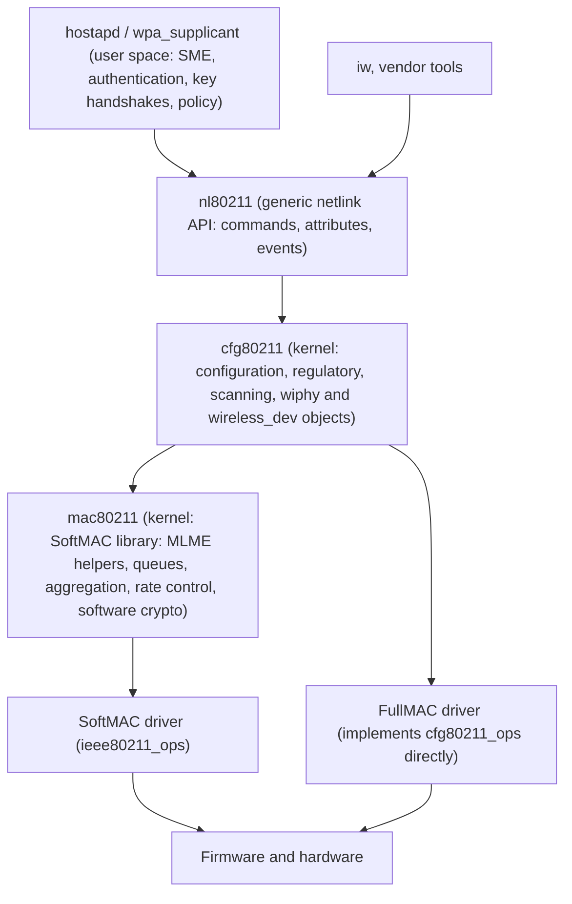
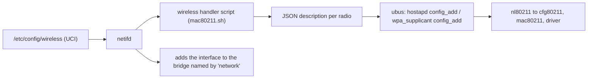

# WF 10: The Linux wireless stack and OpenWrt: from an nl80211 message to a UCI line

*Part of the [networking plan](../00_plan.md), Wi-Fi sub-track · Candela session on the Linux wireless stack, drivers and OpenWrt · You need: [WF 03](03_wifi_mac.md) (what the MAC does), [WF 04](04_wifi_security.md) (handshakes), [WF 08](08_wifi_capture_tools_and_debug.md) (`iw`, `hostapd_cli`, logs), [NET 06](../06_linux_network_stack.md) (the kernel network stack)*

Almost every Wi-Fi product you will work on, from a home router to an enterprise access point to a phone, runs the Linux wireless stack or something modelled on it. For a platform engineer at a Wi-Fi company the stack is the ground you stand on: when a client will not associate, the question is whether the fault is in `hostapd`, in `cfg80211`, in `mac80211`, in the driver, in the firmware or in the configuration, and each has its own tools.

Interviewers ask about this to find out whether you understand **which layer owns what**, and whether you can follow a request from a UCI line or a `wpa_supplicant` command down to a frame on the air and back. The strong answers are layered: name the layer, the interface between layers, the object it owns, and the tool that shows it.

By the end you can:

- draw the stack from `hostapd` and `wpa_supplicant` through nl80211, cfg80211 and mac80211 to the driver and firmware, and say what each layer owns;
- explain SoftMAC against FullMAC and why modern chips blur the line;
- describe the main objects (wiphy, wireless device, virtual interface, station, channel context) and the regulatory model;
- read and build an nl80211 request, and explain events and the control port;
- use `iw`, `wpa_supplicant` and `hostapd` correctly, and know what each configuration check does and does not catch;
- explain virtual interfaces, interface combinations and concurrency;
- follow the transmit and receive paths, the per-station queues and airtime fairness;
- explain which offloads take the data path out of the kernel and how they change debugging;
- use `mac80211_hwsim` to test protocol behaviour without hardware;
- explain how OpenWrt turns `/etc/config/wireless` into a running radio;
- describe driver bring-up for a new chip, and debug by layer.

---

## 1. The layers and who owns what



| Layer | Owns | Does not do |
|---|---|---|
| **`hostapd`, `wpa_supplicant`** | Policy and the slow parts of the protocol: scanning policy, authentication (WPA2/WPA3, 802.1X, SAE), the 4-way handshake, roaming decisions, AP configuration, RADIUS | Real-time frame handling, which is far too slow for user space |
| **nl80211** | The stable user-kernel API over generic netlink: commands to the kernel, events back | Any logic, it is only the transport |
| **cfg80211** | The common configuration layer: devices (`wiphy`), interfaces (`wireless_dev`), channels and bands, the **regulatory** database, scan results and the state exposed to user space | The MAC; it needs a driver or mac80211 under it |
| **mac80211** | The SoftMAC library: station state machine, MLME helpers, transmit and receive handling, per-station queues, aggregation sessions, rate control, power save, mesh, software crypto | Anything the chip must do in real time (it hands those to the driver and firmware) |
| **Driver** | The bus (PCIe, USB, SDIO, AHB), firmware loading, DMA rings and interrupts, translating mac80211 or cfg80211 calls into hardware commands | The protocol decisions |
| **Firmware** | Real-time MAC: ACK, backoff, aggregation, retries, often rate selection and scan sequencing | Policy |

Two sentences capture the design. **The kernel does what must be fast; user space does what must be flexible.** And **cfg80211 is the contract**: a driver that implements it works with `iw`, `wpa_supplicant`, `hostapd` and NetworkManager without any of them knowing the chip.

The same shape appears on every vendor's product. Wi-Fi companies add a proprietary driver and firmware below the contract, their own management daemon above it, and a controller protocol (CAPWAP, [WF 07](07_wifi_architectures_mesh_and_services.md)) beside it.

## 2. cfg80211: the configuration layer

cfg80211 is the Linux configuration API for 802.11 devices. As the kernel documentation says, it must be used, directly or through mac80211, by all modern wireless drivers (the old Wireless Extensions survive only for compatibility).

**The objects.**

| Object | Meaning |
|---|---|
| **`wiphy`** | One physical radio. It holds the capabilities: bands, channels, bitrates, HT, VHT, HE and EHT data, supported interface modes, allowed interface combinations, feature flags, and a pointer to the driver's `cfg80211_ops`. It appears as `phy0`, `phy1`, and in `/sys/class/ieee80211/`. |
| **`wireless_dev`** | The state of one virtual interface (the `ieee80211_ptr` of a `net_device`): its type, connection state, power save mode, registered management frame types, and MLO link data. A wiphy has zero or more. Some types have no network device at all (a P2P device). |
| **Interface types** | Station (managed), AP, monitor, mesh point, IBSS (ad hoc), P2P client and GO, OCB, and 4-address (WDS style) modes |
| **`station_info`** | What the kernel reports per station: signal, TX and RX rate, counters, connected time (what `iw dev wlan0 station dump` prints) |

**Driver registration** is a fixed sequence: allocate a wiphy with the ops table (`wiphy_new`), fill in bands, channels, modes and combinations, bind the parent device, call `wiphy_register`, then create `wireless_dev`s for each interface. On removal, unregister and free.

**Regulatory.** cfg80211 owns the regulatory rules. The kernel carries a database of country rules (frequency ranges, maximum bandwidth, maximum power, DFS and flags). The domain comes from the user (`iw reg set DE`), from the driver or firmware (a country code in the EEPROM or board data), from beacons of other devices (country elements), with the rules database shipped as `regulatory.db` (the old `crda` helper is gone from current kernels). The effective rules are the **intersection** of the sources, and they set per-channel flags:

- **disabled**: not allowed here;
- **no-IR** (no initiating radiation): you may listen but not transmit first, which blocks starting an AP there;
- **radar / DFS**: needs channel availability checking before use ([WF 05](05_wifi_roaming_and_radio_management.md));
- **width limits and power limits**.

Some drivers are **self-managed** (Intel's iwlwifi is a well-known case): the firmware decides the rules and the kernel database is advisory. Two classic field problems come from here: a router with **no country configured** sits on the conservative world domain (fewer channels, lower power), which shows up as "no 5 GHz channel above 64", and a device built for one country but run in another is a **legal** problem as well as a technical one.

**Interface combinations.** A wiphy declares which mixes it supports at once (`iw phy phy0 info` prints "valid interface combinations"): for example "up to 8 APs, or 2 stations plus 4 APs, on at most 2 different channels". This is why a radio can host several SSIDs on one channel (multiple BSS) but cannot run a station on channel 36 and an AP on channel 149 at the same time unless the combination allows two channels (a capability people call **concurrent dual channel**, often paid for with airtime and power).

## 3. nl80211: the API every tool uses

nl80211 is the **generic netlink** family that cfg80211 registers. Every user-space program follows the same steps:

1. Ask the generic netlink controller (family `nlctrl`, id 16) for the id of the family named `nl80211` (it is assigned when the module loads, so it is not constant).
2. Send **commands** (`NL80211_CMD_*`) with **attributes** (`NL80211_ATTR_*`), each a type-length-value triple padded to 4 bytes.
3. Join the **multicast groups** (scan, mlme, regulatory, config, vendor) to receive **events**.

A message is a 16-byte netlink header, a 4-byte generic netlink header (command and version) and the attributes. This builds the request behind `iw phy phy0 interface add wlan1 type ap` (the numbers are from the kernel header):

```python
import struct

NLM_F_REQUEST, NLM_F_ACK = 1, 4

def nla(t, data):                       # attribute: 4-byte header (length, type) + value, padded to 4
    n = struct.pack('HH', 4 + len(data), t) + data
    return n + b'\0' * (-len(n) % 4)
def nla_str(t, s): return nla(t, s.encode() + b'\0')
def nla_u32(t, v): return nla(t, struct.pack('I', v))
def genl(family, cmd, attrs=b'', flags=NLM_F_REQUEST, seq=1):
    body = struct.pack('BBH', cmd, 0, 0) + attrs
    return struct.pack('IHHII', 16 + len(body), family, flags, seq, 0) + body

CMD = dict(GET_WIPHY=1, NEW_INTERFACE=7, TRIGGER_SCAN=33)
ATTR = dict(WIPHY=1, IFNAME=4, IFTYPE=5)
IFTYPE_AP = 3
msg = genl(0x1c, CMD["NEW_INTERFACE"],
           nla_u32(ATTR["WIPHY"], 0) + nla_str(ATTR["IFNAME"], "wlan1") + nla_u32(ATTR["IFTYPE"], IFTYPE_AP),
           NLM_F_REQUEST | NLM_F_ACK)
print(len(msg))     # 48 bytes
```

A **nested** attribute has bit 15 of its type set (`0x8000`) and its payload is a list of attributes (a scan's frequency list is one). Wrapped in a pcap with the netlink link type, `tshark` decodes such messages as `nl80211` with named commands and attributes, which is how you confirm a number from a header file.

**Commands worth knowing.** `GET_WIPHY` (capabilities), `NEW_INTERFACE` and `SET_INTERFACE` (virtual interfaces and modes), `TRIGGER_SCAN`, `AUTHENTICATE` and `ASSOCIATE` (the SoftMAC supplicant path), `CONNECT` (the **FullMAC** path, where the firmware does both steps), `START_AP`, `NEW_STATION`/`GET_STATION`, `SET_CHANNEL`, `REGISTER_FRAME` (ask the kernel to forward received management frames of a type, which is how `hostapd` sees probe and action frames), and `FRAME` (send one).

**Events.** The kernel notifies scan results ready, authentication, association, disconnect, station added or removed, regulatory change, radar detected, channel switch, and TX status of management frames. `iw event -t` prints them with timestamps and is the quickest way to see what the kernel thought happened.

**The control port.** The 4-way handshake frames (EAPOL) are data frames. With the **control port** feature the kernel delivers them to user space over nl80211 instead of a raw packet socket, which lets the kernel hold the right key state and drop traffic until the port is authorised, and it removes a class of races with the old `AF_PACKET` path.

## 4. mac80211: the SoftMAC library

mac80211 is a library of 802.11 behaviour for **SoftMAC** drivers. A driver registers an `ieee80211_hw` with an `ieee80211_ops` table; mac80211 implements `cfg80211_ops` for it.

| Driver callback | What mac80211 asks |
|---|---|
| `start`, `stop` | Bring the radio up and down |
| `add_interface`, `remove_interface` | Create and remove a virtual interface in hardware |
| Channel context callbacks, `config` | Tune to a channel, width and power |
| `bss_info_changed` (`link_info_changed` with MLO) | Beacon interval, BSSID, association state, protection modes, basic rates, TX power, OFDMA parameters |
| `sta_state` | A station moved between none, authenticated, associated and authorized: allocate or free per-station firmware state |
| `set_key` | Install a key in hardware, or refuse (and mac80211 encrypts in software) |
| `conf_tx` | EDCA parameters per access category |
| `wake_tx_queue` | Frames are waiting on a queue: pull them |
| `ampdu_action` | Start, stop or operate an A-MPDU session |
| `hw_scan`, `sw_scan_start` | Scan in firmware, or let mac80211 sequence the channels |

What mac80211 does so drivers do not have to:

- the **station state machine** and MLME helpers (authentication and association frame exchange when asked, SA Query, channel switch handling, beacon-loss monitoring and probes);
- **transmit and receive handling**: 802.3 to 802.11 header conversion, fragmentation, defragmentation, A-MSDU, duplicate detection, the block-ack reorder buffer, delivery of copies to monitor interfaces;
- **rate control**: `minstrel_ht` by default, a statistics-based sampler that keeps a table of success probability for each rate and spends a small share of frames probing others (it takes a few hundred milliseconds to converge after a change, and hunts when the channel changes faster than that), with a hook for firmware rate control;
- **power save**: buffering for dozing stations and the TIM bit on the AP side, PS-Poll and U-APSD on the station side;
- **mesh** (802.11s with HWMP), **IBSS**, **WDS** and **AP VLAN** interfaces;
- **software crypto** when the hardware cannot: CCMP, GCMP, TKIP, WEP and BIP for management frames;
- **aggregation session management** (the ADDBA exchange), and since Linux 6.x the infrastructure for **MLO** (a per-link `bss_conf` and a `link_id` in callbacks, [WF 12](12_wifi7_eht_and_mlo.md)).

### 4.1 SoftMAC against FullMAC

| | FullMAC | SoftMAC (mac80211) |
|---|---|---|
| Where the MLME runs | On the chip, which authenticates, associates, scans and roams by itself | In the kernel, driven by `wpa_supplicant` or `hostapd` |
| What the driver implements | `cfg80211_ops` directly (`connect`, `disconnect`, `scan`, `start_ap`) | `ieee80211_ops` |
| What you see from Linux | Commands and events; the frames only on a sniffer or in firmware logs | The 802.11 frames on a monitor interface; state in `iw` and debugfs |
| Typical drivers | `brcmfmac`, `mwifiex`, `qtnfmac` | `ath9k`, `ath10k`, `ath11k`, `ath12k`, `mt76`, `iwlwifi`, `rtw88`, `rtw89` |
| Chosen when | Phones and small devices where the vendor supplies the whole MAC | APs and clients where the vendor wants Linux to own the MAC |
| A bug is fixed by | A firmware release | A kernel patch |

The line is blurred. Modern SoftMAC chips run a large firmware that does scans, aggregation, rate selection, power save and TX completion, so "SoftMAC" now means the host owns the **management** of the MAC (state, keys, scan policy) and the firmware owns the **real-time** parts. This matters for debugging: a capture on a monitor interface shows the frames the host saw, the firmware may have sent others, and the real answer is in the firmware log.

## 5. Drivers and firmware

A wireless driver has four jobs: **probe** the bus (PCIe, SDIO, USB, or AHB on an SoC) and set up interrupts and DMA; **load firmware and board data** with `request_firmware` from `/lib/firmware/` (board data holds the per-module calibration and regulatory limits); **translate** between the kernel's queues and the hardware's rings (descriptors, DMA mappings, completion interrupts, NAPI polling); and **expose capabilities** in the wiphy.

| Driver family | Chips | Notes |
|---|---|---|
| `ath9k` | Atheros 802.11n | Open, all MAC in the host: the reference for how a SoftMAC driver works |
| `ath10k`, `ath11k`, `ath12k` | Qualcomm 802.11ac, ax, be | Firmware based (WMI, and QMI on some parts); many offload paths; `ath12k` adds MLO |
| `mt76` family | MediaTek MT76xx, MT79xx | Compact, popular on OpenWrt |
| `iwlwifi` | Intel client chips | Closed firmware, self-managed regulatory |
| `rtw88`, `rtw89` | Realtek | Many consumer parts |
| `brcmfmac`, `mwifiex` | Broadcom, Marvell | FullMAC; phones and boards such as the Raspberry Pi |

To find what a system has: `ethtool -i wlan0` (driver, firmware version, bus), `dmesg` at load time, `iw phy phy0 info` (capabilities), `/sys/class/net/wlan0/device`.

## 6. User space: `iw`, `wpa_supplicant`, `hostapd`

**`iw`** is a thin nl80211 client. The commands you will use daily: `iw dev` (interfaces), `iw phy phy0 info` (capabilities, combinations, regulatory flags per channel), `iw dev wlan0 scan`, `iw dev wlan0 link`, `iw dev wlan0 station dump`, `iw dev wlan0 survey dump`, `iw reg get`, `iw event -t`, and `iw phy phy0 interface add mon0 type monitor`.

**`wpa_supplicant`** is the client-side SME. It scans, selects a BSS, drives authentication and association through nl80211 (or one `CONNECT` for FullMAC), runs the 4-way handshake and 802.1X, and decides roams. Its states (`SCANNING`, `AUTHENTICATING`, `ASSOCIATING`, `4WAY_HANDSHAKE`, `COMPLETED`) are the first thing to read. It has an internal driver abstraction, and the nl80211 backend is the one that matters.

**`hostapd`** is the AP-side SME: it creates the BSS (`START_AP` with beacon data), receives management frames from the kernel, runs the authentication and association state machines, the handshakes, RADIUS and the 802.11k/v/r and WPS features, and installs keys. Both are configured by text files and have a control socket (`hostapd_cli`, `wpa_cli`, [WF 08](08_wifi_capture_tools_and_debug.md)).

### 6.1 What a configuration check does and does not catch

`hostapd` with `driver=none` parses and validates its configuration without touching a radio, so it is a free syntax test. Running the real `hostapd` on a generated file and on edits of it gave:

| Edit | Verdict |
|---|---|
| The generated file as is | accepted |
| Passphrase of 3 characters | **rejected**: `invalid WPA passphrase length 3 (expected 8..63)`, with the line number |
| Misspelt option (`ieee80211x`) | **rejected**: `unknown configuration item` |
| VHT80 with a wrong centre-channel index | **accepted** (although wrong) |
| SAE with PMF disabled | accepted (the standard requires management frame protection with SAE) |

So syntax and cross-option rules are checked by `hostapd`, but the **capability and regulatory limits are checked only at `START_AP`** by cfg80211 and the driver, and the **behaviour on the air** only by a client. "`wifi reload` succeeded" does not mean the radio is on the channel you asked for: read `iw dev wlan0 info` and the beacon in a capture.

## 7. Virtual interfaces and concurrency

One wiphy can carry several virtual interfaces (`iw phy phy0 interface add wlan1 type __ap`). Typical uses:

- **Multiple SSIDs** (multiple BSS): several AP interfaces on one radio and one channel, each with its own BSSID. They share the radio's channel, beacon interval and capabilities, and every extra SSID adds beacon overhead ([WF 08](08_wifi_capture_tools_and_debug.md)).
- **AP plus station** (a repeater or a client-bridge): the station interface must be on the same channel as the AP unless the combination allows two.
- **A monitor interface** beside normal operation, to sniff from the AP's own radio.
- **P2P** (Wi-Fi Direct) devices, **mesh** points, **AP VLAN** interfaces for per-station VLANs.

The combination table of section 2 is the authority. When an interface will not come up, `iw phy phy0 info` tells you whether the mix is allowed before you blame the driver.

## 8. The data path, the queues and airtime fairness

**Transmit.**

```
 socket -> TCP/IP -> qdisc -> ieee80211_subif_start_xmit
   -> 802.3 to 802.11 header (addresses by ToDS/FromDS, QoS control, TID)
   -> station and key lookup, fragmentation if above the threshold
   -> intermediate queue per (station, TID), with fq and CoDel
   -> driver wake_tx_queue() -> driver pulls frames
   -> A-MPDU aggregation (mac80211 or firmware), rate selection (minstrel_ht or firmware)
   -> DMA ring -> firmware -> PPDU on the air -> TX status (acked, retries, rate) back up
```

The change that matters most is the **intermediate queue** per station and TID (from the "make Wi-Fi fast" work of the mid 2010s). Before it, the only queues were the driver's FIFO and the qdisc above it, which saw the link as one device with one rate and could neither isolate flows nor know that one station was slow. With a queue per station, mac80211 runs FQ-CoDel on each and chooses **which station** to serve next with knowledge of airtime.

**Receive.** The driver passes a buffer with status (signal, rate, flags, decrypted or not, A-MPDU position) to `ieee80211_rx`. mac80211 runs its **receive handlers in a fixed order**: monitor copies first, then station lookup, duplicate detection, power-save bit handling, decryption if the hardware did not, defragmentation, the block-ack reorder buffer, A-MSDU deaggregation, and conversion to 802.3, and finally delivery to the stack or (for management frames) to the MLME and the daemons that registered for them. The order explains why a frame can be visible on a monitor interface and still be dropped: a replay check failure, a duplicate or a wrong key.

**Who gets the air.** If every station takes equal **turns** (one aggregate each per round), a slow station takes most of the air because its aggregate lasts much longer ([WF 03](03_wifi_mac.md), the performance anomaly). The Linux answer is an **airtime deficit scheduler**: each station has a deficit counter charged with the airtime of each transmission (estimated from the TX status rate and length), and the scheduler serves the station with the lowest used airtime. In a simulation of four saturated stations at rates from 6.5 to 1,201 Mbit/s, equal turns gave the slowest station about 60 percent of the air and a total of about 117 Mbit/s, and equal airtime gave every station 25 percent and a total of about 427 Mbit/s, roughly 3.7 times more. Airtime fairness does not make the slow station faster; it stops it from slowing everyone else. The model leaves out retries, contention and uplink (the AP cannot schedule clients' uplink airtime this way, only with OFDMA triggers, [WF 06](06_wifi6_6e_7_features.md)).

**Aggregation and rate control.** An A-MPDU (up to 64 MPDUs for HT and VHT, 256 for HE) is set up per station and TID with an ADDBA exchange. At 1.2 Gbit/s of 1,500-byte packets one MPDU per transmission would be 100,000 transmissions a second; 32 per aggregate cuts it to about 3,000, which is why aggregation cuts CPU cost and why a latency-sensitive flow of small packets pays the full per-transmission overhead.

## 9. Offloads: where the data path leaves the kernel

A modern router cannot move gigabits through the generic Linux stack on a small CPU, so the path is shortened in several places. At 1.2 Gbit/s of 1,500-byte packets that is 100,000 packets a second, one every 10 µs: with two 1.2 GHz cores at most 24,000 cycles are available per packet in total, and the wireless path may use a fraction of one core. This budget is the engineering reason for the table below.

| Offload | What it moves | What it costs you in debugging |
|---|---|---|
| Hardware crypto | CCMP, GCMP, BIP in the MAC | `set_key` can refuse a cipher; the fallback is slow software |
| Firmware scan, beacon and probe response | Scan sequencing, beacon timer, probe-response template | The host does not see every probe request; timing bugs are in firmware |
| Aggregation, retries and rate selection in firmware | The real-time parts of TX | TX status arrives in batches or as estimates; the rate in `station dump` can be a firmware summary |
| 802.3 encap/decap offload | The 802.11 to 802.3 header conversion | Frames reach the host as Ethernet; a capture on the interface differs from the air |
| Netfilter flow offload (software and hardware) | Established forwarding flows bypass most of the stack | Rules after the offload point are not evaluated; counters can be wrong |
| Packet processing engines (PPE on MediaTek and Qualcomm SoCs, NSS on Qualcomm IPQ) | Routing, NAT and bridging in an accelerator, with the wireless driver delivering frames directly | `tcpdump` does not see the flow; SQM and some firewall features do not apply; a PPE bug looks like random connectivity loss |
| NAPI, GRO, RSS | The usual NIC techniques in the wireless driver | Latency from batching |

**The rule that follows:** always test with the offloads in the **shipping state**, and when something is wrong, disable them one at a time (`ethtool -K`, the flow offload option, the vendor knob) to find the layer. A capture on the AP's own interface can be missing exactly the flows that offload takes, so use a separate sniffer ([WF 08](08_wifi_capture_tools_and_debug.md)).

## 10. `mac80211_hwsim`: a software radio for testing

`mac80211_hwsim` is a kernel module that registers N virtual radios with mac80211 and passes frames between them in memory, optionally through a user-space medium simulator (`wmediumd`) that adds loss, interference and per-link rates. `hostapd` and `wpa_supplicant` run against the virtual radios exactly as against real ones, and a monitor interface (`hwsim0`) carries every frame. The `hostap` project's regression suite is built on it.

The sequence on a machine whose kernel has `CONFIG_MAC80211_HWSIM`:

1. `modprobe mac80211_hwsim radios=2` creates `phy0` and `phy1`, interfaces `wlan0` and `wlan1`, and the monitor interface `hwsim0`.
2. Move `wlan1` into a network namespace (`iw phy phy1 set netns name <ns>`), run `hostapd` on `wlan0` and `wpa_supplicant` on `wlan1`.
3. Capture on `hwsim0` and read authentication, association, EAPOL and data frames in `tshark` with the filters of [WF 08](08_wifi_capture_tools_and_debug.md).

Use it for **protocol and daemon behaviour**: handshakes, roaming logic, configuration, daemon regression. Do not use it for anything that depends on the air (rates, aggregation timing, interference). The sandbox this tutorial was written in has no wireless stack (`nl80211` is not registered and `modprobe mac80211_hwsim` finds no module), so this sequence was not run here.

## 11. OpenWrt

OpenWrt is a Linux distribution for routers and access points, built from source into a firmware image for one device. The pieces that matter for Wi-Fi work:

| Piece | Role |
|---|---|
| Kernel with `mac80211` **backports** | A newer wireless stack built against an older kernel (`kmod-cfg80211`, `kmod-mac80211`, driver packages) |
| `wpad` | One binary with `hostapd` and `wpa_supplicant`, in size and feature variants (basic, full, mesh) and crypto-library variants |
| `procd`, `ubus` | The process supervisor and the message bus; daemons expose objects (`network.wireless`, `hostapd.wlan0`, `network.interface.lan`) with methods and events |
| `netifd` | Reads `/etc/config/network` and `/etc/config/wireless`, creates interfaces, bridges and routes, and runs the wireless handler script |
| UCI | The configuration format and tool: files in `/etc/config/` of `config` sections with `option` and `list` lines, edited with `uci` and applied with `uci commit` |
| LuCI, `rpcd`, `uhttpd` | Web UI and RPC over ubus and UCI |
| `fw4` (nftables), `dnsmasq`, `odhcpd` | Firewall, DHCP and DNS |
| `squashfs` plus `overlayfs` | A read-only root with a writable overlay, so "reset to defaults" deletes the overlay |
| `usteer`, `dawn` | Optional steering daemons over ubus |

### 11.1 From a UCI line to a radio

A **`wifi-device`** section describes a radio (`type`, `band`, `channel`, `htmode`, `country`, `txpower`) and each **`wifi-iface`** a virtual interface on it (`device`, `network`, `mode`, `ssid`, `encryption`, `key`, `ieee80211w`, `ieee80211r`, `isolate`, `hidden`...). Note that `ieee80211r`, `ieee80211k` and `ieee80211v` are **OpenWrt option names**: the generated `hostapd` file uses its own (`mobility_domain`, `rrm_neighbor_report`, `bss_transition`, [WF 05](05_wifi_roaming_and_radio_management.md)).



`wifi reload` re-runs the flow. To look at each stage: `uci show wireless`, `ubus call network.wireless status` (what netifd thinks), `ubus call hostapd.wlan0 get_clients` (associated stations as JSON), `hostapd_cli -i wlan0 status`, `iw dev` and `iwinfo` (the kernel's view), and `logread -f` for `netifd`, `hostapd` and kernel messages in one stream.

A model of the mapping, run against the real `hostapd`, shows what the options become:

```python
ENC = {"psk2": ("WPA-PSK", "0"), "sae": ("SAE", "2"), "sae-mixed": ("WPA-PSK SAE", "1"), "owe": ("OWE", "2")}
BLK80 = [(36, 48, 42), (52, 64, 58), (100, 112, 106), (116, 128, 122), (132, 144, 138), (149, 161, 155)]

def centre80(ch):                       # VHT80 segment-0 centre channel index
    for a, b, c in BLK80:
        if a <= ch <= b: return c

def to_hostapd(dev, iface):
    km, pmf = ENC[iface["encryption"]]
    out = ["driver=none", "interface=wlan0", f"ssid={iface['ssid']}",
           "hw_mode=" + ("a" if dev["band"] == "5g" else "g"),
           f"channel={dev['channel']}", f"country_code={dev['country']}", "ieee80211n=1"]
    if dev["htmode"] == "VHT80":
        out += ["ieee80211ac=1", "vht_oper_chwidth=1",
                f"vht_oper_centr_freq_seg0_idx={centre80(int(dev['channel']))}"]
    out += ["wpa=2", f"wpa_key_mgmt={km}", "rsn_pairwise=CCMP", f"ieee80211w={iface.get('ieee80211w', pmf)}"]
    if "SAE" in km: out.append(f"sae_password={iface['key']}")
    if "PSK" in km: out.append(f"wpa_passphrase={iface['key']}")
    if iface.get("isolate") == "1": out.append("ap_isolate=1")
    return "\n".join(out) + "\n"
```

For a 5 GHz radio on channel 36 with `VHT80`, `sae-mixed` and `isolate 1`, this gives `hw_mode=a`, `vht_oper_centr_freq_seg0_idx=42` (the 80 MHz block 36 to 48 has its centre at 5210 MHz, index (5210 - 5000) / 5), `wpa_key_mgmt=WPA-PSK SAE`, `ieee80211w=1` (PMF optional, so WPA2-only clients can still join) and `ap_isolate=1`. `sae` alone sets PMF required (`ieee80211w=2`), `owe` uses key management OWE with PMF required, and `psk2` gives `WPA-PSK` with no PMF by default.

### 11.2 Practical points

- **Defaults differ between releases**: encryption, PMF, whether new networks start disabled, and the country. A missing `country` leaves the world domain (section 2).
- **The channel and width belong to the radio**, not the interface: changing one SSID's channel changes them all.
- **The `network` option** puts the wireless interface in that network's bridge; with 802.1Q and dynamic VLAN the AP uses `AP_VLAN` interfaces.
- **SQM versus offload**: SQM (`fq_codel` or `cake`, [NET 14](../14_queueing_qos_and_traffic_management.md)) needs software forwarding, so enabling it disables flow offload on that path. This is the classic cause of a router that is fast without SQM and slow with it.
- **Fleet roaming**: the `ieee80211k/v/r` options plus `usteer` or `dawn` implement [WF 05](05_wifi_roaming_and_radio_management.md) on many OpenWrt APs using ubus events.
- **Developer loop**: build an image with `make menuconfig`, test package changes with an installed package or `sysupgrade`, read `dmesg` and `logread`, and reload a driver module with `rmmod` and `modprobe` without a reboot on many devices.

## 12. Driver bring-up: the platform engineer's view

A checklist for a new SoC or radio module:

1. **Hardware description**: the device tree node (bus, interrupts, clocks, reset and power GPIOs, memory regions, firmware name, where the board data and calibration come from, the regulatory region).
2. **Probe and firmware**: enable clocks and power, `request_firmware` for the firmware and board data. A firmware timeout in `dmesg` means a wrong file, wrong version or an unpowered chip.
3. **The control channel to the firmware** (WMI or similar commands and events, QMI on some Qualcomm parts) with a "ready" event before anything else works.
4. **The data rings**: DMA descriptors, interrupts and NAPI, the completion path. Common bugs: a ring that stalls (a missed doorbell or interrupt), a cache coherency problem (a missing barrier), a leak in the completion path.
5. **Capabilities in the wiphy**: bands, channels, HT, VHT, HE and EHT capabilities, streams, maximum aggregate, interface combinations, ciphers, features (scan and probe offload, TWT, OFDMA, MLO). A wrong capability is a problem a client sees only as "slow".
6. **Regulatory and power**: board data and per-channel limits. A TX power table error shows up as low range or an illegal emission.
7. **Test**: associate with `wpa_supplicant`, run an AP with `hostapd`, throughput with the method of [WF 09](09_wifi_testing.md), a separate sniffer, a soak, and with offloads on and off.

Read when it fails: `dmesg`, the firmware log (a debugfs file or trace event in many drivers), `iw event`, `hostapd -dd`, `ethtool -S`, `/sys/kernel/debug/ieee80211/phy0/`, and `trace-cmd record` with the `mac80211` and `cfg80211` events.

## 13. Debugging by layer

| Symptom | Layer to suspect first | First tools | What the answer looks like |
|---|---|---|---|
| `iw` says "nl80211 not found", no phy | No cfg80211 in the kernel, or no driver loaded | `zcat /proc/config.gz`, `lsmod`, `ls /sys/class/ieee80211` | Config option off, or the driver did not probe |
| phy exists, nothing works | Driver probe or firmware | `dmesg`, `ethtool -i`, `/lib/firmware` | Firmware timeout or missing board file |
| A channel is missing or `NO-IR` | Regulatory | `iw reg get`, `iw phy phy0 info`, the country setting | Wrong or missing country, self-managed driver, DFS not yet available |
| AP does not start | hostapd config, then `START_AP` | `hostapd -dd`, the `nl80211:` lines, `iw dev` | A rejected option, a channel the kernel refuses, a missing capability |
| Clients cannot associate | hostapd MLME | `hostapd -dd`, `iw event -t`, a capture | A status code in the association response, or no response |
| Association works, no traffic | Keys, then the bridge | Handshake lines, `iw ... station dump`, `bridge fdb`, `tcpdump` on the bridge | Handshake unfinished, station not authorized, VLAN or isolation setting |
| Throughput low | Rate and airtime | `station dump` (rate, retries, failed), `survey dump`, a sniffer | Poor signal, retries, a busy channel, a slow client holding the air |
| Collapse with many clients | Queues, offload, CPU | `top`/`mpstat`, `/proc/softirqs`, `ethtool -S`, flow offload state | A CPU limit at the packet rate, an aggregation limit, an offload bug |
| Slow or wrong roaming | Supplicant policy and handshake | `wpa_supplicant -dd`, `wpa_cli`, 11k/v frames in a capture | Costly scans, no 11r, a client that ignores steering |
| AP stops beaconing | Firmware crash or DFS | `dmesg`, `iw event`, firmware log | A firmware restart, or radar detection and a channel switch |
| Works in the lab, fails in a house | RF, not software | [WF 08](08_wifi_capture_tools_and_debug.md), [WF 09](09_wifi_testing.md) | Interference, position, a client quirk |

Two habits save time. **Decide the layer before reading logs**: one `iw event` run and one `hostapd -dd` run show whether the failure is a daemon decision (a log line with a reason), a kernel refusal (an errno from nl80211) or silence from the driver (no event at all). And **change one layer at a time**: turn offloads off, then software crypto on, then a different driver version, never several at once.

## 14. Common mistakes

1. **Blaming the driver for a daemon decision**, or the reverse, without reading `hostapd -dd` and `iw event`.
2. **Trusting "config reloaded" as proof the radio is on the right channel.**
3. **No country code**, then chasing missing 5 GHz channels.
4. **Assuming a SoftMAC driver means the host sees every frame.** Firmware sends and absorbs frames.
5. **Debugging a flow that a PPE or flow offload carries** with `tcpdump` on the AP.
6. **Enabling SQM and not noticing it disables offload.**
7. **Configuring a station and an AP on different channels** on a radio that allows only one.
8. **Using OpenWrt option names in a raw `hostapd` file** (`ieee80211r` is not a `hostapd` key).
9. **Reading a monitor-mode capture as if every frame was transmitted** (it also shows frames mac80211 later drops).
10. **Testing only with offloads off** (or only on) and shipping the other state.
11. **Assuming mac80211_hwsim shows real performance.**
12. **Leaving `-ddd` on in production.**

## 15. Interview questions

1. **Draw the Linux Wi-Fi stack and say what each layer owns.** `hostapd`/`wpa_supplicant`, nl80211, cfg80211, mac80211, driver, firmware; policy in user space, real time in the firmware, the contract in cfg80211.
2. **SoftMAC against FullMAC?** Where the MLME runs; `ieee80211_ops` against `cfg80211_ops`; who fixes a bug; how modern chips blur it.
3. **What is a `wiphy` and what is a `wireless_dev`?** A radio with capabilities, against one virtual interface with its state.
4. **How does regulatory work in Linux?** A database of country rules, hints from the user, driver and beacons, intersected, with per-channel flags (disabled, no-IR, radar, width and power); self-managed drivers differ.
5. **What happens when `wpa_supplicant` joins a network?** Scan, choose a BSS, `AUTHENTICATE` and `ASSOCIATE` (or `CONNECT`), EAPOL handshake over the control port, keys installed, state `COMPLETED`.
6. **What does the nl80211 `REGISTER_FRAME` command do?** Asks the kernel to forward received management frames of a type to user space, which is how `hostapd` sees probes and actions.
7. **What does mac80211 give a driver, and what must the driver still do?** State machine, queues, rate control, crypto, aggregation sessions; the bus, firmware, rings and real-time parts.
8. **Why per-station queues?** Flow isolation and airtime accounting; one slow station cannot own a single FIFO.
9. **Explain airtime fairness and what it does not fix.** A deficit scheduler on airtime; it protects the fast stations, it does not speed up the slow one, and it does not schedule uplink.
10. **What offloads do routers use and how do they change debugging?** Hardware crypto, firmware aggregation and rate, 802.3 offload, flow offload, PPE; captures and counters no longer show the whole path.
11. **When would you use `mac80211_hwsim`?** Protocol and daemon testing without hardware; not for rate or timing.
12. **How does OpenWrt turn `/etc/config/wireless` into a radio?** netifd, the wireless handler script, a JSON per radio, ubus calls to `hostapd`, nl80211.
13. **Why can `wifi reload` succeed and the AP still be wrong?** `hostapd` checks syntax and cross-option rules; capability and regulatory limits are enforced at `START_AP`; behaviour on the air is a client matter.
14. **What do you check when an AP has no 5 GHz channel above 64?** The country code and `iw reg get`; the regulatory flags per channel; DFS availability.

## 16. Scenarios and design questions

**S1. A new radio module probes but no interface appears.** *Where to practise:* a board with a vendor SDK, or read `dmesg` from a failed probe on any machine. *Approach:* `dmesg` for firmware load, `ls /lib/firmware`, bus enumeration, power and reset GPIOs, board data.

**S2. Clients associate but get no traffic on one SSID with isolation on.** *Where to practise:* an OpenWrt VM or a router with two SSIDs. *Approach:* handshake lines, station authorized, `bridge fdb`, VLAN, `ap_isolate`, then a capture on the bridge.

**S3. Throughput halves after enabling SQM.** *Where to practise:* a router with flow offload and SQM. *Approach:* check that flow offload is disabled on the path, measure CPU softirq, size the shaper rate, compare with SQM only on egress.

**S4. A customer wants an AP and a client bridge on one radio on different channels.** *Where to practise:* `iw phy phy0 info` on a few drivers. *Approach:* read the interface combinations, explain the one-channel limit, offer a second radio or channel match.

**S5. Design a test setup for the `hostapd` configuration generator of a product.** *Where to practise:* the UCI mapping snippet above plus `hostapd -t`. *Approach:* unit tests of the mapping, `hostapd` syntax check, `mac80211_hwsim` for a real association, a lab check on hardware for the capability and regulatory limits.

**S6. An AP loses beacons every few hours.** *Where to practise:* a soak with `iw event` and a sniffer. *Approach:* `dmesg` for a firmware crash, `iw event` for radar, the firmware log, a known-good firmware version, thermal and power.

**S7. Add a vendor feature that needs a new management frame handler.** *Where to practise:* read the nl80211 vendor command and `REGISTER_FRAME` paths. *Approach:* decide kernel against user space (user space unless real time), use `REGISTER_FRAME` or a vendor command, keep the contract stable.

**S8. A roam is slow only on devices using the vendor's custom driver.** *Where to practise:* compare captures from two drivers. *Approach:* scans (firmware or mac80211), keys installed, offloaded handshake, driver-specific delays, `wpa_supplicant -dd` timings.

**S9. Port a feature from an older kernel to an OpenWrt backports tree.** *Where to practise:* a backports build. *Approach:* find the mac80211 API difference, patch the driver against the backport, test with `hwsim` then hardware.

## 17. Strong answers (outlines)

**S1.** `dmesg` first: is there a `request_firmware` failure, a PCIe link failure, an IOMMU fault? Check the files in `/lib/firmware` against the driver's expected names and versions, the device tree (clocks, resets, power GPIOs) and the bus enumeration. A firmware timeout after load points at power or a wrong board file; no probe at all points at the bus or device tree.

**S2.** Association is fine, so the fault is after the handshake: confirm the station is authorized and the PTK installed, then check the bridge (`bridge fdb show`, port state) and the VLAN assignment. With `isolate` on, peer-to-peer traffic is blocked by design, but the gateway must still be reachable, so test to the router and not to another client. Capture on the bridge and on the wireless interface to see where the packet stops.

**S3.** SQM needs the packets in the software path, so it turns off flow offload (and any PPE offload) for those flows. The CPU then does the routing at the packet rate, which a small SoC cannot do at gigabit. Measure softirq load, then set the shaper below the line rate, limit SQM to the direction that needs it, or choose hardware with enough CPU. Say plainly that bufferbloat control and hardware offload do not combine on many SoCs.

**S4.** Read the interface combination table: if it allows one channel, the station and AP must share it, so either set the AP to the station's channel (the AP then follows the upstream when it changes) or use a second radio. Explain the trade-off: with two channels on one radio the chip time-slices and each side loses airtime and latency.

**S5.** Three levels: unit tests of the mapping with golden configs, a `hostapd` syntax run with `driver=none` to catch typos and passphrase rules, and a `mac80211_hwsim` run with `wpa_supplicant` for real association with each security mode. Hardware tests cover what `hwsim` cannot: regulatory limits, VHT and HE channel indexes at `START_AP`, and rates. Include the negative cases that `hostapd` accepts silently (wrong centre index, SAE without PMF) as explicit checks in your own code.

**S6.** Correlate the beacon loss with `dmesg` and `iw event` timestamps. A firmware crash shows as a restart message and a recovery, a radar event as a channel switch announcement, a thermal or power issue as a pattern with load or temperature. Capture on a separate sniffer so you see what the air saw. Try the previous firmware to bisect.

**S7.** Keep real-time work in firmware or driver, and policy in user space. For a new management frame, register the frame type with `REGISTER_FRAME` and handle it in `hostapd`; for a vendor feature, a vendor nl80211 command keeps the core API stable. Resist forking cfg80211: carry the change as a small patch on top, and plan to upstream it.

**S8.** Capture both drivers' roams on a separate sniffer and compare phases: scan time, authentication, association, handshake. A firmware that does its own scans or offloads the handshake can add delay the host never sees. Read `wpa_supplicant -dd` timestamps against the capture and fix the phase with the largest gap, or ask the vendor.

**S9.** Find which mac80211 or cfg80211 API the feature uses, check whether the backports tree has it, and patch the driver to the backport's version. Test with `mac80211_hwsim` for logic, then on real hardware for rates and regulatory. Keep the patch small so it can be dropped when the tree moves forward.

## 18. Cheat sheet

| Fact | Value |
|---|---|
| Stack | `hostapd`/`wpa_supplicant`, nl80211, cfg80211, mac80211, driver, firmware |
| nl80211 | Generic netlink family; commands, attributes, multicast event groups |
| Message | 16-byte netlink header, 4-byte genl header, TLV attributes padded to 4; nested attribute has bit 15 set |
| cfg80211 objects | `wiphy` (radio), `wireless_dev` (interface), `station_info` |
| Regulatory | Database plus hints, intersected; flags: disabled, no-IR, radar, width, power |
| SoftMAC | `ieee80211_ops` over mac80211; host owns management |
| FullMAC | `cfg80211_ops` directly; chip owns MLME; supplicant sends `CONNECT` |
| mac80211 | State machine, queues, rate control (`minstrel_ht`), crypto, aggregation |
| Queues | Per station and TID, FQ-CoDel, airtime deficit scheduler |
| Offloads | HW crypto, firmware TX, 802.3 offload, flow offload, PPE |
| `iw` | `dev`, `phy info`, `station dump`, `survey dump`, `reg get`, `event -t` |
| `hostapd -t` (`driver=none`) | Syntax and cross-option check only |
| OpenWrt flow | UCI, netifd, `mac80211.sh`, ubus, `hostapd`, nl80211 |
| OpenWrt option names | `ieee80211r/k/v` (UCI), not `hostapd` keys |
| Test without hardware | `mac80211_hwsim` plus `wmediumd` |

## 19. Sources and caveats

Web sources used for this tutorial: the Linux kernel's [cfg80211 documentation](https://docs.kernel.org/6.6/driver-api/80211/cfg80211.html) (`wiphy`, `wireless_dev`, `cfg80211_ops`, regulatory hooks, interface combinations, the registration sequence); the [Linux kernel Wi-Fi stack basics](https://wifidiving.substack.com/p/linux-kernel-wifi-stack-basics) article (the layer split, SoftMAC against FullMAC, the nl80211 command and event path); the [Linux 802.11 driver developer's guide](https://docs.kernel.org/6.2/driver-api/80211/index.html); and the OpenWrt [wireless configuration page](https://openwrt.org/docs/guide-user/network/wifi/basic) (the page itself blocked automated fetching, so the UCI option names come from earlier knowledge of the documentation). The Candela course is the syllabus.

Caveats. The nl80211 encoder was run and its output has the expected 48-byte layout, and the UCI-to-`hostapd` mapping was run against the real `hostapd` 2.10 with `driver=none` (it accepted the generated file, rejected the short passphrase and the misspelt option, and accepted the wrong centre index, as stated). This environment has no wireless stack, so `iw`, `mac80211_hwsim` and any driver behaviour were **not** run here: those sections come from the documentation and from experience. Driver lists, offload names and the `minstrel_ht` description are from memory and change by release. The airtime-fairness figures come from an earlier simulation and show direction, not a field measurement. Check the kernel and OpenWrt versions you actually target.
