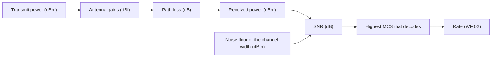

# WF 11: RF fundamentals and the link budget: from transmit power to the rate a client gets

*Part of the [networking plan](../00_plan.md), Wi-Fi sub-track · Candela material on RF, antennas, link budget and channel planning · You need: [WF 02](02_wifi_phy.md) (modulation, MCS, channel widths), [WF 01](01_wifi_landscape_and_ap_anatomy.md) (bands and the AP)*

Most Wi-Fi problems that reach an engineer are, underneath, **RF problems**: a client that sits at the edge of coverage, an AP that is too loud for its neighbours, a 160 MHz channel that made the far rooms worse, a 5 GHz network that "does not reach" where 2.4 GHz does. The protocol tutorials explain what the frames mean. This one explains **why the frames arrive or do not**, and gives you the arithmetic to predict it before anyone walks the building.

Interviewers use RF questions to find out whether you can reason from physics to a customer symptom without a calculator and without hand-waving: why does 5 GHz reach less, why can't a louder AP fix a weak client, why does a wider channel shorten range, why are three channels all you get in 2.4 GHz. The answers are short once you hold five ideas: the **decibel**, the **noise floor**, **path loss**, the **link budget** and **fading**.

By the end you can:

- work in dB and dBm, add powers correctly, and compute a noise floor for any channel width;
- explain free-space loss, why higher frequencies lose more, and why indoor loss is steeper than free space;
- build a link budget, turn it into SNR and then into a rate, and see which end of the link limits you;
- explain why RSSI alone is not a quality measure;
- explain multipath, fading and fade margin, and how much margin an availability target costs;
- explain antenna gain, EIRP, per-chain against total power, MIMO array gain, and the 6 GHz power-spectral-density rule;
- plan channels: overlap, reuse, co-channel and adjacent-channel interference, and the power and width trade-offs;
- recognise non-Wi-Fi interference and its effect on the noise floor;
- walk through a design from requirements to a channel and power plan.

---

## 1. The chain from power to rate

A Wi-Fi link is a chain, and each section of this tutorial is one link of it:



Received power is the sum `Pt + Gt + Gr - path loss`. **SNR** is that power minus the noise floor. The SNR decides which MCS decodes, and the MCS and width decide the rate. Two facts follow at once:

- **Only the ratio matters.** Raising the signal by 3 dB and lowering the noise by 3 dB are the same thing. A wide channel has more noise (section 2), so it needs more signal for the same MCS.
- **The right-hand side is steps.** MCS is discrete, so a client a fraction of a dB below a threshold falls a whole rate step.

## 2. Decibels and the noise floor

### 2.1 Why decibels

Powers in a link span many orders of magnitude (a 200 mW transmitter, picowatts at the receiver), and every stage multiplies the power by a factor. A **decibel** is ten times the base-10 logarithm of a power ratio, which turns every multiplication into an addition:

- **dB** is a ratio (a gain or a loss).
- **dBm** is an absolute power relative to 1 mW.
- **dBi** is antenna gain relative to an isotropic (all-direction) radiator.

Two numbers to know cold: **3 dB is a factor of 2 and 10 dB is a factor of 10**. Everything else follows (6 dB is ×4, 13 dB is ×20, 20 dB is ×100, -3 dB is half). You can add dB to dBm (a gain to a power) but never two dBm values. Two signals add in **milliwatts**:

```python
import math
def db(x): return 10 * math.log10(x)
def add_dbm(*ps): return db(sum(10 ** (p / 10) for p in ps))

print(round(add_dbm(20, 20), 1))              # 23.0: two equal signals add 3 dB
print(round(add_dbm(20, 10) - 20, 2))         # 0.41: a signal 10 dB weaker adds only 0.41 dB
print(round(add_dbm(*[20] * 10), 1))          # 30.0: ten equal signals add 10 dB
```

This is why a distant neighbour barely moves the noise floor and a strong one moves it a lot.

Landmarks worth remembering: an AP at the antenna is typically 20 to 23 dBm (100 to 200 mW); a phone transmits at about 15 dBm; "good for video and voice" is about **-67 dBm**; "weak, lowest rate" is about **-82 dBm**; the noise floor of a 20 MHz channel is about **-95 dBm** with a real receiver. The whole usable range from a nearby AP to the edge is around 80 dB, a factor of 100 million in power, which is why decibels are the only workable unit.

### 2.2 The noise floor

Even with nobody transmitting, a receiver sees **thermal noise**: **-174 dBm per hertz** at room temperature. A channel of width B has `-174 + 10 log10(B)` dBm, and the receiver's own circuits add the **noise figure** (NF, about 6 dB assumed here):

```python
def noise_floor_dbm(width_mhz, nf_db=6):
    return -174 + 10 * math.log10(width_mhz * 1e6) + nf_db

print([round(noise_floor_dbm(w), 1) for w in (20, 40, 80, 160, 320)])
# [-95.0, -92.0, -89.0, -86.0, -82.9]
```

**Each doubling of the width adds 3 dB of noise**, because the receiver now listens to twice the bandwidth. A signal that gives 28 dB of SNR in 20 MHz gives 22 dB in 80 MHz and 16 dB in 320 MHz. This is the **cost of a wide channel**: more subcarriers, but each carries a smaller share of the power. The practical noise floor in a busy building is higher than this thermal figure because of other transmitters (section 8).

## 3. Path loss

### 3.1 Free space and the frequency penalty

In free space power spreads over a sphere, so it falls with the **square of distance**:

```python
def fspl_db(d_m, f_mhz):
    return 20 * math.log10(d_m / 1000) + 20 * math.log10(f_mhz) + 32.44

print([round(fspl_db(1, f), 1) for f in (2437, 5500, 6000)])   # [40.2, 47.2, 48.0] dB at 1 m
```

- **Distance:** doubling the distance adds **6 dB**; ten times adds 20 dB.
- **Frequency:** at the same distance **5 GHz loses about 7 dB more than 2.4 GHz** (`20 log10(5500 / 2437)`), and 6 GHz about 8 dB more.

The frequency penalty is **not a property of the air**. It is a property of the **antenna**: an antenna of fixed gain captures an area proportional to the wavelength squared, so at 5 GHz a 0 dBi antenna collects about five times less power than at 2.4 GHz. In free space a 7 dB deficit is a factor of 2.3 in range. Larger antenna arrays or higher-gain antennas at the higher band are the compensation, which is exactly what MIMO and beamforming provide.

### 3.2 Indoors: the log-distance model

Indoors, walls, floors and furniture absorb, reflect and scatter the signal, so it falls faster than free space. The standard model keeps the one-metre free-space loss as a reference and lets an exponent carry the building:

```python
def path_loss(d_m, f_mhz, n=3.5, walls_db=0):
    return fspl_db(1, f_mhz) + 10 * n * math.log10(max(d_m, 1)) + walls_db
```

The exponent **n is 2 in free space**; in an open office or a house it is about **3 to 3.5**; a cluttered floor with many partitions is **4 or more** (typical ranges, from experience). With n = 3.5, doubling the distance costs **10.5 dB** (not 6), and ten times the distance costs 35 dB. Fixed **wall losses** add on top: a few dB for plasterboard, ten dB or more for concrete, brick, a lift shaft or a metal door, and generally more at 5 and 6 GHz than at 2.4.

Published models give a sense of the numbers. The **ITU indoor model** (Recommendation P.1238) uses a distance power-loss coefficient of about 28 to 31 in the 5 GHz range for offices and homes (the formula is `20 log10 f + N log10 d + floor loss - 28`, so N = 30 is an exponent of 3) and a **floor penetration loss** of roughly 16 dB for one floor at 5.2 GHz and 22 dB at 5.8 GHz in offices. A measured model for 5 GHz office WLANs (the TMB model, `PL = 54.1 + 20.6 log10(d) + 5.25 × W × d`, with W about 0.15 walls per metre) fits one office floor to about 7.7 dB RMS, which is a useful reminder: **a model is only as good as its fit to your building**, and a typical indoor prediction has a standard deviation of 7 to 8 dB. A **site survey** replaces guessed exponents and wall losses with measured ones ([WF 08](08_wifi_capture_tools_and_debug.md)).

**The shadowing term.** Even a good model is a median. Real indoor signals vary around it with a log-normal spread of several dB (shadowing from furniture, people, doors). This is separate from multipath fading (section 5), which varies over centimetres. Treat the model as a mean and add a **margin** for both.

## 4. The link budget

### 4.1 The sum

```
Received power  =  Tx power + Tx antenna gain + Rx antenna gain - path loss
SNR             =  Received power - noise floor
```

Every term is in dB or dBm, so it is one addition and one subtraction. A worked example for an AP at 23 dBm with a 3 dBi antenna and a 0 dBi client, an indoor exponent of 3.5 and a 20 MHz channel (noise floor -95 dBm), no walls:

```python
MCS = [(1,.5),(2,.5),(2,.75),(4,.5),(4,.75),(6,2/3),(6,.75),(6,5/6),(8,.75),(8,5/6),(10,.75),(10,5/6)]
GAP = 8.0   # assumed gap to the Shannon limit: a model parameter, not a standard value

def snr_needed(m): b, r = MCS[m]; return GAP + db(2 ** (b * r) - 1)
def best_mcs(snr):
    ok = [m for m in range(12) if snr >= snr_needed(m)]
    return ok[-1] if ok else None

for f in (2437, 5500):
    for d in (10, 20, 40):
        rssi = 23 + 3 + 0 - path_loss(d, f)
        snr = rssi - noise_floor_dbm(20)
        print(f, d, round(rssi, 1), round(snr, 1), best_mcs(snr))
# 2437 10 -49.2 45.8 11   | 5500 10 -56.2 38.7 11
# 2437 20 -59.7 35.3 11   | 5500 20 -66.8 28.2 9
# 2437 40 -70.2 24.7 7    | 5500 40 -77.3 17.7 4
```

The SNR each MCS needs follows the Shannon bound for its bits per symbol plus an implementation **gap** (8 dB assumed; MCS 0 needs about 4 dB, each step up 2 to 3 dB more, MCS 11 about 33 dB). The model is **not the table of any real chip**, but its shape is true of every receiver. At 40 m the 5 GHz client has lost five MCS steps against 2.4 GHz, which is the 7 dB of section 3.1 turning into a rate. Real receivers also have **minimum sensitivity** requirements in the standard (about -82 dBm for MCS 0 at 20 MHz, about -52 dBm for the top rate in 802.11ax, from memory), and good receivers beat them by several dB.

**The range is smaller in ratio indoors.** Solving the budget for the distance at which the signal falls to -82 dBm gives about 87 m at 2.4 GHz and 54 m at 5 GHz with n = 3.5, a **ratio of 1.6**, whereas free space (n = 2) gives 2.3. A steeper exponent compresses the difference between the bands: a good part of the real-world advantage of 2.4 GHz range comes from walls, which attenuate 5 and 6 GHz more.

### 4.2 RSSI is not SNR

Drivers report RSSI, a power measure whose **scale is vendor specific** (dBm on some chips, an index converted by the driver on others). It says nothing about noise, and the rate depends on the ratio. Two clients at -72 dBm differ by 6 dB of SNR if one is in 20 MHz and the other in 80 MHz, and by far more if a neighbour is on the same channel. **Use SNR (and the noise floor where the driver reports it) to judge a link, and RSSI only to compare signals measured the same way.** In a dense network, the question is often SINR, signal against interference plus noise ([WF 08](08_wifi_capture_tools_and_debug.md)).

### 4.3 Width against range

At 80 MHz the noise floor is 6 dB higher than at 20 MHz, so every row of the table above loses 6 dB of SNR, and every MCS step is lost sooner. The effect is the **wide-channel trade**: peak rate near the AP, range and robustness far from it. At a position where a 20 MHz channel still carries a low rate, an 80 MHz channel may have no link at all, although just inside it carries several times more. This is why an AP in a large building often runs 20 or 40 MHz, and why 160 and 320 MHz are for short, strong links ([WF 02](02_wifi_phy.md), [WF 12](12_wifi7_eht_and_mlo.md)).

### 4.4 The link has two ends

A link budget is solved **for both directions**, and the weaker end sets the rate. An AP may transmit at 23 dBm with a 3 dBi antenna while a phone transmits at about 15 dBm with a poor antenna and a body in the way. The downlink then looks fine (the client hears the AP) and the uplink is poor (the AP barely hears the client). **Raising AP power does not fix an uplink-limited client**; it only makes the AP hear itself louder to its neighbours. The remedies are a more sensitive AP receiver (more antennas), a closer AP, a better client antenna, or lower AP power so that the client's roaming decision matches reality ([WF 05](05_wifi_roaming_and_radio_management.md)). Balance the budget by matching AP power to what the client can send back, a point where "set AP power to the maximum" is the wrong default.

## 5. Multipath and fading

### 5.1 The received power is not a number

The path-loss model gives a mean. In a room the signal arrives directly and by reflections from walls, floor, ceiling and people, each copy with its own delay and phase. At a point the copies add or cancel, so the power **swings by tens of dB over a few centimetres** (half a wavelength is about 6 cm at 2.4 GHz). With many paths of random phase the power follows the **Rayleigh distribution**: the probability that power falls m dB below its mean is `1 - exp(-10^(-m/10))`. A simulation of random phasor sums matches it:

```python
import random
random.seed(1)

def prob_below(m_db, n=100000, paths=30):
    pws = []
    for _ in range(n):
        ph = [random.uniform(0, 2 * math.pi) for _ in range(paths)]
        re, im = sum(math.cos(p) for p in ph), sum(math.sin(p) for p in ph)
        pws.append(re * re + im * im)
    mean = sum(pws) / n
    return sum(1 for p in pws if p < mean * 10 ** (-m_db / 10)) / n

print(round(prob_below(10), 4), round(1 - math.exp(-10 ** -1.0), 4))   # about 0.094 against 0.0952
```

Ten dB below the mean happens roughly 9.5 percent of the time.

### 5.2 Fade margin

To be above a threshold with a given **availability**, the mean must exceed the threshold by a **fade margin**. From the Rayleigh formula:

```python
def fade_margin_db(avail):
    p = 1 - avail
    return -10 * math.log10(-math.log(1 - p))

print([round(fade_margin_db(a), 1) for a in (0.9, 0.99, 0.999)])   # [9.8, 20.0, 30.0]
```

**90 percent costs about 10 dB, 99 percent about 20 dB and 99.9 percent about 30 dB**: each extra nine of availability costs 10 dB, which is about **1.9 times the distance at n = 3.5** for each 10 dB. Diversity (several antennas, MIMO) cuts the margin sharply because the antennas rarely fade together, and OFDM with coding and retries recovers many fades, so real systems need less than the single-antenna Rayleigh figure. This is why "-67 dBm for voice" sits well above the sensitivity of the rate it needs: the difference is margin.

### 5.3 Delay spread and frequency-selective fading

The reflections arrive at different times, and the **delay spread** (tens of nanoseconds in a room, hundreds in a large hall or outdoors) smears symbols. OFDM handles this with the **guard interval**: as long as the delay spread is shorter than the guard interval, symbols do not overlap, and each narrow subcarrier sees a flat channel. The price is that the fading differs **across the channel**: some subcarriers are deep in a null while others are strong, which is why coding and interleaving across subcarriers are essential. A shorter guard interval (the 0.4 µs short GI of Wi-Fi 5; HE offers 0.8, 1.6 and 3.2 µs) gains efficiency but fails sooner in a large space with a long delay spread ([WF 02](02_wifi_phy.md), [WF 06](06_wifi6_6e_7_features.md)).

### 5.4 What moves, and how fast

Fading changes as the **environment** or the **client** moves. The channel stays similar for about the **coherence time**, roughly the time to move a fraction of a wavelength: at walking speed (1.4 m/s) at 5.5 GHz the Doppler shift is about 26 Hz and the coherence time about 15 ms, far shorter than a roam. This is why **rate adaptation** has to track fast and why a fast-moving client (a forklift, a train) needs a different design from a laptop on a desk. The slow part (shadowing, a door closing, a person standing in the path) varies over seconds and is what the rate adaptation and the roam logic respond to.

## 6. Antennas, EIRP and regulatory power

### 6.1 Gain is focus

An antenna does not create power; it **redistributes** it. A 0 dBi (isotropic) antenna radiates equally in every direction, and a higher-gain antenna concentrates the same power into a narrower beam, so **gain in one direction is paid for in others**. An omnidirectional 5 dBi antenna is a flattened doughnut (good horizontal coverage, a null above and below, which matters for a ceiling AP and a floor above), a patch or sector antenna with 8 to 12 dBi covers a cone, and a high-gain dish covers a point. Antenna gain applies **both ways** (it improves reception as much as transmission), which is why it fixes an uplink limit that transmit power cannot.

### 6.2 EIRP, conducted power and per-chain power

Regulators limit the **effective isotropic radiated power (EIRP)**: transmit power plus antenna gain minus cable loss. The notation trap in vendor documents is **what the quoted power includes**:

| Term | Meaning |
|---|---|
| **Per-chain power** | Power from one transmit chain, before combining |
| **Total (conducted) power** | The sum over chains: per-chain plus about 3 dB for two chains and 6 dB for four chains |
| **EIRP** | Total power plus antenna gain minus losses: what the regulator limits |

A vendor GUI that shows 17 dBm per chain on a 4-chain AP is about 23 dBm total, and a design tool may show the total, so a number compared across tools without checking is off by up to 6 dB. A 4-chain AP does not radiate "4 times the power" with the same per-chain level: it is **array gain** that makes the total, and **beamforming gain** (focusing the chains toward a client) that adds to it, while the regulator counts them in the EIRP.

Because EIRP is the limit, a higher-gain antenna means **lower conducted power** to stay legal, which is why directional outdoor antennas come with power backoff rules. Check the country and the rule for the band.

### 6.3 The 6 GHz power-spectral-density rule

In 6 GHz, many regulators limit **power spectral density (PSD)**, not only EIRP: for example, low-power indoor devices in the US may use up to 5 dBm/MHz with a ceiling of 30 dBm EIRP, and the EU 10 dBm/MHz with 23 dBm. EIRP is PSD plus 10 log10(width), capped:

```python
def eirp_dbm(width_mhz, cap, psd):
    return min(cap, psd + 10 * math.log10(width_mhz))

print([round(eirp_dbm(w, 30, 5), 1) for w in (20, 40, 80, 160)])   # [18.0, 21.0, 24.0, 27.0]
```

So a 20 MHz channel is limited to 18 dBm EIRP and a 160 MHz channel to 27 dBm. **A wider channel is allowed more total power, but not more power per hertz.** The noise rises 3 dB per doubling and the allowed power also rises 3 dB, so SNR at a given distance stays the same until the EIRP cap is reached. Under a PSD rule, widening a channel does not cost range the way it does under a fixed total-power limit. Values are examples and differ by country and device class ([WF 06](06_wifi6_6e_7_features.md)).

### 6.4 MIMO, diversity and beamforming

Multiple antennas give three different things, and interviews test whether you can separate them:

- **Receive diversity and combining** (maximal-ratio combining): several antennas with independent fading; the combined SNR is better and the fade margin falls. The gain is about 3 dB for two antennas in the same channel and more against fading.
- **Transmit beamforming**: the AP weights its antennas so signals add at one client and cancel elsewhere, adding up to 10 log10(N) dB toward that client, with the AP needing channel knowledge (sounding, [WF 06](06_wifi6_6e_7_features.md)).
- **Spatial multiplexing**: independent streams to double the rate where SNR is high and the channel is rich in multipath. It needs high SNR to be worth anything: **at the edge of coverage, MIMO helps through diversity and beamforming, not through extra streams**.

## 7. Channel planning

### 7.1 Overlap

In **2.4 GHz** channels are 5 MHz apart but a transmission is 20 MHz wide, so neighbouring channel numbers overlap heavily. Only **1, 6 and 11** (in the US; 1, 5, 9, 13 is sometimes used where channel 13 is allowed) do not overlap. Everything else is adjacent-channel interference, which is worse than co-channel: co-channel Wi-Fi at least **defers** (CCA, [WF 03](03_wifi_mac.md)), because it decodes the preamble, while a partially overlapping transmission on an adjacent channel is just noise that raises the floor and corrupts frames without being deferred to. In **5 GHz and 6 GHz** channels are defined on a non-overlapping grid (20 MHz steps), so a plan chooses among 20 MHz blocks and bonds them: the usable count is about 25 channels of 20 MHz in 5 GHz (fewer with DFS restrictions) and 59 in 6 GHz, falling to 14 channels of 80 MHz, 7 of 160 MHz and 3 of 320 MHz in 6 GHz ([WF 06](06_wifi6_6e_7_features.md)).

### 7.2 Reuse and the co-channel trade

Every channel is reused many times across a building, and **co-channel APs share airtime** (they hear each other above the CCA threshold and take turns). The aim of a plan is to keep two APs on the same channel **far enough apart that their signals at the other's clients are low**, and ideally weaker than the CCA level so they do not defer to each other, but not so far that you run out of channels. The SIR between a cell and its nearest co-channel cell follows the geometry: with a reuse distance of D cell radii, the signal from the own AP over the interference from the nearest co-channel AP is about `10 n log10(D) - 10 log10(k)` dB for k interferers:

```python
def sir_db(d_ratio, n=3.5, k=6):
    return 10 * n * math.log10(d_ratio) - db(k)
print(round(sir_db(2), 1), round(sir_db(3), 1))   # 2.8 dB at twice the distance, 8.9 dB at three times
```

At twice the cell radius the SIR is only about 3 dB, far too low for a high MCS, and it takes **three or four cell radii** to reach the 9 to 15 dB that a decent rate needs. This is why a dense deployment with few channels is limited by **co-channel interference, not by coverage**, and why more channels (6 GHz, 20 MHz widths) are worth more than more power.

### 7.3 Power, width and channels together

- **Lower the power to shrink the cell.** Halving the power (3 dB) shrinks the cell radius by about 18 percent at n = 3.5 but reduces the interference you cause by 3 dB everywhere. In a dense design **cells should be small and quiet**, with the **client** balanced to the AP (section 4.4).
- **Narrow the channel to get more channels.** Four 20 MHz channels at lower SNR requirement beat one 80 MHz channel shared by four APs, when the clients are many and the traffic is light ([WF 05](05_wifi_roaming_and_radio_management.md), [WF 06](06_wifi6_6e_7_features.md)).
- **Use DFS channels carefully.** They expand the plan but a radar event moves the channel ([WF 05](05_wifi_roaming_and_radio_management.md)).
- **Mind the CCA threshold.** A 20 MHz preamble is detected near -82 dBm, so two APs hearing each other at -85 dBm do not defer but still interfere with clients near each other; OBSS PD and BSS colouring change this in Wi-Fi 6 ([WF 06](06_wifi6_6e_7_features.md)).

## 8. Coexistence and non-Wi-Fi interference

Everything that radiates in the band raises the noise floor and corrupts frames. The common sources and their fingerprint ([WF 08](08_wifi_capture_tools_and_debug.md) shows them on a spectrum display):

| Source | Band | Effect |
|---|---|---|
| Microwave oven | 2.4 GHz | Broad, pulsing at mains frequency (16.7 ms), loud within a few metres |
| Bluetooth classic and LE | 2.4 GHz | Narrow hops across the band; adaptive frequency hopping avoids Wi-Fi channels |
| Zigbee and Thread | 2.4 GHz | Narrow, low duty cycle |
| Cordless phones, video bridges, baby monitors | 2.4 or 5 GHz | A constant narrow or wide carrier |
| Radar | 5 GHz DFS channels | Pulses, regulated: Wi-Fi must vacate |
| Other Wi-Fi networks (OBSS) | all | The dominant interferer in dense areas: co-channel (defers) and adjacent-channel (does not) |
| LED drivers, faulty power supplies | broad | A raised noise floor |

A **busy-channel noise floor** of -85 dBm instead of -95 dBm costs 10 dB of SNR across the cell, which is three MCS steps or a third of the distance. The remedy follows the source: move to a clean channel or band, shield or relocate the emitter, reduce Wi-Fi's own overhead (beacons, low rates, [WF 08](08_wifi_capture_tools_and_debug.md)), and plan co-channel reuse.

## 9. A worked design: coverage for an open office

A medium-sized open-plan office, 40 by 25 m, 100 users, video calls, laptops and phones, dual-band, targeting 6 GHz for newer clients.

1. **Requirement to signal.** Video and voice want about -67 dBm (or an SNR near 25 dB) at the client's edge, including a margin for fading. For 5 GHz at n = 3.5, a 23 dBm AP with a 3 dBi antenna reaches -67 dBm at about 20 m in open space (a 93 dB path loss allowed against 47 dB at 1 m plus 35 dB per decade) and at 10 m or less once partitions and people are counted, so plan a **cell radius of about 10 m**.
2. **Capacity, not coverage, sets the AP count.** One 80 MHz cell realistically carries a few hundred Mbit/s shared among its users, so 100 video users need **several cells**, and a 1,000 m² floor with 10 m radius cells needs roughly 6 to 8 APs.
3. **Channels.** With 20 or 40 MHz channels in 5 GHz there are enough channels for a reuse distance of three cells, so give 40 MHz to most and 80 MHz only where traffic is heavy and neighbours are few. In 6 GHz the extra channels allow wider widths without co-channel overlap.
4. **Power.** Set AP power to about 14 to 17 dBm in 5 GHz so cells are small and match the clients' uplink, and keep 2.4 GHz lower or on a subset of APs (every third AP), because 2.4 GHz travels far and has three channels.
5. **Uplink check.** A 15 dBm phone at the cell edge must reach the AP at roughly the same loss: balance the power or check the AP's receive sensitivity.
6. **Validate.** Predictive survey first, then an on-site passive and active survey after install ([WF 08](08_wifi_capture_tools_and_debug.md)) with the real clients, looking at SINR and not RSSI alone, then tune the plan.

The point of the exercise is the order: **requirement, then link budget, then capacity, then channel and power plan, then measurement.** Anyone can place APs on a floor plan; the skill is explaining why the numbers are what they are.

## 10. Debugging by symptom

| Symptom | Likely cause | First check |
|---|---|---|
| Fast near the AP, collapses a few rooms away | Wide channel, low SNR margin, wall losses | SNR and noise floor at the spot; try 40 or 20 MHz |
| 5 GHz "does not reach" where 2.4 GHz does | The 7 dB frequency penalty plus wall loss | Link budget; AP placement; more APs, not more power |
| Good RSSI, poor throughput | Low SINR (co-channel interference) or noise | SINR map, retries, airtime of other BSSs |
| Downlink fine, uplink poor | Client transmit power and antenna limit | Client RSSI at the AP and the AP's receive SNR; lower AP power or add an AP |
| Clients stay on a far AP | AP power too high, client not roaming | AP power plan, minimum RSSI, [WF 05](05_wifi_roaming_and_radio_management.md) |
| Drops with a period | A periodic emitter | Spectrum waterfall |
| Throughput varies with people walking | Shadowing and fading, rate adaptation | Margin; retries against rate over time |
| More APs made it worse | Co-channel interference and beacon overhead | Channel plan, power, SSID count, basic rates |

## 11. Common mistakes

1. **Adding dBm values** instead of milliwatts.
2. **Treating RSSI as quality.** SNR and SINR decide the rate.
3. **Raising AP power to fix a weak uplink.**
4. **Quoting a transmit power without saying per chain, total or EIRP.**
5. **Using the free-space exponent indoors.**
6. **Comparing 2.4 and 5 GHz range from free space only**, forgetting walls and the steeper exponent.
7. **Planning with no fade margin**, then being surprised by the long tail of poor spots.
8. **Using 80 or 160 MHz everywhere** in a large building.
9. **Using channels 2 to 5 or 7 to 10 in 2.4 GHz.**
10. **Adding APs at maximum power** and creating co-channel interference.
11. **Believing MIMO adds streams at the edge**; it adds diversity there.
12. **Trusting a predictive model without a survey.**

## 12. Interview questions

1. **Why does 5 GHz reach less than 2.4 GHz?** The antenna aperture shrinks with wavelength squared (about 7 dB), and walls absorb more at 5 GHz; the free-space frequency effect is an antenna effect, not an air effect.
2. **What is the noise floor of a 20 MHz channel and what happens at 80 MHz?** About -95 dBm with a 6 dB noise figure (-101 thermal); each doubling of width adds 3 dB.
3. **Why does a wider channel have less range?** Same signal, more noise: 3 dB less SNR per doubling, so lower MCS far out.
4. **Why can't a louder AP fix a weak client?** The uplink is limited by the client's power and antenna; the AP's power only helps the downlink and increases interference.
5. **Is RSSI a good measure of link quality?** No: vendor-specific scale, no noise information; SNR (and SINR) decide the rate.
6. **What is fade margin and how much does 99 percent availability cost?** The extra mean power to stay above a threshold despite Rayleigh fading; about 20 dB for 99 percent in a single-antenna model, less with diversity and coding.
7. **Explain EIRP against per-chain power.** EIRP is total power plus antenna gain minus losses and is what is regulated; per-chain power excludes chain combining and gain.
8. **How is power limited in 6 GHz?** By PSD with an EIRP ceiling, so wider channels may use more total power.
9. **Why only channels 1, 6 and 11?** They are the non-overlapping 20 MHz channels in the US 2.4 GHz band; others overlap partially and cause non-deferring adjacent-channel interference.
10. **Why is adjacent-channel interference worse than co-channel?** Co-channel is decoded and deferred to; adjacent is noise.
11. **What does MIMO give a client at the edge of coverage?** Diversity gain and beamforming gain, not spatial streams.
12. **How would you size an AP deployment for an office?** Requirement to signal and SNR, then capacity per cell, then channel reuse, then power and survey.
13. **A customer adds APs and performance drops. Why?** Co-channel overlap, higher noise floor, beacon overhead, power too high.
14. **Why is a site survey still needed if you have a model?** Typical indoor predictions are 7 to 8 dB wrong; walls, furniture and clients differ.

## 13. Scenarios and design questions

**S1. A warehouse with metal racks has dead spots at 5 GHz and none at 2.4 GHz.** *Where to practise:* a link-budget notebook with wall and rack losses, and a passive survey. *Approach:* higher exponent and absorption at 5 GHz, mount APs above the racks in aisles, lower the cell size, use 20 MHz, keep 2.4 for devices that need it.

**S2. A hospital wants voice-grade coverage with roaming.** *Where to practise:* a survey with a voice handset. *Approach:* -67 dBm edge, overlap for roaming, small cells, 20 MHz channels, uplink balance, fade margin for moving staff.

**S3. A stadium has thousands of clients in a bowl.** *Where to practise:* a dense-deployment simulation. *Approach:* capacity-limited, small directional cells under seats, low power, narrow channels, many channels (6 GHz), co-channel SIR.

**S4. Choose between 80 MHz and 40 MHz for a 30-AP campus floor.** *Where to practise:* a spreadsheet with channel counts and SIR. *Approach:* count channels, reuse distance, traffic, client capability, DFS, co-channel overlap.

**S5. A client's uplink is poor in one corner.** *Where to practise:* measure AP-side SNR from that client. *Approach:* uplink budget, client power and antenna, AP receive sensitivity, move or add an AP, lower AP power.

**S6. Explain to a customer why a bigger antenna did not help.** *Where to practise:* a link budget with directional gain. *Approach:* gain is focus, EIRP limit and power backoff, pattern null above and below, polarisation, cable loss.

**S7. A venue's 2.4 GHz network is unusable.** *Where to practise:* spectrum capture. *Approach:* noise floor, non-Wi-Fi sources, SSID count and basic rates, move clients to 5 and 6 GHz, power down 2.4.

**S8. Predict how many APs a floor needs without a survey.** *Where to practise:* a spreadsheet model. *Approach:* edge signal target, exponent range, wall count, capacity per cell, give a range, and say a survey will narrow it.

**S9. A 6 GHz rollout shows lower coverage than 5 GHz in tests.** *Where to practise:* compare budgets at 5.5 and 6.0 GHz and PSD limits. *Approach:* about 1 dB more path loss, PSD cap on power at narrow widths, wall loss, client antennas, AFC for outdoor.

## 14. Strong answers (outlines)

**S1.** Metal racks reflect and block, so paths are shadowed and the exponent is high, with higher loss at 5 GHz. Mount APs above racks along aisles for line of sight, shrink cells, use 20 MHz channels, keep 2.4 GHz only for legacy scanners, and validate with a survey under load because stock changes the RF.

**S2.** Target about -67 dBm at the cell edge with 20 to 25 dB SNR, 15 to 20 percent cell overlap for roaming with 11k/v/r, fade margin for movement, lower AP power balanced to the handset, 20 MHz channels on 5 GHz, and survey with the real handset because its antenna is the limit.

**S3.** Capacity dominates: small, directional, low-power cells under seats or overhead, narrow channels, heavy channel reuse using 6 GHz where available, tight control of the CCA and OBSS PD, and a model of co-channel SIR to find how many cells a channel supports.

**S4.** Count usable channels at each width and the reuse distance that gives the SINR target (about three cell radii). If 80 MHz leaves too few channels, the co-channel contention costs more than the width gains, so choose 40 MHz for most APs and 80 MHz where traffic is heavy and neighbours few.

**S5.** Measure the AP's received SNR from that client. If the downlink is fine and the uplink is low, the client is the limit: lower AP power so the client roams earlier, add an AP near the corner, or improve the AP's receive path. Raising AP power is the wrong answer.

**S6.** Gain focuses the same power, so the beam narrows and the pattern nulls above and below; the regulator limits EIRP, so higher gain means lower conducted power; the client's uplink gains only from the AP receive side; cable loss and polarisation mismatch cost dB. A bigger antenna helps a fixed directional link and does little for roaming clients.

**S7.** Check the noise floor and the spectrum for non-Wi-Fi sources, count SSIDs and basic rates, and move capable clients to 5 and 6 GHz. Reduce 2.4 GHz power or turn it off on most APs, keep 1, 6 and 11, and keep it for the devices that need it.

**S8.** Give a range with stated assumptions: edge target, exponent between 3 and 4, a wall loss per partition, capacity per cell from user count and traffic. Use the larger of the coverage and capacity counts. Say a predictive survey narrows it and an on-site survey confirms it.

**S9.** The loss difference is only about 1 dB at 6 GHz against 5.5 GHz, so look at PSD (a 20 MHz channel is limited to a low EIRP), wall losses, client antenna and the lack of legacy-rate reach. 6 GHz has fewer overlapping neighbours, so SINR is often better even where RSSI is lower.

## 15. Cheat sheet

| Fact | Value |
|---|---|
| dB | 3 dB = x2, 10 dB = x10; add dB to dBm, never dBm to dBm |
| Adding signals | Add milliwatts: two equal signals +3 dB |
| Noise floor | -174 dBm/Hz + 10 log10(B) + NF; 20 MHz is -101 thermal, -95 with NF 6; +3 dB per doubling |
| Free-space loss at 1 m | 40.2 dB at 2.4 GHz, 47.2 dB at 5 GHz, 48.0 dB at 6 GHz |
| Doubling distance | +6 dB free space, +10.5 dB at n = 3.5 |
| Indoor exponent | 3 to 3.5 open, 4 or more cluttered |
| 5 GHz against 2.4 GHz | About 7 dB more loss (antenna aperture), more wall loss |
| Link budget | Rx = Pt + Gt + Gr - PL; SNR = Rx - noise floor |
| Targets | -67 dBm voice and video, -82 dBm weakest; edge SNR above 20 to 25 dB for good rates |
| Fade margin | About 10, 20, 30 dB for 90, 99, 99.9 percent (Rayleigh, single antenna) |
| EIRP | Tx power + antenna gain - loss; per-chain + 3 dB (2 chains) or + 6 dB (4 chains) = total |
| 6 GHz | PSD limit; EIRP = PSD + 10 log10(width), capped |
| 2.4 GHz channels | 1, 6, 11 do not overlap |
| Co-channel SIR | 10 n log10(D) - 10 log10(k); about 3 cell radii for 9 dB |
| Width | +3 dB noise per doubling: peak rate near, range far is worse |
| MIMO at the edge | Diversity and beamforming, not streams |

## 16. Sources and caveats

Web sources used for this tutorial: Wikipedia's [ITU model for indoor attenuation](https://en.wikipedia.org/wiki/ITU_model_for_indoor_attenuation) and ITU-R [Recommendation P.1238](https://www.itu.int/dms_pubrec/itu-r/rec/p/R-REC-P.1238-7-201202-S!!PDF-E.pdf) (distance power-loss coefficients and floor penetration factors for 5 GHz offices); the arXiv paper on the [TMB path loss model for 5 GHz indoor Wi-Fi](https://arxiv.org/pdf/1812.00667) (the fitted model, its 7.7 dB RMS error, and the empirical relation between RSSI and MCS); and Juniper Mist's [transmit power notation](https://www.juniper.net/documentation/us/en/software/mist/mist-wireless/topics/ref/mist-power-notation.html) (per-chain against total against EIRP, and the 6 GHz PSD limits). The Candela RF material is the syllabus.

Caveats. Every function above was run: the dB helpers, noise floor, free-space loss, the log-distance budget, the fade margin (checked against a simulation of random phasor sums), the EIRP and PSD conversion, and the co-channel SIR. The MCS SNR thresholds use an **assumed 8 dB gap to the Shannon limit**, so they show the shape of a real receiver's table and are not any chip's datasheet. Indoor exponents, wall losses, the standard's minimum sensitivities and typical transmit powers are from experience and memory, and the ITU coefficients were taken from a summary page that did not show the full formula, so check the recommendation before you quote it. The 6 GHz power limits differ by country and device class, and the figures quoted (5 dBm/MHz with 30 dBm for the US and 10 dBm/MHz with 23 dBm for the EU) come from the Juniper page. The office design in section 9 is an illustration with round numbers, not a replacement for a survey.
