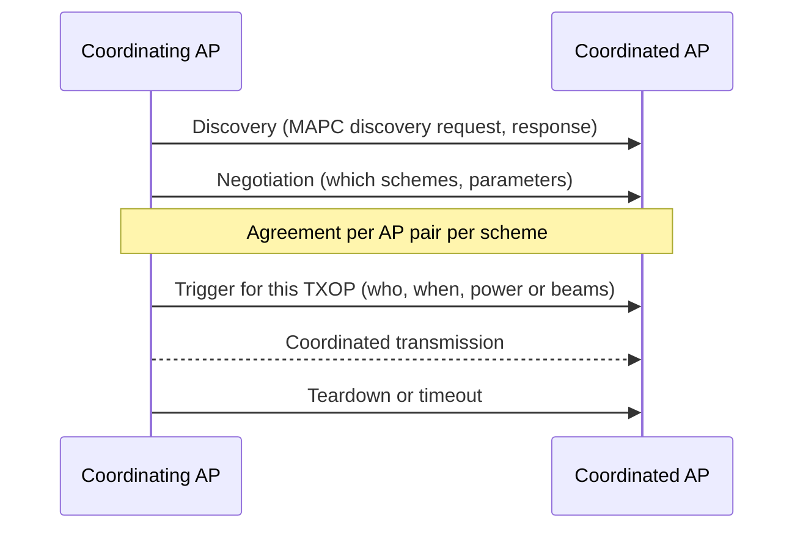

# WF 13: Wi-Fi 8 (802.11bn, Ultra High Reliability): multi-AP coordination, seamless roaming and the reliability toolkit

*Part of the [networking plan](../00_plan.md), Wi-Fi sub-track · not in the Candela course · You need: [WF 12](12_wifi7_eht_and_mlo.md) (MLD, eMLSR, TID-to-link), [WF 05](05_wifi_roaming_and_radio_management.md) (roaming, 802.11r), [WF 06](06_wifi6_6e_7_features.md) (OFDMA, spatial reuse, TWT), [WF 03](03_wifi_mac.md) (EDCA, NAV)*

Wi-Fi 7 raised the peak rate. **Wi-Fi 8 does not.** The draft keeps 320 MHz, 4096-QAM and the same three bands, and aims at what the user actually feels: the tail of the delay and loss distributions when networks overlap, devices move and traffic is time-sensitive. The name of the amendment says it: **Ultra High Reliability (UHR)**. The design question shifts from "how fast can one AP send to one client" to "how do several APs behave as one system, and how does a client stay attached while it moves".

Interviewers use Wi-Fi 8 to test whether you can reason about a standard that does not exist yet: what problem each mechanism targets, what it costs, what the system around it must provide, and how you would measure success. Memorising feature names is the weak answer. The strong answer says "multi-AP coordination only pays when the channel is stable enough that sounding is cheap, and it needs a backhaul with tight timing" and can explain why.

By the end you can:

- say what Wi-Fi 8 is for, what it leaves unchanged, and what the draft targets are;
- name the five multi-AP coordination (MAPC) schemes and say what each needs and when each pays;
- explain the four MAPC phases and why coordination needs the wired network to cooperate;
- explain seamless roaming with a distributed multi-link device, and why it beats 802.11r;
- explain NPCA, DSO, P-EDCA and low-latency indication as the answers to specific tail-latency causes;
- explain distributed-tone resource units and enhanced long range as link-budget tools for uplink;
- list the power-save and peer-to-peer additions and the mmWave direction;
- design a test plan for reliability features, and say why the usual throughput test is the wrong tool.

---

## 1. What Wi-Fi 8 is for

| Question | Wi-Fi 7 answer | Wi-Fi 8 draft answer |
|---|---|---|
| Peak rate | 46 Gbit/s at 16 streams (spec) | Unchanged width and QAM; draft summaries quote up to 8 streams and about 23 Gbit/s |
| Overlapping BSSs | Contend and defer, or reuse space blindly (OBSS PD) | **Coordinate**: share a TXOP, null interference, set powers |
| A client that moves | Roam (reassociate), with 802.11r if lucky | **Seamless mobility domain**: make-before-break across AP MLDs |
| Primary channel busy | Wait, or fall back to a narrower channel | **NPCA**: use an idle secondary channel as a temporary primary |
| Urgent traffic in a busy cell | EDCA priority, restricted TWT | **Prioritized EDCA**, low-latency indication, TXOP preemption |
| Weak uplink | Long-range 802.11be modes | **Distributed-tone RUs**, **enhanced long range (ELR)** |
| What is measured | Rate | 95th and 99.9th percentile latency, MPDU loss, throughput at a given SINR |

The draft targets (stated in the project authorisation and quoted by several summaries) are about **25 percent** improvements over Wi-Fi 7 in throughput at a given signal quality, 95th percentile latency and MPDU loss, especially between overlapping BSSs and while roaming, plus lower power use and better peer-to-peer operation. These are goals, not results.

Why the tail matters: an immersive stream, a control loop for a robot or a cloud-game controller is ruined by the one packet in a thousand that arrives 200 ms late, not by a lower average rate. Average throughput hides exactly the events Wi-Fi 8 targets: a roam, a neighbour's burst, a primary channel that is busy for 3 ms.

**What stays the same.** 2.4, 5 and 6 GHz, 320 MHz, 4096-QAM, the multi-link device and its modes from WF 12, WPA3 and PMF. The U-SIG at the front of the PPDU is version independent, so a new amendment adds its signalling after it and older receivers still parse the start.

**Status and the honest caveat.** The task group formed in 2021, standardisation work began in earnest in late 2023, and a first full draft (D1.0) was reported in mid-2025, with further drafts through 2027. Summaries disagree on the end dates (certification planned for the end of 2027 or early 2028, IEEE publication anywhere from March to September 2028). Wi-Fi 7 silicon shipped on drafts and details moved afterwards; treat any Wi-Fi 8 chip announced before ratification as a draft implementation. Every mechanism below can still change.

## 2. Multi-AP coordination (MAPC)

### 2.1 The problem

A dense deployment has many APs on the same few channels. Today they cope by **deferring** (CSMA/CA: whoever hears the other waits) or by **blind reuse** (OBSS PD: transmit anyway if the other signal is weak). Both waste airtime: deferring serialises transmissions that could have been parallel, and blind reuse trades throughput for collisions. MAPC lets neighbouring APs **agree** on who transmits when, with what power and with what beam, so airtime is shared deliberately. The cost is that APs must talk to each other (over the air or the wire) and agree before the TXOP.

### 2.2 The set of schemes

The draft names five schemes, with a coordinating AP (the one that won the TXOP) and one or more coordinated APs:

| Scheme | What it does | Needs | Layer |
|---|---|---|---|
| **Co-BF** (coordinated beamforming) | Two APs transmit at once; each steers a null toward the other's client | Cross-BSS channel state, calibrated chains | PHY |
| **Co-SR** (coordinated spatial reuse) | Concurrent transmissions under negotiated power limits | Power knowledge, no beamforming | PHY and MAC |
| **Co-TDMA** | The coordinating AP splits its TXOP and gives slices to coordinated APs | A shared primary 20 MHz channel, rules for fairness | MAC |
| **Co-RTWT** | Coordinate restricted-TWT service periods across overlapping BSSs | Shared schedule | MAC |
| **Co-CR** (coordinated channel recommendation) | Neighbours recommend quieter channels for peer-to-peer links | Channel measurement sharing | MAC |

Joint transmission (several APs sending the same data to one client as one big virtual array) and coordinated OFDMA are discussed as later directions, not part of the first set, as far as the sources I read show.

### 2.3 The four phases



**Discovery** and **negotiation** use action frames carrying a MAPC element: the APs learn each other's capabilities, then accept or reject each scheme with parameters. There is one agreement per AP pair for Co-BF, Co-SR and Co-TDMA. Negotiation can optionally be protected with an authenticated key exchange so a rogue AP cannot join the group. The **transmission** phase is per TXOP: the coordinating AP sends a trigger and the coordinated APs follow. **Teardown** ends the agreement.

Coordination sits **on top of EDCA**, not instead of it: the coordinating AP still wins the channel normally, and Co-TDMA respects access category and TXOP limits. MAPC operates per link of an MLD; an eMLSR client needs an initial control frame exchange so it does not switch away mid-coordination ([WF 12](12_wifi7_eht_and_mlo.md)).

### 2.4 Coordinated beamforming: when does it pay?

Two coordinated APs transmit at once. Each steers its beam at its own client and a **null** at the other AP's client. The draft limits it to two APs, two streams per client, four streams in total and four clients. The sounding procedure is joint: an invitation, a **joint NDP** sent by both APs with orthogonal training, and a poll in which each client reports channel state to both APs. The trigger frame carries what a common preamble needs, so the two PPDUs start together and look like one.

The question to ask before building it is: **how deep must the null be, and how often must you re-sound?** A small model makes the trade visible (two overlapping BSSs, 6 GHz, 160 MHz, 20 dBm, path-loss exponent 3.5; each client is 8 m from its own AP and 12 m from the other):

```python
import math

def rx_dbm(tx, d, f_ghz=6.0, n=3.5):
    fspl1 = 20*math.log10(4*math.pi/(3e8/(f_ghz*1e9)))      # free-space loss at 1 m
    return tx - fspl1 - 10*n*math.log10(d)

NOISE = -85.0                                                # dBm over 160 MHz

def rate(sinr_db, bw=160e6, gap_db=8, cap_bits=10, eff=0.8):  # Mbit/s, Shannon-style with a gap
    bits = min(math.log2(1 + 10**((sinr_db - gap_db)/10)), cap_bits)
    return bw*bits*eff/1e6

def sinr(sig, intf=None):
    n = 10**(NOISE/10) + (10**(intf/10) if intf is not None else 0)
    return sig - 10*math.log10(n)

sig, intf = rx_dbm(20, 8), rx_dbm(20, 12)
turns    = 0.5*rate(sinr(sig))                       # each AP gets half the air
together = rate(sinr(sig, intf))                     # both transmit, no coordination
print(round(turns), round(together))                 # 371 92

def cbf(null_db, overhead=0.04):                     # null of depth D, 4 percent sounding cost
    return rate(sinr(sig, intf - null_db))*(1 - overhead)

for d in (0, 10, 20, 30):
    print(d, round(cbf(d)), round(cbf(d)/turns, 2))  # 0 88 0.24 | 10 341 0.92 | 20 608 1.64 | 30 699 1.88
print(next(d/10 for d in range(400) if cbf(d/10) >= turns))   # 11.0: break-even null depth in dB
```

Read it as three regimes. **Without a null, transmitting together is a disaster** (about a quarter of the throughput of taking turns), because the neighbour's signal is only about 6 dB below the wanted one. **Around 11 dB** coordination breaks even with plain turn-taking. **Beyond 25 to 30 dB** the gain saturates near 1.9 times, because the noise floor is now the limit and a deeper null adds nothing. The numbers are a model, not the papers' simulations, but the shape agrees with published results: worse than plain MLO with a shallow null, better with a deep one.

Two further facts decide real deployments. **Sounding cost scales with how fast the channel changes**: if a sounding round costs about half a millisecond, a channel stable for 50 ms spends 1 percent of airtime on it, but a walking user whose channel is stable for 2 ms spends 25 percent, and the gain mostly evaporates. So Co-BF is a feature for **fixed devices** (offices, exhibition halls, TVs), not for people on the move. And a neighbour **as close as your own AP** needs a much deeper null than one 30 m away, where the cells barely interact and no coordination is needed. The draft's own caveat is the same: it is not always beneficial, especially at low or moderate load.

### 2.5 Coordinated spatial reuse and TDMA

**Co-SR** needs no channel state: the coordinating AP tells the others how much power they may use during its TXOP so both can transmit. Because it needs no sounding it has no overhead, and it wins when the cells are far enough apart that reduced power still gives a usable rate: in the same style of model it loses to taking turns when the neighbour is within about 20 m and wins clearly at 30 m or more. The standard does not define how to compute the power; a vendor's algorithm is a differentiator. Two modes exist, one allowing mixed Wi-Fi 7 and Wi-Fi 8 APs and one for Wi-Fi 8 only.

**Co-TDMA** is the simplest: the coordinating AP hands part of its TXOP to a coordinated AP on the same primary channel. It never beats an ideal scheduler but it is robust, cheap to build and needs no channel state. The draft adds fairness rules (a limit on the TXOP share, access reserved for contention) so one AP cannot starve the rest; the split policy is again left to the implementer, and an equal split is known to be suboptimal.

**Co-RTWT** extends restricted TWT ([WF 12](12_wifi7_eht_and_mlo.md)) across BSSs so protected service periods of overlapping cells do not collide. **Co-CR** helps peer-to-peer links (a phone casting to a TV) pick a channel the neighbouring APs are not using.

### 2.6 What MAPC demands of the network

- **Timing.** Coordinated transmissions start together, so APs need tight time alignment, which over-the-air triggering provides within a TXOP, and a **backhaul with low and predictable latency** provides for negotiation and traffic indication.
- **Information sharing.** QoS flow state (a MAPC traffic indication), channel state and neighbour lists must be exchanged.
- **Calibration** of transmit chains for Co-BF.
- **Planning.** Coordination groups are small (two APs for Co-BF), so the plan decides who coordinates with whom: pairs that overlap most.
- **Controller or cloud software** that configures agreements, which is where the fleet tooling of [WF 07](07_wifi_architectures_mesh_and_services.md) matters.

## 3. Seamless roaming

Wi-Fi 7's AP MLD is one box with several radios. Wi-Fi 8's seamless mobility domain lets **separate APs** act as the affiliated APs of related AP MLDs in one domain, so a client that moves **keeps a link on the AP it is leaving while it brings up a link on the next**: make-before-break.

The draft's transition runs in three phases: **prepare** (the client discovers target APs, for example through probe responses, and the network transfers context), **execute** (the client sets up the link on the target and moves traffic), and **complete** (the old link is removed, and during a **draining** period the client still receives buffered downlink frames from the old AP). **No re-authentication** is needed: the keys and the per-TID sequence and block-ack state move with the context, which is why the frames in flight are not lost.

| Mechanism | What a move costs | Why |
|---|---|---|
| Full roam (scan, associate, 802.1X) | Hundreds of milliseconds to seconds | Everything is redone |
| 802.11r with 11k and 11v | Tens of milliseconds | Keys pre-derived, candidates known, but a reassociation gap remains |
| Seamless mobility domain | Approximately zero gap if the second link is up | A link already exists; only the traffic mapping changes |

(Modelled earlier at 120 frames a second: a full roam loses on the order of 170 frames, 802.11r about ten, a ready distributed MLD none, with the worst gap one frame time. The outage times are my assumptions, so use the ordering, not the figures.)

What it demands from the system is **state synchronisation, not bandwidth**: keys, sequence numbers, block-ack scoreboards and buffered frames must move between APs within about one frame time, so the backhaul needs low latency and the APs in a domain need to be managed together (typically one controller or cloud system). Clients must support multi-link, and a domain boundary is still a normal roam. This is the part that gives the 25 percent fewer lost frames while roaming.

## 4. Latency and capacity tools

Each of these targets a specific cause of tail delay.

**NPCA, non-primary channel access.** In Wi-Fi 6 and 7 all contention happens on the primary 20 MHz channel; if a neighbour's network occupies the primary channel, a wide AP waits even though its secondary channels are idle. With NPCA the AP broadcasts switching parameters and a station may move to an idle secondary 20 MHz channel and use it as a temporary primary, starting with an initial control frame. It pays when **neighbours overlap asymmetrically** (they use your primary but not your secondary), and a published system-level study reports gains above 40 percent in asymmetric overlap and a **negative** gain when the neighbour's load is heavy enough that the switch overhead dominates. Know both sides.

**DSO, dynamic subband operation.** The AP directs selected stations to operate in a **sub-band** of its channel, which allows parallel transmissions for different stations (and for low-capability clients that cannot use the full width) and better use of fragmented spectrum. It complements puncturing from [WF 12](12_wifi7_eht_and_mlo.md): puncturing skips a busy part, DSO assigns the parts.

**P-EDCA, prioritized EDCA.** Voice and similar traffic still lose to collisions at the tail. A station that has retransmitted a voice frame past a threshold can send a short clear-the-channel frame, then contend in a short, prioritised window and protect its transmission with RTS/CTS. Published studies report latency cuts of over 40 percent at a single BSS above a few Mbit/s of load; at 1 Mbit/s there is little to gain because there is little contention. It also needs legacy devices to coexist: it works by reserving, not by breaking the rules.

**Low-latency indication (LLI) and TXOP preemption.** A station tells the TXOP holder that urgent traffic is waiting, so the holder can schedule it sooner or let it preempt a lower-priority transmission.

The pattern to see: **EDCA's randomness is the enemy of the tail**, so each tool adds a way to make urgent traffic more deterministic without breaking coexistence.

## 5. Uplink reach: distributed-tone RUs and enhanced long range

**The problem.** In 6 GHz a low-power client is limited by **power spectral density** (dBm per MHz). A small resource unit occupies a narrow slice, so its total power limit is low, which restricts range for exactly the clients that already struggle: small RUs are used by many clients in OFDMA.

**Distributed-tone RU (DRU).** Take the same number of tones but spread them across 20, 40 or 80 MHz. The PSD limit now applies to the whole spread width, so the total allowed power rises. A small calculation:

```python
import math
def dru_gain_db(tones, spread_mhz, sc_khz=78.125):
    contiguous_mhz = tones * sc_khz / 1000
    return 10*math.log10(spread_mhz / contiguous_mhz)

for t in (26, 52, 106):
    print(t, [round(dru_gain_db(t, s), 1) for s in (20, 40, 80)])
# 26  [9.9, 12.9, 16.0]
# 52  [6.9, 9.9, 12.9]
# 106 [3.8, 6.8, 9.8]
print(round(10**(dru_gain_db(26, 20)/(10*3.5)), 2))     # 1.92: range factor at exponent 3.5
```

A 26-tone RU spread over 20 MHz can transmit about **10 dB** more power under the same PSD limit, roughly doubling range at exponent 3.5. A published source quotes gains up to 11 dB for 40 or 80 MHz channels, which fits the order of magnitude. The price: the tones now fade independently (frequency diversity is a benefit, but the RU is no longer one flat narrow channel) and the signal has a higher peak-to-average ratio, which the task group addresses with phase rotations in the training field. It is a **link-budget** feature, not a rate feature.

**Enhanced long range (ELR).** A 20 MHz, one-stream mode using BPSK or QPSK at rate 1/2, with the payload repeated across several RUs (four 52-tone RUs with phase rotation, in the draft I read), a dedicated preamble and a power boost, for devices at the cell edge. It is **uplink only** and for 5 and 6 GHz. Rates are single-digit Mbit/s, so it is for sensors, wearables and edge-of-coverage control traffic, not video.

## 6. Power save, peer-to-peer and the direction beyond

- **Dynamic power save (DPS).** A device runs in a **low-capability mode** (fewer chains and narrower bandwidth) and switches to full capability when needed, with flexible parameters. It also covers battery-powered mobile APs. **MLPM** optimises power-save signalling across links. A related feature allows a station to indicate unavailable durations so packets are not lost when it is away; a published study reports over 30 percent less loss.
- **Peer-to-peer.** **TXSPG** gives a P2P group recurring reserved airtime so unrelated load cannot starve it; Co-CR helps pick channels. This is the casting, gaming-controller and AR/VR headset use case.
- **New MCS and in-device coexistence.** One summary reports four new MCS values with 5 to 30 percent rate gains depending on conditions; values were not in the sources I read, so do not quote them.
- **mmWave.** A related effort (802.11bq) targets 42 to 71 GHz, reusing sub-7 GHz PHY designs scaled up, with control and management kept on sub-7 GHz links through MLO and data moved to mmWave. It shows where MLO goes next: bands with very different propagation behind one MLD.

## 7. Testing and debugging Wi-Fi 8 behaviour

The usual lab habits are wrong for reliability features. **A throughput test hides them.** Design the test around the tail:

- **Measure distributions**, not averages: one-way delay percentiles (95, 99, 99.9), MPDU loss and the longest gap, for a fixed-rate stream (for example 120 packets a second) rather than a saturating TCP flow.
- **Create the event you are testing**: a roam, a neighbour burst, a busy primary channel, a client moving. One move every 20 s with a ten-minute run gives 30 events; a 99.99th percentile claim needs far more samples ([WF 09](09_wifi_testing.md)).
- **A/B the feature** with everything else fixed: coordination on and off, with identical traffic and positions. Repeat with a deep and a shallow null if you can control it.
- **Check that the feature is actually active**: capture the MAPC agreement frames, the NPCA switch, the link setup on the target AP. Many "Wi-Fi 8 gains" in a lab are a feature silently not negotiated, like an MLO client using one link ([WF 12](12_wifi7_eht_and_mlo.md)).
- **Verify the wired side**: timing, backhaul latency and controller state. A seamless roam that loses frames is often a slow context transfer.
- **Tooling.** Wireshark's 802.11 dissector (4.2) does not decode 802.11bn, and there is no stable test equipment yet. Expect to work from vendor builds and simulators.

| Symptom | Likely cause | First check |
|---|---|---|
| Coordination on, no gain | Channel changes faster than sounding, or neighbour far away | Stability time of the channel, geometry |
| Co-SR worse than turns | Neighbour close, power limits too low | Distances, power chosen |
| Roam still drops frames | Second link not up, slow context transfer | Link setup time, backhaul latency |
| NPCA made things worse | Heavy neighbour load, switching overhead | Neighbour load, secondary channel utilisation |
| P-EDCA no change | Light load, no collisions to fix | Load level and retry rates |
| Old clients suffer | Priority traffic starving legacy | Airtime split, fairness rules |

## 8. Common mistakes

1. **Assuming Wi-Fi 8 is faster.** The peak is unchanged; the target is the tail.
2. **Treating draft features as product behaviour.**
3. **Expecting coordination to help moving clients**, when sounding overhead eats the gain.
4. **Ignoring the wired network**: coordination and seamless roaming depend on backhaul timing and state sync.
5. **Testing with throughput only.**
6. **Reporting a 99.99th percentile from too few events.**
7. **Believing 802.11r already solves roaming**: it leaves a gap that the 99th percentile still shows.
8. **Treating NPCA as always positive.**
9. **Forgetting legacy clients**: every Wi-Fi 8 mechanism has to coexist with them.
10. **Confusing MAPC with mesh or controller roaming**: it is air-time coordination, not backhaul steering.

## 9. Interview questions

1. **What is Wi-Fi 8 designed to improve, and what does it not change?** Reliability and tail latency, not peak rate; bands, width and QAM stay.
2. **What are the MAPC schemes?** Co-BF, Co-SR, Co-TDMA, Co-RTWT, Co-CR; joint transmission is later.
3. **When does coordinated beamforming pay?** A deep enough null, a stable channel so sounding is cheap, and a neighbour close enough to matter.
4. **Why is Co-SR attractive?** No sounding, no channel state; only power limits.
5. **What does Co-TDMA give up?** Optimality, in return for simplicity and robustness.
6. **How is seamless roaming different from 802.11r?** A link already exists on the next AP and state moves with the client, so there is no reassociation gap.
7. **What must the network provide for it?** Low-latency state synchronisation between APs, a managed domain.
8. **What does NPCA fix and when does it hurt?** A busy primary with idle secondaries; heavy neighbour load makes the switch overhead dominate.
9. **What problem does P-EDCA address?** Collision-driven tail delay of urgent traffic, at the cost of careful coexistence.
10. **What is a distributed-tone RU?** The same tones spread across a wide band so the PSD limit allows more total power; link budget, not rate.
11. **What is ELR for?** Very weak uplink at the cell edge, low rate, single stream.
12. **How would you test a reliability feature?** Distributions at a fixed rate with the event created repeatedly, A/B, verify negotiation in captures.
13. **Why can a Wi-Fi 8 lab test show no gain?** Feature not negotiated, load too light, channel too dynamic, backhaul too slow.
14. **What is the difference between MLO and a seamless mobility domain?** MLO uses links of one AP MLD; the domain lets links belong to different APs.

## 10. Scenarios and design questions

**S1. A stadium wants Wi-Fi 8 for video upload from phones.** *Where to practise:* an overlap model with many APs. *Approach:* clients move and the channel is dynamic so Co-BF fails; use Co-SR or TDMA where cells are far, DRU and ELR for weak uplink, plan channels first.

**S2. A warehouse robot drops frames when it roams.** *Where to practise:* a fixed-rate stream during a move, captured on both APs. *Approach:* measure the gap, check 802.11r and 11k first, then a seamless domain with state sync, check backhaul latency.

**S3. Two neighbouring offices share a channel and see latency spikes.** *Where to practise:* a two-AP lab with a busy primary. *Approach:* NPCA if the overlap is asymmetric, P-EDCA for the voice, Co-TDMA or Co-SR if they can coordinate, otherwise channel plan.

**S4. Management asks whether to buy Wi-Fi 8 APs now.** *Where to practise:* write the decision memo. *Approach:* the draft status, the clients that support it, what fraction of traffic is tail sensitive, the backhaul, and the option of buying Wi-Fi 7 with upgradable controllers.

**S5. Design the controller side of a MAPC deployment.** *Where to practise:* a diagram of APs, groups and agreements. *Approach:* pair APs by overlap, choose scheme per pair by distance and mobility, secure negotiation, monitor gain per pair and fall back.

**S6. A lab shows a 5 percent gain where the paper claims 25.** *Where to practise:* repeat with controlled load and geometry. *Approach:* check which feature was negotiated, load, distance, mobility and sample size.

**S7. Explain DRU to a link-budget engineer.** *Where to practise:* the PSD calculation. *Approach:* PSD limit times bandwidth, spreading raises the allowed power, cost in PAPR and frequency selectivity.

## 11. Strong answers (outlines)

**S1.** Moving phones make the channel change in milliseconds, so sounding eats the Co-BF gain; choose Co-SR where APs are far apart and Co-TDMA otherwise. For uplink use DRU and ELR where weak clients exist, plan channels and power first, and measure upload at the 95th percentile of delay and loss, not average rate.

**S2.** Capture a fixed-rate stream on both APs to find the gap and whether frames were lost or only delayed. A gap of tens of milliseconds with 802.11r points to the reassociation step. A seamless domain removes it if a link is already up, but needs keys and block-ack state moved within a frame time, so check the backhaul and controller.

**S3.** If the neighbour uses your primary but not your secondary, NPCA helps; if it is heavily loaded, switching overhead can make it negative. P-EDCA helps voice with retransmissions. If the two offices can coordinate, a Co-TDMA agreement is robust; otherwise change the channel plan.

**S4.** Wi-Fi 8 is a draft, clients and certification arrive around the end of 2027 or 2028, and benefits need clients and a coordinated back end. If traffic is not tail sensitive the gain is small. Buy hardware with a software path to upgrade the controller, and pilot with a few APs.

**S5.** Pair APs with the most overlap, pick Co-BF only for fixed clients and close pairs, Co-SR for distant pairs and Co-TDMA as the fallback, secure the negotiation, and monitor per-pair gain so a pair that stops benefiting is reverted.

**S6.** Verify negotiation in captures, compare load and geometry to the paper's, check mobility and sounding overhead, and run enough events for the percentile.

**S7.** A 26-tone RU is about 2 MHz wide and the PSD limit allows power per MHz, so its total power is small. Spread over 20 MHz the limit applies to 20 MHz, about 10 dB more. The cost is PAPR and a less flat channel.

## 12. Cheat sheet

| Fact | Value |
|---|---|
| Name | 802.11bn, Ultra High Reliability, Wi-Fi 8 |
| Goal | About 25 percent better throughput at a given SINR, 95th percentile latency and MPDU loss (draft targets) |
| Unchanged | 2.4, 5, 6 GHz, 320 MHz, 4096-QAM, WPA3 |
| MAPC schemes | Co-BF, Co-SR, Co-TDMA, Co-RTWT, Co-CR |
| MAPC phases | Discovery, negotiation, transmission, teardown |
| Co-BF limit | Two APs, four streams total; needs deep nulls and a stable channel |
| Co-SR | Power limits only; no sounding |
| Seamless roaming | Make-before-break across AP MLDs; prepare, execute, complete; no re-authentication |
| NPCA | Idle secondary becomes temporary primary; can hurt under heavy neighbour load |
| P-EDCA | Priority contention for urgent traffic after retries |
| DSO | Sub-band operation for selected stations |
| DRU | Tones spread across 20 to 80 MHz; allowed power rises about 10 dB or more |
| ELR | 20 MHz, one stream, BPSK or QPSK, uplink, cell edge |
| Power save | DPS, MLPM, unavailable-duration signalling |
| Test | Percentiles, fixed rate, created events, verify negotiation |

## 13. Sources and caveats

Web sources: the Samsung Research [summary of 802.11bn](https://research.samsung.com/blog/IEEE-802-11bn-Ultra-High-Reliability-UHR-Wi-Fi-8) (targets, ELR, DRU, NPCA, DSO, P-EDCA, seamless mobility, timeline); the arXiv multi-AP coordination tutorial [2606.13759](https://arxiv.org/html/2606.13759v1) (MAPC schemes, framework, constraints; I read only the first 100,000 of about 265,000 characters, so its results and joint-transmission sections were not read); the arXiv paper [2607.19931](https://arxiv.org/pdf/2607.19931) (phases of MAPC, seamless roaming, NPCA, P-EDCA, DRU and ELR descriptions, simulation results); the [Wikipedia summary](https://en.wikipedia.org/wiki/IEEE_802.11bn) (streams, rates, bands, timeline); and the IEEE [TGbn specification framework](https://mentor.ieee.org/802.11/dcn/24/11-24-0209-19-00bn-specification-framework-for-tgbn.docx), which I did not read in full.

Caveats. This is a draft standard and every mechanism can change. Sources disagree on the dates and on stream counts, and I give both. The Co-BF model, the DRU calculation and the roaming comparison are my own simple models, run and checked here, and show shapes, not the papers' results. The roaming outage times are my assumptions. DSO and the new MCS values are described only briefly in the sources I read. There is no tshark decoder for 802.11bn frames in version 4.2, so nothing here was decoded from a capture.
