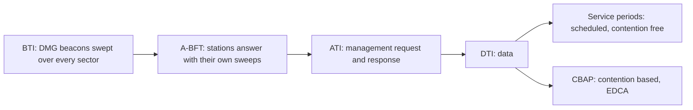
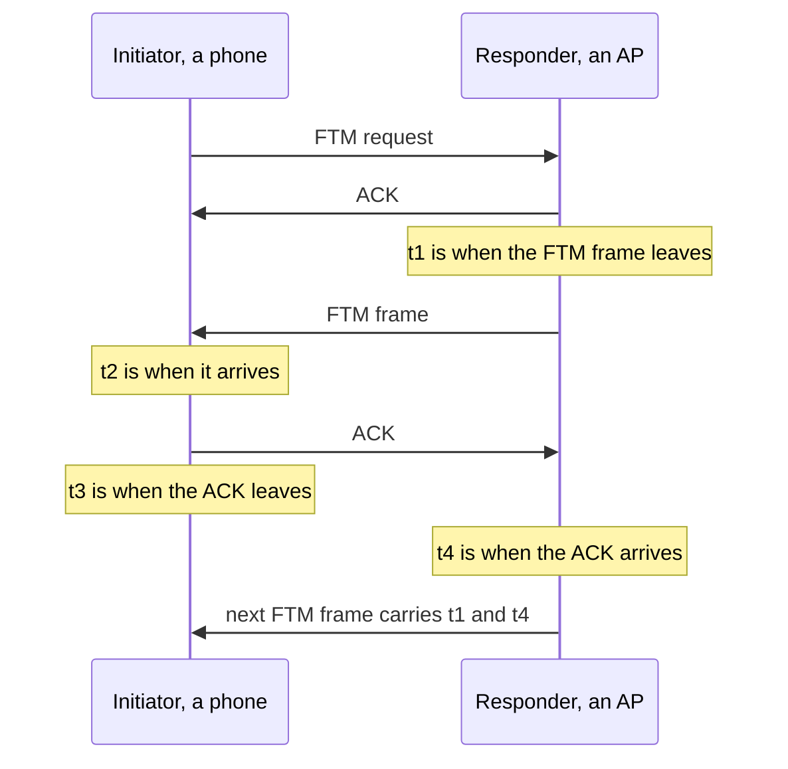
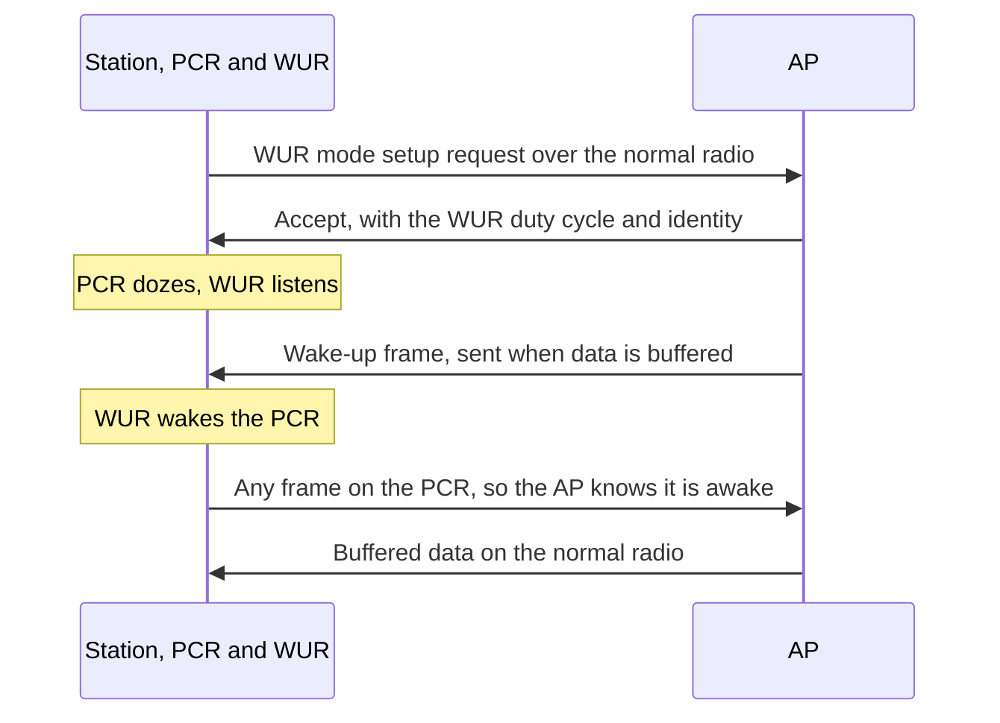
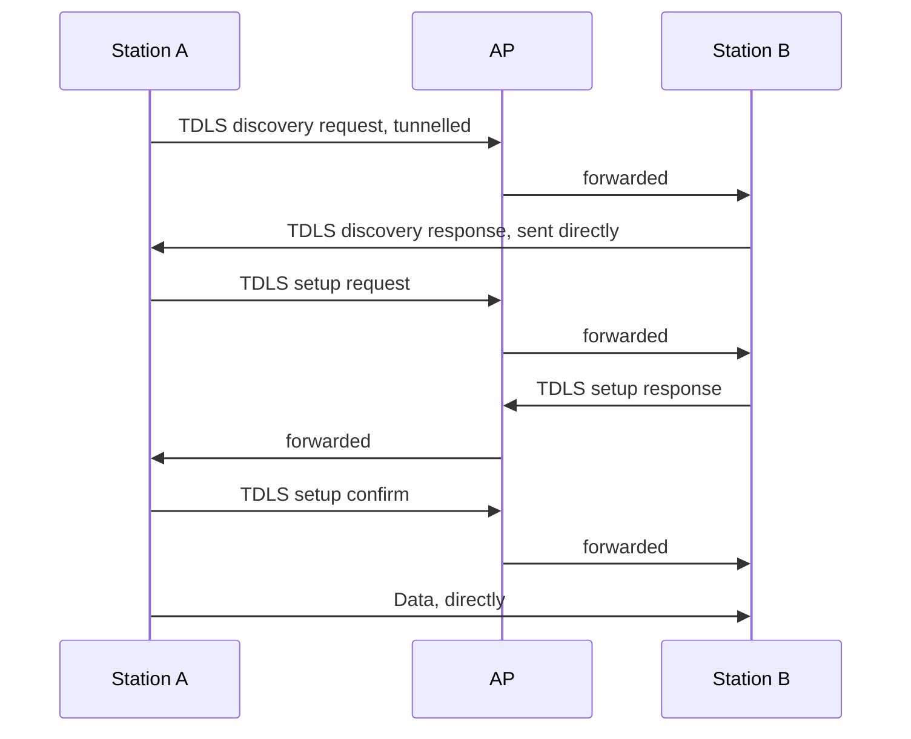

# WF 14: Special-purpose Wi-Fi: HaLow, 60 GHz, V2X, wake-up radio, ranging, sensing, groupcast, direct links and antennas

*Part of the [networking plan](../00_plan.md), Wi-Fi sub-track. Builds on [WF 02](02_wifi_phy.md) (OFDM and rate formulas), [WF 03](03_wifi_mac.md) (DCF, TIM, power save), [WF 06](06_wifi6_6e_7_features.md) (TWT, FILS) and [WF 11](11_rf_fundamentals_and_link_budget.md) (link budget).*

Most of 802.11 is one design stretched across many generations: the same contention-based access, the same association, the same assumption that the device is a laptop or phone a few metres from an AP. A group of amendments breaks that assumption because the job demands something else. Each is an answer to the question "what would Wi-Fi look like if it were built for this one job?", and each fails in its own characteristic way, which is what a platform engineer is expected to know.

| Amendment | The job | What it gives up |
|---|---|---|
| 802.11ah (HaLow) | Thousands of battery sensors, up to a kilometre away | Speed: a few Mbit/s at best |
| 802.11ad and ay | Multi-gigabit links over a few metres | Range, and any ability to pass a wall or a person |
| 802.11p and bd | Vehicles talking at highway speed | Association, acknowledgements, MAC security |
| 802.11ba | Wake a sleeping device on demand at almost no power | A second receiver and some latency tuning |
| 802.11mc, az, bk | Measure distance using the frames Wi-Fi already sends | Accuracy depends on bandwidth and the room |
| 802.11bf | Use Wi-Fi as a presence and motion sensor | Reliability at some positions |
| 802.11aa | Reliable multicast and per-flow priority | More airtime |
| DLS and TDLS | Two clients talking directly, not through the AP | Needs a good direct path |
| 802.11ak | A client that bridges a wired network behind it | Extra complexity in the AP |
| Antennas | Choosing where the energy goes | Coverage elsewhere |

By the end you can:

- explain why HaLow reaches so much farther than 2.4 GHz, why it is slow, how its TIM, RAW, TWT, relay and sector machinery serve thousands of sleepers, and why contention is its real limit;
- explain the 60 GHz beacon interval, beam training, personal BSSs and fast session transfer, and why a hand can cut the link;
- explain OCB mode, why Doppler breaks the 802.11p receiver, and what 802.11bd changed;
- explain the wake-up radio frame, how a station enters WUR mode, and when it saves energy and when it does not;
- walk through a fine timing measurement, read its frame fields, compute a distance, and name what limits its accuracy;
- explain how sensing sessions are organised in 802.11bf and why detection has blind spots;
- compare multicast, GCR and unicast conversion, and explain SCS and intra-access-category priority;
- walk through TDLS setup, power save, channel switch and teardown, and say when a direct link pays;
- explain general link, FILS in one page, and choose an antenna type from a coverage requirement.

---

## 1. 802.11ah, HaLow: Wi-Fi for sensors

### 1.1 The problem

Picture a farm with two thousand soil sensors, or a campus with thousands of meters. Each sends a few dozen bytes every few minutes, runs for years on a coin cell, and sits 300 m or more from the nearest gateway, often behind a wall. Ordinary Wi-Fi fails this in three ways: the range is too short at 2.4 or 5 GHz, waking the radio often costs too much energy, and an AP cannot even address that many stations (the legacy limit is 2,007 association IDs).

HaLow is the answer. It works in the **sub-1 GHz** licence-exempt bands and changes the PHY, the power-save machinery, the addressing and the way access is arbitrated.

### 1.2 Where it operates

| Region | Band | Note |
|---|---|---|
| North America | 902 to 928 MHz | 26 channels of 1 MHz, which can be combined into 2, 4, 8 and 16 MHz |
| Europe | 863 to 868 MHz | A narrow band shared with other users and subject to duty-cycle limits |
| Japan, Korea, Singapore, China and others | Slices near 750 to 930 MHz | Differ by country (from memory) |

The consequence for a product is that HaLow has no single worldwide channel plan: the same chip needs regional configuration, and the usable channel widths differ. In Europe, with only 5 MHz available, the 8 and 16 MHz channels do not exist.

### 1.3 Why it reaches far

Two separate effects add up.

**Lower frequency loses less in the air.** Free-space loss grows with frequency. At 900 MHz it is about 8.5 dB lower than at 2.4 GHz, and walls absorb less.

**A narrow channel hears fainter signals.** A receiver's noise floor depends on the bandwidth it listens to. A 1 MHz channel collects 13 dB less noise than a 20 MHz channel, so it can decode a signal 13 dB weaker at the same modulation.

Together that is about 21 dB, which at an indoor path-loss exponent of 3 means roughly **five times the range** of 2.4 GHz at the lowest rate. With MCS 10 (every bit sent twice) there is another 3 dB, giving nearly seven times. A worked example: if a 2.4 GHz link at its lowest rate reaches 230 m in a given building, the same transmit power on HaLow at 1 MHz reaches roughly 1.2 km. The Wikipedia page gives about a kilometre radius, which agrees. The cost is the data rate, as the next section shows.

### 1.4 The PHY: 802.11ac with the clock divided by ten

The S1G PHY is the 802.11ac OFDM design run ten times slower: 20, 40, 80 and 160 MHz become **2, 4, 8 and 16 MHz**, and the 4 microsecond symbol becomes **40 microseconds** (36 with the short guard interval). A new **1 MHz** mode uses a 32-point FFT with 24 data subcarriers. The Wikipedia page confirms the 2 MHz numbers: a 64-point FFT with 31.25 kHz spacing, 52 data and 4 pilot subcarriers.

The rate is the formula from WF 02: data subcarriers times bits per subcarrier times code rate times streams, divided by the symbol time.

| Channel | Data subcarriers | MCS 0 (BPSK 1/2) | MCS 4 (16-QAM 3/4) | MCS 9 (256-QAM 5/6) |
|---|---|---|---|---|
| 1 MHz | 24 | 0.30 Mbit/s | 1.8 Mbit/s | not used for one stream |
| 2 MHz | 52 | 0.65 Mbit/s | 3.9 Mbit/s | 8.7 Mbit/s |
| 4 MHz | 108 | 1.35 Mbit/s | 8.1 Mbit/s | 18 Mbit/s |
| 8 MHz | 234 | 2.9 Mbit/s | 17.6 Mbit/s | 39 Mbit/s |
| 16 MHz | 468 | 5.9 Mbit/s | 35 Mbit/s | 78 Mbit/s per stream |

MCS 10 exists only at 1 MHz: BPSK 1/2 with every bit repeated, giving 0.15 Mbit/s and the longest range in the standard. The peak is about **347 Mbit/s** (16 MHz, four streams, MCS 9, short guard) by my formula; the Wikipedia page prints 433.3 Mbit/s and I do not know which assumptions it used. A sensor in practice sits at 1 or 2 MHz and a few hundred kbit/s: one 1500 byte frame occupies 40 ms of air at 1 MHz MCS 0, which is why HaLow is for small messages.

### 1.5 The S1G beacon and short frames

At 1 MHz the preamble alone lasts hundreds of microseconds, so every byte of overhead matters. S1G therefore shortens things: a compact **S1G beacon** (a short form that carries only what stations need often, with the full set sent less often), **short MAC headers**, and the **null data packet (NDP)**, a frame whose entire content fits in the PHY signal field with no payload. NDP frames carry things like acknowledgements, power-save polls and CTS. A station answering a poll with an NDP spends a few hundred microseconds on air instead of a millisecond. Another throughput saver is the **bidirectional TXOP** and a **speed frame exchange**: once a station has the medium, the two ends exchange several frames in both directions in the same TXOP without re-contending (from memory).

### 1.6 Addressing thousands of sleepers: the S1G TIM

In legacy power save (WF 03) the AP announces buffered frames in the **TIM**, a bitmap with one bit per association ID. At scale two things fail. The bitmap tops out at 2,007 stations. And the AP must send the span from the first set bit to the last, so ten sleeping stations scattered across the range cost hundreds of bytes in every beacon.

S1G fixes both with a hierarchy:

```
page       (4 per AP)
 +-- block      (32 per page)
      +-- subblock   (8 per block)
           +-- 8 stations, one bit each        4 x 32 x 8 x 8 = 8,192 AIDs
```

An association ID is a 13-bit number split as 2 bits of page, 5 of block, 3 of subblock and 3 of bit. The AP encodes only the blocks and subblocks that contain a set bit, so a sparse set of sleeping stations costs a few dozen bytes: in my simulation, ten stations with buffered traffic cost about 212 bytes in the legacy form and about 38 in the S1G form. The exact byte layout of an encoded block is in the clause and is not needed to understand the idea.

Two further mechanisms keep stations asleep:

- **TIM segmentation and page slicing.** The AP does not have to announce every page in every beacon. It sends the TIM in segments across several beacons, and a **page slice** element tells stations which beacon carries their page. A station waking for one beacon in four spends a quarter of the listening energy.
- **TIM stations and non-TIM stations.** A TIM station wakes at its beacon interval to look at the TIM. A **non-TIM station** does not listen to the TIM at all; it wakes by TWT or on its own schedule, and polls the AP when it wakes. Sensors that report on a timer are natural non-TIM stations.

### 1.7 Not being dropped while silent: BSS max idle

An AP removes a station that has been silent too long. The legacy **BSS max idle period** is a 16-bit field in units of 1,000 time units (1.024 s), so the longest value is about **18.6 hours**. A soil sensor that reports once a day or once a week would be disassociated. S1G extends the idle period with a scaling factor so a station can stay associated for a very long time (months to years, from memory), and TWT agreements make the silence expected rather than suspicious.

### 1.8 Controlling the stampede: RAW

Addressing thousands of stations is not the same as serving them. If a thousand sensors wake at the same instant, DCF produces a collision storm. The **Restricted Access Window (RAW)** divides the contention:

1. The beacon carries a **RAW Parameter Set** describing the window: how long it lasts, how many slots it has, and which AIDs may use which slot.
2. A station may transmit **only inside its own slot**, and only if it can finish before the slot ends (stations not assigned wait; some options let a station use the slot of another group when it is idle).
3. Inside a slot, the ordinary backoff rules apply, but only a small group contends.


The AP can also use RAW to protect sector groups, or to reserve slots for polled traffic. The benefit is clearest in a model: I simulated a thousand saturated stations (every one always has a frame). With free contention, 93 percent of attempts collide and throughput falls to about a third of the one-station figure; groups of ten with RAW recover nearly the one-station performance, about three times better. The numbers depend on assumed timings, so remember the shape: **a large HaLow network is limited by contention, and RAW is what keeps it usable.**

### 1.9 TWT, relay and sectors

**Target Wake Time (TWT).** The station and AP agree on exact wake times, so the station sleeps through everything else. An agreement can be **individual** (negotiated between one station and the AP) or **broadcast** (the AP announces a schedule and stations join it); it can be **announced** (the station sends a poll when it wakes) or **unannounced**. WF 06 covers the mechanics; HaLow was its first heavy user.

**Relay.** A far sensor can send to a nearby relay at a high MCS instead of to a distant AP at the lowest. A relay is logically a station plus an AP, and the standard limits the path to two hops. The saving is on both ends: the sensor's transmission is shorter and cheaper, and the AP sees fewer slow frames.

**Sectorisation.** The AP covers the area with sectors, by antenna or beam. Only stations in the active sector contend, which both cuts collisions and lets overlapping cells reuse the air by taking turns in different directions.

### 1.10 A worked design

Three thousand water meters in a town, each sending 100 bytes every 15 minutes, 800 m from the nearest rooftop AP. Reasoning:

- **Range**: 800 m is feasible at 1 MHz MCS 0 or 10, so rate is about 0.15 to 0.3 Mbit/s.
- **Airtime**: a 100 byte report plus overhead is about 3 to 5 ms at 0.3 Mbit/s with preamble and ACK. Three thousand meters per 900 s is 3.3 reports per second, about 1.5 percent of the air if perfectly scheduled. Rate is not the problem.
- **Contention**: they are not perfectly scheduled. Without RAW or TWT many wake together after a power cut and collide. Use **TWT** to spread wake times and **RAW** groups for the rest.
- **Addressing**: more than 2,007 stations needs the S1G TIM, or non-TIM stations that never read it.
- **Idle**: a meter silent for days needs a long BSS max idle period.

---

## 2. 802.11ad and 802.11ay: 60 GHz

### 2.1 Why 60 GHz

There is a very wide unlicensed slice around 60 GHz (roughly 57 to 71 GHz depending on region, from memory). A channel there is **2.16 GHz** wide, a hundred times a 20 MHz Wi-Fi channel, so even simple modulation gives gigabits. The price is physics.

### 2.2 What 60 GHz does to the signal

- **The starting loss is 20 dB worse than at 6 GHz.** The wavelength is 5 mm, so a receiving antenna of fixed size captures much less energy. Free-space loss at one metre is already 68 dB.
- **Oxygen absorbs it**, about 15 dB per kilometre (from memory): negligible indoors, but part of why outdoor links are short.
- **Almost nothing passes through anything.** A wall stops it, and **a human body in the path costs 20 to 30 dB** (from memory). In my link budget model a 40 dBm EIRP link that reaches about 120 m at the highest single-carrier rate falls to about 8 m with 25 dB of body block.

The way to win the lost signal back is **gain**. At 5 mm wavelength a small phased array focuses energy into a narrow beam, and both ends pointing beams at each other gives tens of dB. That works only if the beams are aimed correctly, which is why the whole MAC of 802.11ad is organised around **beam training**.

### 2.3 The PHYs

802.11ad defines four:

| PHY | Use | Rate |
|---|---|---|
| Control PHY | Beacons, training, management: very robust so that devices can find each other before they have beams | About 27.5 Mbit/s (from memory) |
| Single carrier (SC) | The mainstream mode: simple, low power | 385 Mbit/s up to about 4.6 Gbit/s |
| OFDM | The highest rates | Up to about 6.76 Gbit/s |
| Low-power SC | Handhelds, with a simpler code | About 0.6 to 2.5 Gbit/s (from memory) |

The single-carrier rates follow from a symbol rate of 1.76 Gsym/s, sent in blocks of 512 symbols of which 448 carry data. A BPSK mode with a heavily repeated code gives 385 Mbit/s; BPSK 3/4 gives 1.155 Gbit/s; QPSK 3/4 gives 2.31 Gbit/s; 16-QAM 3/4 gives 4.62 Gbit/s. The OFDM peak comes from 336 data subcarriers, 6 bits, a 13/16 code, one 242 ns symbol, giving 6.757 Gbit/s.

### 2.4 Network types and the beacon interval

802.11ad has two kinds of network: an infrastructure **BSS** with an **AP**, and a **personal BSS (PBSS)** in which one station acts as the **PCP (PBSS control point)**: no association with a distribution system, just a local group such as a phone and a dock. PCP and AP both organise time the same way. Each beacon interval is divided into periods:



- **BTI** (beacon transmission interval): the AP sends its beacon in every direction, one sector at a time, so any station can hear it from some sector.
- **A-BFT** (association beamforming training): stations that heard a beacon use short slots to answer with their own sweep and feedback, which is how a new station's beam is trained during association.
- **ATI** (announcement transmission interval): management frames that need the AP to address stations directly.
- **DTI** (data transfer interval): the data itself, in **service periods (SPs)** (reserved by schedule for a specific pair, no contention) and **contention-based access periods (CBAPs)** (ordinary EDCA). The AP schedules SPs for traffic that needs guaranteed airtime, such as uncompressed video or a dock.

### 2.5 Beam training

Training has two stages.

**Sector level sweep (SLS).** The initiator sends a short **sector sweep (SSW) frame** in every one of its transmit sectors, each frame carrying its sector number and a countdown. The responder listens in a quasi-omnidirectional pattern and records which sector it heard best. Then the responder sweeps back the same way, and the initiator listens. The best sectors are exchanged in **SSW feedback** and acknowledged. This finds a coarse beam on each side.

**Beam refinement (BRP).** The coarse beams are fine-tuned using **training (TRN) fields** appended to ordinary packets, so refinement does not require a new full sweep. During the connection, the same TRN fields allow **beam tracking**: the beams follow a slowly moving device.

The cost grows with the number of sectors. In my model (a sweep frame is about 17 microseconds, from memory) 32 sectors each side takes about a millisecond and 128 sectors takes about four. Finer beams give more gain but must be re-aimed more often when the device turns: a device rotating at 90 degrees per second with 128 sectors would spend an estimated 14 percent of its air time retraining. That is the trade: **gain against training overhead**, and the reason a fast-turning handset suffers at 60 GHz. If the beam is blocked, the stations must search for a new path (often a reflection off a wall), which costs another sweep.

### 2.6 Staying connected: fast session transfer

Because a 60 GHz link can vanish when someone steps in front of it, devices often have a second radio on 2.4 or 5 GHz. **Fast Session Transfer (FST)** moves an ongoing session from one band to the other quickly, keeping the same addresses and security keys, so a video stream drops to a lower rate instead of stopping (from memory). Wi-Fi Alliance products that combined 60 GHz and the lower bands marketed the idea as WiGig.

### 2.7 802.11ay

802.11ay builds on 802.11ad. From the page I read: it **bonds up to four 2.16 GHz channels** (8.64 GHz) and adds **channel aggregation**, **MIMO** including multi-user MIMO (the source gives 8 streams in one place and 4 in another), and higher-order modulation (non-uniform constellations, from memory). It was approved in March 2021. Quoted peak link rates reach tens of Gbit/s and ranges a few hundred metres in ideal conditions. The physics is unchanged: the peaks are line of sight with good beams. Use cases are wireless docking, VR headsets and short-range backhaul.

---

## 3. 802.11p and 802.11bd: vehicles

### 3.1 The problem

A car passing a roadside unit at 100 km/h through a 300 m cell has under 11 seconds in range. Ordinary Wi-Fi spends several seconds scanning (4 to 9 seconds in the measurements of WF 03), then authenticates and associates before a useful frame flows. And the messages are mostly broadcast anyway: a car announcing its position and speed ten times a second to everyone nearby.

### 3.2 OCB mode: no BSS at all

802.11p introduced **OCB**, "outside the context of a BSS". A station just transmits:

- the BSSID is the **wildcard** (all ones);
- no beacons, no authentication, no association;
- the To DS and From DS bits are both zero;
- no MAC-layer security exchange: the applications sign their own messages (from memory, IEEE 1609.2 certificates with pseudonyms);
- broadcast safety messages are sent without acknowledgement and without retry;
- priority between traffic classes comes from EDCA, with safety traffic in the highest class.

### 3.3 Channels and the stack

In North America the band is 5.850 to 5.925 GHz with seven 10 MHz channels (channel numbers 172 to 184, with channel 178 as the control channel); in Europe the ITS-G5 band starts at 5.855 GHz (from memory). Parts of the American band have been reallocated since 2020, so check the current rules. Above the MAC sit the application messages: the cooperative awareness message (CAM) or basic safety message (BSM) at 1 to 10 per second, and event-triggered decentralised notifications for hazards. Time synchronisation comes from GPS, not from beacons.

### 3.4 The PHY: half the clock

OCB uses a **10 MHz** channel: the 20 MHz OFDM design run at half speed, so every time doubles (symbol 8 us, guard interval 1.6 us) and rates halve to **3 to 27 Mbit/s**. The longer guard interval tolerates reflections whose path is 480 m longer than the direct one, which suits outdoor multipath.

### 3.5 Doppler: the real enemy

A moving transmitter shifts the received frequency. At 5.9 GHz and 250 km/h closing speed the shift is about 1.4 kHz. That is small against the 156 kHz subcarrier spacing, so subcarriers do not collide. The damage is **in time**: the channel itself changes every few hundred microseconds (the coherence time, about 310 us at 250 km/h).

An 802.11p receiver estimates the channel once, from the preamble at the start of the frame, and assumes it stays constant. A 300 byte frame at the lowest rate lasts 850 microseconds, almost three coherence times, so by the end of the frame the estimate is stale and the symbols decode badly. The counter-intuitive consequence: **at high speed, slower rates are worse**, because the frame is longer.

### 3.6 Channel load

Safety messages are broadcast, so nobody backs off in a crowd. The limit is airtime. One vehicle sending 300 bytes ten times a second at 6 Mbit/s uses about 0.45 percent of the air, so about 110 vehicles in carrier-sense range load the channel to half. Carrier-sense range is much larger than the range at which a message is useful, so V2X standards add congestion control: lower rate, lower power or fewer messages as the channel fills.

### 3.7 802.11bd

802.11bd (also called NGV) is the evolution. From the paper I read it adds:

- **LDPC** coding in place of the convolutional code, a large coding gain;
- **midambles**: extra training symbols inserted in the middle of the frame so the receiver can re-estimate the channel and track the Doppler change, which fixes exactly the problem above;
- **dual carrier modulation**: the same symbols on two widely separated subcarriers for frequency diversity;
- **retransmissions** whose number depends on congestion, with a combining gain of several dB (3 to 8 dB against 0.5 to 1.7 dB for 802.11p at 10 percent block error);
- **20 MHz** channels and a **mmWave** mode based on 802.11ad and ay;
- a target of **twice the throughput at relative speeds up to 500 km/h** and twice the range.

It must **coexist** with 802.11p: detect its transmissions, defer to them, and share the channel fairly, because old and new vehicles will share roads for years. The doubled throughput appears only at high SNR, so it is a short-range benefit. A cellular alternative, C-V2X, competes with the whole family.

---

## 4. 802.11mc, az and bk: measuring distance with Wi-Fi

### 4.1 The idea

Radio travels at the speed of light, so measuring time of flight gives distance. A phone cannot measure a one-way time, because it does not share a clock with the AP. **Fine Timing Measurement (FTM)** avoids the problem with a round trip: each side measures only an interval on its own clock, so the clocks do not have to agree.



With all four times the initiator computes:

```
round trip time = (t4 - t1) - (t3 - t2)
distance        = speed of light x round trip time / 2
```

The first bracket is the whole time on the responder's clock; the second is how long the initiator took to turn the frame around, on its own clock. What is left is the time spent in the air in both directions.

### 4.2 The frames

Both the request and the measurement frames are **public action frames** (so they can be sent before association), and a station advertises that it can act as a responder or initiator in the **extended capabilities** of its beacons and probe responses.

- **FTM request** (action code 32): carries a trigger bit (start or stop) and, when starting, an **FTM parameters element** with what the initiator wants.
- **FTM** (action code 33): carries a **dialog token** that ties a frame to its acknowledgement, a **follow-up dialog token** that says which earlier frame the timestamps belong to, **time of departure (TOD)** and **time of arrival (TOA)** as 48-bit values in units of 0.1 nanosecond, and error fields for each.

The parameters negotiate a **burst**: how many bursts, how long each lasts (the survey I read gives 250 microseconds to 128 ms), the minimum spacing between FTM frames (in units of 100 us), how many FTM frames per burst, the channel width and format, and the period between bursts (recommended at 10 ms or less). A flag called **ASAP** lets the first FTM frame count as a measurement, to save a round. With n exchanges in a burst you get n minus 1 round trips, and the initiator averages them. I built a request and two FTM frames by hand and `tshark` decodes the action codes, dialog tokens and timestamps.

### 4.3 From distances to a position

One range puts the client on a circle around the AP. Two ranges give two intersection points, three give one, so a position fix needs at least three APs at known locations, plus a calibration step. With errors the circles do not meet exactly, so the client solves a least-squares problem. Geometry matters: if the three APs are in a straight line, the ambiguity across the line cannot be removed; spreading them around the client keeps small range errors from becoming large position errors. Compare with RSSI ranging, where the distance error is often tens of percent, because signal strength depends on walls and bodies: FTM replaces that with a time measurement, which depends on bandwidth.

### 4.4 What limits the accuracy

1. **Clock difference.** Each side measures its interval on a crystal that is a few parts per million off. A turnaround of 100 microseconds with a 40 ppm clock difference produces about 0.6 m of error; a turnaround of 1 ms, about 6 m. So the responder must answer with a short, fixed delay, and good implementations estimate the clock ratio from consecutive frames.
2. **Bandwidth.** The receiver decides when a frame arrived from its preamble. The sharper the signal, the better it can pinpoint arrival, and sharpness is bandwidth. A 20 MHz signal resolves only about 50 ns (15 m of path); 160 MHz resolves about 6 ns (2 m).
3. **Multipath.** The dominant error indoors. The receiver sees the direct path plus reflections and must pick the first. If a reflection arrives within the resolution of the signal, the two merge and the apparent arrival moves later. In my simulation (one reflection with half the amplitude) the RMS error was 1 to 2 m at 20 MHz and about 0.1 to 0.3 m at 160 MHz. Real rooms have many reflections.
4. **Calibration.** Every device has a fixed internal delay between antenna and timestamp point. A constant error of a metre or two is usually calibration, not noise.

### 4.5 802.11az and 802.11bk

From the survey: **802.11az** pushes accuracy below one metre: bandwidth up to 160 MHz, repeated training fields, ranging with many stations at once using the multi-user machinery of Wi-Fi 6 (trigger-based and non-trigger-based), **passive ranging** (the AP sends, nearby stations only listen and time it, which scales to many clients and is more private), FTM data exchanged inside one TXOP using NDP frames, and **secure ranging**: a randomised training sequence (secure LTF) and protected FTM frames so an attacker cannot make a signal appear to arrive earlier. The original FTM had no such protection, and a nearby device could spoof it. **802.11bk** adds 320 MHz channels in 6 GHz for accuracy below 0.1 m. The pattern is the same as in the table: more bandwidth, less error.

---

## 5. 802.11ba: the wake-up radio

### 5.1 The problem

The expensive part of a Wi-Fi client is its main radio. Even in power save it must wake to read beacons, and every wake costs energy. A sensor that receives one command a day still wakes hundreds of times for nothing.

### 5.2 The mechanism

802.11ba adds a second, extremely simple receiver, the **wake-up radio (WUR)**. The main radio is called the primary connectivity radio (PCR). The WUR is basically an envelope detector that watches for a pattern; when the pattern matches its address it wakes the PCR.

From the 802.11ba paper:

- The WUR part of the signal occupies **4 MHz** and uses **on-off keying (OOK)**: the transmitter just switches the carrier on and off, which a simple detector can decode without a mixer or oscillator.
- The frame starts with an ordinary Wi-Fi preamble (so other stations know the air is busy), then a BPSK-mark, then the WUR parts: a **WUR-Sync** field (a 32-bit sequence that also tells the receiver whether the data rate is low or high) and the **WUR-Data**.
- Data goes at **62.5 kbit/s** (4 us symbols) or **250 kbit/s** (2 us symbols), Manchester coded.
- The MAC frame is tiny: an 8-bit frame control, a **12-bit shortened address**, 12 bits of type-dependent control, an optional body and a **16-bit checksum**. The four frame types are **wake-up**, **WUR beacon**, **WUR discovery** and vendor-specific. WUR frames are not acknowledged.
- Several WUR frames can go at once to different stations, one per 20 MHz subchannel.

### 5.3 Entering and leaving WUR mode

The sequence, from memory of the amendment and consistent with the paper:



The AP and station agree on **duty cycles**: periods in which the WUR is on. That lets the WUR sleep too, at the price of more downlink delay. WUR beacons carry a partial timestamp so that the station's clock can be corrected; this matters, because a 100 ppm clock drifts by 0.36 seconds per hour and a station that listens in the wrong window misses the wake-up. If the AP gets no response on the PCR it can resend the wake-up frame.

### 5.4 When it pays

The WUR reduces the cost of waking but is not free: it listens continuously. The alternative, beacon listening, wakes the main radio every interval, so its average cost is the wake energy divided by the interval. The WUR costs its listening power all the time. Setting the two equal gives a **break-even interval**: wake energy divided by WUR power.

With an assumed wake energy of 0.2 mJ and an assumed WUR power of 0.5 mW, the break-even is 0.4 seconds. A device that must respond within 100 ms is better off with a WUR (about four times the battery life in my model). A device that can tolerate several seconds is better off listening to beacons, because the WUR's constant listening costs more than the occasional wake. The deciding number is the WUR power, which I do not have for a real chip: the paper says only that a WUR consumes thousands of times less than the main radio. If it really were 0.05 mW, the break-even would move to four seconds. **The lesson: a wake-up radio is a tool for low latency at low power, not just a power saver.** The paper's own simulation also warns that a WUR frame lasts longer than a normal short frame, so it uses more channel time than TWT does.

---

## 6. 802.11bf: Wi-Fi sensing

### 6.1 The idea

Every received frame carries **channel state information (CSI)**: for each subcarrier, the amplitude and phase after the channel. If a person moves in the room, the reflections change, so the CSI changes. Even breathing moves the chest by millimetres, which at 5 GHz (wavelength about 6 cm) is a measurable change in path length. Applications: presence and occupancy detection, intrusion, fall detection, gesture and breathing monitoring.

### 6.2 How 802.11bf organises it

Before 802.11bf, sensing was a vendor feature that read CSI off ordinary traffic. The amendment standardises it (from memory; I read no source on it):

- **Roles.** A **sensing initiator** starts a session; a **sensing responder** takes part. Separately, a station may be a **sensing transmitter**, sending the sounding frames, or a **sensing receiver**, measuring them; one device can be both.
- **Setup, measurement, termination.** A session is set up (what to measure, how often, what to report), then **measurement instances** run at an agreed rate, then the session ends.
- **Sounding.** Typically an **NDP** (a frame with only a preamble) is used, because it has known training fields and costs very little airtime. Measurements can be **trigger-based** (an AP triggers several stations at once, using the Wi-Fi 6 machinery) or **non-trigger-based**.
- **Reporting.** The receiver reports the measurement, or processes it locally and reports only a result.
- **Bands.** One variant covers sub-7 GHz bands, another the 60 GHz band, where the short wavelength makes the sensing far more sensitive.

### 6.3 Why breathing is detectable

The received signal is the direct path plus a reflection from the chest. As the chest moves, the reflection's phase rotates a little, and the amplitude of the sum rises and falls once per breath. Sampling the amplitude a few times a second and finding its dominant frequency gives the breathing rate.

### 6.4 Why it sometimes fails

**Sampling.** Breathing is about 0.25 Hz, so you must sample faster than twice that. At 0.5 Hz a simple detector fails; at a few hertz it works.

**Blind spots.** This is the interesting one. Treat the direct path and the reflection as two arrows added together. The length of the sum changes strongly when the reflection arrow rotates *across* the direct one. But when the two arrows are lined up (in phase) or opposite (antiphase), a small rotation changes the length only to second order. Then the signal rises and falls **twice per breath**, and a detector looking for 0.25 Hz sees 0.5 Hz. In my simulation the correct rate was found at nearly every static phase and failed completely at exactly those two. Real systems avoid the problem by combining many subcarriers and antennas, whose phases differ, so they are never all blind at once.

**Other limits.** A second moving person, a fan or a curtain also changes the CSI; interference and AGC changes distort amplitude; and CSI can reveal what people are doing in their homes, so **privacy and consent** are open design issues, not afterthoughts. At 60 GHz the wavelength is 5 mm, so a 5 mm chest movement rotates the phase by many radians, which is why 60 GHz sensing can see very small motion.

---

## 7. 802.11aa: reliable groupcast and per-flow priority

### 7.1 The problem with multicast

A multicast or broadcast frame goes to many receivers at once, so it has **no acknowledgement** (otherwise they would all reply), it uses a **basic rate** so everyone can hear it, and it is **never retried**. One receiver with a poor link silently misses frames. For video to a group that is unacceptable, and the basic rate wastes airtime besides.

### 7.2 GCR modes

**GCR (groupcast with retries)** has these ways to improve reliability (from memory):

- **Unsolicited retries (GCR-UR):** the AP sends each group frame several times blind. Simple, costs the same extra airtime for any group size, and still gives no guarantee.
- **GCR block ack:** the AP polls the group with a block ack request, receivers report which frames they got, and the AP resends only what was missed.
- **GCR service period:** the AP delivers the group frames in a service period so stations that dozed know when to listen.

The alternative, **directed multicast service (DMS)**, converts the group frame to unicast copies, each acknowledged and rate-adapted. DMS comes from 802.11v and is covered with multicast in WF 15.

### 7.3 Which to use

In my model at 10 percent loss per receiver: a single multicast transmission reaches all ten receivers only about a third of the time, and with thirty receivers almost never. Three blind copies reach about 99 percent for ten receivers, but always cost three times the air. GCR with block ack reaches everyone at a cost that grows slowly with group size, and beats unicast copies somewhere above about fourteen receivers. At 30 percent loss, unicast copies stayed cheaper all the way to thirty receivers, because each GCR retry round resends the whole frame. **Use unicast for small groups, GCR for large groups with moderate loss.**

### 7.4 Stream classification and intra-access-category priority

Two other 802.11aa features solve problems that appeared in WF 03.

**Stream classification service (SCS).** In WF 03 we saw that DSCP markings can land in the wrong access category: Expedited Forwarding may end up in video, not voice. With SCS a station asks the AP to classify a specific downlink flow (identified by addresses and ports through a traffic classifier) into a given priority, so a video call is treated as video regardless of what the network marked.

**Intra-access-category priority.** Inside one access category all frames normally share one queue and the same priority. With intra-AC priority a stream can mark frames with a finer priority or **drop eligibility**, so for example the key frames of a video stream are protected while less important frames are dropped first under load. 802.11aa also defines **overlapping BSS management**, in which neighbouring APs exchange load information so they can avoid admitting traffic that the shared air cannot carry (from memory).

---

## 8. Direct links: DLS and TDLS

### 8.1 The problem

Two laptops in one room sharing a file through the AP send every bit twice, once up and once down, using the AP's airtime in both directions. A direct link between them would use the air once.

### 8.2 DLS, the first try

**Direct Link Setup (DLS)**, from 802.11e, required the AP's cooperation: one station sent a DLS request to the AP, the AP forwarded it to the peer, and both then sent data directly. It failed in practice because the AP had to support it, and many did not.

### 8.3 TDLS: tunnelled through the AP

**Tunnelled DLS (TDLS)** removes that dependency by hiding the setup frames inside ordinary data frames (LLC and SNAP with ethertype 89-0d), which any AP forwards like normal data. The AP does not need to know TDLS exists, except to forward and, optionally, to forbid it (the AP advertises a "TDLS prohibited" bit). The setup frame carries a **link identifier** naming the BSSID and both stations. I built a setup request this way and `tshark` decodes it.



The steps:

1. **Discovery.** A asks whether B supports TDLS. The request goes through the AP, but B's response goes **directly**, which also proves the two can hear each other.
2. **Setup.** Setup request, response and confirm, all through the AP. They exchange capabilities and supported rates, and run a three-message **peer key handshake** that derives a pairwise key (TPK) used only on the direct link. It is protected by the AP-based security the stations already have, so a third station cannot join the exchange.
3. **Direct data.** Frames go straight between the peers. They use the addressing of an ad-hoc link (To DS and From DS both zero) with the AP's BSSID in the frame.
4. **Channel switch (optional).** The pair may move to another channel for the direct link, using TDLS channel switch request and response. They return to the AP's channel regularly so they do not miss its traffic.
5. **Power save.** Peers can doze: a **peer traffic indication** frame is sent through the AP for a sleeping peer, a **peer traffic response** comes back directly, and one peer can act as a buffer station using U-APSD (from memory).
6. **Link maintenance and teardown.** The peers probe the link periodically; if the direct path degrades they send a **teardown**, and traffic falls back to the AP.

### 8.4 When it pays

Relaying through the AP halves the usable rate (two transmissions per bit). A direct link must therefore be **faster than half the AP rate** to be worth it. If both clients get 120 Mbit/s to the AP, relaying gives 60 Mbit/s: a direct link at 120 doubles that, at 300 it is five times better, but at 30 it loses. Off-channel operation costs the AP traffic the time the clients are away: 50 ms away in every 500 is a 10 percent loss.

---

## 9. 802.11ak and FILS

### 9.1 General link (802.11ak)

Some devices have a wired network behind them: a VR headset connected to a PC, a set-top box with a game console, a docking station. In ordinary 802.11 the AP expects one MAC address per client, and the standard does not allow a station to bridge frames from other addresses cleanly. **802.11ak** defines the **general link**: a station that is also a bridge, with an association that allows frames for multiple addresses behind it, through a **transit link**, and AP-side handling so that the bridged addresses and VLANs are known (from memory; not read). It is of use for headsets, TVs and docks, and for 802.11 links inside a wired bridged network.

### 9.2 FILS in one page

**Fast Initial Link Setup (802.11ai)** shortens the time from "I see an AP" to "I can send data", which is long in ordinary 802.11 (scan, authenticate, associate, 4-way handshake, DHCP). FILS does this with four ideas (see also WF 06):

1. **Fast discovery.** An AP sends a short **FILS discovery frame** frequently (every 20 time units or less, mainly in 6 GHz), so a station finds it without a long scan.
2. **Authentication and association in one round.** The authentication and association requests are combined with key confirmation, so the 4-way handshake is merged into one exchange.
3. **Reuse of a previous authentication.** A station that already authenticated with an EAP server can use rapid reauthentication (ERP) and skip the full EAP exchange.
4. **IP address in the same frames.** DHCP request and response are piggybacked in the association frames (**higher layer protocol encapsulation**), so the station has an address when it associates.

The result is a connection in tens of milliseconds instead of a second, which matters for devices that join often, and for crowded places.

---

## 10. Antennas: where the energy goes

### 10.1 Gain is shape, not power

An antenna cannot create power. It redistributes the same transmit power, so **gain in one direction is lost in others**. Gain is measured against an imaginary perfect radiator that sends equally in all directions (an isotropic radiator): **dBi**. A simple dipole has about 2.15 dBi; some datasheets use **dBd**, relative to a dipole, so 0 dBd is 2.15 dBi. A rough rule: gain in linear terms is about 41,000 divided by the product of the horizontal and vertical beamwidths in degrees. A beam of 60 by 60 degrees: 41,000 / 3,600 is about 11, or about 10.5 dBi. A beam of 10 by 10 degrees: 41,000 / 100 is 410, or about 26 dBi. Narrower beams mean more gain, and less coverage.

### 10.2 Common types

| Type | Typical gain | Pattern | Use |
|---|---|---|---|
| Dipole or rubber duck, omnidirectional | 2 to 5 dBi | Doughnut: all around horizontally, weak straight up and straight down | The default AP and client antenna |
| Patch (panel) | 6 to 9 dBi | A wide cone, about 60 to 90 degrees | Wall-mounted APs, hallways |
| Sector | 10 to 17 dBi | About 60 to 120 degrees wide horizontally | Stadiums, outdoor areas |
| Yagi | 10 to 15 dBi | Narrow beam, about 30 to 40 degrees | Point-to-point links, long corridors |
| Parabolic dish | 20 to 30 dBi | A few degrees | Long outdoor point-to-point links |

(Gain figures are rough, from memory.)

### 10.3 Patterns and mounting

An antenna's radiation pattern has an **E-plane** (the plane containing the electric field) and an **H-plane**; the beamwidth in each is what the datasheet quotes. A ceiling-mounted omnidirectional AP radiates well sideways but has a **null straight down** below it, so a user right under the AP can get a weaker signal than one a few metres away. Tilting a high-gain omnidirectional antenna trades range for a smaller vertical beamwidth. Outdoor and stadium deployments use sectors to cover seating banks and limit interference between cells.

### 10.4 Polarisation

The electric field of the wave has an orientation: **vertical**, **horizontal** or **circular**. A receiving antenna picks up the component aligned with it. A vertical transmitter and a horizontal receiver have a **polarisation mismatch loss** of 20 dB or more in an ideal case, though indoors reflections scramble the polarisation, so the loss is smaller. MIMO designs use **dual-polarised antennas** (one vertical and one horizontal element in one housing) because two polarisations give two decorrelated paths in a compact space.

### 10.5 EIRP and cables

What a regulator limits is **EIRP**: transmit power at the radio plus antenna gain minus cable and connector loss. For example, a 20 dBm radio with a 6 dBi antenna and 1 dB of cable loss has an EIRP of 25 dBm. If the rule allows 30 dBm EIRP, a 10 dBi antenna would be too much unless the power is reduced. Gain also helps on receive, by the same number of dB in the direction of the beam. A high-gain directional antenna therefore extends the range in its beam, but a client with a small antenna still has to send back, so the **return link** is the one that limits a long link.

---

## 11. The amendment map

For orientation, here are the amendments you will see in a datasheet, grouped by the problem they solve (letters from memory; check the standard for details):

| Group | Amendments |
|---|---|
| Main PHYs | b, a, g, n (Wi-Fi 4), ac (5), ax (6), be (7), bn (8) |
| QoS and power | e (WMM), v (network management), ba (wake-up radio), ah (TWT, sub-1 GHz) |
| Security | i (WPA2), w (protected management frames), bi (enhanced data privacy) |
| Roaming and setup | k (radio measurement), r (fast transition), ai (FILS), u (interworking) |
| Mesh and bridging | s (mesh), ak (general link) |
| Special bands | ad, ay (60 GHz), ah (sub-1 GHz), aj (45 GHz, China), p and bd (5.9 GHz vehicles), bb (light communications) |
| Location and sensing | mc, az, bk (ranging), bf (sensing) |
| Groups and privacy | aa (groupcast), bc (enhanced broadcast), bh (random MAC addresses) |

WF 15 covers the groupcast, random-MAC and enhanced-privacy items in more depth.

---

## 12. Testing and debugging these radios

- **HaLow**: test with thousands of simulated stations, because the failure appears only at scale; check that RAW slot assignments match the sleep schedule; measure how long a sensor takes to join when many wake together (after a power cut, for example).
- **60 GHz**: measure throughput against angle and against a body in the path, and the time to recover after a turn. A drop to zero when someone's hand blocks the beam is normal.
- **V2X**: emulate the Doppler of 250 to 500 km/h with a channel emulator, load the channel with 100 or more stations, and test 802.11p and bd devices together.
- **FTM**: calibrate each device model at known distances; do not trust a single indoor measurement; compare 20, 40 and 80 MHz.
- **Wake-up radio**: measure the real current of the WUR and of the sleeping main radio before believing any battery life estimate, and measure the wake-up latency end to end.
- **Sensing**: record the empty room first, then several positions, because of blind spots.
- **GCR and multicast**: measure per-receiver loss before choosing a mode.
- **TDLS**: confirm that the direct rate really exceeds half the AP rate at the clients' real positions, and that an AP that forbids TDLS falls back cleanly.
- **Antennas**: walk the area with a survey tool at the real mounting height, and check the pattern null under ceiling APs.

---

## 13. Common mistakes

1. **Treating HaLow as slow Wi-Fi.** It is a different trade: range and station count in exchange for rate. Designing for throughput on 1 MHz channels misses the point.
2. **Forgetting that RAW and TWT need a plan.** Slots with no relationship to when sensors wake do nothing. The schedule is the feature.
3. **Assuming 60 GHz works through a doorway.** It does not. Plan one AP per room, and expect a person's body to block a link.
4. **Believing the 60 GHz peak rate.** The headline number needs the best modulation and a clean beam. Real links sit on lower rates most of the time.
5. **Expecting 802.11p to behave like Wi-Fi.** There is no association and no acknowledgement of broadcasts. Reliability comes from repetition and from the application, not from the MAC.
6. **Trusting one FTM reading indoors.** Multipath moves it by metres. Average, calibrate and prefer wider channels.
7. **Using the wake-up radio for everything.** It pays for latency-sensitive, rarely-woken devices. For a device that can wait seconds, beacon listening can cost less.
8. **Testing sensing at one position.** Blind spots mean a person can be invisible at one spot and obvious a metre away.
9. **Using GCR for every group.** Small groups are cheaper as unicast copies.
10. **Turning on TDLS without checking the direct rate.** A weak direct link is slower than going through the AP.
11. **Quoting antenna gain without the beamwidth.** High gain means a narrow beam, which can leave users uncovered.
12. **Ignoring EIRP rules when adding gain.** A better antenna can put the radio out of compliance.

---

## 14. Interview questions

**1. Why does HaLow reach farther than 2.4 GHz?**
Two effects. Free-space loss grows with frequency, so 900 MHz loses less than 2.4 GHz. And the channel is narrower (1 or 2 MHz), so there is much less noise in the receiver. Together they add up to roughly twenty decibels. In an indoor model with a path loss exponent of 3 this is a bit over five times the range. The price is rate: tens to hundreds of kbit/s on 1 MHz.

**2. How does HaLow support thousands of stations on one AP?**
A 13-bit AID gives 8,192 stations, organised in four pages of blocks so the TIM can be sent in parts. Then RAW splits contention into slots assigned to groups of stations, so only a small group competes at once, and TWT lets stations sleep for long periods and wake at agreed times. Without RAW, a thousand saturated stations spend most of their time colliding.

**3. Why is beam training needed at 60 GHz?**
Free-space loss at 60 GHz is high and oxygen absorbs more, so the link needs high antenna gain on both ends. High gain means narrow beams, and a narrow beam has to be pointed. The sector sweep finds a coarse direction, beam refinement narrows it, and beam tracking follows movement.

**4. What is fast session transfer?**
A 60 GHz link can be blocked suddenly. FST moves the session to a 2.4 or 5 GHz link on the same device, keeping the connection and state, so the application sees a drop in rate but not a drop in connection.

**5. How can 802.11p send without associating?**
It uses OCB: the wildcard BSSID, no authentication or association, and data frames with To DS and From DS both zero. A car can send a safety message the moment it is on the air. The cost is that there is no acknowledgement or retry for broadcasts and no link-layer security beyond what the upper layers add.

**6. What improves in 802.11bd?**
LDPC coding, midambles that track the channel during long frames, dual carrier modulation, retransmissions that adapt to channel load, and a 20 MHz option. The result is about twice the range or rate at high speed, and coexistence with 802.11p receivers.

**7. How does FTM measure distance, and what limits it?**
It measures the round trip with timestamps on each side, subtracts the responder's turnaround, and multiplies by the speed of light, divided by two. Accuracy is limited by clock difference over the turnaround time, by bandwidth (resolution), by multipath, and by calibration. Newer amendments add bandwidth and security.

**8. How does 802.11ba save power, and when does it not?**
A tiny receiver listens for a wake-up frame while the main radio sleeps. It saves energy when the device needs low latency but is rarely addressed. If the device can wait several seconds, waking for beacons costs less than a receiver that listens all the time.

**9. How does Wi-Fi sensing detect breathing, and what is a blind spot?**
The chest changes the reflected path by millimetres, which rotates the phase and varies the amplitude of the received signal at the breathing rate. When the reflection is exactly in or out of phase with the direct signal, the first-order effect disappears and the amplitude varies at twice the rate. Combining subcarriers and antennas avoids the blind spots.

**10. When is GCR better than DMS or unicast copies?**
For large groups with moderate loss. Unicast copies cost more as the group grows; GCR block ack costs about one transmission plus targeted retries. For small groups, or very lossy ones, unicast can be cheaper.

**11. How does TDLS get through an AP that knows nothing about it?**
The setup frames are encapsulated in ordinary data frames with a special ethertype, so the AP forwards them like data. Only the two peers interpret them. The AP can still forbid TDLS by advertising it.

**12. A client sits directly under a ceiling AP and has a weak signal. Why?**
The omnidirectional antenna has a null straight down. A step to the side often gives a stronger signal.

---

## 15. Scenarios and design questions

These are the shapes real interviews take for a Wi-Fi platform role: a symptom to debug, a system to design, a trade-off to defend, a piece of code to reason about. Each one says where to practise it (whiteboard, a capture in Wireshark, your own AP or Linux box, or a short talk-through) and how to approach it. Strong answers are in section 16.

**S1. Thousands of sensors, one AP** (whiteboard, 15 minutes)
A utility wants 3,000 water meters reporting a few times a day through one outdoor AP. Which technology do you pick and how do you make it work? *Approach:* start from the requirement (range, count, battery, tiny payloads), name the amendment, then walk through what has to be configured so that thousands of stations do not collide: addressing, sleep, scheduling, relays. Finish with what you would test.

**S2. The 60 GHz link that works in the lab and fails in the meeting room** (talk-through)
A wireless dock using 60 GHz works on the bench and drops constantly in a customer's office. List what you would check, in order. *Approach:* separate the physical causes (blockage, reflections, distance, orientation) from the protocol causes (beam training, tracking, fallback). Say what you would capture and what you expect to see.

**S3. Collision avoidance without association** (whiteboard)
Explain how a connected-vehicle radio can send a safety message with no AP, no association and no acknowledgement, and what that costs. Then explain what changes when the road has two hundred cars. *Approach:* describe the mode first, then the failure modes (no retry, no security from the MAC, a busy channel) and the application-level answer (repetition, congestion control, rate and power adaptation).

**S4. Why does indoor positioning drift by metres?** (talk-through, then optionally a Wireshark capture of FTM frames)
A customer uses FTM for indoor positioning and complains that the positions are noisy and sometimes consistently wrong in one corner. Diagnose. *Approach:* split random error (multipath, bandwidth, too few samples) from systematic error (calibration, clock handling, geometry of the APs). Say what you would change in the firmware and what in the deployment.

**S5. Design the wake-up path for a battery camera** (whiteboard)
A door camera must react within a fraction of a second when the app asks for a snapshot but must last a year on batteries. Compare beacon-based power save, TWT and a wake-up radio. *Approach:* make the latency requirement and the traffic pattern explicit, then compare on listening cost, wake cost, latency and complexity. Say which parameter would change your answer.

**S6. Is presence sensing ready to ship?** (talk-through)
Marketing wants "detect if someone is in the room" from existing APs. What can go wrong, technically and otherwise? *Approach:* think about what the signal really measures, why a single position or a single subcarrier can fail, what else moves in a room, and the privacy and consent side.

**S7. Video to forty phones in a lecture hall** (whiteboard)
An access point multicasts a lecture stream and students report glitches. Why, and what are the options? *Approach:* start from why multicast is unreliable and slow in Wi-Fi, then compare the fixes (higher rate, conversion to unicast, groupcast with retries, application-level FEC), and say what decides between them.

**S8. Two laptops, one AP, huge file copy** (talk-through)
Someone suggests enabling TDLS to speed up file sharing between two laptops. What do you check, and what could make it worse? *Approach:* explain what it changes on the air, what must be true for it to help, and the interactions with power save, channel switching and AP policy.

**S9. Dead spot under the ceiling AP** (talk-through)
A user sitting right under an AP has worse signal than a colleague three metres away. Explain, and say what you would change for the next deployment. *Approach:* radiation pattern, mounting height and orientation, polarisation, and then survey practice.

**S10. Reading a capture** (Wireshark, 20 minutes, using any sample capture or a frame you build in scapy)
Find a tunnelled TDLS setup frame, or an FTM exchange, and explain every field that matters. *Approach:* filter by the frame type or ethertype, expand the action and element details, and write down which side sent which timestamp. If your capture has none, build one frame in scapy and decode it with `tshark` to see how the fields are laid out.

**S11. Small piece of code: the S1G TIM** (pen and paper or a few lines in any language)
Given a set of station identifiers, show how you would turn them into the page, block, subblock and bit structure, and say why this encoding is smaller than the legacy bitmap when only a few stations have data. *Approach:* describe the data structure and the loop in words first; the arithmetic is bit shifting. Talk about the sparse case and the dense case.

**S12. Choosing among the amendments** (discussion, 20 minutes)
A customer wants positioning to about a metre, a battery sensor network of a few thousand devices, and a wireless video wall in one room. Which amendment helps each, and what do you check before promising it? *Approach:* use the table at the start of the chapter, especially the "what it gives up" column, and list the checks: device support, regulation, deployment, fallback.

**S13. How would you test a Wi-Fi driver change that touches power save or multicast?** (talk-through)
*Approach:* list what must be verified (state machine, buffering, interaction with beacons and TIM, sleeping peers), what a sniffer capture should show, what stress and soak tests you would run, and how you would make a failure reproducible.

---

## 16. Strong answers

These are outlines of what a strong answer covers, not scripts. Use your own words and your own experience with real products.

**S1.** Pick 802.11ah, because the need is range, count and battery with tiny payloads. The point is making 3,000 stations manageable: the 13-bit AID space and page-based TIM keep addressing and beacons workable; TWT lets each meter sleep for long periods and wake at its own schedule; RAW gives groups of stations their own slots so a power-cut recovery does not become a collision storm; a relay or sectorised antennas extend coverage where one hop is not enough. Mention the regional band and channel limits, the low rate and why it is acceptable, and security. Test with thousands of simulated stations, a mass-wake event, and long-term clock drift against the TWT schedule.

**S2.** Check line of sight first: at 60 GHz a person, a monitor or a hand can block the link. Then distance and orientation, because the beams are narrow. Then reflections: an office with glass and metal can help or confuse beam selection. On the protocol side, look at how often beam training runs, whether tracking keeps up when the device or user moves, how long recovery takes after a block, and whether the session transfers to a lower band. A good answer also mentions capturing the beacon interval structure and the retraining events, and testing with a controlled blocker to measure recovery time.

**S3.** The mode is OCB: no BSSID join, no authentication, no association, broadcast data frames. The benefit is zero setup time, which is what a moving car needs. The cost is that broadcasts have no acknowledgement or retry, there is no link-layer protection beyond upper-layer security, and the channel is shared by everyone in range. At two hundred cars the channel load becomes the problem: collisions rise, so you need congestion control (lower message rate, lower power, adapted rate), and the application must tolerate loss because messages are repeated frequently anyway. Mention 802.11bd's improvements for high speed (midambles, better coding, adaptive retransmissions).

**S4.** Random noise points to multipath and small bandwidth: use more bursts and average, use wider channels, discard outliers. A constant error in one corner points to calibration (a fixed internal delay per device model) or to a geometry problem: APs that are nearly in a line, or too few in range, or a reflecting wall near that corner. Check the clock handling (turnaround time and ratio estimation). On the deployment side, spread the APs around the area rather than along a corridor. Mention that 802.11az with wider channels and secure ranging is the real fix, and that RSSI-based position is worse, not better.

**S5.** Beacon-based power save wakes the radio at every interval, so latency is tied to the interval and energy grows as the interval shrinks. TWT agrees wake times so the device sleeps through beacons, but a snapshot request at an arbitrary time still waits for the next agreed slot. A wake-up radio listens with a tiny receiver, so latency can be a fraction of a second at low average power. The deciding factor is how often the camera is woken and how low the wake-up receiver's real power is: if requests are rare and latency matters, the wake-up radio wins; if the device can tolerate seconds, TWT is simpler and widely supported. Mention ecosystem support, because the AP must also support the feature.

**S6.** What it measures: changes in the channel caused by anything that moves, not people specifically. Risks: blind spots depending on position and phase, fans, curtains, pets and neighbours moving behind walls causing false positives, and changes in interference or gain that look like motion. Mitigation: use many subcarriers and antennas, calibrate per room, and apply temporal filtering. Non-technical: consent, data retention, what is stored (raw channel data can reveal activity), and local regulations. A sound answer says it can ship as a "motion or occupancy hint", not as a safety-critical sensor.

**S7.** Multicast in Wi-Fi has no acknowledgement and no retry, and it is sent at a low basic rate so that everyone can hear it, so some phones miss frames and the rest waste airtime. Options: raise the multicast rate (risky for far clients), convert to unicast with DMS (reliable, cost grows with the number of receivers), use GCR with block ack (reliable, cost grows slowly), or add forward error correction at the application. For forty receivers GCR or application-level FEC is usually better than forty unicast copies; for five, unicast is fine. Also check IGMP snooping and the buffering of multicast for sleeping clients.

**S8.** TDLS moves the data path from client-AP-client to client-client, so it saves airtime only if the direct link is better than half the AP rate, at the clients' actual locations. It may also use another channel, which means the clients leave the AP's channel periodically and can miss traffic. Check the AP's policy (it can prohibit TDLS), the clients' power save, security (the peer key), and what happens when the direct link degrades (it should tear down and fall back). The honest answer is often "measure first".

**S9.** An omnidirectional antenna on a ceiling has a null straight down, so someone directly below is in a weak part of the pattern. The person three metres away is inside the main lobe. For the next deployment: consider mounting height, use downtilted or patch antennas designed for ceiling use, survey at real client height, and place APs so the null falls where people do not sit. Mention polarisation as a secondary factor and that surveys should be done with the real client device.

**S10.** For TDLS: LLC/SNAP with ethertype 89-0d, payload type 2, category 12, an action code, then elements including the link identifier. For FTM: action frames (request and measurement), dialog token and follow-up dialog token, the time of departure and arrival fields, and the ACKs in between. Describe which timestamp is taken at which end and why the follow-up token is needed (the timestamp of a frame is only known after it has been sent).

**S11.** Take each station identifier and split it into page, block, subblock and bit. Mark only the blocks that contain at least one station with buffered data, and encode only those, so the size grows with the number of occupied blocks, not with the number of stations in the BSS. In the sparse case (a few meters out of thousands) this is far smaller than a legacy bitmap that must cover the whole range; in a dense case with most stations active the saving disappears. Mention that the segmentation also lets the AP spread the TIM over several beacons.

**S12.** Positioning: 802.11az, with wide channels and secure ranging; check client and AP support, the number of APs in range and calibration. Sensor network: HaLow with TWT and RAW, plus the wake-up radio for latency-sensitive ones; check the regional band and the schedule. Video wall: 60 GHz in the same room with fallback to 5 GHz; check line of sight and the number of devices. For each, say what you would validate in the real environment before committing.

**S13.** Cover: the unit-level state machine (sleep and wake transitions, TIM and DTIM handling, buffering and release), capture-based checks (the right bits in beacons, frames sent after a poll, no frames lost during transitions), multicast-specific checks (DTIM alignment, sleeping and awake clients together), stress (many stations, mass reconnect), soak (long runs for clock drift and leaks), and how you would make a rare failure reproducible (fixed seeds, logging at the driver and firmware boundary, a capture running next to the device).

---

## 17. Cheat sheet

| Amendment | One line | Key numbers | Main trade-off |
|---|---|---|---|
| ah (HaLow) | Sub-1 GHz, range and many stations | 1 to 16 MHz, 8,192 AIDs, RAW, TWT | Low rate |
| ad / ay | 60 GHz, multi-gigabit | 2.16 GHz channel, beam training, FST | Short range, blocked by people |
| p / bd | Vehicles, no association | OCB, 10 MHz channel, 5.9 GHz | No ack on broadcast, Doppler |
| mc / az / bk | Distance by time of flight | Round trip = (t4 - t1) - (t3 - t2) | Multipath, clocks, bandwidth |
| ba | Wake-up radio | 4 MHz OOK, 62.5 / 250 kbit/s | Always-on receiver power |
| bf | Sensing from channel state | NDP sounding, trigger-based | Blind spots, privacy |
| aa | Reliable groupcast, SCS | GCR-UR, GCR block ack | Not always cheaper than unicast |
| TDLS | Direct link, tunnelled setup | Ethertype 89-0d, peer key | Only pays above half the AP rate |
| ak | Bridging general link | Transit link | Rare support |
| ai (FILS) | Fast link setup | Discovery frame, one-round auth, HLP | Needs support on both sides |
| Antennas | Shape the energy | dBi = dBd + 2.15, gain ~ 41,000 / (az x el) | Gain costs coverage |

---

## 18. Sources and caveats

Read for this chapter: the Candela Wi-Fi course material and mrncciew pages used for the earlier chapters, the Wi-Fi HaLow, 60 GHz, V2X, FTM and wake-up radio papers and surveys, and a TDLS frame decoded with `tshark`. The numbers marked "from memory" (the 802.11bf procedures, GCR modes, 802.11ak, FILS details and the antenna gain table) should be checked against the amendment text before you quote them in an interview or a design review. Where my model gave a number (battery life, multicast cost, sensing success, contention gain), treat it as an illustration of the shape of the trade, not a measurement. Sources disagree on the 802.11ay stream count (4 or 8) and on the HaLow peak rate; the chapter says so where it matters.
