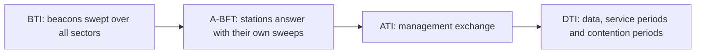
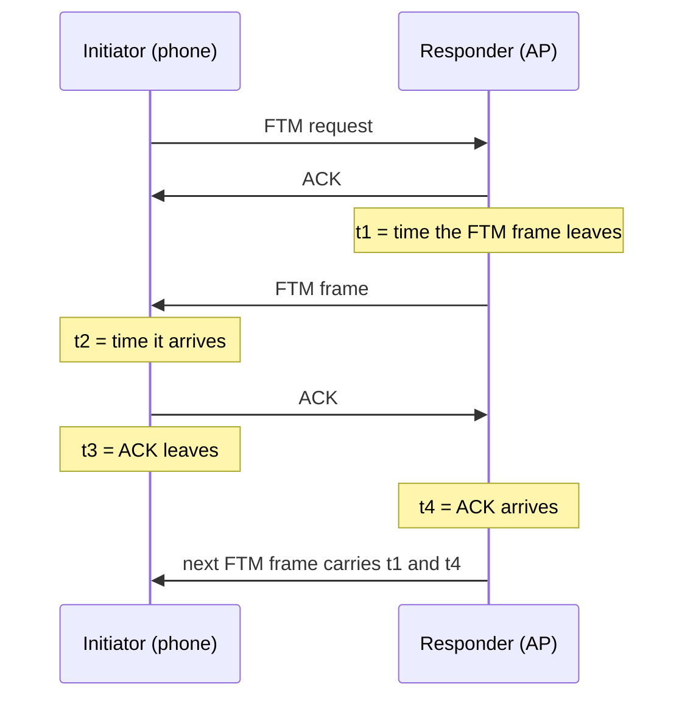
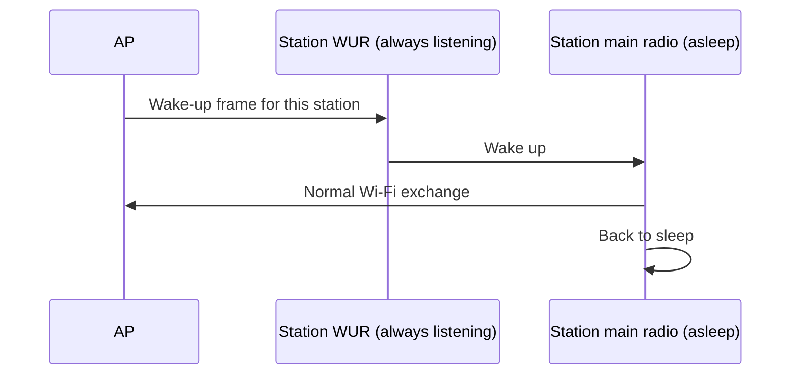

# WF 14: Special-purpose Wi-Fi: HaLow, 60 GHz, V2X, ranging, wake-up radio, sensing, groupcast and direct links

*Part of the [networking plan](../00_plan.md), Wi-Fi sub-track. Builds on [WF 02](02_wifi_phy.md) (OFDM), [WF 03](03_wifi_mac.md) (DCF, TIM, power save), [WF 06](06_wifi6_6e_7_features.md) (TWT) and [WF 11](11_rf_fundamentals_and_link_budget.md) (link budget).*

Most of 802.11 is one design stretched over many generations: same contention-based access, same association, same assumption that the device is a laptop or a phone a few metres from an AP. A few amendments break that assumption because the use case demands something different. Each one is a different answer to the question "what would Wi-Fi look like if it were built for this one job?"

| Amendment | The job | What it gives up |
|---|---|---|
| 802.11ah (HaLow) | Thousands of battery sensors, up to a kilometre away | Speed: a few Mbit/s at best |
| 802.11ad and ay | Multi-gigabit links over a few metres | Range, and any ability to go through a wall or a person |
| 802.11p and bd | Cars talking to cars and roadside units at highway speed | Association, acknowledgements, security at the MAC |
| 802.11ba | Wake a sleeping device on demand with almost no power | A second receiver, and some latency tuning |
| 802.11mc, az, bk | Measure distance with the Wi-Fi frames you already send | Accuracy depends on bandwidth and the room |
| 802.11bf | Use Wi-Fi as a motion and presence sensor | Reliability at some positions |
| 802.11aa | Reliable multicast for video and groups | More airtime |
| TDLS | Two clients talking directly, not through the AP | Needs a good direct path |

By the end you can:

- explain why HaLow reaches so much farther than 2.4 GHz, why it is slow, and why its real bottleneck is thousands of stations contending, not rate;
- explain how the S1G TIM, RAW and TWT let an AP serve thousands of mostly sleeping stations;
- explain why 60 GHz needs beam training, what a beacon interval looks like there, and why a hand can cut a link;
- explain OCB mode, why Doppler is the enemy of 802.11p, and what 802.11bd changed;
- walk through a fine timing measurement, compute a distance, and name what limits its accuracy;
- explain how a wake-up radio works and when it does and does not save energy;
- explain how Wi-Fi sensing detects breathing and why it sometimes cannot;
- compare multicast, GCR and unicast conversion, and say when a TDLS link is worth setting up.

---

## 1. 802.11ah, HaLow: Wi-Fi for sensors

### 1.1 The problem

Picture a farm with two thousand soil sensors, or a building with thousands of meters. Each sends a few dozen bytes every few minutes, runs on a coin cell for years, and sits 300 m or more from the nearest gateway, often behind a wall. Ordinary Wi-Fi fails this in three ways: the range is too short at 2.4 or 5 GHz, the radio uses too much power to wake often, and an AP cannot even address that many stations (the legacy limit is 2,007 association IDs).

HaLow is the answer. It uses the **sub-1 GHz** licence-exempt bands (902 to 928 MHz in North America, 863 to 868 MHz in Europe; other regions differ), and changes the PHY, the power-save machinery and the way access is arbitrated.

### 1.2 Why it reaches far

Two separate effects add up, and it helps to know both.

**Lower frequency loses less in the air.** Free-space loss grows with frequency: at 900 MHz it is about 8.5 dB lower than at 2.4 GHz, and walls absorb less too.

**A narrow channel hears fainter signals.** A receiver's noise floor depends on how much bandwidth it listens to. A 1 MHz channel collects 13 dB less noise than a 20 MHz channel, so it can decode a signal 13 dB weaker at the same modulation.

Together that is about 21 dB, which at a typical indoor path-loss exponent of 3 means roughly **five times the range** of 2.4 GHz at the lowest rate. HaLow even has a mode (MCS 10) that sends every bit twice for another 3 dB. The cost is the data rate.

### 1.3 The PHY: 802.11ac with the clock divided by ten

The S1G PHY is the 802.11ac OFDM design run ten times slower. A 20 MHz channel becomes 2 MHz, 40 becomes 4, 80 becomes 8 and 160 becomes 16. The OFDM symbol, 4 microseconds in 802.11ac, becomes **40 microseconds**. A new **1 MHz** mode with fewer subcarriers is added.

The data rate comes from the same formula you used in WF 02: data subcarriers, times bits per subcarrier, times the code rate, times streams, divided by the symbol time.

| Channel | Data subcarriers | Lowest rate (MCS 0) | A mid rate (MCS 4) | Top rate (MCS 9) |
|---|---|---|---|---|
| 1 MHz | 24 | 0.3 Mbit/s | 1.8 Mbit/s | not valid for one stream |
| 2 MHz | 52 | 0.65 Mbit/s | 3.9 Mbit/s | 8.7 Mbit/s |
| 4 MHz | 108 | 1.35 Mbit/s | 8.1 Mbit/s | 18 Mbit/s |
| 16 MHz | 468 | 5.9 Mbit/s | 35 Mbit/s | 78 Mbit/s per stream |

The headline peak is about **347 Mbit/s** (16 MHz, four streams, MCS 9, short guard), though Wikipedia prints 433.3 Mbit/s and I do not know which assumptions it used. In practice a sensor sits at 1 or 2 MHz and a few hundred kbit/s. At the 1 MHz bottom, one 1500 byte frame takes 40 ms of airtime.

### 1.4 Addressing thousands of sleeping stations: the S1G TIM

In legacy power save (WF 03) the AP announces buffered frames in the **TIM**, a bitmap with one bit per association ID. Two problems appear at scale. The bitmap tops out at 2,007 stations. And the AP must send the bitmap span from the first to the last set bit, so ten sleeping stations scattered across the range cost hundreds of bytes in every beacon.

S1G fixes both with a **hierarchy**:

```
page  (4 pages)
 └─ block  (32 per page)
     └─ subblock  (8 per block)
         └─ 8 stations (one bit each)      4 x 32 x 8 x 8 = 8,192 AIDs
```

The AP encodes only the blocks and subblocks that have a bit set, so a sparse set of sleeping stations costs a few dozen bytes. **Page slicing** goes further: each page can be announced in a different beacon, so a station knows which beacon to wake for and ignores the rest. A station that wakes for one beacon in four spends a quarter of the listening energy.

The point to remember is that HaLow made addressing cheap in both bytes and wake-ups. The exact byte layout of the encoded blocks is something to look up in the clause if you need it.

### 1.5 Controlling the stampede: RAW, TWT and friends

Addressing thousands of stations is not the same as serving them. If a thousand sensors wake at once, they contend with DCF and almost every attempt collides. HaLow uses several tools:

**Restricted Access Window (RAW).** The AP divides stations into groups and gives each group a time slot inside a window. Only the stations of a slot may contend during it. Instead of one thousand-station contention, the AP runs a hundred ten-station contentions in sequence.


**Target Wake Time (TWT).** The station and AP agree on exact wake times, so the station can sleep through everything else, potentially for very long periods. The **maximum idle period** is extended so an AP does not drop a station that stays silent for a very long time. TWT is covered in WF 06; HaLow was one of its first users.

**Short frames.** At 1 MHz the preamble alone is hundreds of microseconds. HaLow adds the **null data packet (NDP)**, a frame that carries its information in the PHY header with no payload, and NDP acknowledgements, so short exchanges stay short.

**Relay.** A far sensor can send to a nearby relay at a high rate instead of to a distant AP at the lowest rate. The relay logically is a station plus an AP, limited to two hops.

**Sectorisation.** The AP covers the area in sectors (by antennas or beams), and only stations in the active sector contend.

### 1.6 What a model shows about contention

I modelled a thousand saturated stations (every one always has a frame) with plausible HaLow timings. A single station is limited by the slow preamble and ACK to about a fifth of the raw rate. With a thousand stations contending freely, 93 percent of attempts collide and the aggregate throughput drops to about a third of the single-station figure. Splitting them into groups of ten with RAW recovers nearly the single-station performance, about three times better than free contention. The exact numbers depend on assumed timings, so treat the shape as the lesson: **a large HaLow network is limited by contention, and RAW is what keeps it usable.**

---

## 2. 802.11ad and 802.11ay: 60 GHz

### 2.1 Why 60 GHz

There is a very wide unlicensed slice around 60 GHz. A channel there is **2.16 GHz** wide, a hundred times wider than a 20 MHz Wi-Fi channel, so even simple modulation gives gigabits. The price is the physics.

### 2.2 What 60 GHz does to the signal

- **Loss at the start is 20 dB worse than at 6 GHz.** The wavelength is 5 mm, so a receiving antenna of fixed size captures much less energy. Free-space loss at 1 m is already 68 dB.
- **Oxygen absorbs it.** About 15 dB per kilometre (from memory), negligible indoors but part of why outdoor links are short.
- **Almost nothing passes through anything.** A wall stops it, and **a human body in the path costs 20 to 30 dB** (from memory). In my link budget model, a 40 dBm EIRP link that reaches about 120 m at the highest single-carrier rate drops to about 8 m with 25 dB of body block.

The way to win back the lost signal is **gain**. At 5 mm wavelength a tiny phased array focuses energy into a narrow beam. Both ends point beams at each other, which gives tens of dB of gain, but only if the beams are aimed correctly. That is why everything about 802.11ad's MAC is about **beam training**.

### 2.3 The PHY

802.11ad defines three: a very low rate **control PHY** (used for beacons and training so that devices can find each other before they have beams), a **single carrier** PHY (up to about 4.6 Gbit/s, simple and low power), and an **OFDM** PHY (up to about 6.76 Gbit/s). The single carrier rates follow from the symbol rate of 1.76 Gsym/s: 385 Mbit/s for the robust BPSK modes, 1.2 Gbit/s at BPSK 3/4, 2.3 Gbit/s with QPSK and 4.6 Gbit/s with 16-QAM.

### 2.4 The beacon interval: time is divided by purpose

A 60 GHz network (a PCP or AP and its stations) divides each beacon interval into four periods:



- **BTI**: the AP sends its beacon in every direction, one sector at a time, so any station can hear it from some sector.
- **A-BFT**: stations that heard a beacon use short slots to respond with their own sweep.
- **ATI**: request and response management traffic.
- **DTI**: the actual data. It contains **service periods** (scheduled, contention-free, reserved for a pair) and **contention-based access periods** (EDCA, like ordinary Wi-Fi).

### 2.5 Beam training

Training has two stages. **Sector level sweep (SLS)**: the initiator sends a frame in every one of its sectors while the responder listens in a quasi-omnidirectional pattern; the responder reports which sector it heard best; then the roles swap. This finds a coarse beam. **Beam refinement (BRP)** then tunes it using training fields appended to ordinary packets, so refinement does not need a new sweep.

The cost grows with the number of sectors. In my model (a sweep frame is about 17 microseconds, from memory), 32 sectors a side takes about a millisecond and 128 sectors takes four. Finer beams give more gain but must be re-aimed more often when the device rotates. At 128 sectors a device turning at 90 degrees per second would spend an estimated 14 percent of its air time retraining. That is the real trade: **gain against training overhead**, and why a fast-rotating phone at 60 GHz suffers.

### 2.6 802.11ay

802.11ay builds on 802.11ad: it **bonds up to four 2.16 GHz channels** (8.64 GHz), supports **MIMO** including multi-user, and adds higher-order modulation. Sources quote peak link rates up to tens of Gbit/s, and range up to a few hundred metres in ideal conditions. The same physics applies: the peaks are line of sight with good beams.

---

## 3. 802.11p and 802.11bd: V2X

### 3.1 The problem: a car cannot wait to associate

A vehicle passing a roadside unit at 100 km/h through a 300 m cell has under 11 seconds in range. Ordinary Wi-Fi spends several seconds scanning, then authenticates, associates, and gets an address before one useful frame flows. In vehicle-to-everything (V2X) communication there is no time for that, and the messages are mostly broadcast anyway: a car announcing its position and speed ten times a second.

### 3.2 OCB mode: no BSS at all

802.11p defines **OCB** ("outside the context of a BSS"). A station just transmits. It uses the **wildcard BSSID** (all ones), there are no beacons, no authentication, no association, and (from memory) no MAC-layer security exchange; applications sign their own messages. Broadcast safety messages are sent without acknowledgement and without retry; priority between traffic classes comes from EDCA.

### 3.3 The PHY: half the clock

OCB uses a **10 MHz** channel: the 20 MHz OFDM design run at half speed, so every time doubles (symbol 8 us, guard interval 1.6 us) and rates halve to **3 to 27 Mbit/s**. The longer guard interval tolerates delays from reflections 480 m longer than the direct path, which suits outdoor multipath.

### 3.4 Doppler: the real enemy

A moving transmitter shifts the received frequency (Doppler). At 5.9 GHz and 250 km/h closing speed the shift is about 1.4 kHz. That is small against the 156 kHz subcarrier spacing, so subcarriers do not collide. The damage is **in time**: the channel itself changes every few hundred microseconds (the coherence time, about 310 us at 250 km/h).

An 802.11p receiver estimates the channel once, from the preamble at the start of the frame, and assumes it stays constant. A 300-byte frame at the lowest rate lasts 850 microseconds, almost three coherence times, so by the end of the frame the estimate is stale and the symbols decode badly. The counter-intuitive consequence: **at high speed, slower rates are worse**, because the frame is longer.

### 3.5 Channel load

Safety messages are broadcast, so nobody backs off in a crowd. The real limit is airtime. One vehicle sending 300 bytes ten times a second at 6 Mbit/s uses about 0.45 percent of the air, so about 110 vehicles in carrier-sense range load the channel to half. Carrier-sense range is much bigger than the range at which a message is useful, so V2X standards add congestion control: lower rate, lower power, or fewer messages as the channel fills.

### 3.6 802.11bd

802.11bd (also called NGV) keeps compatibility with 802.11p and fixes its weaknesses. From the paper I read:

- **LDPC** coding replaces the older convolutional code, a large coding gain;
- **midambles**, extra training symbols inserted in the middle of the frame, let the receiver re-estimate the channel and track the Doppler change, which is exactly the problem above;
- **dual carrier modulation** repeats symbols on two widely separated subcarriers for diversity;
- **retransmissions** that depend on congestion, giving a combining gain of several dB;
- **20 MHz** channels and a **mmWave** mode built on 802.11ad and ay;
- a target of **twice the throughput at relative speeds up to 500 km/h** and twice the range.

It must **coexist** with 802.11p: detect its transmissions, defer to them, and share the channel fairly. The doubled throughput appears only at high SNR, so it is a short-range benefit. A cellular alternative (C-V2X) competes with all of this, and the 5.9 GHz band allocation has changed in some countries.

---

## 4. 802.11mc, az and bk: measuring distance with Wi-Fi

### 4.1 The idea

Radio travels at the speed of light, so measuring the time of flight gives distance. A phone cannot measure one-way time because it does not share a clock with the AP. **Fine Timing Measurement (FTM)** gets around this with a round trip: each side measures only an interval on its own clock, so the clocks need not agree.



The initiator now knows all four times and computes

```
round trip time = (t4 - t1) - (t3 - t2)
distance = speed of light x round trip time / 2
```

The first bracket is the total time on the responder's clock; the second is how long the initiator took to turn the frame around, on its own clock. The difference is time spent in the air both ways.

A measurement burst sends several of these (the survey I read gives burst durations from 250 microseconds to 128 ms, and recommends a burst period of 10 ms or less), and the results are averaged. The request and FTM frames are ordinary public action frames, and `tshark` decodes them.

### 4.2 What limits the accuracy

**1. Clock difference.** Each side measures its interval on a crystal that is a few parts per million off. A turnaround of 100 microseconds with a 40 ppm clock difference produces about 0.6 m of error; a turnaround of 1 ms gives 6 m. So the responder must answer with a short, fixed delay, and good implementations estimate the clock ratio from consecutive frames.

**2. Bandwidth.** The receiver decides when a frame "arrived" from the preamble. The sharper the signal, the better it can pinpoint arrival, and sharpness is bandwidth. A 20 MHz signal resolves only to about 50 ns (15 m of path); 160 MHz resolves to 6 ns (2 m).

**3. Multipath.** This is the dominant error indoors. The receiver sees the direct path plus reflections and must pick the first. If a reflection arrives within the resolution of the signal, the two merge and the apparent arrival moves later, adding metres of error. In my simulation (one reflection with half the amplitude) the RMS error was 1 to 2 m at 20 MHz and about 0.1 to 0.3 m at 160 MHz. Real rooms have many reflections.

**4. Calibration.** Every device has a fixed internal delay between the antenna and the timestamp point. A constant error of a metre or two is usually calibration, not noise.

### 4.3 802.11az and 802.11bk

From the survey: **802.11az** pushes accuracy below one metre by using up to 160 MHz, repeated training fields, and several mechanisms: ranging with many stations at once (using the multi-user machinery of Wi-Fi 6), **passive ranging** (the AP broadcasts and stations just listen and time it), and **secure ranging**: a randomised training sequence and protected frames so an attacker cannot spoof an earlier arrival. **802.11bk** adds 320 MHz in 6 GHz for accuracy below 0.1 m. The pattern is the table above: more bandwidth, less error.

---

## 5. 802.11ba: the wake-up radio

### 5.1 The problem

The expensive part of a Wi-Fi client is its main radio. Even in power save it must wake regularly to read beacons, and each wake costs energy. A sensor that gets one command a day still wakes hundreds of times for nothing.

### 5.2 The mechanism

802.11ba adds a second, extremely simple receiver, the **wake-up radio (WUR)**. It is a basic envelope detector that listens for a pattern and nothing else. When the pattern matches its address, it wakes the main radio.

From the 802.11ba paper:

- The WUR signal occupies **4 MHz** and uses **on-off keying**, which a simple detector can decode without a mixer or oscillator;
- It is preceded by an ordinary Wi-Fi preamble so other stations know to defer;
- Data goes at **62.5 or 250 kbit/s**, a few dozen bits for a frame: a short address and a checksum, with no acknowledgement;
- The AP and the station agree on **duty cycles** so the WUR can sleep too, at the price of more downlink delay.



### 5.3 When it pays

The WUR reduces wake cost but is not free: it listens continuously. The saving depends on how often the alternative would wake. A station using beacon listening wakes every interval; the wake energy divided by the interval is its average cost. The WUR costs its listening power all the time. Equating them gives a **break-even interval**: wake energy divided by WUR power.

With an assumed wake energy of 0.2 mJ and an assumed WUR power of 0.5 mW, the break-even is 0.4 seconds. A device that must respond within 100 ms is better off with a WUR (about 4 times the battery life in my model). A device that can tolerate several seconds of latency is better off just listening to beacons, because the WUR's constant listening costs more than the occasional wake. The deciding number is the WUR power, which I do not have for a real chip: the paper says only that a WUR consumes thousands of times less than the main radio. **The lesson: a wake-up radio is a tool for low latency with low power, not simply a power saver.**

---

## 6. 802.11bf: Wi-Fi sensing

### 6.1 The idea

Every received frame carries **channel state information (CSI)**: for each subcarrier, the amplitude and phase after the channel. If a person moves in the room, the reflections change, so the CSI changes. Even breathing moves the chest several millimetres, which at 5 GHz (wavelength about 6 cm) is a measurable change in path length. 802.11bf standardises how stations set up a sensing session, exchange sounding frames at an agreed rate and report measurements (from memory; I read no source on it).

### 6.2 Why breathing is detectable

The received signal is the direct path plus a reflection from the chest. As the chest moves, the reflection's phase rotates a little, and the sum's amplitude rises and falls once per breath. Sampling the amplitude a few times a second and looking at its frequency gives the breathing rate.

### 6.3 Why it sometimes fails

There are two clear limits.

**Sampling.** Breathing is about 0.25 Hz, so you need to sample faster than twice that. At 0.5 Hz sampling a simple detector fails; at a few hertz it works.

**Blind spots.** This is the interesting one. Think of the direct path and the reflection as two arrows added together. The amplitude of the sum changes when the reflection arrow rotates *against* the direct one, but when the two arrows are lined up (in phase) or opposite (antiphase), a small rotation of the reflection changes the length of the sum only to second order. The result: the signal then rises and falls **twice per breath**, and a detector that looks for 0.25 Hz sees 0.5 Hz. In my simulation the correct rate was found at nearly every static phase, and failed completely at exactly those two phases. Real systems avoid the problem by combining many subcarriers and several antennas, whose phases differ, so they are never all blind at once.

At 60 GHz the wavelength is 5 mm, so a 5 mm chest motion rotates the phase by many radians. That is why 60 GHz sensing can resolve very small motion.

---

## 7. 802.11aa: reliable groupcast

### 7.1 The problem with multicast

A multicast or broadcast frame goes to many receivers at once, so it has **no acknowledgement** (otherwise they would all reply), it uses a **basic rate** so everyone can hear it, and it is **never retried**. One receiver with a poor link silently misses frames. For video to a group, that is unacceptable.

### 7.2 What 802.11aa adds

**GCR (groupcast with retries)** has two reliability modes (from memory):

- **Unsolicited retries**: the AP sends each group frame several times blind. Simple, costs the same extra air for any group size, and still not guaranteed.
- **GCR block ack**: the AP polls the group, collects which frames each receiver missed, and resends only those.

The alternative, **directed multicast service** (an 802.11v feature, covered in WF 15), converts the group frame to unicast copies, each acknowledged and rate-adapted.

### 7.3 Which to use

In my model with 10 percent loss per receiver: a single multicast transmission reaches all ten receivers only about a third of the time, and with thirty receivers almost never. Three blind copies reach about 99 percent for ten receivers but always cost three times the air. GCR with block ack reaches every receiver at a cost that grows slowly with group size, and beats ten unicast copies somewhere above about fourteen receivers. At 30 percent loss, unicast copies stayed cheaper up to thirty receivers, because each GCR retry round resends the whole frame. **Use unicast for small groups, GCR for large groups with moderate loss.**

---

## 8. TDLS: direct links between clients

### 8.1 The problem

Two laptops in the same room, sharing a file through the AP, send every bit twice, once up and once down, using the AP's air time both ways. **Tunnelled Direct Link Setup** lets the two clients talk directly.

### 8.2 How it works

The setup frames travel **through the AP** as ordinary data frames, so it works even before the two clients can hear each other. The initiator sends a setup request (carrying a link identifier that names the BSSID and both stations), the peer answers, the initiator confirms, and the two exchange data directly while remaining associated to the AP. Optionally, they switch to a different channel for the direct link. The peers derive their own key for the direct link, protected by the AP's security. TDLS replaced the older 802.11e DLS, which required the AP to take part.

### 8.3 When it pays

The relay through the AP halves the usable rate (two transmissions per bit). A direct link must therefore be **faster than half the AP rate** to be worth it. If both clients get 120 Mbit/s to the AP, relaying gives 60 Mbit/s, and a direct link at 120 doubles that, at 300 it is five times better, but one at only 30 Mbit/s loses. Off-channel operation also costs the AP traffic the time the clients are away: spending 50 ms of every 500 ms away is a 10 percent loss.

---

## 9. Briefly: the rest of the list

- **802.11ak (general link)** lets a non-AP station act as a bridge to a wired network behind it (from memory, not read).
- **802.11ai (FILS)** cuts initial link setup to tens of milliseconds and is covered in [WF 06](06_wifi6_6e_7_features.md).
- **Wi-Fi Aware (NAN)** and **Wi-Fi Direct** are in [WF 07](07_wifi_architectures_mesh_and_services.md).
- Multicast handling, MAC randomisation and onboarding are in WF 15.

## 10. Testing and debugging these radios

- **HaLow**: test with thousands of simulated stations, since the failure appears only at scale; check that RAW slot assignment matches the sleep schedule; measure how long a sensor takes to join when many wake together.
- **60 GHz**: measure throughput against angle and against a body in the path, and the time to recover after a turn. A drop to zero when someone's hand blocks the beam is normal.
- **V2X**: emulate the Doppler of 250 to 500 km/h with a channel emulator, load the channel with 100 or more stations, and test 802.11p and bd devices together.
- **FTM**: calibrate each device model against known distances; do not trust the first measurement indoors.
- **Wake-up radio**: measure the real current of the WUR and the sleeping main radio before believing any battery life estimate.
- **Sensing**: test an empty room first, then several positions, because of blind spots.
- **GCR and multicast**: measure per-receiver loss before choosing a mode.
- **TDLS**: confirm the direct rate really exceeds half the AP rate at the clients' real positions.

## 11. Common mistakes

1. Quoting HaLow's range without its rate. The kilometre is at the lowest rate.
2. Assuming a large TIM means a large network works. Addressing is not access; contention is the limit.
3. Treating 60 GHz range as free-space range. A body costs 20 to 30 dB.
4. Counting only the 60 GHz data rate and ignoring the time spent on beam training.
5. Treating OCB as a Wi-Fi network. There is no association, and broadcast safety messages are not acknowledged.
6. Ignoring Doppler inside a frame: slower rates mean longer frames and a staler channel estimate.
7. Trusting FTM to a metre or better indoors at 20 MHz.
8. Assuming a wake-up radio always saves energy; it only pays when latency matters.
9. Reading breathing from one subcarrier of one antenna; blind spots will fool it.
10. Using GCR for a small group; unicast copies are cheaper there.
11. Setting up TDLS without checking that the direct rate is above half the AP rate.

## 12. Interview questions

1. **Why does HaLow reach farther than 2.4 GHz?** Lower frequency loses less in free space and through walls, and a 1 MHz channel has far less noise than 20 MHz, so weaker signals decode. About 21 dB combined, roughly five times the range, at the cost of rate.
2. **How does the S1G TIM address thousands of stations?** A hierarchy of pages, blocks and subblocks (8,192 AIDs), with only non-empty parts sent, and page slicing across beacons so stations wake only for their page.
3. **What problem does RAW solve?** Thousands of stations waking together collide under DCF; RAW gives each group its own time slot, so only a few contend at once.
4. **Why is 60 GHz line of sight and what does the MAC do about it?** High loss at the antenna, no penetration, and a body blocks 20 to 30 dB; arrays form narrow beams, and a sector sweep followed by refinement aims them.
5. **What is the beacon interval at 60 GHz?** Beacon sweep, association beam training, announcement, then data in scheduled service periods and contention periods.
6. **What changes in OCB mode?** No BSS: wildcard BSSID, no beacons or association, 10 MHz numerology, unacknowledged broadcast.
7. **Why does Doppler hurt 802.11p, and what did 802.11bd change?** The channel changes within a frame while the channel estimate is taken once at the start; bd inserts midambles, uses LDPC and adds retransmissions.
8. **How does FTM compute distance, and what limits it?** Round trip with four timestamps, so no shared clock is needed; limited by clock difference times turnaround, bandwidth, multipath and calibration.
9. **When does a wake-up radio save energy?** When the latency required is shorter than the beacon-listening break-even, because the WUR listens all the time.
10. **Why might sensing miss a breathing person?** At some static phases the amplitude responds at twice the breathing rate; combine subcarriers and antennas.
11. **GCR or unicast conversion?** Unicast for small groups, GCR with block ack for large groups at moderate loss.
12. **When is TDLS worth it?** When the direct rate exceeds half the AP rate and the clients are close.

## 13. Problems

**Problem A. S1G rate.** Compute the rate of 2 MHz MCS 7 with two streams and the short guard interval (52 subcarriers, 64-QAM at 5/6, 36 us symbol).

**Problem B. 60 GHz blockage.** A link reaches 120 m. A body adds 25 dB of loss. Roughly how far does it reach now (ignoring oxygen)?

**Problem C. V2X load.** A message takes 450 us of airtime and each vehicle sends 10 a second. How many vehicles fill half the channel?

**Problem D. FTM clock error.** Two devices differ by 40 ppm and the responder takes 200 us to answer. What distance error results?

**Problem E. Wake-up radio.** Waking the main radio costs 0.2 mJ; a WUR listens at 1 mW. Below what interval is beacon listening more expensive than the WUR?

## 14. Answers

**A.** 52 x 6 bits x 5/6 x 2 streams = 520 bits per symbol, divided by 36 us is about **14.4 Mbit/s**. About a fifth of one 802.11n stream at 20 MHz, which is the sacrifice for range.

**B.** Each 6 dB of loss halves free-space range, and 25 dB is a factor of 18 in distance (10 to the power 25/20), so about 120 / 18, roughly **7 m**. That is why a body kills a 60 GHz link.

**C.** Half the channel is 0.5 seconds of air per second; each vehicle uses 10 x 450 us = 4.5 ms per second, so 0.5 / 0.0045 is about **111 vehicles**.

**D.** Error is half the speed of light times turnaround times the clock difference: 1.5 x 10^8 m/s x 200 us x 40 x 10^-6 is about **1.2 m**.

**E.** Break-even is energy over power: 0.2 mJ / 1 mW = **0.2 s**. Listening more often than every 0.2 s costs more than the WUR; listening less often costs less.

## 15. Cheat sheet

| Topic | Key points |
|---|---|
| HaLow | Sub-1 GHz; 1, 2, 4, 8, 16 MHz; 802.11ac clocked down 10x; 40 us symbol; about 5x the range of 2.4 GHz at the lowest rate; TIM with 8,192 AIDs in pages, blocks and subblocks; RAW, TWT, NDP, relay, sectors |
| 60 GHz | 2.16 GHz channels; control, single carrier and OFDM PHYs; about 4.6 and 6.76 Gbit/s; 68 dB loss at 1 m; body block 20 to 30 dB; beacon interval BTI, A-BFT, ATI, DTI; sector sweep then refinement; ay bonds four channels |
| V2X | OCB: no association, wildcard BSSID; 10 MHz, 3 to 27 Mbit/s; Doppler breaks the one-shot channel estimate; bd adds LDPC, midambles, retransmission, coexists with p |
| FTM | RTT = (t4 - t1) - (t3 - t2); errors from clock times turnaround, bandwidth, multipath, calibration; az below 1 m, bk below 0.1 m |
| WUR | 4 MHz OOK, 62.5 and 250 kbit/s, main radio sleeps; pays for low latency, break-even is wake energy over WUR power |
| Sensing | CSI changes with motion; sample above twice the rate; blind spots double the frequency |
| GCR | Multicast has no ACK or retry; blind copies or block ack; unicast for small groups |
| TDLS | Setup tunnelled via the AP; direct rate must beat half the AP rate |

Next: WF 15 (multicast, privacy, onboarding and interworking), not yet written.

## Sources

I checked key facts against Wikipedia (IEEE 802.11ah and 802.11ay) and three arXiv papers: "IEEE 802.11ba: Extremely Low Power Wi-Fi for Massive Internet of Things" (arXiv 1909.00594), "Indoor Positioning with Wi-Fi Location: A Survey of IEEE 802.11mc/az/bk Fine Timing Measurement Research" (arXiv 2509.03901, first part read) and "IEEE 802.11bd and 5G NR V2X" (arXiv 1903.08391). Everything marked "from memory", and most mechanism details of 802.11aa, TDLS, 802.11bf, 802.11ak and the 60 GHz MAC, come from my recollection of the amendments, not from the standard, which I did not read.

**What is modelled.** The HaLow range and contention figures, the 60 GHz link budget and training cost, the V2X Doppler and channel load, the ranging error, the wake-up radio battery comparison, the sensing detector and the groupcast comparison are all computed or simulated from simple models with assumed parameters (no radio was used). Treat the numbers as showing the shape of each trade-off, not as measured device behaviour.
