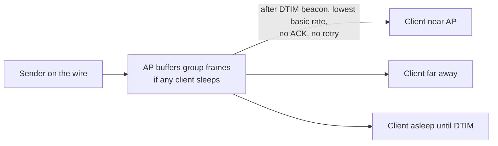
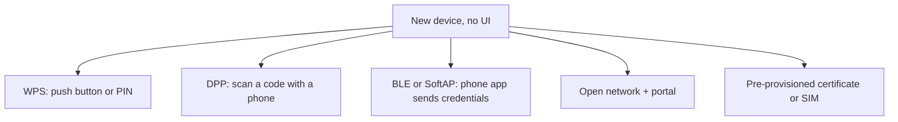
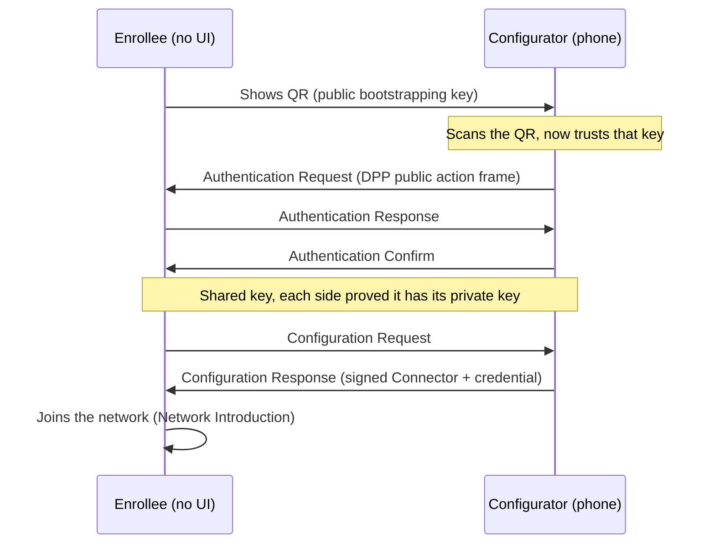
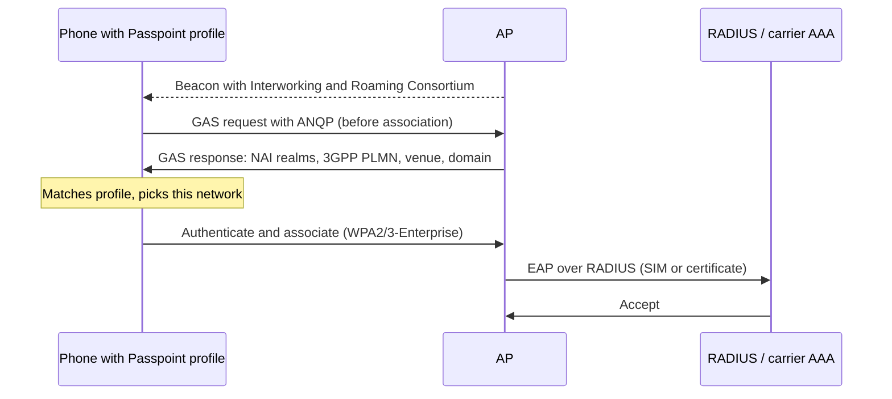
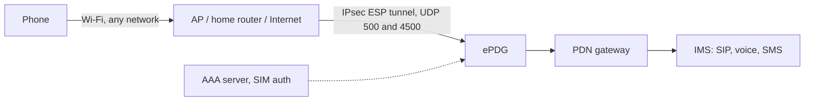

# WF 15: Wi-Fi in the wider network: multicast, address privacy, onboarding, cellular interworking and IoT

*Part of the [networking plan](../00_plan.md), Wi-Fi sub-track. Builds on [WF 03](03_wifi_mac.md) (power save and the DTIM), [WF 04](04_wifi_security.md) (keys, PMF, WPS, captive portals), [WF 05](05_wifi_roaming_and_radio_management.md) (DMS) and [WF 14](14_wifi_amendments_and_special_phys.md) (GCR). Uses [NET 02](../02_ip_routing_and_layer3.md) (multicast, IGMP) and [NET 08](../08_application_protocols_dns_http_tls.md) (DHCP, DNS).*

The first fourteen tutorials treat Wi-Fi as a link: how bits get across the air. A real access point is also a **bridge, a gateway to a cellular carrier, a door that has to let strangers in, and a witness to who is nearby**. Most of the awkward bugs a Wi-Fi platform engineer sees live in those roles, not in the PHY: printers that vanish for half the laptops, a phone that will not stay on the guest network, a device count that doubled overnight, a hotel TV that cannot get through the portal, a sensor that dies in a month.

| Topic | The question | The short answer |
|---|---|---|
| Multicast and broadcast | Why does one chatty protocol slow the whole cell? | Group frames go at the lowest rate, wake every sleeper, and have no retry |
| Address privacy | Why did the client count change and the allow-list break? | Devices now use random, per-network, locally administered addresses |
| Frame protection | What stops a forged beacon or a forged disassociation? | Beacon protection, PMF and the SA Query exchange |
| Onboarding | How does a device with no screen join a network? | WPS is broken; DPP uses public keys and a scanned code |
| Captive portals | How does a phone know it must log in? | A probe URL today; an API announced in DHCP or RA, tomorrow |
| Cellular interworking | How does a phone call over Wi-Fi reach the carrier? | Passpoint for joining; an IPsec tunnel to the carrier's ePDG for the call |
| Unlicensed cellular | Can 5G share 5 and 6 GHz with Wi-Fi? | Yes, with listen-before-talk, but the thresholds are not symmetric |
| IoT | Why do cheap sensors fail on enterprise Wi-Fi? | Sleep, DTIM, multicast discovery, and provisioning |

By the end you can:

- explain why multicast is slow, lossy and power-hungry on Wi-Fi, and choose between snooping, multicast-to-unicast, proxy ARP and a different design;
- show on a Linux bridge what multicast-to-unicast does to a frame and why IGMP snooping cannot help mDNS;
- explain how MAC address randomisation works, what an observer can still correlate, and which network features it breaks;
- explain beacon protection and SA Query and what each prevents;
- compare WPS, DPP, BLE provisioning and a captive portal as ways to get a device onto a network, and say why WPS is retired;
- explain the captive portal API (RFC 8908), how it is announced (RFC 8910), and why it beats probe detection;
- describe Passpoint network selection, a Wi-Fi call from the handset through the ePDG, and where an AP can help or hurt it;
- explain how LTE-LAA and NR-U share spectrum with Wi-Fi and why the detection thresholds matter;
- design Wi-Fi for battery IoT: provisioning, DTIM, multicast filtering and discovery.

---

## 1. Multicast and broadcast over Wi-Fi

### 1.1 Why a group frame is a different animal

On a wired switch a multicast frame costs the same as any other frame at line rate. On Wi-Fi three properties of the link make it expensive, and each one is the reason for a mitigation later in this chapter.

1. **There is no way to pick a rate.** A unicast frame is sent at the rate chosen for that one client, based on its signal ([WF 03](03_wifi_mac.md) rate adaptation). A group frame has many receivers with different signals, so the AP cannot choose well and uses the **lowest rate in the BSS's basic rate set**, so that the farthest client can still decode it.
2. **There is no acknowledgement.** If every receiver acknowledged, the acknowledgements would collide. So the AP sends once and hopes. RFC 9119, the IETF's survey of the problem, says a loss of 5 percent or more is "not uncommon".
3. **Sleepers must be served at a fixed time.** A station in power save is not listening between beacons, so the AP **holds group frames until right after a DTIM beacon** and sends them all at once ([WF 03](03_wifi_mac.md) section 6.3). Every station that wants to be reachable has to wake for that beacon.



### 1.2 What the lowest rate costs

Airtime is the shared resource. The same 1,500 byte frame occupies the channel for very different times depending on the rate it is sent at:

```python
def airtime_us(payload_bytes, rate_mbps, overhead_us=40):
    return overhead_us + payload_bytes * 8 / rate_mbps
for label, rate in [("multicast at 1 Mbit/s (2.4 GHz legacy basic rate)", 1),
                    ("multicast at 6 Mbit/s (5 GHz basic rate)", 6),
                    ("unicast at 300 Mbit/s", 300),
                    ("unicast at 1200 Mbit/s", 1200)]:
    print(f"{label:52s} {airtime_us(1500, rate):9.0f} us")
```

Run here, this gives about 12,000 microseconds at 1 Mbit/s, 2,000 at 6, 80 at 300 and 50 at 1,200: one multicast frame at the old 1 Mbit/s basic rate blocks everyone for as long as **150 unicast frames to a modern client**. (The 40 microsecond fixed overhead is an assumption; the ratio is what matters.) That is why a stream of mDNS, SSDP or a video multicast can make a whole floor feel slow without moving much data.

The first fix is cheap and in every vendor's guide: **remove the low basic rates**. On a 5 GHz-only network, set the minimum basic rate to 12 or 24 Mbit/s so group frames go out at that speed. The cost is that a client too far to decode that rate cannot see beacons or group frames at all, which is a coverage decision you should make deliberately, not by accident ([WF 11](11_rf_fundamentals_and_link_budget.md)).

### 1.3 Power save and the content-after-beacon queue

When any associated station is in power save, the AP buffers every group frame in a queue that is flushed after the DTIM beacon (the **content-after-beacon, CAB, queue**). Three consequences:

- **Latency.** A group frame can wait up to a DTIM period, for example three beacon intervals of 102.4 ms.
- **Overflow.** The queue is finite. Drivers cap how much multicast one beacon interval may carry so that it cannot starve unicast; surplus group frames are dropped, so a burst of mDNS can lose frames for everyone.
- **Wake cost.** Every sleeper wakes at every DTIM to see whether group traffic follows, and stays up for as long as it lasts. A sensor that sleeps through 9 of 10 beacons ([section 6](#6-wi-fi-in-iot)) is pulled awake by neighbours' mDNS.

Raising the DTIM period saves battery and costs group latency; protocols that depend on group frames (mDNS discovery, some printers, ARP resolution after the AP's cache expires) get slower or flaky. It is a trade-off, and a good interview answer states both sides.

### 1.4 No retries, and a trap with keys

Because group frames are not acknowledged, a client that misses one never knows. Two related traps follow:

- **Group rekeying.** The GTK that protects group traffic is renewed with a group key handshake ([WF 04](04_wifi_security.md)). That handshake is **unicast** and acknowledged, so it survives; but a client that misses the *beacon* announcing the new key index can drop group frames until it resynchronises. RFC 9119 notes that unreliable multicast can leave a client "connected" but without working multicast.
- **ARP and neighbour discovery after sleep.** A client waking from sleep that depends on a broadcast ARP reply, with the reply lost, shows as "Wi-Fi connected but no network" for a few seconds.

Reliability add-ons exist ([WF 14](14_wifi_amendments_and_special_phys.md) section 7): **GCR** (blind retries, or block ack) and **DMS**, which converts group frames to unicast. Both need support on the client as well as the AP, which is why the AP-side tricks below are what actually ships.

### 1.5 How a group address maps to Ethernet, and why snooping is imperfect

An IPv4 multicast group maps to an Ethernet address by copying the **low 23 bits** of the group into `01:00:5e:00:00:00`. IPv6 uses `33:33` followed by the last 32 bits; for neighbour discovery it uses **solicited-node** groups `ff02::1:ffXX:XXXX`, mapped to `33:33:ff:XX:XX:XX`.

```python
import ipaddress
def v4_group_mac(g):
    low23 = int(ipaddress.IPv4Address(g)) & 0x7FFFFF
    return "01:00:5e:%02x:%02x:%02x" % (low23 >> 16, (low23 >> 8) & 255, low23 & 255)
print(v4_group_mac("224.0.0.251"))                       # mDNS
print(v4_group_mac("239.1.1.1"), v4_group_mac("224.129.1.1"), v4_group_mac("239.129.1.1"))
```

The first prints `01:00:5e:00:00:fb`. The second prints the **same** address three times: **32 IPv4 groups share one MAC** because 5 bits are dropped. A receiver that filters on MAC alone may accept groups it did not ask for. IPv6 has a similar overlap.

**IGMP and MLD snooping** lets a switch or AP learn which ports (or stations) want which group by reading the membership reports (IGMP for IPv4, MLD for IPv6), and forward group frames only there. On Wi-Fi it is more valuable than on a wire, because it can cut the airtime. Three limits matter:

1. **Link-local groups are not snooped.** Groups in `224.0.0.0/24`, which includes **mDNS (224.0.0.251)** and all-hosts, are flooded by design (RFC 4541), because hosts do not send reports for them. Snooping cannot help the busiest chatty protocol.
2. **IPv6 needs state per host.** Every IPv6 host joins its own solicited-node group, so a switch that does not track MLD properly floods them all.
3. **It needs a querier.** Without a router sending queries on the segment, memberships time out. The Linux bridge can act as querier (`mcast_querier 1`); hostapd-based APs often rely on the bridge.

### 1.6 Multicast to unicast: the fix that ships

The most effective AP-side change is to **convert a group frame to a unicast frame, once per listening station**. Each copy is sent at that client's own rate, acknowledged and retried, and does not wake sleepers that are not members. The cost is more frames: 40 members means 40 copies, so it pays for small groups, and for large groups a plain group frame at a decent rate may be cheaper (the same trade-off as GCR against unicast copies in [WF 14](14_wifi_amendments_and_special_phys.md)).

The Linux bridge in an AP does this when `mcast_to_unicast` is set on a port, using the membership it learned from snooping. A small experiment shows the change in the frame. Three namespaces (one sender, two receivers that join `239.1.1.1`) are connected through a bridge with snooping on; capturing at one receiver:

```bash
ip -n wfb link add br0 type bridge mcast_snooping 1 mcast_querier 1
# ... veth ports pr1, pr2 added to br0, hosts join the group ...
bridge link set dev pr1 mcast_to_unicast on     # set BEFORE the host joins
bridge link set dev pr2 mcast_to_unicast on
bridge mdb show                                  # dev br0 port pr1 grp 239.1.1.1 temp
```

With conversion **off** the receiver sees destination `01:00:5e:01:01:01`. With conversion **on** it sees its own unicast address (`9e:0e:71:91:85:c5` in this run) while the IP destination is still `239.1.1.1`. Two practical details came out of the test: the flag has to be set **before** the host joins (the bridge records the host's MAC from its membership report, so a group joined earlier is not converted), and on this kernel a port with the default `mcast_flood on` still delivered a group that its host had never joined, until `mcast_flood off` was set on that port. So when snooping "does not filter", check the per-port flags.

On an AP the same switches are configuration options (from the documentation, not run here): `igmp_snooping` on the bridge and `multicast_to_unicast` on the Wi-Fi interface in OpenWrt, and `multicast_to_unicast=1` in `hostapd.conf`.

### 1.7 Cutting the broadcast load: proxy ARP, neighbour proxy and friends

Group traffic is not only apps. A large share of broadcast on a wireless LAN is **address resolution and configuration**:

| Source of group traffic | Why it is there | What the AP can do |
|---|---|---|
| ARP requests | Hosts and the router ask "who has this IP?" | **Proxy ARP**: the AP answers on behalf of associated clients from a table, so requests are never broadcast over the air |
| Router ARP storms | A router ARPs for every unused address in a /16 | Proxy ARP, ARP sponges, smaller subnets. RFC 9119 mentions about 2,000 broadcasts per second observed at an IETF meeting |
| IPv6 neighbour solicitation and router advertisement | Address resolution, default router | Neighbour proxy; convert neighbour advertisements to unicast (`na_mcast_to_ucast`); tune RA interval |
| DHCP discover/offer | Clients ask for an address | Convert DHCP broadcast to unicast to the client; drop DHCP offers from unauthorised servers |
| mDNS, SSDP, NetBIOS | Service discovery | **Limit it**: separate VLANs per area, filter, or an mDNS gateway that answers from a cache and reflects only the services you allow across VLANs |

In `hostapd` these are `proxy_arp=1`, `na_mcast_to_ucast=1` and `disable_dgaf=1` (the last tells the AP not to forward group-addressed frames down to stations at all, so a client cannot be fooled by group frames forged by another client; Passpoint requires it, and it is only workable together with proxy ARP and neighbour proxy). Together they turn a "flat" wireless network into one where most broadcast never touches the air. Client isolation ([WF 07](07_wifi_architectures_mesh_and_services.md)) is not an alternative: isolation blocks frames **between** clients, while proxy ARP and conversion reduce what is **sent**.

The design lesson RFC 9119 draws: avoid multicast in **new protocols** that run over wireless, prefer a unicast request to a proxy, and make signalling compatible with devices that sleep. Cast and Matter, for example, still use mDNS for discovery; that is why a Wi-Fi network for smart-home devices needs a deliberate mDNS plan and not just a strong signal.

### 1.8 Debugging multicast

Symptoms and what to look for:

- **Works for some clients, not for sleepers.** Check the DTIM period and whether the client wakes at DTIM; check the CAB queue limit.
- **Works on wire, not on Wi-Fi.** Basic rate too high for the client; snooping without a querier; group frame dropped by client isolation; `disable_dgaf`.
- **Works until it gets busy.** Group queue overflow; airtime at the basic rate (look at channel utilisation versus data throughput in the AP's counters).
- **A capture** on the air shows group frames at the basic rate with no ACK after them; with conversion on, you see unicast frames each followed by an ACK ([WF 08](08_wifi_capture_tools_and_debug.md)).

---

## 2. MAC address randomisation

### 2.1 The problem it solves

A Wi-Fi device used to put its **permanent hardware address** in every probe request, even before it joined anything. A shop, an airport or an advertiser could place a few receivers, log those addresses and follow a person through a building or across a city, without a connection. Randomisation was added to stop that.

### 2.2 How it works

An address has two flag bits in its first octet: bit 0 is **group/individual** and bit 1 is **universal/local**. A randomised address has the **locally administered bit set** (second hex digit 2, 6, A or E) and the group bit clear. A device can use that bit alone to tell that a source address is not a manufacturer's, which is a quick test when you read a capture.

There are two places randomisation happens, with different goals:

- **While scanning** (not associated): the device uses a random address for probe requests, and also randomises the sequence number and other fields that could re-link its frames. Apple states that scans while *not* trying to join a preferred network use a random address that changes on disconnect, and that a scan made while trying to join a preferred network is not randomised. The address cannot be predicted by Apple or the Wi-Fi vendor.
- **When associated:** a device may use a **different, stable, random address per network** (derived from a device secret and the SSID), or a new random address on every connection.

```python
import hmac, hashlib
def private_mac(secret: bytes, ssid: str) -> str:
    h = bytearray(hmac.new(secret, ssid.encode(), hashlib.sha256).digest()[:6])
    h[0] = (h[0] | 0x02) & 0xFE        # locally administered, unicast
    return ":".join(f"{x:02x}" for x in h)
```

For one device secret the same SSID always gives the same address (so the network can remember the device), and a different SSID gives a different one (so two networks cannot compare notes). That is the **per-network stable** model that phones use by default today (platform behaviour from memory; the exact rotation rules differ by vendor and release, so check the current documentation when you design around them).

### 2.3 What a network, or an observer, can still correlate

Randomising the address does not make a device anonymous. Things that remain:

- **Fingerprinting by frame content.** The set and order of information elements in a probe or association request (supported rates, HT/VHT/HE capabilities, extended capabilities, vendor elements) is characteristic of a device model and driver version. Studies of the earliest implementations (for example the 2017 paper *A Study of MAC Address Randomization in Mobile Devices and When it Fails*) showed that several of these fields, and the SSIDs a device probes for, allowed re-identification. Newer systems randomise sequence numbers and scramble some fields (Apple documents a changing scrambler seed and new dialogue tokens per transaction).
- **Everything above layer 2.** DHCP hostname and client identifier, the DHCP parameter request list, the user-agent, TLS fingerprints, DNS names, and a signed-in account. If you log in to a captive portal, the portal knows who you are for that MAC.
- **A fixed address in other places.** A device that associates to the **same network** keeps one address there. For the operator of that network, tracking over time works as before; randomisation protects against **other** observers and against cross-network correlation.
- **Physical-layer fingerprints.** Clock offset, transmit-signal imperfections and the radio's emission pattern can identify hardware without any address (research topic, not a product feature).

### 2.4 What it breaks for the network operator

| Feature | How it relied on a permanent MAC | What changes |
|---|---|---|
| MAC allow or deny lists | Address identifies the device | A device re-joining with a new address looks new; per-network stable address helps; turning randomisation off per network is the user's choice |
| DHCP reservations | Same address, same IP | Reservation keyed on the private address works only while it stays stable |
| Parental controls, per-device policy | Policy is attached to a MAC | Attach to an account or a device certificate instead |
| Device counts and analytics | Count distinct MACs | A device that rotates counts several times; count associations, not addresses, and treat probe counts as upper bounds ([WF 08](08_wifi_capture_tools_and_debug.md)) |
| Captive portal sessions | Session keyed by MAC | A client that rotates between visits logs in again; RFC 8908's `seconds-remaining` lets the client know ([section 4](#4-captive-portals-and-how-a-phone-finds-out)) |
| Licensing per device, MAC authentication bypass | Address as identity | Use certificates (802.1X EAP-TLS) or per-device keys |

The guidance is to **stop treating the MAC address as an identity**. For enterprises it means 802.1X with certificates; for homes it means per-device passphrases (iPSK) or just a good WPA3 passphrase. This is a recurring interview question because it touches security, operations and privacy together.

### 2.5 Frame protection against forgeries: beacon protection, PMF and SA Query

Privacy is about who may observe. **Integrity** is about who may forge. Three mechanisms, which [WF 04](04_wifi_security.md) and [WF 12](12_wifi7_eht_and_mlo.md) introduce, stop an attacker from using management frames to disrupt a network:

- **PMF (802.11w).** Unicast management frames such as deauthentication and disassociation are encrypted and authenticated with the pairwise key; broadcast ones carry an integrity check using the IGTK. A forged deauth is silently dropped.
- **SA Query.** If a client that is already associated appears to associate again (a rogue could do this to hijack or to confuse the AP, or the client may have rebooted and lost state), PMF requires the AP to **ask the existing client to prove it is alive**, using an authenticated query. If the old client answers, the AP rejects the new association and tells the new one to come back later (the *association comeback time*). If it does not, the AP accepts. This stops both a forged re-association and an attack where the attacker triggers a kick.
- **Beacon protection (defined in the 802.11 base standard; the Wi-Fi Alliance requires it for Wi-Fi 7 certification).** Beacons carry a **message integrity check** computed with a key from the BIGTK, so a client can detect a forged beacon (for example one that advertises a false channel switch, a false TIM, or a wrong set of capabilities). Without it a rogue could send a beacon claiming a channel switch to a channel that does not exist and strand every client that does not protect beacons.

A clean way to say it in an interview: PMF protects the **reaction frames** (deauth, disassoc, action), SA Query protects the **association state**, beacon protection protects the **announcement frames**. Each closes a hole the previous one left.

---

## 3. Onboarding a device

### 3.1 The problem

A phone has a screen and a keyboard. A light bulb, a camera, a printer or a sensor usually has neither, and a smart TV has only a remote. Yet each must learn the network name and a credential, and the user should not have to type a 20-character passphrase with arrow keys. Every onboarding method trades **convenience, security and the need for a second device**.



### 3.2 WPS and why it is retired

**Wi-Fi Protected Setup** has two common modes:

- **Push-button (PBC):** press a button on the AP and on the device within about two minutes; the device is given the credential.
- **PIN:** an eight-digit PIN, printed on the AP (or on the device) is typed into the other side.

The PIN mode is where it fails. The **last digit is a checksum** of the first seven, and the protocol checks the PIN in **two halves**: the first four digits and then the next three. An AP replies differently depending on whether the first half was right, so an attacker can find each half separately. The search drops from 10^8 guesses to about **10^4 + 10^3 = 11,000** (US-CERT/CC vulnerability note VU#723755, 2011). Many APs had no lockout, and where there was one, it only slowed the attacker.

```python
def wps_checksum(pin7: int) -> int:
    acc = 0
    p = pin7
    while p:
        acc += 3 * (p % 10); p //= 10
        acc += p % 10;       p //= 10
    return (10 - acc % 10) % 10
print(wps_checksum(1234567))               # 0, so 12345670 is a valid PIN
print(10**8, "->", 10**4 + 10**3)
print(round((10**4 + 10**3) * 2 / 3600, 1), "hours at one guess per 2 s")
```

This confirms the arithmetic: a worst case of about 6 hours at one guess every 2 seconds. A second weakness, the **Pixie Dust** attack, uses an AP whose random numbers (nonces) are weak, so one captured exchange lets the attacker compute the PIN **offline**, with no guesses at all (described from the public write-ups, not reproduced here). The advice that has stood since 2011 is the same: **turn the PIN method off**. Push-button is safer because it needs physical access and a short window, but it still gives a credential to whatever device answers during that window, so some enterprise policies disable WPS entirely. The Wi-Fi Alliance promotes DPP (Wi-Fi Easy Connect) as the modern alternative.

### 3.3 DPP, Wi-Fi Easy Connect

**Device Provisioning Protocol** replaces typed secrets with **public-key cryptography and a scanned code**. The roles:

- **Enrollee:** the new device.
- **Configurator:** a device that already has the credential and decides who may join; usually a phone app, sometimes an AP.
- **Bootstrapping:** how the two learn each other's public key. The enrollee has a permanent key pair (P-256 by default). Its **public key is shown as a QR code** (or sent over NFC or Bluetooth LE), and the configurator scans it.

A QR payload is a short string. The following builds one, with a freshly generated key:

```python
import base64
from cryptography.hazmat.primitives.asymmetric import ec
from cryptography.hazmat.primitives import serialization as s
key = ec.generate_private_key(ec.SECP256R1())
der = key.public_key().public_bytes(s.Encoding.DER, s.PublicFormat.SubjectPublicKeyInfo)
uri = "DPP:C:81/1;M:02:00:00:00:00:01;K:" + base64.b64encode(der).decode() + ";;"
```

It comes to 159 bytes: a `DPP:` prefix, `C:` the channel list (operating class 81, channel 1), `M:` the device's MAC address and `K:` the base64 of the **91-byte public key**. A configurator that scans it knows **exactly which key** to trust, so a man in the middle cannot substitute theirs without being noticed.



Key points:

- **Authentication** is a three-message exchange carried in 802.11 **public action frames** (so it needs no association) whose result is a key shared only by the two peers. Messages two and three carry integrity checks proving that each side holds the private key matching what was scanned.
- **Configuration** returns a **Connector**, a signed object (a JWS) holding the network credential and the configurator's signing key. With DPP's own network introduction, two devices holding Connectors can authenticate each other directly without a passphrase.
- **Any credential type.** DPP can carry a WPA3-Personal key, an SAE key, an EAP-TLS certificate or an OWE setting, so one scan can provision a device with a **per-device credential** that can be revoked alone, unlike a shared passphrase.
- **No PIN.** Nothing short and guessable is exchanged, so there is no equivalent of the WPS attack.
- **PKEX** is a fallback where no code can be scanned: both sides type or know a short shared code, from which they derive a key exchange. The code has low entropy, so it is more exposed than a QR.
- **Risks that remain:** a compromised configurator app could provision an attacker's device, and early `hostapd` and `wpa_supplicant` releases had parsing and state-machine bugs in their DPP code that were fixed between 2020 and 2024 (so check the version you ship). The sharpest operational risk is that the QR code is a **claim ticket**: whoever scans an unconfigured device's code first can enrol it, so a code printed on the outside of a box is an exposure until the device has been claimed.

### 3.4 Other routes you will see

- **BLE or SoftAP provisioning.** The device advertises over Bluetooth LE (or starts its own temporary AP). A phone app connects and sends the SSID and passphrase over that link, often encrypted with a session key negotiated over the same link. This is what most smart-home products do. **Matter** uses BLE to commission a Wi-Fi device (the phone sends the network credentials after an authenticated setup) and then moves it to the Wi-Fi network (from the specification, not tested here).
- **Open network with a portal.** The device joins an open or OWE network and a portal asks for acceptance or a login ([section 4](#4-captive-portals-and-how-a-phone-finds-out)). Impractical without a screen.
- **Pre-provisioned certificate or SIM.** The device has a certificate or an EAP-SIM identity from the factory and joins an 802.1X or Passpoint network with no user step ([section 5](#5-cellular-interworking)).
- **Per-device passphrases (iPSK, DPSK).** The AP or controller maps each device's MAC (or each passphrase) to a policy. The user still types or scans a key, but a leaked key affects one device.

A short comparison for an interview:

| Method | Needs a second device | Secret is | Weakness |
|---|---|---|---|
| WPS PIN | no | 8 digits | 11,000 guesses; offline attack on weak APs |
| WPS push button | no | a time window | Anyone in range during the window |
| DPP with QR | yes | a private key on the device | The label can be copied |
| BLE or SoftAP | yes (phone) | session key over a short-range link | Depends on the app's protocol; open SoftAP window |
| Certificate or SIM | no | a key in secure storage | Provisioning at the factory |

---

## 4. Captive portals and how a phone finds out

### 4.1 What a portal does

A hotel, airport or café network is open or lightly protected, and **blocks everything until the user accepts terms or logs in**. A device first meets the portal as a network that gives an IP address but silently refuses to forward packets, or redirects web traffic to a login page. The device needs to know three things: **is this network captive, where is the login page, and how long is my session?**

### 4.2 Detection by probe: how it works today

Phones and laptops fetch a known URL on a well-known server (an Android or Apple "connectivity check") with plain HTTP and expect a fixed answer. For an open network the answer is **HTTP 204** or a small page with a known string. If the network is captive, the portal hijacks the request and answers with a **302 redirect** to its login page or with a page of its own. The client sees a mismatch and pops up the login view.

```python
# a portal redirects the probe; an open network answers 204
# captive=True : probe status 302 (portal)
# captive=False: probe status 204 (open internet)
```

(Run here with a local web server that answers 302 or 204 on `/generate_204`.) This works, but it has well-known problems:

- **It is a guess.** The client infers the portal from an unexpected answer; a flaky network can look captive, and a clever portal can look open.
- **It cannot use HTTPS.** An HTTPS probe would fail certificate checks when a portal intercepts it, so detection depends on **plain HTTP**, which the portal must intercept and rewrite. Interception is exactly the behaviour that security-minded stacks try to stop.
- **DNS and HTTPS-everywhere interact badly.** A browser with encrypted DNS never asks the portal's resolver; a site with HSTS refuses the redirect; the user sees a certificate error.
- **No session information.** The client learns nothing about expiry, remaining data or whether the login can be extended.
- **Re-detection is slow.** After the session expires, the client needs to notice and ask again.

### 4.3 The standard way: announce the portal (RFC 8910) and query it (RFC 8908)

The IETF captive portal work (RFC 8910, RFC 8908, with the architecture in RFC 8952) makes the network **tell** the client. Two pieces:

1. **Announcement (RFC 8910).** The network provides the URI of an API endpoint in **DHCPv4 option 114**, **DHCPv6 option 103**, or an **IPv6 Router Advertisement option (type 37)**. It obsoletes the earlier RFC 7710, which used a different DHCPv4 option number (from memory) and had no standard API to query. The URI must be **HTTPS**.
2. **API (RFC 8908).** The client sends `GET` to that URI with `Accept: application/captive+json` and receives JSON with these fields:
   - `captive` (required): `true` if the client has not yet met the conditions for access;
   - `user-portal-url`: the web page for the user to log in, over TLS;
   - `venue-info-url`: a page with information about the venue;
   - `seconds-remaining` and `bytes-remaining`: how much of the session is left, so the client can warn and re-login before the cut;
   - `can-extend-session`: whether the portal allows extension.

A DHCP offer carrying option 114 can be built and decoded to see the encoding:

```python
from scapy.all import Ether, IP, UDP, BOOTP, DHCP
p = (Ether()/IP(src="192.168.1.1", dst="255.255.255.255")/UDP(sport=67, dport=68)
     /BOOTP(op=2, yiaddr="192.168.1.50")
     /DHCP(options=[("message-type", "offer"), (114, b"https://portal.example/api"), "end"]))
```

`tshark` decodes it as `Option: (114) DHCP Captive-Portal`, `Captive Portal: https://portal.example/api`. And a server that follows the API answers the client with JSON like `{"captive": true, "user-portal-url": "https://portal.example/login", "seconds-remaining": 0}` when the user has not logged in, and `{"captive": false, "seconds-remaining": 3600}` afterwards, which the test above produced.

Why this is better:

- the answer is **explicit** and **authenticated**: the client checks that the server certificate matches the host in the announcement, and **ignores the API if the check fails**;
- the client learns the **session state** (time and data left) and can ask again when it changes;
- it works with **encrypted DNS and HTTPS-only browsing**, because the portal is a proper HTTPS site;
- the portal can say **"you are not captive"** to a device that does not need to see a login page, such as one with a special network credential.

The honest limit: it only works when **the network provider deploys it** and the client implements it. Probe detection is still the fallback on most networks, so a platform that supports captive portals has to support both.

### 4.4 How the AP and the gateway enforce it

The portal itself is not on the AP; the AP or gateway enforces **a walled garden**:

- before login, allow DHCP, DNS (answered by the portal's resolver or forwarded), and traffic to the portal, the identity provider and the payment provider;
- redirect other HTTP traffic to the portal URL (and drop other protocols);
- after login, **authorise the client's MAC and IP** (a firewall entry, or an AP-level rule), with a timer from the portal;
- on timeout, remove the authorisation, so the next probe sees the portal again.

Randomised MACs matter here ([section 2.4](#24-what-it-breaks-for-the-network-operator)): authorisation keyed on a MAC lasts only as long as the client keeps the address, so ties to an account (a voucher or token in the session) are more robust than ties to an address.

### 4.5 Debugging a portal that "does not pop up"

- **Capture the probe.** Does the client send its connectivity check, and what does it get back? A `204` means the gateway forwarded it, so there is no portal in the path; a `302` should pop the login view.
- **Check DNS.** If the client uses a fixed or encrypted DNS server, the portal never sees the queries and cannot redirect by name.
- **Check what the OS announces.** Option 114 in the DHCP offer? A bad certificate on the API host makes the client ignore it, and the log says so.
- **Test with a plain browser** at `http://neverssl.com`-style pages; an HTTPS-only page will not redirect.
- **Check isolation and VLAN.** The portal host must be reachable from the pre-auth VLAN.
- **Watch session expiry.** The most frequent complaint is "it asked again after an hour": a timer on the gateway shorter than the portal's.

---

## 5. Cellular interworking

### 5.1 Why a carrier cares about Wi-Fi

A carrier wants its subscribers to stay connected indoors, to carry some traffic off its radio network and to offer **voice over Wi-Fi** where cellular coverage is poor. A Wi-Fi vendor wants phones to join the venue's network without a login. Four building blocks connect the two worlds:

1. **Passpoint**: a phone finds and joins a participating Wi-Fi network automatically, with the carrier's credentials and a secure link.
2. **Wi-Fi calling and data over untrusted Wi-Fi**: an IPsec tunnel from the phone to the carrier core.
3. **Trusted Wi-Fi access**: the carrier's core treats certain Wi-Fi networks as part of its own network.
4. **Cellular technologies in unlicensed bands** (LTE-U, LAA, NR-U), which share the same spectrum as Wi-Fi.

### 5.2 Passpoint (Hotspot 2.0)

Without Passpoint a phone sees an SSID and has to guess whether it is the one it knows. Passpoint adds a **query before association**.

- The AP advertises **Interworking** and **Roaming Consortium** elements in its beacons (802.11u). They say, for example, that this network belongs to a venue and supports certain roaming consortium identifiers.
- The phone sends a **GAS** request (a public action frame exchange that needs no association) carrying an **ANQP** query, and the AP replies with details: the **NAI realms** and EAP methods it accepts, the **3GPP cellular network** codes (PLMN IDs) it works with, the **roaming consortium** list, the **venue name**, the **domain name** and the network's connectivity (IP address type, WAN metrics).
- The phone compares this with its **profile**: a home provider's fully qualified domain name, roaming consortium identifiers and credentials. If it matches, it joins with **WPA2 or WPA3-Enterprise** (EAP-SIM, EAP-AKA, EAP-TLS or EAP-TTLS), with no portal and no user step. Android describes the match rule: a **home provider** if the advertised FQDN equals the profile's; a **roaming provider** if the PLMN ID (and since Android 8, the NAI realm) matches.



Other pieces:

- **Online sign-up (OSU)** provisioned a profile on the spot. The Wi-Fi Alliance **deprecated OSU in June 2023** (as documented by Android); later releases rely on profiles installed by a carrier app, by a certificate, or by a SIM.
- **Release 3** added terms-and-conditions and venue URLs and handling for an imminent deauthentication.
- **`disable_dgaf`**, proxy ARP and a "no client-to-client" policy are required in a Passpoint AP, because the network is a shared public one.
- **OpenRoaming** reuses this machinery with identity providers outside the carrier world ([WF 04](04_wifi_security.md)).

Passpoint's lasting value for a platform engineer is the **ANQP query before association**: it makes network selection a deterministic match, not a guess based on an SSID name.

### 5.3 Wi-Fi calling

When a phone has Wi-Fi but poor cellular coverage, it can place a call over the Wi-Fi network and the Internet. The call still belongs to the carrier's IP Multimedia Subsystem (IMS), so the phone needs a **secure path into the carrier core**.



The steps, from the architecture described in the public literature:

1. The phone resolves the **ePDG** (evolved packet data gateway) by a DNS name derived from the SIM's carrier codes. A name of the form `epdg.epc.mnc<MNC>.mcc<MCC>.pub.3gppnetwork.org` is built from the mobile network and country codes (standard format from memory; built in code below).
2. It runs **IKEv2** to the ePDG with **EAP-AKA**, so the SIM authenticates the phone to the carrier through the AAA server.
3. The result is an **IPsec (ESP) tunnel** over the Wi-Fi network and the Internet. Everything the phone sends for the carrier (SIP signalling and voice) goes inside it.
4. The phone registers with IMS and can place and receive calls and messages. The **handover** to LTE (VoLTE) is anchored in IMS and happens as radio conditions change.

```python
def epdg_fqdn(mcc: str, mnc: str) -> str:
    return f"epdg.epc.mnc{mnc.zfill(3)}.mcc{mcc.zfill(3)}.pub.3gppnetwork.org"
print(epdg_fqdn("310", "260"))     # epdg.epc.mnc260.mcc310.pub.3gppnetwork.org
print(epdg_fqdn("404", "45"))      # epdg.epc.mnc045.mcc404.pub.3gppnetwork.org
```

Because the network between the phone and the ePDG is **untrusted**, 3GPP calls this **untrusted non-3GPP access**: the Wi-Fi network is any network, the phone is protected end to end by IPsec, and the Wi-Fi side needs no special support.

What an AP vendor or network operator can still affect:

- **Let IKE through.** Wi-Fi calling needs **UDP 500 and 4500** (IKE and NAT traversal) to reach the ePDG. Firewalls that block them, or that time out UDP NAT mappings in seconds, break the call or drop it after silence. Keepalives from the phone cover part of this.
- **Quality of service.** The ESP packets hide the voice marking. Voice quality needs the **DSCP on the outer packets to map to the voice access category** (WMM AC_VO, [WF 03](03_wifi_mac.md)), and airtime for the call. A congested cell with a good marking is better than an idle cell with none.
- **No application layer gateway.** Do not rewrite or "help" IPsec; leave it alone.
- **Emergency calls** require a registered **emergency address**, since the network cannot place the user from cellular position (regulatory detail, not covered here).
- **Handover.** A call that leaves Wi-Fi coverage moves to LTE; one that never leaves a bad Wi-Fi link can stay on Wi-Fi with poor quality. Published analysis of operational services found that the network selection ignores security risk and service continuity does not weigh call quality, so a call can stay on a poor link (from the 2018 paper *The Untold Secrets of Operational Wi-Fi Calling Services*).
- **Traffic analysis.** The same paper found that the **size, direction and timing of ESP packets leak** events such as dialling, ringing and message sending even though the contents are encrypted. A network owner can see a call is happening without seeing what is said.

### 5.4 Trusted access and 5G

For **trusted** non-3GPP access, the carrier trusts a specific Wi-Fi network (its own hotspots, say) and connects it to the core through a gateway, so the phone does not need an IPsec tunnel. The 5G equivalents are the **N3IWF** (for untrusted access) and the **TNGF** (for trusted access), which let the same phone use Wi-Fi as part of the 5G core (names and roles from the 3GPP specifications; I did not read the specs for this tutorial). The point for an interview: **untrusted access means the tunnel does the security; trusted means the access network does**.

### 5.5 Sharing unlicensed spectrum: LTE-U, LAA, NR-U

Carriers also use the **5 GHz** band (and since 2020 the **6 GHz** band, [WF 06](06_wifi6_6e_7_features.md)) for cellular traffic. Wi-Fi uses carrier sensing without scheduling, while a cellular base station is used to **owning** its channel, so the rules for sharing matter.

| Technology | How it shares | Fairness to Wi-Fi |
|---|---|---|
| LTE-U | **Duty cycling**: on for a fraction of time and off for the rest, with the fraction adapted to what it measures, and no listen-before-talk on each burst | Depends on how well the duty cycle adapts to the Wi-Fi already there |
| LTE-LAA (licence-assisted access) | **Listen before talk (LBT)** with random back-off, the same idea as CSMA/CA, anchored to a licensed carrier | Required in Europe and Japan; the common choice |
| NR-U (5G in unlicensed) | LBT, with channel-access categories and a **maximum channel occupancy time (MCOT)** such as 5 or 8 ms | Designed to share with Wi-Fi 6 and 6E |

The central problem is **asymmetric sensitivity**. Wi-Fi decodes another Wi-Fi preamble at about **-82 dBm** on a 20 MHz channel, and treats other signals as busy only above about **-62 dBm**. A cellular base station that does not decode Wi-Fi uses only **energy detection**, and in the study below it uses one threshold, -62 dBm, for every technology. So the two systems do not agree on who is "too close" to transmit at the same time. A simple free-space estimate shows what the thresholds mean in distance:

```python
import math
def range_m(tx_dbm, thr_dbm, f_mhz):
    return 10 ** (((tx_dbm - thr_dbm) + 27.55 - 20*math.log10(f_mhz)) / 20)
for thr in (-82, -72, -62):
    print(thr, "dBm:", round(range_m(20, thr, 5500)), "m")
```

For a 20 dBm transmitter at 5.5 GHz this gives about **546 m** at -82 dBm, **173 m** at -72 dBm and **55 m** at -62 dBm (free space only; real buildings shrink them). A 10 dB change in the threshold changes the distance at which a transmitter backs off by a factor of about three. A recent simulation of Wi-Fi 6E and NR-U in 6 GHz with ten of each (arXiv 2506.22844) found:

- with a **-62 dBm** energy threshold for both, throughput is shared moderately fairly; **-82 dBm** wastes capacity for both because transmitters defer to signals that would not have interfered;
- the best balance in that setting was **-72 dBm for the NR-U base stations while Wi-Fi stayed at -62 dBm**, with a fairness index above 0.95;
- **frame aggregation** helps Wi-Fi a lot (its per-AP throughput rose from about 6 Mbit/s to about 24 Mbit/s), because short Wi-Fi frames lose against an NR-U burst of up to the MCOT;
- the study's conclusion in its own words: choosing the right **energy detection threshold** matters more for fairness than the occupancy time in a dense deployment.

For a Wi-Fi platform engineer, the practical consequences are diagnostic. Unexplained **busy airtime that is not Wi-Fi** (channel utilisation high while the AP's own and neighbours' decoded traffic is low) can be a cellular system in unlicensed spectrum, a microwave or a camera, and the way to tell is a **spectrum capture** rather than a Wi-Fi capture ([WF 08](08_wifi_capture_tools_and_debug.md), [WF 11](11_rf_fundamentals_and_link_budget.md)). In **6 GHz** the standard-power rules and the **AFC** ([WF 06](06_wifi6_6e_7_features.md)) are about protecting incumbents; sharing with NR-U is a separate arrangement that regulators and operators handle in the band plan.

---

## 6. Wi-Fi in IoT

### 6.1 A different set of constraints

A battery sensor, a smart plug and a door camera put different loads on a network from a laptop.

| Constraint | What it means for Wi-Fi |
|---|---|
| Battery life of months or years | The radio must sleep almost all the time; every wake-up costs energy |
| 2.4 GHz only (many chips) | Congested band; no 5 or 6 GHz features; often 20 MHz and low MCS |
| Small, simple stack | Old security (WPA2 only), no PMF, no OWE, bugs in roaming |
| No screen | Provisioning must be solved ([section 3](#3-onboarding-a-device)) |
| Thousands of devices | Per-device state, DHCP pool size, broadcast load |
| Long lifetime | A device that cannot be updated meets new requirements for years |

### 6.2 Where the energy goes: DTIM

A sleeping station wakes to hear the beacon, and, if it wants group traffic, **every DTIM beacon**. A model of an idle station that wakes for 3 ms at 60 mA and sleeps at 0.05 mA between beacons shows the effect of the DTIM period (the numbers are assumptions chosen to be typical, not measurements):

```python
beacon_ms, wake_ms, wake_ma, sleep_ma = 102.4, 3.0, 60.0, 0.05
for dtim in (1, 3, 10):
    period = beacon_ms * dtim
    avg = (wake_ms*wake_ma + (period-wake_ms)*sleep_ma) / period
    print(f"DTIM {dtim:2d}: wakes every {period:6.1f} ms, average {avg:5.2f} mA")
```

The results are about 1.81 mA at DTIM 1, 0.64 mA at DTIM 3 and 0.23 mA at DTIM 10: **DTIM 3 costs about a third of DTIM 1, and DTIM 10 about an eighth.** That is why IoT networks use a long DTIM. The price is the group-traffic latency of section 1.3: **ARP, mDNS and any broadcast-based discovery wait up to a second**, and a device that cannot be found by its app looks "offline". The usual compromise is **DTIM 3**, together with proxy ARP so the AP answers for the sleepers.

Other energy levers:

- **Listen interval and TWT.** A device can skip beacons (listen interval) but then the AP must buffer for it longer; **TWT** ([WF 06](06_wifi6_6e_7_features.md)) lets it agree a wake schedule with the AP, so it wakes only when it has something to say or expects something.
- **Offload in the radio.** Firmware can answer ARP and neighbour requests, and filter out group frames the host does not want, so the main CPU stays asleep. A **wake-on-WLAN pattern** list says which packets should wake the host (a magic packet, a TCP SYN to a port, a specific mDNS query).
- **Keepalive.** An AP removes a silent client after its idle timeout (BSS max idle, [WF 14](14_wifi_amendments_and_special_phys.md) section 1); the device must send something before then. NAT or firewall timeouts for its TCP connection are usually shorter than the AP's, so the application keepalive is what decides how often it wakes.
- **Roaming and reconnection.** A fast, quiet reconnect after a missed beacon saves more energy than a long one; avoid scans on every wake.

### 6.3 Discovery and addressing

- **mDNS and DNS-SD** are how Matter, Cast, printers and HomeKit devices find each other, so a smart-home network is **multicast-heavy** by design. The failures from section 1 show up as "my phone cannot find the speaker".
- On an enterprise network with many VLANs, mDNS does not cross subnets, so a **gateway** (mDNS reflector or "Bonjour gateway") is added; it should forward only the services you allow and rate-limit queries.
- **IPv6.** Matter and Thread use IPv6 link-local and **router advertisements**, so a network that filters ICMPv6 or multicast RAs breaks them.
- **DHCP lease time.** A pool of 5,000 sensors with a one-day lease is renewed constantly; a long lease with a large pool reduces broadcast.

### 6.4 Failure modes in the field

- **A sensor cannot join a WPA3-only network.** It supports only WPA2-PSK. Use WPA2/WPA3 transition mode, or a separate IoT SSID.
- **PMF "required" blocks old clients.** Set it to optional on the IoT SSID.
- **A sensor on 2.4 GHz drops under heavy co-channel load.** Check utilisation and neighbours ([WF 11](11_rf_fundamentals_and_link_budget.md)).
- **A device does not respond after hours of sleep.** The AP's idle timeout removed it, or the NAT mapping expired before the next message. Increase the AP idle timeout and the device's keepalive interval together.
- **Group key rotation.** A device that sleeps through the key update handshake loses group frames until it re-associates ([section 1.4](#14-no-retries-and-a-trap-with-keys)).
- **A hotel or guest network with a portal.** A TV or speaker cannot show the portal; use a per-device key (iPSK), MAC authentication with a registration page on a phone, or an IoT SSID with a pre-shared key.

---

## 7. Common mistakes

1. **Keeping the 1 Mbit/s basic rate on a network with no 802.11b clients.** Every group frame then costs a hundred times the airtime it needs.
2. **Blaming "multicast" without checking the DTIM and the group queue.** The same symptom has three different causes: rate, buffering and loss.
3. **Expecting IGMP snooping to fix mDNS.** Link-local groups are flooded by design.
4. **Turning on multicast-to-unicast for a large group.** Forty copies can cost more than one frame at a decent rate.
5. **Setting a long DTIM for battery life and then wondering why discovery is slow.**
6. **Treating a MAC address as a device identity.** Allow lists, per-device policy, counts and portal sessions all break on randomisation.
7. **Counting probe-request MACs as people.** Randomised and per-scan addresses inflate the number.
8. **Leaving WPS PIN enabled** because it is the factory default.
9. **Assuming a QR code provisioning flow is secure when the code is printed on the outside.**
10. **Relying only on a connectivity probe for captive portal detection** and ignoring DHCP option 114 and the API.
11. **Tying portal authorisation to a MAC address** and being surprised when the client rotates it.
12. **Blocking UDP 500 and 4500, or timing out UDP flows in seconds,** and breaking Wi-Fi calling.
13. **Marking only the inner packet** and forgetting that the ESP outer header decides the access category.
14. **Deciding thresholds for coexistence with cellular without a spectrum view.** Wi-Fi capture cannot see non-Wi-Fi energy.
15. **Requiring WPA3 and PMF on the one SSID the old sensors must use.**

---

## 8. Interview questions

**1. Why is multicast slow on Wi-Fi?**
The AP cannot choose a rate for a group, so it sends at the lowest basic rate; there is no acknowledgement, so no retries; and if any client sleeps, the AP holds group frames until after the DTIM beacon. One group frame at 1 Mbit/s uses the airtime of about a hundred and fifty unicast frames at 300 Mbit/s.

**2. What does multicast-to-unicast do, and when is it a bad idea?**
The AP turns each group frame into one unicast frame per member, sent at that member's own rate with an acknowledgement and retries. It is good for small groups and lossy links. For a large group, many copies cost more than one frame at a decent rate, so a reliable groupcast (GCR) or a higher basic rate is better.

**3. Why does IGMP snooping not help mDNS?**
mDNS uses 224.0.0.251, a link-local group. Hosts do not send reports for those groups, so switches and APs flood them by design. The fix is to limit mDNS (VLANs, filters, a gateway), not to snoop it.

**4. How does an AP reduce ARP and neighbour discovery traffic?**
Proxy ARP and neighbour proxy: the AP keeps a table of associated clients and answers on their behalf, so requests are never broadcast over the air. It can also convert unicast-intended group frames (neighbour advertisements, DHCP replies) to unicast.

**5. How does a phone randomise its MAC address, and what can still identify it?**
It sets the locally administered bit and uses a random address, either per scan or per network. What can still identify it: the set and order of information elements in its frames, the DHCP hostname and options, DNS and TLS patterns, any login, and the fixed address it keeps on the same network. Randomisation hides it from other observers and other networks, not from the network it joins.

**6. What breaks when devices use private addresses?**
Anything that treats a MAC as an identity: allow lists, DHCP reservations, per-device policy, device counts and captive portal sessions. Use certificates (802.1X), per-device keys or account-based identity instead.

**7. What do PMF, SA Query and beacon protection each prevent?**
PMF stops forged deauthentication and disassociation. SA Query stops a forged re-association from taking over a live session, because the AP checks that the existing client is gone. Beacon protection stops a forged beacon, such as a false channel switch.

**8. Why is WPS PIN insecure?**
The last digit is a checksum and the protocol checks the two halves separately, so the search is about 11,000 guesses, not a hundred million. Many APs lacked a lockout, and weak random numbers allowed an offline attack (Pixie Dust). Disable the PIN method.

**9. How does DPP onboard a device without a screen?**
The new device shows its public key as a QR code. A configurator scans it, so it knows exactly which key to trust, and they run a three-message authentication in public action frames. The configurator then sends a signed configuration object (a connector with a credential). There is no short secret to guess, and the credential can be per-device and revocable.

**10. How does a phone know it is on a captive portal?**
Today mostly by fetching a known URL over plain HTTP and checking for the expected answer (a 204); a redirect or different page means a portal. The standard way is for the network to announce an API in DHCP option 114, DHCPv6 option 103 or an RA option. The client fetches JSON over HTTPS that says whether it is captive, where to log in and how much time or data is left.

**11. What are the advantages of the captive portal API over probing?**
It is explicit, authenticated by TLS, carries session state, works with encrypted DNS and HTTPS-only browsing, and avoids interception. Its limit is that it needs the network and the client to support it, so probing remains the fallback.

**12. What does Passpoint add to ordinary Wi-Fi?**
A query before association (GAS and ANQP) that tells the phone the network's realms, roaming partners, carrier codes and venue. The phone matches that against its profile and joins automatically over WPA2 or WPA3-Enterprise, without a login page and without guessing from an SSID.

**13. How does a Wi-Fi call reach the carrier?**
The phone resolves the ePDG by a name built from the SIM's codes, authenticates with the SIM through IKEv2 and EAP-AKA, and builds an IPsec tunnel across the Wi-Fi network and the Internet. SIP signalling and voice go inside the tunnel to the carrier's IMS. From the Wi-Fi network's view it is ESP traffic on UDP 500 and 4500.

**14. What can a Wi-Fi network do to make Wi-Fi calling better or worse?**
Better: allow UDP 500 and 4500, keep UDP mappings for a long idle period, map the outer DSCP to the voice access category, keep airtime available. Worse: block or time out those flows, rewrite them, or leave the call on a bad link.

**15. What is the difference between trusted and untrusted non-3GPP access?**
Untrusted: the Wi-Fi network is any network, and an IPsec tunnel to the ePDG (or N3IWF in 5G) provides security. Trusted: the carrier trusts the Wi-Fi network and connects it to the core through a gateway, so the phone does not need the tunnel.

**16. How do LTE-LAA and NR-U share the band with Wi-Fi, and what is the main problem?**
They use listen before talk with random back-off, similar to CSMA/CA, with a limited occupancy time. The problem is asymmetric sensing: Wi-Fi decodes a Wi-Fi preamble at around -82 dBm but treats other signals as busy only above about -62 dBm, while the cellular side uses energy detection, so the two disagree about when to defer. A study of 6 GHz found the energy-detection threshold mattered more for fairness than the occupancy time.

**17. A sensor wakes every DTIM. How do you choose the DTIM period?**
Longer saves energy: in a simple model DTIM 3 used about a third of the average current of DTIM 1 and DTIM 10 about an eighth. But group traffic waits up to a DTIM, so discovery that relies on ARP or mDNS slows down. Choose the longest value the application tolerates, use proxy ARP so the AP answers for sleepers, and consider TWT if both ends support it.

**18. Why do smart-home devices make multicast so important?**
Their discovery relies on mDNS and DNS-SD. Without a plan (a single subnet or a gateway that forwards selected services, a sensible DTIM, proxy ARP), the phone cannot find the speaker or the printer.

---

## 9. Scenarios and design questions

Each is a debugging or design task of the kind a Wi-Fi platform interview uses. *Where to practise* says how to try it; *Approach* is the order in which to think.

**S1. The printer that half the laptops cannot see** (a lab: one AP, two laptops, a printer on the wire)
Some laptops find the printer by name and others do not. *Where to practise:* capture mDNS on the wire and on the air, and change the DTIM and basic rates. *Approach:* work out which clients sleep and which do not; check the DTIM and group queue; look for the group frame at the basic rate with no ACK; check VLAN and snooping; then decide between a gateway, proxy and multicast-to-unicast.

**S2. A lecture hall where the stream stutters** (whiteboard)
An AP multicasts video to 200 laptops. *Where to practise:* the Linux bridge lab from section 1.6, with a bigger group. *Approach:* compute the airtime at the basic rate, count the members, compare multicast at a higher rate, unicast copies and a reliable groupcast, and decide where the break-even is.

**S3. "The client count doubled overnight"** (talk-through)
A dashboard shows twice as many devices after a phone software update. *Approach:* randomisation on a per-connection or per-scan basis; count associations, not addresses; check the locally administered bit; see whether DHCP leases and portal sessions grew.

**S4. The allow list that stopped working** (talk-through)
A school allows devices by MAC address and students report that their new phones will not join. *Approach:* the phones use a private per-network address; the option is to register the private address, to switch to certificate or per-device keys, or to ask the user to turn off private addressing for that network; discuss privacy and administration trade-offs.

**S5. Design onboarding for a device with no screen** (whiteboard)
A camera must join a home network with one tap. *Approach:* compare WPS push button, BLE with a phone app, DPP with a QR code; secrets, a second device, trust, a rogue network during setup, and support burden. Say what you would ship and what the fallback is.

**S6. Capture a DPP exchange** (Wireshark with a sample capture, 20 minutes)
Find the public action frames and say what each carries. *Approach:* filter on public action frames with the Wi-Fi Alliance OUI; identify authentication request, response and confirm, then configuration request and response; note what is in the clear and what is protected. If you have no capture, build a frame with scapy.

**S7. The hotel TV that never reaches the portal** (talk-through)
Phones show a login page but the TV never does. *Approach:* probe-based detection and whether the TV does it; DHCP option 114 and the API; the walled garden; a separate SSID with a per-device key or a registration page on the phone; MAC-based authorisation and why rotation matters.

**S8. Wi-Fi calling drops after ten silent minutes** (talk-through, capture)
Calls over Wi-Fi drop after a pause. *Where to practise:* a capture of IKE and ESP traffic on UDP 500 and 4500. *Approach:* UDP mapping timeout in the NAT or firewall, keepalives from the phone, idle timeout on the AP, DSCP marking and airtime; compare with a capture where the call survives.

**S9. The 5 GHz band is busy and no AP can see why** (talk-through)
Channel utilisation is high but decoded Wi-Fi traffic is low. *Approach:* non-Wi-Fi energy: cellular in unlicensed spectrum, radar, microwave, cameras; use a spectrum analyser view; discuss the energy detection thresholds and what you can do (move channel, power, ask the operator); check DFS events.

**S10. A battery sensor that lasts three weeks instead of a year** (design review)
*Approach:* where the energy goes: DTIM, wake duration, scans, reconnects after key rotation, keepalive interval against NAT timeout, retries at low signal. Measure with a current profile, change one thing at a time, and decide between a longer DTIM, TWT and a lower report rate.

**S11. How would you test a change to multicast handling in an AP?** (talk-through)
Cover sleeping and awake clients together, a group queue under load, snooping with and without a querier, link-local groups, IPv6, group rekeying while clients sleep, the effect on unicast latency, and how you would show the airtime saved with a capture.

---

## 10. Strong answers (outlines)

**S1.** Three causes behind one symptom: sleepers missing the group frame (DTIM), the frame lost at a low-margin rate with no retry, and the network design (mDNS across a VLAN boundary). Show the evidence for each from a capture and fix them in order of cost: allow a proper basic rate, shorten the DTIM or add proxy ARP, convert to unicast, and use a gateway for cross-VLAN service discovery.

**S2.** At the basic rate a frame costs the airtime of many unicast frames; with 200 members unicast copies cost 200 frames, so the answer is a reliable groupcast, a better basic rate, or moving the stream to unicast adaptive streaming. The break-even depends on the group size and loss, and you should say you would measure it.

**S3.** The count is wrong, not the devices: private addresses rotate per connection or scan. Count associations and unique identities (certificates, accounts), and treat probes as upper bounds.

**S4.** Stop using the MAC as an identity. For a school: certificates or per-device keys managed by a registration page; as a short fix register the private address the phone presents for that SSID; and explain why asking users to disable privacy is a poor long-term answer.

**S5.** For a camera: BLE or SoftAP with a phone app is the practical default; DPP gives a stronger result where the phone and AP support it; WPS push button needs no phone but exposes a window. Say the threats (a rogue network, a stolen label), the fallback (a button-reset SoftAP), and what you measure (success rate and time).

**S6.** Public action frames with the Wi-Fi Alliance OUI and DPP subtypes: three authentication frames and then configuration request and response. The keys and the configuration are not visible; the frames are.

**S7.** Portals fail devices without a browser. Give the TV a per-device key or a registration flow on the phone, test the probe path and option 114, and tie authorisation to something steadier than a MAC address.

**S8.** A silent period lets a UDP mapping expire, so the ESP and IKE packets are dropped on return. The fix is a longer mapping timeout for UDP 500 and 4500, a shorter keepalive from the phone, and checking that no AP or firewall rule is dropping them.

**S9.** Non-Wi-Fi energy shows as busy time with no decodable frames. Use a spectrum capture to identify it, change channel or width, check DFS history, and describe what a coexistence setting can and cannot change.

**S10.** Break the current profile into wake time, scans, reconnects and keepalives. A long DTIM and TWT reduce wakes; fewer scans and quiet roaming reduce reconnect cost; a keepalive shorter than the NAT or AP timeout is necessary but should be no shorter than needed.

**S11.** Test with a mix of sleeping and awake clients; overload the group queue and check that unicast is not starved; check IGMP and MLD with and without a querier; test link-local groups; rotate the group key during sleep; capture to confirm each frame and its acknowledgement; keep a stress and soak run.

---

## 11. Cheat sheet

| Topic | Remember |
|---|---|
| Group frames | Lowest basic rate, no ACK, buffered until DTIM if any client sleeps |
| Airtime | 1 Mbit/s multicast frame is about 150 unicast frames at 300 Mbit/s |
| Snooping | Link-local groups (mDNS) always flooded; needs a querier; IPv6 needs per-host state |
| Fixes | Raise basic rate, multicast-to-unicast, proxy ARP and neighbour proxy, VLANs and an mDNS gateway, GCR |
| MAC privacy | Locally administered bit set; per-scan or per-network; IEs, DHCP and logins still identify |
| Not a MAC | Identity: use certificates, per-device keys or accounts |
| PMF, SA Query, beacon protection | Protect reactions, association state and announcements |
| WPS | PIN = about 11,000 guesses; turn it off |
| DPP | QR public key, public action frames, signed connector, per-device credential |
| Captive portal | Probe (204 or 302) today; DHCP 114, DHCPv6 103, RA 37 announce an API (RFC 8908) |
| Passpoint | GAS and ANQP before association; match realm, PLMN, roaming consortium |
| Wi-Fi calling | ePDG name from SIM codes; IKEv2 with EAP-AKA; ESP on UDP 500 and 4500 |
| Trusted and untrusted | Untrusted: tunnel gives security; trusted: network does |
| Unlicensed cellular | LTE-U duty cycles; LAA and NR-U listen before talk; thresholds are asymmetric |
| IoT | Long DTIM saves energy and slows discovery; proxy ARP; TWT; mind NAT timeouts |

---

## 12. Sources and caveats

Sources used: [RFC 9119, Multicast Considerations over IEEE 802 Wireless Media](https://www.rfc-editor.org/rfc/rfc9119); [RFC 8908, Captive Portal API](https://www.rfc-editor.org/rfc/rfc8908) and [RFC 8910, Captive-Portal Identification in DHCP and RAs](https://www.rfc-editor.org/rfc/rfc8910); Apple's [Wi-Fi privacy](https://support.apple.com/guide/security/secb9cb3140c) security guide; [A Study of MAC Address Randomization in Mobile Devices and When it Fails](https://arxiv.org/pdf/1703.02874); the [CERT/CC note on WPS (VU#723755)](https://www.kb.cert.org/vuls/id/723755); a summary of [DPP and Wi-Fi Easy Connect](https://gengstah.github.io/wiki/concepts/dpp-easy-connect/); Android's [Passpoint documentation](https://source.android.com/docs/core/connect/wifi-passpoint?hl=en); the paper [The Untold Secrets of Operational Wi-Fi Calling Services](https://arxiv.org/pdf/1811.11274); and the study [Coexistence analysis of Wi-Fi 6E and 5G NR-U in the 6 GHz band](https://arxiv.org/pdf/2506.22844).

**Run fresh for this tutorial** on a Linux 6.18 VM: the airtime comparison, the multicast MAC mapping, the private-address function, the WPS checksum and guess count, the DPP URI built from a new key, the captive portal probe against a local server and the RFC 8908 style reply, a DHCP offer with option 114 decoded by `tshark`, the free-space detection ranges, the DTIM energy model and the ePDG name. The Linux bridge multicast-to-unicast experiment ran in network namespaces with `mcast_snooping`, a querier and two receivers; it showed the destination address change from the group address to the receiver's own, the need to set the flag before the host joins, and, on this kernel, delivery to a non-member until `mcast_flood off` was set on its port. I did not find the kernel mechanism for the last one, so treat it as an observation.

**Models, not measurements:** the DTIM energy figures use assumed currents and wake times; the airtime figures assume a 40 microsecond fixed overhead; detection ranges are free-space only. **From the cited documents, not run:** the Pixie Dust attack, Passpoint behaviour and the Android matching rules, the Wi-Fi calling architecture and its attacks, the NR-U coexistence results (one simulation study, not a field measurement), and the RFC 8908 field list. **From memory, check before quoting:** the DHCPv4 option used by RFC 7710, the exact ePDG name format, the 5G N3IWF and TNGF roles, Matter's BLE commissioning flow, the locally administered address rotation rules of current phone releases, and the OpenWrt and hostapd option names. This VM has no Wi-Fi radio or kernel modules, so no over-the-air capture was possible here.

Earlier and later: [WF 14](14_wifi_amendments_and_special_phys.md), then NET 16 (network foundations gaps) in the [networking plan](../00_plan.md).
