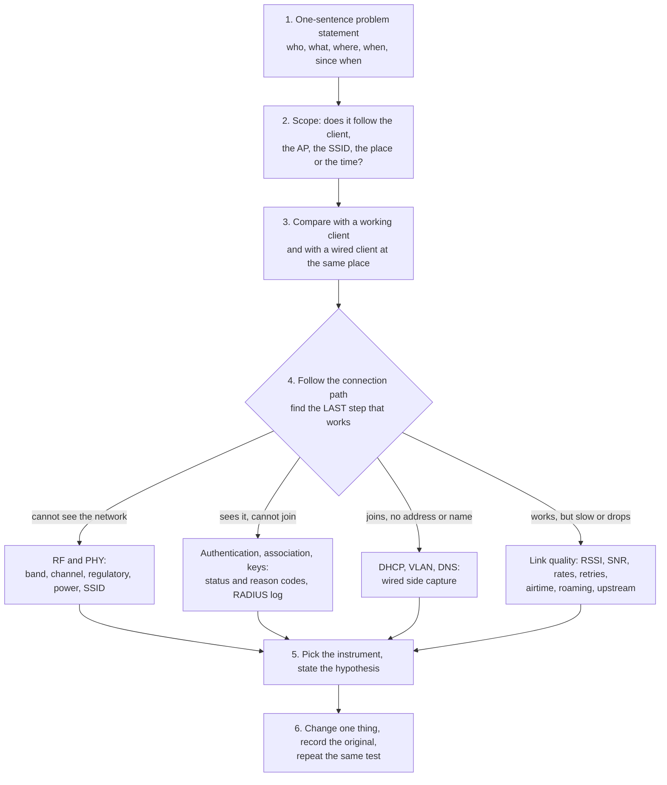

# WF 16: Wi-Fi interview bank and troubleshooting

*Part of the [networking plan](../00_plan.md), Wi-Fi sub-track, and its closing interview tutorial. Draws on every earlier Wi-Fi tutorial: [WF 01](01_wifi_landscape_and_ap_anatomy.md) (architecture), [WF 02](02_wifi_phy.md) (PHY), [WF 03](03_wifi_mac.md) (MAC), [WF 04](04_wifi_security.md) (security), [WF 05](05_wifi_roaming_and_radio_management.md) (roaming and RRM), [WF 06](06_wifi6_6e_7_features.md) (Wi-Fi 6, 6E), [WF 07](07_wifi_architectures_mesh_and_services.md) (controllers, mesh), [WF 08](08_wifi_capture_tools_and_debug.md) (captures), [WF 09](09_wifi_testing.md) (testing), [WF 10](10_linux_wireless_stack_and_openwrt.md) (Linux stack), [WF 11](11_rf_fundamentals_and_link_budget.md) (RF), [WF 12](12_wifi7_eht_and_mlo.md) to [WF 14](14_wifi_amendments_and_special_phys.md) (Wi-Fi 7, 8 and amendments) and [WF 15](15_wifi_multicast_privacy_onboarding_and_interworking.md) (multicast, privacy, onboarding). The networking equivalent is [NET 15](../15_networking_interview_question_bank.md).*

Each Wi-Fi tutorial ends with its own questions and a table of "symptom, likely cause, first check". That is the right place to **learn** a topic. It is the wrong shape for an interview, where nobody says "now we will discuss roaming". The interviewer says "a user says the video call breaks up when they walk to the kitchen", and the answer has to pull from PHY, MAC, roaming, RF and the wired side without being told which. This tutorial is the cross-topic layer: **how Wi-Fi interviews are shaped, a diagnosis order that works for any symptom, a way to read a capture to a verdict, a playbook that consolidates the whole track, twelve worked scenarios, design questions for a Wi-Fi platform, a question bank by area, and the coding and embedded questions that platform roles add.**

A weak answer to "Wi-Fi is slow" is a list of things to try: "check the channel, move the AP, update the firmware". A strong answer is a **method with a stopping rule**: "I would first make the problem precise, because 'slow' can mean low throughput, high latency or a delay in joining. Then I would find out whether it follows the client, the access point, the SSID, the place or the time, compare with a wired client to rule out the network behind the AP, and follow the connection step by step to the last thing that works. At each step I name the instrument, what it can and cannot show, and which result sends me to the next one."

By the end you can:

- say what Wi-Fi interviews ask and in what shape, for network engineer roles and for platform and driver roles;
- run one diagnosis order for any symptom: scope, wired baseline, connection path, instrument, one change at a time;
- read a capture to a verdict (where the connection stopped and who ended it) and use the 802.11 reason and status codes;
- recognise twenty common symptoms by their fingerprint across PHY, MAC, security, roaming, RF, architecture and the wired side;
- work twelve cross-topic scenarios and five design questions in the structure interviewers reward;
- answer about fifty fundamentals questions in 20 to 40 seconds each;
- answer the coding and embedded questions that Wi-Fi software roles add (channel selection, `volatile`, `static`, segmentation faults).

Everything that could be run without a wireless radio was run. The lab VM has **no wireless stack and no radio**, so the captures below are **frames built with `scapy` and decoded by `tshark`**, and the triage script reads them exactly as it would read a real capture. They show the method and the field names, not real air behaviour. Section 13 says exactly what was and was not run.

---

## 1. How Wi-Fi interviews are shaped

There is no single source of truth for what is asked, so this section is explicit about its evidence: **public interview guides** for wireless network engineer roles, **one published interview report for a Wi-Fi software developer role** (a Qualcomm loop), and a **Cisco Live troubleshooting session**. They agree on a shape, and the shape is more reliable than any list of questions.

| Round | What it asks | Typical content |
|---|---|---|
| **Fundamentals** | Definitions and one level of reasons | 2.4 against 5 GHz (range, interference, number of channels), what an SSID is, WPA, WPA2, WPA3, how CSMA/CA handles collisions on a busy network |
| **Troubleshooting** | A broken scenario and your method | "Cannot connect", "slow", "drops when roaming", "voice is choppy" |
| **Design** | Requirements to a plan | Wi-Fi for a large multi-floor office, a stadium, a warehouse: placement, channel plan, density, interference |
| **Coding and systems** (platform roles) | C, algorithms, Linux | Pick the best channel for a crowded AP and explain the trade-offs, `const` against `volatile`, `static`, segmentation faults, string reversal without library calls |
| **Depth probes** (senior and staff) | "Why?" three levels down | Why does aggregation need block acknowledgement, why does a slow client hurt everyone, what does 802.11r change in the key hierarchy |

Two things set staff-level answers apart in every round. **First, state the layer** (RF, PHY, MAC, security, network behind the AP) **and name the frame, field or counter** that shows it: "retries in the capture", "status code 17 in the association response", "the RSN element in the beacon". **Second, say what you would change and what you would watch** to confirm the fix. For a platform role at a company that builds access points, expect the same questions plus **where the behaviour lives in the stack**: in the radio hardware, in firmware, in the driver, in `hostapd`, in the controller.

---

## 2. The diagnosis order

Every credible source (the Meraki troubleshooting guide, the Cisco Live session, the CWNA guide's chapter on troubleshooting) gives the same sequence in different words. It is worth memorising, because it also answers "walk me through how you troubleshoot":



The reasons behind each step, which is what the interviewer is checking:

1. **A precise statement.** "Slow" can be throughput, latency, or delay to join. The Cisco Live session puts it as: problem resolution is only as effective as the description. Record one example with a timestamp, client, SSID, AP and band.
2. **Scope.** If every client at one AP is affected, suspect the AP, its channel or its uplink. If one client model is affected, suspect that client's driver or capabilities. If it happens at 3 p.m. on weekdays, suspect load or an interferer. If it started after a change, look at the change.
3. **Baselines.** A wired client at the same site separates the wireless link from everything behind the AP (switch port, DHCP, DNS, firewall, WAN). A working wireless client shows what "good" looks like for this place.
4. **The connection path** is a chain, and you want the **last link that holds**: see the SSID, authenticate, associate, complete the key handshake, get an address, resolve names, reach the application. The first thing that fails tells you the layer.
5. **Instruments** (section 11 of [WF 08](08_wifi_capture_tools_and_debug.md)): the client's log, the AP's log, the RADIUS log, a capture on the channel, a capture on the wired side, `iw station dump`, spectrum analysis. Each shows part of the picture and hides another, so name what the instrument cannot see.
6. **One change at a time**, with the original value recorded and the same test repeated at the same place with the same clients. Otherwise you cannot tell what fixed it, and a fix you cannot explain comes back.

---

## 3. Reading a capture to a verdict

The most valuable single skill in Wi-Fi debugging is reading the management and EAPOL frames of a connection and saying **where it stopped and who ended it**. A join is a short, fixed sequence:

```
authentication request and response  ->  association (or reassociation) request and response
   ->  EAPOL-Key messages 1 to 4 (the four-way handshake)  ->  data frames
```

The captures are built with `scapy`: management frames for the join, and EAPOL-Key frames whose key information field marks messages 1 to 4 (the `tshark` dissector reads the message number from it). Each is wrapped in a radiotap header so that `tshark` treats it as 802.11:

```python
import warnings; warnings.filterwarnings("ignore")
from scapy.all import *
conf.verb = 0
AP, STA = "02:00:00:00:00:aa", "02:00:00:00:00:01"
def mgmt(sub, src, dst, body):
    return RadioTap()/Dot11(type=0, subtype=sub, addr1=dst, addr2=src, addr3=AP)/body
def auth(src, dst, seq, st=0): return mgmt(11, src, dst, Dot11Auth(algo=0, seqnum=seq, status=st))
def assoc_req(): return mgmt(0, STA, AP, Dot11AssoReq(cap=0x1104, listen_interval=10)/Dot11Elt(ID=0, info=b"lab"))
def reassoc_req(): return mgmt(2, STA, AP, Dot11ReassoReq(cap=0x1104, listen_interval=10, current_AP=AP)/Dot11Elt(ID=0, info=b"lab"))
def assoc_resp(st): return mgmt(1, AP, STA, Dot11AssoResp(cap=0x1104, status=st, AID=1))
def deauth(src, dst, r): return mgmt(12, src, dst, Dot11Deauth(reason=r))
def key(msg, frm_ap):
    info = {1: 0x008a, 2: 0x010a, 3: 0x13ca, 4: 0x030a}[msg]
    body = bytes([2]) + info.to_bytes(2, "big") + (16).to_bytes(2, "big") + (msg).to_bytes(8, "big") + b"\x11"*32 + b"\0"*16 + b"\0"*8 + b"\0"*8 + b"\0"*16 + b"\0\0"
    d = Dot11(type=2, subtype=0, FCfield="from-DS" if frm_ap else "to-DS",
              addr1=STA if frm_ap else AP, addr2=AP if frm_ap else STA, addr3=AP)
    return RadioTap()/d/LLC(dsap=0xaa, ssap=0xaa, ctrl=3)/SNAP(OUI=0, code=0x888e)/EAPOL(version=2, type=3, len=len(body))/Raw(body)
def data(frm_ap=True):
    d = Dot11(type=2, subtype=0, FCfield="from-DS" if frm_ap else "to-DS", addr1=STA if frm_ap else AP, addr2=AP if frm_ap else STA, addr3=AP)
    return RadioTap()/d/LLC(dsap=0xaa, ssap=0xaa, ctrl=3)/SNAP(OUI=0, code=0x0800)/Raw(b"\x45"+b"\0"*30)
join = [auth(STA,AP,1), auth(AP,STA,2), assoc_req(), assoc_resp(0)]
cases = {
 "good":      join + [key(1,1), key(2,0), key(3,1), key(4,0), data(), data(False)],
 "wrong_psk": join + [key(1,1), key(2,0), key(1,1), key(2,0), key(1,1), deauth(AP,STA,15)],
 "ap_full":   [auth(STA,AP,1), auth(AP,STA,2), assoc_req(), assoc_resp(17)],
 "idle":      join + [key(1,1), key(2,0), key(3,1), key(4,0), data(), deauth(AP,STA,4)],
 "slow_roam": [reassoc_req(), assoc_resp(0), key(1,1), key(2,0), key(3,1), key(4,0), data()],
 "no_assoc_resp": [auth(STA,AP,1), auth(AP,STA,2), assoc_req(), assoc_req(), assoc_req()],
}
for n, p in cases.items():
    for i, x in enumerate(p): x.time = 1.0 + i*0.01
    wrpcap(f"{n}.pcap", p)
```

Each outcome has a signature. The script below turns that into code. It reads a capture with `tshark`, follows the sequence, and prints a verdict. It is deliberately small, since the value is in the rules, which are the ones an engineer applies by eye:

```python
import subprocess, sys

REASON = {1: "unspecified", 2: "previous authentication no longer valid", 4: "inactivity",
          5: "AP cannot handle all clients", 15: "4-way handshake timeout",
          16: "group key handshake timeout", 23: "802.1X authentication failed"}
STATUS = {1: "unspecified failure", 12: "association denied, unspecified",
          17: "AP cannot take more stations", 18: "basic rates not supported"}
AP = "02:00:00:00:00:aa"
F = ["frame.number", "wlan.fc.type_subtype", "wlan.sa", "wlan.fixed.reason_code",
     "wlan.fixed.status_code", "wlan_rsna_eapol.keydes.msgnr", "wlan.fc.type"]

def frames(pcap):
    out = subprocess.run(["tshark", "-r", pcap, "-T", "fields", *sum([["-e", f] for f in F], [])],
                         capture_output=True, text=True).stdout.splitlines()
    for line in out:
        n, sub, sa, reason, status, msg, typ = (line.split("\t") + [""] * 7)[:7]
        yield dict(n=n, sub=sub, sa=sa, reason=int(reason, 0) if reason else None,
                   status=int(status, 0) if status else None, msg=int(msg) if msg else None, typ=typ)

def triage(pcap):
    steps, m1, reqs, roam, end = [], 0, 0, False, None
    for f in frames(pcap):
        s = f["sub"]
        if s == "0x000b": steps.append("auth")
        elif s in ("0x0000", "0x0002"):
            reqs += 1; roam = roam or s == "0x0002"; steps.append("assoc-req")
        elif s in ("0x0001", "0x0003"):
            steps.append("assoc-resp ok" if f["status"] == 0 else
                         f"assoc-resp REFUSED status {f['status']} ({STATUS.get(f['status'], '?')})")
        elif f["msg"]:
            steps.append(f"EAPOL M{f['msg']}"); m1 += f["msg"] == 1
        elif f["typ"] == "2": steps.append("data")
        elif s in ("0x000c", "0x000a"):
            who = "AP" if f["sa"] == AP else "client"
            end = f"{who} sent {'deauth' if s == '0x000c' else 'disassoc'}, reason {f['reason']} ({REASON.get(f['reason'], '?')})"
    last = steps[-1] if steps else "nothing"
    if any("REFUSED" in x for x in steps): v = "association refused: " + [x for x in steps if "REFUSED" in x][0]
    elif "assoc-resp ok" not in steps and reqs: v = f"no association response after {reqs} request(s): AP silent, out of range, or frames lost"
    elif "EAPOL M4" not in steps and m1 > 1: v = f"4-way handshake never completed (M1 sent {m1} times, no M3): client rejects or AP rejects M2, typical of a wrong key"
    elif "data" in steps and end: v = f"worked, then ended: {end}"
    elif "data" in steps: v = "connected and passing data"
    else: v = f"stopped after {last}"
    if roam and "EAPOL M1" in steps: v += " | reassociation was followed by a full 4-way handshake: keys were not cached, not a fast roam"
    return v, end

for p in sys.argv[1:]:
    v, end = triage(p)
    print(f"{p:18} {v}" + (f"  [{end}]" if end and 'ended' not in v else ""))
```

It was run against the six captures built above and gave:

| Capture | Verdict printed |
|---|---|
| good join | connected and passing data |
| wrong passphrase | 4-way handshake never completed (M1 sent 3 times, no M3), typical of a wrong key; **AP sent deauth, reason 15 (4-way handshake timeout)** |
| AP full | association refused: **status 17**, AP cannot take more stations |
| idle client | worked, then ended: **AP sent deauth, reason 4 (inactivity)** |
| roam without cached keys | connected, **reassociation was followed by a full 4-way handshake**: not a fast roam |
| AP does not answer | no association response after 3 requests: AP silent, out of range, or frames lost |

Read the wrong-passphrase row, because it is the best example of why you read the **sequence** and not one frame. The AP sends M1, the client answers M2, but M2 carries a message integrity code computed with the wrong key, so the AP drops it and **resends M1**. After a few retries the AP deauthenticates the client with reason 15. The reason code alone says "timeout", which sounds like a radio problem. The repeated M1 and M2 pattern says **keys**. The same capture with M1 only and no M2 would mean the client never answered, which points at the client or at lost frames.

**The codes to know.** The names below were checked by decoding frames carrying each code in `tshark`.

| Frame | Code | Meaning | What it usually means in practice |
|---|---|---|---|
| Deauthentication | reason 1 | Unspecified | Look at the vendor log |
| | 2 | Previous authentication no longer valid | The AP has no state for the client: reboot, timeout or a client that skipped steps |
| | 3, 8 | Sender is leaving | The client or AP left on purpose (disconnect, roam, sleep) |
| | 4 | Disassociated for inactivity | The AP aged the client out (idle timeout, client slept without keepalives) |
| | 5 | AP cannot handle all associated stations | Capacity or admission limit |
| | 6, 7 | Class 2 or class 3 frame from an unauthenticated or unassociated station | The client sent data without finishing the join: an AP restart or a state mismatch |
| | 15 | 4-way handshake timeout | Wrong key, lost EAPOL frames, or a client that stopped answering |
| | 16 | Group key handshake timeout | Client did not acknowledge a group key update (it was asleep or lost the frame) |
| | 23 | 802.1X authentication failed | Check the RADIUS log, not the client |
| Association response | status 1 | Unspecified failure | Vendor log |
| | 12 | Denied for a reason outside the standard | Policy |
| | 17 | AP cannot handle more stations | Capacity |
| | 18 | Client does not support the basic rate set | Basic rates too high for an old client |
| | 43, 53 | Invalid AKM, invalid PMKID | Security mismatch (for example a client that does not parse the fast-transition AKM; [WF 05](05_wifi_roaming_and_radio_management.md)) |

Two cautions that matter in an interview. **A reason code says who sent the frame, not why the condition arose**: an AP deauth with reason 4 is an AP decision, so the question is why the AP considered the client idle. And **a sniffer misses frames** ([WF 08](08_wifi_capture_tools_and_debug.md), "the limits of a sniffer"), so an absent frame is evidence only if the capture was in a position to see it.

---

## 4. The symptom playbook

This table consolidates the debugging sections of all fifteen earlier tutorials into one view, ordered by what a user reports. "First check" is the cheapest instrument that separates the likely causes.

| # | What the user says | Most likely causes (layer) | First check | Where taught |
|---|---|---|---|---|
| 1 | "I cannot see the network" | Band or channel not supported by the client; 6 GHz without RNR or PSC discovery; regulatory channel limits; SSID not enabled on that AP | Beacons on the channel: present? On 6 GHz, are there RNR entries in the 5 GHz beacons? | WF 06, WF 02 |
| 2 | "It sees the network but cannot join" | Wrong key; security mode mismatch (WPA2 only client on WPA3 only); PMF required; AP full; RADIUS unreachable | Association response status; the four-way handshake pattern; RADIUS log | WF 04, section 3 |
| 3 | "Connects, no internet" | DHCP not answering (VLAN, relay, pool); DNS; captive portal; client isolation or policy | Capture on both wireless and wired side of the AP: Discover without Offer on the wire means not RF | WF 08 |
| 4 | "Connects, then drops every few minutes" | Idle timeout; PMF with a broken SA query; group key timeout; roaming to a bad AP; DFS channel change; client power save | Who sent the deauth and which reason; time between drops (a regular period is a timer) | WF 03, WF 04 |
| 5 | "Slow everywhere" | Co-channel contention (airtime), low basic rates, a legacy client, wide channels in dense space, uplink bottleneck | Channel busy and transmit time (`survey dump`); wired baseline; airtime per client | WF 03, WF 08 |
| 6 | "Slow only far from the AP" | Low SNR, low MCS and retries; client transmit power lower than AP's (asymmetric link) | RSSI and SNR at the client, TX rate and retry share, `station dump` | WF 02, WF 11 |
| 7 | "Slow only at busy times" | Capacity: too many clients per radio, channel width too wide, high retransmissions | Client count per radio, airtime by category, per client rates | WF 03, WF 09 |
| 8 | "Pages load slowly, ping is fine" | MTU or fragmentation (tunnelled SSID, CAPWAP); DNS latency; MSS | Ping with the do-not-fragment bit and large sizes; capture the SYN's MSS | WF 07 |
| 9 | "Video call breaks up when I walk" | Slow roam (full EAP), sticky client, scan time, no 802.11r/k/v | Capture the roam: gap between last frame to old AP and first to new; EAP present after reassociation? | WF 05 |
| 10 | "Voice is choppy" | Retries and airtime, WMM not honoured end to end (DSCP mapping lost on the wired side), roaming, power save | WMM and DSCP marks at both ends; retry share; roam gaps | WF 03, WF 05 |
| 11 | "Clings to the far AP" | Sticky client, AP power too high, low basic rates enabled | Client RSSI and neighbours' RSSI at the client; BTM response | WF 05 |
| 12 | "Everything dropped for a minute" | DFS radar event and channel change; AP reboot; controller or uplink flap | DFS event log; AP uptime; uplink | WF 05, WF 02 |
| 13 | "Network got worse after enabling a feature" | A new SSID adds beacon airtime; 802.11r breaks old clients; a higher OBSS PD hurts edge clients; client balancing rejections | Change log; one feature at a time; beacon airtime | WF 05, WF 06 |
| 14 | "6 GHz is slow or short range" | Low-power indoor limit with width; client power; AFC failure for standard power | EIRP by width (section 7); client power; AFC link status | WF 06, WF 11 |
| 15 | "Only one model of phone has problems" | A client capability or driver quirk | The association request of that model; its driver and firmware version | WF 03, WF 08 |
| 16 | "Mesh node is slow" | Same-radio backhaul halving throughput; too many hops; poor parent choice | Backhaul band, hop count, parent RSSI | WF 07 |
| 17 | "All APs at a site rejoin repeatedly" | Controller overload, reconnect storm, WAN flap, echo timers | Controller join rate; WAN loss; AP logs | WF 07 |
| 18 | "Multicast video or casting fails or is choppy" | Multicast at a low basic rate, no snooping or multicast-to-unicast; client isolation blocks it; mDNS across VLANs | Multicast airtime; test with multicast-to-unicast on | WF 15 |
| 19 | "IoT sensor keeps dropping" | DTIM and keepalive mismatch; power save; multicast storms waking it; WPA3 or PMF unsupported | Sensor's wake pattern against DTIM; the AP's idle timeout | WF 03, WF 15 |
| 20 | "A test result is not what we expected" | Measurement error, not a product problem: placement, interference, tool settings, thermals | Repeat variance, conducted against over the air, one variable at a time | WF 09 |

The pattern in the **first check** column is the thing to say aloud: each is the cheapest observation that separates the candidates, and none of them is "change the channel".

---

## 5. Twelve scenarios

Each follows the structure interviewers reward: *where to practise* (what to reproduce or read before the interview) and *approach* (the order of reasoning). The captures and tools are those of [WF 08](08_wifi_capture_tools_and_debug.md); the numbers are in section 7.

**S1. Some phones cannot join a new WPA3 SSID. Others join fine.**
*Where to practise:* read the RSN element of a beacon and association request in a capture ([WF 04](04_wifi_security.md) section 10); run the triage script of section 3.
*Approach:* separate "cannot see" from "cannot join" from "joins then fails". For "cannot join", read the association response status and the four-way handshake pattern. Suspect the **security mode**: a WPA2-only client against a WPA3-only SSID, **PMF required** (WPA3 needs it) against a client that does not support it, **SAE hash-to-element** support, or a transition-mode SSID that old clients mishandle. Compare the failing phone's association request (its RSN capabilities) with a working one. Fix with transition mode for a migration window and a separate legacy SSID, then retire it. Say what you would **not** do: disable PMF on the whole network.

**S2. The open-plan office is slow every afternoon, and fine in the morning.**
*Where to practise:* airtime by category from a capture, and the channel busy and transmit time from `iw survey dump` ([WF 08](08_wifi_capture_tools_and_debug.md)).
*Approach:* a time pattern means **load or a periodic interferer**. Measure channel busy time and the share that is Wi-Fi from other BSSs, from our own BSS, and not Wi-Fi at all. High busy time with many neighbours on the same channel is **co-channel contention**, not a weak signal: more power makes it worse. Then look at the **client mix** (one slow legacy client takes most of the air, the performance anomaly of [WF 03](03_wifi_mac.md)), the **basic rate set** (low basic rates make beacons and management frames expensive), the **channel width** (80 MHz in a dense space leaves few channels), and the **number of SSIDs** (each adds beacons). The fixes are in this order of cheapness: remove unused SSIDs and low basic rates, narrow the width, lower power and reuse channels, add APs only if the capacity maths ([WF 11](11_rf_fundamentals_and_link_budget.md)) says clients per radio is the limit.

**S3. A video call breaks up for a second or two when a user walks down the corridor.**
*Where to practise:* the roam capture reading of [WF 05](05_wifi_roaming_and_radio_management.md) section 12, and the `slow_roam` case of section 3.
*Approach:* it is a **roam**. Capture on the old and new channels (two sniffers) and measure the gap between the last frame to the old AP and the first to the new one. Then read what the gap contained: a **scan across many channels** (11k neighbour reports shorten it), a **full 802.1X exchange** after reassociation (the triage script's "keys were not cached"; fix with 802.11r or key caching), and the **decision** (a client that stays on the old AP until the signal collapses is sticky; steer with 11v and lower power). The budget to quote is about **150 ms** for voice and video transitions, with fast transition near 90 ms in the Cisco Live session's figures. Check that **the wired side learned the move**, since a switch that still sends downlink frames to the old AP stalls the call after a perfect air roam.

**S4. Voice handsets are choppy on one floor only.**
*Where to practise:* retry share from `station dump`, and DSCP to access category mapping ([WF 03](03_wifi_mac.md) section 4).
*Approach:* voice needs **low jitter more than bandwidth**. Check the four things that break it: **retries** (a 20 percent retry rate costs 1.25 times the airtime and adds delay); **WMM** (is voice marked and mapped to the voice category on the wire and the air, and is the mark preserved by the switch); **roaming** (S3); and **power save and DFS**. Floor-specific means local: an interferer, a DFS channel with frequent radar events, a mismatched AP uplink, or a closet AP serving a long corridor at low SNR.

**S5. After enabling 6 GHz, many clients do not see it.**
*Where to practise:* the 6 GHz discovery sections of [WF 06](06_wifi6_6e_7_features.md).
*Approach:* a 6 GHz client does not scan every channel; it finds the BSS by **reduced neighbour report entries in 2.4 and 5 GHz beacons**, by **FILS discovery or unsolicited probe responses** on preferred scanning channels, or from a known list. So check the RNR in the lower-band beacons and that the operating channel is a preferred scanning channel (or has FILS discovery). Then the **security**: 6 GHz requires WPA3 (SAE), OWE or 802.1X with PMF, so a WPA2 configuration hides it from compliant clients. Then client support (a Wi-Fi 6 phone is not a Wi-Fi 6E phone) and the regulatory domain.

**S6. Everyone on a floor drops for about a minute, once or twice a day.**
*Where to practise:* the DFS section of [WF 05](05_wifi_roaming_and_radio_management.md) and the radar events in an AP log.
*Approach:* a daily, short outage on a 5 GHz DFS channel is the **radar signature**: the AP must leave the channel immediately, then perform the **channel availability check (60 seconds)** on the new one, and the old channel stays unavailable for a **non-occupancy period (30 minutes)**. Confirm in the DFS event log, which channel, and whether the events are **real radar** (a nearby weather radar or airport) or **false detection** (poor radios, interference). The fix is to move the affected APs to **non-DFS channels** (or to a pre-cleared fallback), exclude the channel in the plan, and make RRM stop reselecting it. Show the alternative for a hypothesis you reject: an RRM channel change would appear in the RRM log, and a reboot in the uptime.

**S7. A mesh node's clients get half the throughput of the parent's clients.**
*Where to practise:* the mesh section of [WF 07](07_wifi_architectures_mesh_and_services.md).
*Approach:* if the backhaul and the client service share **one radio on one channel**, every packet crosses the air twice, so throughput is at best half for one hop and falls with hops. Check backhaul band, hop count, parent signal and whether the backhaul is a **dedicated radio** or a wire. Fix by a wired or dedicated backhaul, fewer hops, a better parent, or a different band for backhaul.

**S8. Screen casting and multicast video fail on the guest network, but work in the lab.**
*Where to practise:* the multicast lab and airtime arithmetic of [WF 15](15_wifi_multicast_privacy_onboarding_and_interworking.md).
*Approach:* discovery (mDNS, SSDP) is multicast and **does not cross subnets**, and client isolation blocks **client to client** traffic, so casting to a device on the same SSID is deliberately blocked on a guest network. If isolation is not the cause, look at **multicast at the lowest basic rate** (slow, no retry, wakes sleepers), whether **snooping** or **multicast-to-unicast** is on, and VLAN design (an mDNS gateway for services across VLANs).

**S9. Warehouse scanners drop sessions as workers move between aisles.**
*Where to practise:* the roaming debug table and the IoT section ([WF 05](05_wifi_roaming_and_radio_management.md), [WF 07](07_wifi_architectures_mesh_and_services.md) section 9).
*Approach:* scanners are old, low-power, often 2.4 GHz clients with **weak roaming logic and long-lived TCP sessions**. Check coverage along the routes (SNR at the aisle ends, metal racks), whether APs are **too loud** (a scanner holding on to a far AP), fast-transition support (many do not support 802.11r), and the **session layer** (terminal emulation that dies on a one-second gap needs a roam-tolerant session or a keepalive). Fix by cell design (lower power, more cells), a legacy SSID with simple security, and an application that survives a roam.

**S10. After a firmware release, one phone model disconnects now and then. Lab tests pass.**
*Where to practise:* capture of the association request ([WF 08](08_wifi_capture_tools_and_debug.md)); the testing chapter ([WF 09](09_wifi_testing.md)).
*Approach:* a regression that touches **one client model** is a capability or timing interaction. Compare the model's association request (HT, VHT, HE capabilities, power save, extended capabilities) and the sequence at the disconnect between the old and new firmware. The timing-sensitive candidates are **power-save handling** (TIM, buffering, the DTIM), **aggregation and block-ack windows**, **management frame protection and SA query**, and **rate control**. Bisect firmware changes, reproduce in a controlled test with that model, capture both ends, and add a regression test for the model. Say what the lab missed (the model was not in the matrix, or the test did not run long enough, or no power save).

**S11. The controller reboots and guest Wi-Fi goes down, while staff Wi-Fi keeps working.**
*Where to practise:* the architecture comparison of [WF 07](07_wifi_architectures_mesh_and_services.md) section 1.
*Approach:* an SSID that is **centrally switched** through a tunnel to the controller loses service when the controller goes; one that is **locally switched** at the AP does not, as long as authentication does not need the controller. So the guest SSID is tunnelled (typical, to put guests in a DMZ) and staff are local. The fix is controller redundancy, **standalone survivability** for the tunnelled SSID where policy allows, and an honest statement of the trade-off (central policy against failure domain).

**S12. A nightly throughput test now reports 40 percent less than last week.**
*Where to practise:* the repeatability section of [WF 09](09_wifi_testing.md).
*Approach:* first **doubt the measurement**: variance of repeated runs, the environment (neighbouring networks, a different RF situation), the placement and cabling, the tool settings (window size, number of streams, direction), and whether the DUT version changed. Then use a **conducted** setup to take the air out. A drop that persists in a conducted setup is the product; one that disappears is the environment. Bisect builds and compare retries and rates, not only the final number.

---

## 6. Design questions for a Wi-Fi platform

These are the system-design questions that a company building access points or controllers asks, in addition to the site-design question of "Wi-Fi for a large building".

**D1. Design the Wi-Fi for a 40-floor office building with 8,000 users.**
*Where to practise:* the capacity and link budget arithmetic of [WF 11](11_rf_fundamentals_and_link_budget.md), and the airtime reasoning of [WF 03](03_wifi_mac.md).
*Approach:* **requirements first** (users, devices per user, applications, voice, guest and IoT, roaming, security), then **coverage** (signal and SNR targets at the cell edge for the weakest client, usually the phone), then **capacity** (clients per radio, airtime per client: design to the capacity limit, not to the coverage limit), then the **plan** (one AP per roughly one bay of the floor with the 20 MHz or 40 MHz channels, a channel plan that accounts for **vertical** leakage between floors, power set low enough to reuse channels, 6 GHz where supported), the **wired side** (PoE budget, uplink speeds, VLAN and DHCP design, roaming domains), **security** (802.1X for staff, WPA3, a separate guest and IoT SSID), **operations** (monitoring, RRM bounds, firmware policy) and **validation** (predictive model, a passive and active survey after install, a re-survey after changes).

**D2. Design the Wi-Fi for a 50,000-seat stadium.**
*Where to practise:* the multicast and airtime sections, and the link budget with directional antennas.
*Approach:* the problem is **capacity under extreme density**, not coverage. Estimate demand (a small share of users active at the same time), use **many small cells** with directional antennas aimed at the seats (under-seat or handrail mounting), narrow channels (20 MHz) with strict reuse planning, use the 5 and 6 GHz bands, keep the basic rate set high so management frames are cheap, limit SSIDs, plan **uplinks, DHCP scale and NAT** for tens of thousands of clients joining at once, and plan for the **peak** (a goal being scored makes everyone upload at once). Say how you validate: a loaded test with real clients, not a coverage map.

**D3. Design a client steering service for the platform.**
*Where to practise:* the roaming and steering sections of [WF 05](05_wifi_roaming_and_radio_management.md).
*Approach:* the **goal** (move sticky clients, balance load, push dual-band clients to 5 or 6 GHz), the **inputs** (RSSI, rates, retries, airtime, capabilities, neighbour reports), the **actions** (11v transition requests as a polite ask, disassociation as a last resort, probe or association response suppression for band steering), the **safety rules** (hysteresis, per-client rate limits so a client is not bounced, do not steer voice calls in progress, honour clients that refuse, learn which models ignore requests), the **feedback loop** (measure after: did the client improve?), and the **failure mode** (a service that makes things worse must fall back to doing nothing).

**D4. Design the telemetry and firmware update system for 100,000 APs.**
*Where to practise:* the fleet section of [WF 07](07_wifi_architectures_mesh_and_services.md) section 3.
*Approach:* **telemetry** is a budget problem (a small, fixed set of counters per AP and per client, aggregated at the edge, deltas and compression, sampling for detail, events sent immediately). **Firmware rollout** is staged: canary APs, then rings of increasing size, health gates (join rate, client counts, error counters), automatic halt and **rollback**, and a **jittered, rate-limited** schedule so that a fleet does not reconnect or download all at once (the reconnect storm of S-series problems). Cover **failure**: an AP that cannot boot must fall back to its previous image, and a bad release must be stoppable before it reaches the whole fleet.

**D5. Where should per-station airtime fairness live, and how would you build it?**
*Where to practise:* the data path and queues of [WF 10](10_linux_wireless_stack_and_openwrt.md) section 8.
*Approach:* the problem is the performance anomaly ([WF 03](03_wifi_mac.md)): equal frame share gives slow clients most of the airtime. The remedy is to schedule by **airtime** and not by packets, with a deficit per station and per-station queues (fair queueing with a controlled-delay algorithm to keep latency low). The design question is **where the knowledge is**: the host knows what is queued, but the **rate chosen and the airtime used** are decided by rate control and the retries, which may live in **firmware** on a FullMAC or offloaded chip. So either the firmware reports **per-frame airtime** back to the host's accounting, or the scheduling is done in the firmware. Name the trade-off: a host-side scheduler is simple to debug and tune, a firmware scheduler is closer to the radio and cheaper per packet.

---

## 7. Numbers to carry

A few calculations come up constantly. They are short, and quoting them with the unit and the assumption is a sign of seniority. The 6 GHz power rule is from memory (the United States rule for low-power indoor APs, a power spectral density limit of 5 dBm per MHz of EIRP), so check the regulatory domain.

```python
import math

# 1. 6 GHz low-power indoor: EIRP limit grows with width because the limit is per MHz
for w in (20, 40, 80, 160):
    print(f"6 GHz LPI, {w:3d} MHz: {5 + 10*math.log10(w):4.1f} dBm EIRP")

# 2. Free-space path loss: why 5 GHz and 6 GHz reach less far than 2.4 GHz (at the same distance)
def fspl(d_m, f_mhz): return 20*math.log10(d_m/1000) + 20*math.log10(f_mhz) + 32.44
for f in (2437, 5500, 6500):
    print(f"FSPL at 10 m, {f} MHz: {fspl(10, f):.1f} dB")

# 3. Retries cost airtime: expected transmissions per delivered frame is 1 / (1 - p)
for p in (0.1, 0.2, 0.5):
    print(f"retry rate {p:.0%}: {1/(1-p):.2f}x airtime")

# 4. A slow client holds the air: time to send one 1500-byte frame at different rates (payload only)
for mbps in (6, 54, 600):
    print(f"1500 B at {mbps:3d} Mbit/s: {1500*8/mbps:6.1f} us")
```

The output is: **18, 21, 24 and 27 dBm** of EIRP at 20, 40, 80 and 160 MHz (so a wide channel on 6 GHz low-power indoor is allowed more total power, but the same per-MHz level, so **range per MHz does not improve**); free-space loss at 10 m of **60.2 dB at 2.4 GHz, 67.2 dB at 5.5 GHz and 68.7 dB at 6.5 GHz** (about 7 dB worse at 5 GHz, and walls absorb more at the higher frequencies, which is the full answer to "why does 5 GHz reach less"); **1.25 times** the airtime at a 20 percent retry rate and **2 times** at 50 percent; and a 1,500-byte frame costs **2,000 microseconds at 6 Mbit/s and 20 at 600**, a hundredfold difference, which is why one slow client hurts everyone ([WF 03](03_wifi_mac.md)).

Other numbers worth having ready, and where they came from: voice and video transitions should be **at or under about 150 ms**, and fast transition (802.11r) about 90 ms, against 150 to 300 ms for key caching (Cisco Live session); after a DFS radar event a channel is unavailable for **30 minutes (non-occupancy)** and the next channel needs a **60 second availability check** (same session; weather-radar channels need 10 minutes, from memory); the **three non-overlapping 2.4 GHz channels** (1, 6, 11 in the United States, from memory).

---

## 8. Fundamentals question bank

Answers are written to be said in 20 to 40 seconds. Details live in the tutorial named in each heading.

### 8.1 Radio and PHY ([WF 02](02_wifi_phy.md), [WF 11](11_rf_fundamentals_and_link_budget.md))

1. **2.4 GHz against 5 GHz against 6 GHz?** 2.4 GHz has the best reach and wall penetration but only three non-overlapping channels and heavy interference (Bluetooth, microwaves, neighbours). 5 GHz has many more channels (some need DFS) and cleaner air but shorter reach. 6 GHz adds a large block of clean spectrum with no legacy devices and mandatory WPA3, at similar reach to 5 GHz.
2. **What limits the data rate of a link?** The signal to noise ratio at the receiver, which sets the highest modulation and coding (MCS) it can decode, times the channel width and the number of spatial streams. Distance, walls and interference reduce SNR, so the rate adapts down.
3. **RSSI against SNR?** RSSI is the received signal power; SNR is the signal above the noise floor. Rates depend on SNR, so a strong signal in a noisy place is still slow.
4. **Why not use the widest channel?** A wider channel doubles the rate per doubling but needs more clean spectrum, raises the noise it collects, and in dense deployments leaves fewer channels to reuse, so contention rises. 20 MHz is usual in dense space.
5. **MIMO, MU-MIMO and beamforming?** MIMO sends several streams on the same frequency using multiple antennas, for rate. Beamforming shapes the signal toward a client, for SNR. MU-MIMO serves several clients at once on different spatial streams, and needs good channel knowledge.
6. **What is OFDM and why does Wi-Fi use it?** Many narrow subcarriers each carrying a slow symbol, with a guard interval, so multipath delay spreads cause little inter-symbol interference. It makes wide channels workable.
7. **What is DFS?** Dynamic frequency selection: on 5 GHz bands shared with radar, an AP must listen for radar before use (a 60 second check), leave immediately when it detects it, and avoid the channel afterwards (30 minutes).
8. **What is EIRP and why do regulators limit it?** Effective isotropic radiated power: transmit power plus antenna gain. Limits protect other users of the spectrum, which is why a high-gain antenna requires lower conducted power.

### 8.2 MAC ([WF 03](03_wifi_mac.md))

9. **How does Wi-Fi handle collisions?** It avoids them. CSMA/CA: listen, wait a random backoff, send, expect an acknowledgement. No acknowledgement means retry with a larger backoff window. Wi-Fi cannot detect a collision while transmitting.
10. **The hidden node problem?** Two clients cannot hear each other but both reach the AP, so they collide there. RTS/CTS makes the AP announce the reservation so everyone sets their NAV (network allocation vector) and stays quiet, at the cost of overhead, so it is used for large frames.
11. **Why is throughput so much lower than the PHY rate?** Wi-Fi is half duplex and shared, and every frame pays preamble, interframe spacing, backoff and acknowledgement. Aggregation (A-MPDU) amortises that overhead, and typical TCP throughput is roughly 60 to 70 percent of the PHY rate in good conditions (from memory).
12. **What is aggregation and block acknowledgement?** Many frames are sent in one transmission (A-MPDU) and acknowledged with one block ack bitmap. It raises efficiency, but a bad link loses a whole burst, and the window and buffer sizes bound it.
13. **What is WMM?** A priority scheme with four access categories (voice, video, best effort, background), each with its own contention parameters, so higher priority gets shorter waits. It is a share of the chances to transmit, not a guarantee.
14. **How does power save work?** A station tells the AP it is sleeping, the AP buffers frames, and the station wakes for beacons and checks the TIM (traffic indication map). Multicast is delivered after the DTIM beacon, so a long DTIM saves battery but delays multicast.
15. **What is the performance anomaly?** With equal chances to transmit, a slow client takes much more airtime per frame, so all clients get throughput close to the slow client's. Airtime fairness fixes it.

### 8.3 Security ([WF 04](04_wifi_security.md))

16. **The four-way handshake in a sentence?** Both sides prove they know the pairwise master key and derive fresh session keys from it plus two nonces, so the passphrase is never sent and every session has different keys.
17. **WPA2-PSK against WPA3-SAE?** In PSK an attacker who records a handshake can try passphrases offline. SAE is a password-authenticated key exchange, so each guess needs an online interaction, and it gives forward secrecy.
18. **What is PMF (802.11w)?** Protected management frames: deauthentication and disassociation are authenticated, so an attacker cannot disconnect clients by spoofing them. WPA3 requires it.
19. **802.1X and EAP in short?** The supplicant (client) proves identity to an authentication server (RADIUS) through the AP, which only relays; the exchange produces a master key per user and session. It gives per-user keys and revocation, unlike a shared passphrase.
20. **What is OWE?** Opportunistic Wireless Encryption: an open network that still encrypts traffic per client with a key exchange, protecting against passive sniffing, but with no authentication of the network.
21. **What is an evil twin and how do you defend?** A rogue AP imitating a real SSID. Defences: 802.1X with server certificate validation, PMF, and rogue detection (WIPS).

### 8.4 Roaming and radio management ([WF 05](05_wifi_roaming_and_radio_management.md))

22. **802.11k, v and r?** k: the AP gives the client a neighbour list so it scans fewer channels. v: the AP can ask the client to move (BSS transition management). r: fast transition, so the keys for the next AP are derived in advance and the roam skips the full authentication.
23. **What is a sticky client?** One that stays on its AP until the signal is poor because its roam decision is conservative. Fixes: lower power, remove low basic rates, 11v requests, and in the worst case disassociation.
24. **What does RRM do?** Automatic channel and power planning from measurements, plus coverage hole detection. Its risk is instability: changes in the middle of the day disrupt clients, so it needs limits and schedules.

### 8.5 Wi-Fi 6, 7 and 8 ([WF 06](06_wifi6_6e_7_features.md), [WF 12](12_wifi7_eht_and_mlo.md), [WF 13](13_wifi8_uhr_802_11bn.md))

25. **What does OFDMA add?** It splits a channel into resource units shared among several clients in one transmission, which is efficient for small frames and many clients, and gives scheduled access.
26. **What is BSS colour?** A short identifier in the preamble so a station can tell a frame from another network on the same channel and, with spatial reuse, transmit anyway at a controlled power. Duplicate colours between neighbours defeat it.
27. **What is TWT?** Target wake time: negotiated schedules for when a station wakes, which saves power and reduces contention, especially for IoT.
28. **What are the 6 GHz rules in short?** About 1.2 GHz of spectrum (59 channels of 20 MHz in the United States), WPA3 or OWE required, no legacy devices, discovery by RNR or FILS, and power classes (low-power indoor, standard power with AFC coordination).
29. **What does Wi-Fi 7 add?** 320 MHz channels, 4096-QAM, multi-link operation (MLO) so a client uses several bands at once, multi-RU, and preamble puncturing to use a channel with an interferer in part of it.
30. **What does MLO give?** Lower latency and better reliability (send on whichever link is free) and higher peak throughput, with several modes that differ in how much simultaneous transmit and receive the hardware supports.

### 8.6 Architecture ([WF 01](01_wifi_landscape_and_ap_anatomy.md), [WF 07](07_wifi_architectures_mesh_and_services.md))

31. **Autonomous, controller-based and cloud-managed?** Autonomous APs are configured individually. A controller centralises configuration, RRM and sometimes the data path. Cloud-managed APs keep the data path local and get configuration and analytics from the cloud, so the AP keeps working if the cloud is unreachable.
32. **What is CAPWAP?** The protocol between an AP and a controller: a control channel (discovery, join, configuration, keepalive) and a data channel that tunnels client traffic, with its own MTU concerns.
33. **Local against central switching?** Local: client traffic leaves the AP onto the wired VLAN, scalable and resilient. Central: it is tunnelled to the controller, giving central policy and guest isolation at the cost of a bottleneck and failure domain.
34. **How does a mesh work and what is its limit?** Nodes forward through each other over a wireless backhaul. The limit is airtime: a shared radio carries each packet more than once, so use a dedicated backhaul radio or wire.

### 8.7 Linux and platform ([WF 10](10_linux_wireless_stack_and_openwrt.md))

35. **cfg80211, nl80211 and mac80211?** cfg80211 is the configuration layer and regulatory framework; nl80211 is its netlink API used by `iw` and `hostapd`; mac80211 is the library that implements the MAC for SoftMAC drivers.
36. **SoftMAC against FullMAC?** In SoftMAC, the host (mac80211) implements MAC management and the driver moves frames; in FullMAC the chip's firmware implements most of the MAC and the driver is thin.
37. **What does `hostapd` do?** A user-space daemon that runs the AP's management: authentication, association, key handshakes, RADIUS, and configuration, through nl80211.
38. **Where does rate control live?** In mac80211 (Minstrel) for many SoftMAC drivers, or in firmware or hardware for others, which is why host-side airtime accounting can be hard.
39. **How do you test without a radio?** `mac80211_hwsim` creates virtual radios for protocol and daemon behaviour; it says nothing about the air.

### 8.8 Capture, testing and the rest ([WF 08](08_wifi_capture_tools_and_debug.md), [WF 09](09_wifi_testing.md), [WF 15](15_wifi_multicast_privacy_onboarding_and_interworking.md))

40. **How do you capture Wi-Fi traffic?** A monitor-mode interface on the right channel, with radiotap headers carrying signal, rate and channel; or a capture on the AP. Limits: it misses frames, sees one channel, and cannot read encrypted data without the keys.
41. **Why is multicast a problem on Wi-Fi?** It is sent at a low basic rate, after the DTIM, without retries, and wakes every sleeping client, so a chatty protocol uses a large share of the air.
42. **What is MAC address randomisation and what does it break?** Clients use a random address per network (or per connection) for privacy. It breaks anything keyed on the MAC: allow lists, DHCP reservations, session continuity, analytics.
43. **Conducted against over-the-air testing?** Conducted connects radios by cable and attenuators so the RF is controlled and repeatable; over the air tests the antennas and the environment but varies. Use conducted for regressions and over the air for validation.
44. **What are the common mistakes in an `iperf` test?** One stream, wrong direction, a window too small, CPU-limited endpoints, a wired bottleneck, and one run only.
45. **What is Passpoint (Hotspot 2.0)?** Automatic, secure onboarding for roaming between networks using credentials and network discovery (ANQP), so a user connects to a partner network without a portal.

---

## 9. Coding and embedded questions for Wi-Fi software roles

The Qualcomm interview report adds a round of **coding and systems questions**: pick the best channel for a crowded access point and discuss the trade-offs; segmentation faults; `const` against `volatile`; `static`; reversing a string without library functions. They are reasonable to expect for a platform role, and the first is a Wi-Fi question in disguise.

### 9.1 "Pick the best channel for a crowded AP"

Say the model before the code: each neighbouring BSS contributes interference to a candidate channel in proportion to its **received power** and to **how much its channel overlaps** the candidate. On 2.4 GHz, channels are 5 MHz apart but 20 MHz wide, so channels 1, 6 and 11 do not overlap, and a neighbour on 9 interferes with both 6 and 11. A scorer that counts only same-channel neighbours misses that.

```python
import math

def overlap_2g4(a, b):
    """2.4 GHz channels are 5 MHz apart but 20 MHz wide: leakage falls to zero at 5 channels apart."""
    return max(0.0, 1 - abs(a - b) / 5)

def best_channel(scan, candidates, overlap=overlap_2g4):
    """scan: list of (channel, rssi_dbm) of neighbouring BSSs. Score = summed received power that leaks into the candidate."""
    def score(ch):
        return sum(10 ** (rssi / 10) * overlap(ch, c) for c, rssi in scan)   # linear mW, weighted by overlap
    ranked = sorted((score(ch), ch) for ch in candidates)
    return ranked[0][1], [(ch, round(10 * math.log10(s), 1) if s else None) for s, ch in ranked]

scan = [(1, -55), (1, -70), (6, -60), (6, -62), (6, -80), (9, -50), (8, -65), (11, -88)]
print(best_channel(scan, [1, 6, 11]))
print(best_channel(scan, [1, 6, 11], overlap=lambda a, b: 1.0 if a == b else 0.0))
```

Run for this tutorial, the **overlap-aware** version chose **channel 1** (scores of -54.9, -52.3 and -52.1 dBm for 1, 6 and 11; lower is better), while the **same-channel-only** version chose **channel 11**, which sits next to a strong neighbour on channel 9. The difference is the answer to "what trade-offs?":

- **Model fidelity.** Sum power in linear units, not decibels, and use real overlap shapes (the spectral mask) for 5 and 6 GHz as well, where 20 MHz channels do not overlap but wider bonded channels share a primary.
- **Airtime, not only power.** A weak neighbour that is busy matters more than a strong one that is idle, so weight by the neighbour's **channel utilisation**.
- **Our own clients.** The best channel for the AP is not always the best for its clients, and a **DFS** channel is cleaner but risks radar events.
- **Stability.** Switching channels disconnects clients, so require a **minimum improvement and a dwell time** (hysteresis), and avoid changing in the middle of the day.
- **Coordination.** APs that choose independently can chase each other, so a controller or a cluster-wide plan is better, and in dense deployments the optimum is a **graph colouring** problem, which is solved greedily or by local search.

### 9.2 C questions

- **`const` against `volatile`.** `const` says the program must not modify the object through this name. `volatile` says the value can change **outside the program's control** (a memory-mapped hardware register, a variable changed by an interrupt handler or another thread's signal handler), so the compiler must not cache it in a register, merge or drop accesses. `const volatile` is a read-only status register that hardware updates. `volatile` does **not** make an access atomic and does **not** order it against other memory operations (use atomics and barriers).
- **`static`.** Inside a function it gives a variable **static storage duration** (it keeps its value between calls, one copy, initialised once). At file scope on a variable or function it gives **internal linkage**: the name is visible only in that file.
- **Segmentation fault: causes and debugging.** A memory access the hardware or kernel refuses: dereferencing a null or dangling pointer, use after free, stack overflow (deep recursion or a huge local array), buffer overflow into unmapped memory, writing to read-only memory (a string literal, code). Debug with a **core dump** and `gdb` (`bt` for the faulting frame), prevent with **AddressSanitizer** and static analysis, and ask whether the cause is the bug or only where it surfaced.
- **Reverse a string without library functions.** Two indices from the ends, swap, move inwards, and handle the empty string. The loop must find the length without `strlen`:

```c
#include <stdio.h>

static void reverse(char *s) {
    char *end = s;
    while (*end) end++;               /* find the terminator without strlen */
    if (end == s) return;             /* empty string */
    for (end--; s < end; s++, end--) {
        char t = *s; *s = *end; *end = t;
    }
}

int main(void) {
    char a[] = "wifi7", b[] = "", c[] = "x";
    reverse(a); reverse(b); reverse(c);
    printf("[%s] [%s] [%s]\n", a, b, c);   /* [7ifiw] [] [x] */
    return 0;
}
```

The point to make aloud: it must be a **modifiable array** (`char a[]`), since a pointer to a **string literal** (`char *p = "wifi7"`) would segfault on the first write, which links the two questions.

---

## 10. Common mistakes in Wi-Fi interviews

1. **Starting with a fix.** "Change the channel" before a problem statement and a scope.
2. **Not naming the layer or the field.** "The roaming is bad" against "a full EAP exchange follows the reassociation".
3. **Ignoring the wired side.** DHCP, VLANs, switch learning and uplinks cause many "Wi-Fi problems".
4. **Treating signal strength as the cure.** In co-channel contention, more power makes it worse.
5. **Reading one frame instead of the sequence.** Reason 15 alone says timeout; the repeated M1 and M2 says keys.
6. **Changing several things at once**, then not knowing which fixed it.
7. **Trusting a speed test.** One run, one direction, one stream, an unknown bottleneck.
8. **Forgetting that a sniffer misses frames** and sees one channel.
9. **Quoting numbers without assumptions** (the 5 dBm per MHz rule needs the regulatory domain; throughput needs the client and the width).
10. **Giving a design answer with no requirements,** or with coverage only and no capacity.
11. **No failure mode for the platform design** (steering that makes things worse, a rollout with no rollback).

---

## 11. Strong answers (outlines)

**"Wi-Fi is slow" (S2).** (1) Make it precise (throughput, latency, join time) and scope it (client, AP, SSID, place, time); (2) wired baseline to separate wireless from the network behind; (3) measure channel busy time and its sources, retries and client rates; (4) decide between **contention** (airtime), **link quality** (SNR, retries) and **upstream**; (5) fix cheapest first (SSIDs, basic rates, width, power), then capacity; (6) re-measure with the same test.

**Walking breaks a call (S3).** (1) It is a roam; (2) capture both channels and measure the gap; (3) read the gap: scan, full authentication, late decision; (4) fix with 11k, 11v, key caching or 802.11r, and power and basic-rate settings; (5) check the wired side learned the move; (6) quote the 150 ms budget.

**A 40-floor building (D1).** (1) Requirements; (2) coverage target by weakest client; (3) capacity as the real limit, with airtime per client; (4) the plan, including vertical channel reuse and low power; (5) wired side and security; (6) operations; (7) validation by survey and re-survey.

**Airtime fairness (D5).** (1) The performance anomaly; (2) schedule by airtime with a deficit per station and fair queues; (3) where the information lives (host against firmware rate control); (4) report airtime from firmware or schedule in firmware; (5) the trade-off between debuggability and per-packet cost.

---

## 12. Cheat sheet

| Topic | Remember |
|---|---|
| Diagnosis order | Precise statement, scope, wired and working baselines, last working step in the connection path, instrument and hypothesis, one change at a time |
| Join sequence | Auth, association, EAPOL M1 to M4, data; the first missing step names the layer |
| Wrong key signature | M1 and M2 repeating, no M3, then AP deauth reason 15 |
| Key codes | Reason 4 inactivity, 15 four-way timeout, 16 group key timeout, 23 802.1X failed; status 17 AP full, 18 basic rates, 43 invalid AKM, 53 invalid PMKID |
| Roam budget | Voice and video at or under about 150 ms; fast transition about 90 ms; key caching 150 to 300 ms |
| DFS | Radar means leave at once; 60 s availability check; 30 min non-occupancy |
| Retries | Airtime is 1 / (1 - retry rate): 1.25 times at 20 percent, 2 times at 50 percent |
| Slow client | 1,500 B takes 2,000 microseconds at 6 Mbit/s and 20 at 600 |
| 6 GHz LPI | 5 dBm per MHz EIRP: 18 dBm at 20 MHz, 24 at 80, 27 at 160 (regulatory domain) |
| FSPL at 10 m | 60 dB at 2.4 GHz, 67 at 5.5 GHz, 69 at 6.5 GHz |
| 6 GHz discovery | RNR in lower-band beacons, preferred scanning channels, FILS; WPA3 or OWE required |
| Multicast | Lowest basic rate, after DTIM, no retries; use snooping and multicast-to-unicast |
| Mesh | One radio for backhaul and clients halves throughput per hop |
| Channel choice | Overlap-weighted power in linear units, airtime weighting, hysteresis, coordination |
| `volatile` | Value can change outside the program; not atomic, not ordered |
| `static` | Function: persistent local; file scope: internal linkage |

---

## 13. Sources and caveats

Sources used (fetched while writing): the [Meraki guide to troubleshooting wireless client connection and performance issues](https://documentation.meraki.com/Wireless/Troubleshooting_and_Support/Troubleshooting/Troubleshoot_Wireless_Client_Connection_and_Performance_Issues) (the order of steps, scoping, the wired baseline, the connection path, one change at a time); the Cisco Live 2025 session [BRKEWN-2399](https://www.ciscolive.com/c/dam/r/ciscolive/emea/docs/2025/pdf/BRKEWN-2399.pdf) (the problem statement, roam time figures, DFS timers); the [Mist reason code reference](https://www.juniper.net/documentation/us/en/software/mist/mist-wireless/topics/ref/mist-wifi-error-codes.html) (deauthentication and disassociation reason codes); and the [interview report for a Qualcomm Wi-Fi software developer role](https://www.geeksforgeeks.org/qualcomm-interview-experience-for-wifi-sw-developer-2-years-exp/) (the rounds and the coding and C questions). The shape of fundamentals and troubleshooting rounds also draws on public wireless engineer interview guides found by search (for example [Robert Half](https://www.roberthalf.com/blog/job-interview-tips/7-essential-wireless-network-engineer-interview-questions) and [Insight Global](https://insightglobal.com/blog/wireless-network-engineer-interview-questions/)), which were located but not read in full. The other fifteen Wi-Fi tutorials supply the mechanisms.

**Run fresh for this tutorial** on a Linux 6.18 VM with `scapy`, `tshark` and `gcc`: the six synthetic captures and the triage script; the decoding of every reason and status code in the table in section 3 (the names are `tshark`'s); the numbers of section 7; the channel-selection routine (both scorers); and the C string reversal (compiled and run).

**Not run, and why:** the VM has **no wireless stack and no radio** (`nl80211` is not registered and `mac80211_hwsim` cannot load), so there are no real captures. The six captures are **frames I constructed to show each signature**, so they prove that the method reads those signatures and not that real devices behave exactly so (real handshakes have timing, retransmissions and vendor behaviour that vary). No throughput, roam or range figure was measured. **Evidence limits:** the interview evidence is a small number of public guides and one candidate's report, so the **shape** of the rounds is better supported than any particular question; I could not find reliable reports specific to Google, Nvidia, Meta, Microsoft, Cisco or Palo Alto Networks Wi-Fi loops, so the company-specific preparation is inferred. **From memory, check before quoting:** the 6 GHz low-power indoor rule (5 dBm per MHz) and its domain-specific variants; the 59 channel count; weather-radar DFS timing; the 2.4 GHz non-overlapping channel sets by region; the typical TCP efficiency of 60 to 70 percent; Wi-Fi 6 and 7 rate and feature details; MLO modes; the Minstrel and mac80211 details; reason and status codes not shown above; and vendor behaviour for steering, RRM and key caching.

Earlier and later: [WF 15](15_wifi_multicast_privacy_onboarding_and_interworking.md), then the [networking plan](../00_plan.md) (observability, time and troubleshooting craft next).
