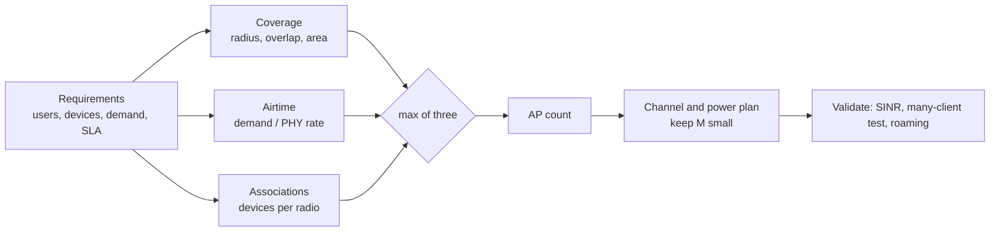
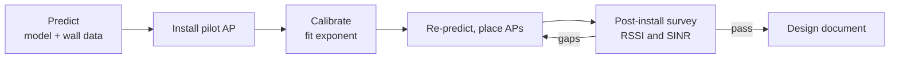

# WF 17: WLAN design and capacity planning: requirements, airtime budgets, density, voice, PoE and validation

*Part of the [networking plan](../00_plan.md) · You need: [WF 02](02_wifi_phy.md) (rates and channels), [WF 03](03_wifi_mac.md) (contention, the performance anomaly), [WF 11](11_rf_fundamentals_and_link_budget.md) (link budget, path loss) and [WF 05](05_wifi_roaming_and_radio_management.md) (channels, power, roaming)*

Anyone can place access points on a floor plan. A Staff-level wireless engineer is asked something harder: "we have a 600-seat lecture hall, 2,400 square metres of open office, a 20,000 square metre warehouse and a stadium section: how many access points, where, on which channels, at what power, powered how, and how do you prove it works?" The weak answer is a rule of thumb: "one AP per 100 users" or "one per 200 square metres". The strong answer treats the design as three separate constraints, **coverage, capacity and associations**, computes each, takes the largest, and then explains what makes the capacity number move: **airtime**, not bandwidth and not device count.

This tutorial turns the earlier Wi-Fi tutorials into a method. Rates, contention, the performance anomaly and the link budget are already in WF 02, WF 03 and WF 11; here they become an airtime budget and an AP count. The numbers come from small models you can run, checked against published vendor design guides that the last section lists.

By the end you can:

- turn a vague brief into design inputs (users, devices, take rate, applications, the weakest client, growth) and say which question decides the design;
- compute cell radius, AP spacing and AP count for a coverage target with a stated overlap;
- build an airtime budget: demand per client, the PHY rate it is carried at, and the fraction of the channel it consumes;
- explain why a slow client, a low minimum data rate or a wide channel changes capacity, and when channel width helps or hurts;
- size a design from coverage, airtime and association limits and say which one dominates for an office, a lecture hall, a warehouse and a stadium;
- design for voice, video and location, and explain why voice capacity is limited by packets and not by bits;
- plan PoE class, switch budget, cable category and uplink speed for the AP generation;
- read a survey (coverage against SINR), calibrate a predictive model, and write the validation plan and the design document.

Section 17 lists what was run, what was fetched and what is from memory.

---

## 1. Start from requirements

A design is the answer to a set of questions, and the questions come first:

| Input | Why it matters | Typical trap |
|---|---|---|
| **Area and building** (walls, floors, ceiling height, glass, metal) | Sets the path-loss exponent and the cell radius | Using a single exponent for a building with concrete cores and glass walls |
| **Users and devices** (and the **take rate**: how many of the people carry a device that associates) | Sets association count, and with demand sets airtime | Counting people, not devices; one person is two or three devices |
| **Demand per device** (average, not peak) and **the application mix** (web, video calls, streaming, voice, scanners, IoT) | Sets airtime | Using a peak speed test as the demand |
| **The weakest client** (single stream, low power, old standard) | The link must work for the worst device, not the laptop on your desk | Surveying with a laptop and designing for phones |
| **Service levels** (voice calls without drops, roaming time, latency) | Sets signal, overlap, minimum rates and QoS | No SLA written down, so no way to say "done" |
| **Growth** (device count and demand in 2 to 3 years) | Wi-Fi capacity is cheaper to design in than to retrofit | Designing for today's headcount |
| **Bands and regulations** (5 and 6 GHz, DFS exposure, power limits) | Sets the channel count | Assuming 6 GHz is available everywhere |
| **Wired side** (cable, switch ports, PoE budget, uplink speed, controller or cloud limits) | The AP is useless without power and a path | Discovering at install that the switch cannot power the APs |

The order of work, which later sections follow: **requirements, coverage, capacity, channel and power plan, wired plan, validation.** A venue guide from a vendor (Aruba's large-venue guide, which I read) puts the first rule well: size for the **take rate** (from under 25 percent in a concert hall to nearly 100 percent in a university lecture hall) and for growth two to three years out, because the upstream devices (DHCP, ARP and NAT tables, firewall sessions, licences, controllers) are sized from the same number.

---

## 2. Coverage design

Coverage answers "can a client at the edge of the cell hear the AP and be heard, at a rate that works". It is the link budget of WF 11, turned into a radius, a spacing and a count.

**Signal targets.** Design targets are the weakest client's received signal at the cell edge, with margin for fading. Typical values in the guides I read: about **-67 dBm** for voice and video (the Cisco real-time-over-WLAN guide states a cell boundary of -67 dBm) and about -70 dBm for data. A target is a number to be checked **at the client**, with the client's own transmit power and antenna, so a phone that transmits at 15 dBm into a 23 dBm AP gives a one-way link unless AP power is reduced to match.

**Overlap.** Cells must overlap so a client can roam without losing the link, but overlap costs capacity, because overlapping co-channel cells share airtime. The guide gives overlap targets: **5 to 10 percent for data, at least 20 percent for voice and video, 20 to 30 percent for critical communications such as healthcare**, and 30 percent or more for dual-band or mission-critical designs. Its worked geometry (a 43-foot client radius and a 59-foot AP spacing for 20 percent overlap) is a check you can reproduce. The model computes the overlap of two circular cells, solves for the spacing that gives a target overlap, and counts access points on a hexagonal layout:

```python
# overlap_spacing.py
import math
def lens_fraction(d, r):
    """Fraction of one circular cell (radius r) that a neighbour at distance d also covers."""
    if d >= 2 * r: return 0.0
    lens = 2 * r * r * math.acos(d / (2 * r)) - (d / 2) * math.sqrt(4 * r * r - d * d)
    return lens / (math.pi * r * r)

def spacing_for(overlap, r):
    lo, hi = 0.0, 2.0 * r
    for _ in range(60):
        mid = (lo + hi) / 2
        if lens_fraction(mid, r) > overlap: lo = mid
        else: hi = mid
    return (lo + hi) / 2

def radius_m(tx_dbm, ref_db, n, threshold_dbm, margin_db=0.0):
    return 10 ** ((tx_dbm - ref_db - threshold_dbm - margin_db) / (10 * n))

if __name__ == "__main__":
    print("check against the published geometry: a client radius of 43 ft and an AP spacing of 59 ft for 20 percent overlap")
    print(f"  model overlap at d = 59 ft, r = 43 ft: {lens_fraction(59, 43):.0%}")

    r = radius_m(17, 47, 3.3, -67)
    rm = radius_m(17, 47, 3.3, -67, 8)
    print(f"\ncell radius for -67 dBm at 17 dBm, n = 3.3, 47 dB at 1 m: {r:.1f} m with no margin, {rm:.1f} m with an 8 dB fade margin")
    area = 40 * 60
    print(f"\nAPs for a {area} m2 floor, hex layout, radius {rm:.1f} m (coverage only, no capacity)")
    print("  overlap   spacing   area per AP   APs")
    for ov in (0.05, 0.10, 0.20, 0.30):
        d = spacing_for(ov, rm)
        a = math.sqrt(3) / 2 * d * d
        print(f"  {ov:7.0%}  {d:6.1f} m  {a:9.0f} m2  {math.ceil(area / a):4d}")
    print("data design wants about 5 to 10 percent overlap, voice about 20, critical communications 20 to 30 (vendor guide)")
```

```text
check against the published geometry: a client radius of 43 ft and an AP spacing of 59 ft for 20 percent overlap
  model overlap at d = 59 ft, r = 43 ft: 20%

cell radius for -67 dBm at 17 dBm, n = 3.3, 47 dB at 1 m: 13.2 m with no margin, 7.6 m with an 8 dB fade margin

APs for a 2400 m2 floor, hex layout, radius 7.6 m (coverage only, no capacity)
  overlap   spacing   area per AP   APs
       5%    13.3 m        153 m2    16
      10%    12.2 m        129 m2    19
      20%    10.4 m         94 m2    26
      30%     8.9 m         68 m2    36
data design wants about 5 to 10 percent overlap, voice about 20, critical communications 20 to 30 (vendor guide)
```

Reading it:

- **The model reproduces the published geometry**: two circles of radius 43 ft spaced 59 ft apart overlap by 20 percent of a cell. A formula you can check against a published number is worth trusting more than one you cannot.
- **Radius comes from the link budget, and fade margin is a design choice.** With no margin the -67 dBm radius is 13.2 m; with an 8 dB fade margin it is 7.6 m. That one decision changes the cell **area** by a factor of three, so it changes the AP count by three. State the margin; do not hide it in a spreadsheet constant.
- **Overlap is not free**: for the same floor, 5 percent overlap needs 16 APs and 30 percent needs 36, more than double. Match overlap to the service level (voice and healthcare pay for it; a guest network does not).
- **This is coverage only.** It says nothing about whether the cells can carry the traffic, which is section 3.

Two checks that catch common errors: the **uplink** (the client's weaker transmitter sets the usable edge, so a map made from the AP's received signal overstates coverage) and the **channel plan** (more APs at full power make more co-channel interference, so more APs often need less power each; WF 05 section 9).

---

## 3. Capacity design: the airtime budget

Capacity is not bandwidth. A channel is a shared medium, so what limits a cell is the **fraction of time** it is busy. Every client's traffic consumes airtime in proportion to its demand and inversely to the **PHY rate** it is carried at. That is the **airtime budget**:

`airtime used by one client = demand / (PHY rate × efficiency)`, and the sum over all clients must stay under the **usable airtime**.

Two constants carry the realism, and both come from vendor guidance I read: payload throughput is roughly **50 to 70 percent** of the theoretical PHY rate (the model uses 65 percent), and about **25 percent of airtime** is lost to contention and overhead (the model keeps 75 percent usable). The PHY rate comes from the HE rate formula of WF 02: data subcarriers, bits per subcarrier, coding rate and streams over the symbol time.

```python
# he_rates.py
# 802.11ax (HE) PHY rate = data subcarriers x bits per subcarrier x coding rate x streams / symbol time
SD = {20: 234, 40: 468, 80: 980, 160: 1960}                       # data subcarriers per channel width
MCS = [(1, 1/2), (2, 1/2), (2, 3/4), (4, 1/2), (4, 3/4), (6, 2/3), (6, 3/4), (6, 5/6), (8, 3/4), (8, 5/6), (10, 3/4), (10, 5/6)]
SYMBOL_US = 12.8 + 0.8                                            # symbol plus 0.8 us guard interval

def he_rate(width, mcs, nss=1):
    bits, code = MCS[mcs]
    return SD[width] * bits * code * nss / SYMBOL_US             # Mbit/s

if __name__ == "__main__":
    print("HE PHY rate in Mbit/s (0.8 us guard interval)")
    print("width  streams   MCS0    MCS7    MCS9   MCS11")
    for width in (20, 40, 80):
        for nss in (1, 2):
            print(f"{width:5d}  {nss:7d} " + "".join(f"{he_rate(width, m, nss):7.1f} " for m in (0, 7, 9, 11)))
```

```text
HE PHY rate in Mbit/s (0.8 us guard interval)
width  streams   MCS0    MCS7    MCS9   MCS11
   20        1     8.6    86.0   114.7   143.4
   20        2    17.2   172.1   229.4   286.8
   40        1    17.2   172.1   229.4   286.8
   40        2    34.4   344.1   458.8   573.5
   80        1    36.0   360.3   480.4   600.5
   80        2    72.1   720.6   960.8  1201.0
```

The table reproduces the standard figures (86.0 Mbit/s for MCS 7 on one stream at 20 MHz, 143.4 for MCS 11, 1,201 for MCS 11 on two streams at 80 MHz). Now the budget:

```python
# airtime_budget.py
from he_rates import he_rate
USABLE = 0.75       # airtime left after contention and overhead (the venue guide's 25 percent rule of thumb)
EFF = 0.65          # payload throughput as a fraction of the PHY rate ("50 to 70 percent of theoretical")

def airtime(demand_mbps, phy_mbps):
    """Fraction of the channel's time this client's traffic consumes."""
    return demand_mbps / (phy_mbps * EFF)

print("1. One cell: 20 clients at MCS 7 (86 Mbit/s), each wanting 2 Mbit/s, on a 20 MHz channel")
base = 20 * airtime(2, he_rate(20, 7))
print(f"   airtime used {base:.0%} of {USABLE:.0%} available")
slow = airtime(2, he_rate(20, 0))
print(f"   one more client stuck at MCS 0 (8.6 Mbit/s) with the same 2 Mbit/s: it alone uses {slow:.0%}; the cell is now at {base + slow:.0%} -> {'overloaded' if base + slow > USABLE else 'fine'}")
print(f"   the same client at MCS 7 would use {airtime(2, he_rate(20, 7)):.1%}: a slow client costs {slow / airtime(2, he_rate(20, 7)):.0f}x the airtime for the same bytes")

print("\n2. How many associated clients one radio can carry, by average demand per client (MCS 7, 1 stream)")
print("   width   0.25 Mbit/s   0.5 Mbit/s   1 Mbit/s   2 Mbit/s   4 Mbit/s")
for w in (20, 40, 80):
    print(f"   {w:3d} MHz " + "".join(f"{USABLE / airtime(d, he_rate(w, 7)):12.0f} " for d in (0.25, 0.5, 1, 2, 4)))

print("\n3. Total system throughput = channels x goodput per channel x reuse (the guide's formula), 1 stream MCS 7")
for w, n in ((20, 9), (40, 4), (80, 2)):
    g = he_rate(w, 7) * EFF * USABLE
    print(f"   {w:3d} MHz: {n} non-DFS channels x {g:5.1f} Mbit/s = {n * g:5.0f} Mbit/s (reuse factor 1)")

print("\n4. A radio's airtime when the traffic mix is not equal: 30 phones (1 stream, MCS 5, 1 Mbit/s each) + 6 laptops (2 streams, MCS 9, 8 Mbit/s each)")
phones = 30 * airtime(1, he_rate(40, 5, 1))
laptops = 6 * airtime(8, he_rate(40, 9, 2))
print(f"   40 MHz channel: phones {phones:.0%}, laptops {laptops:.0%}, total {phones + laptops:.0%} of {USABLE:.0%}")
print(f"   the laptops are a sixth of the devices but {laptops / (phones + laptops):.0%} of the airtime used: count airtime, not devices")
```

```text
1. One cell: 20 clients at MCS 7 (86 Mbit/s), each wanting 2 Mbit/s, on a 20 MHz channel
   airtime used 72% of 75% available
   one more client stuck at MCS 0 (8.6 Mbit/s) with the same 2 Mbit/s: it alone uses 36%; the cell is now at 107% -> overloaded
   the same client at MCS 7 would use 3.6%: a slow client costs 10x the airtime for the same bytes

2. How many associated clients one radio can carry, by average demand per client (MCS 7, 1 stream)
   width   0.25 Mbit/s   0.5 Mbit/s   1 Mbit/s   2 Mbit/s   4 Mbit/s
    20 MHz          168           84           42           21           10
    40 MHz          336          168           84           42           21
    80 MHz          703          351          176           88           44

3. Total system throughput = channels x goodput per channel x reuse (the guide's formula), 1 stream MCS 7
    20 MHz: 9 non-DFS channels x  41.9 Mbit/s =   377 Mbit/s (reuse factor 1)
    40 MHz: 4 non-DFS channels x  83.9 Mbit/s =   336 Mbit/s (reuse factor 1)
    80 MHz: 2 non-DFS channels x 175.6 Mbit/s =   351 Mbit/s (reuse factor 1)

4. A radio's airtime when the traffic mix is not equal: 30 phones (1 stream, MCS 5, 1 Mbit/s each) + 6 laptops (2 streams, MCS 9, 8 Mbit/s each)
   40 MHz channel: phones 34%, laptops 16%, total 50% of 75%
   the laptops are a sixth of the devices but 32% of the airtime used: count airtime, not devices
```

What it says, in the order of the output:

1. **A cell is full sooner than it looks, and one slow client breaks it.** Twenty clients at MCS 7 asking for 2 Mbit/s each use 72 percent of a 20 MHz channel against 75 percent available. One more client stuck at MCS 0 uses 36 percent alone, **ten times the airtime of the same client at MCS 7**, and the cell is at 107 percent. This is the performance anomaly of WF 03 as a budget line, and it is why the cheapest capacity upgrade is raising the **minimum data rate** (WF 05 section 9) so that no client can take 10 times the air.
2. **Clients per radio is a function of demand.** A 20 MHz radio at MCS 7 carries about 168 clients at 0.25 Mbit/s each but 21 at 2 Mbit/s and 10 at 4. Vendor guides plan 60 to 200 associated clients per radio (the venue guide I read uses about 60 per radio for underseat APs and up to 200 for overhead), plan about 1 to 4 Mbit/s per device, and note that platform limits (hundreds per radio) are far above what a design should target. The table shows why these numbers hold together only when most associated devices are **idle most of the time**.
3. **Total system throughput does not grow with channel width.** The venue guide's formula is channels × goodput per channel × reuse factor. With 5 GHz non-DFS channels (9 of 20 MHz, 4 of 40, 2 of 80) the totals are 377, 336 and 351 Mbit/s: wider channels carry more each, but there are fewer of them, so the product is about constant. Total spectrum is the budget; width only chooses how to slice it. This is the first-order reason section 4 exists.
4. **Count airtime, not devices.** Thirty phones and six laptops are 36 devices, but the laptops are a sixth of them and 32 percent of the airtime used.

Vendor worked example for scale: if each AP delivers 100 Mbit/s and supports 50 users, a thousand APs deliver 100 Gbit/s in total and each user gets 2 Mbit/s. That is the order of magnitude to expect for a dense venue: **a few megabits per user, not hundreds**.

---

## 4. Channel width and reuse: where density gets decided

In a sparse deployment, wider channels are better: higher rates, and few neighbours to interfere with. In a dense one, the trade changes. Each AP shares airtime with every co-channel AP it can hear, so the load a cell sees depends on **how many APs are within interference range** (call it M) and how many channels there are to spread them over. A model with random channel assignment gives the airtime load of one contention domain:

```python
# width_reuse.py
import math
from he_rates import he_rate, MCS
GAP = 8.0
def snr_needed(m):                                  # the model used in the RF tutorial: Shannon bound plus an implementation gap
    b, r = MCS[m]
    return GAP + 10 * math.log10(2 ** (b * r) - 1)
def best_mcs(snr):
    ok = [m for m in range(12) if snr_needed(m) <= snr]
    return max(ok) if ok else None

EFF = 0.65
N = {"non-DFS only": {20: 9, 40: 4, 80: 2}, "with DFS": {20: 25, 40: 12, 80: 6}}   # channel counts in 5 GHz (US)

def domain_load(width, n_channels, m_in_range, demand_mbps, snr20, nss=1):
    """Airtime demanded in one contention domain: this AP plus its co-channel neighbours (random assignment over n channels)."""
    snr = snr20 - 10 * math.log10(width / 20)       # noise grows with width: 3 dB per doubling
    m = best_mcs(snr)
    if m is None: return float("inf")
    cochannel = 1 + (m_in_range - 1) / n_channels
    return cochannel * demand_mbps / (he_rate(width, m, nss) * EFF), m

print("airtime load of one contention domain (1.0 = full), per-cell demand 30 Mbit/s, clients at 28 dB SNR in 20 MHz, 1 stream")
print("APs within interference range      width   channels   MCS   load")
for plan in ("non-DFS only", "with DFS"):
    for m_in in (3, 12, 60):
        row = []
        for w in (20, 40, 80):
            load, mcs = domain_load(w, N[plan][w], m_in, 30, 28)
            row.append(f"{w} MHz: {N[plan][w]:2d} ch, MCS {mcs}, {load:4.2f}")
        print(f"  {plan:12s} M={m_in:2d}   " + "   ".join(row))
print("\nthe same, but clients at 18 dB SNR (a larger cell or a noisier floor)")
for m_in in (12, 60):
    row = []
    for w in (20, 40, 80):
        r = domain_load(w, N["non-DFS only"][w], m_in, 30, 18)
        row.append(f"{w} MHz: " + ("no link" if r == float("inf") else f"MCS {r[1]}, {r[0]:4.2f}"))
    print(f"  non-DFS only M={m_in:2d}   " + "   ".join(row))
```

```text
airtime load of one contention domain (1.0 = full), per-cell demand 30 Mbit/s, clients at 28 dB SNR in 20 MHz, 1 stream
APs within interference range      width   channels   MCS   load
  non-DFS only M= 3   20 MHz:  9 ch, MCS 8, 0.55   40 MHz:  4 ch, MCS 7, 0.40   80 MHz:  2 ch, MCS 6, 0.28
  non-DFS only M=12   20 MHz:  9 ch, MCS 8, 0.99   40 MHz:  4 ch, MCS 7, 1.01   80 MHz:  2 ch, MCS 6, 0.93
  non-DFS only M=60   20 MHz:  9 ch, MCS 8, 3.38   40 MHz:  4 ch, MCS 7, 4.22   80 MHz:  2 ch, MCS 6, 4.34
  with DFS     M= 3   20 MHz: 25 ch, MCS 8, 0.48   40 MHz: 12 ch, MCS 7, 0.31   80 MHz:  6 ch, MCS 6, 0.19
  with DFS     M=12   20 MHz: 25 ch, MCS 8, 0.64   40 MHz: 12 ch, MCS 7, 0.51   80 MHz:  6 ch, MCS 6, 0.40
  with DFS     M=60   20 MHz: 25 ch, MCS 8, 1.50   40 MHz: 12 ch, MCS 7, 1.59   80 MHz:  6 ch, MCS 6, 1.54

the same, but clients at 18 dB SNR (a larger cell or a noisier floor)
  non-DFS only M=12   20 MHz: MCS 4, 1.99   40 MHz: MCS 3, 2.51   80 MHz: MCS 2, 2.78
  non-DFS only M=60   20 MHz: MCS 4, 6.76   40 MHz: MCS 3, 10.56   80 MHz: MCS 2, 13.02
```

The SNR-to-MCS step uses the Shannon-plus-gap model of WF 11 (an assumption, not any chip's table), and the channel counts are the 5 GHz channel plan of WF 02 (from memory). Read the rows by regime:

- **Sparse (M = 3):** wider wins clearly: loads 0.55, 0.40 and 0.28 for 20, 40 and 80 MHz. Few neighbours, so the rate gain is not eaten by reuse.
- **Moderate (M = 12), non-DFS only:** a tie (0.99, 1.01, 0.93). With DFS channels allowed the wide channels pull ahead (0.64, 0.51 and 0.40 for 20, 40 and 80 MHz), which is a real argument for DFS in dense designs, with its radar-event exposure (WF 02 section 11).
- **Dense (M = 60):** every width is overloaded: 3.4, 4.2 and 4.3 without DFS, and 1.5, 1.6 and 1.5 with it, so with DFS the three are within 6 percent of each other. Doubling the width halves the channel count and doubles the rate, so the product is nearly fixed. **More width does not cure this regime.**
- **Low SNR (18 dB):** the narrow channel wins decisively (load 1.99 against 2.78 at M = 12, and 6.8 against 13.0 at M = 60), because the noise floor rises 3 dB per doubling of width, which costs MCS steps. This is the real reason vendor guides for very dense venues use **20 MHz as the baseline**: the width barely changes capacity, but narrow channels are more robust and use fewer DFS-exposed blocks.

What actually helps in the dense regime is lowering M, the number of APs that hear each other:

- **Lower transmit power** so cells are small and the interference range shrinks (the same lever as section 2, now for capacity).
- **Directional antennas** that aim at the seats and away from neighbours (the venue guide recommends directional antennas where possible to focus coverage on high-density areas and cut interference).
- **Use the building as a shield**: under-seat APs in a stadium put bodies and concrete between cells; wall-mounted or in-room APs in dormitories and hotels use the walls.
- **More spectrum**: DFS channels, and 6 GHz where permitted, increase N. A 6 GHz radio with 59 channels of 20 MHz, as described in WF 02, is the biggest single lever.
- **Fewer, better clients**: band steering, minimum rates, and disabling 2.4 GHz (three channels) in dense spaces (WF 05).

The lesson to state in an interview: **adding APs to a dense space adds capacity only if each new cell hears fewer neighbours; if M grows with the AP count, capacity stays flat.**

---

## 5. Putting the constraints together

The count of access points is the largest of three numbers:

- **Coverage:** area divided by the area one AP covers at the chosen radius and overlap (section 2).
- **Airtime:** total airtime demanded divided by what one AP can supply after co-channel losses (section 3).
- **Associations:** devices divided by the number the design allows per radio.

Three constraints, one answer:



```python
# size_design.py
import math
from he_rates import he_rate
from overlap_spacing import spacing_for, radius_m
USABLE, EFF, COCH = 0.75, 0.65, 1.5       # COCH: airtime lost to co-channel neighbours (a planning assumption, see the width model)
CAP_PER_RADIO = 100                       # associated devices per radio the design allows (assumption; platform limits are far higher)

def size(name, area_m2, devices, demand_mbps, phy_mbps, overlap, radius_m_):
    d = spacing_for(overlap, radius_m_)
    cover = math.ceil(area_m2 / (math.sqrt(3) / 2 * d * d))
    load = devices * demand_mbps / (phy_mbps * EFF)             # airtime wanted across the whole space (1.0 = one full channel)
    airtime = math.ceil(load / (USABLE / COCH))
    assoc = math.ceil(devices / CAP_PER_RADIO)
    need = max(cover, airtime, assoc)
    what = [k for k, v in (("coverage", cover), ("airtime", airtime), ("associations", assoc)) if v == need][0]
    print(f"{name:34s} coverage {cover:4d}  airtime {airtime:4d}  associations {assoc:4d}  -> {need:4d} APs, set by {what}")

r = radius_m(17, 47, 3.3, -67, 8)
print("APs needed, from three constraints; the largest wins")
size("open office, 2,400 m2, 150 devices", 2400, 150, 1.0, he_rate(40, 7, 2), 0.10, r)
size("same office, video calls on every desk", 2400, 150, 6.0, he_rate(40, 7, 2), 0.10, r)
size("lecture hall, 400 m2, 600 devices", 400, 600, 0.5, he_rate(20, 7, 1), 0.10, r)
rw = radius_m(17, 47, 3.3, -72, 4)                 # scanners tolerate a weaker edge: -72 dBm, 4 dB margin
size("warehouse, 20,000 m2, 60 scanners", 20000, 60, 0.1, he_rate(20, 5, 1), 0.20, rw)
size("stadium bowl section, 6,000 m2, 5,000 dev", 6000, 5000, 0.5, he_rate(20, 7, 1), 0.10, r)
print("the dominant constraint changes with the venue: the warehouse and the office are coverage problems at these demands, the hall and the stadium section are capacity problems")
```

```text
APs needed, from three constraints; the largest wins
open office, 2,400 m2, 150 devices coverage   19  airtime    2  associations    2  ->   19 APs, set by coverage
same office, video calls on every desk coverage   19  airtime    9  associations    2  ->   19 APs, set by coverage
lecture hall, 400 m2, 600 devices  coverage    4  airtime   11  associations    6  ->   11 APs, set by airtime
warehouse, 20,000 m2, 60 scanners  coverage   61  airtime    1  associations    1  ->   61 APs, set by coverage
stadium bowl section, 6,000 m2, 5,000 dev coverage   47  airtime   90  associations   50  ->   90 APs, set by airtime
the dominant constraint changes with the venue: the warehouse and the office are coverage problems at these demands, the hall and the stadium section are capacity problems
```

Reading it:

- **The dominant constraint changes with the venue.** The office and the warehouse are **coverage** problems at these demands: the office needs 19 APs for the floor whatever the traffic, and the warehouse needs 61 because the floor is large and the demand is tiny. The lecture hall and the stadium section are **airtime** problems: 11 APs for 400 m² and 90 for 6,000 m², far above what coverage alone would say.
- **A video-call office is still coverage-limited**: even with every desk at 6 Mbit/s the airtime need is 9 APs, below the 19 that coverage requires. The right response to a "video everywhere" request is to check the airtime, find there is headroom, and not buy more APs.
- **Capacity APs in a small space are the density trap of section 4.** Eleven APs in a 400 m² hall are one every 36 m², so M is large; the design only works with low power, directional antennas and a deliberate channel plan. The model counts the APs; it does not prove they can coexist.
- The warehouse uses a weaker edge target (-72 dBm, 4 dB margin) because scanners tolerate it; the constants differ by use, which is why section 1 comes first.

---

## 6. Venue patterns

| Venue | What dominates | Typical design choices |
|---|---|---|
| **Open office** | Coverage, then roaming and video | Cells of about 10 m, 5 to 20 percent overlap, 40 MHz in 5 GHz, 6 GHz for newer clients, power matched to client uplink |
| **Classroom and lecture hall** | Airtime and association count | Take rate close to 100 percent; low power, 20 to 40 MHz, several APs per hall on separate channels, minimum rate raised; ceiling or wall APs aimed at the seats |
| **Stadium and arena** | Airtime, interference range | Under-seat and directional overhead APs, 20 MHz baseline, 6 GHz and DFS where allowed, low power; the guide I read uses about 150 to 200 seats per overhead AP, 60 per under-seat AP, take rates of 20 to 100 percent, and plans 1 to 4 Mbit/s per device; separate high-density tuning for concourses and suites |
| **Warehouse and retail** | Coverage, roaming, voice and scanners | Large cells at lower thresholds, high ceilings need directional antennas, racking and stock change the RF, roaming across aisles, 2.4 GHz often still present for old scanners |
| **Hospital** | Reliability, overlap, interference | 20 to 30 percent overlap, redundancy so one AP failure does not leave a hole, medical devices and wearables with weak radios, many walls and shielded rooms |
| **Hotel and dormitory** | Through-wall loss and many devices per room | APs in or near rooms rather than corridors, low power, 5 GHz and 6 GHz, consumer devices with odd behaviour |
| **Outdoor and campus** | Range, weather, line of sight | Directional antennas, higher power within regulation, mounting and cabling outdoors |

(The stadium numbers are from the venue guide I read; the rest are general practice and from memory, so check them against the vendor guide for the product in front of you.)

---

## 7. Voice, video and location

**Signal and rate settings.** The Cisco real-time-over-WLAN guide I read gives the standard recipe: **-67 dBm** at the cell edge, **at least 20 percent overlap**, and **disable data rates below 12 Mbit/s** (including MCS 0) for voice and video, because a low rate does not extend range usefully; it makes the call occupy more air and drops quality. It also says not to lower rates to extend the cell radius, to use 5 GHz (preferably 40 MHz channels), to base the plan on eight non-DFS channels, and to set the AP power so it does not exceed the phone's (an initial AP power of 13 dBm or less when the endpoint's maximum is 16 dBm). It points out that **QoS only prioritises traffic after the channel is clear**, so it cannot remove the delay caused by co-channel interference: a voice design is first an interference design.

**Voice capacity is packets, not bits.** The same guide gives call capacity for G.711 at 64 kbit/s over 802.11a: **20 simultaneous bidirectional calls per channel at 12 Mbit/s and 27 at 24 Mbit/s or higher**. A voice packet carries only 160 bytes every 20 ms, so the air time is dominated by fixed costs. The model computes the ideal packet time from the legacy OFDM timing and the voice access category:

```python
# voice_calls.py
import math
SLOT, SIFS = 9, 16                     # 802.11a, microseconds
AIFS = SIFS + 2 * SLOT                 # voice access category: AIFSN 2
BACKOFF = 1.5 * SLOT                   # voice CWmin 3: mean 1.5 slots

def ofdm_time(bytes_, rate):           # legacy OFDM frame time in microseconds: 20 us preamble and SIGNAL, 4 us symbols
    ndbps = rate * 4
    return 20 + 4 * math.ceil((16 + 8 * bytes_ + 6) / ndbps)

def packet_time(rate, ack_rate):
    payload = 160                                    # 20 ms of G.711 at 64 kbit/s
    mpdu = payload + 12 + 8 + 20 + 8 + 26 + 4        # RTP, UDP, IP, LLC/SNAP, MAC header with QoS, FCS
    return AIFS + BACKOFF + ofdm_time(mpdu, rate) + SIFS + ofdm_time(14, ack_rate)

for rate, ack in ((12, 12), (24, 24), (54, 24)):
    t = packet_time(rate, ack)
    calls = 20000 / (2 * t)                          # each call sends one packet each way every 20 ms
    print(f"voice at {rate:2d} Mbit/s: {t:5.1f} us per packet incl. ACK and access -> at most {calls:4.1f} bidirectional calls per channel")
print("each packet carries 1,280 payload bits; most of its air time is fixed cost: preamble, access, SIFS and the ACK")
t12, t24 = packet_time(12, 12), packet_time(24, 24)
print(f"doubling the rate from 12 to 24 Mbit/s cuts the packet time by only {1 - t24 / t12:.0%}")
print("published figures for the same traffic (G.711, 802.11a, one channel): 20 calls at 12 Mbit/s, 27 calls at 24 Mbit/s or more")
for rate, ack, published in ((12, 12, 20), (24, 24, 27)):
    bound = 20000 / (2 * packet_time(rate, ack))
    print(f"published {published} calls is {published / bound:.0%} of this model's ideal bound at {rate} Mbit/s: the rest is contention, retries, beacons and headroom")
```

```text
voice at 12 Mbit/s: 279.5 us per packet incl. ACK and access -> at most 35.8 bidirectional calls per channel
voice at 24 Mbit/s: 195.5 us per packet incl. ACK and access -> at most 51.2 bidirectional calls per channel
voice at 54 Mbit/s: 147.5 us per packet incl. ACK and access -> at most 67.8 bidirectional calls per channel
each packet carries 1,280 payload bits; most of its air time is fixed cost: preamble, access, SIFS and the ACK
doubling the rate from 12 to 24 Mbit/s cuts the packet time by only 30%
published figures for the same traffic (G.711, 802.11a, one channel): 20 calls at 12 Mbit/s, 27 calls at 24 Mbit/s or more
published 20 calls is 56% of this model's ideal bound at 12 Mbit/s: the rest is contention, retries, beacons and headroom
published 27 calls is 53% of this model's ideal bound at 24 Mbit/s: the rest is contention, retries, beacons and headroom
```

- The ideal bound is 35.8 calls at 12 Mbit/s, 51.2 at 24 and 67.8 at 54: **doubling the rate from 12 to 24 Mbit/s cuts the packet time by only 30 percent**, so capacity rises by 43 percent and not 100.
- The published 20 and 27 are 56 and 53 percent of the ideal bound: the rest goes to contention beyond the mean backoff, retries, beacons and the headroom a designer must leave. Use the vendor figure for a plan and the model to **explain its shape**.
- **Practical consequence:** a voice cell is limited by the number of packets per second, so more bandwidth (wider channels, faster MCS) barely helps; fewer co-channel neighbours and a clean channel do.

**Video** scales with bit rate: the same guide lists, per channel, 7 H.264 720p calls at 2.5 Mbit/s each at MCS 7 but only 1 at MCS 1, so for video the **rate** matters much more than for voice.

**Location.** Location services (WF 07 section 7) infer position from the signal strengths several APs hear, so the AP layout matters differently: APs placed only in the middle of a floor give poor geometry, while **APs around the perimeter as well as inside**, with several APs hearing each client at usable strength, give better positions (from memory; confirm with the location vendor's design guide). A coverage-only layout for data is often a poor layout for location, so ask early whether location is a requirement.

---

## 8. Mesh and wireless backhaul in a design

A wireless backhaul is a capacity decision, not just a cabling shortcut. WF 07 section 5 covers the mechanics: a node that forwards on the same radio and channel uses the air twice, so throughput falls by about half per hop. For design purposes:

- **Treat each wireless hop as consuming airtime from the cell it shares**, so a node three hops from the gateway on one radio gets about a quarter of one link's rate.
- **Use a dedicated backhaul radio or a wire** for anything that must carry real load, and reserve single-radio meshes for light traffic, short chains or temporary coverage.
- **Plan the backhaul link at a good SNR** (about 25 dB or more for a high rate), since a poor link costs everyone on the path.
- **Keep hop counts low** and give each hop's link a measured rate in the survey (an active survey over the backhaul path).

---

## 9. Cabling, PoE and uplinks

The wired plan fails projects that the RF plan got right.

**PoE standards.** The standards' figures (from the PoE standards page I read) are the power at the switch port and the power guaranteed at the device after cable loss:

| Standard | At the switch (PSE) | At the device (PD) |
|---|---|---|
| 802.3af (type 1) | 15 W | 12.95 W |
| 802.3at (type 2, PoE+) | 30 W | 25.5 W |
| 802.3bt type 3 | 60 W | 51 W |
| 802.3bt type 4 | 90 W | 71 W |

Modern APs draw more than the older standards give. The Cisco power-requirements page I read lists maximum draws such as **25.5 W (a Wi-Fi 6 AP), 30.5 W, 39 W and 47 W (Wi-Fi 7 APs)** and what happens at lower power: radios drop to fewer chains or shut down, the USB port is disabled, the multigigabit uplink falls to 1 Gbit/s, and some APs do not boot at 15 W. The AP then shows in the controller as **low power**, and the symptom is "the AP works but is slow", a classic. The model compares:

```python
# poe_budget.py
# PSE output power and the power a powered device is guaranteed after cable loss (the standards' figures)
STD = {"802.3af (type 1)": (15.4, 12.95), "802.3at (type 2)": (30.0, 25.5), "802.3bt type 3": (60.0, 51.0), "802.3bt type 4": (90.0, 71.3)}
# maximum draws as published for example Cisco APs (25.5, 30.5, 39 and 47 W)
APS = {"Wi-Fi 6 AP, 2x2": 25.5, "Wi-Fi 6 AP, 4x4": 30.5, "Wi-Fi 7 AP, tri-band": 39.0, "Wi-Fi 7 AP, high end": 47.0}
print("which PoE standard gives each AP its full draw at the device")
print("  AP (maximum draw)                  " + "  ".join(f"{k:>17s}" for k in STD))
for name, draw in APS.items():
    row = ["full" if draw <= pd else "reduced" for _, pd in STD.values()]
    print(f"  {name:20s} {draw:5.1f} W        " + "  ".join(f"{r:>17s}" for r in row))

print("\nswitch budget: a 48-port switch with a 740 W PoE budget (an example)")
budget = 740.0
for name, draw in APS.items():
    print(f"  {name:22s}: {draw:5.1f} W each -> {int(budget // draw):2d} APs on one switch of 48 ports")
print("  allocation by class (worst case) is higher than the measured draw: a class 4 port reserves 30 W, a class 6 port 60 W (PSE side)")
print(f"  24 high-end Wi-Fi 7 APs at 47 W need {24 * 47.0:.0f} W of the {budget:.0f} W budget; the same 24 reserved at 60 W (class 6) need {24 * 60.0:.0f} W")

print("\nuplink: data rate per generation from the Cisco white paper table, and the cabling it implies")
for name, uplink in (("Wi-Fi 6 AP, 2.4 + 5 GHz", 2.5), ("Wi-Fi 6E AP, tri-band", 5.0), ("Wi-Fi 7 AP, tri-band", 10.0)):
    print(f"  {name:26s} listed at {uplink:4.1f} Gb/s: plan a {'2.5' if uplink <= 2.5 else '5' if uplink <= 5 else '10'}G uplink (2.5G and 5G run on Cat5e, 10G needs Cat6a, all to 100 m)")
```

```text
which PoE standard gives each AP its full draw at the device
  AP (maximum draw)                   802.3af (type 1)   802.3at (type 2)     802.3bt type 3     802.3bt type 4
  Wi-Fi 6 AP, 2x2       25.5 W                  reduced               full               full               full
  Wi-Fi 6 AP, 4x4       30.5 W                  reduced            reduced               full               full
  Wi-Fi 7 AP, tri-band  39.0 W                  reduced            reduced               full               full
  Wi-Fi 7 AP, high end  47.0 W                  reduced            reduced               full               full

switch budget: a 48-port switch with a 740 W PoE budget (an example)
  Wi-Fi 6 AP, 2x2       :  25.5 W each -> 29 APs on one switch of 48 ports
  Wi-Fi 6 AP, 4x4       :  30.5 W each -> 24 APs on one switch of 48 ports
  Wi-Fi 7 AP, tri-band  :  39.0 W each -> 18 APs on one switch of 48 ports
  Wi-Fi 7 AP, high end  :  47.0 W each -> 15 APs on one switch of 48 ports
  allocation by class (worst case) is higher than the measured draw: a class 4 port reserves 30 W, a class 6 port 60 W (PSE side)
  24 high-end Wi-Fi 7 APs at 47 W need 1128 W of the 740 W budget; the same 24 reserved at 60 W (class 6) need 1440 W

uplink: data rate per generation from the Cisco white paper table, and the cabling it implies
  Wi-Fi 6 AP, 2.4 + 5 GHz    listed at  2.5 Gb/s: plan a 2.5G uplink (2.5G and 5G run on Cat5e, 10G needs Cat6a, all to 100 m)
  Wi-Fi 6E AP, tri-band      listed at  5.0 Gb/s: plan a 5G uplink (2.5G and 5G run on Cat5e, 10G needs Cat6a, all to 100 m)
  Wi-Fi 7 AP, tri-band       listed at 10.0 Gb/s: plan a 10G uplink (2.5G and 5G run on Cat5e, 10G needs Cat6a, all to 100 m)
```

- **A Wi-Fi 7 AP needs 802.3bt to run in full**, and 802.3at (30 W) leaves even the lower-draw ones reduced. Cisco's white paper also notes that its Wi-Fi 7 APs support standards-based PoE (including 802.3bt) and **not the proprietary 60 W UPOE**, so a switch that only offers the proprietary mode may not power them fully.
- **The switch budget is a hidden limit.** With an example 740 W budget, a 48-port switch powers only 15 high-end Wi-Fi 7 APs at 47 W, and class-based allocation reserves more than the measured draw, so 24 of those APs would need 1,128 W measured or 1,440 W reserved: a **PoE budget** is a design number, not a port count.
- **Uplink and cabling.** The Cisco white paper lists the data rate per generation (Wi-Fi 6: 2.5 Gbit/s, Wi-Fi 6E: 5, Wi-Fi 7: 10) and states that multigigabit **2.5G and 5G run on Cat5e and 10G on Cat6a, all to 100 m**, with **Cat6a recommended for new installations**. Cabling is the part of a building that is hardest to change later: run the better cable once.
- **Other wired checks:** switch port speed matches the AP's uplink, the VLAN and DHCP design, a certified cable run (ANSI/BICSI testing is cited in the same paper), cable length under 100 m, and bundle size within the fill ratios to avoid heat in PoE bundles.

---

## 10. Predictive and on-site surveys, and reading a survey

WF 08 section 9 covers the survey types. For design, the question is **how much to trust the model**, and how to measure that. A predictive tool is as good as its wall and floor data; the standard practice is to **calibrate it with a few validation measurements** next to a real installed AP. The model shows what calibration buys: a predictive plan assumed a path-loss exponent of 3.0 for a building that really behaves like 3.6, and the validation points recover the real value:

```python
# calibrate.py
import numpy as np, math
rng = np.random.default_rng(12)
TRUE_N, REF, SHADOW, TX = 3.6, 47.0, 5.0, 17.0       # the building's real behaviour (unknown to the planner)
PLAN_N = 3.0                                          # what the predictive tool assumed from its wall database
def radius(n, thr=-67.0, margin=8.0): return 10 ** ((TX - REF - thr - margin) / (10 * n))

print(f"predictive plan assumed n = {PLAN_N}: radius {radius(PLAN_N):.1f} m;  the building really has n = {TRUE_N}: radius {radius(TRUE_N):.1f} m")
print(f"  area per AP the plan counted on: {math.pi * radius(PLAN_N) ** 2:.0f} m2, what the building gives: {math.pi * radius(TRUE_N) ** 2:.0f} m2 ({(radius(TRUE_N) / radius(PLAN_N)) ** 2:.0%} of it)")

def measure(npoints):
    d = rng.uniform(2, 25, npoints)
    rssi = TX - REF - 10 * TRUE_N * np.log10(d) + rng.normal(0, SHADOW, npoints)
    return d, rssi

def fit(d, rssi):
    x = -10 * np.log10(d); y = rssi - TX + REF
    n = (x @ y) / (x @ x)                              # least squares through the known 1 m loss
    resid = y - n * x
    se = math.sqrt(resid @ resid / (len(d) - 1) / (x @ x))
    return n, se

print("\ncalibrating from validation measurements taken next to one installed AP")
print("  points   fitted n   +/- (1 sigma)   radius from the fit   error vs true radius")
for k in (4, 8, 16, 40, 100):
    d, r = measure(k)
    n, se = fit(d, r)
    print(f"  {k:6d}   {n:8.2f}   {se:11.2f}   {radius(n):16.1f} m   {radius(n) / radius(TRUE_N) - 1:+18.0%}")
print(f"\ntrue radius {radius(TRUE_N):.1f} m. A fitted exponent is a number with an error bar: a pilot of a few points can still be off by 10 percent in radius, which is 20 percent in area.")
```

```text
predictive plan assumed n = 3.0: radius 9.3 m;  the building really has n = 3.6: radius 6.4 m
  area per AP the plan counted on: 269 m2, what the building gives: 128 m2 (48% of it)

calibrating from validation measurements taken next to one installed AP
  points   fitted n   +/- (1 sigma)   radius from the fit   error vs true radius
       4       3.82          0.34                5.7 m                 -10%
       8       3.45          0.09                6.9 m                  +9%
      16       3.56          0.10                6.5 m                  +2%
      40       3.61          0.07                6.4 m                  -1%
     100       3.56          0.05                6.5 m                  +2%

true radius 6.4 m. A fitted exponent is a number with an error bar: a pilot of a few points can still be off by 10 percent in radius, which is 20 percent in area.
```

- **A modest error in the exponent is a large error in area.** n = 3.0 against 3.6 gives a radius of 9.3 m against 6.4 m, so the plan counted on **more than twice** the area per AP that the building provides: a design 52 percent short of APs from one wrong number.
- **Calibration converges quickly but a fit is a number with an error bar**: four points gave n = 3.82 ± 0.34 and a radius 10 percent off; 16 points gave 3.56 ± 0.10 and a radius 2 percent off. A pilot of a few points can still be off by 10 percent in radius, which is 20 percent in area, so measure at several distances and in several rooms and treat the fit as an estimate.

The design loop, since a survey result feeds back into the plan:



**Reading a survey.** A map of the **best signal** says whether anyone is out of coverage; it does not say whether the channel is usable. The model puts the same floor through three channel plans:

```python
# survey_model.py
import math, random
random.seed(4)
W, H = 60.0, 40.0                         # a floor, metres
TX, N_EXP, REF = 17.0, 3.3, 47.0          # dBm per AP, path-loss exponent, loss at 1 m (5 GHz)
NOISE = -92.0
SHADOW = 4.0                              # dB of random shadowing per point and AP

def layout(spacing):
    pts, row, y = [], 0, spacing / 2
    while y < H:
        x = spacing / 2 + (spacing / 2 if row % 2 else 0)
        while x < W:
            pts.append((x, y)); x += spacing
        y += spacing * 0.866; row += 1
    return pts

def rssi(ap, x, y, rng):
    d = max(1.0, math.hypot(ap[0] - x, ap[1] - y))
    return TX - REF - 10 * N_EXP * math.log10(d) + rng.gauss(0, SHADOW)

def plan_channels(aps, n, mode):
    if mode == "all on one channel": return [0] * len(aps)
    if mode == "random": return [random.randrange(n) for _ in aps]
    ch = []                                # greedy colouring: pick the channel least used by the nearest already-coloured APs
    for i, a in enumerate(aps):
        near = sorted(range(i), key=lambda j: math.hypot(aps[j][0] - a[0], aps[j][1] - a[1]))[:6]
        use = [sum(1 for j in near if ch[j] == c) for c in range(n)]
        ch.append(use.index(min(use)))
    return ch

def survey(aps, chans, step=1.0):
    rng = random.Random(9)
    pts = good67 = good70 = sinr20 = sinr25 = 0
    heard = 0
    y = step / 2
    while y < H:
        x = step / 2
        while x < W:
            r = [rssi(a, x, y, rng) for a in aps]
            best = max(range(len(aps)), key=lambda i: r[i])
            interf = sum(10 ** (r[i] / 10) for i in range(len(aps)) if i != best and chans[i] == chans[best] and r[i] > -92)
            denom = 10 ** (NOISE / 10) + interf
            sinr = r[best] - 10 * math.log10(denom)
            pts += 1; good67 += r[best] >= -67; good70 += r[best] >= -70
            sinr20 += sinr >= 20; sinr25 += sinr >= 25
            heard += sum(1 for i in range(len(aps)) if chans[i] == chans[best] and r[i] >= -82)
            x += step
        y += step
    return [100 * v / pts for v in (good67, good70, sinr20, sinr25)] + [heard / pts]

print(f"floor {W:.0f} x {H:.0f} m, {TX:.0f} dBm APs, n = {N_EXP}, {SHADOW:.0f} dB shadowing")
for spacing in (12, 18):
    aps = layout(spacing)
    print(f"\n{len(aps)} APs at {spacing} m spacing")
    print("  channel plan          best RSSI>=-67   >=-70   SINR>=20 dB   SINR>=25 dB   co-channel APs heard (>=-82)")
    for n, mode in ((1, "all on one channel"), (4, "random"), (4, "greedy colouring")):
        r = survey(aps, plan_channels(aps, n, mode))
        print(f"  {mode + (' (%d ch)' % n if n > 1 else ''):20s} {r[0]:10.0f}% {r[1]:8.0f}% {r[2]:11.0f}% {r[3]:13.0f}% {r[4]:18.1f}")
```

```text
floor 60 x 40 m, 17 dBm APs, n = 3.3, 4 dB shadowing

18 APs at 12 m spacing
  channel plan          best RSSI>=-67   >=-70   SINR>=20 dB   SINR>=25 dB   co-channel APs heard (>=-82)
  all on one channel          100%      100%           8%             3%               14.2
  random (4 ch)               100%      100%          30%            18%                3.9
  greedy colouring (4 ch)        100%      100%          37%            20%                3.6

6 APs at 18 m spacing
  channel plan          best RSSI>=-67   >=-70   SINR>=20 dB   SINR>=25 dB   co-channel APs heard (>=-82)
  all on one channel           87%       95%           8%             5%                4.9
  random (4 ch)                87%       95%          44%            30%                1.8
  greedy colouring (4 ch)         87%       95%          70%            51%                1.4
```

- **The RSSI result is identical for all three plans** (100 percent of the floor at -67 dBm with 18 APs; 87 percent with 6 APs), because RSSI depends on the AP positions and power only.
- **The SINR result is not**: with 6 APs on one channel only 8 percent of the floor reaches 20 dB, with 4 random channels 44 percent, with a greedy colouring that spreads neighbours onto different channels **70 percent**. The same coverage map hides a nearly ninefold difference in quality. This is why a survey report must show **SINR or co-channel overlap**, not RSSI alone.
- **More APs made the SINR worse, not better**: the 12 m layout (18 APs) is over-covered, and even with the greedy channel plan only 37 percent of it reaches 20 dB, against 70 percent for the 6-AP layout, because the extra cells hear each other (3.6 co-channel APs above -82 dBm on average, against 1.4). More APs without lower power is the density trap of section 4.

---

## 11. Validation and the design document

A design is finished when someone else can check it. Write the **acceptance criteria** before install, in numbers:

- **Coverage:** signal at the target (for example -67 dBm) at a stated percentage of the area, measured with the target device class, **and SINR** at a stated threshold.
- **Capacity:** a **many-client test** (WF 09 section 3.4) to a stated load, with throughput per client and the airtime utilisation from the AP, not only an iperf from one laptop.
- **Roaming:** time on the stated path, with the real clients (WF 05).
- **Voice and video:** loss, jitter and call quality on the stated path, with the real handsets.
- **Wired:** PoE power at each port, uplink speed, cable test results.
- **Resilience:** an AP failure leaves the target coverage (for critical sites), and a controller or uplink failure behaves as designed.

**The design document** records inputs, assumptions, decisions and test results, so the design can be reviewed, handed over and changed without rediscovering the reasoning:

1. Requirements and assumptions (users, devices, take rate, demand, growth, SLA).
2. Building data and the RF model used, with calibration points.
3. AP positions, mounting, antennas, power and channel plan (and the reasons for each).
4. The capacity calculation (airtime, associations, system throughput) with the constants stated.
5. Wired plan (PoE class and budget, cable, switch ports, VLANs, uplinks).
6. Security and services (SSIDs, authentication, QoS, multicast) as they affect the RF.
7. Acceptance tests and results (survey maps with SINR, capacity and roaming tests).
8. Risks and open items, and the monitoring that will show the design drifting (airtime utilisation, retries, client counts per radio).

---

## 12. Common mistakes

- **Designing from a rule of thumb** ("one AP per N users or square metres") instead of the three constraints.
- **Counting devices instead of airtime**: a few slow clients cost more than many fast ones.
- **Leaving low data rates enabled**, which lets a distant client use 10 times the airtime.
- **Assuming wider channels add capacity** in a dense space, when total spectrum is fixed and narrow channels are more robust.
- **Adding APs without lowering power or aiming antennas**, so the number of co-channel neighbours grows with the AP count.
- **Reporting RSSI as quality**; surveying with a device unlike the clients.
- **Ignoring the uplink**: a strong AP and a weak phone.
- **Hiding the fade margin** or the overlap target in a constant.
- **Forgetting the wired side**: PoE class and switch budget, cable category and uplink speed.
- **Forgetting growth**, and the upstream tables sized from the same device count.
- **Skipping validation** or testing with one laptop.

---

## 13. Interview questions

**Q1. How do you decide how many APs a space needs?**
Compute three numbers and take the largest: coverage (area over the area one AP covers at the target radius and overlap), airtime (total demand over what one AP supplies after co-channel losses) and associations (devices over the per-radio limit). The dominant one depends on the venue: warehouses and offices are coverage-limited, lecture halls and stadium sections airtime-limited.

**Q2. What is an airtime budget?**
Each client uses `demand / (PHY rate × efficiency)` of the channel; the sum must stay under the usable airtime (the models here use 65 percent efficiency and 75 percent usable). It explains why one client at MCS 0 costs ten times the airtime of the same client at MCS 7.

**Q3. Why is "clients per AP" a weak design number?**
It hides demand and rate. A 20 MHz radio at MCS 7 carries about 168 clients at 0.25 Mbit/s but 21 at 2 Mbit/s. The number is only meaningful with average demand per device and the rate they are carried at.

**Q4. Does a 80 MHz channel give more capacity than 20 MHz?**
Per cell yes; per venue not necessarily. Total throughput is channels × goodput per channel × reuse, and widening divides the channel count while multiplying the rate, so the product is about constant (377, 336 and 351 Mbit/s for 9, 4 and 2 non-DFS channels). In a sparse deployment wide wins; in a dense one the three are about equal and narrow wins on robustness, particularly at low SNR.

**Q5. What actually increases capacity in a dense venue?**
Lowering the number of APs that hear each other: lower power, directional antennas, shielding (under-seat APs), plus more spectrum (DFS, 6 GHz) and a good channel plan. Adding APs helps only when each new cell hears fewer neighbours.

**Q6. Why do vendor guides use 20 MHz as the baseline for stadiums?**
Total spectrum fixes capacity to first order, so width does not buy capacity, while narrow channels tolerate lower SNR (3 dB per doubling of width) and need fewer DFS-exposed blocks.

**Q7. What overlap do you design for?**
About 5 to 10 percent for data, at least 20 percent for voice and video, 20 to 30 percent for critical communications. The model reproduces the guide's geometry: 43 ft radius at 59 ft spacing is 20 percent.

**Q8. How much does the fade margin matter?**
A lot. At 17 dBm and n = 3.3, the -67 dBm radius is 13.2 m with no margin and 7.6 m with 8 dB, a factor of three in cell area and in AP count.

**Q9. How do you set up Wi-Fi for voice?**
-67 dBm at the cell edge, at least 20 percent overlap, disable data rates below 12 Mbit/s, 5 GHz with a clean channel plan, AP power matched to the phone, QoS enabled, and fast roaming (WF 05). QoS does not fix co-channel interference, so the channel plan comes first.

**Q10. How many voice calls does one channel carry, and why does faster rate not double it?**
The vendor figures are 20 calls at 12 Mbit/s and 27 at 24 Mbit/s. A voice packet carries 160 bytes every 20 ms, so air time is dominated by preamble, access, SIFS and ACK: in the model doubling the rate cuts packet time by only 30 percent, so capacity rises 43 percent. Voice is packet-limited.

**Q11. A Wi-Fi 7 AP is installed on a switch that supplies 802.3at. What happens?**
It runs reduced: fewer chains or radios, the multigigabit uplink drops to 1G, USB disabled, and the controller shows low power. Wi-Fi 7 APs draw about 39 to 47 W, which needs 802.3bt (51 to 71 W at the device) and, importantly, standards-based PoE rather than the proprietary 60 W mode.

**Q12. What uplink and cable for a Wi-Fi 7 AP?**
Plan a 2.5G, 5G or 10G multigigabit port by the AP's capability; 2.5G and 5G run on Cat5e and 10G on Cat6a, all to 100 m, and Cat6a is recommended for new installs. A 1G uplink caps the AP below its radio capability.

**Q13. A switch has 48 PoE ports but only 740 W. How many APs?**
Fifteen at 47 W measured; fewer if the switch allocates by class (60 W reserved). The PoE budget is a design number separate from the port count.

**Q14. Predictive survey says fine; the site is not. Why, and how do you fix it?**
The model's wall and floor data was wrong. In the lab an assumed exponent of 3.0 for a building at 3.6 meant the plan counted on twice the area per AP. Calibrate with validation measurements near one installed AP, re-run the prediction, then verify with a passive survey.

**Q15. What does a survey report need to show?**
Coverage against the client's target, **SINR or co-channel overlap** (not RSSI alone), an uplink view, and active results (throughput, roaming). The same floor can show 8 percent or 70 percent of its area above 20 dB SINR by channel plan alone, with identical RSSI.

**Q16. A lecture hall design needs 11 APs for 400 square metres. Is that sensible?**
Only with low power, directional antennas and a deliberate channel plan. At that density each AP hears many others (large M), and the capacity count assumes they do not interfere. Check M, use 20 MHz plus DFS or 6 GHz, aim antennas at the seats, raise the minimum rate.

**Q17. Why is count of devices the wrong measure?**
Airtime. Thirty phones and six laptops: the laptops are a sixth of the devices and 32 percent of the airtime used in the model.

**Q18. When is a wireless mesh backhaul acceptable in a design?**
Light traffic, short chains, temporary or hard-to-cable spots. Each same-radio hop roughly halves throughput; use a dedicated backhaul radio or a wire for load, keep hops few, link SNR about 25 dB or more.

**Q19. How do you write acceptance criteria?**
In numbers, with the method: coverage and SINR percent of area with the target device, many-client capacity test with airtime utilisation, roaming time on a defined path, voice quality, PoE and uplink checks, resilience for critical sites.

**Q20. What do you monitor after handover to know the design is drifting?**
Airtime utilisation and retries per radio, associated clients per radio, low-rate client count, channel changes and DFS events, AP power state. They show capacity or interference problems before users report them.

---

## 14. Scenarios and design questions

**S1. A 600-seat lecture hall, 80 percent of students use two devices, and the AP count keeps growing in the proposal.**
*Where to practise:* sections 3 to 5 and `size_design.py`.
*Approach:* demand per device and take rate first; airtime count gives the AP number; then check M. Lower power, aim antennas at the seats, raise the minimum rate, choose 20 MHz and channels including DFS or 6 GHz; propose a capacity test with real devices.

**S2. A warehouse design from the vendor has 214 APs; the customer says it is too many.**
*Where to practise:* section 2 and `overlap_spacing.py`.
*Approach:* ask for the radius and overlap assumed. Scanners tolerate a weaker edge (the model used -72 dBm and a 4 dB margin, giving 61 APs for 20,000 m²); voice would raise the target. Check ceiling height and antennas, racking, and the voice requirement before changing the count, and validate with a pilot aisle.

**S3. Voice calls drop in one part of an office.**
*Where to practise:* sections 2 and 7.
*Approach:* signal at the cell edge (-67 dBm), overlap there, co-channel interference (SINR, not RSSI), minimum rate settings, AP and phone power balance, roaming (WF 05) and QoS markings. Capture a call and look at retries and rates (WF 08).

**S4. A stadium section is specified at 5,000 devices in 6,000 square metres.**
*Where to practise:* sections 4 to 6.
*Approach:* the model gives 90 APs by airtime; check the assumption of 0.5 Mbit/s and the take rate; under-seat and directional APs; 20 MHz baseline; DFS and 6 GHz; channel plan with low M; upstream sizing (DHCP, NAT, sessions, licences) and a staged load test at an event.

**S5. A new Wi-Fi 7 deployment: half the APs show low power in the controller.**
*Where to practise:* section 9 and `poe_budget.py`.
*Approach:* identify the switch PoE standard and budget per port and per switch, the AP draw, and the cabling (Cat5e or Cat6a, length). Upgrade the ports (802.3bt) or reduce the load per switch; confirm the AP is not in reduced mode and the uplink is 2.5G or higher.

**S6. The predictive design and the post-install survey disagree by 40 percent of the floor.**
*Where to practise:* section 10 and `calibrate.py`.
*Approach:* compare the wall and floor attenuation in the model with measurement; fit the exponent from validation points; check AP power and antenna patterns in the model; re-predict and add or move APs where the corrected model shows holes; document the correction.

**S7. Write the validation plan for a hospital wing.**
*Where to practise:* section 11 and WF 09.
*Approach:* 20 to 30 percent overlap and a resilience test (one AP off still covers); passive and active survey with the real handsets and carts; roaming path along the corridors; voice quality; medical device coexistence and a spectrum check; PoE and uplink checks; a signed design document with the measured maps.

---

## 15. Strong answers (outlines)

**S1 (lecture hall).** (1) Demand per device and take rate; (2) airtime-based AP count; (3) check interference range M; (4) power, antennas, minimum rate; (5) 20 MHz plus extra spectrum; (6) load test.

**S2 (warehouse count).** (1) Ask for radius and overlap; (2) set the target by use; (3) check antennas and ceiling; (4) pilot aisle.

**S3 (voice drops).** (1) Edge signal and overlap; (2) SINR; (3) rates and power balance; (4) roaming; (5) capture.

**S4 (stadium section).** (1) Airtime count; (2) assumptions (demand, take rate); (3) under-seat and directional; (4) channel plan and spectrum; (5) upstream sizing; (6) staged test.

**S5 (low power APs).** (1) Switch standard and budget; (2) AP draw; (3) cabling; (4) fix and confirm.

**S6 (survey disagreement).** (1) Compare model and measurement; (2) fit; (3) re-predict; (4) correct the layout; (5) document.

**S7 (hospital validation).** (1) Overlap and resilience; (2) real devices; (3) roaming and voice; (4) coexistence; (5) wired checks; (6) signed document.

---

## 16. Cheat sheet

| Topic | One line to remember |
|---|---|
| Three constraints | AP count = max(coverage, airtime, associations) |
| Signal targets | About -67 dBm voice and video, -70 data (vendor guides) |
| Overlap | 5 to 10 percent data, 20 percent voice, 20 to 30 critical |
| Radius | From the link budget; fade margin 0 to 8 dB changes area by 3x |
| Airtime | `demand / (PHY rate × efficiency)`; efficiency about 0.5 to 0.7; usable about 75 percent |
| Slow client | MCS 0 costs 10 times the airtime of MCS 7 for the same bytes |
| Clients per radio | Plans of 60 to 200 only work when most clients are idle; 1 to 4 Mbit/s per device |
| System throughput | channels × goodput × reuse; width does not change it to first order |
| Dense venues | Lower M (power, antennas, shielding), more spectrum, 20 MHz baseline |
| Voice | Packet-limited; 20 calls at 12 Mbit/s, 27 at 24 Mbit/s or more; rates below 12 off |
| PoE | af 12.95 W, at 25.5 W, bt 51 W and 71 W at the device; Wi-Fi 7 APs draw 39 to 47 W |
| Cabling | 2.5G and 5G on Cat5e, 10G on Cat6a, 100 m; Cat6a for new installs |
| Survey | Show SINR, not RSSI alone; calibrate the model; verify after install |
| Documents | Inputs, model, AP plan, capacity calculation, wired plan, tests, risks |

---

## 17. Sources and caveats

**Run fresh in this VM** (Python 3 with `numpy`):

- The HE rate table, the airtime budget, the width and reuse load model, the voice-call timing model, the AP count from three constraints, the overlap and spacing geometry (checked against the published 43 ft and 59 ft figures), the survey model with three channel plans, the calibration fit and the PoE and uplink comparison.

**Fetched and read** (check the pages for current versions before quoting): the Aruba large-public-venue design guide pages on network capacity (per-radio client planning figures, the 25 percent loss rule, the system throughput formula, take rate and growth) and on design fundamentals (20 MHz baseline, seats per AP, 1 to 4 Mbit/s per device, directional antennas); the Cisco real-time-over-WLAN design guide chapter (the -67 dBm boundary, overlap targets, minimum rates, call capacities, the power and channel-plan advice, the 43 ft and 59 ft geometry); the Microchip page on PoE standards; the Cisco white paper on Wi-Fi 7 cabling and PoE (uplink speeds, Cat6a, PoE classes, 100 m); and the Cisco page on access point power requirements (the maximum draws and reduced-power behaviour).

**From memory** (check before quoting): the 5 GHz channel counts and the DFS split (also in WF 02); the venue pattern table apart from the stadium figures; location-design guidance (perimeter APs, several APs hearing each client); the legacy OFDM timing constants and the voice access-category parameters used in the voice model; typical wall and building behaviour.

**Not run, and why:** a real site survey, a real controller or AP, or a real client mix (the VM has no radios), so every number is a model: the airtime model assumes 65 percent efficiency and 75 percent usable airtime from vendor guidance, treats co-channel neighbours as a random assignment, and ignores hidden nodes, aggregation limits and per-client rate variation beyond the cases shown; the survey model uses log-distance path loss with random shadowing and no walls; the PoE model uses an example 740 W budget and published maximum draws, not a measured one; and the comparison with published call capacities shows the model's shape (about 55 percent of the ideal bound), not a prediction. Treat vendor planning figures as starting points to be verified by a pilot and a post-install survey.

Earlier and later: [WF 11](11_rf_fundamentals_and_link_budget.md), [WF 05](05_wifi_roaming_and_radio_management.md) and [WF 08](08_wifi_capture_tools_and_debug.md); the [networking plan](../00_plan.md) has NET 24 (networking coding drills) next.
