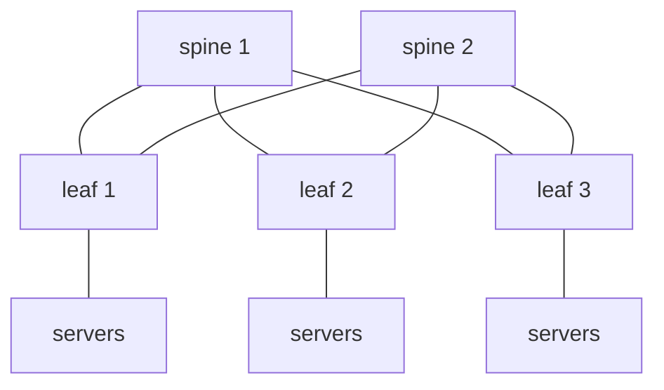

# NET 11: Routing protocols and datacenter fabrics: OSPF, BGP, leaf-spine, ECMP, VXLAN and EVPN, BFD and convergence

*Part of the [networking plan](00_plan.md) · You need: [NET 02](02_ip_routing_and_layer3.md) (longest prefix match, the routing table, OSPF and BGP at a glance), [NET 06](06_linux_network_stack.md) (the kernel FIB and what a forwarded packet costs). The topology arithmetic of fat trees, ECMP and incast is in [CO 29](../04_computer_organization/29_interconnection_networks_and_warehouse_scale_computing.md) and is not repeated here.*

A router is a computer that keeps a map and forwards by it. This tutorial is about how the map is built and kept right while links fail. "How would you design the network of a datacenter?" and "walk me through what happens when a link fails" are Staff-level questions at Nvidia, Google, Meta, Microsoft and Cisco, and they are one question: a leaf-spine fabric running BGP with ECMP, and the time it takes to notice a failure and reroute.

A weak answer names protocols. A strong answer builds the fabric from requirements (every server pair has many equal paths, losing a switch loses a sliver of capacity, the control plane is simple and well-understood), says why BGP and not OSPF, shows how ECMP spreads flows and how its hash goes wrong, and puts a **number and a mechanism** on detection and convergence.

The routers in the experiments are real: FRR daemons (`zebra`, `bgpd`, `bfdd`) in Linux network namespaces joined by veth pairs, the same software that runs on SONiC switches.

By the end you can:

- explain distance vector and link state, and what OSPF does that BGP does not;
- explain a BGP session, its messages and attributes, the best path order, and iBGP against eBGP;
- steer traffic with local preference, AS path and communities, and explain route reflectors;
- explain why large datacenters run eBGP on a leaf-spine fabric (RFC 7938), and size one;
- explain ECMP, the hash fields, hash polarisation, and resilient hashing;
- explain VXLAN and EVPN: the overhead, the entropy trick, and what EVPN carries;
- explain failure detection (carrier, BFD, hold timers) and what convergence time is made of;
- follow a route from the BGP daemon to the forwarding ASIC.

---

## 1. The problem and the two families

Each router must learn which prefixes are reachable through which neighbour. Two families of algorithm do it.

**Distance vector** (RIP, and BGP in spirit, where it is a *path* vector): each router tells its neighbours "I can reach X at cost N". A router chooses the neighbour with the lowest total and passes its own table on. It only knows what neighbours say, so it is simple and cheap, and it is vulnerable to loops: after a failure, routers can keep telling each other about a route that no longer exists and increase the cost step by step ("counting to infinity"). Fixes are split horizon, poison reverse, hold-down timers and, in BGP, carrying the **whole AS path**, so a router sees its own AS in a path and rejects it.

**Link state** (OSPF, IS-IS): each router floods a description of its own links to everyone in the area, so every router holds the **same map** and runs Dijkstra's shortest path algorithm on it. Convergence is fast and loop-free because all routers compute from the same data, at the price of flooding and per-router CPU that grow with the network.

| | Distance / path vector | Link state |
|---|---|---|
| A router knows | its neighbours' views | the whole topology of the area |
| Computation | choose best neighbour | Dijkstra over the map |
| Loops | possible during convergence; path vector prevents them | none in steady state |
| State grows with | prefixes | links and routers |
| Examples | RIP, BGP | OSPF, IS-IS |

The practical split: **link state inside one administrative domain** (fast, automatic), **BGP between domains** (policy, scale, control), and, as section 6 shows, increasingly BGP inside the datacenter too.

---

## 2. OSPF

OSPF routers form **adjacencies** with neighbours: they exchange Hello packets (to discover each other and agree on timers), then synchronise their **link-state databases** by exchanging LSAs (link-state advertisements), then each runs SPF to build routes. Parts to know:

- **Hello and dead intervals.** Defaults of 10 s and 40 s on broadcast links (30 s and 120 s on non-broadcast), and they must match for the neighbours to form an adjacency. Tuning them down (the lab used 1 s and 3 s) speeds up failure detection and costs CPU.
- **Areas.** Area 0 is the backbone; other areas attach to it and see summaries. Areas bound flooding and SPF cost in a big network.
- **Network types and the DR.** On a broadcast segment, OSPF elects a **designated router** so that N routers form adjacencies with the DR and not with each other (N squared). On a **point-to-point** link there is no election, and that is what a fabric uses.
- **LSA types** (router, network, summary, external) describe the topology, the segments, the inter-area summaries and the redistributed routes.
- **Cost** is the metric, by default inversely proportional to bandwidth.

OSPF on a leaf-spine fabric works, but it scales poorly in one specific way: every link change is **flooded to every router**, and every router re-runs SPF. In a fabric with thousands of switches and many links, a flapping link creates network-wide work, which is a big part of why the large operators moved to BGP.

---

## 3. BGP

BGP is the protocol of the internet, and between organisations it is the only choice. It carries **prefixes with attributes**, and it is policy-driven: routers choose and advertise routes according to rules their operators write, not according to shortest distance alone.

### 3.1 The session

A BGP session is a **TCP connection on port 179** between two configured neighbours (BGP does not discover them). The messages are:

| Message | Purpose |
|---|---|
| OPEN | Version, my AS, hold time, router ID, **capabilities** (multiprotocol, route refresh, four-byte AS) |
| KEEPALIVE | Proves the neighbour is alive, sent every third of the hold time |
| UPDATE | Announces new routes (with attributes) or **withdraws** old ones |
| NOTIFICATION | An error; closes the session |

The session comes up through the states Idle, Connect or Active, OpenSent, OpenConfirm, **Established**. If no message arrives within the **hold time**, the session is torn down and every route learned from that neighbour is withdrawn. This hold timer is the slow failure detector (section 10): defaults of 60 s keepalive and 180 s hold (vendor-dependent).

In the lab, a leaf has two eBGP sessions, one to each spine:

```
Neighbor   V   AS     MsgRcvd MsgSent  Up/Down   State/PfxRcd  PfxSnt
10.1.1.0   4  65000      17     17    00:00:12         4          6
10.2.1.0   4  65000      17     17    00:00:12         4          6
```

Each leaf received four prefixes from each spine (the other two leaves' server subnets and loopbacks) and sent six (its own two, plus the four it learned).

### 3.2 Path attributes

A route is a prefix plus attributes. The ones to know:

- **AS_PATH**: the list of ASes the route crossed. Used for loop prevention (reject a route containing my own AS), and as a policy and tie-break (shorter is better). Seen in the lab: a leaf's route to a remote server subnet carried `65000 65002`, through the spine's AS, then the origin.
- **NEXT_HOP**: where to send traffic for this prefix. eBGP sets it to the advertising router; iBGP **does not change it** by default, which is why iBGP needs the IGP to reach next hops (or `next-hop-self`).
- **LOCAL_PREF**: iBGP only, set by policy, higher wins. The main knob for "prefer this exit".
- **MED** (multi-exit discriminator): a hint to a neighbouring AS about which of several links to use, lower wins, only comparable between routes from the same neighbouring AS.
- **ORIGIN, COMMUNITY, WEIGHT** (the last is vendor-local). **Communities** tag routes so policy elsewhere can act on them (do not advertise to peers, prepend towards this provider, blackhole).

### 3.3 eBGP and iBGP

**eBGP** runs between different ASes. **iBGP** runs between routers in the **same** AS, to spread externally learned routes inside it. An iBGP router **never re-advertises** a route learned from an iBGP peer to another iBGP peer (the split-horizon rule that prevents loops, since AS_PATH is unchanged inside an AS). That forces a **full mesh** of iBGP sessions, which does not scale, and the two fixes are **route reflectors** (a designated router that reflects routes between its clients) and confederations.

### 3.4 Best path selection

For each prefix, BGP picks one best path (and may install several equal ones, section 8). The order interviewers expect, simplified:

1. Highest **weight** (vendor-local).
2. Highest **local preference**.
3. **Locally originated** routes.
4. Shortest **AS path**.
5. Lowest **origin** type (IGP, then EGP, then incomplete).
6. Lowest **MED** (from the same neighbouring AS).
7. **eBGP over iBGP**.
8. Lowest **IGP metric** to the next hop.
9. Oldest route, then lowest **router ID**, then lowest neighbour address, as tie-breaks.

For **multipath** to install several, the paths must tie through the AS-path-length step (and, in practice, have equal attributes up to there); FRR needs `maximum-paths N`. In the lab both spine paths tied, so both were installed:

```
Paths: (2 available, best #1, table default)
  65000 65002   10.1.1.0 from 10.1.1.0 (10.255.1.1)   valid, external, multipath, best (Router ID)
  65000 65002   10.2.1.0 from 10.2.1.0 (10.255.1.2)   valid, external, multipath

$ ip route show 10.10.2.0/24
10.10.2.0/24 nhid 12 proto bgp metric 20
        nexthop via 10.1.1.0 dev l1s1 weight 1
        nexthop via 10.2.1.0 dev l1s2 weight 1
```

Two paths, one "best" for advertising, but **both** in the kernel's forwarding table as an ECMP route. (The "best (Router ID)" says the tie was broken by router ID, which is the last step.)

### 3.5 The update pipeline

A route passes through a fixed pipeline (the shape common to all implementations): an UPDATE enters the **Adj-RIB-In** of the peer; **inbound policy** accepts, rejects or changes it; the survivors go to the **Loc-RIB**, where the best path is chosen per prefix; the best path (and the multipath set) goes to the routing table manager (`zebra` in FRR) and then the FIB; **outbound policy** filters what is advertised; and the result goes to the **Adj-RIB-Out** of each peer. A router that loses a path withdraws it, and so do the routers that depended on it, **one hop at a time**. That ripple is why BGP convergence is slower than link state, and why the fabric design in section 6 limits path hunting.

---

## 4. Steering BGP with policy

Policy is the point of BGP. Two examples, from a lab run: a leaf has equal paths to a remote subnet through spine 1 and spine 2.

- **Raise local preference** on routes learned from spine 1 (`set local-preference 200` in an inbound route-map): the best path becomes `best (Local Pref)`, only one path is installed, and **all** traffic goes through spine 1. Local preference acts on the receiving AS and is the standard way to choose an exit.
- **Prepend the AS path** towards the leaf from spine 2 (`set as-path prepend 65000`): the path through spine 2 becomes `65000 65000 65002`, one longer, so the other path wins on `best (AS Path)`. Prepending influences how **others** see you, which is the common way to attract less inbound traffic on a link.

In real networks the toolkit is: local preference (outbound choice), AS-path prepending and communities (inbound influence), MED (hint to a neighbour), route filters by prefix list and AS-path regex, `max-prefix` limits on peers (a leaked full table can melt a router), and RPKI origin validation, which checks that the origin AS is authorised for the prefix and is the main defence against accidental or malicious **route hijacks**. The famous outages (a misconfigured provider leaking or hijacking prefixes) are failures of exactly this filtering.

---

## 5. iBGP and route reflectors

Inside one AS, a route learned from an iBGP peer is not passed to other iBGP peers. With N routers that needs N(N-1)/2 sessions. A **route reflector (RR)** relaxes the rule: it has **clients**, learns routes from them and **reflects** them to its other clients and to non-client peers, so a client needs only one session (to the RR, or two for redundancy). Loop protection is added with the **originator ID** and the **cluster list**. In a lab with three routers in one AS, a client's route reached another client through the RR with those attributes attached, and without the RR it did not arrive.

The trade-offs to state: an RR creates a hierarchy and hides paths (it reflects only its **best** path, so clients may lack the alternative paths they would see in a full mesh, which can give suboptimal routing or slow failover), and the RR is a failure domain, so use two. **BGP add-path** lets a speaker advertise several paths per prefix to fix the hidden-path problem.

---

## 6. BGP as the datacenter routing protocol

### 6.1 The design (RFC 7938)

Large datacenters run **eBGP on every link** of a leaf-spine fabric, instead of an IGP. The common design:

- Every **leaf** (top-of-rack switch) has its **own AS number**. All the **spines** of one tier share a single AS number.
- Leaves peer with **every spine** (a full bipartite graph) over point-to-point /31 links, using the link addresses.
- Each leaf originates its server subnet and loopback. Spines pass them on.
- Equal paths through every spine are installed as ECMP (`maximum-paths`).
- No IGP, no iBGP, no route reflectors, so a single protocol and a simple mental model.

Why BGP and not OSPF: it **scales** (no flooding of every topology change to every node), it has **policy** (communities and route maps give per-rack control, drains and maintenance), it is **one protocol** to operate, it works well with automation, and its failure behaviour can be bounded by design. The cost is slower convergence than a link-state IGP unless failure detection is tuned (section 10).

### 6.2 Why the spines share an AS

If each spine had its own AS, then after a failure, BGP's path-vector can explore **valley paths**: a route that goes leaf, spine, leaf, spine, leaf (up, down, up) can look like a valid path and be tried during convergence ("path hunting"), wasting time and sometimes forming loops or transient black holes. If all spines share an AS, a route that has already passed through the spine AS **contains it in the AS path** and is rejected by loop prevention when a spine would see it again. That cuts off the valley path by construction, and it is why the leaf's route to a remote subnet reads `65000 65002`: one spine AS, then the origin. The cost is that the spines cannot re-advertise routes learned from other spines, which in a two-tier Clos is exactly what you want.

### 6.3 The details that matter in production

- **Unnumbered or /31 point-to-point links**, and BGP configured on interface (RFC 5549 style) to avoid address planning.
- **Timers**: the default hold time is too long for a fabric; use BFD or short timers (section 10).
- **Maintenance drain**: advertise with a community that lowers preference or prepends, wait for traffic to leave, then work on the switch.
- **Max paths and AS-path relax**: multipath normally needs identical AS paths, so with leaves in different ASes, `multipath-relax` lets paths of equal length but different ASes count as equal.
- **Route filtering at the leaf**: accept only the prefixes you expect, so a misconfigured server cannot leak routes into the fabric.

---

## 7. Leaf-spine and Clos

A **Clos** network builds a big, non-blocking switch out of many small ones. The two-tier form is the **leaf-spine**: leaves connect to servers (down) and spines (up), every leaf connects to every spine, and there is no leaf-to-leaf link. Any two servers on different leaves are exactly **two switch hops** apart, with as many equal paths as there are spines. Three tiers (a **fat tree** or **super-spine** design) extend it when one tier of spines cannot reach enough leaves.



### 7.1 Oversubscription and sizing

Per leaf, ports are split between **down** (servers) and **up** (spines). The **oversubscription ratio** is down bandwidth over up bandwidth. With 64-port leaves and spines:

```python
def leaf_spine(ports=64, down=32):
    up = ports - down
    return {"oversubscription": f"{down / up:.1f}:1", "spines": up, "leaves": ports,
            "servers": ports * down, "per-server Gb/s if all talk outside the rack": round(100 * up / down, 1)}

for down in (32, 40, 48):
    print(down, leaf_spine(down=down))
spines = 4
print("one spine lost out of", spines, "-> capacity left", f"{(spines - 1) / spines:.0%}")
print("VXLAN: 1500-byte underlay MTU leaves", 1500 - 50, "bytes for the inner IP packet")
```

It prints 2,048 servers at 1:1 (100 Gb/s each to the outside), 2,560 at 1.7:1 (60 Gb/s) and 3,072 at 3:1 (33 Gb/s). The trade is clear: more server ports per leaf means more servers and less bandwidth per server for traffic leaving the rack. Storage and AI training fabrics use 1:1; general cloud racks often use 2:1 or 3:1 because most traffic stays near.

**Failure is graceful**: lose one of four spines and 75 percent of the capacity remains; lose one of sixteen and 94 percent does. This is the argument for **many small spines** over a few big ones: the blast radius of a failure is one over the number of spines.

---

## 8. ECMP: the hash that spreads flows

With many equal paths, a router must choose one per packet. Per-packet round robin would reorder packets within a flow (and TCP treats reordering as loss), so routers **hash** the packet's flow identity and use the hash to select a next hop, so that **every packet of one flow takes the same path** and different flows spread out.

### 8.1 Which fields

The hash is computed over header fields. Hashing only the **source and destination addresses** means all traffic between one pair of hosts takes one path: in a test with 2,000 flows between one address pair, **all 2,000 used one link**. Hashing the **5-tuple** (addresses, ports, protocol) separates the flows, and in the same test they split roughly evenly (1,046 and 955). That is why switches hash the 5-tuple, and why a single elephant flow still uses only one path no matter how many exist.

### 8.2 Hash polarisation

If every tier of the fabric uses **the same hash function and seed** on the same fields, then flows that were sent to link 0 by the first tier are all sent to link 0 again by the second, and half the links at the lower tier carry nothing. This is **polarisation**. A small simulation shows it:

```python
import hashlib

def pick(flow, nhops, seed):
    """Choose a next hop from a hash of the flow, the way a switch picks an ECMP member."""
    return int.from_bytes(hashlib.sha256(f"{seed}:{flow}".encode()).digest()[:4], "big") % nhops

flows = [f"10.0.0.1:{p}>10.0.1.1:80" for p in range(2000, 4000)]

def tier2_counts(seed1, seed2):
    counts = {}
    for f in flows:
        a = pick(f, 2, seed1)                 # tier 1 chooses spine a0 or a1
        b = pick(f, 2, seed2)                 # tier 2 chooses one of its two links
        counts[(a, b)] = counts.get((a, b), 0) + 1
    return dict(sorted(counts.items()))

print("same hash at both tiers:   ", tier2_counts(7, 7))
print("different seeds per tier:  ", tier2_counts(7, 8))
```

With the same seed, flows land only in `(0, 0)` and `(1, 1)`: two of the four second-tier links idle. With different seeds all four are used evenly (about 500 each). In real fabrics, set a **different hash seed (or fields) per tier or per switch**. In the lab with real kernels, the same effect appeared: one seed everywhere gave a skewed split at the second tier, different seeds gave four even links.

### 8.3 Imbalance without a bug

Even a perfect hash balances **flows**, not **bytes**. A few huge flows (a storage replication, an AI collective) can sit on one link while others are idle, and the hash is statistically fair only across many flows. Mitigations: more, smaller flows (parallel connections or multiple queue pairs), **flowlet switching** (re-hash a flow when it has been idle long enough that reordering is impossible), **adaptive routing** or packet spraying with reordering-tolerant transports, and weighting.

### 8.4 Resilient hashing and weighted ECMP

With plain hashing, if a next hop is removed, the hash-to-member mapping changes for many flows, and **flows that were fine are moved**, which breaks connections through stateful devices and causes reordering. **Resilient (consistent) hashing** keeps a fixed table of buckets mapped to members and, when a member is removed, only its buckets are reassigned: flows on the surviving paths do not move. A link failure should disturb only the flows that used that link. **Weighted ECMP** gives members unequal shares (a path with half the capacity gets half the buckets).

---

## 9. VXLAN and EVPN: an overlay on the fabric

A pure L3 fabric has a limit: servers in different racks are on different subnets, but virtual machines and containers often need to be in **the same L2 segment** after they move. An **overlay** solves it: tunnel the tenant's Ethernet frames inside the fabric's IP packets, so the fabric stays simple L3 and tenants see L2.

**VXLAN** wraps an Ethernet frame in UDP (destination port 4789) with a header carrying a 24-bit **VNI** (virtual network identifier, so 16 million segments against VLAN's 4,096). The switch or host that does the wrapping is a **VTEP**.

### 9.1 The wrapper and its cost

The wrapper adds an outer IP header (20 bytes), UDP (8) and the VXLAN header (8), and it carries the tenant's **whole Ethernet frame**, including its 14-byte header, as the payload. Counting the outer Ethernet header as well, the overhead is **50 bytes** per packet. Against a 1,500-byte underlay IP MTU, the inner IP packet can be at most 1,500 - 20 - 8 - 8 - 14 = **1,450 bytes**. In the lab, a ping with a 1,500-byte inner packet and the do-not-fragment bit failed locally with `message too long, mtu=1450`, and a 1,450-byte one passed. The operational rule: **raise the underlay MTU** (9,000 or 9,216 in a fabric) by at least 50, or lower the tenant MTU, otherwise large packets are dropped or fragmented and "small packets work, large ones hang" appears.

### 9.2 Entropy for the underlay's ECMP

The underlay hashes the **outer** headers. If every inner flow between two VTEPs had the same outer source and destination addresses, UDP ports and protocol, they would all take **one** path. So the VTEP derives the **outer UDP source port from a hash of the inner flow**. In the lab, 400 inner flows that differed only in inner source port produced 393 distinct outer source ports, and the underlay split them across both paths according to those ports. This is the standard trick, and it is why VXLAN does not defeat ECMP.

### 9.3 EVPN: BGP as the control plane

Without a control plane, a VXLAN VTEP learns MAC addresses by **flooding** (broadcast, unknown unicast, multicast) and learning from source addresses, as an Ethernet switch does, which does not scale and floods across the fabric. **EVPN** uses **BGP** (the multiprotocol extension, address family L2VPN EVPN) to **advertise MAC and IP addresses and the VTEP that owns them**, so VTEPs learn from routes, not floods.

The route types to know:

| Type | Name | Carries |
|---|---|---|
| 1 | Ethernet auto-discovery | Multihoming and fast convergence for a server attached to two leaves |
| 2 | MAC/IP advertisement | A host's MAC (and IP) and the VNI and VTEP it is behind |
| 3 | Inclusive multicast | The list of VTEPs for a VNI, for broadcast, unknown and multicast traffic |
| 4 | Ethernet segment | Designated forwarder election for multihomed segments |
| 5 | IP prefix | A routed prefix for inter-subnet (L3) routing in a VRF |

EVPN also gives **ARP suppression** (the VTEP answers ARP from its table instead of flooding), **anycast gateways** (every leaf answers as the same default gateway, so a VM keeps its gateway when it moves), and **MAC mobility** (a sequence number so a move is recognised). In the lab, the same two-VTEP overlay with an EVPN control plane learned the remote host through a BGP route instead of through flooding.

---

## 10. Failure detection and convergence

When a link or switch fails, traffic that used it is lost until the router **notices**, the protocol **withdraws and recomputes**, and the **forwarding table** is updated. Convergence time is the sum.

### 10.1 Three ways to detect

1. **Carrier (link down).** If a cable is pulled or a port goes down, the interface reports it immediately and the routing daemon withdraws routes at once. In the lab, taking a fabric link down removed the failed path at the remote leaf in about **0.18 seconds**, even with BGP timers of 1 s keepalive and 3 s hold, because the loss of carrier was signalled and BGP did not have to wait for a timer.
2. **Protocol timers (hello, hold).** If the link stays **up** but the neighbour stops responding (a hung process, a one-way failure, a fault in the middle of a fibre or a transceiver, or a switch in between), only the timer finds out. Silent loss was simulated by dropping all traffic on one fabric link while it stayed up: with BGP at keepalive 1 s and hold 3 s the failed path left the remote leaf's table after about **2.9 seconds** (the hold time), and with the default 180 second hold it would be minutes.
3. **BFD (Bidirectional Forwarding Detection).** A lightweight protocol, run separately, that sends small packets every few hundred milliseconds (or tens of milliseconds) and declares the path dead after a few misses. Routing protocols subscribe to it. Under the same silent failure, with BFD at its default of 300 ms and a multiplier of 3, the path left the table in about **0.87 seconds**. With intervals of 50 ms it is lower still, limited by how fast the CPU or hardware can send them (BFD offloaded to the switch ASIC gets to tens of milliseconds).

```bash
# FRR: enable BFD for a BGP neighbour and shorten the timers
# router bgp 65001
#  neighbor 10.1.1.0 remote-as 65000
#  neighbor 10.1.1.0 timers 1 3
#  neighbor 10.1.1.0 bfd
# bfd
#  profile fast
#   detect-multiplier 3
#   transmit-interval 50
#   receive-interval 50
```

### 10.2 What the number does not include

The measured time is how long until a **remote router's routing table** changed. Convergence for a user is longer: the packets in flight on the failed link are lost, the **hardware forwarding table** must be reprogrammed (milliseconds to a second for a big table, and much faster if the failure is a **next hop group** member and not a route per prefix, section 11), transport protocols time out and retransmit (TCP's retransmission timeout, NET 03, is far longer than the routing convergence), and in a stateful path the flows must be re-established. A senior answer separates **detection**, **propagation**, **computation** and **programming**, gives a number for each, and says which one dominates.

Techniques to shorten it: BFD, carrier-based detection (fast fault propagation), **ECMP with local repair** (the router that sees its link fail stops using that member immediately, without waiting for BGP, so a spine failure costs the leaf one hash-table update), pre-computed backups (IP fast reroute, MPLS FRR), graceful restart where a control-plane restart must not drop the forwarding plane, and limiting path hunting with the shared spine AS.

---

## 11. From a route to the forwarding hardware

In FRR the roles are split between processes. `bgpd` (and `ospfd`) compute routes and hand them to **`zebra`**, the routing table manager, which holds the **RIB** (every route from every protocol), picks the winner per prefix by **administrative distance** (a connected route beats static, which beats eBGP, and OSPF is 110), and installs the winner in the kernel over **netlink**. Seen in the lab: `zebra` marks the route `B>*` (selected, installed), and the kernel table shows it with `proto bgp`.

The **FIB** maps a prefix (longest prefix match, a trie in the kernel, TCAM or algorithmic structures in hardware) to a **next hop group**. A group is a set of next hops that the ECMP hash indexes. The important design: routes point at a **group**, so when a link fails, the group is updated once, and not every route that used it. This is why a link failure in a large table is fast to repair in the forwarding plane.

In **SONiC** (the open switch operating system that runs FRR as its routing stack): `bgpd` decides, `zebra` installs in the kernel and sends the route over the Forwarding Plane Manager interface to **`fpmsyncd`**, which writes it to the APPL_DB; **`orchagent`** converts it to SAI objects in ASIC_DB; **`syncd`** programs the chip through the vendor SDK and the **SAI** (Switch Abstraction Interface). That pipeline, and its latency, is the "programming" part of convergence.

---

## 12. Common mistakes

1. **OSPF for a very large fabric**, with flooding and SPF work on every change.
2. **Hold timers left at defaults**, so a silent failure takes minutes to notice. Use BFD.
3. **Every spine in its own AS**, which allows valley paths and path hunting.
4. **Forgetting `maximum-paths`** (or multipath-relax), so BGP installs one path and the fabric is not ECMP.
5. **Hashing on addresses only**, so one host pair uses one path.
6. **The same hash seed at every tier**, so the fabric polarises.
7. **VXLAN without raising the underlay MTU.**
8. **Assuming ECMP balances bytes.** It balances flows.
9. **No inbound and outbound route filters**, so a leaked or hijacked prefix propagates, and no `max-prefix` on peers.
10. **Plain hashing where resilient hashing is needed**, so a link failure reshuffles healthy flows.
11. **Confusing carrier-down detection with silent-failure detection** when sizing convergence.
12. **A single route reflector.**

---

## 13. Interview questions

1. Compare distance vector and link state. Where does BGP fit?
2. How does an OSPF adjacency form, and why does a point-to-point link not need a DR?
3. List the BGP message types and the states of a session. What does the hold timer do?
4. Walk through BGP best path selection.
5. What is the difference between eBGP and iBGP, and why do you need route reflectors?
6. How do you make traffic prefer one exit? How do you influence inbound traffic?
7. Why do large datacenters run eBGP instead of OSPF? Describe the AS numbering.
8. Why do the spines share one AS?
9. Size a leaf-spine fabric: oversubscription, number of spines, what happens when one fails.
10. How does ECMP work, which fields are hashed, and why not per-packet?
11. What is hash polarisation and how do you avoid it?
12. Why do elephant flows break ECMP balance, and what are the mitigations?
13. What does VXLAN add to a packet, and how does the underlay still balance the traffic?
14. What does EVPN add to VXLAN, and what are route types 2 and 5?
15. A link fails. Walk through detection, propagation and forwarding update, and say how to make it faster.
16. Walk a BGP route from the wire to the forwarding ASIC.

---

## 14. Scenarios and design questions

**S1. Design the network for a 10,000-server datacenter with a 3:1 oversubscription target.** Topology, protocols, addressing, failure behaviour.

**S2. After a software upgrade, one spine silently stops forwarding while its BGP sessions stay up.** What do you see and how do you prevent it?

**S3. Traffic between two racks uses one of eight uplinks and the others are idle.** Diagnose.

**S4. VMs on different racks can ping each other, but large file transfers between them stall.** Why?

**S5. A customer on your network originates a prefix it does not own, and traffic is hijacked.** What controls should have caught it?

**S6. Draining a leaf for maintenance without dropping traffic.** How?

**S7. Failover of a link causes TCP connections through a stateful load balancer to reset.** Why, and what is the fix?

**S8. A storage cluster needs the fabric to stay lossless and balanced under a few huge flows.** What do you change?

---

## 15. Strong answers (outlines)

**Q1.** Distance vector: neighbours' views, simple, loop risk, counting to infinity, fixed by split horizon and, in BGP, the full AS path. Link state: flood links, same map, Dijkstra, fast and loop-free, heavier. BGP is path vector between domains, policy driven.

**Q2.** Hello exchange and parameter match, database exchange, adjacency Full, then SPF. On point-to-point links there are only two routers, so no election.

**Q3.** OPEN, KEEPALIVE, UPDATE, NOTIFICATION. Idle, Connect/Active, OpenSent, OpenConfirm, Established. Hold timer is the silence limit: expiry tears the session down and withdraws its routes.

**Q4.** Weight, local preference, locally originated, AS path length, origin, MED, eBGP over iBGP, IGP metric, then age and router ID tie-breaks. Multipath requires a tie up to the AS-path step.

**Q5.** eBGP between ASes, iBGP within one; iBGP does not re-advertise to iBGP peers, so a full mesh is needed, or route reflectors that reflect routes between clients (with originator ID and cluster list), at the cost of hiding alternate paths and a failure domain.

**Q6.** Local preference for outbound; AS path prepending, communities and MED for inbound; filters and RPKI for safety.

**Q7.** Scale (no flooding of every change), policy and per-rack control, one protocol, simple failure domains, automation friendly. Each leaf its own AS, all spines of a tier share one, eBGP on every link, ECMP across spines.

**Q8.** The shared AS makes loop prevention reject valley paths (leaf, spine, leaf, spine), eliminating path hunting during failures.

**Q9.** Per leaf choose down and up ports: ratio is down over up (2:1, 3:1). Number of spines equals uplinks per leaf; leaves limited by spine ports. Lose one of N spines, capacity falls by 1/N, so many small spines.

**Q10.** Hash the flow's 5-tuple to pick a next hop so one flow keeps one path (no reordering); addresses-only puts a host pair on one path.

**Q11.** Same hash and seed at successive tiers correlates the choices and leaves links idle. Use different seeds or fields per tier, and check link utilisation after changes.

**Q12.** Few large flows fall on few links. Use many flows, flowlet switching or adaptive routing, packet spraying with reordering-tolerant transport, weighted or resilient ECMP, and traffic engineering.

**Q13.** 50 bytes (outer IP, UDP, VXLAN, plus the outer Ethernet header); raise the underlay MTU. The outer UDP source port is hashed from the inner flow so the underlay ECMP spreads them.

**Q14.** EVPN advertises MACs and IPs over BGP so VTEPs learn by routes, not floods; enables ARP suppression, anycast gateway, mobility, multihoming. Type 2 carries MAC and IP; type 5 an IP prefix.

**Q15.** Detect (carrier fast, BFD tens to hundreds of ms, hold timer seconds to minutes), propagate (withdraws hop by hop), compute, program the FIB and ASIC. Speed up with BFD, local ECMP repair, next hop groups, fast reroute, bounded path hunting.

**Q16.** Adj-RIB-In, inbound policy, Loc-RIB best path, `zebra` RIB by administrative distance, kernel over netlink; in SONiC, fpmsyncd, APPL_DB, orchagent, ASIC_DB, syncd, SAI, ASIC next hop group.

**S1.** 3:1 means 48 down and 16 up on a 64-port leaf, so 16 spines. With 64-port spines a two-tier fabric has at most 64 leaves, 3,072 servers, so 10,000 servers need about 210 leaves and therefore a three-tier design (pods of leaves and spines joined by a super-spine) or higher-radix switches; eBGP per leaf AS and a shared spine AS, ECMP and BFD, /31 links, loopback and server prefixes, filters, community-based drain; losing a spine costs 1/16 of capacity.

**S2.** The link is up and BGP is up, but traffic is black-holed because the data plane is broken; BGP keepalives pass on a path that the data plane does not. BFD with data-plane-like packets, health checks, and monitoring of drops per link catch it.

**S3.** Hashing on addresses only, polarisation with the same seed, or one elephant flow. Check the hash fields and seeds, `ip route` multipath, and the flow distribution.

**S4.** VXLAN overhead: the underlay MTU is 1,500, so large inner packets exceed it and are dropped. Raise the underlay MTU or lower the tenant MTU.

**S5.** Prefix filters and AS-path filters on customer sessions, max-prefix limits, and RPKI origin validation.

**S6.** Raise the metric or prepend and set a drain community so neighbours shift traffic, wait for utilisation to fall, then shut it down; use graceful shutdown.

**S7.** Plain ECMP re-hashes surviving flows when a member leaves, so the load balancer sees flows move to a path or instance that has no state. Use resilient hashing so only the affected flows move.

**S8.** Many parallel queue pairs or flows, adaptive routing or flowlets, PFC and ECN tuned for lossless, per-tier hash seeds, and a non-oversubscribed (1:1) fabric.

---

## 16. Cheat sheet

- Distance vector: neighbours' views, path vector in BGP. Link state: same map, Dijkstra. OSPF: Hello, DB exchange, SPF, areas, DR only on broadcast.
- BGP: TCP 179; OPEN, KEEPALIVE, UPDATE, NOTIFICATION; hold timer. Attributes: AS_PATH, NEXT_HOP, LOCAL_PREF, MED, communities. Best path: weight, local pref, AS path, origin, MED, eBGP over iBGP, IGP metric, router ID.
- iBGP split horizon, so a full mesh or route reflectors. Policy: local pref out, prepend in, filters, max-prefix, RPKI.
- Datacenter: leaf-spine, eBGP per leaf, shared spine AS, ECMP with `maximum-paths`. Oversubscription = down over up. Lose one of N spines: 1/N.
- ECMP: hash the 5-tuple, per tier seeds to avoid polarisation, flows not bytes, resilient hashing.
- VXLAN: 50 bytes, UDP 4789, VNI 24-bit, hashed outer source port. EVPN: BGP carries MAC/IP and prefixes; type 2 and 5.
- Detection: carrier (fast), BFD (tens to hundreds of ms), hold timer (seconds to minutes). Convergence = detect + propagate + compute + program.
- zebra RIB to kernel (netlink); SONiC: fpmsyncd, orchagent, syncd, SAI.

---

## 17. Sources and caveats

Sources used: RFC 4271 (BGP-4), RFC 7938 (use of BGP for routing in large-scale data centers), RFC 2328 (OSPF), RFC 7348 (VXLAN), RFC 7432 (BGP EVPN), RFC 5880 (BFD), RFC 4456 (route reflection), RFC 6811 (RPKI origin validation); the [FRRouting documentation](https://docs.frrouting.org/) (zebra, bgpd, bfdd, EVPN); the [NVIDIA Cumulus Linux BGP documentation](https://docs.nvidia.com/networking-ethernet-software/cumulus-linux-516/Layer-3/Border-Gateway-Protocol-BGP/); and the interview-oriented question lists on [Glassdoor](https://static.glassdoor.it/Interview/senior-network-engineer-interview-questions-SRCH_KO0,23_IP56.htm) and [Intellipaat](https://intellipaat.com/blog/interview-question/bgp-interview-questions).

Caveats. The FRR leaf-spine fabric (two spines, three leaves, six eBGP sessions, `maximum-paths 2`), the session summary, the multipath route and kernel entry, the convergence times (about 0.18 s for a carrier-down failure, about 2.9 s for a silent failure with BGP timers of 1 s and 3 s, about 0.87 s with BFD at its default of 300 ms times 3), the polarisation simulation and the sizing arithmetic were run for this tutorial on one Linux 6.18 VM as root, with FRR 8.4 in network namespaces. The local-preference and AS-path-prepend steering, the 2,000-flow ECMP hash results (all on one link with address-only hashing, 1,046 and 955 with the 5-tuple, polarisation with a shared seed), the VXLAN MTU, outer-port-entropy and EVPN runs and the route reflection test come from earlier runs of the previous version of this tutorial and were not re-run. The timers were shortened for the lab (BGP 1 s and 3 s; defaults are 60 s and 180 s and differ by vendor), and the convergence times measure when a remote router's kernel table changed, not user-visible recovery. The kernel has no MPLS and I did not test VRF; MPLS, segment routing, add-path, RPKI, ASIC and SONiC internals, flowlets and adaptive routing are described from documentation and not measured. Everything is IPv4. Defaults (OSPF and BGP timers, multipath behaviour, BFD intervals) vary by vendor and release.

Earlier and later: [NET 02](02_ip_routing_and_layer3.md), [NET 09](09_network_security_firewalls_ips_dpi.md), [NET 12](12_rdma_roce_and_lossless_fabrics.md), [the networking plan](00_plan.md).
