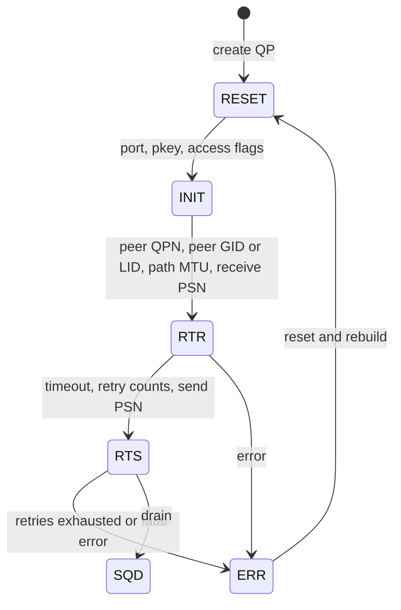
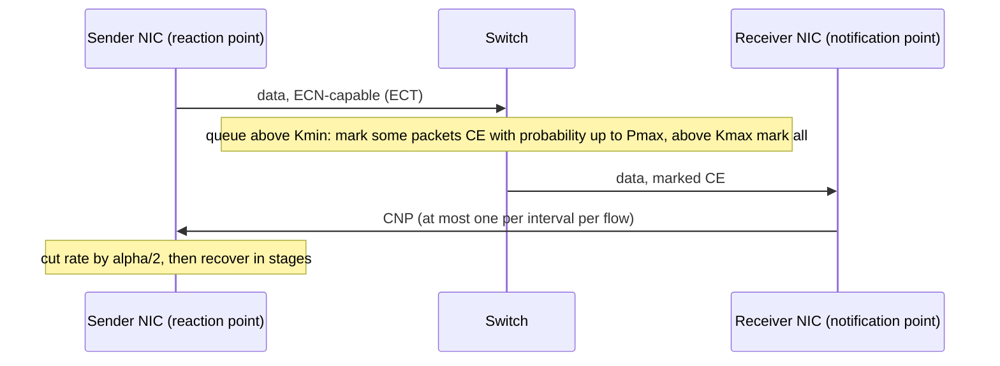

# NET 12: RDMA, RoCE and lossless fabrics: verbs, RoCEv2, PFC, ECN and DCQCN, and collectives

*Part of the [networking plan](00_plan.md) · You need: [NET 06](06_linux_network_stack.md) (what the kernel does per packet), [NET 07](07_zero_copy_networking.md) (kernel bypass and zero copy), [NET 11](11_routing_protocols_and_datacenter_fabrics.md) (leaf-spine, ECMP and its hash). Queueing theory and QoS are in [NET 14](14_queueing_qos_and_traffic_management.md).*

Every large AI training cluster and most high-end storage systems move bytes with RDMA: the network card reads and writes the memory of another machine without either CPU touching the data. On Ethernet this is called RoCE (RDMA over Converged Ethernet), and it only works well if the fabric is almost never congested and almost never drops a packet. Keeping an Ethernet fabric in that state is the real subject: priority flow control, ECN, DCQCN, load balancing with a handful of huge flows, and the failure modes that each fix introduces.

"Why does RoCE need a lossless network?", "what is a PFC storm?" and "why do all-reduce flows collide on ECMP?" are standard Staff-level questions at Nvidia, Meta, Google, Microsoft and Cisco. A weak answer lists acronyms. A strong answer starts from the transport's assumption (a loss is rare, and recovery is expensive), explains why Ethernet violates it (incast in shallow buffers), shows what pause frames cost (head-of-line blocking, deadlock, storms), and then shows the layered fix: ECN-based rate control first, PFC as the backstop, and a hash or spraying scheme that survives low-entropy traffic.

By the end you can:

- explain what RDMA removes from the data path, and the difference between one-sided and two-sided operations;
- describe the verbs objects (protection domain, memory region, queue pair, completion queue) and the queue pair state machine;
- read a RoCEv2 packet: headers, opcodes, the ECN bits, congestion notification packets, and why the UDP source port matters;
- explain go-back-N recovery and why a loss that TCP shrugs off hurts RDMA;
- explain incast, and why shallow Ethernet buffers drop;
- explain PFC: the frame, thresholds, headroom, and what it breaks (victim flows, storms, deadlock) and how the watchdog helps;
- explain ECN marking and the DCQCN loop, and why ECN must fire before PFC;
- explain why a few large flows defeat ECMP, and the options (more queue pairs, spraying, adaptive routing);
- explain what all-reduce puts on the network;
- configure and triage a RoCE deployment from counters.

---

## 1. What RDMA removes, and what it asks of the network

### 1.1 The cost of a socket

A TCP send crosses the kernel: a system call, a copy from user memory into socket buffers, the TCP state machine, the IP and driver layers, an interrupt or poll on the receive side, and another copy to the reader ([NET 06](06_linux_network_stack.md) walks the path, [NET 07](07_zero_copy_networking.md) shows how far zero copy gets you). Each stage is cheap alone. At 400 Gb/s per port and with many ports per server, the CPU time and memory bandwidth spent moving bytes become the limit, and the latency of the software path (tens of microseconds, with a long tail) dominates small messages.

RDMA moves the whole transport into the network card:

- **Kernel bypass.** The application posts a *work request* to a queue in its own memory and rings a doorbell on the NIC. No system call on the data path.
- **Zero copy.** The NIC reads from and writes to registered application memory directly, by DMA.
- **Transport offload.** Sequence numbers, acknowledgements, retransmission and segmentation are done by the NIC, not by a kernel TCP stack.
- **Remote memory access.** The sender can name a region of the *remote* machine's memory and the remote NIC performs the access without waking the remote CPU.

The result is a round trip of a few microseconds, near line rate with very little CPU, and, importantly, predictable latency.

### 1.2 Two kinds of operation

| | Two-sided (channel semantics) | One-sided (memory semantics) |
|---|---|---|
| Operations | SEND, with a matching RECV | WRITE, READ, atomics (fetch-and-add, compare-and-swap) |
| Remote CPU | must post a receive buffer in advance and handle the completion | not involved at all |
| Remote buffer chosen by | the receiver (it posted the buffer) | the sender (it supplies address and key) |
| Typical use | RPC requests and replies, control messages | bulk data movement, parameter exchange, GPU to GPU copies |
| Needs from the sender | nothing about the remote memory | the remote virtual address and an `rkey` |

A WRITE can carry an *immediate* value that also raises a completion on the receiver, which is how a sender says "the data is there" without a separate message. A READ pulls data from the remote side; the response comes back as a stream of packets, so a READ costs one round trip.

### 1.3 Three transports, and three ways to carry them

The verbs interface offers several queue pair types. **RC** (reliable connection) gives ordered, acknowledged delivery between exactly two queue pairs, and is what storage and collective libraries use. **UC** (unreliable connection) has the connection but no acknowledgements. **UD** (unreliable datagram) is connectionless and message-size limited to one MTU, used for multicast and for cheap discovery and control traffic. Vendors add their own (dynamically connected transports that share state across peers, and newer multipath and out-of-order capable transports) to fix the scaling and loss behaviour of RC.

The same verbs API runs over three fabrics:

| Fabric | What it is | Loss handling |
|---|---|---|
| **InfiniBand** | A separate network: its own switches, routing and link layer, with **credit-based** flow control, so a sender transmits only when the receiver has buffer | lossless by construction |
| **RoCE v1 / v2** | The InfiniBand transport carried over Ethernet. v1 is a layer 2 ethertype; **v2 is carried in UDP over IP** and is routable | needs PFC and ECN to be near-lossless |
| **iWARP** | RDMA over TCP | TCP handles loss; heavier NIC, little used in new designs |

RoCE v2 is what people mean today when they say RoCE, and the rest of this tutorial is about it.

### 1.4 What RDMA asks of the network

The InfiniBand transport was designed for a lossless link layer. Its recovery is simple and cheap in the common case: the receiver accepts packets in order, and on a gap the sender goes back and resends from the missing one. There is no sophisticated congestion window and no fast per-packet retransmission machinery in the classic design. That simplicity is what lets it live in a NIC at 400 Gb/s. It also means the transport has an assumption: **a packet drop is a rare accident, not a signal**. Ethernet drops packets as its normal way of saying "slow down". Everything that follows is the work of making Ethernet behave as the transport expects.

---

## 2. Verbs: the programming model

### 2.1 The objects

You rarely write verbs by hand (NCCL, MPI, UCX, storage stacks do), but interviewers ask for the model because it explains the failure modes.

| Object | What it is | Why it exists |
|---|---|---|
| **Device context** | An open handle to the RDMA NIC | everything hangs off it |
| **Protection domain (PD)** | A grouping of resources that may be used together | a queue pair can only touch memory registered in the same PD |
| **Memory region (MR)** | A range of virtual memory registered with the NIC | registration **pins** the pages and gives the NIC a translation table; returns an `lkey` (local use) and an `rkey` (given to a remote peer) |
| **Completion queue (CQ)** | Where the NIC reports finished work | the application polls it (lowest latency) or sleeps on an event |
| **Queue pair (QP)** | A send queue and a receive queue; the unit of connection state | one RC connection is one QP on each side |
| **Work request (WR)** | A descriptor: opcode, scatter-gather list, remote address and key | posted to the send or receive queue |
| **Work completion (WC)** | A status record for a finished WR | success, or an error that moves the QP to the error state |

The `rkey` is a **capability**: whoever holds it, together with a remote address, can read or write that memory through the NIC. This is the security model of RDMA, and a standard follow-up question (never hand out an `rkey` for more than a peer needs, bind keys to a PD and a QP, and use memory windows to revoke access).

Why registration instead of "just use any pointer"? The NIC works on physical addresses, and the page it is writing to must not move or be swapped out while a packet is in flight. Pinning is expensive, so applications register large regions once and reuse them, and libraries keep registration caches. On-demand paging exists on some NICs but costs a page fault round trip when it triggers.

### 2.2 The queue pair state machine

A QP is created in the Reset state and has to be walked through states before it can send. The walk is where the connection parameters are supplied.



- **INIT**: the QP accepts receive WRs but does not yet know its peer.
- **RTR** (ready to receive): the QP now knows the peer queue pair number, the peer address (on RoCE, a **GID**, which is derived from an IP address), the path MTU and the first packet sequence number to expect. It can receive but not send.
- **RTS** (ready to send): the QP has timeouts and retry counts and its own starting sequence number, and can transmit.
- **ERR**: any unrecoverable problem (retry count exceeded, a remote access error, a bad `rkey`) puts the QP here; all outstanding WRs complete with an error and the connection is dead. Applications have to rebuild it. This is why a fabric that causes retries to be exhausted turns into application-visible failures and not just slowness.

Both sides have to exchange their QP number, starting sequence number, GID and, for one-sided access, the buffer address and `rkey`, **out of band**: over a TCP socket, or with the RDMA connection manager (`rdma_cm`), which does the same exchange over IP addressing.

### 2.3 One write, end to end

This is the whole sequence for a single RDMA WRITE on a loopback queue pair, written as plain verbs C. It compiled cleanly here against the installed `libibverbs` headers. It was **not run past the device list**, because the VM has no RDMA device (no rxe or siw, and no kernel modules).

```c
/* write.c: one RDMA WRITE on an RC queue pair. Build: gcc -Wall -Wextra write.c -libverbs */
#include <errno.h>
#include <infiniband/verbs.h>
#include <stdint.h>
#include <stdio.h>
#include <stdlib.h>
#include <string.h>

#define NEED(x, what) do { if (!(x)) { fprintf(stderr, "%s failed: %s\n", what, strerror(errno)); return 1; } } while (0)

int main(void) {
    int n = 0;
    struct ibv_device **list = ibv_get_device_list(&n);
    if (!list || n == 0) { printf("no RDMA device\n"); return 2; }
    struct ibv_context *ctx = ibv_open_device(list[0]);
    NEED(ctx, "open");
    struct ibv_pd *pd = ibv_alloc_pd(ctx);                    /* 1. protection domain */
    NEED(pd, "alloc_pd");
    size_t len = 1 << 20;
    char *buf = aligned_alloc(4096, 2 * len);                 /* source in the first half, target in the second */
    NEED(buf, "alloc");
    memset(buf, 'A', len); memset(buf + len, 0, len);
    struct ibv_mr *mr = ibv_reg_mr(pd, buf, 2 * len,          /* 2. register: pin pages, get lkey and rkey */
                                   IBV_ACCESS_LOCAL_WRITE | IBV_ACCESS_REMOTE_WRITE);
    NEED(mr, "reg_mr");
    struct ibv_cq *cq = ibv_create_cq(ctx, 16, NULL, NULL, 0);/* 3. completion queue */
    NEED(cq, "create_cq");
    struct ibv_qp_init_attr ia = { .send_cq = cq, .recv_cq = cq, .qp_type = IBV_QPT_RC,
        .cap = { .max_send_wr = 8, .max_recv_wr = 8, .max_send_sge = 1, .max_recv_sge = 1 } };
    struct ibv_qp *qp = ibv_create_qp(pd, &ia);               /* 4. queue pair, born in RESET */
    NEED(qp, "create_qp");

    struct ibv_qp_attr a;
    memset(&a, 0, sizeof a);                                  /* 5. RESET -> INIT */
    a.qp_state = IBV_QPS_INIT; a.port_num = 1; a.qp_access_flags = IBV_ACCESS_REMOTE_WRITE;
    NEED(!ibv_modify_qp(qp, &a, IBV_QP_STATE | IBV_QP_PKEY_INDEX | IBV_QP_PORT | IBV_QP_ACCESS_FLAGS), "INIT");

    union ibv_gid gid;                                        /* RoCE names a peer by GID (index 1 is often RoCEv2 IPv4) */
    NEED(!ibv_query_gid(ctx, 1, 1, &gid), "query_gid");
    memset(&a, 0, sizeof a);                                  /* 6. INIT -> RTR: who is the peer, which PSN to expect */
    a.qp_state = IBV_QPS_RTR; a.path_mtu = IBV_MTU_4096; a.dest_qp_num = qp->qp_num; a.rq_psn = 0;
    a.max_dest_rd_atomic = 1; a.min_rnr_timer = 12;
    a.ah_attr.is_global = 1; a.ah_attr.port_num = 1;
    a.ah_attr.grh.dgid = gid; a.ah_attr.grh.sgid_index = 1; a.ah_attr.grh.hop_limit = 64;
    NEED(!ibv_modify_qp(qp, &a, IBV_QP_STATE | IBV_QP_AV | IBV_QP_PATH_MTU | IBV_QP_DEST_QPN | IBV_QP_RQ_PSN |
                                IBV_QP_MAX_DEST_RD_ATOMIC | IBV_QP_MIN_RNR_TIMER), "RTR");

    memset(&a, 0, sizeof a);                                  /* 7. RTR -> RTS: timeouts, retries, first send PSN */
    a.qp_state = IBV_QPS_RTS; a.timeout = 14; a.retry_cnt = 7; a.rnr_retry = 7; a.sq_psn = 0; a.max_rd_atomic = 1;
    NEED(!ibv_modify_qp(qp, &a, IBV_QP_STATE | IBV_QP_TIMEOUT | IBV_QP_RETRY_CNT | IBV_QP_RNR_RETRY |
                                IBV_QP_SQ_PSN | IBV_QP_MAX_QP_RD_ATOMIC), "RTS");

    struct ibv_sge sge = { .addr = (uintptr_t)buf, .length = (uint32_t)len, .lkey = mr->lkey };
    struct ibv_send_wr wr, *bad = NULL;                       /* 8. the work request: where, how much, remote address and rkey */
    memset(&wr, 0, sizeof wr);
    wr.wr_id = 1; wr.sg_list = &sge; wr.num_sge = 1; wr.opcode = IBV_WR_RDMA_WRITE; wr.send_flags = IBV_SEND_SIGNALED;
    wr.wr.rdma.remote_addr = (uintptr_t)(buf + len); wr.wr.rdma.rkey = mr->rkey;
    NEED(!ibv_post_send(qp, &wr, &bad), "post_send");         /* rings the doorbell; the NIC does the rest */

    struct ibv_wc wc;
    int got;
    do got = ibv_poll_cq(cq, 1, &wc); while (got == 0);       /* 9. busy-poll the completion */
    printf("completion: %s, copied %s\n", ibv_wc_status_str(wc.status), memcmp(buf, buf + len, len) ? "NO" : "yes");
    return 0;
}
```

Read it as three phases: **setup** (steps 1 to 7: allocate objects, register memory, walk the QP to RTS), **data path** (steps 8 and 9: post and poll, no system call), and **teardown** (omitted). Only the setup is slow; a real application does it once per connection and then lives on the data path.

Design points an interviewer will push on: a QP per connection is NIC state, and a large all-to-all job can need tens of thousands of QPs per node, which exceeds the NIC's cache (hence shared receive queues and dynamically connected transports); a one-sided WRITE gives no notification to the target unless you use write-with-immediate or a following SEND, so the protocol on top has to say how the receiver learns the data is ready; and a signaled completion for every WR is expensive, so real code signals every Nth.

---

## 3. RoCEv2 on the wire

### 3.1 The packet

A RoCEv2 packet is an ordinary Ethernet, IP and UDP packet whose payload is the InfiniBand transport:

```
Ethernet | IP (DSCP, ECN) | UDP (dst 4791, src = entropy) | BTH | extended header(s) | payload | ICRC | FCS
```

- **UDP destination port 4791** identifies RoCEv2. The **source port** is chosen by the sender and carries entropy, so that ECMP and port channels spread different queue pairs over different paths. Without it, every RDMA packet between two hosts would hash to one path ([NET 11](11_routing_protocols_and_datacenter_fabrics.md) section 8).
- **BTH** (base transport header, 12 bytes): the **opcode** (RC SEND, WRITE first/middle/last/only, READ request, READ response, ACK, and so on), the **destination queue pair number**, the **packet sequence number (PSN)**, an acknowledge-request bit, and the partition key.
- **RETH** (RDMA extended transport header, 16 bytes): present on the first packet of a WRITE and on a READ request. It carries the **remote virtual address**, the **rkey**, and the **total DMA length** of the message.
- **AETH** (ACK extended transport header, 4 bytes): in acknowledgements. The syndrome says "ACK with N credits" or a NAK reason, and carries the message sequence number.
- **ICRC**: an invariant CRC over the fields that routers do not change (it masks the TTL and the ECN bits, for example), computed by the NIC.

A large WRITE is cut into packets of the path MTU: a *first* packet with the RETH, *middle* packets with only the BTH, and a *last* packet. The receiver acks, and the sender knows each packet by PSN.

### 3.2 Reading one

The snippet builds the first packet of a 1 MiB write with scapy and writes a pcap that tshark decodes. The ICRC is computed by scapy and not by hardware, so it is for decoding practice only.

```python
from scapy.all import Ether, IP, UDP, Raw, Packet, XLongField, XIntField, wrpcap
from scapy.contrib.roce import BTH, bind_layers

class RETH(Packet):                                   # scapy ships BTH and AETH but not RETH
    name = "RETH"
    fields_desc = [XLongField("va", 0), XIntField("rkey", 0), XIntField("dmalen", 0)]
bind_layers(BTH, RETH, opcode=0x06)                   # opcode 6 = RC RDMA WRITE First

pkt = (Ether() / IP(src="10.0.0.1", dst="10.0.0.2", tos=0x02)        # tos 0x02: ECN capable (ECT0)
       / UDP(sport=49320, dport=4791, chksum=0)                      # RoCEv2 port, entropy source port
       / BTH(opcode=0x06, dqpn=0x11, psn=100)
       / RETH(va=0x7f0000100000, rkey=0x1234, dmalen=1 << 20)
       / Raw(b"A" * 4096))
wrpcap("/tmp/roce.pcap", [pkt])
print(len(bytes(pkt)), "bytes")
```

```bash
tshark -r /tmp/roce.pcap -V -Y 'udp.port == 4791' | grep -E 'Opcode|Destination Queue|Packet Sequence|Virtual Address|Remote Key|DMA Length'
```

tshark shows opcode "RC RDMA WRITE First (6)", destination QP 0x11, PSN 100, the virtual address, remote key 0x1234 and DMA length 1048576. A 4096-byte first packet is 4170 bytes on the Ethernet frame and a middle or last packet 4154; an ACK is 62 bytes; a bare READ request 74.

What to take from reading captures in practice:

- **PSN gaps** in one direction followed by repeated PSNs mean loss and go-back-N retransmission.
- **ACK/NAK syndromes** tell you whether the receiver saw a sequence error (a NAK) or ran out of receive buffers (receiver-not-ready).
- **The ECN bits** (the low two bits of the IP TOS byte): 10 and 01 are ECN-capable, 11 means a switch marked the packet **congestion experienced (CE)**. Data packets are ECT; in the sample, the CE-marked packet is the same packet with the bits set to 11.
- **CNP (congestion notification packet)**: a small RoCEv2 packet with its own opcode that a receiver sends back toward the sender when it sees a CE-marked packet. It is itself sent with ECN not-capable and, in a good design, in a high priority so it is not stuck behind the congestion it reports. Section 8 uses it.

### 3.3 Efficiency

The headers cost 82 bytes per full frame (Ethernet, IP, UDP, BTH, ICRC, FCS, preamble and gap) against an MTU of 4096, so the payload is about 98 percent of wire time, compared with about 94 percent for TCP at MTU 1500 (earlier runs). Small messages are different: a 64-byte WRITE is under 40 percent payload, and at 100 Gb/s the NIC's message rate and not the bandwidth is the limit (tens of millions of messages per second). This is why RoCE fabrics run a large MTU (4096 on the RDMA path; the Ethernet MTU on the port has to be larger than that), and why small-message performance is measured in messages per second.

---

## 4. Reliability and what a loss costs

### 4.1 How an RC connection recovers

- Each packet carries a PSN. The receiver accepts only the **next expected PSN**. A packet with a higher PSN is dropped (some NICs buffer a little) and the receiver sends a **NAK** with the expected PSN.
- ACKs are cumulative and can be coalesced; the sender keeps a window of unacknowledged packets bounded by what the NIC can track.
- On a NAK, or when the **local ACK timeout** expires, the sender **goes back to the lost PSN and resends everything from there**, including packets the receiver would have accepted had they been kept.
- After `retry_cnt` consecutive failed timeouts the QP moves to the error state (section 2.2).

### 4.2 Why that is expensive

The cost of go-back-N is proportional to the number of packets in flight at the time of the loss, because every one of them is thrown away and resent. In flight means bandwidth times round-trip time: the faster the link and the longer the path, the more a single loss wastes. A rough model, with `p` the loss probability per packet and `W` the packets in flight, is that goodput is `(1 - p) / (1 + p (W - 1))`:

```python
def goodput_gbn(loss, window):          # fraction of the link carrying new data, go-back-N
    return (1 - loss) / (1 + loss * (window - 1))

def goodput_sr(loss):                   # selective repeat, for comparison
    return 1 - loss

for rtt_us, window in ((10, 30), (1000, 2991)):      # 100 Gb/s, 4 KB packets: window = bandwidth x RTT
    for loss in (1e-4, 1e-3, 1e-2):
        print(f"RTT {rtt_us:4d} us  loss {loss:g}  go-back-N {goodput_gbn(loss, window):6.1%}  selective {goodput_sr(loss):6.1%}")
```

Run, the table shows the shape that matters. In a datacenter with a 10 microsecond RTT (window about 30 packets) even a 1 percent loss leaves go-back-N at about 77 percent of the link. At a 1 millisecond RTT (a wide-area path, window about 3,000 packets) a loss rate of one in a thousand is already down to about a quarter of the link, and 1 percent leaves about 3 percent. Selective repeat holds up at all of them. The conclusions: RoCE is for short, tightly controlled paths; the network must keep loss near zero; and this is why newer NICs and transports (selective retransmission, out-of-order placement of data, multipath) are the direction of travel, and why the Ultra Ethernet specification redefines the transport. Some current NICs already implement selective retransmission for RC, so check what the NIC in question does before quoting go-back-N as the behaviour.

Two practical points. The **timeout** is long (a ladder set by the `timeout` field; milliseconds to seconds), so a loss that is not detected by a later packet (the last packet of a message) can stall a QP for a long time. And a **retry storm** (loss causes resends, which cause more congestion, which causes more loss) is how a marginal fabric turns into an outage.

---

## 5. Why plain Ethernet is not enough: incast

A datacenter switch has a **shared packet buffer** of tens of megabytes for dozens of ports, so each port, in the worst moment, can count on a small slice. That is fine for steady traffic. It fails for **incast**: many senders transmit to one receiver at the same moment, and the single egress port toward that receiver cannot drain as fast as the traffic arrives. Storage reads from many servers, the reduce step of a collective, a parameter server, and a MapReduce shuffle are all incast shapes.

What happens depends on the transport:

- **TCP** fills the egress queue, the buffer overflows, some flows lose whole windows, and the senders sit idle waiting for the retransmission timeout, which has a floor (`rto_min`, 200 ms by default on Linux) that is thousands of times the fabric RTT. Meanwhile the link is idle. This is the classic **TCP incast collapse**: more senders make the total *slower*. The measured version, with real TCP into a 1 Gb/s port and 64 KB buffer: 8 senders behaved normally, while 48 senders took about 300 ms for a transfer whose ideal time is near 100 ms, a third of the link (earlier runs). Lowering `rto_min` to 1 ms doubled the goodput, and a 16 MB buffer fixed it (90 percent), which tells you the two real cures: a shorter timeout, or more buffer.
- **RDMA over RC** is worse, because loss triggers go-back-N and long timeouts, and there is no congestion window to back off.

So a RoCE network has two options for the many-to-one moment. **Drop and recover** is what TCP does and RC cannot afford. **Do not drop: tell the senders to wait.** That is priority flow control.

---

## 6. Priority flow control (PFC)

### 6.1 The mechanism

Ethernet has had a pause frame for decades (802.3x), but it stops the **whole link**, which also stops unrelated traffic. **802.1Qbb PFC** pauses **one priority class at a time** (eight classes, numbered 0 to 7, the 802.1p value in a VLAN tag or, in IP networks, a class derived from the DSCP).

The receiver of traffic watches its ingress buffer for each lossless priority. When the buffer crosses the **XOFF threshold**, it sends a PFC frame upstream saying "stop priority 3". The upstream device stops transmitting that priority (other priorities continue). When the buffer drains below the **XON threshold** a frame with pause time zero resumes it.

The PFC frame is a minimum-size MAC control frame: destination `01:80:c2:00:00:01` (a reserved multicast address that bridges do not forward), ethertype `0x8808`, opcode `0x0101`, a **class-enable vector** (one bit per priority, so priority 3 is `0x0008`), and eight 16-bit **pause times**. A pause time is counted in **quanta of 512 bit times**, which is 20.48 ns at 25 Gb/s, 5.12 ns at 100 Gb/s and 1.28 ns at 400 Gb/s. The maximum, 65535 quanta, is therefore about 1.3 ms at 25G and only 84 microseconds at 400G.

```python
import struct
def pfc_frame(priorities, quanta=65535):
    mask = sum(1 << p for p in priorities)
    times = [quanta if (mask >> p) & 1 else 0 for p in range(8)]
    return struct.pack("!HH8H", 0x0101, mask, *times)        # after the Ethernet header (dst 01:80:c2:00:00:01, type 0x8808)

body = pfc_frame([3])
print(body.hex(" ", 2))
for gbps in (25, 100, 400):
    print(f"{gbps}G: one quantum {512 / gbps:.2f} ns, full pause {65535 * 512 / gbps / 1e3:.1f} us")
```

Pause is **hop by hop**: a switch that is paused upstream fills its own buffers, then pauses *its* upstream, and so on. The congestion information climbs back toward the sources one hop at a time. That propagation is both the strength (no packet is dropped anywhere) and the danger (section 7).

### 6.2 Headroom: why a pause is not instant

When the XOFF threshold is crossed and the pause frame is sent, bytes keep arriving: the pause frame takes time to travel, the peer takes time to react, a frame that already started transmitting finishes, and the bytes already on the cable still land. The buffer must hold all of that **after** XOFF, or it overflows and drops, which is the thing PFC exists to prevent. This reserved space is **headroom**:

```
headroom per port and priority  =  rate x (2 x cable delay + peer reaction time)  +  2 x maximum frame
```

```python
def headroom(gbps, cable_m, mtu=4096, response_us=1.0):
    frame = mtu + 82
    rtt = 2 * cable_m * 4.9e-9 + response_us * 1e-6        # 4.9 ns per metre in fibre
    return gbps * 1e9 / 8 * rtt + 2 * frame                # bytes

for g, m in ((100, 100), (400, 100), (400, 2000)):
    h = headroom(g, m)
    print(f"{g}G over {m} m: {h / 1e3:7.1f} KB per priority per port, {64 * 2 * h / 1e6:6.1f} MB for 64 ports x 2 priorities")
```

The reaction time is an assumption (vendors publish the real number for their ASIC). The result is what matters: at 400 Gb/s and 100 m about 107 KB per priority per port, and for a 64-port switch with two lossless priorities about 14 MB, a large share of the whole shared buffer. At 400G over a 2 km link it is over 130 MB, more than the whole buffer of a typical switch. Three consequences:

- **Faster links and longer cables need far more headroom**, so lossless RoCE is a short-reach technology (in-building, in-pod). Long-haul lossless needs another mechanism.
- **Lossless priorities are expensive.** Every lossless class reserves headroom on every port, which is why deployments use one or two (RDMA data, and sometimes a second for another class) and leave everything else lossy.
- **A larger MTU raises headroom**, a small reason to keep the RoCE MTU at 4096 rather than 9000.

### 6.3 Marking which traffic is lossless

PFC works per priority, so the network has to put RDMA traffic in a lossless priority and everything else in lossy ones. On an IP fabric the sender sets a **DSCP** in the IP header (for example 26, mapped to priority 3), and each switch and NIC is configured to **trust DSCP** and map it to the priority and to a traffic class with a buffer pool, scheduling weight (ETS) and PFC enabled for it. The **CNP** goes in a separate, higher-priority queue that is lossy or strict priority, so that congestion feedback is never held up. One mismatch in this mapping at one hop (a switch that maps DSCP 26 to a lossy queue) silently makes the fabric lossy at that hop, which is the first thing to check when RDMA performance collapses under load.

---

## 7. What PFC breaks

PFC is a flow-control scheme with no end-to-end view, and it has the usual failure modes of one.

### 7.1 Head-of-line blocking and victim flows

Pause applies to a priority on a link, not to a flow. Two flows X and Y share priority 3 on the link into a switch. X heads for a congested receiver and Y for an idle one. When X's egress queue fills, the switch pauses the *upstream link*, and Y is paused with it although its own destination is free. Y is a **victim flow**. Congestion spreads backwards from the hot spot and takes down traffic that had nothing to do with it. In a model with an offered load of half the link for each flow, the victim delivered about half of what it delivered with PFC off and the switch dropping instead (earlier runs). Whether you prefer loss or victims is exactly the trade of this tutorial.

### 7.2 Pause storms

A PFC pause that never stops is a **pause storm**. The classic cause is a faulty or stuck NIC or host that stops draining its receive buffer: it keeps asserting pause for the priority, the ToR queue toward it fills and the ToR pauses its upstream, and within milliseconds the pause spreads through the fabric and stops unrelated servers. A single broken endpoint can take down a whole pod. The standard defence is a **PFC watchdog**: if a queue has been paused for longer than a timer without any packet leaving it, the switch declares a storm, **drops or ignores pause and flushes** that queue until things recover, and raises an alarm. Servers have a matching NIC-side watchdog. The watchdog trades correctness (a few lost packets, and RC will pay for them) for survival of the rest of the fabric.

### 7.3 Deadlock

PFC can **deadlock**. A deadlock needs a **cyclic buffer dependency**: switch A's queue is full and paused by B, B's by C, and C's by A, so nobody can send and nobody can drain. In a loop-free **up-down** Clos fabric (traffic goes up toward the spine and then only down), there are no cycles by construction, which is the basic reason RoCE runs safely on leaf-spine. Cycles appear when something breaks that structure:

- a **routing detour** after a link failure that sends a packet down and back up (a "bounce"), creating a loop through lower tiers;
- **flooding** of unknown-unicast or broadcast traffic into a lossless class (a classic production cause: an ARP entry expiring on the host while the switch's MAC entry has not, so frames flood);
- misconfigured links in a ring or a mesh.

In a three-switch ring model with every flow crossing two ring links, a heavy load (0.9 of the link) drives all the flows to zero and keeps 98 percent of the time paused; at a light load the same ring is fine, and the watchdog un-sticks it by dropping packets (earlier runs). Deadlock is a **load-dependent** failure, which is why it appears in production and not in the lab. Mitigations: keep the topology up-down, make sure bounced routes do not use a lossless class, keep unknown unicast out of lossless priorities, run watchdogs, and monitor pause counters.

---

## 8. ECN and DCQCN: PFC as the backstop, not the plan

If PFC is the only control, a congested fabric spends its life pausing, with all of section 7 as the cost. The better design keeps PFC as a **rare safety net** and controls the rate of the sources **before** the buffers reach the pause threshold. That control is **DCQCN** (data center quantized congestion notification), built on ECN.

### 8.1 The loop



1. **Switch (congestion point).** RED-style marking on the egress queue: below `Kmin` nothing is marked, between `Kmin` and `Kmax` the marking probability rises linearly to `Pmax`, above `Kmax` every packet is marked. Marking sets the ECN bits to CE and keeps forwarding; **no packet is dropped**.
2. **Receiver NIC (notification point).** On seeing a CE-marked packet of a flow, it sends a **CNP** to the sender, at most one per flow per fixed interval (tens of microseconds), so feedback is bounded.
3. **Sender NIC (reaction point).** It keeps a current rate `Rc`, a target rate `Rt` and an estimate `alpha` of how congested the path is. On a CNP it **cuts** the rate: `Rt = Rc`, `Rc = Rc (1 - alpha/2)`, and raises `alpha` toward 1. With no CNPs for a timer interval, `alpha` decays, and the rate **recovers** in stages: **fast recovery** (halve the gap to the old target repeatedly), then **additive increase** (raise the target by a fixed step), then **hyper increase**.

The cut is proportional to `alpha`, so a flow that keeps getting marked cuts hard and one that was marked once cuts gently. Senders that are marked more (they hold a larger share of the queue) slow down more, so shares converge toward fairness.

### 8.2 Why ECN has to fire before PFC

The thresholds are set in a strict order: **Kmin < Kmax < XOFF**. The queue must pass the ECN marking range before it reaches the pause threshold, or the pause fires first, the senders freeze for a whole pause time, and the rate control never gets a chance to act.

In a time-step model of eight senders into one 40 Gb/s port (the setup of the DCQCN paper), PFC alone held the port paused almost 90 percent of the time with thousands of pause events in 20 ms and no rate control at all. With ECN marking and the PFC threshold set high, there were two pause events in 20 ms and the eight senders were working their rates down toward the fair share of 5 Gb/s each (earlier runs, a model and not a hardware measurement). That is the whole argument for the ordering in one sentence: **ECN is the controller, PFC is the guard rail**.

### 8.3 Tuning and the alternatives

DCQCN has many parameters (the marking thresholds and `Pmax`, the CNP interval, `g` for the `alpha` average, the timers and increase steps) and the right values depend on link speed, RTT and the traffic mix. Too low a `Kmin` wastes throughput by throttling early; too high and PFC fires; slow recovery leaves bandwidth idle after a burst; fast recovery re-creates the congestion. In production it is tuned per fabric and, at scale, per NIC generation.

Because DCQCN is a *marking-based* scheme with a reaction delay of one RTT plus the CNP interval, alternatives exist: **TIMELY** (rate control from measured RTT gradients, no switch support), **HPCC** (switches add in-band telemetry to each packet, so senders see exact queue and link load), **Swift** (delay-based, Google), and the receiver-driven credit schemes of the **Ultra Ethernet** transport. Meta, Microsoft, Google and NVIDIA each run their own mix; the interview point is the common structure (fast feedback, rate control at the NIC, PFC kept for emergencies), not one algorithm.

---

## 9. Load balancing with a few large flows

ECMP ([NET 11](11_routing_protocols_and_datacenter_fabrics.md) section 8) spreads **flows** over equal paths by hashing the 5-tuple. That works when there are thousands of small, random flows, because the law of large numbers evens them out. AI and storage traffic is the opposite: **few flows, each at line rate, all long-lived**. A GPU server may have one flow per peer, and each wants 400 Gb/s.

With F long flows hashed onto U uplinks, two flows landing on the same uplink share one link's capacity, so each runs at half speed. The collective finishes when its **slowest** flow finishes, so one unlucky collision slows the whole step.

```python
import random
random.seed(5)
def busiest(uplinks, queue_pairs=1, trials=20000):
    """Mean load, in whole-link flows, on the most loaded uplink when uplinks*queue_pairs flows are hashed at random."""
    total, clean = 0.0, 0
    for _ in range(trials):
        load = [0] * uplinks
        for _ in range(uplinks * queue_pairs):
            load[random.randrange(uplinks)] += 1
        total += max(load) / queue_pairs
        clean += max(load) == queue_pairs
    return total / trials, clean / trials

for qps in (1, 4):
    mean, clean = busiest(8, qps)
    print(f"8 uplinks, {qps} queue pair(s) per connection: busiest link {mean:.2f}x, collective speed {1 / mean:.0%}, perfect spread {clean:.2%}")
```

With eight uplinks and one queue pair each, the busiest link carries on average about 2.6 flows' worth, so the collective runs at about 38 percent of the speed the fabric could deliver, and the chance of a perfect spread is a quarter of a percent. With four queue pairs per connection (32 flows) the busiest link is about 1.8 flows' worth and the collective runs at about 57 percent. More flows help but do not cure it.

The options, from cheapest to most invasive:

| Approach | How it helps | Cost |
|---|---|---|
| **More queue pairs per connection** (each with its own UDP source port) | more, smaller flows, so hashing averages better | more NIC state; improvement is partial |
| **Choose source ports deliberately** (the library probes or is told the topology) | place flows on distinct paths on purpose | needs knowledge of the hash and topology; fragile across failures |
| **Rail-optimised topology and job placement** | most traffic stays within a rail or a pod, so collisions are rare by construction | a design-time choice that couples the scheduler to the network |
| **Flowlet switching** | re-hash a flow at idle gaps, which keeps order safe | needs gaps in the traffic; collectives have few |
| **Per-packet spraying / adaptive routing** | spread every flow over all paths and steer around congestion in the switch | packets arrive **out of order**, so the NIC must place data out of order and track completion without a strict PSN order |
| **Centralised path assignment** | a controller gives each flow a path | latency and complexity at failure |

The last two are why modern AI fabrics (NVIDIA Spectrum-X adaptive routing, Ultra Ethernet, hyperscaler in-house transports) need NIC support for **out-of-order delivery**: the go-back-N assumption of in-order arrival and ECMP's per-flow stickiness are the same design decision, and moving off one means moving off the other. InfiniBand does adaptive routing in its switches for the same reason.

---

## 10. Collectives: what AI training puts on the fabric

Distributed training synchronises with **collective operations**; the dominant one is **all-reduce**: every GPU contributes a gradient buffer and every GPU ends up with the sum. The library (NCCL, RCCL) maps it to point-to-point RDMA transfers between GPUs.

### 10.1 Ring and tree

- **Ring all-reduce**: arrange N GPUs in a ring; split the buffer into N chunks; do N-1 steps of reduce-scatter and N-1 steps of all-gather, each step sending one chunk to the next GPU. Each GPU sends about `2 (N-1)/N` times the buffer size, which is nearly independent of N, so it is **bandwidth-optimal**. But it takes `2 (N-1)` steps, and each step has a latency, so for many GPUs and small buffers it is latency-bound.
- **Tree all-reduce** (a pipelined tree of reductions up and broadcasts down): `2 log2 N` steps of latency but a little more than twice the buffer on the busiest link, so it wins for **small messages and large N**.

```python
import math
def ring(n, size, bw=50e9, step=5e-6):    # 400 Gb/s = 50 GB/s; 5 us per step is an assumption
    return 2 * (n - 1) * (step + size / n / bw)
def tree(n, size, bw=50e9, step=5e-6):
    return 2 * math.log2(n) * step + 2 * size / bw

for size, label in ((1 << 30, "1 GiB"), (4096, "4 KiB")):
    print(label, "on 512 GPUs: ring %.2f ms, tree %.2f ms" % (ring(512, size) * 1e3, tree(512, size) * 1e3))
```

For a 1 GiB buffer on 512 GPUs the two are within about 10 percent (ring about 48 ms and tree about 43 ms in this model), and the cost is dominated by bandwidth. For 4 KiB the ring needs over a thousand steps and is about five milliseconds against about 90 microseconds for the tree. The library picks per message size; real implementations (NCCL) also combine rings and trees, and use the fast links inside a node (NVLink) for the intra-node phase so that only the inter-node phase reaches the Ethernet or InfiniBand fabric.

### 10.2 What it means for the network

- **Synchronised bursts.** All GPUs finish computing, then all communicate at once at line rate, then compute again. The fabric sees an on-off pattern with every sender active together: a standing recipe for incast and microbursts.
- **Tail latency is the metric.** The step ends when the **slowest** flow ends, so a 1 percent unlucky flow sets the job's speed. Average throughput is the wrong thing to watch.
- **Few, fat flows**: section 9.
- **Loss and pause are catastrophic**: go-back-N stalls and pause storms stop a whole synchronous job. A training cluster is one failure domain, so networks for it are built with generous headroom, balanced topologies (rail-optimised or fat tree, near 1:1 oversubscription) and aggressive monitoring.
- **Scale-up versus scale-out.** NVLink and NVSwitch connect GPUs inside a node or a rack with their own lossless links; RoCE or InfiniBand connect nodes (scale-out). Interview questions about "the network for 10,000 GPUs" are mostly about the scale-out fabric.

---

## 11. Running RoCE: configuration and triage

### 11.1 What must agree everywhere

Most RoCE incidents are a mismatch between NIC, switch and neighbour. The checklist:

| Item | Must be true |
|---|---|
| **MTU** | RoCE path MTU (usually 4096) fits inside the interface MTU on **every** hop, including the switch ports |
| **DSCP to priority mapping** | NIC and every switch trust DSCP and map the RDMA DSCP to the same lossless priority |
| **PFC** | enabled for exactly the RDMA priority, on both ends of every link; **disabled** for lossy classes |
| **Buffers** | the lossless priority has its own buffer pool and enough headroom for the cable length and speed |
| **ECN** | marking enabled on the lossless queue, `Kmin` and `Kmax` below XOFF, and the NIC's DCQCN enabled with matching parameters |
| **CNP** | in a high-priority, unpaused queue, with a DSCP the switches map correctly |
| **Scheduling** | ETS weights give the RDMA class what it needs; other classes cannot starve it |
| **ECMP hash** | includes the UDP source port, and seeds differ per tier |
| **Watchdogs** | PFC watchdog on the switches and the NICs |

Reference commands on a Linux host (iproute2 `dcb`, and NVIDIA's `mlx5` RDMA configuration). They are shown for orientation and **were not run**: the VM has no physical NIC, and `dcb` returns "Operation not supported" on a virtual ethernet pair. Option names change between releases, so check the manual page for your version.

```bash
dev=eth0
dcb pfc set dev "$dev" prio-pfc all:off 3:on            # lossless on priority 3 only
dcb app replace dev "$dev" dscp-prio 26:3                # DSCP 26 maps to priority 3
dcb pfc show dev "$dev"

# NVIDIA mlx5: DSCP and ECN bits for RDMA connection manager traffic (106 = DSCP 26 << 2 | ECN 2)
echo 106 | tee /sys/kernel/config/rdma_cm/mlx5_0/ports/1/default_roce_tos > /dev/null

# What to read
ethtool -S "$dev" | grep -E 'prio3_pause|cnp|out_of_sequence|packet_seq_err|timeout'
rdma statistic show link mlx5_0/1

# Bandwidth test between two hosts (perftest): server, then client
#   ib_write_bw -d mlx5_0 -x 3 --report_gbits
#   ib_write_bw -d mlx5_0 -x 3 --report_gbits SERVER_IP
```

### 11.2 What to read, and what it means

| Counter (names vary by vendor) | Meaning | If it is climbing |
|---|---|---|
| NIC **pause received / sent** per priority | PFC is active on this link | steady growth is congestion; a very large count or constant pause is a storm or a slow receiver |
| NIC **CNP sent / received** | ECN marking is working and DCQCN is reacting | zero CNPs under load: ECN not marking, or CNP dropped or misrouted |
| **Out of sequence**, **packet sequence error**, **implied NAK** | packets lost or reordered, go-back-N happening | the fabric is dropping: check buffer and PFC mapping |
| **Local ACK timeout** | an acknowledgement did not arrive in time | loss of the last packet or a dead path; precedes QP errors |
| **Receiver not ready** | the peer had no receive buffer posted | an application problem, not a network one |
| Switch **pause tx/rx**, **ECN marked**, **drops** per queue | where congestion is and what the buffer did | drops on the lossless queue mean PFC is not holding |
| Switch **watchdog** events | a storm was cut | find the stuck endpoint |

### 11.3 Triage order

1. **Is the traffic in the right class?** Capture a few packets at the sender (the DSCP) and confirm each hop maps it to the lossless queue. A mismatch is the most common cause.
2. **Are there drops on the lossless queue?** If yes, headroom or PFC configuration is wrong on that hop.
3. **Is PFC constantly asserted?** Find who is pausing whom, follow the pause toward the source, and find the slow receiver or stuck NIC.
4. **Is ECN marking, and are CNPs flowing?** If PFC is busy but there are no CNPs, DCQCN is not engaged and PFC is doing all the work.
5. **Is one link hot while others are idle?** That is a hash collision (section 9): check the hash fields and the number of queue pairs.
6. **Are retransmission counters rising only on certain paths?** A flapping link or dirty optic gives corrupted frames; fix the physical layer.
7. **Only then** tune DCQCN parameters.

---

## 12. Common mistakes

1. **Enabling PFC on every priority**, which multiplies headroom use and widens the blast radius of a storm.
2. **A DSCP-to-priority mismatch at one hop**, so a link is silently lossy.
3. **ECN thresholds above the PFC threshold**, so PFC fires first and DCQCN never acts.
4. **No PFC watchdog**, so one stuck NIC pauses a pod.
5. **Unknown-unicast or broadcast flooding in a lossless class**, which can create a cyclic dependency.
6. **Assuming RoCE works across a wide area**: go-back-N and headroom both scale with distance.
7. **MTU mismatch** (RoCE MTU larger than the interface MTU somewhere).
8. **Forgetting that CNPs need a protected queue.**
9. **Judging a collective by average bandwidth**; the slowest flow decides.
10. **Hashing on addresses only**, or one UDP source port per host pair, so every RDMA flow takes one path.
11. **Treating PFC and ECN as alternatives.** They are layers: ECN controls, PFC protects.
12. **Reading `ib_write_bw` of one flow as the cluster's behaviour**; the problems appear with many flows.

---

## 13. Interview questions

1. What does RDMA remove from the data path, and what does it cost the network?
2. Compare one-sided and two-sided operations. When is each right?
3. Name the verbs objects and what each is for. What is an `rkey`?
4. Why must memory be registered, and what does registration cost?
5. Walk through the queue pair states and what each transition supplies.
6. Draw a RoCEv2 packet. What do the BTH, RETH and AETH carry?
7. Why is the UDP source port important in RoCEv2?
8. What happens on an RC connection when one packet is lost? Why is that expensive on a fast, long path?
9. Why does Ethernet drop packets under incast, and why is that a problem for RDMA?
10. How does PFC work, and how is it different from 802.3x pause?
11. What is PFC headroom and what sets its size?
12. What is a victim flow? Why does PFC create them?
13. What is a pause storm and how do you contain it?
14. How can PFC deadlock, and why is a leaf-spine fabric normally safe?
15. Describe DCQCN: the switch, the receiver and the sender.
16. Why must ECN marking start before the PFC threshold?
17. What are the alternatives to DCQCN, and what do they trade?
18. Why do a few large flows defeat ECMP, and what can you do?
19. What does all-reduce put on the network, and why is tail latency the metric?
20. RoCE throughput collapsed after a switch change. What do you check, in what order?

---

## 14. Scenarios and design questions

**S1. Design the network for a 1,000-GPU training cluster.** Topology, oversubscription, lossless classes, congestion control, load balancing, monitoring.

**S2. After adding a new rack, RDMA bandwidth falls to a fraction under load but ping is fine.** What do you suspect and in what order do you check?

**S3. One server's NIC firmware hangs, and half the pod stops.** What happened, and what should have prevented it?

**S4. A link failure triggers a fabric-wide stall that continues after the link is repaired.** What mechanism could cause it?

**S5. Collective time varies by 3x between runs of the same job.** Why, and what would you change?

**S6. A team wants to run RoCE between two datacenters 80 km apart.** What do you tell them?

**S7. Storage over RoCE is fine at light load and slow at high load, with no drops reported.** What do you read?

**S8. Choose between PFC with DCQCN, InfiniBand, and a newer out-of-order transport with spraying.** What are the trade-offs?

**Where to practise.** Build the packets and the pcap decode of section 3 yourself with scapy and read them in Wireshark. Read the DCQCN paper (SIGCOMM 2015) and the Microsoft RDMA-at-scale paper (SIGCOMM 2016), then re-derive the headroom and threshold ordering for a fabric you choose. Software RoCE (`rdma_rxe`) on a Linux machine with kernel modules lets you run the verbs sample and `ib_write_bw` end to end, although without PFC or real congestion. For interview drill, explain each scenario aloud in two minutes, starting with the mechanism and ending with the counter you would read.

---

## 15. Strong answers (outlines)

**Q1.** Removes the kernel, the copy and the CPU transport work: user-space queues, DMA from registered memory, transport in the NIC, remote memory access without the remote CPU. Costs: it assumes a nearly lossless, in-order network with short round trips.

**Q2.** Two-sided SEND/RECV needs the receiver to post buffers and handle completions, so it suits RPC and control messages. One-sided WRITE and READ name remote memory with address and `rkey` and involve no remote CPU, so they suit bulk transfer, but need a protocol to signal readiness (write-with-immediate or a following send).

**Q3.** PD, MR (lkey/rkey), CQ, QP, WR, WC. The `rkey` is a capability for remote access to a registered region; limit its scope and lifetime.

**Q4.** The NIC DMAs by physical address, so pages must be pinned and translated. Registration is slow, so register large regions once and cache; on-demand paging trades pinning for page-fault cost.

**Q5.** Reset to Init: port and access flags. Init to RTR: peer QP number, address (GID), path MTU, expected PSN. RTR to RTS: timeouts, retry counts, starting PSN. Error on exhausted retries.

**Q6.** Ethernet, IP (DSCP and ECN), UDP port 4791, BTH (opcode, destination QP, PSN), RETH (address, rkey, length) on the first write packet and read requests, AETH in acks, payload, ICRC.

**Q7.** It carries entropy so ECMP and link aggregation spread different queue pairs; without it every flow between two hosts uses one path.

**Q8.** The receiver drops later packets and NAKs; the sender goes back and resends everything from the lost PSN, so cost scales with packets in flight (bandwidth times RTT). Fine in a pod, terrible over long paths. Timeouts are long, and exhausted retries kill the QP. Newer NICs add selective retransmission.

**Q9.** Many-to-one fan-in exceeds a port's drain rate and the buffer share is small, so it overflows. TCP collapses on timeouts; RC cannot tolerate the loss at all.

**Q10.** The receiver sends a pause frame for one priority when its buffer crosses XOFF and a zero pause time at XON; the other priorities keep flowing. 802.3x stops the whole link.

**Q11.** The buffer reserved for bytes that arrive after XOFF: link rate times round trip plus reaction time, plus two maximum frames. Grows with speed, cable length and MTU, and is reserved per lossless priority per port.

**Q12.** Pause is per priority and link, not per flow, so a flow to an idle destination is stopped behind a flow to a congested one. Congestion spreads backwards.

**Q13.** A pause that does not end, usually from a stuck endpoint. It spreads hop by hop. Contain it with a PFC watchdog on switches and NICs that flushes the queue and alarms, plus monitoring of pause duration.

**Q14.** A cyclic buffer dependency across switches; causes are bounced routes after failures, flooding into lossless classes and ring topologies. Up-down Clos has no cycles by construction.

**Q15.** Switch marks CE with RED-style probability between Kmin and Kmax. The receiver returns a rate-limited CNP. The sender cuts by alpha over two and then recovers in fast, additive and hyper stages.

**Q16.** If PFC fires first the senders freeze and rate control never reacts; with ECN first, PFC becomes a rare backstop. Order: Kmin below Kmax below XOFF.

**Q17.** TIMELY (RTT gradient), HPCC (in-band telemetry), Swift (delay), receiver-driven credit transports. They trade switch support, reaction speed and complexity for less dependence on marking.

**Q18.** Few long flows do not average out, so collisions halve a flow's speed and the slowest flow gates the step. More queue pairs, deliberate port selection, rail-optimised topology, flowlets, or spraying and adaptive routing with out-of-order capable NICs.

**Q19.** Synchronised bursts of large transfers at line rate; the step ends with the slowest flow, so tail latency and collisions matter more than average bandwidth. Ring is bandwidth-optimal, tree is latency-optimal.

**Q20.** Class mapping (DSCP and priority) at every hop; drops on the lossless queue; pause counters and who is pausing; CNP and ECN counters; hash balance on uplinks; retransmission counters by path; then tuning.

---

## 16. Cheat sheet

- RDMA: kernel bypass, zero copy, NIC transport, remote memory access. One-sided (WRITE, READ, atomics) versus two-sided (SEND/RECV). Verbs: PD, MR (lkey/rkey), CQ, QP, WR. QP: Reset, Init, RTR, RTS, Error.
- RoCEv2: Ethernet, IP, UDP 4791 (source port = entropy), BTH (opcode, dest QP, PSN), RETH, AETH, ICRC. CNP is the congestion feedback.
- RC reliability: in-order PSN, NAK, go-back-N; cost grows with bandwidth times RTT; retries exhausted means QP error.
- Incast: many-to-one overflows a shallow buffer; TCP collapses on timeouts, RC cannot tolerate loss.
- PFC: per-priority pause (802.1Qbb), XOFF/XON, headroom = rate x (2 delay + reaction) + 2 frames, per lossless priority per port.
- PFC failures: victim flows, pause storms (watchdog), deadlock (cyclic dependency; up-down Clos is safe).
- DCQCN: switch ECN (Kmin, Kmax, Pmax), receiver CNP, sender cut by alpha/2 and staged recovery. Kmin < Kmax < XOFF. ECN controls, PFC protects.
- Few big flows break ECMP: more QPs, rail-optimised design, flowlets, spraying and adaptive routing with out-of-order NICs.
- Collectives: all-reduce; ring is bandwidth-optimal, tree is latency-optimal; tail latency decides.
- Triage: class mapping, drops on lossless queue, pause, CNP and ECN, hash balance, retransmission by path, then tuning.

---

## 17. Sources and caveats

Sources used: the InfiniBand Architecture Specification, Annex A17 (RoCEv2) and the `rdma-core` and `perftest` documentation; IEEE 802.1Qbb (priority-based flow control); RFC 3168 (ECN); the DCQCN paper, "Congestion Control for Large-Scale RDMA Deployments" (Zhu et al., SIGCOMM 2015); "RDMA over Commodity Ethernet at Scale" (Guo et al., SIGCOMM 2016); "Datacenter Ethernet and RDMA: Issues at Hyperscale" (Hoefler et al., arXiv 2302.03337); the NVIDIA documentation on RoCE configuration and DCQCN; the Ultra Ethernet Consortium specification; and the NCCL documentation for collective algorithms.

Caveats. No RDMA could run in this environment: the VM has no RDMA device, no software RoCE (no `rdma_rxe` or `siw`, and no kernel modules), and virtual ethernet pairs cannot do PFC. So the verbs program was **compiled** with `-Wall -Wextra` against the installed headers and run only to the point where it reports that there is no device. The RoCEv2 packet build and its tshark decode (opcodes, sizes, ECN bits, CNP), the PFC frame bytes and quanta arithmetic, the headroom function, the go-back-N formula table, and the ring, tree and ECMP-collision arithmetic were **run fresh for this tutorial**. The TCP incast measurements (real TCP into a rate-limited port), the efficiency percentages, and the models of the victim flow, the three-switch deadlock ring and the eight-sender DCQCN loop come from **earlier runs** of the previous version of this tutorial and were not re-run here; the last three are time-step models and not hardware measurements. The reaction time used for headroom, the 5 microseconds per collective step and the DCQCN parameters are assumptions. NIC behaviour (whether a given NIC does selective retransmission, its DCQCN defaults, counter names), switch buffer sizes, `dcb` and `rdma_cm` option names, adaptive routing and the Ultra Ethernet transport are described from documentation and vary by vendor and release.

Earlier and later: [NET 06](06_linux_network_stack.md), [NET 11](11_routing_protocols_and_datacenter_fabrics.md), [NET 13](13_load_balancing_proxies_and_anycast.md), [the networking plan](00_plan.md).
