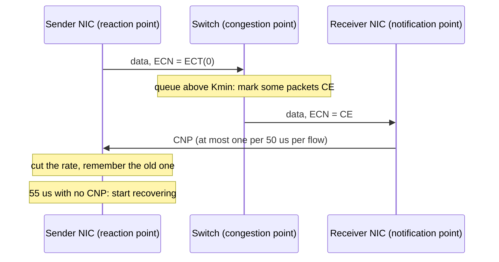

# NET 12: RDMA, RoCE and lossless fabrics

*Part of the [networking plan](00_plan.md) · Time: about 8 hours · You need: [NET 11](11_routing_protocols_and_datacenter_fabrics.md) (the leaf-spine fabric, ECMP and its hash, valley paths), [NET 07](07_zero_copy_networking.md) (what kernel bypass removes), and the parts of [CO 29](../04_computer_organization/29_interconnection_networks_and_warehouse_scale_computing.md) on credits and headroom (section 4.3), PFC deadlock (5.5), incast (7.4) and RDMA at a glance (7.5), which this tutorial builds on and does not repeat. RDMA moves the transport protocol into the network card, so that one machine can read or write another machine's memory without either operating system touching the data. That is fast only if the network does not drop packets, and an Ethernet network drops packets by design. This tutorial is about the protocol (verbs objects, RoCEv2 packets, reliable connections), about the machinery that makes Ethernet lossless (PFC) and the damage that machinery does (head-of-line blocking, pause storms, deadlock), about the end-to-end control that keeps PFC rare (ECN, CNP, DCQCN), and about how the collective operations of GPU training load such a fabric.*

"Why does RoCEv2 need PFC, what goes wrong with PFC, and how do ECN and DCQCN help?" is the standard question at Nvidia, Meta and Microsoft for AI-infrastructure and networking roles, and a follow-up to "design the network for a 10,000 GPU cluster" at Google and Meta. A Staff level answer has four parts that connect: the **transport** (a hardware go-back-N reliable connection, so one lost packet costs a whole window), the **fabric** (PFC to avoid loss, with headroom sized from cable length), the **failure modes** (the victim flow, the pause storm, the cyclic buffer dependency) and the **control loop** (ECN marks, CNPs and a rate that comes down in microseconds). This tutorial measures what the sandbox can, models what it cannot, and says which is which.

**Eight honest limits, stated first.**

1. **No RDMA ran here.** The kernel (Linux 6.18, Firecracker VM, 2 vCPUs, root) has **no InfiniBand support**: no `rdma_rxe` (software RoCE), no `siw`, no `ib_uverbs`. `ibv_get_device_list` fails with `Function not implemented` (section 2). I installed the verbs library and headers, so a program that posts an RDMA write **compiles**, but it was **never run past the device list**. The whole verbs flow is therefore explained from the API and the specification and marked **from memory**.
2. **The packets are built, not captured.** The RoCEv2 headers in section 3 were **constructed with scapy** and decoded by `tshark`. Their sizes and field layout are real. They did not cross a NIC, and the ICRC was computed by scapy, **not checked against hardware**.
3. **The only real queue is a Linux `tbf`.** The kernel has **no `netem`, no RED or ECN marking qdisc, no `fq_codel`** (all disabled in its configuration), and veth devices cannot do PFC (`dcb pfc show` on a veth printed `Operation not supported`). So the one **measured** network effect is **incast of real TCP** through a tail-drop buffer (section 5). There is no real PFC and no real ECN marking anywhere in this tutorial.
4. **PFC, head-of-line blocking, deadlock, DCQCN and go-back-N are small Python models**, a few dozen lines each (`pfcsim.py`, `dcqcn.py`, `e7_gobackn.py`). They show the **mechanism** and the **direction and rough size** of each effect. They are **not hardware measurements**, and their time steps and thresholds are mine. Where a parameter comes from the DCQCN paper I say so; the paper's text was read for those values (section 8).
5. **The collective numbers are formulas and a Monte Carlo** (`e8_collective.py`). NCCL's real algorithm choice, its channels and its queue pair counts are **from memory**.
6. **Hardware is from memory:** how a NIC stores queue pair state and what happens when it runs out of cache, how a switch ASIC carves its shared buffer into headroom and pools, the counter names of a particular NIC, adaptive routing in a particular switch, and everything about InfiniBand's subnet manager.
7. **One link speed per model.** The DCQCN model runs at 40 Gb/s because the paper's deployed parameters were tuned there. At 100 or 400 Gb/s the same parameters would behave differently, and vendors tune them per platform.
8. **Everything shares two vCPUs.** The incast clients and servers, 48 Python threads at most, compete with the kernel for the same two cores, so the times in section 5 have a floor above the ideal that is partly the machine.

By the end you can:

- **say what RDMA removes and what it needs** (computed: a 4,096 byte RoCEv2 packet carries **98.0 %** payload on the wire against **94.1 %** for a TCP segment at MTU 1500; a 64 byte write is only **39.5 %** payload but reaches **77 million messages per second** at 100 Gb/s);
- **draw a RoCEv2 packet and read its fields** (measured by building and decoding: Ethernet 14, IPv4 20, UDP 8 to **port 4791**, BTH 12, an extended header of 16 for the first packet of a write, payload, ICRC 4; a middle packet of a write is **4,154 bytes** for 4,096 of payload; an ACK is **62**);
- **say why one lost packet is so costly** (modelled: with 30 packets in flight, **0.1 % loss** costs go-back-N **2.9 %** of goodput; with a 1 ms round trip, 2,991 in flight, the same loss leaves **25 %**, while selective repeat would keep 99.9 %);
- **show that Ethernet drops under incast and what that costs** (measured, real TCP: 256 KB from each of N servers into a 1 Gb/s port with a 64 KB buffer: N = 8 took **18.9 ms**, N = 48 took **302 ms** for a transfer that needs **101 ms** (**33 %** goodput); lowering `rto_min` to 1 ms gave **67 %**; a 16 MB buffer gave **90 %**);
- **build and size PFC** (measured: a PFC frame is **60 bytes**, destination `01:80:c2:00:00:01`, opcode `0x0101`, a class enable vector and eight pause times; one quantum is **5.12 ns** at 100 Gb/s and a full pause of 65,535 quanta lasts **335.5 µs**; computed: a 400 Gb/s port with 100 m cables needs **107 KB** of headroom per priority, **13.7 MB** for 64 ports and two priorities);
- **explain what PFC breaks** (modelled: a flow that offers 0.5 and shares only a link with a congested flow delivered **0.26** with PFC and **0.50** without; three switches in a ring **deadlocked to zero delivery** with **98 %** of ticks paused at an offered load of 0.45 per flow and not at 0.4; a watchdog that flushes the stuck queue did not restore throughput while the load stayed, and a route with no cycle ran at **0.85 to 0.94** with no pause at all);
- **write down DCQCN and say why the parameters interlock** (modelled at 40 Gb/s with the paper's parameters: eight senders into one port, **PFC alone paused 87.5 %** of the time with **2,501** pause events in 20 ms; with ECN and a high PFC threshold there were **2 pause events** and the rates summed to line rate, but only **2.2 to 7.7 Gb/s** per flow after 20 ms against a fair 5);
- **say why a few big flows break ECMP** (computed: 8 flows on 8 uplinks have **no collision in 0.24 %** of trials and the busiest link carries **2.6 flows**, so the all-reduce runs at about **38 %**; four queue pairs per connection raise that to about **57 %**);
- **say what an all-reduce puts on the wire** (computed: each GPU sends **2(n-1)/n** of the data, **2 GiB** for 1 GiB at 512 GPUs, in **1,022 ring steps**; for a 4 KiB message a ring takes **5,110 µs** and a tree **90 µs**);
- **list what to configure and check on a RoCE network** and the failures that follow from each (section 11).

## Where the numbers come from

Each experiment is a script `eN_*.sh` in `prog/` with its output frozen in `v/`, run with `run.sh`. `e1_roce_packets.py` builds RoCEv2 packets with scapy (it defines the RETH layer, which scapy lacks) and writes a pcap that `tshark` decodes. `e2_pfc_frame.py` builds a PFC frame. `e3_headroom.py` is the headroom arithmetic. `incast.sh` and `incast.py` build three namespaces (servers, a switch with a `tbf` on the receiver port, a client) and run N real TCP connections at once. `pfcsim.py` is the packet-level PFC model, `dcqcn.py` the DCQCN rate model, `e7_gobackn.py` the retransmission model, `e8_collective.py` the collective formulas and the collision Monte Carlo, and `e9_verbs.c` the verbs program that was compiled but not run. The answers to the problems are `ans_a` to `ans_e`.

Every number in the text is copied from `v/*.out` or computed from a printed figure with the arithmetic shown. A number that is not measured, modelled or computed here is marked **from memory**. The random models use fixed seeds, so each run prints the same figures; a different seed changes them within a spread that I show where it matters (section 8).

## Data and timing

| What | Size or time |
|---|---|
| RoCEv2 packets (`e1_roce_packets.sh`) | 9 packets built, decoded with `tshark`, efficiency table |
| PFC frame (`e2_pfc_frame.sh`) | 2 frames, `dcb` attempt on a veth |
| Headroom (`e3_headroom.sh`) | arithmetic only |
| Incast (`e4_incast.sh`) | 3 namespaces, 1 Gb/s `tbf` port, N from 1 to 48, 5 repeats each, about 2 minutes |
| PFC model (`e5_pfc.sh`) | 6 runs of 800 to 1,500 ticks |
| DCQCN model (`e6_dcqcn.sh`) | 4 runs of 20 ms at 1 µs steps |
| Retransmission model (`e7_gobackn.sh`) | 2 windows, 5 loss rates, 200,000 packets each |
| Collectives (`e8_collective.sh`) | formulas, 20,000 trials per row |
| Verbs program (`e9_verbs.sh`) | compile, run to the device list, tool checks |

---


## 1. What RDMA removes, and what it asks of the network

A TCP request and reply between two processes costs, in [CO 29](../04_computer_organization/29_interconnection_networks_and_warehouse_scale_computing.md) section 1.2, about **17 µs** of endpoint work: system calls, a copy in each direction, the TCP state machine, interrupts and wake-ups. [NET 07](07_zero_copy_networking.md) removed some copies. **Remote direct memory access** removes the rest by moving three things out of the kernel and the CPU:

| Moved | Into | Effect |
|---|---|---|
| **The data path** | user space, through memory the application registered and the NIC maps | no system call and no copy to a kernel buffer; the NIC reads and writes the application's memory by DMA |
| **The transport** | the NIC: sequence numbers, acknowledgements, retransmission, segmentation into packets | no per-packet CPU work, and the CPU is not woken for every packet |
| **The remote side** | the remote NIC, for one-sided operations | a **write** or **read** of remote memory completes without the remote CPU running at all |

The cost of that arrangement is on the network. A TCP stack on a CPU copes with loss: it has timers, selective acknowledgements and congestion control, all in software that can be changed. A NIC's transport is **fixed-function hardware** built for speed, and its loss recovery is simple and expensive (section 4). So the design pushes a requirement onto the network: **do not drop packets, and keep queues short**. The rest of this tutorial is how that is met on Ethernet, and what it costs.

Three transports carry RDMA, and the difference is who provides the lossless network:

| Transport | Link layer | How it avoids loss | Notes |
|---|---|---|---|
| **InfiniBand** | its own switches and links | **credit-based flow control** per virtual lane, link by link (the credits of CO 29 section 4.3) | a central **subnet manager** programs the forwarding tables; adaptive routing is common; from memory |
| **RoCE v1** | Ethernet, ethertype `0x8915` | PFC | a layer 2 protocol: not routable across subnets; scapy's source confirms the ethertype |
| **RoCE v2** | UDP over IP over Ethernet, **port 4791** | PFC, and ECN-based congestion control | routable and ECMP-friendly, so it is the one deployed in leaf-spine datacenters |

**iWARP** (RDMA over TCP) is the fourth, with TCP's own loss recovery in the NIC; it exists but is rare in new AI clusters (from memory). In this tutorial **RoCE** means RoCEv2.

### 1.1 Two kinds of operation

| Kind | Operations | Who is involved |
|---|---|---|
| **Two-sided** | SEND, with a matching RECV posted by the receiver | both CPUs: the receiver must have posted a buffer, and gets a completion |
| **One-sided** | WRITE, READ, atomic compare-and-swap and fetch-and-add | only the initiator's CPU: the target NIC checks a key and the address range and performs the access |

A one-sided write needs three facts about the remote memory, learned in advance by some other channel (usually a TCP connection or the RDMA connection manager): the **virtual address**, the **length** and a **remote key (rkey)**. The rkey is a capability: the target NIC refuses an access whose key does not match the registered region. That is the whole protection model, and it is why a leaked rkey is a memory-safety problem (from memory).

---


## 2. The verbs objects and the life of a queue pair

The programming interface is **verbs** (`libibverbs`). Everything is an object the application creates and the NIC knows about:

| Object | What it is |
|---|---|
| **Device context** | an open handle to one RDMA device (`ibv_open_device`) |
| **Protection domain (PD)** | a scope: queue pairs and memory regions in different PDs cannot be mixed |
| **Memory region (MR)** | a buffer **registered**: pinned in RAM and translated for the NIC. It yields an **lkey** (for the local NIC to use) and an **rkey** (for a remote peer) |
| **Completion queue (CQ)** | where the NIC reports finished work, one **work completion** per signalled request |
| **Queue pair (QP)** | a **send queue** and a **receive queue**. The endpoint of a connection. A 24 bit **QP number** identifies it |
| **Work request (WR)** | one operation posted to a queue: opcode, local buffer (a scatter-gather list), and for one-sided operations the remote address and rkey |

The data path is: the application writes a **work queue entry** into the send queue in its own memory, rings a **doorbell** (a store to a NIC register), the NIC fetches the entry, reads the payload by DMA, sends packets, receives the acknowledgement, writes a **completion entry** into the CQ, and the application **polls** the CQ in user space. No system call is on that path. That is the part of the stack [CO 29](../04_computer_organization/29_interconnection_networks_and_warehouse_scale_computing.md) section 7.5 summarised.

### 2.1 The queue pair state machine

A reliable connected QP is created in a `RESET` state and must be moved through three states by `ibv_modify_qp`, each call supplying the fields that state needs (from memory, checked against the program below by compiling it):

| State | Fields supplied | Meaning |
|---|---|---|
| **INIT** | port, partition key index, allowed remote access | the QP may post receives |
| **RTR** (ready to receive) | the **peer's QP number**, the peer's **address** (a GID for RoCE, since the peer is an IP address), the path MTU, the expected starting sequence number | the QP can accept packets from that peer |
| **RTS** (ready to send) | the **ACK timeout**, retry count, RNR retry count, the starting send sequence number | the QP may send |

The peer's QP number, GID, and any rkey and address must reach the other side **out of band**. The usual ways are a short TCP exchange, or `librdmacm`, which uses the IP address and a connection management protocol. That is why an RDMA application still opens a TCP socket first.

### 2.2 The sequence as a program

`e9_verbs.c` runs the whole sequence on a **loopback** queue pair, where the QP's destination is itself, and posts one 1 MiB write from the first half of a buffer to the second. It is the shortest correct shape of an RDMA program. The setup:

```c
    int n = 0;
    struct ibv_device **list = ibv_get_device_list(&n);
    if (!list || n == 0) { printf("no RDMA device (%s, %d devices)\n", list ? "empty list" : strerror(errno), n); return 2; }
    struct ibv_context *ctx = ibv_open_device(list[0]);
    NEED(ctx, "ibv_open_device");
    struct ibv_pd *pd = ibv_alloc_pd(ctx);
    NEED(pd, "ibv_alloc_pd");
    size_t len = 1 << 20;
    char *buf = aligned_alloc(4096, 2 * len);
    NEED(buf, "aligned_alloc");
    memset(buf, 'A', len); memset(buf + len, 0, len);
    struct ibv_mr *mr = ibv_reg_mr(pd, buf, 2 * len, IBV_ACCESS_LOCAL_WRITE | IBV_ACCESS_REMOTE_WRITE);
    NEED(mr, "ibv_reg_mr");
    struct ibv_cq *cq = ibv_create_cq(ctx, 16, NULL, NULL, 0);
    NEED(cq, "ibv_create_cq");
    struct ibv_qp_init_attr ia = { .send_cq = cq, .recv_cq = cq, .qp_type = IBV_QPT_RC,
        .cap = { .max_send_wr = 8, .max_recv_wr = 8, .max_send_sge = 1, .max_recv_sge = 1 } };
    struct ibv_qp *qp = ibv_create_qp(pd, &ia);
    NEED(qp, "ibv_create_qp");

    struct ibv_qp_attr a;
    memset(&a, 0, sizeof a);
    a.qp_state = IBV_QPS_INIT; a.pkey_index = 0; a.port_num = 1; a.qp_access_flags = IBV_ACCESS_REMOTE_WRITE;
    NEED(!ibv_modify_qp(qp, &a, IBV_QP_STATE | IBV_QP_PKEY_INDEX | IBV_QP_PORT | IBV_QP_ACCESS_FLAGS), "INIT");
```

and the transitions and the work request:

```c
    union ibv_gid gid;                                   /* RoCE addresses a peer by GID; index 1 is often the RoCEv2 IPv4 one */
    NEED(!ibv_query_gid(ctx, 1, 1, &gid), "ibv_query_gid");
    memset(&a, 0, sizeof a);
    a.qp_state = IBV_QPS_RTR; a.path_mtu = IBV_MTU_4096; a.dest_qp_num = qp->qp_num; a.rq_psn = 0;
    a.max_dest_rd_atomic = 1; a.min_rnr_timer = 12;
    a.ah_attr.is_global = 1; a.ah_attr.port_num = 1; a.ah_attr.grh.dgid = gid; a.ah_attr.grh.sgid_index = 1; a.ah_attr.grh.hop_limit = 64;
    NEED(!ibv_modify_qp(qp, &a, IBV_QP_STATE | IBV_QP_AV | IBV_QP_PATH_MTU | IBV_QP_DEST_QPN | IBV_QP_RQ_PSN |
                                IBV_QP_MAX_DEST_RD_ATOMIC | IBV_QP_MIN_RNR_TIMER), "RTR");

    memset(&a, 0, sizeof a);
    a.qp_state = IBV_QPS_RTS; a.timeout = 14; a.retry_cnt = 7; a.rnr_retry = 7; a.sq_psn = 0; a.max_rd_atomic = 1;
    NEED(!ibv_modify_qp(qp, &a, IBV_QP_STATE | IBV_QP_TIMEOUT | IBV_QP_RETRY_CNT | IBV_QP_RNR_RETRY |
                                IBV_QP_SQ_PSN | IBV_QP_MAX_QP_RD_ATOMIC), "RTS");

    struct ibv_sge sge = { .addr = (uintptr_t)buf, .length = (uint32_t)len, .lkey = mr->lkey };
    struct ibv_send_wr wr, *bad = NULL;
    memset(&wr, 0, sizeof wr);
    wr.wr_id = 1; wr.sg_list = &sge; wr.num_sge = 1; wr.opcode = IBV_WR_RDMA_WRITE; wr.send_flags = IBV_SEND_SIGNALED;
    wr.wr.rdma.remote_addr = (uintptr_t)(buf + len); wr.wr.rdma.rkey = mr->rkey;
    NEED(!ibv_post_send(qp, &wr, &bad), "ibv_post_send");

    struct ibv_wc wc;
    int got;
    do got = ibv_poll_cq(cq, 1, &wc); while (got == 0);
    printf("completion: %s, copied %s\n", ibv_wc_status_str(wc.status), memcmp(buf, buf + len, len) ? "NO" : "yes");
    return 0;
```

It compiled with `-Wall -Wextra` against the installed headers with no warnings, which checks every function name, struct field and flag against the real API. It could not go further, because the kernel has no RDMA device:

```text
--- 1. compile against the installed headers
compiled with no warnings
--- 2. run
no RDMA device (Function not implemented, 0 devices)
exit status 2
--- 3. the tools
Failed to get IB devices list: Function not implemented
Version: 50.0-2ubuntu0.2
--- 4. the rdma tool and perftest
Failed to open NETLINK_RDMA socket
rdma link show exit status 1
/usr/bin/ib_read_bw
/usr/bin/ib_send_bw
/usr/bin/ib_write_bw
```

`ibv_get_device_list` itself returned the error `Function not implemented`, because `libibverbs` asks the kernel's RDMA subsystem, which is not built. `rdma link show` could not open its netlink socket for the same reason. The perftest tools (`ib_write_bw`, `ib_read_bw`, `ib_send_bw`) are installed but have nothing to talk to. **On a Linux machine with the `rdma_rxe` module** (software RoCE, from memory: `modprobe rdma_rxe` then `rdma link add rxe0 type rxe netdev eth0`) the same program would run over an ordinary Ethernet interface, which is how to try verbs without a RoCE NIC. **That is the first thing to do on your own machine.**

### 2.3 Things in the program an interviewer will ask about

- **Why register memory?** The NIC does DMA with physical addresses and cannot take page faults, so the pages must stay put (**pinned**) and the NIC needs a translation table for them. Registration is slow (it walks and pins pages), so applications register once and reuse; a registration cache is a standard component (from memory).
- **Why `IBV_SEND_SIGNALED`?** Completions are optional per request. Signalling every request costs a CQ entry and a poll; real code signals one in every N and relies on in-order completion on a reliable connection (from memory).
- **What does a completion on a write mean?** On a reliable connection, the requester's completion for a WRITE arrives when the **acknowledgement** returns, meaning the remote NIC accepted the data. It does **not** mean the remote application has seen it. The remote CPU is not told. To signal the remote application there is WRITE with immediate data, which consumes a receive and generates a completion there, or a separate SEND (from memory).
- **Why `timeout = 14`?** The local ACK timeout is `4.096 µs × 2^timeout` (from memory), so 14 gives 4.096 µs × 16,384 = **67.1 ms** (computed) before the requester retransmits. Section 4 shows why that number matters.
- **Why does the receive queue exist for a write?** It does not: a one-sided WRITE or READ needs no posted receive. A SEND does.
- **What limits the number of connections?** The NIC keeps per-QP state (sequence numbers, addresses, keys) and caches it on chip. With thousands of active QPs the cache misses and performance falls (from memory). This is one reason large clusters limit QPs per node, and a reason to be careful with the "more QPs per connection" fix in section 9.

---


## 3. RoCEv2 on the wire

A RoCEv2 packet is an ordinary UDP datagram whose payload begins with an InfiniBand **base transport header**:

```text
+----------+----------+---------+-----------+------------------+---------+------+-------+
| Ethernet | IPv4     | UDP     | BTH       | extension header | payload | ICRC | FCS   |
| 14       | 20       | 8       | 12        | 0, 4 or 16       | 0..MTU  | 4    | 4     |
|          | ECN, DSCP| dst 4791| opcode,   | RETH, AETH ...   |         |      |       |
|          |          | src =   | QP, PSN   |                  |         |      |       |
|          |          | entropy |           |                  |         |      |       |
+----------+----------+---------+-----------+------------------+---------+------+-------+
```

`e1_roce_packets.py` builds nine such packets with scapy. scapy knows the BTH, the acknowledgement extension header (AETH) and the congestion notification packet (CNP), but not the **RDMA extended transport header (RETH)**, so the program defines it: a 64 bit virtual address, a 32 bit rkey and a 32 bit DMA length.

```python
class RETH(Packet):
    name = "RETH"
    fields_desc = [XLongField("va", 0), XIntField("rkey", 0), BitField("dmalen", 0, 32)]

for op in (0x06, 0x0a, 0x0c):                  # RC WRITE_FIRST, WRITE_ONLY, READ_REQUEST
    bind_layers(BTH, RETH, opcode=op)
```

The packets are one 1 MiB write cut into 4,096 byte packets (first, middle, last), the acknowledgement, a small single-packet write, a read request, a send, a CNP and a middle packet that a switch has marked:

```python
n = (1 << 20) // MTU
add("WRITE_FIRST  4096 B", ip() / udp(49320) / BTH(opcode=0x06, dqpn=0x11, psn=100) / RETH(va=0x7f0000100000, rkey=0x1234, dmalen=1 << 20) / Raw(b"A" * MTU))
add("WRITE_MIDDLE 4096 B", ip() / udp(49320) / BTH(opcode=0x07, dqpn=0x11, psn=101) / Raw(b"B" * MTU))
add("WRITE_LAST   4096 B", ip() / udp(49320) / BTH(opcode=0x08, dqpn=0x11, psn=100 + n - 1, ackreq=1) / Raw(b"C" * MTU))
add("ACK (AETH)", ip() / udp(49321) / BTH(opcode=0x11, dqpn=0x22, psn=100 + n - 1) / AETH(syndrome=0x1f, msn=1))
add("WRITE_ONLY     64 B", ip() / udp(49320) / BTH(opcode=0x0a, dqpn=0x11, psn=500) / RETH(va=0x7f0000200000, rkey=0x1234, dmalen=64) / Raw(b"D" * 64))
add("READ_REQUEST", ip() / udp(49322) / BTH(opcode=0x0c, dqpn=0x11, psn=501) / RETH(va=0x7f0000300000, rkey=0x1234, dmalen=8192))
add("SEND_ONLY      64 B", ip() / udp(49323) / BTH(opcode=0x04, dqpn=0x11, psn=7) / Raw(b"E" * 64))
add("CNP (ECN marked data seen)", ip(0x00) / udp(49324) / cnp(0x11))
add("WRITE_MIDDLE, CE marked", ip(0x03) / udp(49320) / BTH(opcode=0x07, dqpn=0x11, psn=102) / Raw(b"B" * MTU))
```

```text
packet                        bytes   wire    hdr
WRITE_FIRST  4096 B            4170   4194     98
WRITE_MIDDLE 4096 B            4154   4178     82
WRITE_LAST   4096 B            4154   4178     82
ACK (AETH)                       62     86     86
WRITE_ONLY     64 B             138    162     98
READ_REQUEST                     74     98     98
SEND_ONLY      64 B             122    146     82
CNP (ECN marked data seen)       74     98     98
WRITE_MIDDLE, CE marked        4154   4178     82
```

`bytes` is the frame without its 4 byte FCS, `wire` adds the FCS and the 20 bytes of preamble and inter-frame gap that every Ethernet frame costs on the cable, and `hdr` is `wire` minus the payload. A **middle** packet of a write has **82** bytes of overhead: 14 + 20 + 8 + 12 + 4 (ICRC) + 4 (FCS) + 20 (gap). The **first** packet of a write has **98**, the extra 16 being the RETH. The reason is that only the first (or only) packet of a message names the memory: the packets that follow are matched to it by QP number and **sequence number**, and the receiving NIC remembers where the write has got to. The ACK is **62** bytes (an AETH of 4), the CNP **74**.

### 3.1 Reading the headers

tshark decodes the first packet of the write and the acknowledgement:

```text
--- 1. the first packet of a 1 MiB write
InfiniBand
    Base Transport Header
        Opcode: Reliable Connection (RC) - RDMA WRITE First (6)
        Partition Key: 65535
        Reserved: 00
        Destination Queue Pair: 0x000011
        Packet Sequence Number: 100
    RETH - RDMA Extended Transport Header
        Virtual Address: 0x00007f0000100000
        Remote Key: 0x00001234
        DMA Length: 1048576 (0x00100000)
    Invariant CRC: 0x7ea41c18
Data (4096 bytes)
--- 2. an acknowledgement
        Opcode: Reliable Connection (RC) - Acknowledge (17)
        Destination Queue Pair: 0x000022
        Packet Sequence Number: 355
        Syndrome: 31, Ack
            ...1 1111 = Credit Count: 31
        Message Sequence Number: 1
    Invariant CRC: 0x1bb21eee
```

- **Opcode.** The top three bits choose the transport (RC is `0x00`, UC `0x20`, UD `0x60`) and the low five the operation: `0x06` is RDMA WRITE First, `0x07` Middle, `0x08` Last, `0x0a` Write Only, `0x0c` Read Request, `0x04` Send Only, `0x11` Acknowledge. The decode shows `RDMA WRITE First (6)` and `Acknowledge (17)`.
- **Destination QP** is 24 bits: the packet names the receiving queue pair, not an address or a port. The only addresses on the wire are the IP addresses, and the UDP destination port is always **4791**.
- **PSN**, the packet sequence number, is 24 bits and counts **packets**, not bytes. The write started at **100**, has 1,048,576 ÷ 4,096 = **256** packets, so it ends at 100 + 255 = **355**, which is the PSN in the acknowledgement. 24 bits wrap after 16.7 million packets.
- **AckReq** is set on the last packet (and periodically on long messages) to ask for an acknowledgement; the responder may also acknowledge on its own schedule (from memory).
- **AETH syndrome** `0x1f`: the top bits say ACK (as opposed to a NAK or an RNR NAK), and the low five bits are a credit count (31 here). A NAK carries a code, and the one that matters is **sequence error** (from memory): the next section.
- **ICRC**, shown by tshark as `Invariant CRC`, covers the headers and payload with the **fields a switch is allowed to change masked out** (scapy's source masks the IP TTL, ToS and checksum, the UDP checksum and the BTH congestion bit and reserved byte). That is why a router can decrement the TTL or mark ECN without invalidating the end-to-end check, while the ordinary Ethernet FCS is rewritten hop by hop. Scapy computed these values; I did not check them against a NIC.

### 3.2 ECN bits, the marked packet and the CNP

```text
--- 3. ECN bits of every packet and the CNP
1       49320   4791    2       6
2       49320   4791    2       7
3       49320   4791    2       8
4       49321   4791    2       17
5       49320   4791    2       10
6       49322   4791    2       12
7       49323   4791    2       4
8       49324   4791    0       129
9       49320   4791    3       7
```

The columns are frame number, UDP source port, UDP destination port, the **IP ECN field**, and the BTH opcode. Every data packet leaves the sender with ECN `2`, **ECT(0)**: "this transport understands ECN". Frame 9 is the same packet with ECN `3`, **CE** (congestion experienced), which is what a congested switch writes; **I constructed it, no switch marked it**. Frame 8 is the **CNP**, opcode **129 (`0x81`)**. This tshark version does not know the opcode, so it prints `Unknown (129)`, and the `Reserved: 40` it showed is the **BECN** bit (`0x40`) in the byte after the partition key. A CNP is a 16 byte BTH-plus-padding packet that the **receiver's NIC** sends back to the sender's QP when it receives CE-marked data; the sender reacts by lowering its rate (section 8). I gave the CNP ECN `0`; the specification gives CNPs their own high priority (from memory).

### 3.3 The UDP source port is the entropy

A switch spreads load with an ECMP hash of the five-tuple ([NET 11](11_routing_protocols_and_datacenter_fabrics.md) section 8). In RoCEv2 the addresses and destination port (4791) are the same for every flow between two hosts, so the **UDP source port** is the only field that can differ. The NIC picks it per queue pair, derived from the QP number (from memory). The consequence, which section 9 quantifies, is that **one QP is one path**: a long write on one QP uses one uplink for its whole life.

### 3.4 Efficiency and message rate

```text
--- 4. payload per wire byte and packets per second at 100 Gb/s
RoCEv2 at 100 Gb/s   (a TCP segment at MTU 1500 with timestamps: 1448 / 1538 = 94.1%)
packet                  payload efficiency       Mpps
WRITE_MIDDLE, MTU 256       256      75.7%      36.98
WRITE_MIDDLE, MTU 512       512      86.2%      21.04
WRITE_MIDDLE, MTU 1024     1024      92.6%      11.30
WRITE_MIDDLE, MTU 2048     2048      96.2%       5.87
WRITE_MIDDLE, MTU 4096     4096      98.0%       2.99
WRITE_ONLY                    8       7.5%     117.92
WRITE_ONLY                   64      39.5%      77.16
WRITE_ONLY                  256      72.3%      35.31
WRITE_ONLY                 1024      91.3%      11.14
```

A middle packet at MTU 4,096 puts **98.0 %** of the wire bytes into payload, against **94.1 %** for a TCP segment at MTU 1,500 with timestamps (1,448 ÷ 1,538, computed). At MTU 1,024 it is **92.6 %**, and at 256 it is **75.7 %**. A single small write is dominated by headers: **7.5 %** for 8 bytes, **39.5 %** for 64. The packet rate column is the **limit of the cable**: 100 Gb/s carries **77 million** 64 byte writes per second or **3 million** 4 KB packets per second. A real NIC reaches its own message-rate limit before the cable's (from memory), and that, not the cable, is what a small-message benchmark measures.

A 4,096 byte RoCE MTU makes an IP packet of **4,156 bytes** (the first packet: frame 4,170 minus 14), so every link on the path must have an interface MTU of at least that. The usual choice is 4,200 or 9,000. One link left at 1,500 silently breaks the large packets, and RDMA reports it as a retry timeout rather than as an MTU error (from memory).

---


## 4. The reliable connection, and why one loss costs a window

A **reliable connection (RC)** guarantees delivery in order. The mechanism is the one the section 3 headers show, and it is old and simple:

1. The sender numbers packets with a **PSN** and keeps every unacknowledged packet in a buffer in the NIC.
2. The **receiver accepts only the next expected PSN**. A packet that arrives ahead of it (one before it was lost) is **discarded**, and the receiver returns a **NAK with the sequence-error code** carrying the PSN it expected (from memory of the InfiniBand specification).
3. On the NAK, the sender **goes back** to that PSN and resends **everything from there on**. That is **go-back-N**.
4. If the **last** packet of a burst is lost, no later packet arrives to show the gap, and no NAK is generated. Only the sender's **ACK timeout** detects it. The program of section 2 set `timeout = 14`, which is `4.096 µs × 2^14` = **67.1 ms**, about **6,700 times** a 10 µs round trip.

Some newer NICs add selective retransmission in place of go-back-N, and the Ultra Ethernet work aims at out-of-order delivery, but both are vendor specific (from memory). The classic RoCE behaviour above is what the PFC design of the next sections was built to protect.

### 4.1 What a loss costs: a model

How much goodput does go-back-N lose at a given loss rate `p`? The sender keeps a window of `W` packets in flight, enough to fill the link: `W` is the bandwidth-delay product in packets. At 100 Gb/s and a 10 µs round trip, with a 4,178 byte packet on the wire, `W = 100e9 × 10e-6 ÷ 8 ÷ 4178` = **30** packets (computed); across a campus with a 1 ms round trip it is **2,991**. When a packet is lost, the `W - 1` packets already sent behind it are discarded, so each loss wastes about a window. Per delivered packet the sender transmits `(1 + p(W - 1)) ÷ (1 - p)` packets on average, giving

`goodput = (1 - p) ÷ (1 + p × (W - 1))`.

`e7_gobackn.py` checks the formula by simulating 200,000 packets and compares selective repeat, which resends only the lost packet (goodput about `1 - p`):

```python
def gbn(p, n=200000):
    sent = delivered = 0
    while delivered < n:
        sent += 1
        if random.random() < p: sent += W - 1      # the W - 1 packets already in flight behind the lost one are discarded
        else: delivered += 1
    return delivered / sent
def sr(p, n=200000):
    sent = 0
    for _ in range(n):
        sent += 1
        while random.random() < p: sent += 1
    return n / sent
```

```text
--- 1. 100 Gb/s, 10 us round trip, MTU 4096: window = 100e9 * 10e-6 / 8 / 4178
window 30 packets
loss rate     go-back-N      formula    selective
1e-06            100.0%       100.0%       100.0%
1e-05            100.0%       100.0%       100.0%
0.0001            99.8%        99.7%       100.0%
0.001             97.1%        97.1%        99.9%
0.01              76.8%        76.7%        99.0%
--- 2. the same link across a campus, 1 ms round trip: window = 2991
window 2991 packets
loss rate     go-back-N      formula    selective
1e-06            100.0%        99.7%       100.0%
1e-05             97.1%        97.1%       100.0%
0.0001            80.7%        77.0%       100.0%
0.001             25.3%        25.0%        99.9%
0.01               3.2%         3.2%        99.0%
```

Read the two tables together. **In a rack, at a 10 µs round trip,** a loss rate of 10⁻³ costs go-back-N **2.9 %** and 10⁻² costs **23 %**: bad but survivable. **Across a campus, at 1 ms,** 10⁻⁴ already costs **19 %** (simulated 80.7 %, formula 77.0 %), 10⁻³ leaves **25 %** and 10⁻² leaves **3.2 %**, while selective repeat holds **99 %** at 10⁻². The simulated and formula values differ at the rows with few loss events (at 10⁻⁴ there are only about 20 losses in 200,000 packets, and at 10⁻⁶ there are none), which is sampling noise, not a flaw in the formula.

That is the whole argument for the design. The penalty scales with the **window**, so it is mild in a short, fast fabric and ruinous on a long path. Hardware go-back-N needs a loss rate near zero **and** a short round trip. That is why RoCE is run **inside** a datacenter, with the network engineered not to drop, rather than across the wide area (from memory: wide area RDMA exists but needs different transports or loss recovery).

---


## 5. Ethernet drops packets: incast, measured

A plain Ethernet switch has a finite buffer per port, and when more arrives than leaves it **drops the excess**. The standard way to hit that is **incast**: many servers answer one client at the same moment. [CO 29](../04_computer_organization/29_interconnection_networks_and_warehouse_scale_computing.md) section 7.4 worked the arithmetic from the literature. Here it is measured with **real TCP in the real kernel**, to see how large the effect is and what changes it.

### 5.1 The setup

Three namespaces: `tx` holds the servers, `sw` is the switch, `rx` is the client. The link from `sw` to `rx` is the bottleneck, **1 Gb/s with a `tbf` qdisc whose `limit` is the port buffer**. The client opens N connections, sends one byte on each, and every server answers with 256 KB. The transfer needs `N × 256 KB × 8 ÷ 1 Gb/s` = **2.1 ms per server** if nothing is lost. The setup:

```bash
incast_up() { # buffer-bytes
  local LIM=$1
  for n in tx sw rx; do ip netns add $n; ip netns exec $n ip link set lo up; done
  ip link add t0 netns tx type veth peer name s0 netns sw
  ip link add s1 netns sw type veth peer name r0 netns rx
  ip netns exec tx ip addr add 10.1.0.2/24 dev t0; ip netns exec sw ip addr add 10.1.0.1/24 dev s0
  ip netns exec sw ip addr add 10.2.0.1/24 dev s1; ip netns exec rx ip addr add 10.2.0.2/24 dev r0
  for p in tx:t0 sw:s0 sw:s1 rx:r0; do ip netns exec ${p%:*} ip link set ${p#*:} up; ip netns exec ${p%:*} ethtool -K ${p#*:} tso off gso off gro off > /dev/null 2>&1; done
  ip netns exec tx ip route add 10.2.0.0/24 via 10.1.0.1
  ip netns exec rx ip route add 10.1.0.0/24 via 10.2.0.1
  ip netns exec sw sysctl -qw net.ipv4.ip_forward=1
  ip netns exec sw tc qdisc add dev s1 root tbf rate 1gbit burst 32kb limit $LIM
  ip netns exec tx python3 prog/incast.py server x $BLOCK &
  SRV=$!; sleep 0.5
}
incast_down() { kill $SRV 2> /dev/null; wait $SRV 2> /dev/null; for n in tx sw rx; do ip netns del $n 2> /dev/null; done; }
run() { # n reps
  ip netns exec rx python3 prog/incast.py client 10.1.0.2 $1 $BLOCK $2
}
```

and the sweeps (the senders' `rto_min` is set with `ip route ... rto_min`):

```bash
echo "--- 2. 48 servers, 64 KB buffer, four values of rto_min on the senders"
for r in 200ms 20ms 5ms 1ms; do
  ip netns exec tx ip route change 10.2.0.0/24 via 10.1.0.1 rto_min $r
  printf 'rto_min %-6s ' $r; run 48 5 | awk '{printf "median %7.1f ms  min %7.1f  max %7.1f  goodput %5.1f %%\n", $2, $3, $4, $5}'
done
incast_down; trap - EXIT
echo "--- 3. 48 servers, rto_min 200 ms, four buffer sizes"
for b in 65536 262144 1048576 16777216; do
  . prog/incast.sh; incast_up $b
  printf 'buffer %9d B ' $b; run 48 5 | awk '{printf "median %7.1f ms  min %7.1f  max %7.1f  goodput %5.1f %%\n", $2, $3, $4, $5}'
  incast_down
done
```

The result is the median of five repeats, with the fastest and slowest:

```text
--- 1. more servers, 64 KB buffer, default rto_min (200 ms); 256 KB from each; ideal time is N x 2.1 ms
  N median_ms   min_ms   max_ms  goodput_%
  1       2.3      2.2      2.6       92.6
  2       4.7      4.6     15.6       89.8
  4       9.0      8.9      9.4       93.5
  8      18.9     17.8    216.2       88.8
 16     222.8     36.5    230.4       15.1
 32     270.2    249.8    281.0       24.8
 48     302.3    288.1    313.2       33.3
```

Up to N = 8 the transfer runs at **89 to 94 %** of the ideal. At N = 16 the **median is 222.8 ms** against an ideal of 33.6 ms, goodput **15.1 %**, and the fastest repeat was **36.5 ms**: the collapse is **bimodal**, some repeats escape and the others wait out a retransmission timeout. At N = 48 the median is **302.3 ms** for a transfer that needs 100.7 ms (**33.3 %**). The paper CO 29 cites measured about 3 % at 47 servers with older kernels; a current kernel with SACK and tail-loss probes does better, but it does not avoid the collapse.

### 5.2 What changes it

```text
--- 2. 48 servers, 64 KB buffer, four values of rto_min on the senders
rto_min 200ms  median   297.1 ms  min   291.5  max   301.5  goodput  33.9 %
rto_min 20ms   median   164.3 ms  min   131.8  max   221.0  goodput  61.3 %
rto_min 5ms    median   168.4 ms  min   130.4  max   623.3  goodput  59.8 %
rto_min 1ms    median   151.1 ms  min   124.3  max   228.3  goodput  66.6 %
--- 3. 48 servers, rto_min 200 ms, four buffer sizes
buffer     65536 B median   298.8 ms  min   287.4  max   313.2  goodput  33.7 %
buffer    262144 B median   294.2 ms  min   292.0  max   355.9  goodput  34.2 %
buffer   1048576 B median   250.6 ms  min   114.1  max   301.3  goodput  40.2 %
buffer  16777216 B median   111.4 ms  min   108.2  max   115.2  goodput  90.4 %
```

- **A shorter retransmission floor** helps: `rto_min` 200 ms gives **33.9 %**, 20 ms gives **61.3 %**, 5 ms gives **59.8 %** (one repeat took 623 ms), 1 ms gives **66.6 %**. It does not give 98 %, because the retransmissions collide again and because the VM's two CPUs are doing 48 sender threads; the best case here is bounded by both.
- **A bigger buffer** helps once it is big enough: 64 KB and 256 KB give **33.7 %** and **34.2 %**, 1 MB gives **40.2 %**, and **16 MB gives 90.4 %** (median 111.4 ms). The first window of 48 connections is 48 × 10 segments × 1,448 B = **695 KB**, and the whole demand to absorb is about `(N - 1) × 256 KB` = **12 MB**, which is why only the 16 MB buffer works. You cannot buffer your way out, because switch buffers are tens of megabytes shared by many ports.

The honest summary is that a lossy Ethernet fabric under synchronised bursts loses most of its goodput to **timeouts**, and a transport that cannot tolerate even small loss (section 4) cannot live there. Two mechanisms are added, and the rest of the tutorial is about their interaction:

| Mechanism | Acts | What it does | What it costs |
|---|---|---|---|
| **PFC** (priority flow control) | hop by hop, in microseconds | the switch tells the upstream neighbour to stop sending one priority before its buffer overflows, so nothing is dropped | headroom memory; **it spreads congestion** (section 7) |
| **ECN with a rate controller** (DCQCN) | end to end, in tens of microseconds | switches mark packets when a queue passes a threshold; the receiver NIC reports the marks; the sender NIC lowers its rate | thresholds and parameters that must be set together with PFC (section 8) |

---


## 6. Priority flow control

Classic Ethernet flow control (802.3x PAUSE) stops **the whole link**. **Priority flow control (PFC, IEEE 802.1Qbb)** pauses **one of eight priorities** on a link and leaves the others running, so RDMA traffic can be lossless on one priority while ordinary TCP traffic on another keeps its normal drop-and-retransmit behaviour. A switch chooses a packet's priority from the VLAN priority bits or, on a routed fabric with no VLAN tags, from the **DSCP** field (from memory), and keeps a separate queue and a separate **ingress counter** per port and priority.

### 6.1 The frame

`e2_pfc_frame.py` builds an XOFF for priority 3 and an XON, the two messages of the protocol:

```python
def pfc(enable_mask, quanta):
    body = struct.pack("!HH", 0x0101, enable_mask) + b"".join(struct.pack("!H", q) for q in quanta)
    return Ether(src="02:00:00:00:00:01", dst="01:80:c2:00:00:01", type=0x8808) / Raw(body + bytes(26))
xoff = pfc(1 << 3, [0, 0, 0, 65535, 0, 0, 0, 0])
xon = pfc(1 << 3, [0] * 8)
```

```text
XOFF for priority 3: 0180 c200 0001 0200 0000 0001 8808 0101 0008 0000 0000 0000 ffff 0000 0000 0000 0000 0000 0000 0000 0000 0000 0000 0000 0000 0000 0000 0000 0000 0000
length 60 bytes (a minimum frame without its 4 byte FCS)

speed       1 quantum   65535 quanta bytes in that time
25 Gb/s      20.48 ns      1342.2 us           4194 KB
100 Gb/s      5.12 ns       335.5 us           4194 KB
400 Gb/s      1.28 ns        83.9 us           4194 KB
```

and `tshark` decodes the first:

```text
    Type: MAC Control (0x8808)
MAC Control
    Opcode: Class Based Flow Control [CBFC] Pause (0x0101)
    CBFC Class Enable Vector: 0x0008, C3
    CBFC Class Pause Times
        C0: 0
        C1: 0
        C2: 0
        C3: 65535
        C4: 0
        C5: 0
        C6: 0
        C7: 0
```

It is a **60 byte** frame (64 with the FCS) to the reserved multicast address `01:80:c2:00:00:01`, which a bridge never forwards (a pause is **hop by hop** and stops at the first switch), with ethertype `0x8808` (MAC control), opcode `0x0101`, a **class enable vector** (`0x0008` means priority 3 is addressed) and **eight pause times**, one per priority. A time is counted in **quanta of 512 bit times**, so what it means depends on the link speed:

- At **100 Gb/s** a quantum is **5.12 ns** and the maximum pause, 65,535 quanta, lasts **335.5 µs**; at **400 Gb/s** it is **83.9 µs**; at **25 Gb/s** it is **1,342 µs**. In every case that is **4,194 KB** of data at line rate.
- **XON** is the same frame with the time set to zero: resume now. A switch that is still congested when a pause is about to expire sends another XOFF.

The kernel cannot configure PFC on a veth: `dcb pfc show dev v0` printed `Operation not supported`, and `ethtool -a` failed the same way.

```text
--- 2. dcb on a veth in a namespace
Attribute read: Operation not supported
netlink error: Operation not supported
```

On a Linux host with a real NIC and driver support, `dcb pfc set dev eth0 prio-pfc 3:on` (from memory) is how it is turned on, and in practice the switch and the NIC vendor's tools do it.

### 6.2 Headroom: the buffer you must hold back

When a switch's ingress counter for a priority passes the **XOFF threshold** it sends a pause. Packets keep arriving for a while after that, and the switch must have **somewhere to put them**, because the whole point is to drop none. That reserved space is **headroom**. After the decision to send XOFF at time zero:

1. The switch may be in the middle of sending a frame on that link, so the XOFF waits up to **one maximum frame**.
2. The XOFF crosses the cable: one **propagation delay** `d`.
3. The peer finishes the frame it is sending (one more **maximum frame**) and takes a **response time** `r` to act on the pause.
4. Everything the peer put on the wire until then still has to arrive: another `d`.

So `headroom = rate × (2d + r) + 2 × maximum frame`, where `d` is 4.9 ns per metre of fibre. `e3_headroom.py` computes it with `r = 1 µs` (**an assumption**; the real figure is a NIC and switch property, from memory) for a 4,096 byte MTU (a frame of 4,178 bytes, using the 82 bytes of overhead from section 3):

```text
max frame 4178 B (MTU 4096 + 82 bytes of headers and gap), peer response 1.0 us (an assumption)
speed        cable in flight  headroom 64 ports x 2
25 Gb/s       10 m     3.4 KB    11.8 KB      1.51 MB
25 Gb/s      100 m     6.2 KB    14.5 KB      1.86 MB
25 Gb/s      500 m    18.4 KB    26.8 KB      3.43 MB
25 Gb/s     2000 m    64.4 KB    72.7 KB      9.31 MB
100 Gb/s      10 m    13.7 KB    22.1 KB      2.83 MB
100 Gb/s     100 m    24.7 KB    33.1 KB      4.24 MB
100 Gb/s     500 m    73.7 KB    82.1 KB     10.51 MB
100 Gb/s    2000 m   257.5 KB   265.9 KB     34.03 MB
400 Gb/s      10 m    54.9 KB    63.3 KB      8.10 MB
400 Gb/s     100 m    99.0 KB   107.4 KB     13.74 MB
400 Gb/s     500 m   295.0 KB   303.4 KB     38.83 MB
400 Gb/s    2000 m  1030.0 KB  1038.4 KB    132.91 MB
```

Read it as a design table:

- A **400 Gb/s** port with **100 m** cables needs **107.4 KB** per priority, and a 64 port switch with two lossless priorities needs **13.7 MB** just for headroom. At **2 km** it is **1,038 KB** per priority, **132.9 MB** for the same switch, which is more than a switch has. **Headroom grows with speed and with cable length**, which is why lossless Ethernet is a **building-scale** technology and not a campus one.
- The terms are not equal. At 400 Gb/s and 100 m, the data in flight (99.0 KB) is 92 % of the total; at 25 Gb/s and 10 m, the two frames (8.4 KB) are **71 %** of it (computed from the table). A smaller MTU shrinks the second term only: at MTU 1,024 the 400 Gb/s, 100 m figure falls from 107.4 KB to 101.2 KB, because propagation dominates.
- **The paper's own switch (from the DCQCN paper):** an Arista 7050QX32 with a Broadcom Trident II chip, **12 MB** of shared buffer, 32 ports at 40 Gb/s and 8 priorities, reserved **22.4 KB** of headroom per port and priority, for an MTU of 1,500. That is `8 × 32 × 22.4 KB` = **5.7 MB**, **48 %** of the buffer, held back before any packet is queued. The rest is shared, and the paper's static PFC threshold came out at `(12 MB - 5.7 MB) ÷ 256` = **24.5 KB** (their figure: 24.47 KB). With only 8 priorities and 32 ports, a lossless class costs half the chip's memory.

Two design consequences: **run few lossless priorities** (each one multiplies the headroom), and **keep RoCE links short** (headroom is a bill paid in buffer memory).

### 6.3 Pause storms and the watchdog

A pause is a promise that the sender will stop. If a **NIC or a link gets stuck** and keeps asserting pause, or a receiver stops draining, the switch's output queue toward it fills, the switch's own ingress counters rise, and it pauses **its** upstream neighbours, which then fill, and the pause spreads backwards through the fabric. Guo et al. (RDMA over Commodity Ethernet at Scale, cited in CO 29) report a **NIC pause-frame storm** of this kind in production. The defence is a **PFC watchdog** on the switch (from memory): if a queue has been paused for longer than a threshold with no progress, the switch treats it as faulty, **drops its packets and ignores the pause** for a while, trading some loss for the survival of the rest of the fabric. Section 7 models what the watchdog does and does not fix.

---


## 7. What PFC breaks: the victim flow and the deadlock

PFC avoids loss by moving congestion **backwards**. A queue that is full tells its upstream neighbour to stop, and the neighbour's queue grows until it tells **its** neighbour. Back-pressure that spreads this way does two kinds of harm, and both are reproduced by `pfcsim.py`, a model with **FIFO-free per-output queues, per-input ingress counters, a pause that takes effect two ticks late, and one packet per link per tick**. It is a model, not a measurement: the buffers and thresholds are small round numbers, XOFF at 20 packets, XON at 10, headroom 6.

```python
        for key, L in s.links.items():                      # arrivals at the far end of each link
            while L["wire"] and L["wire"][0][0] <= s.t:
                f, h, _ = L["wire"].popleft()[1]
                if L["sink"]: s.got[f] += 1; continue
                nxt = s.flows[f]["route"][h + 1]
                if (not s.pfc and len(s.oq[nxt]) >= OQCAP) or (s.pfc and L["cnt"] >= XOFF + HEAD): s.drops[f] += 1; continue
                s.oq[nxt].append((f, h + 1, key)); L["cnt"] += 1
        for L in s.links.values():                          # a pause is decided from the input counter, seen DELAY ticks late
            if s.pfc and not L["sink"]:
                cur = L["hist"][-1]
                L["hist"].append(1 if L["cnt"] >= XOFF else (0 if L["cnt"] <= XON else cur)); L["pause"] = L["hist"].popleft()
            L["paused"] += L["pause"]
```

An arriving packet joins the **output queue** of its next link and raises the **counter of the input it came from**. When a counter reaches XOFF the pause is asserted, and the upstream sender sees it two ticks later. When PFC is off, the switch instead **drops** at a full output queue.

### 7.1 The victim flow

Three flows. `X` and `Y` both come from switch `T` over one link to switch `S`. `X` goes on to receiver `R1` and `Y` to `R2`. A third flow `O` comes from another input and also goes to `R1`, which is **slow** (it accepts one packet every two ticks), so `R1` is the congested port. `X` and `O` compete for it. `Y`, which shares **no congested port** with anyone, offers 0.5 packets per tick and should get all 0.5.

```text
--- 1. a victim flow Y with PFC on (X and O are congested at the slow receiver R1, Y goes to R2)
t=  200  X 0.24  Y 0.30  O 0.25
t=  400  X 0.21  Y 0.28  O 0.28
t=  600  X 0.21  Y 0.26  O 0.28
t=  800  X 0.27  Y 0.18  O 0.23
drops: X 0 Y 0 O 0   paused: T>S 50% O>S 71%
--- 2. the same, PFC off (the switch drops instead)
t=  200  X 0.19  Y 0.49  O 0.30
t=  400  X 0.27  Y 0.48  O 0.23
t=  600  X 0.21  Y 0.54  O 0.29
t=  800  X 0.23  Y 0.47  O 0.27
drops: X 194 Y 0 O 565   paused: T>S 0% O>S 0%
```

With PFC on, `Y` delivers **0.30, 0.28, 0.26, 0.18** packets per tick in the four windows (about **0.26**), against **0.49, 0.48, 0.54, 0.47** with PFC off. `Y` loses **half its throughput to a congestion it has nothing to do with**. The mechanism is the ingress counter of the `T` to `S` link: it counts `X`'s packets queued at the slow `R1` port, passes XOFF, and **`T` is told to stop sending that priority altogether**, including `Y`. The link spent **50 %** of the ticks paused and the `O` link **71 %**. With PFC off, `X` and `O` lose packets (194 and 565 drops in 800 ticks) and `Y` loses none. The DCQCN paper observes the same thing in hardware, with a victim flow falling from an expected 20 Gb/s to 10 Gb/s and to 4.5 Gb/s as more senders were added elsewhere (from the paper).

That is the trade: **PFC gives the congested flows zero loss and charges the cost to innocent ones**, because a pause is per link and priority, not per flow.

### 7.2 The deadlock

PFC deadlock needs a **cyclic buffer dependency**: queue A cannot drain until queue B has room, B waits for C, and C waits for A. Take three switches in a ring where every flow crosses **two** ring links (flow `i` enters at switch `i`, passes switch `i+1` and leaves at switch `i+2`), so every ring link carries one flow's first hop and another's second. Each flow offers a fixed load.

```text
--- 3. three switches in a ring, each flow crosses two ring links, load 0.9, PFC on
t=  250  F0 0.01  F1 0.01  F2 0.01
t=  500  F0 0.00  F1 0.00  F2 0.00
t=  750  F0 0.00  F1 0.00  F2 0.00
t= 1000  F0 0.00  F1 0.00  F2 0.00
t= 1250  F0 0.00  F1 0.00  F2 0.00
t= 1500  F0 0.00  F1 0.00  F2 0.00
drops: F0 0 F1 0 F2 0   paused: S0>S1 98% S1>S2 98% S2>S0 98%
--- 4. the same ring at load 0.4
t=  250  F0 0.40  F1 0.44  F2 0.40
t=  500  F0 0.37  F1 0.45  F2 0.40
t=  750  F0 0.36  F1 0.44  F2 0.40
t= 1000  F0 0.40  F1 0.35  F2 0.40
t= 1250  F0 0.41  F1 0.38  F2 0.39
t= 1500  F0 0.42  F1 0.46  F2 0.45
drops: F0 0 F1 0 F2 0   paused: S0>S1 0% S1>S2 0% S2>S0 0%
```

At an offered load of **0.9** per flow, delivery falls to **0.01 in the first 250 ticks and to 0.00 for ever after**, with **98 %** of the ticks paused on every ring link and **no drops at all**. Every ring queue is waiting for the next to make room, and none will. At a load of **0.4** the same ring delivers **0.35 to 0.46** per flow with **no pause**: **the cycle is necessary but congestion is what triggers it.** `ans_e` sweeps the load:

```text
--- the ring (two ring links per flow), PFC on: delivered rate per flow in the last 250 ticks, by offered load
load 0.3  delivered 0.39 0.32 0.28   ring links paused 0%
load 0.4  delivered 0.42 0.46 0.45   ring links paused 0%
load 0.45 delivered 0.00 0.00 0.00   ring links paused 80%
load 0.5  delivered 0.00 0.00 0.00   ring links paused 85%
load 0.6  delivered 0.00 0.00 0.00   ring links paused 95%
load 0.9  delivered 0.00 0.00 0.00   ring links paused 98%
```

In this run (one random seed, so the threshold moves with it) the ring runs at 0.3 and 0.4 and is dead at **0.45**, where each ring link carries 2 × 0.45 = **0.9** of its capacity on average. **A deadlock does not need an overloaded network**: random bursts are enough to fill the queues once a cycle exists.

The remedies, run in the same model:

```text
--- 5. load 0.9 with a watchdog that flushes a queue paused for 100 ticks
t=  250  F0 0.01  F1 0.01  F2 0.01
t=  500  F0 0.00  F1 0.00  F2 0.00
t=  750  F0 0.00  F1 0.00  F2 0.00
t= 1000  F0 0.00  F1 0.00  F2 0.00
t= 1250  F0 0.00  F1 0.00  F2 0.00
t= 1500  F0 0.00  F1 0.00  F2 0.00
drops: F0 253 F1 253 F2 253   paused: S0>S1 81% S1>S2 81% S2>S0 81%
--- 6. load 0.9, PFC on, each flow crosses one ring link (no cycle)
t=  250  F0 0.87  F1 0.88  F2 0.90
t=  500  F0 0.94  F1 0.92  F2 0.90
t=  750  F0 0.85  F1 0.91  F2 0.89
t= 1000  F0 0.86  F1 0.91  F2 0.90
t= 1250  F0 0.87  F1 0.86  F2 0.94
t= 1500  F0 0.90  F1 0.91  F2 0.92
drops: F0 0 F1 0 F2 0   paused: S0>S1 0% S1>S2 0% S2>S0 0%
```

- **A watchdog** that flushes a queue paused for 100 ticks dropped **253 packets per flow** and still delivered **0.00** (paused 81 % of the time): while the overload and the cycle persist, the queues refill and lock again within the next windows. The watchdog is a **safety net that frees the fabric for other traffic**, not a cure.
- **Removing the cycle** works. When each flow crosses **one** ring link, the same load of 0.9 is delivered at **0.85 to 0.94** per flow with **zero pause** and no drops.

### 7.3 Why a Clos fabric is normally safe, and when it is not

In a leaf-spine fabric a packet goes **up** to a spine and **down** to a leaf. Every buffer dependency follows that order, so there is no cycle, and the DCQCN paper says that a cycle cannot arise in a Clos network without malfunctioning or misconfigured equipment, and omits the proof. The danger is a path that goes **up, down and up again**: a **valley** path. [NET 11](11_routing_protocols_and_datacenter_fabrics.md) section 6 produced exactly that: after a spine to leaf link failed, **OSPF used a four-hop path that bounced off another leaf at cost 50**, while BGP, with the datacenter AS plan, rejected it. On a lossless RoCE fabric, that valley path is what would **close the cycle**, so the routing design and the lossless design are the same design. A link failure plus a permissive routing configuration, not a bug in PFC, is how real deadlocks happen (from memory).

The ways out, ordered by how much they cost:

| Remedy | What it does | Cost |
|---|---|---|
| **Routing with no valleys** | the BGP AS plan of NET 11; up-down only | none in steady state; a failure may leave fewer paths |
| **Fewer lossless priorities, and RDMA alone in them** | less headroom and fewer places to lock | a design discipline |
| **Priority by hop count** (from memory) | packets move to a higher priority each time they would loop, breaking the cycle | more priorities, more headroom |
| **A watchdog** | frees the fabric from a stuck queue | the stuck traffic is dropped |
| **Keep PFC rare with DCQCN** | queues stay short, so XOFF is seldom reached | the tuning of section 8 |

---


## 8. ECN and DCQCN: keep the queues short so PFC rarely fires

The aim of end-to-end congestion control on a RoCE fabric is to **slow senders down before the queue reaches the PFC threshold**, so the lossless machinery is a rarely used backstop. DCQCN (Zhu et al., SIGCOMM 2015) does it with three roles:



1. The **congestion point** is the switch. When an egress queue passes **Kmin** it marks packets CE with a probability that rises linearly to **Pmax** at **Kmax**, and marks every packet above Kmax (a RED-style ramp; the paper's values below).
2. The **notification point** is the receiving NIC. When CE-marked data arrives, it sends a **CNP** (section 3.2) to the sender, at most **one per 50 µs per flow** (the paper's N).
3. The **reaction point** is the sender NIC. It keeps a **current rate** `Rc`, a **target rate** `Rt` and a congestion estimate `α`.

### 8.1 The algorithm

From the paper (Section 3.1), with `g` a small gain:

- **On a CNP:** `Rt = Rc`, `Rc = Rc × (1 - α/2)`, `α = (1 - g) × α + g`. The cut is **proportional to `α`**, so a flow that keeps being marked cuts harder.
- **No CNP for K = 55 µs:** `α = (1 - g) × α`, so the estimate decays.
- **Recovery.** Every timer period `T` and every `B` bytes sent, the rate is raised. For the first **F = 5** events it is **fast recovery**: `Rc = (Rt + Rc) ÷ 2`, halving the distance to the target. After that it is **additive increase**: `Rt = Rt + RAI`, then `Rc = (Rt + Rc) ÷ 2`. The paper also has a hyper increase phase but gives no equation for it, so **the model leaves it out**.

The paper's deployed values (its Section 6.1 and Table of settings), used unchanged here:

| Parameter | Value | Parameter | Value |
|---|---|---|---|
| `g` | 1/256 | Kmin | 5 KB |
| timer `T` | 55 µs | Kmax | 200 KB |
| byte counter `B` | 10 MB | Pmax | 1 % |
| `RAI` | 40 Mb/s | CNP interval N | 50 µs |

`dcqcn.py` runs these at **40 Gb/s**, the speed of the paper's testbed, with time steps of 1 µs. Senders **start at line rate**, as RDMA senders do: there is no slow start. The sender and the switch:

```python
class Flow:
    def __init__(s):
        s.rc = s.rt = C; s.alpha = 1.0; s.since_cnp = 0.0; s.t_cnp = 0.0; s.t_inc = 0.0; s.sent = 0.0
        s.tstage = s.bstage = 0; s.marked = False
    def cnp(s):
        s.rt = s.rc; s.rc *= 1 - s.alpha / 2; s.alpha = (1 - G) * s.alpha + G
        s.tstage = s.bstage = 0; s.t_inc = 0.0; s.sent = 0.0; s.since_cnp = 0.0
    def increase(s):
        if max(s.tstage, s.bstage) >= F:
            s.rt = min(s.rt + RAI, C)
        s.rc = min((s.rt + s.rc) / 2, C)
```

```python
    p = 0.0 if q < KMIN else (1.0 if q > KMAX else PMAX * (q - KMIN) / (KMAX - KMIN))
    for f in flows:
        sent = 0.0 if paused else f.rc * DT
        if ECN and not paused and random.random() < 1 - (1 - p) ** (sent / PKT): f.marked = True
        f.sent += sent; f.t_cnp += DT; f.t_inc += DT; f.since_cnp += DT
        if f.marked and f.t_cnp >= CNP_GAP: f.cnp(); f.marked = False; f.t_cnp = 0.0
        if f.since_cnp >= 55e-6: f.alpha *= 1 - G; f.since_cnp = 0.0
        if f.t_inc >= TIMER: f.t_inc = 0.0; f.tstage += 1; f.increase()
        if f.sent >= BYTES: f.sent = 0.0; f.bstage += 1; f.increase()
```

### 8.2 Eight senders into one port

Eight senders at 40 Gb/s into one 40 Gb/s port, an 8 to 1 incast, for 20 ms. The column `sum_rc_Gb/s` is the **sum of the senders' configured rates**, not the delivered traffic, so 320 means all eight are trying to send at 40 Gb/s. `paused_%` is the share of the time PFC held the senders so far.

```text
--- 1. PFC only (pause at 24 KB, resume at 12 KB)
  t_ms  queue_KB  sum_rc_Gb/s  min_Gb/s  max_Gb/s  paused_%
  2.50      27.5        320.0     40.00     40.00      87.5
  5.00      27.5        320.0     40.00     40.00      87.5
  7.50      27.5        320.0     40.00     40.00      87.5
 10.00      27.5        320.0     40.00     40.00      87.5
 12.50      27.5        320.0     40.00     40.00      87.5
 15.00      27.5        320.0     40.00     40.00      87.5
 17.50      27.5        320.0     40.00     40.00      87.5
 20.00      27.5        320.0     40.00     40.00      87.5
PFC pause events 2501, drops 0, rates at the end 40.0 40.0 40.0 40.0 40.0 40.0 40.0 40.0 Gb/s
```

**PFC alone** holds the queue at a constant **27.5 KB** (just over its 24 KB threshold) by pausing the senders **87.5 %** of the time, **2,501 pause events in 20 ms**. The link stays full and each sender gets its 5 Gb/s share, but every one of them runs at full rate in short bursts between pauses, and any flow sharing those links with other destinations would be a victim (section 7.1).

```text
--- 2. DCQCN with PFC at 24 KB
  t_ms  queue_KB  sum_rc_Gb/s  min_Gb/s  max_Gb/s  paused_%
  2.50      25.1        288.7     27.86     40.00      86.1
  5.00      23.8        270.1     17.81     40.00      85.6
  7.50      23.3        259.5     19.12     40.00      85.3
 10.00      22.4        247.2     19.25     37.99      84.9
 12.50      21.2        226.3     19.91     35.55      84.4
 15.00      20.8        218.9     18.39     35.72      83.9
 17.50      20.3        212.6     18.52     35.06      83.6
 20.00      20.4        214.1     17.97     36.82      83.3
PFC pause events 3345, drops 0, rates at the end 22.7 18.0 32.9 34.5 21.8 20.0 36.8 25.7 Gb/s
```

**DCQCN with the PFC threshold at 24 KB** is no better: **3,345 pause events**, paused **83.3 %**. At 24 KB the marking probability is `0.01 × (24 - 5) ÷ 195` = **0.1 %**, so PFC fires **long before ECN has marked enough** to slow the senders. This is the paper's constraint (from the paper): for DCQCN to work, **the PFC threshold must not be reached before the switch has had a chance to mark**, which in the worst case means `tPFC > n × tECN` for `n` ports. In their switch the static PFC threshold was 24.47 KB, which would force `tECN` below **0.85 KB**, less than one MTU. They resolved it with a **dynamic threshold**, `tPFC = β × (B - 8n × tflight - s) ÷ 8` with `β = 8` (`s` is the buffer in use), which lets the PFC threshold rise while the buffer is mostly empty, and ECN threshold below 21.75 KB.

```text
--- 3. DCQCN with PFC at 1000 KB
  t_ms  queue_KB  sum_rc_Gb/s  min_Gb/s  max_Gb/s  paused_%
  2.50     113.0         27.6      1.93      1.93       8.2
  5.00       0.0         22.7      3.73      3.73       4.1
  7.50       4.0         36.5      3.81      5.53       2.7
 10.00      58.4         40.2      3.25      6.49       2.0
 12.50      82.0         40.0      3.67      7.37       1.6
 15.00      53.9         39.9      3.32      7.55       1.4
 17.50      54.2         40.1      3.73      6.86       1.2
 20.00     107.3         40.3      2.24      7.68       1.0
PFC pause events 2, drops 0, rates at the end 4.9 2.2 5.3 5.7 5.9 4.2 4.8 7.7 Gb/s
```

**With the PFC threshold raised to 1,000 KB** the model behaves as designed. The first 2.5 ms overshoots, with an average queue of **113 KB** and PFC firing, and the rates falling hard (to 1.9 Gb/s each at the end of that window, aggregate 15 Gb/s). After that, **there are 2 pause events in 20 ms** (1.0 % paused), the **rates sum to line rate** (39.9 to 40.3 Gb/s from 10 ms on) and the queue sits between **0 and 107 KB**, mostly in the marking band. The flows are not yet fair: after 20 ms the rates are **2.2 to 7.7 Gb/s**, against a fair 5.0. `ans_c` runs 60 ms and three seeds: at 60 ms the spread is still **3.6 to 5.9** (seed 1), and other seeds end at 4.1 to 6.1 and 4.2 to 6.6. **Convergence to fairness is slower than convergence to line rate**, because the increase is additive and the cuts are random.

```text
--- 4. DCQCN, 2 senders instead of 8, PFC at 1000 KB
  t_ms  queue_KB  sum_rc_Gb/s  min_Gb/s  max_Gb/s  paused_%
  2.50      12.6         22.4     11.44     11.44       0.0
  5.00       0.0         24.7     13.24     13.24       0.0
  7.50       0.0         28.3     15.08     15.08       0.0
 10.00       0.0         31.9     16.84     16.84       0.0
 12.50       0.0         35.5     18.68     18.68       0.0
 15.00       1.7         39.0     19.45     20.48       0.0
 17.50      12.0         39.1     17.95     21.22       0.0
 20.00       5.4         39.8     19.25     21.85       0.0
PFC pause events 0, drops 0, rates at the end 19.2 21.9 Gb/s
```

With **two** senders the queue never builds (0 pauses), the rates start at 40 Gb/s each, fall at once on the first marks and then **climb back by additive increase** to **19.2 and 21.9 Gb/s** at 20 ms: the link is only **full** again at about 15 ms. A recovery of **tens of milliseconds** after a transient is the price of a proportional, additive scheme, and it is why a flow that finishes quickly (a short message) may never reach its fair rate.

### 8.3 What to take from the model, and what not to

**Take:** the **direction** (PFC alone holds the queue at the pause threshold with thousands of pauses; DCQCN with a high PFC threshold has two), the **coupling** (a PFC threshold of 24 KB defeats ECN), and the **slow convergence**. **Do not take** the figures as predictions for a 100 or 400 Gb/s network: the parameters are tuned per link speed and per switch (from memory), the model has one queue and no propagation delay, and a real NIC generates CNPs from hardware counters on a coarser schedule. Other controllers exist (TIMELY uses round-trip delay, HPCC uses in-band telemetry from the switches, and some vendors run their own variants), and a lossy Ethernet design with selective retransmission and packet spraying is the direction of the Ultra Ethernet work; all of those are **from memory** here.

---


## 9. A few big flows against ECMP

[NET 11](11_routing_protocols_and_datacenter_fabrics.md) section 8 showed that an ECMP hash spreads **many small flows** well (2,001 packets split 1,046 and 955 across two paths) and **polarises** when two tiers use the same hash (one tier-2 switch sent every flow to the same next hop, so half the tier-2 links carried nothing). RDMA traffic is the opposite case: **few, long, fast flows**. A queue pair is one UDP five-tuple (section 3.3), so one QP follows one path for as long as it lives, and an all-reduce on a 400 Gb/s NIC is a handful of flows each wanting the **whole** link.

The law of large numbers that makes ECMP work for thousands of web requests does not apply to eight flows. Put `F` flows at random on `U` equal links. The chance that **no two** share a link is `U! ÷ ((U - F)! × U^F)`; for 8 flows on 8 links it is `8! ÷ 8⁸` = 40,320 ÷ 16,777,216 = **0.24 %**. Almost always at least one link carries two or more flows, and **the collective finishes when its slowest flow does**, so the busiest link sets the pace. `e8_collective.py` runs 20,000 random placements per row, and the speed column is `100 ÷ (mean number of flows on the busiest link, in units of one connection)`, an estimate that assumes each flow wants a full link and the step ends with the last one:

```text
--- 2. F long flows hashed onto U equal uplinks, 20000 trials; flows = connections x queue pairs
   U    F  QPs   mean busiest all-reduce speed     no collision
   8    8    1      2.60 link              38%            0.23%
   8   32    4      1.76 link              57%            0.00%
  16   16    1      3.08 link              32%            0.00%
  16   64    4      1.97 link              51%            0.00%
  32   32    1      3.54 link              28%            0.00%
  32  128    4      2.16 link              46%            0.00%
  64   64    1      3.95 link              25%            0.00%
  64  256    4      2.35 link              43%            0.00%
```

- **8 flows on 8 uplinks** (one QP each): the busiest link carries **2.60 flows** on average, the step runs at about **38 %** of the ideal, and **0.23 %** of placements had no collision (the exact value is 0.24 %, computed above).
- **It gets worse with scale, slowly:** 16 flows on 16 uplinks gives 3.08 flows on the busiest link (32 %), 32 on 32 gives 3.54 (28 %) and 64 on 64 gives 3.95 (25 %). The expected maximum of a random placement grows slowly with the number of links.
- **Four QPs per connection** quarter each flow and give the hash four chances: the same 8 uplinks now have 32 flows, the busiest link carries **1.76 connections' worth** (57 %), and 64 uplinks give 2.35 (43 %). It is a large improvement and not a cure, and it costs NIC state per QP (section 2.3).

What is done about it (all **from memory**, except the hash behaviour measured in NET 11):

| Fix | Idea | Catch |
|---|---|---|
| **More QPs or UDP source ports per connection** | split a message across several 5-tuples | NIC QP state; the application must split the message (NCCL does this with an environment setting, `NCCL_IB_QPS_PER_CONNECTION`) |
| **Per-packet spraying** | the switch sends each packet on a different path | a reliable connection expects **in order** delivery (section 4): a reordered packet looks like a loss and triggers go-back-N, so the NIC must accept out-of-order data and place it, which is a NIC and switch feature designed together |
| **Adaptive routing** | the switch picks the least loaded uplink per packet or flowlet | the same reordering issue; vendor specific |
| **Flowlet switching** | re-hash after a gap in the flow longer than the path delay difference | needs gaps; a saturated RDMA flow has none |
| **Topology and placement** | a **rail-optimised** layout connects GPU `k` of every server to the same leaf, so most ring neighbours share a leaf and never touch a spine; the job scheduler places jobs under one leaf where it can | constrains scheduling |
| **A different hash seed per tier** | avoid polarisation (NET 11: four seeds gave 512, 504, 487 and 499 of 2,000) | does not help when the flow count is the problem |

---

## 10. Collectives, and the traffic they put on the fabric

A training job synchronises its GPUs with **collective operations**. The common one is **all-reduce**: every GPU holds a gradient of `S` bytes, and every GPU must end with the sum. [CO 29](../04_computer_organization/29_interconnection_networks_and_warehouse_scale_computing.md) section 7.6 gave the bandwidth term. Here is the shape of the traffic.

A **ring all-reduce** has two phases of `n - 1` steps each. Split the data into `n` chunks. In the **reduce-scatter** phase each GPU sends one chunk to its neighbour in the ring and adds the chunk it receives to its own, so after `n - 1` steps each GPU holds the full sum of one chunk. In the **all-gather** phase the finished chunks circulate for another `n - 1` steps. Every step moves `S ÷ n` bytes to **one neighbour only**, so each GPU sends **`2(n - 1) ÷ n × S`** bytes in total, which tends to `2S` however many GPUs there are, and does it in `2(n - 1)` steps. A **tree** all-reduce sends up a tree and back down, with a latency of order `log n` steps instead of `n` and the same `2S` of bandwidth when pipelined (NCCL's version uses two complementary trees so that no link idles; from memory).

```text
--- 1. all-reduce of 1 GiB per GPU over one 400 Gb/s port (formulas; 5 us per step is an assumption)
  GPUs   sent per GPU ring steps    ring time    tree time
     8        1.75 GiB         14     37.65 ms     42.98 ms
    64        1.97 GiB        126     42.91 ms     43.01 ms
   512        2.00 GiB       1022     47.98 ms     43.04 ms
  4096        2.00 GiB       8190     83.89 ms     43.07 ms
  GPUs   size per GPU               ring time    tree time
   512           4 KiB               5110.2 us      90.2 us
   512        1024 KiB               5151.9 us     131.9 us
```

The model is `ring: 2(n - 1) × (α + S ÷ n ÷ B)` and `tree: 2 log₂ n × α + 2S ÷ B`, with `B` = 50 GB/s (one 400 Gb/s port) and **`α` = 5 µs per step, an assumption**:

- For **1 GiB** per GPU the bandwidth term dominates: each GPU sends **1.75 GiB** at 8 GPUs and **2.00 GiB** at 512, and the ring time is **37.7 ms, 42.9 ms, 48.0 ms and 83.9 ms** at 8, 64, 512 and 4,096 GPUs. The ring's `2(n - 1)` latency steps start to matter at 4,096 GPUs (8,190 steps), where the tree, at about 43 ms regardless, wins.
- For a **4 KiB** message the latency term is everything: at 512 GPUs a ring takes **5,110 µs**, the tree **90 µs**, a factor of 57. That is why a collective library keeps several algorithms and **chooses by message size and scale** (NCCL's choice is tuned by internal tables; from memory).
- The bandwidth number reported by `nccl-tests`, **bus bandwidth**, is the algorithm bandwidth `S ÷ time` multiplied by `2(n - 1) ÷ n` for all-reduce, so that it is comparable to the link speed regardless of `n` (from memory).

What this puts on the network, in order of importance:

1. **A few long, regular flows**, one per neighbour pair and channel, which is the ECMP problem of section 9.
2. **Synchronised steps.** Every GPU starts a step together and the next step cannot begin until the slowest finishes, so **one slow link, one collided hash or one stalled pause delays everybody**. Tail behaviour, not average, sets the speed.
3. **Incast in other collectives.** An **all-to-all** (expert parallelism in mixture-of-experts models) has every GPU send to every other, `n(n - 1)` flows, with many senders converging on each receiver at the same moment (from memory). That is the section 5 pattern, on a fabric that has no drop to fall back on.
4. **A hierarchy.** Inside a server, GPUs talk over NVLink (450 GB/s per direction in CO 29's figures), nine times faster than a 400 Gb/s port, so a good implementation reduces inside the server first and sends one reduced copy across the network per NIC. The network sees `S` per NIC, not per GPU.

**Sizing, from NET 11 and CO 29:** a training fabric is usually built **non-blocking** (1:1; from memory) because the collectives use the bisection bandwidth all at once, unlike the 3:1 oversubscribed fabric NET 11 sized for general servers (63 leaves, 16 spines and 1,008 cables for 3,000 servers). The cost of the extra spine capacity is accepted because a GPU idle waiting for gradients costs more than the switch.

---

## 11. Running RoCE: what to configure, what to read, how to triage

This section is **from memory** of vendor documentation and operations experience, except where it points to a measurement above. Counter and setting names differ between vendors and versions; check your platform's documentation.

### 11.1 The configuration that must agree everywhere

| Item | What must be true | If it is wrong |
|---|---|---|
| **MTU** | every link's interface MTU is at least 4,156 for a 4,096 RoCE MTU (section 3.4) | large packets vanish and the QP times out; small tests pass |
| **Lossless priority** | the same priority is PFC-enabled on the NIC and on **every** switch port in the path, and DSCP maps to it identically | loss on one hop: go-back-N (section 4) turns it into a throughput collapse |
| **Headroom** | sized for the cable length of each port (section 6.2) | drops despite PFC, because packets in flight overflow the buffer |
| **ECN marking** | enabled on the RoCE queue, with Kmin and Kmax **below** the PFC threshold (section 8) | PFC does all the work: pauses, victim flows, deadlock risk |
| **CNP priority** | CNPs travel in a high priority that is **not** paused behind data | congestion notices arrive late |
| **DCQCN** | enabled on the NICs, parameters set for the link speed | senders ignore CE marks |
| **GID index** | the application uses the **RoCEv2 GID** of the interface, not a RoCEv1 or link-local one | connection setup fails or traffic is sent as RoCEv1 |
| **Traffic class** | the application sets the DSCP or traffic class of its QPs (NCCL: `NCCL_IB_TC` and `NCCL_IB_GID_INDEX`) | RDMA lands in the lossy class |
| **ECMP hash** | includes the UDP source port, with a different seed per tier (NET 11 section 8) | polarisation, half the links idle |
| **PFC watchdog** | enabled on every switch | one stuck NIC pauses a pod |

### 11.2 What to read

On a NIC, the per-port hardware counters live under `/sys/class/infiniband/<device>/ports/1/hw_counters/` and the Ethernet counters in `ethtool -S`. Typical names, which differ by vendor, are pause frames received and sent **per priority** (`rx_prio3_pause`, `tx_prio3_pause`), **CNPs** sent and handled (`np_cnp_sent`, `rp_cnp_handled`), ECN-marked packets seen by the receiver, and the **loss indicators**: out-of-sequence packets, sequence-error NAKs and local ACK timeouts. On a switch, read the per-priority queue depth, ECN marks, pause frames in and out, drops and the watchdog's events. The rule of thumb: **in a healthy RoCE fabric the drop counters are zero, the pause counters are small and the CNP counters are non-zero under load.** A pause counter that climbs continuously is a fabric already living on PFC.

Kernel-bypass traffic does not pass through the host's network stack on most NICs, so **`tcpdump` on the host shows nothing**. Capture on a **switch mirror port**, or with the vendor's capture tool (from memory), and open it in Wireshark, which decodes the BTH as in section 3.

### 11.3 Triage

| Symptom | Likely cause | Check |
|---|---|---|
| Small messages fast, large messages time out | MTU mismatch somewhere on the path | interface MTU per hop |
| Throughput low and bursty, no drops | PFC doing the work; ECN not marking | CNP counters zero while pause counters climb |
| Throughput collapses, retries and timeouts rise | loss on a lossless class | drop counters, a misconfigured PFC priority on one port, headroom |
| All-reduce slows as the job grows; one uplink hot and others idle | ECMP collisions or polarisation | per-uplink utilisation; hash seeds; QPs per connection |
| A whole pod stalls and recovers after a minute | pause storm or deadlock cleared by the watchdog | pause counters, watchdog events, a recent link failure that opened a valley path |
| Works on one pair, fails across leaves | GID, DSCP or MTU differs on the longer path | `show_gids` or equivalent, per-hop QoS config |

---


## 12. Common mistakes

1. **"RoCE is RDMA over Ethernet, so any Ethernet network will do."** It runs, and it collapses under load. Hardware go-back-N (section 4) needs a loss rate near zero, which needs PFC, ECN, headroom and consistent QoS on every hop (section 11.1).
2. **"PFC prevents congestion."** It prevents **loss** by moving the queue upstream. The congestion is still there and now it blocks innocent flows (section 7.1: a flow that offered 0.5 delivered 0.26).
3. **Calling PFC end to end.** A pause is **hop by hop**: the frame goes to `01:80:c2:00:00:01`, which a bridge never forwards (section 6.1). End-to-end control is the job of DCQCN.
4. **Sizing headroom from the MTU.** It depends mostly on **speed and cable length**: 107 KB per priority at 400 Gb/s and 100 m, 1,038 KB at 2 km, and the MTU moved the figure by 6 % (section 6.2).
5. **Making many priorities lossless.** Each one multiplies the headroom: in the paper's switch, 8 priorities on 32 ports reserved 48 % of the buffer.
6. **Setting ECN thresholds above the PFC threshold.** With XOFF at 24 KB the marking probability was 0.1 % and PFC fired 3,345 times in 20 ms (section 8.2); DCQCN never got to act.
7. **Believing a write's completion means the remote application saw the data.** It means the remote **NIC** accepted it (section 2.3). Signalling the application needs write-with-immediate or a send.
8. **Thinking deadlock needs an overloaded network.** It needs a **cycle** and a few bursts: the model's ring locked at 2 × 0.45 = 0.9 of link capacity. A healthy Clos has no cycle, and a failure plus a permissive routing policy (NET 11's valley path) can create one.
9. **Treating the watchdog as the fix.** It frees the fabric by dropping the stuck queue; with the cycle and the load still there, the queues locked again and delivery stayed at 0.00 (section 7.2).
10. **Expecting ECMP to balance RDMA like web traffic.** Eight flows on eight links collide in 99.76 % of placements and the step runs at about 38 % (section 9). One QP is one path.
11. **Quoting the go-back-N penalty without the window.** The same 10⁻³ loss rate costs 2.9 % at 30 packets in flight and 75 % at 2,991 (section 4.1).
12. **Mixing up InfiniBand and RoCE flow control.** InfiniBand uses **credits** per virtual lane; RoCE uses **PFC** per priority. Credits cannot overflow a buffer by construction; PFC needs headroom to be right.
13. **Leaving one hop at MTU 1,500.** Small tests pass, large messages time out, and the error is a retry timeout, not an MTU message. `tcpdump` on a kernel-bypass host shows nothing to confirm it.
14. **Presenting a model as a measurement.** The PFC, DCQCN and go-back-N figures here come from small Python models with round-number thresholds. They show a mechanism and its direction. The incast figures are the only network behaviour measured in this tutorial, and the packet sizes are of built, not captured, packets.

---

## 13. Twelve interview questions

Each has an outline of a good answer; the section to go back to is in brackets.

1. **Why does RoCEv2 need a lossless network?** The NIC runs a reliable connection with go-back-N: the receiver discards out-of-order packets and the sender resends the window. One loss costs about a window of work, so goodput is `(1 - p) ÷ (1 + p(W - 1))`, small in a rack (W = 30: 2.9 % at 10⁻³) and ruinous on a long path (W = 2,991: 25 % left). Tail loss waits for an ACK timeout of tens of milliseconds. [4]
2. **What is PFC, and how do you size its headroom?** A per-priority pause frame (802.1Qbb) sent to the upstream neighbour when an ingress counter passes XOFF. Headroom is what arrives after the decision: `rate × (2 × cable delay + peer response) + 2 maximum frames`. At 400 Gb/s and 100 m that is about 107 KB per port and priority; headroom grows with speed and distance. [6]
3. **What goes wrong with PFC?** Head-of-line blocking of innocent flows (a pause stops a whole priority on a link), pause storms from a stuck NIC, and deadlock from a cyclic buffer dependency. [7]
4. **How can a Clos network deadlock?** Up-down routing has no buffer cycle. A link failure plus routing that allows an up-down-up valley path creates one, and under load every queue waits for the next. Fix with routing that forbids valleys, fewer lossless priorities, hop-based priorities and a watchdog as a net. [7.2, 7.3]
5. **How do ECN and DCQCN work?** The switch marks CE when a queue passes Kmin (probability rising to Pmax at Kmax). The receiver NIC sends a CNP at most once per 50 µs per flow. The sender cuts `Rc` by `(1 - α/2)`, updates `α`, then recovers by fast recovery and additive increase on a timer and a byte counter. [8]
6. **Why must the ECN threshold sit below the PFC threshold?** If PFC fires first, the queue is held at the pause point and ECN marks too rarely to slow the senders; the model had 3,345 pauses at XOFF 24 KB and 2 at 1,000 KB. The paper needs `tPFC > n × tECN` and uses a dynamic threshold to get there. [8.2]
7. **Walk through one RDMA write on the wire.** A first packet with BTH (opcode 6, destination QP, PSN) and RETH (address, rkey, length), middle packets with BTH only, a last packet asking for an ACK, and an ACK with AETH carrying the PSN. UDP port 4791, source port as entropy, ICRC at the end. A 1 MiB write at MTU 4,096 is 256 packets. [3]
8. **A write completed. Does the remote CPU know?** No. The completion at the requester means the remote NIC acknowledged. The remote side learns by polling memory, by write-with-immediate, or by a following send. [2.3]
9. **A 1,024-GPU job slows down as it grows and one uplink is saturated while others idle. Why?** ECMP on a few long flows: each QP is one five-tuple, so random hashing puts two or more on a link and the slowest sets the step. Use more QPs or source ports per connection, spraying or adaptive routing with NICs that accept reordering, a hash seed per tier, and placement or rail-optimised wiring. [9]
10. **Ring or tree all-reduce?** Ring: `2(n - 1)` steps, bandwidth optimal, latency grows with `n`. Tree: `2 log n` steps, better for small messages and large `n`. At 512 GPUs a 4 KiB message takes 5,110 µs by ring and 90 µs by tree in the model; at 1 GiB the two are within 12 %. [10]
11. **RoCE, InfiniBand, iWARP?** InfiniBand: its own fabric, credits per virtual lane, subnet manager. RoCEv2: RDMA in UDP/IP on Ethernet, PFC and ECN. iWARP: RDMA over TCP with TCP's recovery, rarely used in new AI clusters. [1]
12. **RoCE throughput is half of what it should be. How do you debug it?** Check MTU on every hop, PFC priority and headroom per port, ECN marking and CNP counters, pause and drop counters, per-uplink load, GID and DSCP of the QPs, then run `ib_write_bw` between two hosts under the same leaf and across leaves to localise it. [11]

---

## 14. Problems

Do each on paper first, then with the script named. The scripts take their parameters on the command line, so you can change the numbers and run again from `/home/claude/net12` (or your copy of `prog/`).

**Problem A (paper, then `headroom_one.py`): headroom for your switch.** A 64 port, 400 Gb/s switch carries two lossless priorities with MTU 4,096 and a peer response time of 1.5 µs. (a) Headroom per port and priority and in total for 300 m cables. (b) The same for 25 m cables. (c) The same for MTU 1,024 and 300 m. (d) If the switch has 64 MB of buffer, what share goes to headroom in (a) and (b)? *Approach:* write the four steps of section 6.2 as a sum, convert the propagation to time at 4.9 ns per metre, find the bytes in flight at line rate, add two frames, and only then run `python3 prog/headroom_one.py SPEED CABLE MTU RESPONSE PORTS PRIORITIES`.

**Problem B (paper, then `eff.py`): packet efficiency and message rate.** For a 400 Gb/s NIC, compute the payload efficiency and the packet rate of a middle packet of a write at MTU 1,024 and 4,096 and of single 64 byte writes. What goodput does a workload of 64 byte writes get at best, and what does that say about the MTU you would configure? *Approach:* use the 82 bytes of overhead of section 3 (98 for a first or only packet), and check with `python3 prog/eff.py 400`.

**Problem C (script, `dcqcn.py`): how fair is DCQCN after 60 ms?** Run eight senders with the PFC threshold at 1,000 KB for 60 ms on three seeds. (a) How far apart are the final rates? (b) Raise the additive step `RAI` from 40 to 160 Mb/s with the environment variable `RAI_MBPS` and compare. (c) Explain, from the equations, why convergence to fairness is slower than convergence to line rate. *Approach:* run `./run.sh ans_c`, compare the spread of each run (maximum minus minimum), and reason about what `α` and the random marking do to two flows with different rates.

**Problem D (script, `ans_d.py`): collisions on your uplinks.** For `F` flows on `U` uplinks, compute exactly the probability that no two flows share a link and the mean flows on the busiest link, for (U, F) = (8, 8), (8, 4), (16, 8), (32, 16), (32, 32) and (64, 32). Which of these would you accept for a collective, and what would you change for the others? *Approach:* the exact value is a product of `(U - i) ÷ U` for `i` from 0 to `F - 1`; the busiest link is a simulation; then use section 9's table of fixes.

**Problem E (script, `ans_e.sh`): where does the ring lock?** In the model of section 7.2, find the lowest offered load per flow at which the three-switch ring deadlocks, then say which of these removes the deadlock and what each costs: a flow that crosses one ring link instead of two, a watchdog, a load below the threshold. *Approach:* run `./run.sh ans_e` (the loads are 0.3, 0.4, 0.45, 0.5, 0.6, 0.9), then run `python3 prog/pfcsim.py ring 1 0 LOAD HOPS` yourself with another seed by editing `random.seed(7)`.

---


## 15. Answers

### Problem A: headroom

--- (a) 64 ports, 400 Gb/s, 300 m, MTU 4096, 2 lossless priorities, peer 1.5 us
round trip on the cable 2.94 us + peer 1.50 us = 4.44 us; 222000 bytes in flight; 2 frames 8356; headroom 230.4 KB per port and priority
64 ports x 2 priorities = 29.49 MB
--- (b) the same with 25 m cables (inside a rack row)
round trip on the cable 0.24 us + peer 1.50 us = 1.75 us; 87250 bytes in flight; 2 frames 8356; headroom 95.6 KB per port and priority
64 ports x 2 priorities = 12.24 MB
--- (c) 400 Gb/s with MTU 1024 and 300 m
round trip on the cable 2.94 us + peer 1.50 us = 4.44 us; 222000 bytes in flight; 2 frames 2212; headroom 224.2 KB per port and priority
64 ports x 2 priorities = 28.70 MB

(a) 230.4 KB per port and priority, 29.49 MB in total: 46 % of a 64 MB buffer. (b) With 25 m cables it is 95.6 KB and 12.24 MB, 19 % of the buffer. (c) MTU 1,024 saves only 6.2 KB per port and priority (2.7 %), because the bytes in flight on the cable dominate. The lesson of section 6.2 holds: for a long-cable fabric the buffer budget is set by distance and speed, and cutting the MTU does little. The peer response time of 1.5 µs is an assumed figure, as in section 6.

### Problem B: efficiency and message rate

--- (a) 400 Gb/s
RoCEv2 at 400 Gb/s   (a TCP segment at MTU 1500 with timestamps: 1448 / 1538 = 94.1%)
packet                  payload efficiency       Mpps
WRITE_MIDDLE, MTU 256       256      75.7%     147.93
WRITE_MIDDLE, MTU 512       512      86.2%      84.18
WRITE_MIDDLE, MTU 1024     1024      92.6%      45.21
WRITE_MIDDLE, MTU 2048     2048      96.2%      23.47
WRITE_MIDDLE, MTU 4096     4096      98.0%      11.97
WRITE_ONLY                    8       7.5%     471.70
WRITE_ONLY                   64      39.5%     308.64
WRITE_ONLY                  256      72.3%     141.24
WRITE_ONLY                 1024      91.3%      44.56

At MTU 1,024 a middle packet carries 92.6 % payload at 45.21 Mpps; at 4,096 it carries 98.0 % at 11.97 Mpps, so the larger MTU wins 5.4 points of goodput and needs a quarter of the packet rate. For 64 byte writes the efficiency is 39.5 % and the rate 308.64 Mpps, so the best goodput is 0.395 × 400 ≈ 158 Gb/s, and a NIC that cannot process 309 Mpps delivers less. The MTU is irrelevant to such a workload (the messages are smaller than any MTU), so choose it for the bulk traffic (4,096 for large transfers, subject to every hop supporting an IP MTU of at least 4,156) and batch small writes where the application allows.

### Problem C: DCQCN fairness at 60 ms

--- (a) 8 senders, DCQCN with PFC at 1000 KB, 60 ms: the rates at 60 ms (a fair share is 5.0 Gb/s)
 45.00      87.8         40.1      3.61      5.93       0.5
 52.50      87.1         40.0      3.99      5.93       0.4
 60.00      91.7         39.7      3.63      5.91       0.3
PFC pause events 2, drops 0, rates at the end 4.8 5.7 3.6 4.0 4.5 4.8 5.0 5.9 Gb/s
--- (b) three random seeds: the rates at 60 ms
PFC pause events 2, drops 0, rates at the end 4.8 5.7 3.6 4.0 4.5 4.8 5.0 5.9 Gb/s
PFC pause events 2, drops 0, rates at the end 5.2 4.1 6.1 5.6 4.9 5.1 5.2 6.1 Gb/s
PFC pause events 2, drops 0, rates at the end 4.4 6.6 4.5 4.2 5.0 4.2 5.4 4.7 Gb/s
--- (c) the additive step RAI raised from 40 to 160 Mb/s, seeds 1 to 3
PFC pause events 2, drops 0, rates at the end 5.9 6.9 4.9 6.4 5.4 5.2 5.0 4.6 Gb/s
PFC pause events 2, drops 0, rates at the end 5.6 3.2 4.1 5.7 4.3 5.3 5.7 6.9 Gb/s
PFC pause events 2, drops 0, rates at the end 6.2 5.2 4.9 5.5 5.7 5.3 4.6 6.1 Gb/s
--- (d) the same RAI of 160 Mb/s, queue and pauses in the last windows
 37.50      86.3         39.8      4.27      7.04       0.5
 45.00      73.2         39.5      4.81      7.04       0.5
 52.50      80.2         39.4      3.48      7.15       0.4
 60.00      69.8         38.9      4.58      6.95       0.3
PFC pause events 2, drops 0, rates at the end 5.9 6.9 4.9 6.4 5.4 5.2 5.0 4.6 Gb/s

(a) The final rates range from 3.6 to 5.9 Gb/s on seed 1 (spread 2.3), 4.1 to 6.1 on seed 2 (2.0) and 4.2 to 6.6 on seed 3 (2.4), against a fair share of 5.0. (b) With `RAI_MBPS=160` the ranges are 4.6 to 6.9 (2.3), 3.2 to 6.9 (3.7) and 4.6 to 6.2 (1.6): no consistent improvement, so raising the additive step is not a way to fairness in this model. (c) My reasoning, which this experiment does not prove: the sum of the rates converges quickly because every flow reacts to the same queue, while *shares* converge only through the multiplicative cut `Rc(1 - α/2)`, which takes more from the faster flow, and CNPs arrive randomly so the cuts are not matched to the flows' rates. The additive increase is the same for every flow, so it does not close a gap. Longer runs and more seeds would be needed to say how long fairness takes.

### Problem D: ECMP collisions

# ans_d.py: the chance that F flows land on U uplinks with no collision, exactly, and the expected busiest link by trial
import math, random
random.seed(11)
print("%4s %4s %18s %14s" % ("U", "F", "P(no collision)", "mean busiest"))
for U, F in ((8, 8), (8, 4), (16, 8), (32, 16), (32, 32), (64, 32)):
    p = math.prod((U - i) / U for i in range(F))
    c = 0
    for _ in range(5000):
        k = [0] * U
        for _ in range(F): k[random.randrange(U)] += 1
        c += max(k)
    print("%4d %4d %17.4f%% %9.2f flows" % (U, F, 100 * p, c / 5000))

   U    F    P(no collision)   mean busiest
   8    8            0.2403%      2.61 flows
   8    4           41.0156%      1.64 flows
  16    8           12.0820%      2.05 flows
  32   16            1.0403%      2.40 flows
  32   32            0.0000%      3.53 flows
  64   32            0.0077%      2.71 flows

Each row is `U` uplinks and `F` flows. The exact probability that no two flows collide is `P = Π (U - i) ÷ U` for `i = 0 … F - 1`: 0.2403 % for 8 flows on 8 links, 41.0 % for 4 flows on 8, 12.1 % for 8 on 16, 1.04 % for 16 on 32, and 0.0077 % for 32 flows on 64 links. Take the busiest-link column as the measure that matters, since the slowest flow sets the step: 2.61 flows on the busiest link in the (8 links, 8 flows) case means that link carries 2.6 times its fair load, and 32 flows on 32 links gives 3.53. Doubling the links does not help much when the flows double as well: 2.61, then 2.40 for 32 links and 16 flows, then 2.71 for 64 links and 32 flows. Two things reduce it: more flows per connection (more QPs) so each flow is a smaller share, and a path choice that is not a hash (section 9). I would accept only the 4 flows on 8 links row (1.64) without one of the two, and only for a small, latency-insensitive job.

### Problem E: the ring's threshold

--- the ring (two ring links per flow), PFC on: delivered rate per flow in the last 250 ticks, by offered load
load 0.3  delivered 0.39 0.32 0.28   ring links paused 0%
load 0.4  delivered 0.42 0.46 0.45   ring links paused 0%
load 0.45 delivered 0.00 0.00 0.00   ring links paused 80%
load 0.5  delivered 0.00 0.00 0.00   ring links paused 85%
load 0.6  delivered 0.00 0.00 0.00   ring links paused 95%
load 0.9  delivered 0.00 0.00 0.00   ring links paused 98%

In this seed the ring works at an offered load of 0.4 and is dead (0.00 delivered, 80 % or more of the time paused) from 0.45 up, so the threshold lies between 0.4 and 0.45; the values at 0.3 and 0.4 vary between flows (0.28 to 0.46) and a second seed could move the threshold. The three remedies: **a flow that crosses one ring link** (section 7.2: delivery 0.85 to 0.94 at the high load, no pause) removes the cycle and costs a topology or routing change; **the watchdog** frees the queue by dropping (253 packets per flow in the model) and did not restore delivery while the load stayed high, so it is a net, not a fix; **a lower load** works but gives up the capacity you built the fabric for. The first is the real fix.

---

## 16. Cheat sheet

**Packets (bytes on the wire):** WRITE_FIRST 4,194 (4,096 payload), WRITE_MIDDLE 4,178, ACK 86, WRITE_ONLY (64 B) 162, READ_REQUEST 98, CNP 98. Efficiency: MTU 4,096 98.0 %, 1,024 92.6 %, 256 75.7 %. UDP port 4791. IP MTU at least 4,156 for RDMA MTU 4,096.

**PFC:** 60 byte frame to `01:80:c2:00:00:01`, type `0x8808`, opcode `0x0101`; quantum = 512 bit times (5.12 ns at 100G, 1.28 ns at 400G); full pause 335.5 µs at 100G.

**Headroom per port and priority:** `speed × (2 × 4.9 ns × metres + peer response) + 2 × (MTU + 82)`; 107.4 KB at 400G, 100 m, MTU 4,096, 1 µs; 1,038 KB at 2 km.

**Go-back-N goodput:** `(1 - p) ÷ (1 + p(W - 1))`: W = 30, p = 10⁻³: 97.1 %; W = 2,991, p = 10⁻³: 25.3 %.

**DCQCN:** CNP: `Rt = Rc`, `Rc = Rc(1 - α/2)`, `α = (1 - g)α + g`; no CNP for K = 55 µs: `α` decays; then 5 fast-recovery steps `Rc = (Rt + Rc)/2`, then additive `Rt += RAI`. Deployed (paper): timer 55 µs, byte counter 10 MB, Kmin 5 KB, Kmax 200 KB, Pmax 1 %, g = 1/256, RAI 40 Mb/s, CNP interval 50 µs. Condition `tPFC > n × tECN`.

**Incast (measured, tbf 1 Gb/s, 64 KB buffer, 256 KB per server):** N ≤ 8 about 90 %; N = 16 15 %; N = 48 33 % (rto_min 200 ms); rto_min 1 ms 67 %; 16 MB buffer 90 %.

**Deadlock:** needs a cyclic buffer dependency; one ring hop per flow breaks it; the watchdog drops but does not fix.

**ECMP:** 8 flows on 8 links: 0.24 % no-collision, busiest link 2.6 flows, step at 38 %; 4 QPs per connection: 57 %.

**Collectives:** ring `2(n - 1)` steps, tree `2 log n`; 4 KiB at 512 GPUs 5,110 µs ring, 90 µs tree; 1 GiB at 4,096 GPUs 83.9 ms ring, 43.1 ms tree.

**Debug order:** MTU on every hop, PFC priority and headroom, ECN and CNP counters, pause and drop counters, uplink balance, GID and DSCP, `ib_write_bw` under one leaf then across leaves.

---

## 17. Sources

Read for this tutorial:

- Zhu et al., *Congestion Control for Large-Scale RDMA Deployments* (DCQCN), SIGCOMM 2015: algorithm, parameters and switch figures, read from a university mirror of the paper.
- IEEE 802.1Qbb (Priority-based Flow Control): frame layout recalled from the standard and checked against the built frame in `e2_pfc_frame.py`.
- The `scapy` RoCE contrib module and `tshark`'s InfiniBand dissector: used to build and decode the packets of section 3.
- `rdma-core` (libibverbs headers and `ibv_*` utilities), installed here and compiled against.

From memory (not re-read for this tutorial):

- InfiniBand Architecture Specification, Volume 1 and Annex A17 (RoCEv2): BTH, RETH and AETH layouts, opcodes and the ACK timeout formula `4.096 µs × 2^timeout`.
- RFC 3168 (ECN) and the CNP details of the RoCEv2 annex.
- Guo et al., *RDMA over Commodity Ethernet at Scale*, SIGCOMM 2016 (deadlock and pause storms), and Vasudevan et al., *Safe and Effective Fine-grained TCP Retransmissions for Datacenter Communication*, SIGCOMM 2009 (incast and `rto_min`): cited through CO 29.
- NCCL documentation: ring and tree collectives, and the use of several QPs per connection.

Cross references: NET 11 (ECMP in section 8, valley paths in section 6, fabric sizing), CO 29 (headroom 4.3, PFC deadlock 5.5, incast 7.4, RDMA 7.5, accelerator networks 7.6).
