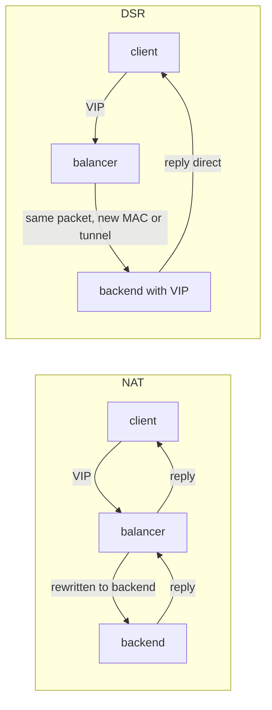
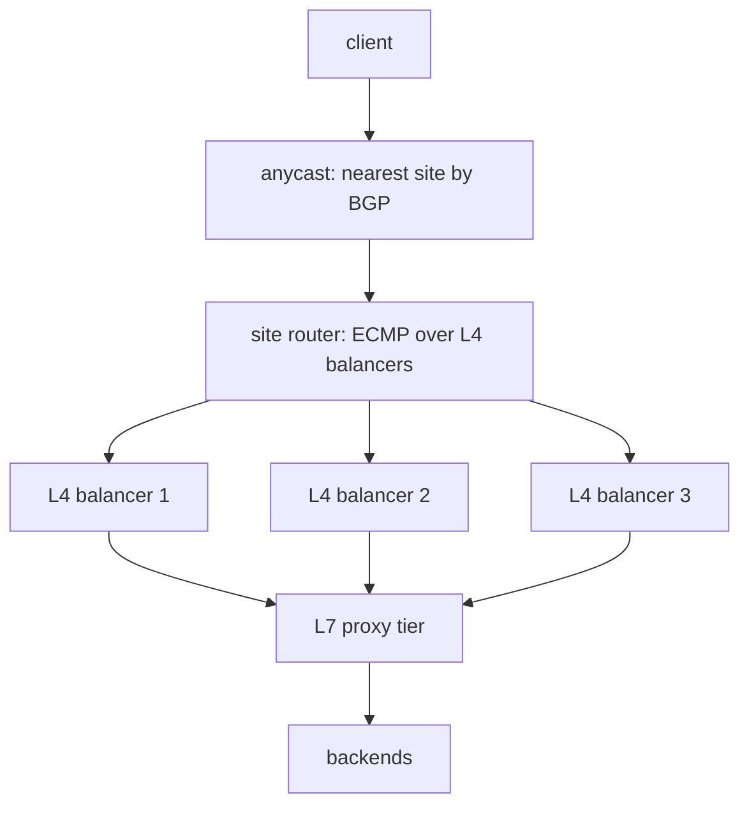

# NET 13: Load balancing, proxies and anycast: forwarding modes, consistent hashing, health checks, L7 proxies and the network as the first balancer

*Part of the [networking plan](00_plan.md) · You need: [NET 11](11_routing_protocols_and_datacenter_fabrics.md) (ECMP and its hash, resilient next hop groups, BGP in the datacenter), [NET 09](09_network_security_firewalls_ips_dpi.md) (connection tracking, NAT, SYN cookies), [NET 07](07_zero_copy_networking.md) (XDP). TLS and HTTP internals are in [NET 08](08_application_protocols_dns_http_tls.md).*

A load balancer takes traffic aimed at one name and spreads it over many machines, and stays correct while those machines come and go. "Design a load balancer that survives a backend being added or removed without breaking existing connections" is a standard question at Google, Meta, Cloudflare-style infrastructure teams and Nvidia, and "where would you put an L4 and where an L7 balancer" is the first follow-up to almost every system design question.

A weak answer lists algorithms (round robin, least connections). A strong answer treats the balancer as five connected decisions: **where it sits** and who sends traffic to it, **how it forwards** a packet (and whether replies come back through it), **how it picks a backend** (and what that pick does when the backend set changes), **what it remembers** (and what a restart loses), and **how it notices failure** (and what the notice window costs). Each decision constrains the next, and the interview is about following the chain.

By the end you can:

- explain the difference between L4 and L7 balancing, and what each buys;
- compare the forwarding modes (proxy, NAT, direct server return, tunnelling) by what they cost and where the reply goes;
- compare backend selection: round robin, least connections, power of two choices, and the consistent hashes (ring, rendezvous, Maglev), with what each does when a backend leaves;
- explain connection tracking, resilient hashing and draining, and what happens to open connections on a change;
- put a number on health check delay and design checks that do not make outages worse;
- explain what an L7 proxy adds (routing, retries, pooling, TLS termination) and its traps;
- explain anycast, what it does to long connections, and how ECMP and L4 and L7 tiers stack;
- sketch a data plane in nftables, IPVS, XDP or user-space, and say where each fits.

---

## 1. What a load balancer decides

A client connects to a **virtual IP (VIP)** or a name. Something must choose a real server, and everything after that depends on how that something is built.


Not every system has all tiers. A small service has one proxy. A large one has the network spread traffic over a fleet of L4 balancers, which spread connections over a fleet of L7 proxies, which spread requests over backends. Each tier exists because the one before it cannot do something.

### 1.1 Layer 4 against layer 7

| | **L4** (transport) | **L7** (application) |
|---|---|---|
| Looks at | IP addresses, ports, TCP/UDP flags | the HTTP request, headers, path, cookies, gRPC method |
| Unit of balancing | a **connection** (or a packet) | a **request** |
| Connection to the client | passes through or rewrites; one end-to-end TCP connection in most modes | terminates it: two separate connections, client side and server side |
| Per-packet cost | very low (hash, table lookup, rewrite) | high (parse, buffer, copy, maybe TLS) |
| Can do | spread connections, keep affinity, absorb a DDoS | route by path or host, retry, rate limit, add headers, terminate TLS, pool connections, shed load per user |
| Cannot do | see inside HTTP, balance requests inside one long connection | scale as cheaply, or survive without state |
| Typical software | IPVS, Maglev, Katran, nftables, hardware balancers | Envoy, nginx, HAProxy, cloud application balancers |

The rule of thumb: **use L4 where you need volume and simplicity, L7 where you need to make a decision per request**. The main reason L7 matters for modern traffic is multiplexing: one HTTP/2 or gRPC connection carries thousands of requests, and an L4 balancer that picks one backend per connection would send all of them to the same server. Per-request balancing needs a proxy that speaks the protocol.

### 1.2 Four ways to forward

| Mode | What the balancer does | Where the reply goes | Cost |
|---|---|---|---|
| **Proxy** (full proxy, L7 or L4) | terminates the client connection, opens its own to the backend | back through the balancer | two connections, a copy of every byte, but full control |
| **NAT** (destination NAT, "full NAT" if the source is also rewritten) | rewrites the destination (and maybe source) address, keeps a table entry per connection | **must** come back through the balancer so the rewrite can be reversed | the balancer carries both directions |
| **Direct server return (DSR)** | changes only the link-layer destination (L2 DSR) or wraps the packet in a tunnel (GRE, IPIP, GUE) to the backend; the backend holds the VIP | **straight from the backend to the client**, bypassing the balancer | the balancer sees only requests, which are small compared to responses; the backend must accept the VIP |
| **Tunnel to a proxy tier** | encapsulate to the next tier across routed networks | depends on the next tier | an extra header (MTU), but works across subnets |

Two questions separate the modes, and they are worth asking aloud in an interview: **does the reply pass through the balancer?** and **is the packet rewritten?**



---

## 2. NAT mode: a stateful rewrite

In NAT mode the balancer rewrites the destination of each incoming packet from the VIP to the chosen backend, and **remembers the choice** so later packets of the connection (and the replies) get the matching rewrite. On Linux this is connection tracking plus a NAT rule; the nftables version below picks a backend round robin with a counter.

```bash
nft -f - <<'RULES'
table ip lbnat {
  chain pre {
    type nat hook prerouting priority dstnat;
    ip daddr 10.0.1.100 tcp dport 80 dnat to numgen inc mod 3 map {
      0 : 10.0.11.2, 1 : 10.0.12.2, 2 : 10.0.13.2
    }
  }
}
RULES
```

A hash of the client address and port, `dnat to jhash ip saddr . tcp sport mod 3 map { ... }`, picks by flow instead of by counter. In an earlier run of this setup, 3,000 connections went to the three backends in nearly equal thirds, and `conntrack -L` showed **one entry holding both directions**: the original tuple (client to VIP) and the reply tuple (backend to client).

### 2.1 What the balancer remembers

The conntrack entry is the whole design. It lets later packets skip the selection, and lets replies be translated back. The consequences:

- **State per connection**: memory proportional to concurrent connections, and a lookup per packet. A restart loses it (section 5).
- **The return path must pass through the balancer.** If a reply bypasses it, the client sees a packet from the backend's address when it expected the VIP, and drops it. In a broken-route test (a backend whose default route did not go back through the balancer), 3 of 9 connections failed silently: the connections that landed on that backend never completed. This is the classic "it works for some clients" symptom. Fixes: make the balancer the backends' default gateway, or **source-NAT** the traffic so replies return to the balancer by definition.
- **Source NAT hides the client.** With full NAT the backend sees the balancer's address, not the client's. Applications that log or rate limit by IP break, so the real client is carried in a header (`X-Forwarded-For`) or in the **PROXY protocol**, a small prefix that a TCP proxy sends before the first byte of data.
- **The balancer carries both directions**, so response bandwidth, usually the larger direction, runs through it.

---

## 3. Direct server return

DSR removes the reply path from the balancer. The balancer forwards the request packet **unchanged except for the link-layer destination** (or inside a tunnel), and the backend, which also holds the VIP on a non-ARPing interface (usually on loopback), answers the client directly with the VIP as source.

```bash
# on each backend: own the VIP without answering ARP for it (so only the balancer attracts the traffic)
ip addr add 10.0.1.100/32 dev lo
sysctl -w net.ipv4.conf.all.arp_ignore=1 net.ipv4.conf.all.arp_announce=2
```

```bash
# on the balancer (L2 DSR), a sketch: the rule that picks a backend by hash and rewrites only the
# destination MAC (`ether daddr set`, then `fwd to` the backend's device) hangs off a netdev ingress chain
nft add table netdev dsr
nft add chain netdev dsr in '{ type filter hook ingress device "lb0" priority 0; }'
```

What it buys: in 300 requests of 100 KB each, the NAT-mode balancer put about 31 MB on its client-facing side (the responses), while in DSR mode that side carried nothing and the balancer received about 187 KB against 604 KB (earlier runs). The balancer in DSR sees request-sized traffic, so one box can front a very large response volume. This is why video and software download fleets use it.

What it costs:

- **Backends must accept the VIP** and must not answer ARP for it. A mistake here (ARP leak) makes a backend steal the VIP's traffic.
- **L2 DSR needs the balancer and backends on one L2 segment.** Across routers use a **tunnel** (GRE, IPIP or GUE) from the balancer to the backend, which adds a header and needs MTU care. Maglev does this with GRE.
- **No L7 features**: the balancer never sees responses, so it cannot retry, cannot see HTTP status for health, cannot change the content.
- **Asymmetric paths** complicate firewalls and monitoring.
- **Connection tracking still exists** on the balancer for the request direction, but it can be small, since the balancer sees only the forward packets (it cannot see FIN or RST from the backend; entries age out by timer).

---

## 4. Choosing a backend

### 4.1 Algorithms that do not need memory

| Algorithm | Idea | Good for | Weakness |
|---|---|---|---|
| **Round robin** (and weighted) | the next backend in turn | equal short requests | ignores load; with unequal request sizes the loads diverge |
| **Random** | uniform pick | stateless, many balancers | the busiest backend is above average by chance (below) |
| **Least connections** | fewest active connections | long, uneven connections | needs shared counts across balancer instances; counts connections, not work |
| **Power of two choices** | pick two at random, take the less loaded | a near-optimal result with little coordination | needs a load signal |
| **Hash of a key** (client IP, 5-tuple, cookie, header) | same key to same backend | **affinity** (stickiness) and caching | not load-aware; what happens when the set changes is the next subsection |
| **Peak EWMA / latency-aware** | favour backends that answer fast | heterogeneous or degrading backends | needs latency measurement, can oscillate |

Random is worse than it looks and two choices is better than it looks. In a simulation of 20 backends and 400 equal connections the busiest backend carried 1.46 times the average with a random pick, 1.07 with the better of two random picks, and exactly 1.0 with least loaded (earlier runs). With **heavy-tailed** work (a few giant requests among many small ones, a Pareto shape) even the best choice stayed at 1.7 times the average, because a single giant request cannot be split. The lesson: balancing connection counts does not balance work, and the cure for giants is splitting the work, not a cleverer picker.

### 4.2 The consistent hash problem

If the pick is `hash(flow) mod N`, then **changing N moves almost every flow**, and a flow that moves lands on a backend that has no state for it (a connection that breaks, a cache that is cold). Consistent hashing exists to move only the flows that must move.

| Scheme | How a flow finds its backend | Strength | Weakness |
|---|---|---|---|
| **hash mod N** | `hash(flow) mod N` | uniform, one line of code | remaps nearly everything on any change |
| **Hash ring** | place each backend at many points on a circle; a flow goes to the next point clockwise | moves only about 1/N of flows; supports weights by point count | balance depends on the number of points (more points, better balance, more memory) |
| **Rendezvous** (highest random weight) | every backend scores the flow; the highest score wins | moves exactly the flows of the removed backend, perfectly uniform | cost per lookup is O(N) |
| **Maglev** | build a lookup table of M slots (M prime, much larger than N) by letting backends take turns claiming slots from their own permutation; a flow looks up `hash mod M` | O(1) lookup, near-uniform, small disruption | a little collateral movement, and it must be rebuilt on a change |

The Maglev table construction is short, and it is worth being able to write:

```python
import bisect, hashlib

def h(s, salt=""):
    return int.from_bytes(hashlib.blake2b((salt + s).encode(), digest_size=8).digest(), "big")

def mod_n(names):                                   # hash modulo the number of backends
    return lambda f: names[h(f) % len(names)]

def ring(names, points=100):                        # each backend owns many points on a circle
    pts = sorted((h(f"{n}#{i}"), n) for n in names for i in range(points))
    keys = [p[0] for p in pts]
    return lambda f: pts[bisect.bisect(keys, h(f)) % len(pts)][1]

def rendezvous(names):                              # highest random weight: every backend scores the flow
    return lambda f: max(names, key=lambda n: h(f, n))

def maglev(names, m=65537):                         # m prime, much larger than the number of backends
    off = [h(n, "offset") % m for n in names]
    skip = [h(n, "skip") % (m - 1) + 1 for n in names]
    nxt, table, filled = [0] * len(names), [None] * m, 0
    while True:
        for i, n in enumerate(names):               # backends take turns claiming their next free preferred slot
            c = (off[i] + nxt[i] * skip[i]) % m
            while table[c] is not None:
                nxt[i] += 1
                c = (off[i] + nxt[i] * skip[i]) % m
            table[c] = n; nxt[i] += 1; filled += 1
            if filled == m:
                return lambda f: table[h(f) % m]

flows = [f"10.1.{i // 250}.{i % 250}:{40000 + i % 9000}->vip:443" for i in range(50000)]
backends = [f"b{i}" for i in range(10)]
for name, build in (("hash mod N", mod_n), ("ring, 100 points", ring), ("rendezvous", rendezvous), ("Maglev", maglev)):
    before, after = build(backends), build(backends[:-1])          # backend b9 is removed
    moved = [f for f in flows if before(f) != after(f)]
    collateral = [f for f in moved if before(f) != "b9"]           # moved although its backend survived
    print(f"{name:18s} moved {len(moved) / len(flows):6.1%}  collateral {len(collateral) / len(flows):6.1%}")
```

Run, with ten backends and one removed, the ideal is **10 percent moved and 0 percent collateral** (only the removed backend's flows move). `hash mod N` moves about **90 percent**, of which about **80 percent is collateral damage**: flows that were on healthy backends and got moved for no reason. The ring and rendezvous move about 10 percent with no collateral. Maglev moves about 10 percent with a small collateral of about 0.2 percent.

Two more facts to keep:

- **Balance.** With 10 backends the busiest backend carried about 1.14 times the average on a ring of 100 points per backend, 1.07 with 1,000 points, and about 1.02 for rendezvous and Maglev (earlier runs). Few ring points means uneven arcs; this is why Maglev and rendezvous are preferred when balance matters.
- **Table size matters for Maglev.** With 100 backends and one removed, a table of 1,009 entries moved 4.2 percent of flows (ideal 1), 65,537 entries moved 1.5 percent, and 655,373 moved 1.1 percent (earlier runs). The table must be much larger than the number of backends for the shares to be even, and bigger tables disrupt less, at the cost of memory and rebuild time.

Why Maglev and not a ring at Google scale: lookup is one array read, which suits a packet pipeline, and the table builds in milliseconds. And why *every* hash scheme needs state anyway: a hash only gives the same answer for the same backend set. When the set changes, a new flow's pick changes; an existing flow stays pinned only because the balancer **remembers** it, which is the next section.

---

## 5. Remembering the choice: state, and what a change does

### 5.1 Hash plus a flow table

Real balancers combine the two: the **first packet** of a connection is placed by the hash, and the choice is **recorded in a flow table** keyed by the 5-tuple. Later packets use the table. Only a connection that is **not in the table** (new, or its entry expired, or the balancer restarted or a different balancer instance sees it) falls back to the hash.

That gives the property people want: **existing connections stay where they are when the backend set changes, and only new connections use the new set.** The hash decides quickly and consistently, and the table protects the connections in flight.

What this means in practice:

- A planned change (add or drain a backend) is safe: existing connections keep their entries.
- A **balancer restart** loses the table. Every existing connection is re-hashed, and with `hash mod N` or a changed backend set a share of them lands on a different backend and is reset. With 300 long connections held open through a rule change, none broke while the table was kept, and 158 broke when the table was lost at the same moment (earlier runs).
- **Multiple balancer instances** (ECMP in front of an L4 fleet) do not share tables. If the router moves a flow to another instance (a balancer joins or leaves), that instance has no entry and must **choose the same backend from the hash alone**. That is the real reason for a consistent hash that every instance computes identically (Maglev builds the same table on every machine from the same backend list, with no coordination).
- A **resilient hash** in the network (next section and section 9) does the same job at the router.

A subtle trap: the nftables `jhash ... mod N` is **not** a plain modulo. Growing from 2 backends to 3 kept about 54 percent of flows in an earlier run where a true modulo keeps 33 percent. Do not assume a particular consistency property from a library; test what changes when N changes.

### 5.2 Sizing the table

The flow table needs an entry per concurrent connection, and entries expire after an idle timeout. Memory is entries times entry size (tens of bytes to a few hundred), and the entry count is arrival rate times lifetime (Little's law):

```python
def table_size(new_flows_per_s, idle_timeout_s, entry_bytes=64):
    entries = new_flows_per_s * idle_timeout_s          # concurrent entries, by Little's law
    return entries, entries * entry_bytes / 1e6          # count, megabytes

for rate, timeout in ((10_000, 100), (100_000, 10), (1_000_000, 10), (1_000_000, 100)):
    n, mb = table_size(rate, timeout)
    print(f"{rate:>9,} new flows/s x {timeout:>3}s idle timeout = {n:>12,.0f} entries, about {mb:,.0f} MB")
```

The same arithmetic explains **SYN floods** against balancers: spoofed SYNs create entries that live for the timeout, so a flood of a million SYNs per second with a 100 second entry fills 100 million entries. Defences are short timeouts for half-open entries, SYN cookies at the front, or not creating state until the handshake completes.

There is a second trade. If the idle timeout is shorter than the longest quiet period of a legitimate connection (a websocket, a database session, a long download paused by flow control), its entry is forgotten and the next packet is re-hashed. If the backend set changed in the meantime, that connection breaks. In a model with a 65,537-entry Maglev table and 100 backends, one removal re-hashes about 0.55 percent of surviving flows, so after ten removals during a long quiet period about 5 percent of idle connections are broken (earlier runs).

### 5.3 Draining and failing over

To remove a backend without breaking users: **stop sending it new connections** (remove it from the hash or set its weight to zero) but **keep its existing entries** until the connections end or a drain timeout expires, then remove it. This is **connection draining**, and it is why a deploy that kills backends instantly produces a burst of resets. Application protocols help: `Connection: close`, HTTP/2 GOAWAY, and gRPC max connection age tell clients to reconnect, which moves long-lived connections gradually.

---

## 6. Noticing failure: health checks and the window they leave open

### 6.1 Active and passive checks

- **Active checks**: the balancer probes each backend at an interval (`inter`): a TCP connect, an HTTP GET to a health path, or a gRPC health call. It marks the backend down after `fall` consecutive failures and up again after `rise` successes.
- **Passive checks (outlier detection)**: the balancer watches real traffic and ejects a backend that returns errors or times out, for a growing time, with a cap on how many backends it will eject at once.

Active checks find a dead backend before users do. Passive checks find the sick-but-answering backend that a shallow probe misses. Production proxies use both.

### 6.2 The detection window

Between a backend's death and its removal, the balancer keeps sending it traffic, and every request in that window fails (unless retried). The window is bounded by the check settings:

```python
def window(inter, fall):
    return (fall - 1) * inter, fall * inter      # shortest and longest time until the backend is marked down

def failed_requests(rate_per_s, backends, inter, fall):
    lo, hi = window(inter, fall)
    share = 1 / backends                          # the dead backend's share of the traffic
    return rate_per_s * share * lo, rate_per_s * share * hi

for inter, fall in ((2, 3), (1, 3), (0.5, 3), (0.1, 2)):
    lo, hi = window(inter, fall)
    a, b = failed_requests(20, 3, inter, fall)
    print(f"inter {inter}s fall {fall}: detected in {lo:.1f} to {hi:.1f} s; 20 req/s over 3 backends loses {a:.0f} to {b:.0f} requests")
```

With `inter 1s fall 3` the backend is marked down in 2 to 3 seconds. In an earlier haproxy run at 20 requests per second over three backends, killing one backend produced **14 failed requests** with retries off, and **0** with `retries 3` and `option redispatch`. Retrying on a *different* backend hides the window from the user entirely, which is why proxies retry connection failures by default. Faster checks shorten the window, but cost: every balancer probes every backend, so 100 proxies at a 100 ms interval put 1,000 checks per second on each backend, and tight timers make a loaded backend flap.

### 6.3 What a check should test

- **Too shallow** (a TCP connect): the process is alive but its database is down, so the check passes and requests fail.
- **Too deep** (checks the database and three dependencies): a dependency blip fails every backend's check at once, and the balancer removes the whole fleet.
- **Good practice**: a dedicated health endpoint that checks what this instance needs to serve (it is initialised, its local resources work), kept cheap; separate **liveness** (restart me) from **readiness** (send me traffic); use `rise` greater than `fall` or hysteresis so a flapping backend does not bounce in and out.
- **Panic mode**: if too many backends fail checks (for example more than half), sending everything to the survivors collapses them. Envoy's panic threshold and similar features then ignore health and spread over everything, on the logic that a dependency problem is more likely than every backend being dead.
- **Slow start**: a freshly started backend with a cold cache and JIT should get a growing share, not an equal one.

---

## 7. Layer 7 proxies: what you buy, and the connection pool

An L7 proxy terminates the client's connection, reads the request, chooses a backend **per request**, and sends it over a connection of its own. That buys:

- **Routing by content**: host, path, header, cookie, gRPC method, to different backend pools (canary releases, A/B tests, API versioning).
- **Protocol bridging**: HTTP/2 or HTTP/3 to the client and HTTP/1.1 to backends, TLS to the client and plain inside.
- **Retries, timeouts, circuit breaking and rate limiting** with knowledge of the request.
- **Connection pooling to backends**: the proxy keeps warm connections and reuses them. In one run, 1,000 requests each arriving on a new client connection created **1,001 backend connections** in plain TCP mode and with conservative reuse, and **only 2** when the proxy was allowed to reuse backend connections aggressively (haproxy `http-reuse always`; earlier runs). That saves handshakes, port exhaustion and backend memory.
- **Observability**: per-route latency, status and error metrics.
- **Security**: a place to terminate TLS, apply WAF rules, authenticate.

The costs and traps:

- **The backend sees the proxy, not the client.** Pass the client address in `X-Forwarded-For` or `Forwarded`, or with the PROXY protocol; and **trust it only from your own proxies**, or a client can forge it.
- **Retries multiply load.** A retry is a new request: three retries of a failing call can triple traffic to a struggling backend. Use **retry budgets** (retries as a fraction of requests), retry only **idempotent** requests (or those that failed before being sent), and add **jittered backoff**. Without these, retries turn a partial failure into a **retry storm**.
- **Timeouts must nest**: a client timeout shorter than the proxy's and the proxy's shorter than the backend's means work continues after the caller has given up. Set per-hop timeouts and propagate a **deadline**.
- **Head-of-line blocking and big buffers**: a slow client holding a connection and a slow upload make proxy memory the limit. Set client timeouts and buffer limits.
- **A proxy is a state-holding hop that can fail**: it needs its own redundancy, which is the L4 tier above it.

A minimal HAProxy configuration that shows the pieces named above (routing, health checks, retries with redispatch, forwarding the client address):

```
global
  maxconn 4096
defaults
  mode http
  timeout connect 1s
  timeout client 5s
  timeout server 5s
  retries 3
  option redispatch 1
frontend fe
  bind :80
  option forwardfor
  acl is_api path_beg /api
  use_backend api if is_api
  default_backend web
backend api
  balance leastconn
  option httpchk GET /health
  server a1 10.0.21.2:80 check inter 1s fall 3 rise 2
  server a2 10.0.22.2:80 check inter 1s fall 3 rise 2
backend web
  balance roundrobin
  option httpchk GET /health
  server w1 10.0.11.2:80 check inter 1s fall 3 rise 2
  server w2 10.0.12.2:80 check inter 1s fall 3 rise 2
```

---

## 8. TLS termination

Terminating TLS at the balancer centralises certificates and lets the proxy see HTTP, at a CPU cost that is dominated by the **handshake** (the public-key operations), not the data (symmetric encryption is cheap with hardware support). Measured as proxy CPU per new connection on one thread (earlier runs, relative and not absolute): about **40 microseconds** for plain TCP, about **890 microseconds** for a TLS 1.3 handshake with an RSA-2048 certificate, about **500 microseconds** with an ECDSA P-256 certificate, and about **405 microseconds** when the client **resumes** a session. So a new TLS connection costs roughly twelve to twenty times a plain one, and the levers are all about not doing full handshakes:

- **Keep-alive and HTTP/2**: fewer connections.
- **Session resumption and tickets** (shared ticket keys across the fleet, or a client that returns to a different proxy gets a full handshake).
- **ECDSA certificates** instead of RSA.
- **Offload** to hardware or a dedicated TLS tier.
- Decide **where the plaintext boundary is**: re-encrypting to backends (mTLS) is the safe default inside a zero-trust network and doubles the TLS work; terminating at the edge and running plain inside is cheaper but trusts the internal network.

NET 08 covers the handshake and QUIC. For balancing, QUIC adds a twist: connections are identified by a **connection ID** and not the 5-tuple, so a balancer can route by connection ID and survive client IP changes and NAT rebinding, which a 5-tuple hash cannot.

---

## 9. Anycast and ECMP: the network as the first balancer

### 9.1 Anycast

**Anycast** announces the same IP prefix from many locations (typically by BGP). Routers send each packet to the **closest** announcement by routing metric. It gives you geographic proximity, failover (withdraw the route and traffic goes elsewhere), and DDoS dilution (the attack is spread across all sites) with no DNS tricks. DNS resolvers, CDNs, and public DNS services use it.

Inside one site, the same idea repeats: the router sees several equal-cost paths to the VIP (one per L4 balancer, each announcing the VIP) and **ECMP** spreads flows over them, using the hash from [NET 11](11_routing_protocols_and_datacenter_fabrics.md). Maglev works this way: every Maglev machine announces the VIP and the router picks one by hash.



### 9.2 What a change does to long connections

Here the earlier consistent hash lesson reappears at the router. Three sites behind a three-way ECMP route took 989, 1,021 and 990 of 3,000 new connections, so the spread works. Then one site was withdrawn with 150 long connections open (earlier runs):

- With a **plain multipath route**, the router's hash is taken modulo the number of next hops, so removing one **re-hashes everything**: the 39 connections on the withdrawn site broke (expected), and **28 of 50 connections on a surviving site broke too**, a collateral loss.
- With a **resilient next hop group** (the kernel's `ip nexthop add ... group 1/2/3 type resilient buckets 128`), the hash indexes a fixed table of buckets and only the removed site's buckets are reassigned, so **no surviving connection broke**.

```bash
# a resilient ECMP group: 128 buckets, a bucket is reassigned only when it has been idle for 120 s
ip nexthop add id 1 via 10.9.1.2 dev r1
ip nexthop add id 2 via 10.9.2.2 dev r2
ip nexthop add id 3 via 10.9.3.2 dev r3
ip nexthop add id 100 group 1/2/3 type resilient buckets 128 idle_timer 120
ip route add 10.99.0.1/32 nhid 100
```

So the three levels share one design principle: hash to choose, **keep the mapping stable when the set changes**, and **remember what is in flight**. Resilient hashing at the router, Maglev at the L4 tier, and connection draining at the proxy are the same idea.

Bucket count matters: with few buckets, the shares among sites are uneven (with 50 sites and 64 buckets the busiest site had 1.56 times its share), so size the group to a multiple of the site count by a good margin (1,024 buckets gave 1.03).

### 9.3 What anycast does not give you

- **Load awareness.** Routing is by BGP distance, not by load, so a busy site keeps attracting traffic. Operators shift traffic by changing announcements (prepending, communities, partial withdrawal).
- **Stickiness across routing changes.** A BGP change can move a client to another site mid-connection, and TCP connections break. This is fine for short requests (DNS, HTTP with retries) and harmful for long ones. QUIC's connection IDs and application-level retry are the mitigations; for TCP-heavy services, providers keep the anycast to a front tier that does little and terminates quickly.
- **Control of which site.** Closest in routing terms is not closest in latency, and a path can be longer than expected.
- **A health signal.** A site that is announcing but broken attracts traffic and blackholes it. The announcement must be **tied to health**: a local agent withdraws the route when the service fails, and the same withdrawal-versus-convergence timing from NET 11 applies.

Compare **DNS-based global balancing** (GSLB): it returns different addresses by location and health, with finer policy, but cached answers and TTLs mean a slow, imprecise failover, and clients may ignore TTLs. Many systems use both: anycast for the entry point, DNS for steering between regions.

---

## 10. Data planes: where the selection runs

| Data plane | How | Speed | Fits |
|---|---|---|---|
| **IPVS** (kernel, `ip_vs`) | the classic Linux L4 balancer: NAT, DR and tunnel modes, schedulers (rr, wlc, sh, mh Maglev-hash), its own connection hash table | millions of packets per second per box | Kubernetes `kube-proxy` IPVS mode, simple fleets |
| **nftables / iptables** | `dnat` with `numgen` or `jhash`, conntrack for state | good, not specialised | small setups, cluster-internal services, tests |
| **XDP / eBPF** | a program at the driver hook selects a backend and rewrites or encapsulates before the kernel stack runs | tens of millions of packets per second per box in native mode | Katran (Meta), Cilium, Cloudflare's L4 tier |
| **User-space kernel bypass** (DPDK, Maglev) | poll the NIC from user space, one core per queue | line rate on modern NICs | Google's Maglev, some hardware-adjacent balancers |
| **Hardware** (switch ASIC, SmartNIC, dedicated appliance) | tables in silicon | line rate | cloud providers' edges, appliances |

NET 07 explains why XDP and bypass are fast: no per-packet allocation, no stack traversal, batched, per-CPU data. A balancer's job (hash a few fields, look up a table, rewrite a header) is small enough to fit in that model.

### 10.1 The selection step of an XDP balancer

This program parses to TCP, hashes the 4-tuple, picks a backend either by modulo or from a user-space-filled Maglev table, and counts SYN picks per backend. It then passes the packet on (a real balancer would rewrite or encapsulate and return `XDP_TX`). It compiles with `clang -O2 -target bpf`; run in generic mode on a veth in an earlier lab, its picks were 1,006, 1,066 and 928 of 3,000 connections with hash modulo 3, and 1,017, 1,001 and 982 from a 1,009 entry table. Generic mode is not fast, so the picks matter, not the speed.

```c
// xdp_sel.c: pick a backend for each TCP packet by hashing the 4-tuple, count the picks, pass the packet on.
#include <linux/bpf.h>
#include <linux/if_ether.h>
#include <linux/ip.h>
#include <linux/tcp.h>
#include <linux/in.h>
#include <bpf/bpf_helpers.h>
#include <bpf/bpf_endian.h>

#define M 1009
struct { __uint(type, BPF_MAP_TYPE_ARRAY); __uint(max_entries, M); __type(key, __u32); __type(value, __u32); } table SEC(".maps");
struct { __uint(type, BPF_MAP_TYPE_ARRAY); __uint(max_entries, 16); __type(key, __u32); __type(value, __u64); } picks SEC(".maps");
struct { __uint(type, BPF_MAP_TYPE_ARRAY); __uint(max_entries, 1); __type(key, __u32); __type(value, __u32); } mode SEC(".maps");

static __always_inline __u32 mix(__u32 a, __u32 b, __u32 c)
{
    __u32 h = (a ^ (b << 16) ^ (b >> 16) ^ c) * 0x9E3779B1u;
    h ^= h >> 15; h *= 0x85EBCA6Bu; h ^= h >> 13;
    return h;
}

SEC("xdp")
int select_backend(struct xdp_md *ctx)
{
    void *data = (void *)(long)ctx->data, *end = (void *)(long)ctx->data_end;
    struct ethhdr *eth = data;
    if ((void *)(eth + 1) > end || eth->h_proto != bpf_htons(ETH_P_IP)) return XDP_PASS;
    struct iphdr *ip = (void *)(eth + 1);
    if ((void *)(ip + 1) > end || ip->protocol != IPPROTO_TCP || ip->ihl != 5) return XDP_PASS;
    struct tcphdr *tcp = (void *)(ip + 1);
    if ((void *)(tcp + 1) > end) return XDP_PASS;
    __u32 h = mix(ip->saddr, tcp->source, ip->daddr ^ tcp->dest), zero = 0;
    __u32 *n = bpf_map_lookup_elem(&mode, &zero);
    if (!n) return XDP_PASS;
    __u32 idx = h % M, pick;
    if (*n == 0) {                       // hash modulo a number of backends
        pick = h % 3;
    } else {                             // one lookup in a table that user space fills
        __u32 *t = bpf_map_lookup_elem(&table, &idx);
        if (!t) return XDP_PASS;
        pick = *t;
    }
    __u64 *c = bpf_map_lookup_elem(&picks, &pick);
    if (c && tcp->syn && !tcp->ack) __sync_fetch_and_add(c, 1);
    return XDP_PASS;
}
char LICENSE[] SEC("license") = "GPL";
```

What to notice: the bounds checks before every header access are demanded by the eBPF verifier, the table lives in a **map** that user space updates atomically (so a backend change is a map write, not a program reload), and a real balancer keeps a per-CPU **flow table** in a map, checks it first, and only on a miss consults the Maglev table. After the table was rebuilt for two backends and written, the picks were 1,463, 1,537 and 0, which is the whole control plane: compute a table in user space, write it into a map.

---

## 11. Putting it together

### 11.1 The usual shape

For a large service: anycast or DNS steers users to a site; the site router uses ECMP (resilient) over a fleet of **L4 balancers** that all announce the VIP; each L4 balancer sends the flow to an **L7 proxy** using a flow table and a shared consistent hash (often with DSR or a tunnel, so replies skip the L4 tier); the proxies terminate TLS, route per request, pool connections and retry; the backends report health through checks and outlier detection. Each tier is **stateless where it can be** (so any instance can take over) and **has a consistent way to pick** (so a missing table entry is not a catastrophe).

### 11.2 A failure walk

**An L4 balancer dies.** The router's next hop disappears (a BFD or link event, section 10 of NET 11), resilient hashing reassigns only that balancer's buckets, and the surviving balancers receive flows they have no entry for. Because every balancer computes the same Maglev table, they choose the same backend as the dead one did, and **existing connections survive** unless the backend set also changed. Cost: a short window of loss until the router converges.

**A proxy dies.** Its connections reset (it held both ends); clients reconnect. The L4 tier notices via checks and stops sending it new connections. Clients with retry and idempotent requests recover with a small blip.

**A backend dies.** Active checks take `(fall - 1) x inter` to `fall x inter` to notice; the proxy retries connect failures on another backend in the meantime; outlier detection ejects a backend that returns errors; panic mode prevents an over-aggressive removal from collapsing the pool.

**A deploy.** Drain: stop new connections, wait for the existing ones, GOAWAY or max-age to move long connections, then stop. Slow start brings the new instance in gradually.

**A thundering herd after an outage.** All clients retry at once and the recovering fleet is knocked down again. Mitigations: jittered backoff at clients, retry budgets at proxies, admission control and load shedding (reject early with 503 and `Retry-After`), and warm-up.

### 11.3 What to configure and check

| Concern | What to check |
|---|---|
| Return path | with NAT, replies pass through the balancer; with DSR, the backend holds the VIP and does not ARP |
| MTU | tunnelling and VXLAN subtract bytes; path MTU and MSS clamping |
| Hash fields | include the source port, so one client IP does not pin to one backend; same hash function and seed on every balancer instance |
| Flow table | size by arrival rate times idle timeout; timeout above the quietest legitimate connection |
| Health | cheap, relevant, with hysteresis; separate liveness and readiness; panic threshold |
| Retries | idempotent only, a budget, redispatch to another backend |
| Timeouts | nested and propagated as a deadline |
| Client address | PROXY protocol or `X-Forwarded-For`, trusted from known proxies only |
| Draining | connection draining, GOAWAY, max connection age |
| Observability | per backend: connections, errors, latency percentiles, ejections; per balancer: table occupancy, drops |

---

## 12. Common mistakes

1. **`hash mod N` with a changing N**, so every backend change reshuffles most flows.
2. **NAT mode without a return path through the balancer**, so some clients silently fail.
3. **DSR backends that answer ARP for the VIP.**
4. **Balancing connections when the traffic is multiplexed** (HTTP/2, gRPC), so one connection carries almost all the load. Use an L7 proxy.
5. **Health checks that are too shallow or too deep**, and no panic mode.
6. **Retrying non-idempotent requests, or retrying without a budget**, which creates retry storms.
7. **Flow table timeout shorter than a legitimate quiet period**, so idle connections break on a change.
8. **No connection draining** during deploys.
9. **A plain ECMP hash in front of a balancer fleet**, so losing one balancer re-hashes every flow. Use resilient hashing.
10. **Trusting `X-Forwarded-For` from the internet.**
11. **Hashing only the source address** (a large NAT or corporate proxy sends everything to one backend).
12. **Treating anycast as load balancing**: it is proximity, not load.
13. **No slow start** for fresh backends.
14. **A load balancer that is itself a single point of failure.**

---

## 13. Interview questions

1. Compare L4 and L7 load balancing. When do you need each?
2. Walk through NAT mode and direct server return. Where does the reply go and why does it matter?
3. What breaks if the return path of a NAT balancer does not go through it?
4. What does DSR cost you, and why do large-response services like it?
5. Compare round robin, least connections and power of two choices. Why is random worse than you expect and two choices better?
6. Why is `hash mod N` a bad way to pick a backend when the set changes?
7. Explain consistent hashing with a ring, then rendezvous hashing and Maglev. When would you choose each?
8. How does Maglev build its lookup table, and why must the table be much larger than the number of backends?
9. If the balancer remembers each connection, why does it also need a consistent hash?
10. What happens to open connections when you add a backend? When the balancer restarts?
11. Size the flow table for one million new connections per second.
12. How long does it take to notice a dead backend, and how do you stop users from seeing it?
13. Design a health check. What is panic mode?
14. What does an L7 proxy buy you, and what are its traps (retries, timeouts, client address)?
15. How much does TLS termination cost, and how do you reduce it?
16. What is anycast, and what does it do to a long-lived TCP connection when a site is withdrawn?
17. Why does a resilient ECMP group help, and what is the property it shares with Maglev?
18. How would you drain a backend without breaking users?
19. Design the load balancing for a service with a billion users and global traffic.
20. How would you build an L4 balancer with XDP? What goes in the program and what in user space?

---

## 14. Scenarios and design questions

**S1. Design a load balancer that survives a backend being added or removed without breaking existing connections.** Cover the hash, the flow table, the control plane and what a balancer restart does.

**S2. After one of four L4 balancers is rebooted, a few percent of long-lived connections reset.** Why and what do you change?

**S3. A gRPC service behind an L4 balancer has one backend at 90 percent CPU and the rest idle.** Diagnose and fix.

**S4. Some clients get timeouts through a NAT balancer, others do not.** What do you check?

**S5. A backend fails and the error rate spikes for a few seconds, then recovers.** Reduce the spike.

**S6. A flash sale triples traffic and retries amplify the overload.** What do you put in place?

**S7. You must load balance UDP (game servers, DNS or QUIC).** What changes compared with TCP?

**S8. A site announces the anycast VIP but its application is broken.** How does this happen and how do you prevent it?

**Where to practise.** Build the hashing snippet of section 4 and extend it with weights and with a flow table, then measure what a removal and a restart do. Run HAProxy or Envoy locally in front of three small servers, kill one, and watch the failed requests under different `inter`, `fall` and `retries`. In a Linux network namespace lab, reproduce NAT mode, break the return route, then switch to DSR. Read the Maglev paper and the Katran README, and re-derive the table-size trade-off. For drill, explain scenarios S1 to S8 aloud in two minutes each, naming the failing component first.

---

## 15. Strong answers (outlines)

**Q1.** L4 balances connections by addresses and ports: cheap, fast, protocol-agnostic. L7 terminates and reads requests: routing by content, retries, pooling, TLS, per-request balancing for multiplexed protocols, at higher cost. Use L4 for volume and as the front tier, L7 where the decision depends on the request.

**Q2.** NAT rewrites the destination and keeps a conntrack entry so replies are rewritten back; replies must pass through the balancer. DSR rewrites only the link layer or tunnels, the backend holds the VIP and replies directly. DSR takes the large response direction off the balancer at the cost of L7 visibility and backend VIP setup.

**Q3.** The client receives a reply from the backend's address instead of the VIP and drops it; connections to that backend fail, so some clients work and some do not. Fix by making the balancer the gateway or source-NATting.

**Q4.** Backends must hold the VIP without ARPing, L2 DSR needs one segment (else a tunnel with MTU cost), no response visibility for retries or health. Large-response services like it because the balancer sees only requests.

**Q5.** Round robin ignores load, least connections needs shared counts and ignores work size, random leaves the busiest above average by chance, two choices cuts the imbalance sharply with little coordination. Heavy-tailed work is not fixed by any picker.

**Q6.** The modulus changes with N, so most flows get a new backend, including those on healthy backends: broken connections and cold caches.

**Q7.** Ring: points on a circle, moves about 1/N, balance depends on point count. Rendezvous: highest score wins, exact and uniform, O(N) per lookup. Maglev: a permutation-based lookup table, O(1) lookups, near-uniform, a little collateral. Choose rendezvous for small sets, Maglev for packet paths.

**Q8.** Each backend has offset and skip from two hashes of its name, giving a permutation of the M slots; backends take turns claiming their next unclaimed slot until the table is full. M prime and much larger than N so shares are even and a removal disturbs few slots.

**Q9.** The table protects connections within one balancer. Across balancers, after restarts or when ECMP moves a flow, a missing entry must be recreated, and only a hash that every instance computes identically gives the same backend.

**Q10.** Add: existing entries stay, only new connections use the new set. Restart: the table is lost, so connections are re-hashed, and any that map elsewhere reset. Mitigate with a consistent hash shared across instances and connection draining.

**Q11.** Entries equal rate times idle timeout (Little's law); at one million per second and 10 seconds that is 10 million entries, about 640 MB at 64 bytes. Shorter timeouts for half-open state, because of SYN floods.

**Q12.** Between `(fall - 1) x inter` and `fall x inter`. Hide it with retries on a different backend, passive outlier detection, and fast but hysteretic checks.

**Q13.** A cheap endpoint that checks what the instance needs, readiness separate from liveness, hysteresis; panic mode ignores health when too many backends fail so the survivors are not crushed by a shared dependency failure.

**Q14.** Content routing, bridging, retries, pooling, observability, TLS and security. Traps: lost client IP (header or PROXY protocol, trust only your proxies), retry storms (budgets, idempotency, backoff), non-nested timeouts, slow clients holding buffers.

**Q15.** The handshake dominates: tens of microseconds plain against hundreds for TLS 1.3, more for RSA than ECDSA, less on resumption. Reduce with keep-alive, HTTP/2, resumption with shared ticket keys, ECDSA, offload.

**Q16.** The same prefix announced from many sites, traffic goes to the nearest. A withdrawal or routing change can move a client to another site, and a TCP connection there has no state and resets; short requests recover by retry, long ones break. Mitigate with QUIC connection IDs and a thin anycast tier.

**Q17.** A resilient group hashes into a fixed bucket table and reassigns only the removed next hop's buckets, so surviving flows keep their paths. Maglev does the same at the L4 tier.

**Q18.** Stop sending new connections, keep existing entries, signal long connections to reconnect (GOAWAY, max age), wait for a drain timeout, then stop.

**Q19.** Anycast or GSLB to a site, resilient ECMP to an L4 Maglev-style fleet, L7 proxies per site, health tied to route announcements, retry budgets and load shedding, drains, and per-tier redundancy.

**Q20.** User space computes the Maglev table and writes it to a map, health changes rewrite it, the XDP program parses headers, checks a per-CPU flow table, falls back to the table, rewrites or encapsulates and returns XDP_TX; the verifier demands bounds checks.

---

## 16. Cheat sheet

- L4: connections, cheap, fronts the fleet. L7: requests, content aware, retries, TLS, pooling.
- Modes: proxy, NAT (reply must return through it), DSR (backend holds the VIP, reply direct), tunnel.
- Pickers: round robin, least connections, power of two choices, hash. Heavy-tailed work needs splitting.
- `hash mod N` remaps about N-1/N; ring, rendezvous and Maglev move about 1/N; Maglev table M prime and much greater than N.
- Hash plus flow table; consistent hash across instances; resilient ECMP at the router; drain before removal.
- Flow table entries = rate x idle timeout.
- Health window: (fall-1) x inter to fall x inter; hide with retry to another backend; panic mode; liveness versus readiness.
- Retries: idempotent, budget, jitter; nest timeouts; trust forwarded headers only from known proxies.
- TLS: handshake cost dominates; resume, ECDSA, keep-alive.
- Anycast: proximity not load; withdrawal breaks long TCP; tie announcement to health.
- Data planes: IPVS, nftables, XDP (Katran), bypass (Maglev), hardware.

---

## 17. Sources and caveats

Sources used: "Maglev: A Fast and Reliable Software Network Load Balancer" (Eisenbud et al., NSDI 2016) and the [Paper Trail summary](https://www.the-paper-trail.org/post/2020-06-23-maglev/) (checked this session) and [The Morning Paper write-up](https://blog.acolyer.org/2016/03/21/maglev-a-fast-and-reliable-software-network-load-balancer/); the Katran documentation; the Linux Virtual Server (IPVS) and nftables documentation; the HAProxy and Envoy documentation (health checking, outlier detection, panic threshold, retry budgets); RFC 7938 and the kernel nexthop group documentation (resilient groups); "The Power of Two Choices in Randomized Load Balancing" (Mitzenmacher); and the interview-oriented lists on [techinterview.org](https://www.techinterview.org/post/3233474140/system-design-load-balancer-architecture-l4-l7-nginx-haproxy-round-robin-least-connections-health-checks-ssl-termination/), [IGotAnOffer](https://igotanoffer.com/blogs/tech/load-balancing-system-design-interview) and [Codemia](https://codemia.io/courses/system_design_fundamentals/load_balancing_fundamentals_algorithms).

Caveats. The hashing comparison (hash mod N, ring, rendezvous, Maglev), the flow table and health check arithmetic, the HAProxy and nftables syntax checks, the resilient group commands and the XDP program compile were **run fresh for this tutorial** on one Linux 6.18 VM as root. The network experiments (NAT and DSR byte counts, the return-path failure, the 300-connection table-loss test, the haproxy failed-request counts, the connection pool counts, the TLS CPU per connection, the three-site anycast withdrawal, the XDP picks, the Maglev table-size sweep, the bucket-balance table and the power-of-two-choices simulation) come from **earlier runs** of the previous version of this tutorial and were not re-run. This kernel has no IPVS (`CONFIG_IP_VS` is off), so IPVS modes and schedulers are described from documentation. Anycast was modelled with static multipath and resilient next hop groups, not BGP. The XDP program ran in generic mode on a veth, so its picks are real and its speed is not. Everything ran on two vCPUs, so throughput and latency figures are relative. TLS costs are proxy CPU per connection (10 ms tick resolution). Katran, DPDK balancers, hardware balancers, cloud providers' internals and Maglev's own throughput numbers are from documentation, and defaults (haproxy 2.8, Envoy) vary by version.

Earlier and later: [NET 07](07_zero_copy_networking.md), [NET 11](11_routing_protocols_and_datacenter_fabrics.md), [NET 14](14_queueing_qos_and_traffic_management.md), [the networking plan](00_plan.md).
