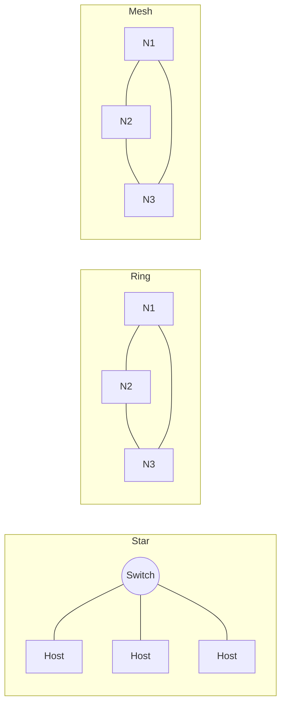
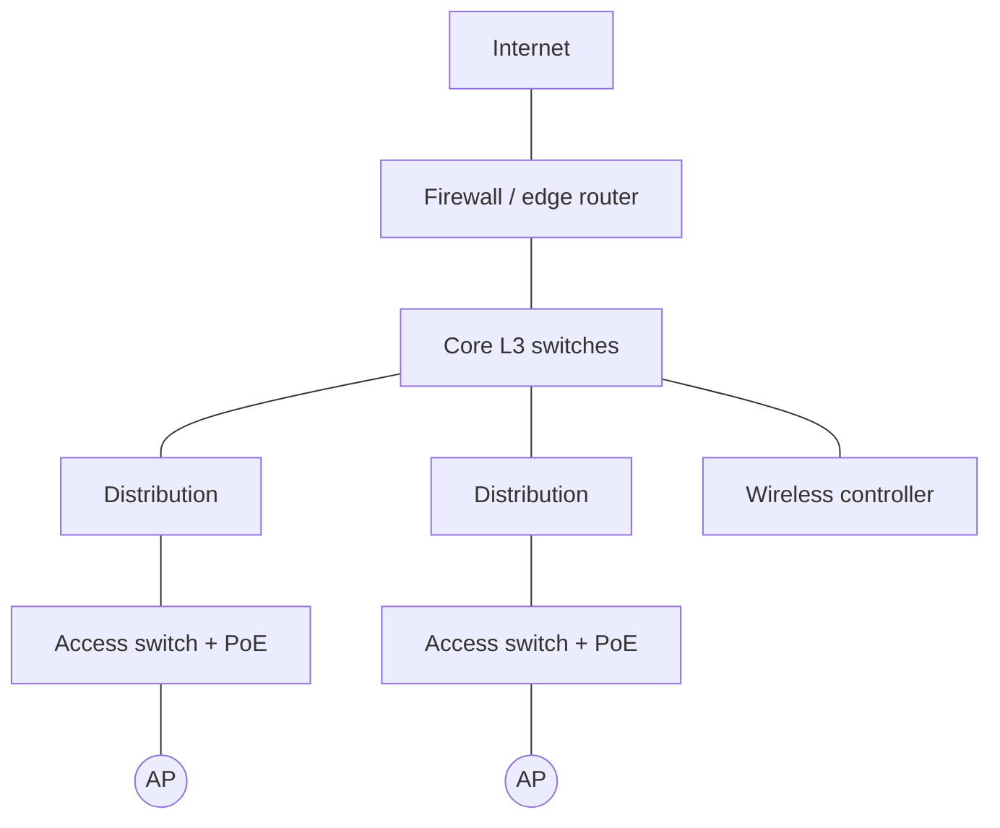
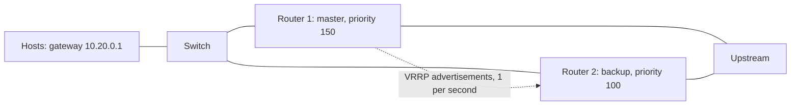

# NET 16: Network foundations: media, devices, legacy routing, gateway redundancy, access control and basic attacks

*Part of the [networking plan](00_plan.md) · You need: [NET 01](01_network_models_and_layer2.md) (frames, switching, VLANs), [NET 02](02_ip_routing_and_layer3.md) (IP, routing tables, NAT) and [NET 11](11_routing_protocols_and_datacenter_fabrics.md) (OSPF and BGP). Pairs with [NET 09](09_network_security_firewalls_ips_dpi.md) for the security parts and with the Wi-Fi sub-track ([WF 07](10_wifi/07_wifi_architectures_mesh_and_services.md) for APs and controllers).*

The core tutorials went deep on TCP, the Linux stack, load balancers and RDMA. A staff-level interview for a network-equipment or Wi-Fi platform company still opens with the **older, plainer material**, and answers it badly if you have only worked at the top of the stack: why a link negotiates 100 Mbit/s half duplex, what an access point's power budget is, what happens to the default gateway when a router dies, why a static route with a high number "floats", how RIP differs from EIGRP, what a TACACS+ server does that RADIUS does not, and how one laptop on a switch can poison everyone's ARP cache.

A weak answer recites the definition ("VRRP is a first-hop redundancy protocol"). A strong answer gives the **mechanism, the timer arithmetic, the failure mode and the command that shows it**: "VRRP elects a master by priority, the master sends an advertisement every second, a backup takes over after three missed advertisements plus a skew that depends on its priority, so a dead master costs about three seconds unless you tune the interval, and the new master sends a gratuitous ARP so hosts relearn the MAC". This tutorial is built to produce the second kind of answer, with small labs you can run: a VRRP failover, floating static routes, ARP spoofing and its defence, and ACL ordering.

By the end you can:

- place a network in a scope (PAN, LAN, MAN, WAN) and a topology, and contrast circuit and packet switching;
- say what hubs, bridges, switches, routers, firewalls, access points and wireless controllers do and where each sits in a campus;
- choose copper or fibre for a run, say what each category and fibre grade gives, and diagnose a speed or duplex mismatch;
- explain Power over Ethernet classes and work out how many access points a switch can power;
- classify an address (RFC 1918, link-local, shared CGNAT space) and explain why a host has a 169.254 address;
- explain administrative distance and the floating static route, and what actually happens on Linux;
- explain RIP, its limits and count to infinity, and EIGRP's feasibility condition, and say why OSPF and BGP won;
- explain HSRP, VRRP and GLBP, compute VRRP's failover time, and run a failover with `keepalived`;
- explain standard and extended ACLs, first-match ordering and implicit deny, and where to place them;
- compare RADIUS and TACACS+ and say when each is used;
- explain ARP spoofing, DHCP and DNS attacks, VLAN hopping and their defences, and the idea of Zero Trust;
- compare FTP, SFTP and FTPS, SMTP, IMAP and POP3, and SSH against Telnet.

---

## 1. Scope, topology and how bits are carried

### 1.1 Network scopes

Scope is about **who owns the cable and how far it goes**, and it decides the technology.

| Scope | Reach | Typical technology | Owner |
|---|---|---|---|
| PAN | a person's few metres | Bluetooth, USB, NFC | the user |
| LAN | a building or campus | Ethernet, Wi-Fi | the organisation |
| MAN | a city | metro Ethernet, fibre rings | a carrier or a city |
| WAN | countries | leased lines, MPLS, the Internet, SD-WAN | carriers |

The boundaries are blurry on purpose; what matters in an interview is the consequence. A LAN is **cheap, fast and owned**: you can run broadcast protocols, trust the medium more and change it at will. A WAN is **rented, slower and lossy**: you pay per megabit, you cannot rely on multicast, and you add encryption and traffic shaping.

### 1.2 Topologies



- **Bus**: one shared cable (old coax Ethernet). A break stops everyone and collisions are shared. Historical.
- **Star**: every host to a central switch. The standard LAN shape; a failed cable costs one host, a failed switch costs the whole star.
- **Ring**: each node to two neighbours (token ring, FDDI, SONET rings, and Ethernet rings with ERPS). A single cut is survived by sending the other way round.
- **Mesh**: many links between nodes. A **full mesh** of *n* nodes needs n(n-1)/2 links (45 for ten nodes), so real networks use **partial meshes**.
- **Tree and hierarchical**: access, distribution and core layers (the classic campus design), or **leaf-spine** in datacenters ([NET 11](11_routing_protocols_and_datacenter_fabrics.md)), which is a two-tier full bipartite mesh.

A good answer names the **failure domain** of each shape: what is lost when one cable, one port or one device fails, and how long recovery takes.

### 1.3 Circuit switching and packet switching

**Circuit switching** sets up a dedicated path before data flows and holds it for the whole call (the old telephone network). Delay is fixed and small, bandwidth is guaranteed, but unused capacity is wasted and setup takes time. **Packet switching** cuts data into packets, each forwarded on its own with a header carrying the destination. Capacity is shared (statistical multiplexing), so it is efficient for bursty traffic, but delay varies and congestion can drop packets ([NET 14](14_queueing_qos_and_traffic_management.md)).

The practical points: the Internet is packet-switched; voice over IP gets circuit-like quality by marking and queueing, not by reserving a circuit; MPLS and virtual circuits are **packet-switched networks with circuit-like paths** (labels chosen at setup), a middle ground.

---

## 2. Devices and what each one does

The same job (moving frames or packets) is done at different layers with different costs. The key idea is the **domain** each device splits.

| Device | Layer | Forwards on | Splits collision domain | Splits broadcast domain |
|---|---|---|---|---|
| Repeater or hub | 1 | nothing: repeats every bit to all ports | no | no |
| Bridge | 2 | destination MAC | yes | no |
| Switch (L2) | 2 | destination MAC, in hardware, per port | yes (each port) | no (unless VLANs) |
| L3 switch | 2 and 3 | MAC within a VLAN, IP between VLANs, in hardware | yes | yes (one per VLAN or routed port) |
| Router | 3 | destination IP, longest prefix | yes | yes |
| Firewall | 3 to 7 | state, addresses, ports, applications | yes | yes |
| Access point | 1 and 2 | bridges Wi-Fi to the wire | n/a (shared air) | no |
| Wireless controller | 2 to 7 | policy, sometimes the data path | | |

- A **hub** makes the whole network one collision domain, so only half duplex works and throughput collapses with load. Nobody sells hubs now, but the term appears in every collision-domain question.
- A **switch** is a multi-port bridge: it **learns** source addresses per port, forwards to one port, floods unknowns, and runs full duplex with no collisions ([NET 01](01_network_models_and_layer2.md)).
- An **L3 switch** routes between VLANs at line rate in an ASIC. The distinction from a router is mostly **feature and interface mix** (routers have WAN interfaces, large tables and deep features; L3 switches have many fast Ethernet ports), not a different principle.
- An **access point** is a bridge between 802.11 and 802.3. In a **controller-based** design the AP may tunnel client traffic to a controller (CAPWAP, central data path) or switch it locally onto the wired network (local or "flex" mode); the controller always handles configuration, radio management and roaming state ([WF 07](10_wifi/07_wifi_architectures_mesh_and_services.md)). Where the data path goes decides where VLANs must exist and where the bottleneck is.



A **broadcast domain** matters because ARP, DHCP and mDNS reach every host in it: a bigger domain means more noise and a bigger blast radius for loops and attacks, which is why VLANs and routed access layers exist.

---

## 3. The physical layer: cables, fibre, negotiation and power

### 3.1 Copper

Twisted-pair copper carries Ethernet up to **100 m** for most speeds. The category sets the speed it is rated for:

| Category | Rated for | Notes |
|---|---|---|
| Cat5e | 1 Gbit/s, and 2.5 Gbit/s | The minimum for gigabit; fine for most Wi-Fi 5 APs |
| Cat6 | 5 Gbit/s at 100 m; 10 Gbit/s only to about 55 m | Better crosstalk performance |
| Cat6A | 10 Gbit/s at 100 m | The usual choice for Wi-Fi 6 and 7 AP uplinks (2.5, 5 or 10 Gbit/s) |
| Cat8 | 25 or 40 Gbit/s to about 30 m | Datacenter, short runs |

(Figures from the NSRC cabling-standards slides; "Cat 7" is not an IEEE-recognised category.) Why this matters for Wi-Fi: a Wi-Fi 6 or 7 AP can carry more than 1 Gbit/s, so a **multi-gigabit uplink (2.5G or 5G) on Cat5e or better** removes the wired bottleneck, and the cable you pulled ten years ago may be the limit.

### 3.2 Fibre

Fibre carries light and goes much farther with no electrical interference.

| Type | Core | Typical reach | Use |
|---|---|---|---|
| Multimode (OM3, OM4) | 50 µm | 10GBASE-SR: 300 m on OM3, 550 m on OM4; 100GBASE-SR4: 70 m on OM3, 100 m on OM4 | Inside a building or datacenter |
| Single-mode (OS2) | 8 to 10 µm | 10 km for LR optics; 40 km for ER | Between buildings, campuses, metro |

The same NSRC slides recommend installing **only single-mode** today: it costs about the same, reaches farther and outlasts speed upgrades, while multimode reach drops sharply at high speeds. Connectors and modules: LC for most SFP-family transceivers (SFP, SFP+, SFP28; QSFP and QSFP28 for 40 and 100 Gbit/s); the SR4 optics use a 12-fibre MPO connector of which 8 fibres are used. Always match the **fibre type, the wavelength and the optic**: a single-mode optic on multimode fibre may link with errors or not at all.

### 3.3 Autonegotiation, speed and duplex

Ethernet over twisted pair **autonegotiates**: both ends advertise what they support and pick the best common mode. Trouble comes from a **manual setting on one side**. If one end is forced to 100 Mbit/s full duplex and the other is left on auto, the auto side cannot see the partner's advertisement; it detects the **speed** (from the signal) but must assume **half duplex**. The result is a **duplex mismatch**: the full-duplex side sends whenever it likes, the half-duplex side sees that as collisions and backs off. The link works for light traffic and collapses under load.

Symptoms and the evidence that shows them:

- the **half-duplex side** counts **late collisions** and collisions; the **full-duplex side** counts **CRC and runt frames**;
- pings are fine, a large transfer is far slower than the link rate, and throughput is erratic;
- on Linux, `ethtool eth0` shows speed, duplex and whether autonegotiation is on; `ethtool -S eth0` shows the counters (names differ by driver).

The rule: **leave both ends on auto, or force both ends identically, and never mix.** For gigabit and above, autonegotiation is required by the standard, so forcing is rarely the right move.

### 3.4 Power over Ethernet

PoE sends DC power over the same twisted pairs so an access point, camera or phone needs no power socket. **PSE** (power sourcing equipment) is the switch or injector; **PD** (powered device) is the AP.

| Standard | Common name | PSE output per port | Power at the device | Used for |
|---|---|---|---|---|
| 802.3af | PoE (Type 1) | 15.4 W | about 12.95 W | phones, simple APs |
| 802.3at | PoE+ (Type 2) | 30 W | about 25.5 W | most Wi-Fi 5 and 6 APs |
| 802.3bt Type 3 | PoE++ / 4PPoE | 60 W | about 51 W | Wi-Fi 6E and 7 APs with many radios, cameras |
| 802.3bt Type 4 | | 90 W | about 71 W | high-power devices |

(From the IEEE 802.3 standards as I remember them and vendor tables; check the exact figures against a datasheet before quoting.) Two points are asked often. First, **the switch has a total PoE budget**, so the number of ports you can run at full power is a division. Second, the **class** is what the switch reserves, while the AP may use less; **LLDP-MED or the 802.3bt power negotiation** lets the AP ask for exactly what it needs, so the reservation shrinks.

```python
budget_w = 370              # example switch PoE budget
pse_w = {"802.3af": 15.4, "802.3at": 30.0, "802.3bt type 3": 60.0, "802.3bt type 4": 90.0}
for k, w in pse_w.items():
    print(f"{k:15s} {int(budget_w // w):3d} ports at full class allocation")
```

On a 370 W switch this gives 24 ports at 802.3af, 12 at 802.3at, 6 at bt Type 3 and 4 at bt Type 4: a 24-port switch cannot power 24 APs of Wi-Fi 7 class. A common field failure is an AP that boots in a **reduced mode** (fewer radio chains or one radio off) because the port provided only af or at power; the AP's log or LED says so.

---

## 4. Addresses you will meet that are not "public"

```python
import ipaddress as ip
for a in ["169.254.12.7", "10.4.5.6", "172.16.0.1", "172.32.0.1", "192.168.1.1", "100.64.3.3", "8.8.8.8"]:
    x = ip.ip_address(a)
    kind = ("APIPA / link-local (RFC 3927)" if x in ip.ip_network("169.254.0.0/16") else
            "private (RFC 1918)" if any(x in ip.ip_network(n) for n in ("10.0.0.0/8","172.16.0.0/12","192.168.0.0/16")) else
            "carrier-grade NAT shared space (RFC 6598)" if x in ip.ip_network("100.64.0.0/10") else "public")
    print(f"{a:14s} {kind}")
```

- **RFC 1918 private space**: `10.0.0.0/8`, `172.16.0.0/12` (172.16.0.0 to **172.31**.255.255, so `172.32.0.1` is public, as the run above shows) and `192.168.0.0/16`. Not routed on the Internet; reaching it needs NAT ([NET 02](02_ip_routing_and_layer3.md)).
- **APIPA, link-local `169.254.0.0/16`** (RFC 3927): a host that **asks for DHCP and gets no answer** picks an address here, checks it with ARP and uses it **for local communication only**. A laptop that shows 169.254.x.x tells you immediately that **DHCP failed**: the server is down, the VLAN or relay is wrong, or the AP dropped the broadcast ([WF 03](10_wifi/03_wifi_mac.md) and [WF 15](10_wifi/15_wifi_multicast_privacy_onboarding_and_interworking.md) cover the Wi-Fi side).
- **Shared address space `100.64.0.0/10`** (RFC 6598): used by carriers between customer NAT and carrier NAT, so it must not clash with a customer's own 10.x network. If a home router's WAN address is in this range, you are behind **CGNAT** and cannot accept inbound connections.

---

## 5. Static routes, administrative distance and the floating route

### 5.1 Which route wins

A router can learn the same prefix from several sources. Longest prefix wins first ([NET 02](02_ip_routing_and_layer3.md)); if two sources offer **the same prefix**, the router needs a way to rank the sources. Cisco-style devices use **administrative distance (AD)**, a trust value where **lower is better**, and only then compare the protocol's own metric.

| Source | Typical default AD (Cisco-style, from memory) |
|---|---|
| Connected interface | 0 |
| Static route | 1 |
| eBGP | 20 |
| EIGRP (internal) | 90 |
| OSPF | 110 |
| IS-IS | 115 |
| RIP | 120 |
| EIGRP (external) | 170 |
| iBGP | 200 |

Defaults differ between vendors, and Linux has no AD at all: it ranks routes by **metric** (and by which routing daemon installed them). FRR lets you set a `distance` per protocol and per route and translates it into the kernel metric.

### 5.2 The floating static route

A **floating static route** is an ordinary static route given a **worse AD (or metric) than the dynamic or primary route**, so it sits unused until the better one disappears. It is the cheapest backup there is: a branch with a leased line and a cheap broadband link uses the line as primary (learned by OSPF, AD 110) and a static route with AD 200 over broadband as backup.

A test with two routes to the same prefix (metrics 10 and 200 on Linux), then the primary link going down:

```bash
ip -n fa route add 192.0.2.0/24 via 10.1.0.2 metric 10     # primary
ip -n fa route add 192.0.2.0/24 via 10.2.0.2 metric 200    # floating backup
ip -n fa route get 192.0.2.1          # via 10.1.0.2 dev a1
ip -n fa link set a1 down
ip -n fa route get 192.0.2.1          # via 10.2.0.2 dev a2   (backup took over)
```

Two findings that matter in practice:

1. **The backup takes over only when the primary route is removed.** Removal happens when the **local interface goes down**. If the cable stays up but the path beyond is dead (a failed upstream router, a broken ISP circuit), the route stays installed and traffic blackholes. The fix is to tie the route to a **probe**: BFD, an IP SLA or a tracked ping, so the route is withdrawn when the far end stops answering ([NET 11](11_routing_protocols_and_datacenter_fabrics.md) has BFD).
2. **On Linux the primary did not come back by itself.** After `a1` went down its route was deleted, and when the link came up again the table still showed only the metric-200 route: routes added with `ip route` are removed with the interface and not restored. A network manager, `netifd` or FRR's static daemon re-adds them. This is why "a static route" on a Linux box in a real product is owned by a daemon, not typed once.

---

## 6. Legacy interior routing: RIP and EIGRP

OSPF and BGP ([NET 11](11_routing_protocols_and_datacenter_fabrics.md)) dominate large networks, but RIP and EIGRP remain in small sites and in exams, and the ideas behind them (distance vector, loop avoidance, feasible successors) are asked as concepts.

### 6.1 RIP: distance vector in its simplest form

Each router tells its neighbours **its whole table** (distance to each network) at fixed intervals, and picks the neighbour with the smallest advertised distance plus one. The metric is **hop count**; **16 means unreachable**, so the network diameter is at most **15 hops**. RIPv2 sends to the multicast address 224.0.0.9 over UDP port 520, supports CIDR and authentication, and updates every 30 seconds by default (timers from memory).

The weakness is in the name: **it learns about failure slowly** and can loop while it does. After a break, neighbours exchange stale information and a route's metric **counts to infinity**, one step per update. A small simulation of routers A and B, where the link beyond B has just failed and A still believes B can reach the network:

```python
INF = 16
def run(poison):
    dA, dB, rounds = 2, INF, 0         # B has noticed its link died
    while not (dA >= INF and dB >= INF) and rounds < 50:
        rounds += 1
        advA = INF if poison else dA   # poison reverse: A's route goes via B, so A advertises "unreachable" back
        dB = min(INF, advA + 1)        # B now believes it can go via A
        dA = min(INF, dB + 1)          # A follows B, its next hop
    return rounds
print(run(False), run(True))
```

This returns 8 rounds without protection (A's metric goes 4, 6, 8 ... 16) and 1 with it. At a 30 second update interval that is minutes of loop. The standard defences:

- **Split horizon**: never advertise a route back out of the interface you learned it on.
- **Route poisoning and poison reverse**: advertise a dead route with metric 16 so everyone drops it at once; advertise it back to the neighbour you learned it from as 16.
- **Triggered updates**: send a change at once instead of waiting for the timer.
- **Hold-down timers**: ignore worse information about a route for a while after it fails.
- The **maximum of 15** is itself a defence: counting stops at 16.

### 6.2 EIGRP: distance vector with a proof of loop freedom

EIGRP (Enhanced Interior Gateway Routing Protocol, originally Cisco's and since published as an informational RFC) still exchanges distances, but it keeps **all paths** in a topology table and uses **DUAL**, the Diffused Update Algorithm, to guarantee loop freedom.

- **Feasible distance (FD)**: the best total metric to a destination through the current best neighbour (the **successor**).
- **Reported distance (RD)**: the metric a neighbour advertises for that destination, from its own point of view.
- **Feasibility condition**: a neighbour is a **feasible successor** (a safe backup) if its **RD is less than our FD**. Its path cannot go through us, because its own distance is already smaller than ours.

When the successor fails and a feasible successor exists, the router switches **at once, with no queries**. Only when none exists does it send queries to neighbours and wait for replies (the "active" state).

```python
paths = {"via R2": (10, 20), "via R3": (15, 25), "via R4": (30, 40)}   # (reported distance, total distance)
fd = min(t for _, t in paths.values())
for n, (rd, t) in paths.items():
    print(n, "feasible successor" if rd < fd and t != fd else "successor" if t == fd else "must query")
```

With a feasible distance of 20 through R2, R3 (RD 15 < 20) is a valid instant backup, and R4 (RD 30) is not. The metric defaults to **bandwidth and delay** (K1 and K3 set to 1, the others 0), and **neighbours with mismatched K values do not form adjacency**. Internal EIGRP routes have AD 90.

| | RIP | EIGRP | OSPF |
|---|---|---|---|
| Type | distance vector | advanced distance vector | link state |
| Metric | hop count (max 15) | bandwidth and delay | cost (bandwidth) |
| Convergence | slow, timer driven | fast with a feasible successor | fast (SPF after flooding) |
| Updates | full table periodically | incremental, event driven | LSAs flooded on change |
| Standard | open | originally Cisco, now documented | open |

Why OSPF and BGP won: they are open and multi-vendor, **OSPF scales with areas**, and **BGP** is the only choice between organisations. Datacenters then moved to BGP alone ([NET 11](11_routing_protocols_and_datacenter_fabrics.md)).

---

## 7. First-hop redundancy: HSRP, VRRP and GLBP

### 7.1 The problem

A host has **one default gateway** address. If that router dies, the host cannot leave its subnet even though a second router sits next to it. Pointing hosts at two gateways does not work with ordinary DHCP, and routing protocols on hosts are not an option. A **first-hop redundancy protocol (FHRP)** lets two or more routers share a **virtual IP and virtual MAC**: hosts use the virtual IP as their gateway, one router answers for it, and when it fails another takes over the same address, so the hosts notice nothing.



### 7.2 How VRRP works

**VRRP** (Virtual Router Redundancy Protocol; the standard is RFC 3768 for v2, RFC 5798 for v3 with IPv6) works like this:

1. Routers in a group share a **virtual router ID (VRID)** and one or more **virtual IPs**. The virtual MAC is `00:00:5e:00:01:<VRID>` for IPv4.
2. Each router has a **priority** (1 to 254, default 100; 255 is for the router that owns the virtual address).
3. The **highest priority becomes master**, answers ARP for the virtual IP and forwards traffic. It sends an **advertisement** (IP protocol 112, to 224.0.0.18) every **advertisement interval**, 1 second by default.
4. Backups listen. If no advertisement arrives for the **master down interval**, a backup takes over:

   master down interval = 3 × advertisement interval + skew time, where **skew = (256 - priority) / 256 × the advertisement interval**.

   The skew staggers the backups so the higher-priority one wins the race. For priority 100 and a 1 second interval, 3 + 0.61 = **about 3.6 seconds**.
5. The new master sends a **gratuitous ARP** so switches and hosts relearn who owns the address. **Preemption** (on by default in VRRP) lets a higher-priority router take the role back when it returns.
6. A master that is shut down gracefully sends an advertisement with **priority 0**, which makes the backups wait only the **skew time** (about 0.6 s here) instead of the full master-down interval.

### 7.3 A failover you can run

A lab with three namespaces on a bridge (two routers and a client) and `keepalived` as the VRRP daemon:

```
vrrp_instance LAN {
  state BACKUP
  interface vr1
  virtual_router_id 51
  priority 150            # 100 on the second router
  advert_int 1
  virtual_ipaddress { 10.20.0.1/24 }
}
```

The client pings the virtual address every 0.2 seconds and watches its ARP entry for it. The results in this VM:

| How the master stopped | Lost pings | Outage | What the client saw |
|---|---|---|---|
| `keepalived` stopped cleanly | 3 | about 0.6 s | the VIP moved to router 2 after the skew time only (priority 0 advertisement) |
| the master's interface taken down | 13 | about 2.6 s | the VIP moved after the master-down timer |

The client's ARP entry for the virtual IP changed from one MAC (`9a:8a:92:6b:98:16`) to another (`9a:df:1d:ee:76:c7`) and the new master announced itself with ARP. The silent failure took **2.6 seconds, not 3.6**: the master-down timer starts from the **last advertisement received**, which arrived up to one second before the failure, so detection lands between roughly 2.6 and 3.6 seconds after it. (`keepalived` uses real interface MACs by default, which is why the MAC changed; its `use_vmac` option gives a stable virtual MAC and avoids relying on the gratuitous ARP.)

Three practical points follow: a **graceful stop is fast and a crash is slow**; shortening the interval to 100 ms makes crash failover about 0.4 seconds at the price of more load and a higher chance of false failover under CPU stalls; and where sub-second matters, pair the group with **BFD** ([NET 11](11_routing_protocols_and_datacenter_fabrics.md)) or use a different design, below.

### 7.4 HSRP and GLBP

| | HSRP | VRRP | GLBP |
|---|---|---|---|
| Origin | Cisco proprietary (RFC 2281 describes it) | open standard | Cisco proprietary |
| Roles | active, standby, others listen | master, backups | one AVG and up to four AVFs |
| Virtual MAC | `0000.0c07.acXX` (v1) | `0000.5e00.01XX` | several, `0007.b400.XXYY` |
| Multicast address | 224.0.0.2 (v1), 224.0.0.102 (v2) | 224.0.0.18 | 224.0.0.102 |
| Hello / hold | 3 s / 10 s | 1 s / about 3.6 s | 3 s / 10 s |
| Default priority | 100 | 100 | 100 |
| Preempt by default | no | yes | no (for the AVG) |
| Load sharing | per group, by using several groups | per group, same | built in |

(Values from memory and common vendor documentation; defaults vary by platform. The FRR documentation confirms the VRRP defaults used here: VRRPv3, preempt enabled, advertisement interval in multiples of 10 ms.)

**GLBP** adds **load sharing inside one group**: the **active virtual gateway (AVG)** answers ARP requests for the one virtual IP with **different virtual MACs**, one per **active virtual forwarder (AVF)**, so hosts spread over several routers while sharing one gateway address. With HSRP or VRRP you get the same effect by **two groups** (two virtual IPs, each router master of one) and handing out half the hosts each gateway.

### 7.5 Where FHRPs stand today

- **Tracking**: the usual extension is to **lower the priority** when the upstream link or a tracked route fails, so the router with a working path becomes master. Without it a router can be master of the group and be unable to reach the world.
- **Datacenters** often avoid FHRPs: **anycast gateways** (the same gateway IP and MAC on every leaf, as in EVPN) or **MLAG with VARP** give an **active-active** gateway with no election and no timer ([NET 11](11_routing_protocols_and_datacenter_fabrics.md)). Hosts keep one gateway address and any leaf answers.
- **Split brain**: if the routers stop hearing each other but both still reach the hosts, **both become master** and answer ARP; hosts see flapping MACs. Use a **dedicated, redundant link for advertisements**, isolation of the segment (VRRPv2 as specified in RFC 3768 has no authentication), and monitoring that alerts on two masters.
- On Wi-Fi networks FHRP failures look like **"all clients lose the Internet for several seconds"**: clients keep their IP and ARP entry for the old MAC until the gratuitous ARP arrives. Group-addressed frames are slow on Wi-Fi ([WF 15](10_wifi/15_wifi_multicast_privacy_onboarding_and_interworking.md)), so a proxy-ARP AP that caches the old MAC can lengthen the outage.

---

## 8. Access control lists

An **ACL** is an ordered list of permit and deny rules that a router, switch or firewall applies to packets. Three properties explain nearly every ACL bug:

1. **First match wins**, so **order is the logic**.
2. There is an **implicit deny at the end** on Cisco-style devices: a packet that matches nothing is dropped. (Linux `nftables` has a **chain policy** instead, `accept` or `drop`.)
3. An ACL is **applied to an interface in a direction** (in or out); an ACL that exists but is not applied does nothing.

| Type | Matches on | Typical use |
|---|---|---|
| Standard | source address only | route filtering, restricting management access, simple permits |
| Extended | source, destination, protocol, ports (and flags, DSCP) | most packet filtering |
| Named | either, with a name and editable lines | readable and maintainable |
| Reflexive or stateful | return traffic of sessions started inside | simple stateful filtering without a full firewall |
| Time-based | adds a time window | office hours rules |

**Placement** (classic guidance): put **extended ACLs close to the source**, so unwanted traffic is dropped before it crosses the network, and **standard ACLs close to the destination**, because matching only on source would otherwise block that source from everywhere.

The ordering problem shows up clearly with `nftables`. The server listens on ports 22 and 8080 and two clients connect from `.5` and `.9`; a blocked connect shows as a timeout (DROP).

| Rules (in order) | .5 to :22 | .5 to :8080 | .9 to :22 | .9 to :8080 |
|---|---|---|---|---|
| 1. deny the /24, then permit .5 | DROP | DROP | DROP | DROP |
| 2. permit .5, then deny the /24 | open | open | DROP | DROP |
| 3. permit the /24 to tcp 22, then deny the /24 | open | DROP | open | DROP |

Row 1 is the classic mistake: the permit for one host sits **behind** a broader deny, so it never matches. Row 3 shows why extended ACLs (protocol and port) are the useful ones. The practical disciplines: put the **most specific rules first**, **count hits per rule** to find dead ones, and **test with a connection from each case**, not by reading the list.

---

## 9. AAA: RADIUS and TACACS+

**AAA** is authentication (who are you), authorisation (what may you do) and accounting (what did you do). Two protocols carry it, for two different jobs.

| | RADIUS | TACACS+ |
|---|---|---|
| Transport | UDP (ports 1812 and 1813; 1645 and 1646 in older systems) | TCP (port 49) |
| Encryption | only the **password** in the request | the **whole packet body** (the header stays readable) |
| AAA design | authentication and authorisation **combined** | the three functions **separate** |
| Per-command authorisation | no | **yes**: allow or deny each CLI command per user or group |
| Typical job | **network access**: Wi-Fi 802.1X, VPN, wired port authentication | **device administration**: who may log in to a router and which commands they may run |
| Standard | IETF (RFC 2865 and 2866) | Cisco-originated; documented as an informational RFC |

(Transport, encryption scope, separation and per-command authorisation are from Cisco's comparison note; the port numbers are from memory.) The practical rule: **RADIUS for users joining a network** (it is what 802.1X and WPA-Enterprise use, [WF 04](10_wifi/04_wifi_security.md)), **TACACS+ for administrators on infrastructure**, where "this engineer may show but not configure" matters and where an audit trail of every command is required. TCP also tells TACACS+ at once that a server is down, while UDP cannot distinguish a dead server from a slow one, so RADIUS clients use timeouts and retries and a list of servers.

---

## 10. Layer 2 and basic attacks, and their defences

Most of these succeed because a **trusted shared segment trusts what it hears**.

### 10.1 ARP spoofing

ARP has no authentication. Any host can answer, or announce, "10.30.0.1 is at my MAC", and neighbours update their cache, sending the attacker their traffic (a man in the middle). A lab with a victim, a gateway and an attacker on one bridge:

```
victim thinks gateway is at:   6a:37:58:a8:7a:f5 REACHABLE      (the real gateway)
attacker is:                   6a:80:3a:ea:1c:48
after the forged reply:        6a:80:3a:ea:1c:48 STALE          (poisoned)
--- defence: a permanent neighbour entry
after another forged reply:    6a:37:58:a8:7a:f5 PERMANENT      (unchanged)
```

The forged reply was built with `scapy` (an ARP reply from the attacker claiming the gateway's IP). One surprise from the test: a forged reply sent **within half a second** of a genuine one was **ignored**, and only a reply sent after a pause worked. That is the kernel's `locktime` (1 second by default), which keeps the first answer to avoid flapping. It is a speed bump, not a defence.

Defences, from host to network:

- **Static or permanent ARP entries** for critical addresses such as the gateway (as in the test); impractical at scale.
- **Dynamic ARP Inspection (DAI)** on the switch: it checks each ARP packet against a trusted binding table built by **DHCP snooping** (IP, MAC, port) and drops forged ones.
- **Port security** (limit the MACs per port) and **802.1X** so unknown hosts cannot join.
- **Encryption above** (TLS, SSH) so a man in the middle sees little, and **private VLANs** or client isolation so peers cannot reach each other.

### 10.2 DHCP attacks and DNS cache poisoning

- **DHCP starvation** requests all addresses with fake MACs; **a rogue DHCP server** hands out a malicious gateway or DNS. **DHCP snooping** marks which ports may answer DHCP (trusted) and drops offers from the rest, and rate-limits requests.
- **DNS cache poisoning** tricks a resolver into caching a forged answer. The attacker must guess the **16-bit transaction ID** (and, in the original form, nothing else), which in 2008 the Kaminsky technique made feasible by racing many forged replies. The fixes: **randomising the source port** (adds about 16 more bits to guess), **0x20 case randomisation** of the query name, **DNSSEC** (signed answers), and encrypted transports between client and resolver ([NET 08](08_application_protocols_dns_http_tls.md)).

### 10.3 VLAN hopping

An attacker on an access port reaches a VLAN it should not. There are two ways ([NET 01](01_network_models_and_layer2.md) for tags):

- **Switch spoofing:** the port is left in a dynamic mode and the attacker sends **DTP** messages so the switch forms a trunk with it; the attacker then tags frames for any VLAN the trunk carries.
- **Double tagging:** the attacker, on an access port in the trunk's **native VLAN**, sends a frame with two tags. The first switch strips the outer (native) tag and forwards the frame on the trunk with the inner tag intact, so the next switch delivers it into the target VLAN. It is **one way** (no return path), enough to inject traffic.

Defences: set user ports to **static access** and disable DTP; keep the **native VLAN unused** (and tag it on trunks); **allow only needed VLANs** on each trunk; shut unused ports; authenticate with 802.1X. DAI helps against ARP spoofing but is not a VLAN hopping defence, and firewalls do not see these attacks because they happen inside layer 2.

### 10.4 Zero Trust

The old model was a **castle and moat**: everything inside the corporate network is trusted, so one compromised laptop on the LAN reaches everything. **Zero Trust** (described in NIST SP 800-207, from memory) drops location as a basis for trust:

- **verify explicitly**: authenticate and authorise every request using identity, device health and context, not the source network;
- **least privilege**: give each user and service only the access it needs, for as long as it needs;
- **assume breach**: segment the network, inspect and log east-west traffic, and limit the blast radius.

In networking terms it shows up as **micro-segmentation**, per-device certificates (802.1X EAP-TLS, [WF 04](10_wifi/04_wifi_security.md)), identity-aware proxies in front of applications, and mutual TLS between services. It does **not** remove firewalls or VLANs; it stops treating them as sufficient.

---

## 11. Application protocols from the older toolbox

| Protocol | Ports | What it does | The point to make |
|---|---|---|---|
| Telnet | 23 | remote terminal | **cleartext**, including the password; replaced by SSH |
| SSH | 22 | encrypted remote shell, file copy, tunnels | host keys (trust on first use), public-key login, port forwarding |
| FTP | 21 control, 20 or random data | file transfer | **two connections**, cleartext; trouble with NAT and firewalls |
| SFTP | 22 | file transfer **over SSH** | a different protocol from FTP, not "FTP with SSL" |
| FTPS | 21 or 990 | FTP wrapped in TLS | still two connections, so still awkward with firewalls |
| SMTP | 25 (server to server), 587 (submission), 465 (implicit TLS) | **send** and relay mail | store and forward; STARTTLS upgrades the link |
| POP3 | 110 / 995 | **download** mail, usually delete from the server | simple, single device |
| IMAP | 143 / 993 | **manage mail on the server** | folders and state synchronised across devices |

(Port numbers from the IANA registry as I remember them.)

- **Why FTP is awkward:** the **control connection** carries commands and the **data connection** carries each transfer. In **active mode** the server connects back to the client, which a NAT or firewall blocks. In **passive mode** the client opens both connections, to a port the server chooses, so the firewall must allow a range or have an FTP helper that watches the control channel. This is the stock example of a protocol that puts addresses **inside the payload**.
- **Telnet against SSH:** Telnet sends keystrokes in cleartext, so anyone on the path (and an ARP spoofer on the LAN) reads the password. SSH negotiates keys first, authenticates the **server** by its host key (so you notice a man in the middle when the key changes) and the **user** by password or public key, then encrypts everything. It also carries **port forwarding**, which is why it is both a tool and a policy concern.
- **SMTP against IMAP:** SMTP **pushes** mail towards a destination; IMAP and POP3 **pull** it from a mailbox. Authentication and encryption were added later (submission on 587, STARTTLS), which is why mail still has many interoperability and spoofing problems (SPF, DKIM and DMARC address sender forgery).

---

## 12. Common mistakes

1. **Mixing forced and automatic speed or duplex** on the two ends of a link.
2. **Assuming a Cat5e run supports a multi-gigabit AP** without testing, or ignoring the 100 m limit including patch cords.
3. **Counting PoE ports without the budget.** The switch has ports for 24 APs and power for 12.
4. **Calling 172.32.0.0 private.** Only 172.16.0.0 to 172.31.255.255 is.
5. **Treating a 169.254 address as a network fault.** It is the symptom that DHCP did not answer; look for the cause.
6. **A floating static route that never floats**, because the interface stays up when the path beyond fails. Track it with BFD or a probe.
7. **Believing a Linux static route survives a link flap.** The daemon that owns it must re-add it.
8. **Using RIP for anything with more than 15 hops**, or without split horizon and poisoning.
9. **Configuring EIGRP K values differently on two routers** and wondering why there is no adjacency.
10. **Forgetting tracking on the FHRP group**, so a router with a dead uplink is still the gateway.
11. **Two VRRP masters** because advertisements cross a failing link, with no alarm.
12. **ACL rules in the wrong order**, or an ACL not applied to an interface.
13. **Using RADIUS where per-command authorisation is required**, or TACACS+ for Wi-Fi 802.1X.
14. **Relying on a switch's default port settings** (DTP on, native VLAN 1, no DHCP snooping).
15. **Using FTP or Telnet across an untrusted path** because "it is only internal".

---

## 13. Interview questions

**1. What is the difference between a hub, a switch and a router?**
A hub repeats every bit to all ports, so everything shares one collision domain and one broadcast domain. A switch forwards frames by destination MAC to one port, which gives each port its own collision domain, but all ports stay in one broadcast domain unless VLANs are used. A router forwards by destination IP, so each interface is its own broadcast domain.

**2. Where do access points and wireless controllers sit, and what decides the data path?**
APs connect to access switches, usually with PoE; controllers sit in the core or the cloud. In a tunnelled design client traffic is carried to the controller and enters the wired network there, so VLANs live at the controller. In a local-switching design the AP puts traffic on its own VLAN at the access switch and the controller only manages. That choice decides where the bottleneck is and which VLANs each port must carry.

**3. A link works for pings but a file copy runs at a fraction of the rate and shows errors. What do you suspect?**
A duplex mismatch: one side forced to full duplex, the other on auto and falling back to half. The half-duplex side counts late collisions and the full-duplex side counts CRC and runt frames. Check `ethtool`, set both ends the same, and prefer autonegotiation on both.

**4. A switch has 24 PoE ports and a new AP will not power up properly. Why?**
The PoE budget or the class. The total budget may be used up, or the port may offer only af or at power while the AP needs more, so it boots in a reduced mode or not at all. Check the switch's PoE status, the AP's power class and whether LLDP power negotiation is enabled.

**5. What is a 169.254 address and what does it tell you?**
A link-local address a host assigns itself when DHCP gets no reply. It lets hosts on the same link talk, but there is no gateway. It tells you the DHCP request or reply is being lost: server down, wrong VLAN, relay missing, or an AP dropping broadcasts.

**6. What is administrative distance and what is a floating static route?**
AD ranks the trustworthiness of route sources when several offer the same prefix; lower wins. A floating static route is a static route with a deliberately higher AD (or metric) than the primary, so it takes over only when the primary route is withdrawn. It is withdrawn only when the local interface goes down, so for failures farther away you track it with BFD or a probe.

**7. Why is RIP limited, and what is count to infinity?**
RIP uses hop count with a maximum of 15 and learns of failures by timers. After a break, neighbours keep advertising stale routes to each other and the metric climbs one step per update until it reaches 16, which can take minutes. Split horizon, poison reverse, triggered updates and hold-downs reduce it.

**8. How does EIGRP find a backup route without a loop?**
It keeps every neighbour's reported distance. A neighbour is a feasible successor if its reported distance is less than our feasible distance, which proves its path does not go through us. If the successor fails, the router switches to the feasible successor at once; otherwise it queries its neighbours.

**9. Why did OSPF and BGP win over RIP and EIGRP?**
They are open, scale (areas in OSPF, policy and path vectors in BGP) and converge quickly; BGP is the only option between organisations, and datacenters use it internally. RIP's limits are structural, and EIGRP was proprietary for most of its life.

**10. How does VRRP elect a master and how long does a failover take?**
By priority, the highest wins, ties going to the higher address. The master advertises every second; backups wait three intervals plus a skew of (256 minus priority)/256 of an interval, about 3.6 seconds at priority 100. A graceful shutdown sends priority 0 and the backups wait only the skew. The new master sends a gratuitous ARP.

**11. How do HSRP, VRRP and GLBP differ?**
HSRP is Cisco's, with active and standby routers; VRRP is the open standard with master and backups; both give one virtual IP and MAC. GLBP also shares load inside one group by answering ARP with different virtual MACs for different routers. With HSRP or VRRP you spread load by running two groups.

**12. What would you do if a gateway failover takes ten seconds?**
Look at the timers (hello and hold, or advertisement interval), whether tracking lowers priority on an uplink failure, whether preemption and delays cause a second flap, and whether hosts keep an old ARP entry because the gratuitous ARP was lost (especially on Wi-Fi). Then shorten timers with BFD, or move to an active-active design such as an anycast gateway.

**13. What is the difference between a standard and an extended ACL, and where do you apply each?**
A standard ACL matches only the source address; an extended one matches protocol, source, destination, and ports. Apply extended ACLs near the source to drop traffic early, and standard ACLs near the destination so you do not block a source from everywhere.

**14. Why did my permit rule not work?**
Rules are evaluated in order and the first match wins, so a broader deny above it matched first. Also check the implicit deny at the end, the interface and direction the ACL is applied to, and hit counters per rule.

**15. RADIUS or TACACS+ for administrators logging in to routers?**
TACACS+: it runs over TCP, encrypts the whole body, separates authentication from authorisation and can authorise each command, which gives roles such as read-only and a full audit trail. RADIUS is the choice for network access such as Wi-Fi 802.1X and VPN.

**16. How does ARP spoofing work and how do you stop it?**
A host sends forged ARP replies claiming the gateway's IP at its own MAC, and neighbours update their caches, so traffic flows through the attacker. Stop it with DHCP snooping plus dynamic ARP inspection on switches, port security and 802.1X; add static entries for critical hosts; and use TLS or SSH so intercepted traffic is not readable.

**17. What is VLAN hopping?**
Reaching a VLAN without authorisation, by switch spoofing (negotiating a trunk with DTP) or double tagging (a frame with two tags from the native VLAN whose outer tag is stripped). Fix it with static access ports, DTP off, an unused native VLAN, restricted trunks and shut unused ports.

**18. What is DNS cache poisoning and how was it made harder?**
Getting a resolver to cache a forged answer by matching the query's transaction ID. Randomising the source port, 0x20 case randomisation and DNSSEC make guessing or accepting forged answers impractical.

**19. What is Zero Trust, in networking terms?**
Not trusting a request because of where it comes from. Every request is authenticated and authorised using identity and device state, access is least-privilege, and the network is segmented on the assumption that something inside is already compromised. In practice: micro-segmentation, certificates per device, mutual TLS and identity-aware proxies.

**20. Why is FTP hard to firewall, and what are SFTP and FTPS?**
FTP uses a control connection and separate data connections whose addresses are exchanged inside the control channel, so NAT and firewalls need a helper or a port range. FTPS is FTP over TLS and keeps the two-connection problem; SFTP is a different protocol that runs over SSH on one connection.

**21. Why are Telnet and plain FTP and POP3 considered unsafe?**
They send credentials and data in cleartext, so anyone on the path or on a shared segment who can capture or spoof ARP reads them. Their encrypted replacements are SSH, SFTP or FTPS, and IMAP or POP3 over TLS.

---

## 14. Scenarios and design questions

Each scenario is a debugging or design question of the kind used in a loop. *Where to practise* says how to try it; *Approach* is the order of thought.

**S1. The branch office that lost its Internet for four seconds** (lab: the VRRP lab in section 7)
Two routers share a gateway; during an uplink fault the users lose Internet for a few seconds, then it returns. *Where to practise:* run the `keepalived` lab, stop the master cleanly and by taking its interface down, and compare the outage. *Approach:* timers, skew, graceful versus crash, tracking, gratuitous ARP and the host's cache, then ways to speed it up (BFD, shorter interval) and the risk of doing so.

**S2. The AP that works on the bench and misbehaves in the ceiling** (talk-through)
A Wi-Fi 6E AP in a new building has only some radios active and a 1 Gbit/s uplink, and users complain about throughput. *Approach:* PoE class and budget on that switch port, LLDP power negotiation, the cable category and length, the switch port speed (2.5 or 5 Gbit/s needed), the controller data path and its VLAN, then check on the switch and the AP's own status.

**S3. One side shows CRC errors, the other late collisions** (whiteboard)
Read the counters and say what is wrong, how it happens, and how you would prove it and fix it. *Approach:* speed and duplex negotiation, who forced what, what each side infers, and the fix at both ends.

**S4. The backup link nobody used** (design)
A site has a leased line and a cheap broadband link; design the failover. *Approach:* primary route learned dynamically, floating static with higher AD, tracking by BFD or an IP SLA probe (the interface-up trap), NAT for the second path, how to detect recovery, and what you do about asymmetric return paths.

**S5. Design gateway redundancy for a campus VLAN** (whiteboard)
Compare HSRP or VRRP with tracking, GLBP, and an anycast gateway. *Approach:* failover time targets, whether you want active-active, the number of VLANs and their configuration burden, the behaviour of hosts and APs, and failure cases such as split brain and a failed uplink behind a healthy master.

**S6. Someone is capturing passwords on the guest VLAN** (talk-through, lab)
Explain how they could with ARP spoofing and what you would deploy. *Where to practise:* the ARP lab (a victim, a gateway and an attacker on a bridge). *Approach:* the attack mechanics, evidence (duplicate IP, MAC flapping, ARP inspection logs), DHCP snooping and DAI, client isolation, and encryption above.

**S7. Write the ACL** (whiteboard)
Allow SSH from the admin subnet to servers, web from anywhere, and nothing else, then say where you apply it. *Where to practise:* the `nftables` ordering lab. *Approach:* write specific rules first, state the default policy, apply in the right direction near the right device, count hits, and test each case.

**S8. RADIUS or TACACS+?** (talk-through)
A company wants staff on Wi-Fi with certificates and network engineers with per-command rights. *Approach:* 802.1X with RADIUS for Wi-Fi and wired access, TACACS+ for device administration, how each server is made redundant, and what to log.

**S9. Which cable and optic?** (design)
Connect two buildings 400 m apart and run 10 Gbit/s now, with room to grow. *Approach:* reach and fibre type (single-mode is the safe choice), the optic and wavelength, a patch panel and loss budget, and why multimode would limit future upgrades.

**S10. Explain how you would test a first-hop redundancy feature in a router or AP product** (talk-through)
*Approach:* election and preemption, timers, graceful and crash failover, tracking, split brain with advertisements blocked, interaction with ARP and neighbour caches, behaviour with many groups, and what you measure (outage seen by a client at a fixed ping rate).

---

## 15. Strong answers (outlines)

**S1.** Name the master-down formula and the skew. A silent failure costs three intervals plus skew, a graceful stop only the skew. Add tracking so the router with the working uplink wins, check that the gratuitous ARP reaches clients, and say that shortening the interval to 100 ms gives about 0.4 s but raises false failovers; BFD gives faster detection without the risk to VRRP's own timers.

**S2.** Establish power first: switch class and budget, the AP's requested class, whether the AP is in reduced-power mode. Then the wire: cable category and run length, negotiated speed, the AP's uplink capability. Then the design: local or tunnelled data path and VLANs, and the controller capacity. Prove each by a counter or a status page.

**S3.** The half-duplex side reports late collisions; the full-duplex side reports CRC and runts. That pattern is a duplex mismatch from one forced end; set both to auto or both to the same fixed values, clear counters and watch.

**S4.** A dynamic primary and a static backup with a higher AD; track the primary with a probe so the route withdraws when the path fails and not only the link; NAT on the backup; plan recovery (preempt back with a delay) and test both directions.

**S5.** Start from requirements: failover time, active-active need, scale. VRRP or HSRP with tracking and timers meets most campus needs; GLBP is Cisco-only and shares load per group; an anycast gateway or MLAG with VARP gives active-active with no election. Cover split brain and monitoring.

**S6.** ARP replies from an attacker poison caches; show duplicate or flapping MACs; deploy DHCP snooping and DAI, port security, client isolation, and require TLS. Add that a short static entry is a fix only for a few critical hosts.

**S7.** Specific permits first (admin subnet to servers on port 22, anyone to port 443), then a default drop; apply inbound near the servers or at the zone edge; hit counters; test from each source. Mention that statefulness lets replies return without extra rules.

**S8.** RADIUS (and EAP-TLS) for access; TACACS+ for administrators with command sets and accounting; redundant servers and a local fallback account on devices; central logs.

**S9.** Single-mode OS2 with LR optics for the distance and for growth, a documented loss budget with patch panels, matching connector types, and a spare pair; multimode would meet 10G at 400 m on OM4 but not the next upgrade.

**S10.** Test election, preemption, both failure modes, tracking, split brain, and many groups at scale; measure the outage from the client side with a steady ping and compare it to the formula; test with ARP caches, and with a Wi-Fi client in the path.

---

## 16. Cheat sheet

| Topic | Remember |
|---|---|
| Domains | Hub: one collision and broadcast domain. Switch: per-port collision domain. Router or VLAN: broadcast boundary |
| Cables | 100 m copper; Cat5e 1G (2.5G), Cat6A 10G; single-mode OS2 for reach and growth |
| Duplex mismatch | One end forced, one auto: late collisions on half side, CRC on full side |
| PoE | af 15.4 W, at 30 W, bt 60 or 90 W at the switch; check the total budget |
| Addresses | RFC 1918 = 10/8, 172.16/12, 192.168/16; 169.254 = DHCP failed; 100.64/10 = CGNAT |
| AD | connected 0, static 1, eBGP 20, EIGRP 90, OSPF 110, RIP 120, iBGP 200 (Cisco-style) |
| Floating route | Higher AD; only floats if the route is withdrawn; track it |
| RIP | Hop count, 15 max, 30 s updates; split horizon, poison reverse, triggered updates |
| EIGRP | DUAL, feasible successor if RD < FD, bandwidth and delay metric |
| VRRP | Priority, advert 1 s, master down = 3 x advert + skew, graceful stop = skew only, gratuitous ARP |
| FHRP | HSRP (Cisco), VRRP (open), GLBP (load sharing); track uplinks; beware split brain |
| ACL | First match, implicit deny, direction matters; extended near source, standard near destination |
| AAA | RADIUS UDP for network access; TACACS+ TCP for device admin and command authorisation |
| L2 attacks | ARP spoofing (DAI), rogue DHCP (snooping), VLAN hopping (static access, no DTP, unused native VLAN) |
| Zero Trust | Verify explicitly, least privilege, assume breach |
| Protocols | FTP two connections and cleartext; SFTP is SSH; SMTP sends, IMAP syncs, POP3 downloads; SSH replaces Telnet |

---

## 17. Sources and caveats

Sources used: [FRR's VRRP documentation](https://docs.frrouting.org/en/latest/vrrp.html) (defaults, macvlan requirements, failover behaviour); Cisco's [RADIUS and TACACS+ comparison](https://www.cisco.com/c/en/us/support/docs/security-vpn/remote-authentication-dial-user-service-radius/13838-10.html); Cisco's [EIGRP overview](https://www.cisco.com/c/en/us/support/docs/ip/enhanced-interior-gateway-routing-protocol-eigrp/16406-eigrp-toc.html) (DUAL, feasibility condition, K values); the NSRC [cabling-standards slides](https://nsrc.org/workshops/2026/nsrc-nren-cndo/networking/cndo/en/presentations/Layer1-Cabling-Standards.pdf) (copper categories, fibre reach); a summary of [VLAN hopping](https://securew2.com/?p=86786) (switch spoofing, double tagging, mitigations); and the earlier tutorials NET 01, 02, 08, 09 and 11.

**Run fresh for this tutorial** on a Linux 6.18 VM: the VRRP failover with `keepalived` 2.2.8 in network namespaces (clean stop and interface-down cases, about 0.6 s and 2.6 s of lost pings at a 0.2 s ping interval, so the measurement is coarse), the floating static route and the observation that the primary route was not restored after the link came back, the ARP spoofing lab with `scapy` and the static-entry defence, the `nftables` ACL ordering lab, the address classification, the RIP count-to-infinity model, the EIGRP feasibility check and the PoE budget arithmetic.

**Models, not measurements:** the RIP simulation uses two routers and synchronous updates; the PoE budget uses an assumed 370 W switch. **From the cited documents, not run:** the duplex-mismatch counters, the copper and fibre reach figures, the RADIUS and TACACS+ differences and the VLAN hopping mechanics. **From memory, check before quoting:** administrative distance defaults, HSRP and GLBP timers and MACs, PoE power per class, RIP timers and the RFC and port numbers named. This VM has no physical Ethernet port, so autonegotiation and PoE could not be observed. Wi-Fi and controller behaviour in this chapter is described, not demonstrated; see the WF tutorials.

Earlier and later: [NET 15](15_networking_interview_question_bank.md), then NET 17 (cloud, SDN, NFV and automation) in the [networking plan](00_plan.md).
